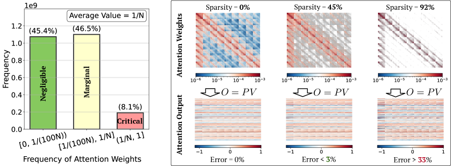
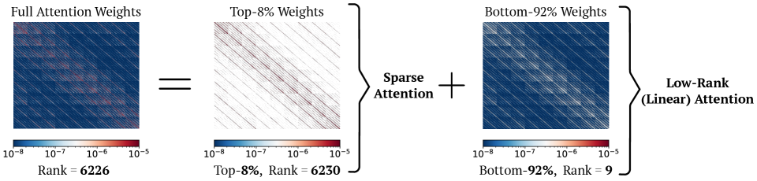
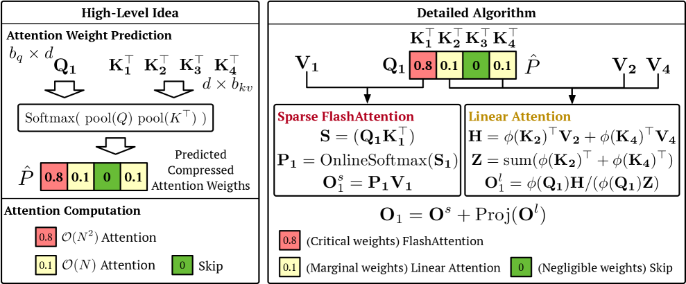
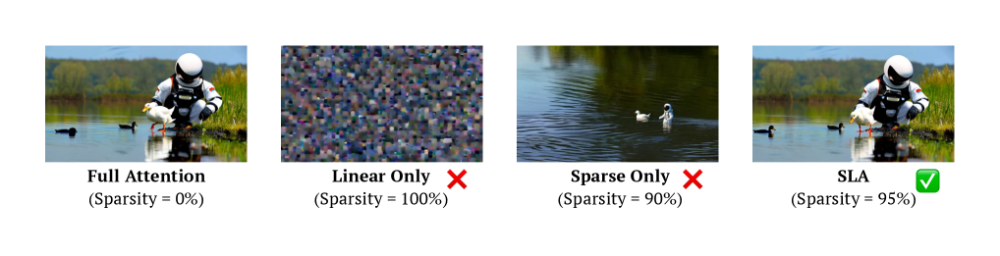
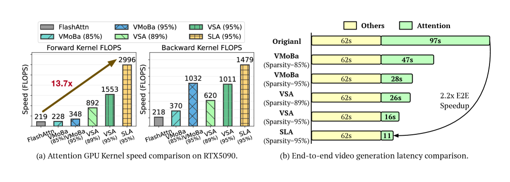
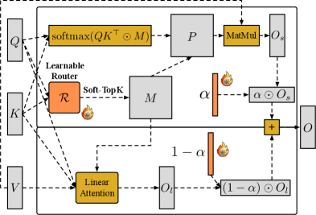
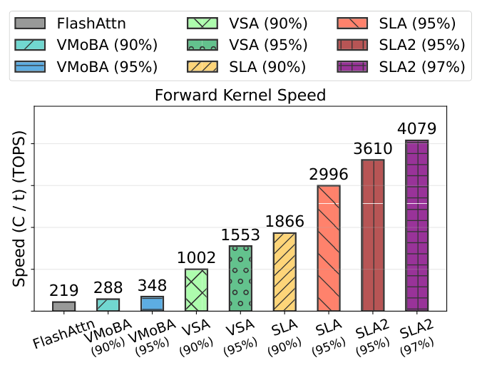
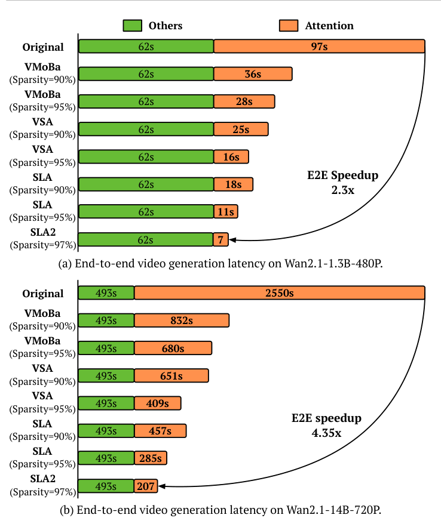

# SLA / SLA2：DiT 稀疏线性 Attention

!!! info "论文信息"
    **论文题名：** SLA2: Sparse-Linear Attention with Learnable Routing and QAT。 
    **作者：** Jintao Zhang、Haoxu Wang、Kai Jiang、Kaiwen Zheng、Youhe Jiang、Ion Stoica、Jianfei Chen、Jun Zhu、Joseph E. Gonzalez。 
    **机构：** 未在公开元数据中稳定解析；以 arXiv/PDF 或官方页 affiliation block 为准。 
    **时间 / 主题：** 2026-02；高效训练。 
    **arXiv / 官方报告：** arXiv：[2602.12675](https://arxiv.org/abs/2602.12675)。 
    **GitHub / 项目：** GitHub：[github.com/thu-ml/SLA](https://github.com/thu-ml/SLA)。 
    **元数据来源与核验口径：** 来源：[arXiv](https://arxiv.org/abs/2602.12675)；[GitHub API / repo](https://github.com/thu-ml/SLA)；Checked Date：2026-06-04；Repro Status：Paper / official materials reviewed, independent reproduction not claimed。

## 两代 SLA 解决的是同一个分工问题

视频 DiT 的 attention 常面对 1 万到 10 万个 token。完整 Softmax attention 保留所有 query–key 关系，代价随序列长度平方增长；纯稀疏 attention 可以少算一部分关系，却容易在高稀疏率下丢失视频内容；线性 attention 把大量关系压进小矩阵，又难以表达尖锐、复杂的关注模式。SLA 的起点，是观察同一张 attention map 内部是否同时存在两种结构，让不同计算方式各自处理合适的部分。[↗](https://arxiv.org/pdf/2509.24006v2#page=1)

第一代 SLA 找到的分工是：少数大权重保留稀疏 Softmax 计算，大量中等权重交给线性分支，极小权重直接跳过。它提供可微调的前向和反向 kernel，在 Wan2.1-1.3B 上以约 95% 的稀疏率维持接近完整模型的质量。第二代 SLA2 继续修正两个问题：两个分支各自归一化之后，应该怎样组合；哪些块值得做昂贵的 Softmax，能否由训练学出来。再用量化感知训练适应低比特计算，SLA2 把所测配置推到 97% 稀疏率。

理解这条路线，要分清三件事。**稀疏率**描述多少块没有走昂贵分支；**算子加速**描述一次 attention 调用节省多少时间；**完整生成加速**还要计入 MLP、投影、VAE 等其他计算。SLA2 的约 18.7 倍算子加速与 1.3B 模型约 2.30 倍完整生成加速，可以同时成立。两篇论文的训练数据和完整基线也不同，不能直接把质量表相减，归因于一项技术改动。

## 少数大权重之外，仍有不能丢掉的信息

设一头 attention 的输入为 $Q,K,V\in\mathbb R^{N\times d}$，$N$ 是 token 数，$d$ 是 head dimension。完整计算为

$$
S=QK^\top/\sqrt d,\qquad P=\operatorname{Softmax}(S),\qquad O=PV.
$$

每个 query 对应 $P$ 的一行，行内权重和为 1。大权重容易成为稀疏计算的保留对象，但“单个权重很小”并不能推出“所有小权重加起来都不重要”。SLA Figure 1 正是把这两个问题分开检验：左边统计权重大小，右边观察删掉一批权重后，真正的输出 $PV$ 损失了多少。[↗](https://arxiv.org/pdf/2509.24006v2#page=3)

{ width="760" }

在这个从 Wan2.1 采样的例子中，约 8.1% 的权重大于均匀平均值 $1/N$；约 45.4% 小于 $1/(100N)$；中间约 46.5% 既不大，也没有小到可以完全忽略。跳过最小的约 45% 时，输出相对 L1 误差低于 3%；只保留最大的约 8% 时，误差超过 33%。图里最重要的是从 45% 到约 92% 稀疏率的这一跳：为了继续减少计算，传统稀疏方法开始删除大量累计贡献可观的中间权重。

这些比例是样本观察，不是所有层、head 和扩散时间步都遵守的固定阈值。它们提出的研究问题更一般：能否让中间这批关系以更便宜的形式保留下来，而不要求它们也做完整的 query–key 点积和 Softmax？

### 稀疏与低秩为什么可以互补

SLA Figure 3 把同一张矩阵按权重大小拆开。先看 Top-8% 与原矩阵的复杂度，再看 Bottom-92% 的变化。[↗](https://arxiv.org/pdf/2509.24006v2#page=4)

{ width="760" }

图中完整矩阵、Top-8% 矩阵与 Bottom-92% 矩阵的 stable rank 分别约为 6226、6230、9。Stable rank 是衡量有效复杂度的连续指标，不能把它直接等同于严格的代数秩。这个例子表达的是：少数大权重仍保留复杂的关系结构，而去掉它们以后，剩下的大部分矩阵更容易压缩。

用二值 mask $M$ 写出来，分解本身只是一个恒等式：

$$
P=P\odot M+P\odot(1-M).
$$

它还没有节省任何计算。真正的近似发生在下一步：对前一部分做稀疏计算，对后一部分用线性 attention 的特征汇总近似。通常的线性 attention 先计算 $\phi(K)^\top V$，再左乘 $\phi(Q)$，中间矩阵只有 $d\times d$。未经位置 mask 的特征乘积 $\phi(Q)\phi(K)^\top$ 的秩至多为 $d$，因此适合表达低复杂度关系，却难以完整容纳前述高复杂度部分。

这一观察说明了两条路线为何要协同，也留下了一个需要训练回答的问题：按数值分出来的低秩部分，是否真的能被所选的线性特征映射近似？第一代 SLA 没有把低秩观察当成精确重建保证，而是给线性输出加可学习投影，再微调整个扩散模型，让它适应这套新的 attention。

## 第一代 SLA 的完整信息流

### 用块级代理决定算什么

如果为了挑选重要位置先计算完整 $P$，昂贵的二次计算已经发生了。SLA 沿 token 维度对每个块的 Q/K 做均值池化，以较小的矩阵预测重要性：

$$
P_c=\operatorname{Softmax}\!\left(\frac{\operatorname{pool}(Q)\operatorname{pool}(K)^\top}{\sqrt d}\right),
\qquad
P_c\in\mathbb R^{(N/b_q)\times(N/b_k)}.
$$

这里 $b_q,b_k$ 是 query/key 块大小。每行最大的 $k_h\%$ 记为 critical，最小的 $k_l\%$ 记为 negligible，其余记为 marginal。压缩 mask $M_c$ 的三个值分别是 1、−1、0；每个值控制一整块 $b_q\times b_k$ 的计算。[↗](https://arxiv.org/pdf/2509.24006v2#page=4)

| Block type | Mask value | Computation | 保留的作用 |
| --- | ---: | --- | --- |
| Critical | 1 | Sparse Softmax attention | 保留精细的强 query–key 关系 |
| Marginal | 0 | Normalized linear attention | 以特征汇总补充大量中间关系 |
| Negligible | −1 | Skip | 放弃估计贡献很小的部分 |

块级预测有两层近似。池化后的点积不等于块内每个点积；整块路由也不能逐元素追踪尖锐变化。采用它是为了匹配 GPU 的分块矩阵乘法，把选择成本与实际计算一起降低。在固定块大小下，路由仍包含缩小后的二次矩阵，不能称整个 SLA 对任意长度都具有严格线性复杂度。

总览图可以按一个 query 块 $Q_1$ 的路径读：它与第一个 key 块走红色的稀疏分支，与第二、第四个块走黄色的线性分支，第三个块跳过。最后才组合两路输出。[↗](https://arxiv.org/pdf/2509.24006v2#page=5)

{ width="820" }

### 稀疏分支保留精细关系，线性分支汇总其余关系

对 critical 块，SLA 使用 FlashAttention 风格的 online Softmax。重要的是，多个被选块共同参与这一行的归一化，不能先对每块单独做 Softmax 再把输出相加。实现维护每行的 running maximum、指数和、未归一化的输出累积，遇到更大的最大值时同步缩放旧累积，最后统一除以归一化项。

也因此，稀疏分支输出 $O^s$ 是“只在选中 key 上重新归一化”的结果。被排除的 key 完全不进入 Softmax 分母。在表达 mask 时，应将不可见 logit 视为 $-\infty$，而非简单乘成 0；零 logit 的指数仍为 1，会错误地给被跳过的位置分配概率。这一点也正是 SLA2 后续分析归一化失配的基础。

对 marginal 块，先为每个 key/value 块预计算

$$
h_j=\phi(K_j)^\top V_j\in\mathbb R^{d\times d},\qquad
z_j=\phi(K_j)^\top\mathbf1\in\mathbb R^{d\times1}.
$$

再由当前 query 块选择需要的汇总：

$$
H_i=\sum_{j:M_c[i,j]=0}h_j,\qquad
Z_i=\sum_{j:M_c[i,j]=0}z_j,\qquad
O_i^l=\frac{\phi(Q_i)H_i}{\phi(Q_i)Z_i}.
$$

分母按行广播，它把线性分支归一化为加权平均，防止输出幅值随着纳入的 key 数量变化。$h_j,z_j$ 可以被多个 query 块复用，不必针对每个 query–key 对重新做乘法；每个 query 块只需要选择汇总并计算自己的 $O_i^l$。不同 query 块可能选择不同的 marginal 集合，因此不能把这里的全部线性分支误写成一个与 query 无关的全局 $K^\top V$。[↗](https://arxiv.org/pdf/2509.24006v2#page=5)

第一代最终使用

$$
O=O^s+\operatorname{Proj}(O^l).
$$

$\operatorname{Proj}:\mathbb R^d\rightarrow\mathbb R^d$ 是可学习线性映射。它让线性分支成为对稀疏输出的可学习补偿，模型通过扩散目标适应这套组合。论文明确指出，该分支不能直接解释为原始 marginal attention 输出的精确替代。

### 能微调，需要两条路径都有反向传播

SLA 的贡献还包括融合的 backward kernel。对稀疏分支，它沿 FlashAttention 的路径重建选中块的概率，再把损失梯度传回 Q、K、V。以单个选中块为例，省略块间累积符号，核心关系为

$$
D_i^s=\operatorname{rowsum}(dO_i^s\odot O_i^s),\qquad
dP_{ij}=dO_i^sV_j^\top,\qquad
dS_{ij}=P_{ij}\odot(dP_{ij}-D_i^s).
$$

由 $S_{ij}=Q_iK_j^\top/\sqrt d$ 的定义继续应用链式法则，$dQ_i$ 与 $dK_j$ 的贡献分别为 $dS_{ij}K_j/\sqrt d$ 和 $dS_{ij}^\top Q_i/\sqrt d$，而 $dV_j$ 获得 $P_{ij}^\top dO_i^s$。归一化梯度中的 $D_i^s$ 把同一行所有 key 的相互影响保留下来，稀疏化改变的是参与集合，而非去掉 Softmax 的耦合关系。[↗](https://arxiv.org/pdf/2509.24006v2#page=6)

线性分支的梯度可以从商式直接理解。记 $U_i=\phi(Q_i)$、$n_i=U_iZ_i$、$G_i=dO_i^l$，分母 $n_i$ 为每个 query 的归一化标量。则

$$
D_i^l=\operatorname{rowsum}(G_i\odot O_i^l),\qquad
dH_i=(U_i/n_i)^\top G_i,\qquad
dZ_i=-(U_i/n_i)^\top D_i^l,
$$

$$
dU_i=\frac{G_iH_i^\top-D_i^lZ_i^\top}{n_i}.
$$

第一项把输出变化传向分子，第二项扣除分母变化带来的影响。随后按 marginal mask，把各个 query 块的 $dH_i,dZ_i$ 汇总到相关 key 块，再传回 $\phi(K_j)$ 和 $V_j$；特征映射与投影剩余的梯度由自动微分衔接。V 被两条路径使用，其梯度必须累加两条路径的贡献。[↗](https://arxiv.org/pdf/2509.24006v2#page=7)

这一实现使 SLA 能进入扩散模型的端到端微调。它并不意味着第一代离散 Top-k 路由本身已可微：模型参数可沿当前选中的 attention 计算更新，路由仍由池化分数的启发式选择决定。

### 高稀疏率下，省掉乘法后还要省调度与汇总

如果 95% 的块不走昂贵乘法，扫描整行 mask、反复累加线性摘要就可能成为新的开销。附录 A.3 为不同模式给出三种优化。[↗](https://arxiv.org/pdf/2509.24006v2#page=15)

- **索引表。** 预先记录需要访问的行、列位置，使稀疏循环直接遍历有效块，而不扫描大量无用 mask。
- **先全量汇总，再减排除项。** 当 marginal 块占大多数，先求 $\sum_jh_j$、$\sum_jz_j$，再扣除不属于 marginal 的块。若 90% 的块需要纳入，可以用约 10% 的减法替代逐项加入那 90%。
- **Method of Four Russians。** 当 marginal 密度在中间区域，例如约 50%，将连续 $g$ 个摘要分成一组，预计算其 $2^g$ 个子集和。之后一个查询可以用一次查表取得组内所需子集，理论上减少约 $g$ 倍在线加法，但要付出预计算和额外存储成本。

这三种手段解释了“公式里只剩便宜加法”与“GPU 上真的跑得快”之间还隔着什么。它们依赖具体密度和访问模式；理论 FLOPs 减少不自动等于同等倍数的实际加速。

## 第一代实验：混合分工是否比两条单独路线更好

### 主实验同时观察质量与计算量

SLA 的视频实验使用 Wan2.1-1.3B，约 2 万个从公开网站收集的 5 秒、480p 视频，batch size 64，微调 2000 steps。$b_q=b_k=64$，$k_h=5\%$、$k_l=10\%$，线性特征映射选 Softmax。论文比较了各自微调后的完整 attention、SLA 与训练型基线；Sparge-F 则保留其无需训练的使用方式，Sparge-T 是作者实现的可训练版本。[↗](https://arxiv.org/pdf/2509.24006v2#page=7)

下表保留 Table 1 的完整指标，避免仅挑选 SLA 占优的列。VA/VT 分别对应美学与技术视频质量；IQ、OC、AQ、SC 来自 VBench 的成像质量、整体一致性、美学质量和主体一致性。VR 是 VisionReward 的预测分数，不是人工投票胜率。

| Method | VA ↑ | VT ↑ | IQ ↑ | OC ↑ | AQ ↑ | SC ↑ | VR ↑ | FLOPs ↓ | Sparsity ↑ |
| --- | ---: | ---: | ---: | ---: | ---: | ---: | ---: | ---: | ---: |
| Full Attention | 76.78 | 82.88 | 62.5 | 23.3 | 56.1 | 93.0 | 0.059 | 52.75T | 0% |
| Sparge-F | 0.002 | 0.026 | 26.0 | 4.6 | 35.7 | 85.1 | -0.216 | 7.91T | 85% |
| Sparge-T | 73.83 | 77.87 | 61.9 | 22.7 | 55.4 | 93.1 | 0.014 | 7.38T | 84% |
| VMoBa | 32.33 | 35.79 | 58.0 | 18.8 | 46.2 | 89.9 | -0.175 | 7.91T | 85% |
| VSA | 55.37 | 64.61 | 60.6 | 22.4 | 51.9 | 83.6 | -0.069 | 5.92T | 89% |
| SLA | 76.96 | 83.92 | 62.2 | 23.6 | 55.9 | 93.1 | 0.048 | 2.74T | 95% |

SLA 的计算量从 52.75T 降到 2.74T，按表计算约减少 94.8%，相当于原来的 $1/19.3$。VA、VT、OC、SC 接近或略高于完整基线，IQ、AQ、VR 则略低。这支持“以大幅减少 attention 计算换取接近完整模型的质量”，不支持逐项严格无损。Sparge-F 到 Sparge-T 的变化也说明，在这种高稀疏率下，适应训练本身很关键。[↗](https://arxiv.org/pdf/2509.24006v2#page=8)

不同基线在表中使用不同稀疏率，所以它不是固定计算量下的纯架构排名。它回答的是：各方法在报告的配置下，能否同时接近完整模型质量并把成本推得更低。SLA 的价值就在这一联合条件，而非单独赢一个质量分数。

### 为什么简单相加两个模块还不够

Table 2 对比了 Linear Only、Sparse Only 和直接相加的 L+S。为便于看清差异，下表保留原表的全部质量列与成本列。

| Method | VA ↑ | VT ↑ | IQ ↑ | OC ↑ | AQ ↑ | SC ↑ | VR ↑ | FLOPs ↓ | Sparsity ↑ |
| --- | ---: | ---: | ---: | ---: | ---: | ---: | ---: | ---: | ---: |
| Linear Only | 0.042 | 0.099 | 39.5 | 3.6 | 28.8 | 90.7 | -0.213 | 0.10T | 100% |
| Sparse Only | 64.00 | 70.50 | 57.2 | 21.8 | 51.7 | 88.7 | -0.073 | 7.91T | 85% |
| L+S | 29.65 | 41.15 | 58.6 | 18.8 | 45.3 | 87.1 | -0.105 | 5.37T | 90% |
| SLA (softmax) | 76.96 | 83.92 | 62.2 | 23.6 | 55.9 | 93.1 | 0.048 | 2.73T | 95% |
| SLA (elu+1) | 75.50 | 81.01 | 62.8 | 23.5 | 55.3 | 92.9 | 0.034 | 2.74T | 95% |
| SLA (hedgehog) | 74.59 | 82.62 | 61.9 | 22.5 | 54.3 | 93.2 | 0.035 | 3.11T | 95% |

纯线性极便宜，但内容和总体视觉质量损失严重；纯稀疏保留更多内容，成本却仍高于 SLA；简单相加两条独立输出也没有解决分工问题。SLA 让 linear 分支只服务于分配给它的块，再学习输出补偿，在更低计算量下得到更好的整体折中。这组实验改变了多个结构与稀疏率条件，因此可以支持整套融合设计有效，不能将所有差异单独归因于某一层投影。[↗](https://arxiv.org/pdf/2509.24006v2#page=8)

原图中的宇航员例子提供了直观对应。应先检查目标主体是否还存在，再比较水面和场景结构；Linear Only 的噪点和 Sparse Only 丢失目标主体，比某个一致性指标的小幅升降更容易说明问题。

{ width="820" .atlas-figure-compact }

*来源：SLA Figure 2。图中 Sparse Only 是 90% 稀疏率，而上表 Sparse Only 是 85%；这是不同展示配置。单帧面板也不等于完整运动质量测试。*

特征映射消融说明 Softmax 是报告配置中的较好折中，但它并非每列都赢：elu+1 的 IQ 为 62.8，高于 Softmax 的 62.2；hedgehog 的 SC 为 93.2，略高于 93.1。作者采用 Softmax，依据的是多项质量和计算量的整体关系。

另一个疑问是保留更多 critical 块能否稳定提高质量。原表给出的结果如下。

| Critical fraction | VA ↑ | VT ↑ | IQ ↑ | OC ↑ | AQ ↑ | SC ↑ | VR ↑ | FLOPs ↓ |
| --- | ---: | ---: | ---: | ---: | ---: | ---: | ---: | ---: |
| Top 5% | 76.96 | 83.92 | 62.2 | 23.6 | 55.9 | 93.1 | 0.048 | 2.73T |
| Top 10% | 75.29 | 82.20 | 62.5 | 22.6 | 55.8 | 93.5 | 0.057 | 5.38T |
| Top 20% | 75.81 | 83.82 | 62.7 | 22.4 | 54.5 | 92.6 | 0.059 | 10.65T |

从 5% 到 20%，计算量接近四倍，但质量没有同步、单调改善。IQ/VR 有所上升，OC/AQ 反而下降。这说明在适应训练后，更多完整 attention 计算并不自动带来每项质量更好；5% 的选择具有明确的成本依据，而非一个普适最优比例。

### 图像实验检验了不同训练场景

附录使用 LightningDiT-1p0B/1，约 1.03B 参数，在 ImageNet 512×512 上进行预训练实验，训练 100,000 steps、batch size 128，块大小仍为 64，特征映射仍选 Softmax。这与前面的 2000 步视频微调是不同实验预算。[↗](https://arxiv.org/pdf/2509.24006v2#page=15)

| Method | FID ↓ | FLOPs ↓ | Sparsity ↑ |
| --- | ---: | ---: | ---: |
| Full Attention | 31.87 | 12.88G | 0% |
| SpargeAttn-F | 206.11 | 3.66G | 71.57% |
| SpargeAttn-T | 46.05 | 3.16G | 75.45% |
| VSA(2D) | 35.75 | 3.62G | 75.00% |
| VMoBA(2D) | 39.45 | 3.22G | 75.00% |
| SLA | 31.49 | 1.73G | 87.50% |

SLA 在该预算下以约 7.45 倍更低的 attention FLOPs 得到接近、略优于完整基线的 FID。这补充说明混合机制不只适用于一个视频微调场景；它没有证明只训练 2000 步就能达到图像结果，也没有把这个有限训练预算下的 FID 等同于充分训练后的最终质量上限。

## 第一代的 13.7 倍为何只变成 2.2 倍生成加速

SLA Figure 6 左边比较算子，右边分解整段生成耗时。先看右侧黄色的 Others，理解 attention 省下的时间还能影响多少总时间。[↗](https://arxiv.org/pdf/2509.24006v2#page=9)

{ width="760" }

RTX 5090 上，SLA 相对 FlashAttention2 的前向 kernel 最高约 13.7 倍，反向约 6.8 倍。图中的 FLOPS 使用“完整 attention 的理论运算量 / 实际耗时”计算，是等效吞吐；稀疏方法跳过了大量操作，所以不能把它当成 GPU 真正执行了对应数量的乘加，也不能直接用来计算硬件利用率。

整段视频生成中，attention 从 97 秒降到 11 秒，其余计算仍约 62 秒。因此按图上分项计算

$$
\operatorname{Speedup}_{\mathrm{E2E}}=\frac{97+62}{11+62}=\frac{159}{73}\approx2.18,
$$

对应论文四舍五入后的 2.2 倍。这里 attention 阶段自身约为 8.8 倍加速，已经小于某一算子基准的 13.7 倍；完整模型还进一步受到 Others 限制。即使 attention 耗时降到零，在这组固定分项下总加速也最多约为 $159/62=2.56$ 倍。

反向 kernel 的结果说明微调过程中的 attention 也能加速，但论文没有给出一个由 6.8 倍直接等同而来的完整训练吞吐提升。2000 步、batch 64 对应约 12.8 万个视频样本使用次数，这也只是训练量口径，不是独立视频数量或可直接推算的 GPU 小时。

## SLA2 的第一步：把两个归一化结果放回正确尺度

第一代的投影为什么承担了很重的补偿任务？SLA2 从稀疏 Softmax 的归一化方式推导原因。令完整概率分布 $P$ 被二值 mask 分为

$$
P_1=P\odot M,\qquad P_2=P\odot(1-M),\qquad
\alpha=P_1\mathbf1.
$$

$\alpha\in\mathbb R^{N\times1}$ 是每个 query 落在选中 key 上的概率质量。$P_1$ 每行的和通常小于 1；稀疏 Softmax 则把选中 key 的概率重新归一化，得到

$$
P_s=P_1/\alpha,\qquad
P_1V=\alpha\odot(P_sV)=\alpha\odot O_s.
$$

第一代直接用了 $O_s$，因而它在线性分支上需要学习的并不只有 $P_2V$，还包括稀疏分支放大的残差：

$$
\operatorname{Proj}(O_l)\approx P_2V+(\alpha-1)\odot O_s.
$$

这项残差与稀疏分支自身输出有关，却被交给另一路近似模块补偿，学习任务因此更复杂。[↗](https://arxiv.org/pdf/2602.12675v1#page=3)

用一个解释性例子看尺度问题：假设某个 query 的完整概率为 $(0.6,0.2,0.1,0.1)$，选中前两个 key，那么其概率质量是 $\alpha=0.8$，稀疏 Softmax 返回 $(0.75,0.25)$。若 V 的对应标量值为 $(2,4,10,0)$，完整输出是 3，稀疏输出是 2.5，其余两个 key 的条件平均是 5。正确组合是 $0.8\times2.5+0.2\times5=3$；简单把两个平均相加会得到 7.5。这个例子由上述定义构造，只解释归一化关系，不代表论文实测数据。

SLA2 因此改用

$$
O=\alpha\odot O_s+(1-\alpha)\odot O_l,\qquad 0\leq\alpha\leq1.
$$

两路都先产生归一化输出，再用互补系数组合，去掉原来对线性输出的额外补偿投影。推导中的 $\alpha$ 是完整分布的真实概率质量；部署中的 $\alpha$ 是学习得到的系数，避免计算完整 $P$。Algorithm 2 采用按 query 块存储、广播到块内 token 的系数。它让组合方式与概率分解一致，但不会保证训练后每个系数都等于原模型的真实概率质量，也不会保证线性分支精确等于剩余条件分布。

第二代总览图应沿 Q/K 的路由、两路 attention、互补混合系数阅读。图中的 Soft-TopK 对应路由学习阶段；真正的部署以及第二阶段适应训练使用硬选择。

{ width="520" .atlas-figure-compact }

*来源：SLA2 Figure 1。图中 mask 是稀疏位置选择的简写，被排除的位置不进入稀疏 Softmax。*

## SLA2 的第二步：学习什么值得做昂贵计算

第一代的规则是保留池化后最大的分数，但大权重与“难以由线性分支近似”并不完全相同。某些较大权重可能仍有适合低秩表示的结构；某些略小的关系也可能是恢复输出不可缺少的细节。因此 SLA2 让 router 学习分工，而不要求它忠实复刻原来的权重大小排序。[↗](https://arxiv.org/pdf/2602.12675v1#page=4)

### 路由器输入与训练信号各做什么

先计算 $\bar Q=\operatorname{pool}(Q)$、$\bar K=\operatorname{pool}(K)$，再引入两个可学习投影：

$$
C=\operatorname{proj}_q(\bar Q)\operatorname{proj}_k(\bar K)^\top,\qquad
M_c=\operatorname{TopK}_{\text{row}}(C,k\%).
$$

$C$ 是块级路由分数。每行硬 Top-k 保持固定预算，只把最大的 $k\%$ 块交给稀疏分支，其余交给线性分支。投影为恒等映射时，排序退回第一代的池化点积启发式；学习投影后，可以改变用于划分的表示。对于硬 Top-k，正的统一缩放和逐行 Softmax 不改变排序；训练用的软选择则还依赖具体分数尺度和温度。

Q、K 决定 attention map，因此 router 只输入它们，不直接读取 V。但其学习目标是匹配完整 attention 的输出，包含 V：同样一处权重误差，在不同的 V 上可能造成不同输出误差。这意味着该 router 学的是数据分布下对输出有用的划分，不是独立于训练任务的普适最优分解。

### 两阶段训练解决软选择到硬选择的衔接

第一阶段采集各 attention 层、各扩散时间步的 Q/K/V，固定这些输入，以完整 attention 为目标，优化 router $R$ 和混合系数 $\alpha$：

$$
\mathcal L_{\mathrm{init}}=
\operatorname{MSE}\bigl(\operatorname{FullAttn}(Q,K,V),\operatorname{SLA2}(Q,K,V;k\%,R,\alpha)\bigr).
$$

硬 Top-k 无法直接对选择位置反向传播，论文用 SoftTop-k 替代：

$$
\widetilde M_{c,ij}=\sigma\!\left(\frac{C_{ij}}{\tau}+\lambda_i\right),\qquad
\sum_j\widetilde M_{c,ij}=k\%\cdot\frac{N}{b_k}.
$$

$\sigma$ 是 sigmoid，$\tau$ 控制软选择的陡峭程度，$\lambda_i$ 通过二分搜索满足逐行预算。这个约束很关键：不能靠让所有位置都变成 1 来降低拟合误差。训练时通过可微的选择代理把输出误差传回投影，论文使用 $\tau=0.1$，并描述了保留比例 5%、4%、3% 的初始化训练。[↗](https://arxiv.org/pdf/2602.12675v1#page=4)

第二阶段将 attention 换成 SLA2，固定 router 的投影参数，使用硬 Top-k，以端到端 diffusion loss 微调模型参数 $\Theta$ 与 $\alpha$。这让模型适应部署时真实的离散路由和近似输出，而非一直依赖训练时的软 mask。Algorithm 2 的注释与 Section 8 明确区分这两阶段。[↗](https://arxiv.org/pdf/2602.12675v1#page=5)

固定 router 参数不意味着固定 mask。模型参数更新后 Q/K 会变化，不同输入、层与时间步本来就有不同 Q/K；即使投影权重不更新，硬 Top-k 的选择仍会随输入变化。这也是“可学习路由”和“动态路由”之间的区别：前者描述参数怎么得到，后者描述推理时每次选择怎么产生。

## SLA2 的第三步：让模型在训练时见到低比特误差

高稀疏率缩小了要算的块数，量化则降低剩余块的计算成本。SLA2 对稀疏分支采用量化感知微调：前向使用低比特 QK 与 PV 乘法，反向保持 FP16，量化方案沿用 SageAttention2++。它并没有声称所有模型参数、所有分支以及所有反向乘法都转成低比特。[↗](https://arxiv.org/pdf/2602.12675v1#page=4)

以概念式表示，量化操作返回低比特张量及其 scale。选中块的 score 来自

$$
S_{ij}=\operatorname{dequant}(\widehat Q_i\widehat K_j^\top;s_Q,s_K)/\sqrt d,
$$

之后计算 Softmax 权重，再对权重与 V 量化，用低比特乘法形成输出贡献。实际 kernel 采用 online Softmax，不会先生成完整的 $N\times N$ 概率矩阵；它量化当前块的指数权重乘 V，并维护全行归一化所需的最大值与指数和。最后再得到 $O_s$，与高精度线性分支输出混合。Algorithm 2 也在量化前对 K 做列均值平滑，以缓解异常值影响。[↗](https://arxiv.org/pdf/2602.12675v1#page=5)

前向误差来自多处：Q/K 量化改变 logits，Softmax 放大或缩小这些变化；权重与 V 的量化又影响加权和。QAT 的作用是让扩散模型在实际近似计算中训练，使参数逐渐适应这些扰动，而非只在训练完成后突然替换算子。

反向采用原 FP16 Q/K/V、前向结果及保存的归一化信息，按高精度 attention 的梯度形式传播。它为离散量化提供可用的代理梯度，而不是求舍入函数几乎处处为零的精确导数。也不能把它理解为一次完全独立的高精度前向再反向：保存的 $O_s$ 和归一化量仍来自低比特前向。附录 Algorithm 3 分别处理 sparse 与 linear 的梯度汇总，继承第一代的预计算与融合方式。[↗](https://arxiv.org/pdf/2602.12675v1#page=12)

因此，SLA2 与其他 QAT 工作的共同点是训练时暴露量化误差；具体量化格式、缩放粒度和反向代理必须按各自实现讨论。这里没有依据把它替换成 Attn-QAT 的 FP4 训练设计，也没有理由把推理侧低比特收益直接等同于完整训练速度收益。

## SLA2 的质量结果应如何读

### 第二代换了训练预算，也换了完整基线口径

SLA2 在 Wan2.1-T2V-1.3B-480P 与 14B-720P 上微调，数据为约 3000 个、每个约 5 秒的私有整理视频，来源为公开内容，caption 由 Qwen3-VL-Flash 生成。微调 500 steps，两个模型的 batch size 分别为 64、15，块大小为 $b_q=128,b_k=64$。这些描述没有把第一阶段 Q/K/V 拟合的全部成本列成一张训练预算表，因此不能仅凭 500 步推断完整适应流程的 GPU 时间。[↗](https://arxiv.org/pdf/2602.12675v1#page=6)

与第一代不同，这里的 Full Attention 基线明确标为未经该额外训练。论文也将微调后一些指标上升解释为数据质量带来的收益。因此，“SLA2 某列高于 Full Attention”同时包含额外微调与 attention 变化，不能独立证明近似计算本身比完整计算更好。第一代的 2 万视频、2000 步结果与这里的 3000 视频、500 步结果，也应各自在自己的实验中解读。

### 1.3B：97% 稀疏率接近完整质量，但有分项回退

以下为 SLA2 Table 1 的 1.3B 部分。MS 是 Motion Smoothness，其余缩写与前文相同；全部质量指标越大越好。

| Method | Sparsity | IQ ↑ | OC ↑ | AQ ↑ | MS ↑ | SC ↑ | VR ↑ | FLOPs ↓ |
| --- | ---: | ---: | ---: | ---: | ---: | ---: | ---: | ---: |
| Full Attention | 0% | 63.67 | 20.27 | 64.41 | 98.95 | 95.40 | 0.1084 | 52.75T |
| VMoBA | 90% | 65.31 | 20.82 | 64.14 | 97.80 | 86.69 | 0.0936 | 5.28T |
| VSA | 90% | 59.57 | 19.27 | 50.60 | 97.44 | 87.98 | -0.0881 | 5.40T |
| SLA | 90% | 63.10 | 20.88 | 64.34 | 97.90 | 92.54 | 0.0872 | 5.40T |
| SLA2 | 90% | 67.70 | 21.62 | 64.86 | 98.69 | 95.54 | 0.1093 | 5.51T |
| VMoBA | 95% | 63.08 | 21.07 | 61.96 | 97.68 | 79.83 | 0.0746 | 2.64T |
| VSA | 95% | 55.50 | 14.95 | 42.13 | 96.19 | 88.34 | -0.1309 | 2.75T |
| SLA | 95% | 63.14 | 21.09 | 62.91 | 97.83 | 94.36 | 0.0881 | 2.75T |
| SLA2 | 95% | 67.04 | 21.55 | 64.90 | 98.46 | 95.27 | 0.1023 | 2.87T |
| SLA2 | 97% | 66.64 | 21.42 | 64.62 | 98.04 | 94.83 | 0.1039 | 1.82T |

在相同的 90% 或 95% 稀疏率下，SLA2 的六项质量均高于这张 1.3B 表中的其他稀疏基线。进一步到 97%，仍超过这些基线各自 90% 的配置，同时 FLOPs 更低。这是可学习分工、混合系数与 QAT 组合价值最清楚的一组结果。[↗](https://arxiv.org/pdf/2602.12675v1#page=6)

对完整 attention 的比较则不同。97% 配置的 IQ、OC、AQ 略高，但 MS 从 98.95 降到 98.04，SC 从 95.40 降到 94.83，VR 从 0.1084 降到 0.1039。按 FLOPs 表计算，$52.75/1.82\approx28.98$ 倍是理论运算量之比，而非实测生成速度；1.82T 仍包含线性分支等成本，所以 97% 的昂贵分支稀疏率不等于精确削掉总 attention 成本的 97%。

### 14B：更大模型并没有让所有比较都变成全胜

| Method | Sparsity | IQ ↑ | OC ↑ | AQ ↑ | MS ↑ | SC ↑ | VR ↑ | FLOPs ↓ |
| --- | ---: | ---: | ---: | ---: | ---: | ---: | ---: | ---: |
| Full Attention | 0% | 68.01 | 22.44 | 64.66 | 99.14 | 95.93 | 0.1238 | 292.6T |
| VMoBA | 90% | 67.18 | 20.85 | 63.64 | 98.55 | 94.50 | 0.1117 | 29.26T |
| VSA | 90% | 64.03 | 21.27 | 63.37 | 98.90 | 93.65 | 0.1074 | 20.92T |
| SLA | 90% | 67.58 | 21.62 | 63.80 | 98.78 | 95.74 | 0.1166 | 20.92T |
| SLA2 | 90% | 69.63 | 20.68 | 66.41 | 98.84 | 95.74 | 0.1238 | 21.16T |
| VMoBA | 95% | 21.27 | 7.96 | 33.59 | 99.99 | 100.00 | -0.0965 | 14.63T |
| VSA | 95% | 47.69 | 13.90 | 34.95 | 97.09 | 91.12 | -0.1822 | 14.87T |
| SLA | 95% | 64.43 | 20.89 | 61.89 | 98.86 | 94.41 | 0.1078 | 14.87T |
| SLA2 | 95% | 69.02 | 21.11 | 65.55 | 98.89 | 95.53 | 0.1125 | 15.11T |
| SLA2 | 97% | 66.93 | 21.12 | 65.14 | 98.71 | 94.42 | 0.1149 | 9.26T |

14B 的 95% SLA2 相对同稀疏率 SLA，六项质量都有改善；到 97% 时，成本继续降到 9.26T，但质量出现更明显折中。相比 Full Attention，仅 AQ 略高，IQ、OC、MS、SC、VR 都低于完整基线。相比 90% SLA，97% SLA2 的 IQ、OC、MS、SC、VR 也没有全部胜出。即便在相同 90% 稀疏率，SLA2 的 OC 20.68 仍低于 SLA 的 21.62，MS 98.84 也略低于 VSA 的 98.90。应以这些实际行列为准理解“保持质量”，不能照搬概述中的“全部指标更优”。

VMoBA 95% 那行还提供了一个很有价值的评测反例：IQ 只有 21.27、VR 为负，却得到 MS 99.99、SC 100。它说明高平滑性、高一致性单项并不足以证明生成质量；缺少内容或变化的结果也可能在这些指标上得高分。表格本身不能确定这个模型究竟以哪种方式失败，但足以说明必须联合看质量、语义和动态指标。

两模型的 97% 配置保留的报告 FLOPs 分别约为完整 attention 的 3.45% 和 3.16%。这些比例由表中数值计算，不应与稀疏块比例混用。14B 的不同方法即使标为相同名义稀疏率，其表列 FLOPs 也并不总相同；选择时应同时看报告的实际成本列。

## 消融分别回答量化、路由和稀疏预算的问题

SLA2 Table 2 先在 1.3B、97% 稀疏率下检验 QAT 和可学习路由。`w/o QAT` 是不在训练中暴露量化误差、但推理时仍进行量化的对照；`Topk-router` 退回第一代的池化分数选择。它们各自针对不同问题。[↗](https://arxiv.org/pdf/2602.12675v1#page=8)

| Method | IQ ↑ | OC ↑ | AQ ↑ | MS ↑ | SC ↑ | VR ↑ |
| --- | ---: | ---: | ---: | ---: | ---: | ---: |
| Full Attention | 63.67 | 20.27 | 64.41 | 98.95 | 95.40 | 0.1084 |
| w/o QAT | 65.28 | 20.66 | 61.85 | 97.44 | 94.65 | 0.0850 |
| Topk-router | 63.66 | 20.90 | 62.65 | 97.86 | 94.26 | 0.0876 |
| SLA2 | 66.64 | 21.42 | 64.62 | 98.04 | 94.83 | 0.1039 |

加入 QAT 后，AQ 从 61.85 到 64.62，VR 从 0.0850 到 0.1039，其他四项也改善，支持训练中适应量化误差有效。它不是证明量化比高精度天然更好，因为这个对照的推理也使用量化。作者另报告低比特带来约 1.3 倍额外 kernel 加速，属于在稀疏机制之上进一步减少剩余计算成本。

把 heuristic Top-k 换成可学习 router，IQ 从 63.66 到 66.64，VR 从 0.0876 到 0.1039，全部六项改善，说明单纯保留池化大分数并非最佳划分。该表没有单独给出固定其他条件、只移除互补混合系数的实验，因此混合公式具有明确的分析动机，但其独立贡献不能从这两行消融中量化。

稀疏预算的消融则考察性能在 85% 到 97% 间怎样变化。

| SLA2 sparsity | IQ ↑ | OC ↑ | AQ ↑ | MS ↑ | SC ↑ | VR ↑ |
| --- | ---: | ---: | ---: | ---: | ---: | ---: |
| 85% | 67.97 | 21.98 | 64.79 | 98.75 | 95.79 | 0.1135 |
| 90% | 67.70 | 21.62 | 64.86 | 98.69 | 95.54 | 0.1093 |
| 95% | 67.04 | 21.55 | 64.90 | 98.46 | 95.27 | 0.1023 |
| 97% | 66.64 | 21.42 | 64.62 | 98.04 | 94.83 | 0.1039 |

总体上，更高稀疏率换来较低成本和一定质量损失；但表中并非所有指标都单调。AQ 在 95% 时略高于 85%，VR 在 97% 时又略高于 95%。没有多随机种子区间时，不宜把这些小波动都解释成确定的机制收益。实际选择可以从应用最敏感的指标出发，例如更在意主体稳定与运动时，未必值得为了 97% 这个数字放弃 90% 或 95% 配置。

## 第二代效率：新增收益落在整条链路的哪里

SLA2 的算子图使用 RTX 5090，横轴同时标出方法和稀疏率。先看同属 SLA 系列的 95% 配置，再看推到 97% 后的增量，可以避免把全部收益归给单独一项 QAT。[↗](https://arxiv.org/pdf/2602.12675v1#page=7)

*来源：SLA2 Figure 4，RTX 5090 前向 kernel；纵轴为完整 attention 等效运算量除以耗时。*

FlashAttention2 为 219 等效 TOPS，SLA 95% 为 2996，SLA2 95% 为 3610，SLA2 97% 为 4079。按图中整数计算，$4079/219\approx18.63$，对应论文约 18.6–18.7 倍的说法。同为 95% 时 SLA2 相对 SLA 约快 $3610/2996=1.20$ 倍；SLA2 从 95% 到 97% 再约快 $4079/3610=1.13$ 倍。这些是图中报告配置的综合变化，不能作为完全隔离其他因素的 QAT 单因素实验。

当视角转到完整模型，下面的耗时分解比最大倍数更有决策价值。绿色 Others 是当前 attention 优化没有直接消除的时间。

*来源：SLA2 Figure 5。14B 测试启用 sequential CPU offloading，图中报告耗时已排除 offloading 开销。*

| Model | Full Attention time | SLA attention time | SLA2 attention time | Other time | Full → SLA2 total speedup |
| --- | ---: | ---: | ---: | ---: | ---: |
| Wan2.1-1.3B-480P | 97 s | 11 s at 95% | 7 s at 97% | 62 s | $(97+62)/(7+62)=2.30\times$ |
| Wan2.1-14B-720P | 2550 s | 285 s at 95% | 207 s at 97% | 493 s | $(2550+493)/(207+493)=4.35\times$ |

1.3B 的 attention 从 97 秒降到 7 秒，约快 13.9 倍，总耗时从 159 秒降到 69 秒。相对已经采用第一代 SLA 的 73 秒，第二代进一步改善为 $73/69\approx1.06$ 倍。14B 则从报告的 3043 秒降到 700 秒；相对第一代 SLA 的 778 秒，增量约为 $778/700\approx1.11$ 倍。这说明第一代已经移走大部分瓶颈后，继续优化 attention 的整模型收益会变小。[↗](https://arxiv.org/pdf/2602.12675v1#page=8)

14B 的 4.35 倍还有一个具体边界：模型超出单张 RTX 5090 显存，评测采用 CPU offloading，但从报告延迟中扣除了搬运开销。该数字适合比较剔除这项影响后的计算耗时，不能直接当成在同一显存条件下用户真实等待时间缩短了 4.35 倍。若部署必须依赖 offloading，就需要把搬运时间和可能的重叠重新计入；若换成足够显存的 GPU，则又需要重新测算算子相对速度。

## 从这两篇论文可以复用什么

SLA 提供的可复用设计，是把 attention 的近似预算分配给不同类型的关系：重要而复杂的部分保留精细计算，大量可汇总的部分用线性摘要补足，再用适应训练修复剩余误差。它要求模型有可利用的结构，也要求使用者能承担数据、训练和 kernel 集成成本。第一代在视频微调、图像预训练上的结果给出了具体可行性证据，但不同模型的结构与最优稀疏率仍需实测。

SLA2 进一步提供了三处可独立思考的接口。第一，两个归一化分支相加前，先处理它们的概率质量和尺度；第二，用输出误差训练路由，而不只按权重大小猜测；第三，让端到端训练见到部署时的硬路由与低比特误差。它们把“少算哪些关系”“留下的关系怎么计算”“算完以后怎么合并”连成了一条完整路径。

采用时最有价值的顺序是先测瓶颈，再验证近似。若 attention 仍占大头，可以在目标 Q/K/V 上测路由和输出误差，经过适应训练后联合检查内容、运动和语义；若 attention 已被压到个位数秒，MLP、投影、VAE 或数据搬运可能更值得投入。两篇论文的实验都提醒同一件事：高稀疏率只有在质量、算子成本和完整链路耗时同时成立时，才构成有用的加速。

## 继续阅读

稀疏线性 attention 的复杂度要与[Transformer 与注意力](../../foundations/transformer-attention-and-tokenization.md)的 dense 基线对照；长上下文的 kernel 和内存边界见[FlashAttention 演化](../../operators/long-context-and-flashattention-evolution.md)。
