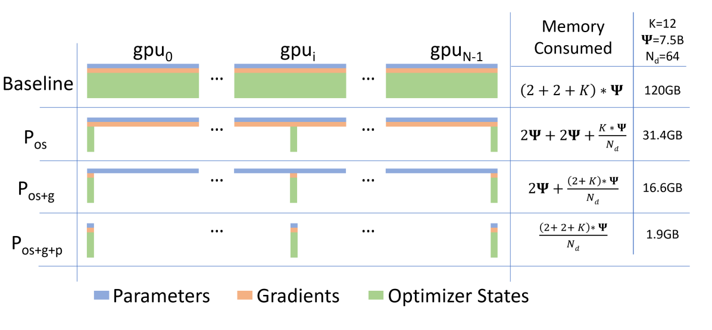
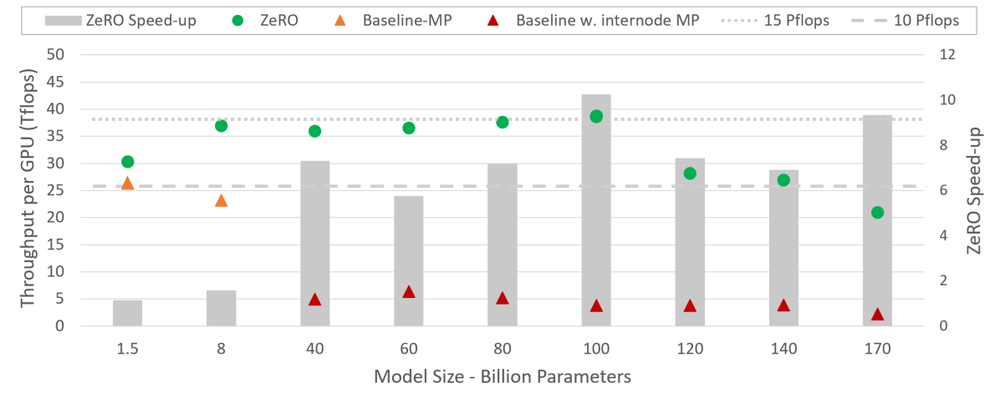
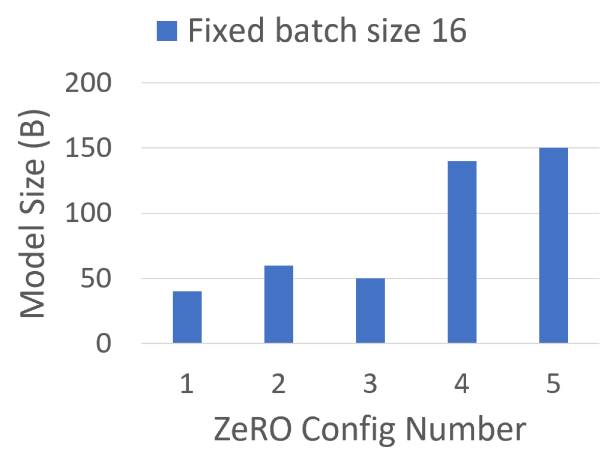
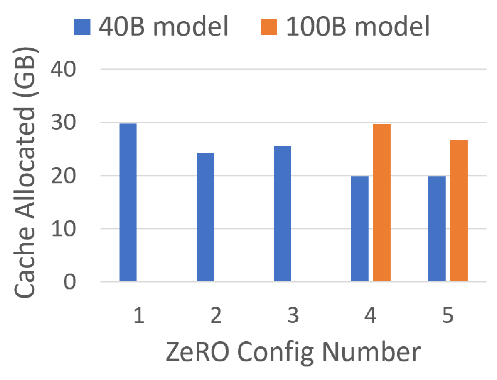

# ZeRO：数据并行真正浪费的是训练状态副本

!!! info "本站判断"
    这页把《ZeRO：数据并行真正浪费的是训练状态副本》当作机制和证据案例来读：先看它真正改变了哪个接口，再看实验、消融、scaling 或失败边界是否支撑这个 claim。

    Checked Date: 2026-06-04；Repro Status: Paper / official materials reviewed, independent reproduction not claimed.

Checked date: 2026-06-03
Repro status: 论文级理解；本站未复现实验，只引用原论文图、Microsoft Research 论文页和 DeepSpeed 官方文档。

ZeRO 要解决的问题不是“模型太大”这么笼统，而是更精确的一笔显存账：普通 data parallel 让每张 GPU 都保存完整 parameters、gradients 和 optimizer states。GPU 数量增加后，计算吞吐和全局 batch 可以变大，但单卡上那份训练状态没有变小。于是训练大模型时，你经常不是被 fp16 权重本身卡住，而是被 Adam 状态、梯度、master weights、激活和临时 buffer 一起挤爆。

ZeRO 的核心思想很朴素：**既然 data-parallel ranks 训练的是同一个模型，就不应该让每张卡长期保存同一份训练状态；把 optimizer states、gradients、parameters 分阶段切到不同 ranks，需要时再通信取回。**

## 先拆显存：model states 和 residual states

ZeRO 论文把训练显存分成两类。第一类是 model states：参数、梯度和优化器状态。它们的大小主要跟参数量 \(\Psi\) 成正比。第二类是 residual states：activations、temporary buffers、memory fragmentation 等。它们通常跟 batch size、sequence length、layer 数、通信实现和 allocator 行为有关。

很多 OOM 排查会直接说“模型放不下”，但这句话不够精确。一个 1.5B 参数模型的 fp16 权重只有约 3GB；可是训练时还要保存梯度、fp32 master weights、Adam 一阶矩、Adam 二阶矩，激活和各种通信 buffer 也要占空间。ZeRO-DP 主要处理 model states 的冗余，ZeRO-R 才进一步处理 residual memory。

## 为什么 mixed precision Adam 是 \(16\Psi\)

以 mixed precision Adam 为例，单个参数的训练状态可以粗略拆成：

| 状态 | dtype | 每参数字节 |
| --- | --- | --- |
| fp16 parameter | fp16 | 2 |
| fp16 gradient | fp16 | 2 |
| fp32 master parameter | fp32 | 4 |
| Adam first moment | fp32 | 4 |
| Adam second moment | fp32 | 4 |

所以普通 data parallel 里，每张 GPU 的 model states 约是：

\[
M_{\text{DP}} = (2 + 2 + 4 + 4 + 4)\Psi = 16\Psi
\]

这里的 \(\Psi\) 是参数个数，不是字节数。若 \(\Psi=1.5B\)，那么仅 model states 就约 24GB，还没算 activations、workspace、fragmentation 和通信 buffer。这个数字解释了为什么“大模型训练显存”不能只看模型权重文件大小。

## ZeRO-DP：三阶段分别切掉什么冗余

{ width="860" }

<small>图源：[ZeRO: Memory Optimizations Toward Training Trillion Parameter Models](https://arxiv.org/abs/1910.02054)，Figure 1。原图表达 ZeRO-DP 三阶段依次分片 optimizer states、gradients、parameters，并比较每卡 model-state 显存。本站读法是先看“长期常驻对象”：Stage 1 切 optimizer，Stage 2 继续切 gradients，Stage 3 连 parameters 也按需切。</small>

设数据并行度为 \(N_d\)，Adam optimizer states 约 \(12\Psi\) bytes，fp16 gradients 约 \(2\Psi\)，fp16 parameters 约 \(2\Psi\)。忽略小的 metadata 和临时 buffer 后，三个阶段的单卡 model-state 显存可以这样读：

\[
M_{\text{ZeRO-1}} \approx 2\Psi_{\text{param}} + 2\Psi_{\text{grad}} + \frac{12\Psi_{\text{optim}}}{N_d}
\]

\[
M_{\text{ZeRO-2}} \approx 2\Psi_{\text{param}} + \frac{(2\Psi_{\text{grad}}+12\Psi_{\text{optim}})}{N_d}
\]

\[
M_{\text{ZeRO-3}} \approx \frac{(2\Psi_{\text{param}}+2\Psi_{\text{grad}}+12\Psi_{\text{optim}})}{N_d}
\]

这些式子最重要的不是精确到每个 runtime buffer，而是看懂“谁被分片、谁还常驻”。ZeRO-1 仍然让每张卡保存完整参数和梯度，只把 Adam 状态切开；ZeRO-2 让梯度也按 optimizer shard 对齐；ZeRO-3 则让参数本身不再长期完整复制。

## Stage 1：optimizer state sharding

普通 DP 中，每张卡都拿到完整梯度，然后每张卡都更新完整模型参数，因此每张卡都需要完整 Adam states。ZeRO-1 改变的是“谁负责更新哪一片参数”：每个 rank 只保存自己那片参数对应的 fp32 master weight、momentum 和 variance。梯度同步后，每个 rank 只更新自己的 partition，再把更新后的参数结果广播或同步给其他 ranks。

这一步通常性价比很高，因为 Adam states 很大，而参数计算路径还相对接近普通 DP。它适合 optimizer states 是主要瓶颈、但还不想引入更复杂 parameter all-gather 生命周期的场景。

## Stage 2：gradient partitioning

ZeRO-2 继续问：既然每个 rank 只更新 optimizer state 的一片，那它真的需要长期保存完整梯度吗？答案是不需要。梯度可以通过 reduce-scatter 直接规约到对应 partition，而不是 all-reduce 后让每张卡都拿到一整份梯度。

从工程角度看，Stage 2 的关键是把“梯度同步”改写成“同步并分发”。这样 optimizer partition 和 gradient partition 对齐，显存进一步下降。代价是通信 bucket、reduce-scatter、overlap window 和 gradient accumulation 的实现细节变得更重要。

## Stage 3：parameter partitioning

ZeRO-3 最激进：参数也不再完整常驻每张卡。forward 或 backward 需要某一层参数时，runtime all-gather 这一层或这一组参数；计算完成后，参数可以释放或重新分片。这样单卡 model states 可以接近随 \(1/N_d\) 缩小。

这也是 Stage 3 的复杂性来源。参数生命周期不再是“训练开始加载一次，整个 step 常驻”，而是“按计算顺序 gather、使用、释放、反向再 gather”。这会影响通信重叠、module wrapping、checkpoint 保存、state dict 导出、offload 策略和故障恢复。ZeRO-3 省显存最强，但它把系统压力转移到带宽、调度和状态管理。

## ZeRO-R：模型状态不是全部显存

如果只记住 ZeRO-1/2/3，会漏掉论文另一半：ZeRO-R。ZeRO-DP 减少的是 model states 冗余；ZeRO-R 处理 residual states，包括 activation checkpoint partitioning、constant-size buffers 和 memory defragmentation。

Activation checkpointing 用重计算换显存，但在 model parallel 或 data parallel 组合下，activation checkpoint 本身也可能出现冗余。partitioned activation checkpointing 会把 checkpointed activations 分片，需要时再恢复。Constant-size buffers 处理的是通信和临时算子 buffer 随模型规模膨胀的问题。Memory defragmentation 关注长生命周期 tensor 和短生命周期 tensor 混在一起导致大块连续显存不可用的问题。

这个区分很实用：如果 OOM 来自 Adam states，ZeRO-1/2 可能直接有效；如果来自长序列 activations，activation checkpointing、sequence/context parallel 或 attention kernel 更直接；如果来自 allocator fragmentation，换 ZeRO stage 也未必治本。

## 实验图应该看规模、吞吐和显存三件事

{ width="760" }

<small>图源：[ZeRO](https://arxiv.org/abs/1910.02054)，Figure 2。原图展示 ZeRO 相比 baseline 的吞吐提升。本站读法是不要把它当“省显存等于更快”的通用结论，而要看省下的显存是否转成更大的 batch、更少 OOM 和更好的硬件利用。</small>

ZeRO 的实验不是为了证明某个 NLP benchmark 准确率更高，而是证明在给定硬件下能训练更大的模型，并且保持可接受吞吐。系统论文里的核心证据通常是三类：最大可训练模型规模、吞吐/扩展效率、峰值显存。

{ width="760" }

<small>图源：[ZeRO](https://arxiv.org/abs/1910.02054)，Figure 6。原图比较不同设置下可训练的最大模型规模。本站读法是看“容量边界”如何随状态分片移动：ZeRO 的价值首先是把以前放不下的模型放进训练系统。</small>

{ width="760" }

<small>图源：[ZeRO](https://arxiv.org/abs/1910.02054)，Figure 7。原图展示最大显存分配变化。本站读法是把显存降低和上面的模型规模图连起来：只报省显存不够，还要说明省下的空间是否换来了更大模型、更大 batch 或更稳的训练。</small>

读这些图时要小心外推。ZeRO 论文时代的模型、硬件、优化器和通信栈与今天不同；但它提出的状态分片账本仍然是现代 DeepSpeed、FSDP 和大模型训练栈的核心语言。

## ZeRO、FSDP、TP/PP 不是同一层工具

Megatron-style tensor parallelism 主要切单层计算：比如把 MLP GEMM、attention heads 或 vocab projection 分到多张 GPU。Pipeline parallelism 主要切层，把不同层放到不同 stage。ZeRO/FSDP 主要切 data-parallel 副本里的训练状态，减少每个 DP rank 保存的冗余。

这几个工具经常组合，但它们回答的问题不同：

| 主瓶颈 | 更直接的工具 |
| --- | --- |
| Adam states / gradients / parameter replica 放不下 | ZeRO / FSDP |
| 单层矩阵太大或单层计算要多卡协同 | Tensor parallelism |
| 层数太深、单卡放不下完整网络 | Pipeline parallelism |
| 长序列 activation 或 attention 成本爆炸 | Activation checkpointing、sequence/context parallel、FlashAttention |
| CPU/NVMe 总内存够但 GPU 不够 | ZeRO-Offload / ZeRO-Infinity，但要付带宽和延迟成本 |

FSDP 和 ZeRO-3 思想相近，都是 full sharding、按需 gather、用完释放，但生态气质不同：DeepSpeed 更像训练 runtime 和配置化系统，FSDP 更贴近 PyTorch 原生 module wrapping 与 state dict 生态。选择哪一个，不应只看“谁更省显存”，还要看模型改造、checkpoint、导出、调试和团队维护成本。

## 阅读结论

ZeRO 最值得带走的是一套显存账本，而不是一个配置名。普通 data parallel 浪费的是完整复制的 model states；mixed precision Adam 的常驻状态约 \(16\Psi\)；ZeRO-1/2/3 分别切 optimizer states、gradients 和 parameters；ZeRO-R 继续处理 activations、temporary buffers 和 fragmentation。

上线到真实训练栈时，先问五个问题：OOM 来自哪类显存？省下显存是否会被通信吃掉？checkpoint 是否能保存和恢复分片状态？导出到后训练/推理是否有明确格式？当前硬件拓扑是否支撑 Stage 3 的 all-gather 和 overlap？这些问题答清楚，ZeRO 才是训练系统设计，而不是一个救火开关。

## 外部精读

- [ZeRO paper](https://arxiv.org/abs/1910.02054)
- [Microsoft Research: ZeRO publication page](https://www.microsoft.com/en-us/research/publication/zero-memory-optimizations-toward-training-trillion-parameter-models/)
- [DeepSpeed ZeRO tutorial](https://www.deepspeed.ai/tutorials/zero/)
- [DeepSpeed ZeRO documentation](https://deepspeed.readthedocs.io/en/latest/zero3.html)
- [PyTorch FSDP documentation](https://docs.pytorch.org/docs/stable/fsdp.html)
- [Datawhale: VRAM Calculation and ZeRO](https://datawhalechina.github.io/llm-algo-leetcode/01_Hardware_Math_and_Systems/06_VRAM_Calculation_and_ZeRO.html)

## 相关阅读与下一步

- 外部材料：[论文标题 arXiv 检索](https://arxiv.org/search/?query=zero&searchtype=title)。
- 外部材料：[Semantic Scholar 标题检索](https://www.semanticscholar.org/search?q=zero)。
- 外部材料：[Papers with Code 检索](https://paperswithcode.com/search?q=zero)。
- 站内下一步：[论文精读专题](../index.md)。
- 站内下一步：[论文专题写作规范](../writing-standard.md)。
- 站内下一步：[外部精读来源台账](../../references/external-reading-ledger.md)。
