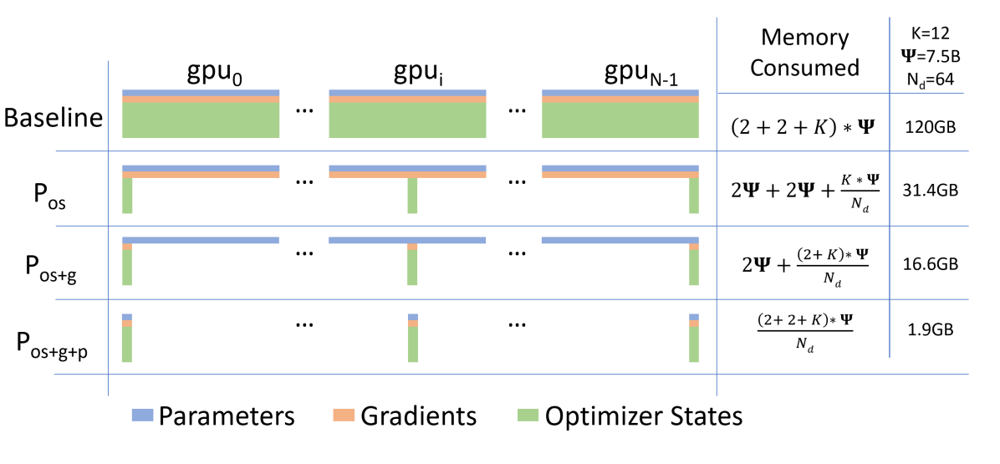
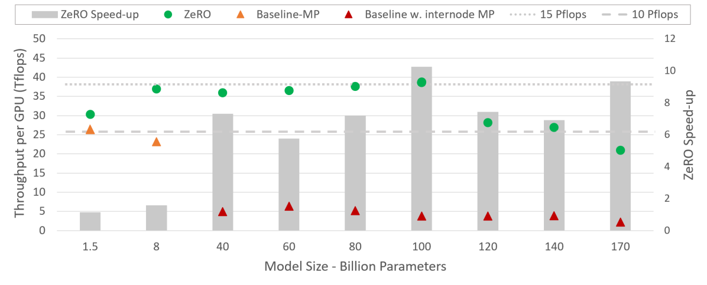
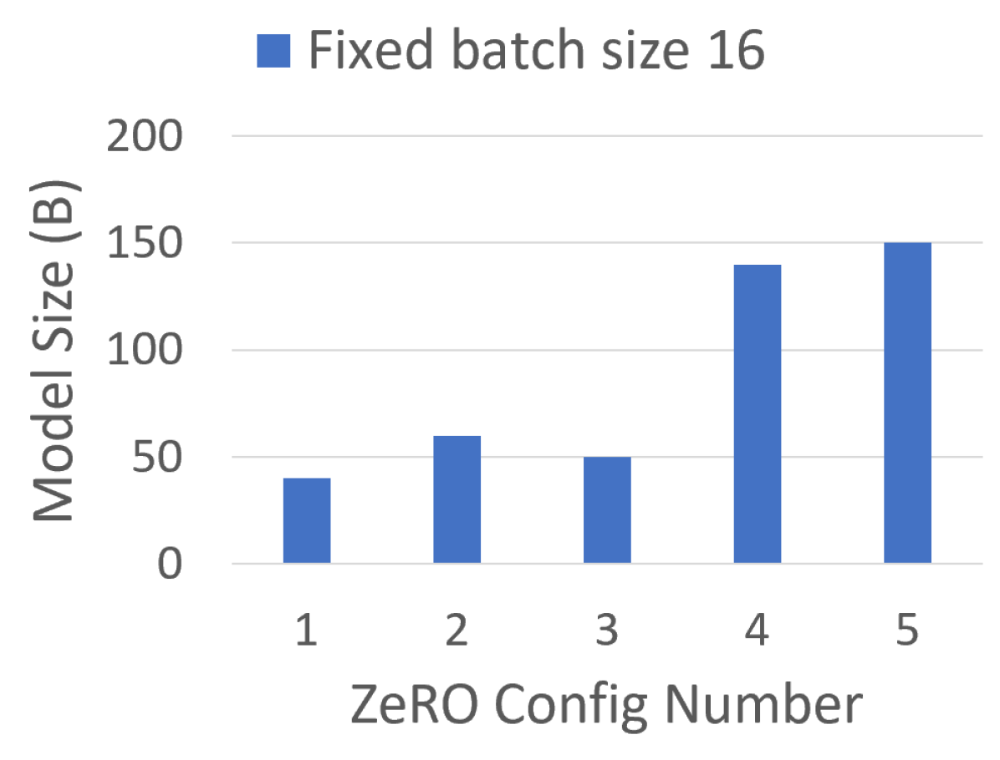
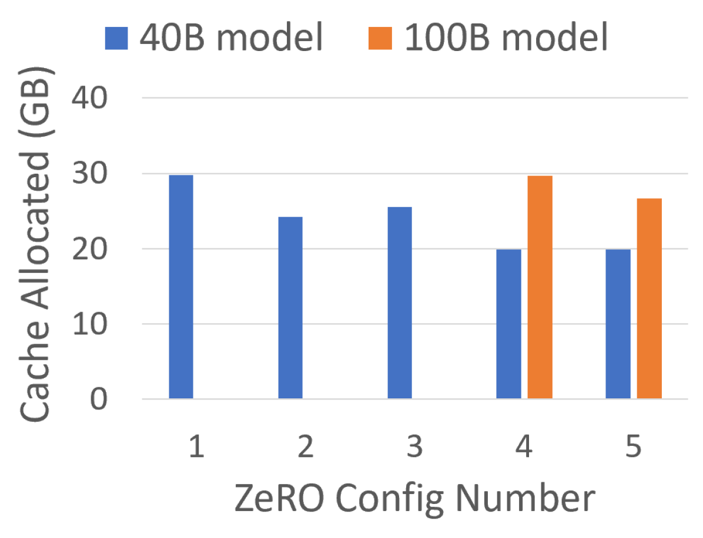
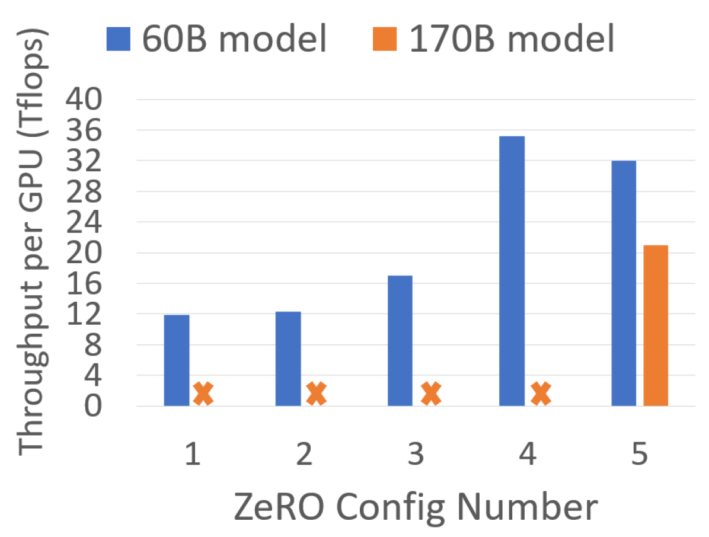
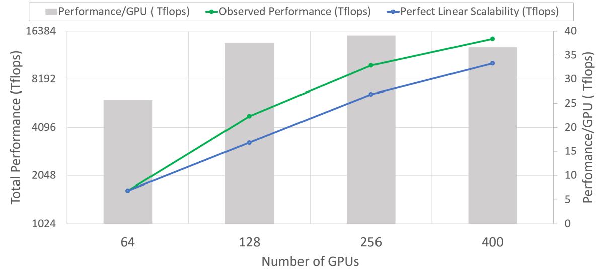
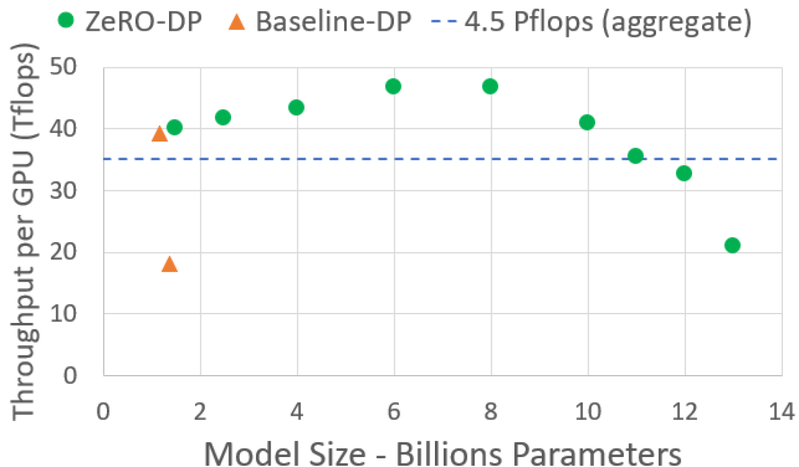
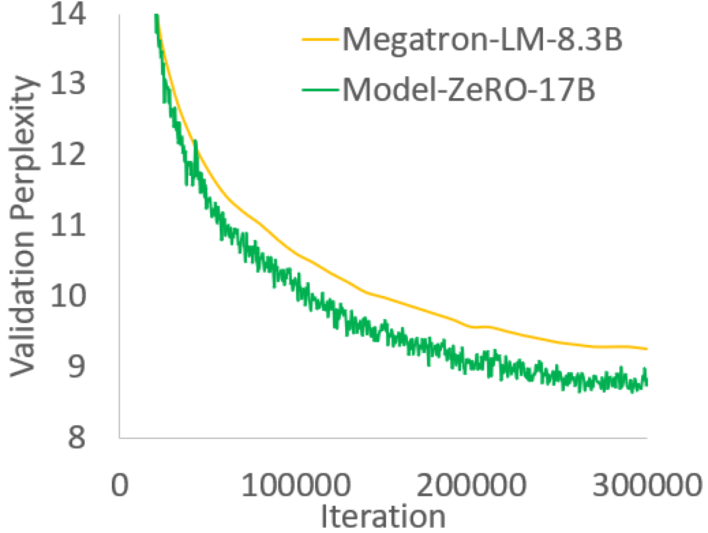

# ZeRO：数据并行真正浪费的是训练状态副本

!!! info "论文信息"
    **论文题名：** ZeRO: Memory Optimizations Toward Training Trillion Parameter Models。 
    **作者：** Samyam Rajbhandari、Jeff Rasley、Olatunji Ruwase、Yuxiong He。 
    **机构：** 未在公开元数据中稳定解析；以 arXiv/PDF 或官方页 affiliation block 为准。 
    **时间 / 主题：** 2019-10；高效训练。 
    **arXiv / 官方报告：** arXiv：[1910.02054](https://arxiv.org/abs/1910.02054)；官方材料：[www.microsoft.com/en-us/research/publication/zero-memory-optimizations-toward-training-trillion-parameter-models/](https://www.microsoft.com/en-us/research/publication/zero-memory-optimizations-toward-training-trillion-parameter-models/)。 
    **GitHub / 项目：** GitHub：未找到官方链接；项目页：[www.microsoft.com/en-us/research/publication/zero-memory-optimizations-toward-training-trillion-parameter-models/](https://www.microsoft.com/en-us/research/publication/zero-memory-optimizations-toward-training-trillion-parameter-models/)。 
    **元数据来源与核验口径：** 来源：[arXiv](https://arxiv.org/abs/1910.02054)；[官方 / 项目材料](https://www.microsoft.com/en-us/research/publication/zero-memory-optimizations-toward-training-trillion-parameter-models/)；Checked Date：2026-06-15；Repro Status：Paper / official materials reviewed, independent reproduction not claimed。

## 训练显存为什么远大于权重文件

ZeRO 处理的是数据并行训练中的状态冗余。每张卡计算不同样本，却各自保留相同的参数、梯度和优化器状态。增加 GPU 可以处理更多数据，但只要每卡仍保存完整模型状态，单卡装不下的问题就不会消失。ZeRO 把这些状态的所有权分给数据并行进程，并根据计算需要传递参数和梯度，使集群显存能够共同承担同一模型。[↗](https://arxiv.org/pdf/1910.02054v3#page=2)

传统模型并行可以拆开参数，却会把每层矩阵运算也切碎。设备越多，每卡的运算块越小，层间又需要频繁通信；一旦超出节点内的高速互联，通信更容易成为瓶颈。论文在当时的 Megatron-LM 上测试 40B 模型跨两台 DGX-2，观察到每张 V100 约 5 TFLOPS。这解释了为什么“继续加模型并行度”不是一个没有代价的解法。

ZeRO 的核心观察是，**状态需要被某个进程保存，不等于每个参与计算的进程都要始终保存它。** Adam 的动量只在更新那一段参数时有用；某层权重只在对应前向、反向时需要；反向生成的梯度归约完以后，只有负责更新的进程需要留下它。沿时间调度这些对象，就可能保留数据并行较大的计算块，又减少重复状态。[↗](https://arxiv.org/pdf/1910.02054v3#page=9)

先把显存账算清。记参数数量为 $\Psi$，论文采用 FP16 参数、FP16 梯度和混合精度 Adam。除低精度权重之外，每个参数还需要 FP32 主权重，以及 Adam 的一阶、二阶统计量。

| State | Bytes / parameter | Why it is needed |
| --- | ---: | --- |
| FP16 parameters | 2 | 前向与反向计算 |
| FP16 gradients | 2 | 当前训练步的更新信号 |
| FP32 master parameters | 4 | 在较高精度下累计参数更新 |
| FP32 momentum | 4 | Adam 一阶统计量 |
| FP32 variance | 4 | Adam 二阶统计量 |
| Total model states | 16 | 尚未包含激活与临时缓冲 |

因此这一配置下的模型状态为 $16\Psi$ 字节。一个 7.5B 参数模型的低精度权重只有 15 GB，训练模型状态却要约 120 GB。这里使用十进制 GB；换成其他优化器、梯度精度或主权重实现，需要重新列账，不能机械套用每参数 16 字节。

论文另外把激活、临时缓冲和碎片归为 residual states。这个分类决定了后面的两条工作线：ZeRO-DP 分割模型状态，ZeRO-R 处理其余占用。只解决第一类，长序列训练仍可能被激活撑满。

原文用 1.5B GPT-2 给出了更完整的账本。FP16 权重约 3 GB，混合精度 Adam 的全部模型状态约 24 GB；batch 32、序列长度约 1K 时，激活还可能需要约 60 GB。activation checkpointing 可以把这项降到约 8 GB，却要付出重计算；一个将全部参数相关张量展平成 FP32 的临时缓冲又是 6 GB。因此，不能用“权重文件只有 3 GB”推断 32 GB 卡肯定足够训练。[↗](https://arxiv.org/pdf/1910.02054v3#page=8)

这几项也有不同生命周期。参数与优化器统计跨 step 保留；激活检查点从前向保留到对应反向；某个算子工作区只存在很短时间。峰值显存取决于哪些对象同时存在，不能把所有曾经出现过的张量大小直接相加，也不能只看 step 结束时的空闲量。ZeRO-R 正是沿这种生命周期处理余下开销。

## 三个阶段实际改变了哪些对象

Figure 1 应从每行保留的彩色块读起。Stage 1 只改变优化器状态的所有权；Stage 2 进一步让每卡只长期保留自己负责的梯度；Stage 3 再让参数按需出现。计算过程需要的完整参数与长期驻留的参数份额，是两个不同概念。

{ width="860" }

图源：ZeRO，Figure 1。下表按同一混合精度 Adam 假设重写图中的显存关系，$N_d$ 为数据并行度。

| Configuration | Model-state memory per device | $\Psi=7.5$B, $N_d=64$ |
| --- | --- | ---: |
| Standard DP | $16\Psi$ | 120 GB |
| $P_{os}$ | $4\Psi+12\Psi/N_d$ | 31.41 GB |
| $P_{os+g}$ | $2\Psi+14\Psi/N_d$ | 16.64 GB |
| $P_{os+g+p}$ | $16\Psi/N_d$ | 1.875 GB |

表中数值由公式直接计算。它们是模型状态下界，不是包括运行时峰值的 GPU 容量要求。例如 Stage 3 临时收集当前层的完整权重时，实际占用会高于长期分片的 1.875 GB。

这里的 4 倍与 8 倍是数据并行度很大时的模型状态节省上限。对于 Stage 1，$12\Psi/N_d$ 可以继续缩小，但 $4\Psi$ 不动；Stage 2 同理还留下 $2\Psi$ 的完整参数。只有第三阶段才把全部模型状态都按 $N_d$ 分摊。增加设备是否还能显著释放显存，必须先看剩下哪一项已经成为下限。

举例来说，128B 参数模型在 64 路 Stage 3 下的模型状态恰好是 $16\times128/64=32$ GB。原文 Table 1 将它列入容量分析，但它已经用满 32 GB 的状态预算，没有给激活、临时参数和运行时留空间。这个数字应理解为分析边界，而不是可直接复制的单卡容量配置。[↗](https://arxiv.org/pdf/1910.02054v3#page=11)

### Stage 1：只有拥有者更新这一段参数

每张卡仍用完整 FP16 参数完成自己的前向和反向。优化器状态按参数索引分片，每个进程只保存并更新自己负责的主权重、动量和方差。各分片得到一致的全局梯度后独立更新，随后交换更新后的参数，供下一步计算使用。

这种安排保留了 Adam 的数学更新，仅改变状态放在哪里、由谁执行。它节约的是原来各卡重复保存的 12 字节优化器状态。随着 $N_d$ 增大，这部分趋于零，但完整参数和梯度的 $4\Psi$ 仍然存在，因此模型状态节省趋近 4 倍。

### Stage 2：梯度归约到负责更新的进程

如果某段参数只由一个进程更新，就不需要所有进程都长期保留该段完整梯度。反向生成的梯度可以通过 reduce-scatter 汇总并分发到相应拥有者；不属于本进程的梯度用完即可释放。更新后再 all-gather 参数。

这一阶段的常驻模型状态是

$$
M_{os+g}=2\Psi+\frac{14\Psi}{N_d}.
$$

第一项是完整 FP16 参数，第二项是分片梯度与优化器状态。通信和反向计算的执行顺序会影响梯度桶的瞬时占用，公式不能替代显存时间线。

### 用四个进程看一次 Stage 2 更新

把参数索引划成 A、B、C、D 四段，分别由四个进程拥有。这是解释性例子。每个进程仍执行自己数据上的完整模型前向、反向，所以四张卡都计算出关于 A 的局部梯度；reduce 将它们汇总到 A 的拥有者，后者用自己的 FP32 主权重、动量与方差更新 A。B、C、D 同样各自由对应拥有者更新。

完成以后，四个进程各自掌握一段更新好的 FP16 参数，通过 all-gather 重新组成下一 step 所需的完整参数副本。优化器统计不需要跟着广播，因为下一步仍由同一个拥有者负责该段更新。减少的是重复存储和重复优化器工作，并没有让某一份数据的梯度被遗漏。

实际反向不会等所有层的梯度都生成才开始归约。论文将属于相应分片的梯度组织成 bucket，在可用时归约，并与后续反向计算重叠；不属于本进程的梯度归约后释放。bucket 太小会增加通信调用成本，太大又延长梯度驻留。这使分片与通信调度成为同一个设计问题。[↗](https://arxiv.org/pdf/1910.02054v3#page=10)

### Stage 3：按层取得参数，计算后释放

Stage 3 连完整参数副本也不再长期保留。到某层前向或反向时，进程收集计算所需的参数；用完后释放不归自己所有的份额。每张卡仍处理自己的数据，矩阵计算也不因此自动变成张量并行的局部矩阵乘法。[↗](https://arxiv.org/pdf/1910.02054v3#page=11)

这说明 ZeRO 与张量并行能够组合：前者主要改变数据并行组内的状态驻留，后者把一次层内计算分给多个设备。组合时要同时检查数据并行组、张量并行组和每一步通信发生的位置。

第三阶段的时间线可以继续沿一层来追踪。开始前向前，收集该层参数；各进程在自己的样本上计算；本层用完后释放临时完整副本。轮到反向时，按相反的层顺序再取得参数，计算局部梯度，然后归约到拥有者。拥有者更新自己的参数片段，下一轮再按需提供。它把完整副本从“整个训练过程常驻”改成“计算期间暂时存在”。

因此，Stage 3 的 $16\Psi/N_d$ 描述长期分片量，峰值还受当前计算单元的参数和工作区影响。层本身很大时，仍需要考虑怎样在设备上完成这一层计算；只看到集群总显存足够，并不能自动保证所有局部算子都可运行。

## 为什么前两阶段能省显存而不增加通信量

论文用带宽受限的大张量通信模型分析通信体积。标准数据并行的 all-reduce 可以分解为 reduce-scatter 和 all-gather，每部分约移动 $\Psi$ 个元素，总计约 $2\Psi$。

Stage 2 将这两部分安排到不同对象上。先对梯度执行 reduce-scatter，拥有者更新，再 all-gather 参数，仍约为

$$
V_{os+g}=\Psi+\Psi=2\Psi.
$$

Stage 3 需要在计算期间重新取得参数，论文分析约为 $3\Psi$，相对标准数据并行增加 50%。这个 1.5 倍是该调度模型中的元素通信量比例；它没有包含每次 collective 的启动成本、网络拓扑差异与通信计算重叠程度。[↗](https://arxiv.org/pdf/1910.02054v3#page=13)

第三阶段的 $3\Psi$ 可以按时间展开：前向收集参数约 $\Psi$，反向再收集一次约 $\Psi$，梯度 reduce-scatter 约 $\Psi$。第二阶段末尾的一次完整参数 all-gather，在第三阶段被移到按层前向中，并因为反向还需要参数而多出一次。增加的 50% 正来自这一重排。[↗](https://arxiv.org/pdf/1910.02054v3#page=14)

这些量按论文的大消息带宽模型以元素计，不是每条链路上严格相同的字节数。有限进程数、具体 collective 算法、张量精度和分桶都会影响真实通信；特别是很多小 gather 可能有相同总字节量，却有更大的启动与同步开销。另一方面，与计算重叠的通信不全部进入关键路径。所以“同样 $2\Psi$”支持通信量没有额外增长，不意味着两套代码的 step time 必定相同。

因此，Stage 3 的选型问题是：分片参数所释放的显存，能否换来足够有价值的模型规模、batch 或序列长度，同时使参数收集的成本可接受。参数本来已经放得下时，更多分片不必然更快。

## 模型状态降下来以后，剩余显存如何处理

ZeRO-R 的三项优化分别针对不同的生命周期。

**Partitioned activation checkpointing（分片激活检查点）**利用张量并行组中的激活冗余。保存检查点时分片，反向需要重算时 all-gather 恢复。论文以 100B 模型、batch 32、序列长度 1024、16 路模型并行为例，检查点占用约从 33 GB 降到 2 GB；这些值属于具体配置，不能直接套到任意 Transformer。必要时还能将检查点卸载到 CPU，但要支付传输成本。

**Constant-size buffers（固定大小缓冲）**限制通信和优化器融合缓冲随模型无限增长。大的缓冲有利于带宽利用，却也可能占去大量显存；例如 3B 参数的 FP32 整体缓冲就是 12 GB。固定大小的分桶使额外空间与模型大小脱钩。

**Memory defragmentation（内存去碎片）**则针对长寿命检查点、梯度与短寿命临时张量交错分配的情况。论文通过预分配连续空间等方式减少碎片，让“总空闲内存足够”更有机会转化为一次大分配成功。[↗](https://arxiv.org/pdf/1910.02054v3#page=12)

### 为什么激活分片发生在模型并行组内

ZeRO-DP 中，不同进程看到不同样本，激活通常也不同，不能把这些不同激活当成重复副本。这里被消除的是模型并行产生的重复：例如按输出列拆一个线性层，各设备计算不同输出列，但都需要同一份完整输入。保存检查点时，这份输入会在模型并行组内重复存在。

ZeRO-R 在前向完成后将检查点分给这个 MP 组；反向重算前再 all-gather 恢复。它与 activation checkpointing 配合，前者减少同一份检查点的跨设备复制，后者减少沿深度保留的中间量。两者作用轴不同，不能因为都叫“节省激活”就以为只能二选一。[↗](https://arxiv.org/pdf/1910.02054v3#page=12)

通信分析也因此要与 MP 的原有通信比较。以论文采用的 Megatron Transformer 为例，记单层输入激活元素数为 $A$。前向有两次 all-reduce，重算有两次，反向又有两次；按每次约 $2A$ 计算，总量约 $12A$。分片检查点多出一次 all-gather，约为 $A$，相对增加约 $1/12=8.3\%$。这是对文中“不足 10%”的展开，依赖该模型并行与检查点策略，并非所有层结构的固定比例。[↗](https://arxiv.org/pdf/1910.02054v3#page=14)

节约激活显存后，可以增大每次处理的 batch。对固定数量的训练样本，这会减少 step 数，从而摊薄数据并行通信；它不是说 batch 变大以后，单个 step 的参数梯度突然从 $\Psi$ 变得更小。讨论“通信减少”时，需要分清每步通信与每个样本分摊的通信。

CPU offload 则再增加一轮设备与主存之间的搬运。原文这里卸载的是分片后的激活检查点，并不是后来所有以 ZeRO 命名的 CPU 参数、优化器卸载方案。只有显存释放带来的 batch 或可运行规模收益足够大，才值得支付传输；后面的 60B 实验会直接展示省内存却降低吞吐的情况。

### ZeRO 与模型并行如何共同约束全局 batch

若有 $N_d$ 路数据并行、每个副本每步处理 $b$ 个样本，在不额外引入梯度累积的简单情况下，全局 batch 是 $N_db$。纯数据并行为了容纳更大模型不断增加设备，也会推高全局 batch；这可能改变优化行为，而不是一个纯粹的系统参数。

将每个数据副本再分到 $N_m$ 个模型并行设备，总设备数为 $N_dN_m$，可以在相同设备预算下减少数据副本数。理想状态分片因子达到 $N_dN_m$，同时利用 MP 组内的激活分片。论文提出 1024 GPU、节点内 16 路 MP、跨节点 64 路 DP 的组合，就是为了同时利用显存、局部互联和可接受的全局 batch。[↗](https://arxiv.org/pdf/1910.02054v3#page=4)

这解释了 ZeRO 为什么没有让其他并行方法失去用途。减少状态冗余可以降低所需 MP 度，MP 仍可帮助控制单层计算、激活与全局 batch。实际组合的目标是把通信放在合适的互联上，而不是使某一个并行度尽可能大。

## 容量、吞吐与扩展实验回答不同问题

实验使用 25 台 DGX-2、共 400 张 V100，节点间总带宽报告为 800 Gbps。无模型并行时与 PyTorch DDP 比较；有模型并行时，与 2019 年 9 月版本的 Megatron-LM 比较，ZeRO 自身也复用其模型并行实现。因此，它测量的是当时这些实现下的系统差异，不是对今天任意训练框架的固定倍数承诺。[↗](https://arxiv.org/pdf/1910.02054v3#page=17)

原文将节点内 NVSwitch 链路的 300 GB/s 与跨节点 EDR 链路的 12.5 GB/s 对照。它们是链路层面的描述，与前面的集群节点间总带宽不是同一个量。关键机制是，ZeRO 节省状态显存后可以把 MP 留在单节点内；跨节点主要做较粗粒度的数据并行通信，减少细粒度层内操作对慢链路的依赖。

读 Figure 2 时先固定模型规模，比较 ZeRO 与基线的吞吐，再观察规模增加后基线是否被迫跨节点做模型并行。论文的优势来自分片让模型并行留在高带宽节点内部，以及省出的显存改善计算配置。

{ width="760" }

图源：ZeRO，Figure 2。作者报告在 400 张 V100 上训练 100B 参数模型时，每卡超过 38 TFLOPS，聚合超过 15 PFLOPS，相对同规模基线超过 10 倍。这是完整系统配置的比较，不能归因为某一种 collective 单独快了 10 倍。

论文主要实测实现称为 **ZeRO-100B**，由 $P_{os+g}$ 与 ZeRO-R 组成，配合模型并行支持最高 170B 规模。完整 Stage 3 对万亿参数的支持在本文中主要是容量与通信分析。把标题中的“trillion”理解为已完整训练万亿参数模型，会混淆理论可装载性和实测系统。[↗](https://arxiv.org/pdf/1910.02054v3#page=4)

### 10 倍速度比较并没有固定所有运行参数

附录给出的实际配置使 Figure 2 的含义更明确。下表抽取 100B 与 170B 两个规模；Local batch 是每个数据副本的 batch，Global batch 按 DP 度计算。

| Model | System | GPUs | MP degree | Local batch | Global batch |
| --- | --- | ---: | ---: | ---: | ---: |
| 100B | ZeRO | 400 | 16 | 32 | 800 |
| 100B | Baseline | 384 | 128 | 2 | 6 |
| 170B | ZeRO | 400 | 16 | 12 | 300 |
| 170B | Baseline | 256 | 256 | 2 | 2 |

基线的 MP 度必须整除设备数，且受 hidden size、head 数等限制，不能在所有配置下恰好使用 400 张卡。作者因此报告每 GPU 吞吐，而不是简单用不同设备总数的总吞吐相除。附录还显示相应 attention head 配置会变化，这不是严格固定全部网络细节、batch 和并行度后只开关一项功能的实验。[↗](https://arxiv.org/pdf/1910.02054v3#page=23)

它证明的是内存优化让更有效的运行配置成为可能。100B 模型的 MP 从 128 降到 16，每副本 batch 从 2 增到 32，层内通信与计算粒度都明显改变。每卡 TFLOPS 的提升很有价值，但不等于已经证明以不同全局 batch 达到相同质量时也恰好快十倍。系统吞吐、样本吞吐和训练收敛时间需要分别记录。

超过 100B 后，ZeRO 的每卡吞吐也下降，Figure 2 中 170B 约为 21 TFLOPS。作者将其归因于剩余内存不足以维持更大的 batch。这一趋势支持显存与计算利用率的联系，也说明分片没有让容量增大完全免费。

### 五种配置把状态、激活与卸载分开

Figure 6–8 中的横轴不是 Stage 1、2、3，而是下面五个配置。它们都包含固定大小缓冲与碎片管理，第三阶段参数分片没有进入这组实测。

| Config | Model-state partitioning | Residual optimizations |
| --- | --- | --- |
| C1 | $P_{os}$ | Constant buffers + memory defragmentation |
| C2 | $P_{os}$ | C1 residuals + partitioned activation checkpoints |
| C3 | $P_{os+g}$ | Constant buffers + memory defragmentation |
| C4 | $P_{os+g}$ | C3 residuals + partitioned activation checkpoints |
| C5 | $P_{os+g}$ | C4 residuals + CPU activation checkpoint offload |

C2 与 C3 不是包含关系。C2 分片激活但保留完整梯度，C3 分片梯度却不启用激活分片；哪一个省更多，取决于模型状态与激活各占多少。这个细节直接解释了为什么图中有些指标不会随配置编号单调改善。[↗](https://arxiv.org/pdf/1910.02054v3#page=18)

接着看容量图与最大显存分配图。前者回答旧系统装不下的配置能否运行，后者解释新增空间来自哪里；二者需要与吞吐结果一起看。

{ width="760" }

图源：ZeRO，Figure 6。

Figure 6 固定 batch 16、MP 16，最大规模依次约为 40B、60B、50B、140B、150B。C1 到 C2 仅加入激活分片，模型容量从 40B 到 60B；C2 到 C4 加上梯度分片，进一步到 140B。C3 只有 50B，低于 C2 的 60B，说明在这组条件下，放弃激活分片不能仅靠梯度分片补回来。

C5 的 CPU 卸载再增加约 10B 容量。它与前述 170B 最大可运行规模不矛盾：这里固定 batch 16，170B 的另一组配置使用 batch 12。把不同实验的 batch 条件省略，会把这两张图误读成论文前后不一致。

{ width="760" }

图源：ZeRO，Figure 7。

Figure 7 记录的是 PyTorch 缓存的内存峰值，不只是当前活跃模型状态张量的和。40B 模型从 C1 到 C2 下降；C2 到 C3 又略升，因为两种分片对象发生交换。C4 到 C5 在 40B 上几乎不变，在 100B 上才更明显。它说明卸载是否有可观收益取决于激活绝对量，不能把某个理论分片倍率直接乘到整个训练峰值上。

再看 Figure 8 的蓝色 60B 柱和橙色 170B 柱。横轴相同，但这次关心的是最好可达到的每卡吞吐，而非固定 batch 的最大容量。

{ width="760" }

图源：ZeRO，Figure 8。橙色叉号表示对应 170B 配置无法运行。

60B 的 C4 高于 C5，虽然 C5 卸载了更多激活，却增加 CPU 往返开销，并没有转化为更高吞吐。170B 则只有 C5 能运行，此时卸载首先打开了可运行范围。论文因此只在有利时启用 $P_{a+cpu}$。这个实验给出的采用标准很具体：先判断是否必须靠卸载才能运行，再判断多出的 batch 收益是否抵得过传输成本。[↗](https://arxiv.org/pdf/1910.02054v3#page=19)

作者还报告 60B 模型在 64–400 GPU 区间出现超线性扩展。更多进程降低每卡状态占用，允许增大每卡 batch，从而提高计算效率。这一解释也限定了结果的使用方式：它没有证明固定每卡 batch、固定模型和固定运行配置时，通信越多越能超线性加速。

## 超线性扩展中，每张卡的工作也发生了变化

Figure 3 用固定的 60B 模型，从 64 增到 400 GPU。绿色是实际总吞吐，蓝色是假设每卡性能不变时的线性扩展，灰色柱则按右轴显示每卡吞吐。先比较绿、蓝两线，再观察灰柱，才能分清总量与单位设备效率。

{ width="860" }

图源：ZeRO，Figure 3。左轴总 TFLOPS 使用对数刻度，右轴是单卡 TFLOPS。

附录 Table 6 固定 MP 16、75 层、hidden size 8192，但 batch 随可用显存调整。

| GPUs | MP | DP, derived | Local batch | Global batch |
| --- | ---: | ---: | ---: | ---: |
| 64 | 16 | 4 | 16 | 64 |
| 128 | 16 | 8 | 48 | 384 |
| 256 | 16 | 16 | 48 | 768 |
| 400 | 16 | 25 | 64 | 1600 |

64 到 128 卡时，数据并行度翻倍，每卡分担的梯度和优化器状态减少，local batch 从 16 升到 48。更大的矩阵计算提高算术强度，每 GPU 吞吐也增加，因而总吞吐可以超过线性扩展。400 卡的灰柱并未继续严格升高，但总吞吐仍高于最初基准外推的线性线。[↗](https://arxiv.org/pdf/1910.02054v3#page=23)

这类收益有实际价值，却依赖原配置受到内存与计算粒度限制。若每卡 batch 已固定且计算效率已经较高，继续增加数据并行度并不必然复制同样的超线性结果。全局 batch 从 64 到 1600 的变化也意味着，不能只用图中的吞吐倍数替代完整的 time-to-quality 比较。

## 不改模型代码，可以把普通 DP 推到多大

Figure 4 取消模型并行，使用 128 GPU。应先看绿色点延伸到的模型规模，再看它们的纵向位置。

{ width="760" }

图源：ZeRO，Figure 4。橙色为普通 DP，绿色为 ZeRO-DP。

普通 DDP 约到 1.4B 就耗尽内存，ZeRO-100B 可以运行 13B。对中间多个规模，每卡吞吐约为 40 TFLOPS 或更高；接近 13B 时降到约 21 TFLOPS，因此不能把“最高可运行 13B”与“平均超过 40 TFLOPS”拼成 13B 上的同一个性能点。附录列出 13B 的 local batch 为 2，全局为 256，仍能看到容量边缘的计算粒度代价。[↗](https://arxiv.org/pdf/1910.02054v3#page=24)

这部分贡献还包含使用接口。论文实现接收 PyTorch `torch.nn.Module`，像包装普通数据并行模型一样接入；它不要求研究者先把每个算子改成模型并行版本。对需要自由修改结构的研究者，这种降低接入成本的价值与单项 TFLOPS 同样实际。本文没有对所有自定义模块逐一验证兼容性，采用时仍要检查参数共享、通信顺序与训练状态保存。

## 容量分析、可运行规模与完成训练，是三种证据

1T 参数、16 bytes/parameter 的状态总量约为 16 TB；分到 1024 个设备约为 15.6 GB/卡。这说明完整分片有能力突破模型状态容量障碍，但并没有支付激活、临时状态与完整训练 FLOPs，也没有证明该规模的模型已经训练收敛。

论文用 BERT-Large 的既有训练耗时作数量级估计：在同样样本量、序列长度和计算效率假设下，1T 模型就可能需要约 140 天；如果数据和上下文随模型扩大，还可能超过一年。这是条件化估算，不是实际执行了 1T 训练。显存能装下与训练能按期完成，是两个独立预算问题。[↗](https://arxiv.org/pdf/1910.02054v3#page=16)

实测的 170B 证明系统能执行相应训练配置并测出吞吐；论文另以 17B Turing-NLG 作为端到端训练案例。Figure 5 比较它与 Megatron-LM 8.3B 的验证困惑度随迭代的变化。

{ width="760" }

图源：ZeRO，Figure 5。横轴是训练迭代，绿色 17B 模型在图示后段有更低的验证困惑度。

作者报告这一 17B 模型持续达到 41.4 TFLOPS/GPU，提供了内存优化能够支撑实际语言模型训练的证据。图中两个模型规模不同，不能将困惑度下降解释为同一个网络换上 ZeRO 后精度自动提高；系统直接改变的是能以什么预算训练多大的模型。参数分片本身保留原优化器的更新规则，而非发明一种提高泛化的新目标。[↗](https://arxiv.org/pdf/1910.02054v3#page=19)

## 把论文变成训练配置的判断方法

采用 ZeRO 前，先记录参数、梯度、优化器状态和激活各自的峰值。若主要压力来自优化器状态，Stage 1 就可能足够；若梯度也占用显著，Stage 2 有直接收益；若参数本身构成瓶颈，才需要评估 Stage 3 的参数取得与释放。

长上下文任务还应单独测激活检查点和 attention 工作区。推理中的 KV cache 不属于本文的混合精度 Adam 账本。模型状态节省也不自动降低训练 FLOPs；它首先改变可运行的模型、batch 和并行配置，再通过这些改变影响吞吐。

可复用的核心认识是把三个问题分开计算：**谁拥有状态、何时需要完整状态、为了取得它要传多少数据。** 沿这三个问题检查显存与通信时间线，比只比较 Stage 编号更接近实际训练效率。
