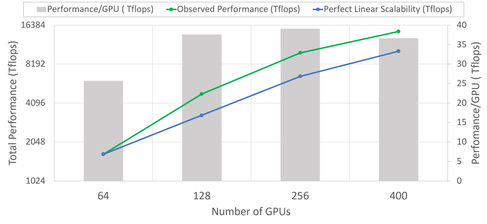
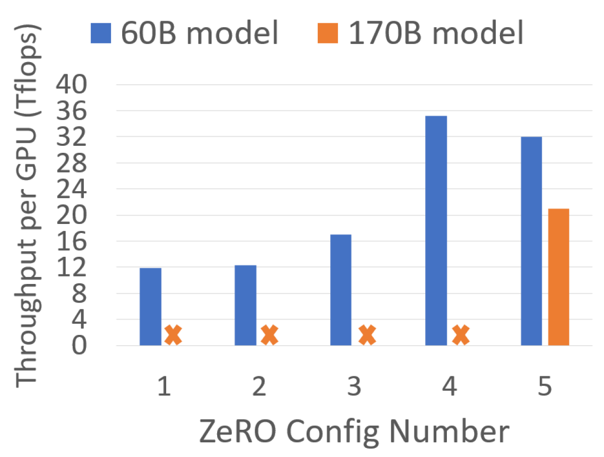
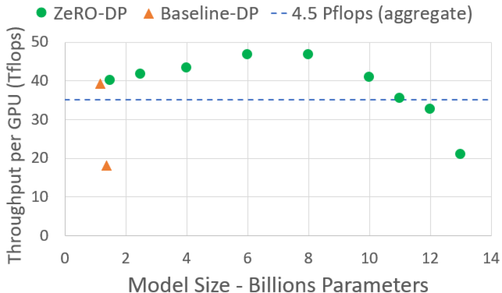
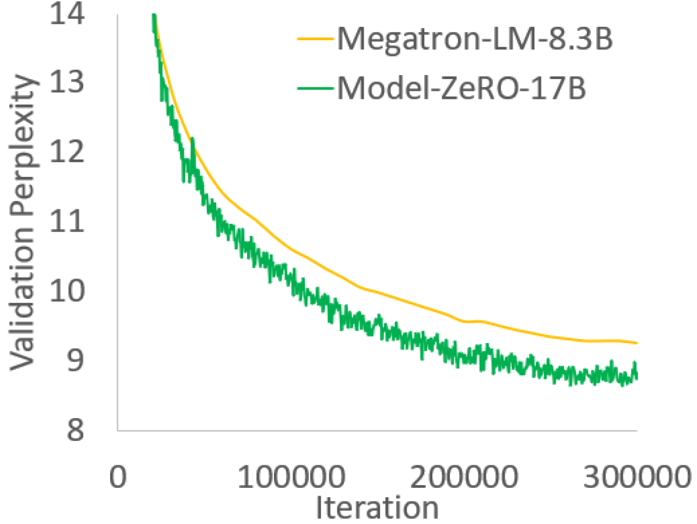

# ZeRO：大模型训练的零冗余状态优化

!!! note "读法定位"
    这页先按“论文证据节点”读：先问它解决哪一个瓶颈，再看核心图表、实验 setting 和不能外推的边界。背景概念先回 [论文专题讲解](../index.md) 和 [训练与基础系统](../../training/index.md)。
    **前置**：不必先读完所有相关论文，但要知道本篇的输入、训练/推理路径和评测口径分别对应什么。
    **主线关系**：读完后把结论回填到「训练与基础系统」路线里，判断它改变的是机制、成本、数据配方、评测口径，还是仍停留在前沿假设。

!!! info "论文信息"
    - 论文：`ZeRO: Memory Optimizations Toward Training Trillion Parameter Models`
    - 链接：[arXiv:1910.02054](https://arxiv.org/abs/1910.02054)
    - 作者：Samyam Rajbhandari、Jeff Rasley、Olatunji Ruwase、Yuxiong He
    - 代码：[microsoft/DeepSpeed](https://github.com/microsoft/DeepSpeed)
    - 日期：2019-10；arXiv v3 修订于 2020-05-13
    - 关键词：ZeRO、DeepSpeed、data parallelism、optimizer state partitioning、gradient partitioning、parameter partitioning、activation partitioning、memory defragmentation、mixed precision Adam

Megatron-LM 解决的是“Transformer 的大 GEMM 怎么切到多张 GPU 上”。ZeRO 解决的是另一个更底层的问题：**数据并行明明最容易用，为什么一上大模型就把每张卡的显存浪费在重复存 optimizer states、gradients 和 parameters 上？**

ZeRO 的核心想法很漂亮：保持数据并行的使用方式和计算粒度，但把模型状态从“每张卡完整复制一份”改成“在 data-parallel ranks 间分片存储，训练时按需 gather / reduce”。这样就能在不要求用户重写模型的前提下，把可训练模型规模从十亿级推到百亿、千亿甚至理论上的万亿参数。

## 它的效率贡献是什么

| 维度 | 贡献 |
| --- | --- |
| 节省的成本 | 消除 data parallel training 中 optimizer states、gradients、parameters 的冗余复制，并优化 activations、temporary buffers、memory fragmentation |
| 核心机制 | ZeRO-DP 三阶段分片：`P_os` partition optimizer states，`P_os+g` 再 partition gradients，`P_os+g+p` 再 partition parameters；ZeRO-R 处理 activation partition、constant-size buffers 和 defragmentation |
| 对训练系统主线的意义 | 把“大模型训练显存账”从模型切分问题扩展成状态生命周期问题，成为 DeepSpeed ZeRO、FSDP、optimizer/gradient/parameter sharding 的基础范式 |
| 主要风险 | 论文的 ZeRO-100B 实现主要覆盖 `P_os+g` 加 ZeRO-R，并未完整评估后来的 ZeRO-3 生态；实验基于 V100/DGX-2 与 GPT-2-like dense models |
| 应接到本站哪里 | [Megatron-LM / DeepSpeed 与训练栈](../../training/megatron-lm-deepspeed-and-open-training-stacks.md)、[分布式训练与 Checkpointing](../../training/distributed-training-and-checkpointing.md)、[低比特训练与数值格式](../../training/low-bit-training-and-numerics.md) |

## 证据等级与外推边界

ZeRO 的证据分两层：前半部分是内存和通信量的理论分析，后半部分是 ZeRO-100B 在 400 张 V100 上的系统实验。它证明的是“状态分片能大幅降低 DP 的显存冗余，并保留较高训练吞吐”，不是证明“万亿参数训练在当时已经经济可行”。

| 论文结论 | 证据来源 | 证据等级 | 可外推到高效训练 | 不能直接外推 |
| --- | --- | --- | --- | --- |
| mixed precision Adam 的模型状态显存远大于 fp16 参数本身 | Section 3 memory accounting、Figure 1 | Analytical accounting | 训练系统要拆开 parameters、gradients、optimizer states、activations、buffers 和 fragmentation | 不包含现代 FP8/FP4 optimizer、8-bit optimizer 或 CPU/NVMe offload 的完整成本 |
| ZeRO-DP 三阶段能线性降低冗余状态 | Figure 1、Table 1、Table 2 | Analytical + measured capacity | ZeRO/FSDP 类方法本质是在 DP 组内分片模型状态，并在生命周期需要时重建 | 不能只看理论显存，还要看 gather/reduce 通信和 overlap |
| ZeRO-100B 能把 100B 级 dense GPT-like 模型跑到高吞吐 | Figure 2、Figure 3、Table 5、Table 6 | System throughput | 大模型训练的吞吐提升可以来自“更省显存 -> 更大 local batch -> 更高 arithmetic intensity” | 不能代表所有模型、网络拓扑和 batch regime 都会 super-linear scaling |
| ZeRO-R 解决 residual states 后，显存瓶颈继续后移 | Figure 6、Figure 7、Figure 8、Table 3 | Ablation / system analysis | activation partition、buffer sizing 和 defragmentation 应该和状态分片一起考虑 | CPU activation offload 只有在模型很大或 batch 很小时才可能值得 |
| Turing-NLG 证明 ZeRO 能支撑真实大模型训练 | Figure 5、Section 10.6 | End-to-end model result | 系统论文也要接到真实训练 loss / perplexity，而不是只报告 memory | 数据、tokenizer、模型细节和完整训练配方没有像模型报告那样展开 |

## 显存账：为什么 1.5B GPT-2 参数只有 3GB 却训不动

论文从一个非常适合教学的问题开始：1.5B 参数如果用 fp16 存参数，只有大约 3GB；为什么 TensorFlow / PyTorch 在 32GB GPU 上还是训不动？

答案是训练时不只存参数。以 mixed precision Adam 为例，模型有 \(\Psi\) 个参数时：

| State | Precision | Memory |
| --- | --- | --- |
| parameters used in forward/backward | fp16 | \(2\Psi\) bytes |
| gradients | fp16 | \(2\Psi\) bytes |
| fp32 master parameters | fp32 | \(4\Psi\) bytes |
| Adam momentum | fp32 | \(4\Psi\) bytes |
| Adam variance | fp32 | \(4\Psi\) bytes |
| total model states | mixed precision Adam | \(16\Psi\) bytes |

所以 1.5B 参数不只是 3GB，而是至少 \(16 \times 1.5B = 24GB\) 的 model states。还没算 activation、temporary buffers、fragmentation 和通信 buffer。这就是 ZeRO 论文最重要的训练视角：**显存不是一个总数，而是一组生命周期不同的状态。**

{ width="860" }

<small>图源：ZeRO Figure 1。原图比较 data parallel model states 的 per-device memory，并展示 ZeRO-DP 三阶段如何逐步分片 optimizer states、gradients 和 parameters。图中示例使用 \(\Psi=7.5B\)、\(N_d=64\)、mixed precision Adam \(K=12\)。</small>

!!! note "这张图怎么读"
    这张图要按“哪些状态还在每张卡上重复保存”来读。Stage 1 只切 optimizer states，Stage 2 再切 gradients，Stage 3 连 parameters 也切开；每一步减少的是 data parallel 里无意义的冗余，而不是改变模型数学定义。它支撑的是显存可行性和可扩展性，不直接证明模型质量更好。

## ZeRO-DP 三阶段

ZeRO-DP 的三阶段不是互斥选项，而是累积打开：

| Stage | Partitioned state | Per-device model-state memory | Communication volume |
| --- | --- | --- | --- |
| baseline DP | none | \(16\Psi\) | baseline all-reduce, about \(2\Psi\) data movement per step |
| `P_os` | optimizer states | \(4\Psi + K\Psi/N_d\) | same communication volume as DP |
| `P_os+g` | optimizer states + gradients | \(2\Psi + (2+K)\Psi/N_d\) | same communication volume as DP, using reduce-scatter + all-gather |
| `P_os+g+p` | optimizer states + gradients + parameters | \(16\Psi/N_d\) | about 1.5x baseline DP communication volume |

这里 \(N_d\) 是 data parallel degree，\(K=12\) 是 mixed precision Adam optimizer states 的内存系数。三个阶段的直觉可以这样记：

1. `P_os`：每个 rank 只负责更新一部分 optimizer states，省掉 Adam master weights / momentum / variance 的重复存储；
2. `P_os+g`：梯度也按负责的参数 shard reduce-scatter，不再每张卡保留完整 gradients；
3. `P_os+g+p`：参数本身也分片，forward / backward 到某一层时按需 broadcast / all-gather。

### Table 1: ZeRO-DP Memory

下面表格重绘自原论文 Table 1，保留英文列名。单位为 GB，表示不同 DP degree 下每张设备的 model-state memory。

| DP | 7.5B Model P_os (GB) | 7.5B Model P_os+g (GB) | 7.5B Model P_os+g+p (GB) | 128B Model P_os (GB) | 128B Model P_os+g (GB) | 128B Model P_os+g+p (GB) | 1T Model P_os (GB) | 1T Model P_os+g (GB) | 1T Model P_os+g+p (GB) |
| --- | --- | --- | --- | --- | --- | --- | --- | --- | --- |
| 1 | 120 | 120 | 120 | 2048 | 2048 | 2048 | 16000 | 16000 | 16000 |
| 4 | 52.5 | 41.3 | 30 | 896 | 704 | 512 | 7000 | 5500 | 4000 |
| 16 | 35.6 | 21.6 | 7.5 | 608 | 368 | 128 | 4750 | 2875 | 1000 |
| 64 | 31.4 | 16.6 | 1.88 | 536 | 284 | 32 | 4187 | 2218 | 250 |
| 256 | 30.4 | 15.4 | 0.47 | 518 | 263 | 8 | 4046 | 2054 | 62.5 |
| 1024 | 30.1 | 15.1 | 0.12 | 513 | 257 | 2 | 4011 | 2013 | 15.6 |

这张表解释了 ZeRO 的影响力。普通 DP 下，模型状态不随 DP degree 下降；ZeRO 打开 `P_os+g+p` 后，1T 模型在 1024-way DP 下的模型状态理论上可以降到 15.6GB/卡。论文也提醒：显存够放下不等于训练时间经济可行，1T 模型在当时硬件上端到端训练可能仍需很久。

## ZeRO-R：模型状态之外还有 residual states

ZeRO-DP 把 model states 压下去以后，剩下的 activation、temporary buffers 和 fragmented memory 会变成新瓶颈。论文把这一组优化称为 ZeRO-R。

| Component | What it optimizes | Training detail |
| --- | --- | --- |
| `P_a` | partitioned activation checkpointing | MP 中 activation checkpoints 不再在 model-parallel ranks 上重复保存；需要时 all-gather 还原 |
| `P_a+cpu` | CPU activation checkpoint offload | 对超大模型可把 partitioned activation checkpoints 放到 CPU，减少 GPU activation footprint |
| `C_B` | constant-size buffers | 避免 fused temporary buffers 随模型大小线性增长；例如 3B 模型的 32-bit fused buffer 可达 12GB |
| `M_D` | memory defragmentation | 将 activation checkpoints 和 gradients 搬到预分配连续 buffer，降低碎片导致的 OOM 和 allocator overhead |

论文给了一个很具体的 activation 例子：100B GPT-like 模型、batch size 32、sequence length 1024、MP degree 16，如果每层 checkpoint 一个 activation，单卡 activation checkpoints 约 33GB；用 `P_a` 后可降到约 2GB，再 offload 到 CPU 时 GPU activation footprint 接近 0。

## 通信量：为什么它还能像 DP 一样高效

ZeRO 不是简单地“把东西切了”，因为分片必然意味着训练时要取回或聚合状态。论文的关键论证是通信体积仍然接近标准 DP。

标准 DP 的 gradient all-reduce 可以拆成 reduce-scatter + all-gather，两步各移动约 \(\Psi\) 元素，所以每步约 \(2\Psi\)。

`P_os+g` 的通信路径是：

1. gradient partition 用 reduce-scatter，把每个参数 shard 的 gradient 聚合到负责它的 rank；
2. 每个 rank 更新自己负责的参数 shard；
3. all-gather 更新后的 parameters，让下一步 forward/backward 能使用完整参数。

这两步合起来仍然约 \(2\Psi\)，和标准 DP 同阶。`P_os+g+p` 进一步把 parameters 常驻分片，forward/backward 时按层 gather，会把通信量提高到约 1.5x baseline DP，但换来随 \(N_d\) 线性下降的模型状态显存。

### Table 2: Maximum Model Size

下面表格重绘自原论文 Table 2，保留英文列名。左侧是内存分析得到的最大模型规模，右侧是 `ZeRO-OS` 实测可运行模型规模。

| MP | GPUs | Max Theoretical Model Size Baseline | Max Theoretical Model Size P_os | Max Theoretical Model Size P_os+g | Max Theoretical Model Size P_os+g+p | Measured Model Size Baseline | Measured Model Size ZeRO-DP (P_os) |
| --- | --- | --- | --- | --- | --- | --- | --- |
| 1 | 64 | 2B | 7.6B | 14.4B | 128B | 1.3B | 6.2B |
| 2 | 128 | 4B | 15.2B | 28.8B | 256B | 2.5B | 12.5B |
| 4 | 256 | 8B | 30.4B | 57.6B | 0.5T | 5B | 25B |
| 8 | 512 | 16B | 60.8B | 115.2B | 1T | 10B | 50B |
| 16 | 1024 | 32B | 121.6B | 230.4B | 2T | 20B | 100B |

这张表说明了 ZeRO 和 MP 的关系：MP 仍然可以作为 batch size、activation 或通信拓扑的工具，但“只是为了让模型状态放得下”这件事，ZeRO-DP 通常更直接。

## ZeRO-100B 的实现与实验设置

论文实现并评估的是 ZeRO-100B：`P_os+g` 的 ZeRO-DP 加 ZeRO-R，而不是完整 `P_os+g+p`。这是一个务实取舍：完整 ZeRO 理论上能上 1T，但当时算力让 1T 端到端训练不经济，因此实验聚焦 100B 级 GPT-2-like 模型。

| Training / system component | Detail |
| --- | --- |
| Implementation | PyTorch implementation; compatible with any model implemented as `torch.nn.Module` |
| Usability | users wrap the model and use ZeRO-powered DP like classic DP; no model rewrite required |
| Hardware | 400 V100 GPUs, 25 DGX-2 nodes, 800 Gbps internode communication bandwidth |
| No-MP baseline | PyTorch distributed data parallel (DDP) |
| MP baseline | Megatron-LM, September 2019 open-source version |
| Model family | GPT-2-like transformer models with varied hidden dimension and number of layers |
| ZeRO with MP | ZeRO-powered DP combined with Megatron-LM model parallelism |
| Implementation focus | efficient support for models around 100B parameters on then-current hardware |

{ width="860" }

<small>图源：ZeRO Figure 2。原图比较 ZeRO 与 SOTA baseline 在不同模型规模下的 training throughput 和 speedup。ZeRO 的 MP 始终限制在单节点内，而 baseline 在 40B 以上需要跨节点 MP，通信效率快速下降。</small>

!!! note "Figure 2 怎么读"
    这张吞吐图的重点不是“ZeRO 总是更快”，而是模型变大后 baseline 被迫跨节点做 model parallel，通信代价上升；ZeRO 通过状态分片让更多模型规模留在更高效的数据并行/节点内并行组合里。读数边界是硬件拓扑、batch size、activation checkpointing 和实现都会影响吞吐，不能把 speedup 直接照搬到任意集群。

论文报告 ZeRO-100B 可在 400 张 V100 上高效运行最高 170B 参数模型；对 8B 到 100B 模型，平均达到约 15 PFLOPs，总体约为硬件峰值 30% 以上。100B 模型上 ZeRO 每 GPU 超过 38 TFLOPs，聚合超过 15 PFLOPs，相比 SOTA baseline 同规模训练有 10x 以上速度提升。

### Table 5: Figure 2 Model Configurations

下面表格重绘自原论文 Appendix Table 5，保留英文列名。它解释了 Figure 2 的模型、MP 与 batch 配置。

| Model size | ZeRO/Baseline | Number of GPUs | MP | Layers | Hidden size | Attention head | Batch size | Total batch size |
| --- | --- | --- | --- | --- | --- | --- | --- | --- |
| 1.5B | ZeRO | 400 | 1 | 48 | 1600 | 16 | 24 | 9600 |
| 1.5B | Baseline | 400 | 2 | 48 | 1600 | 16 | 16 | 3200 |
| 8B | ZeRO | 400 | 4 | 72 | 3072 | 24 | 64 | 6400 |
| 8B | Baseline | 400 | 8 | 72 | 3072 | 24 | 8 | 400 |
| 40B | ZeRO | 400 | 4 | 88 | 6144 | 32 | 12 | 1200 |
| 40B | Baseline | 384 | 32 | 88 | 6144 | 64 | 4 | 48 |
| 60B | ZeRO | 400 | 16 | 132 | 6144 | 32 | 64 | 1600 |
| 60B | Baseline | 384 | 64 | 132 | 6144 | 64 | 4 | 24 |
| 80B | ZeRO | 400 | 16 | 100 | 8192 | 64 | 32 | 800 |
| 80B | Baseline | 384 | 128 | 100 | 8192 | 128 | 4 | 12 |
| 100B | ZeRO | 400 | 16 | 125 | 8192 | 64 | 32 | 800 |
| 100B | Baseline | 384 | 128 | 125 | 8192 | 128 | 2 | 6 |
| 120B | ZeRO | 400 | 16 | 150 | 8192 | 64 | 24 | 600 |
| 120B | Baseline | 384 | 128 | 150 | 8192 | 128 | 2 | 6 |
| 140B | ZeRO | 400 | 16 | 175 | 8192 | 64 | 16 | 400 |
| 140B | Baseline | 384 | 128 | 175 | 8192 | 128 | 2 | 6 |
| 170B | ZeRO | 400 | 16 | 212 | 8192 | 64 | 12 | 300 |
| 170B | Baseline | 256 | 256 | 212 | 8192 | 256 | 2 | 2 |

这张表要和 Figure 2 一起读。baseline 为了放下大模型，被迫把 MP 拉到跨节点甚至 128/256-way，导致每个 GPU 的计算粒度变小、通信跨慢链路；ZeRO 则把 MP 控制在单节点 16-way 以内，靠 DP state sharding 拿回显存。

## Super-linear Scalability

ZeRO 论文最有意思的实验之一是 super-linear scaling：GPU 数变多时，每 GPU throughput 也上升。原因不是违反并行常识，而是 ZeRO-DP 随 DP degree 增大降低每 GPU memory footprint，使单卡能放更大的 batch，从而提高 arithmetic intensity。

{ width="860" }

<small>图源：ZeRO Figure 3。原图展示 60B 参数模型从 64 到 400 GPU 时的 speedup 与 per-GPU throughput。论文解释为 ZeRO-DP 减少显存占用后允许更大 per-GPU batch，提高计算效率。</small>

下面表格重绘自原论文 Appendix Table 6，保留英文列名。

| Model size | ZeRO/Baseline | Number of GPUs | MP | Layers | Hidden size | Attention head | Batch size | Total batch size |
| --- | --- | --- | --- | --- | --- | --- | --- | --- |
| 60B | ZeRO | 64 | 16 | 75 | 8192 | 32 | 16 | 64 |
| 60B | ZeRO | 128 | 16 | 75 | 8192 | 32 | 48 | 384 |
| 60B | ZeRO | 256 | 16 | 75 | 8192 | 32 | 48 | 768 |
| 60B | ZeRO | 400 | 16 | 75 | 8192 | 32 | 64 | 1600 |

论文也没有把 super-linear scaling 说成免费午餐。它明确指出 batch 太大会影响 convergence，但这些超大模型在 1K GPU 量级下仍处于 batch 不够大的区间，因此增大 batch 还没有撞到 critical batch size。

## ZeRO Configurations 与消融

论文用 C1 到 C5 组合 ZeRO-DP 和 ZeRO-R，用于 Figure 6、Figure 7、Figure 8 的消融。下面表格重绘自原论文 Table 3，保留英文列名。

| Config | ZeRO-DP | ZeRO-R |
| --- | --- | --- |
| 1 | P_os | C_B + M_D |
| 2 | P_os | C_B + M_D + P_a |
| 3 | P_os+g | C_B + M_D |
| 4 | P_os+g | C_B + M_D + P_a |
| 5 | P_os+g | C_B + M_D + P_a+cpu |

{ width="640" }

<small>图源：ZeRO Figure 6。原图比较不同 ZeRO configurations 下可运行的 maximum model size。</small>

{ width="640" }

<small>图源：ZeRO Figure 7。原图比较不同 ZeRO configurations 的 PyTorch max cached memory，用于观察状态分片、activation partition 和 CPU offload 对显存峰值的影响。</small>

{ width="640" }

<small>图源：ZeRO Figure 8。原图比较不同 ZeRO configurations 的 per-GPU throughput。C5 虽然显存最低，但 activation CPU transfer 会降低吞吐，因此论文只在收益大于代价时启用 `P_a+cpu`。</small>

这里最重要的工程结论是：**省显存本身不是终点，省出来的显存要么用于跑更大模型，要么用于更大 batch 和更高吞吐；如果 offload 带来的数据搬运超过收益，就不应该打开。**

## Model Configurations Summary

下面表格重绘自原论文 Table 4，保留英文列名。它把 Figure 2、Figure 3、Figure 5 涉及的模型规模、层数和 hidden dimension 做了汇总。

| Figure 2 model size | Layers | HD | Figures 3, 5 model size | Layers | HD |
| --- | --- | --- | --- | --- | --- |
| 1.5B | 48 | 1600 | 1.16B-2.5B | 24, 34, 54 | 1920 |
| 8B | 72 | 3072 | 4B | 64 | 2304 |
| 40B-60B | 88, 132 | 4096 | 6B-8B | 52, 72 | 3072 |
| 80B-170B | 100, 125, 150 | 8192 | 10B-13B | 50, 54, 58, 62 | 4096 |
| 140B-170B | 175, 212 | 8192 | 60B | 75 | 8192 |

## 从 100B 到 1T：能放下不等于训练得起

ZeRO 把 1T 模型从“显存不可能”推进到“显存理论可行”，但论文也非常清醒地指出了 compute power gap。它用 BERT-Large 做类比：BERT-Large 在 1024 GPU DGX-2H cluster 上可以 67 分钟训练；1T 参数模型单样本计算量约为 BERT-Large 的 3000 倍。如果假设相同 sequence length 和样本数，1T 训练也要约 140 天；实际更大模型往往还会增加数据量和序列长度，因此可能超过一年，需要 exa-flop 级系统才更合理。

{ width="760" }

<small>图源：ZeRO Figure 4。原图展示 ZeRO-DP 支撑更大模型时的 maximum model throughput，强调 ZeRO 解决了显存可行性，但训练时间仍受算力制约。</small>

## Turing-NLG：系统优化要回到真实模型质量

ZeRO 论文最后用 Turing-NLG 作为真实端到端训练例子。截至论文 v3 的时间点，Turing-NLG 是 17B 参数语言模型，使用 ZeRO-100B 端到端训练，并在 WebText-103 上达到 perplexity 10.21。论文报告这个模型的 sustained throughput 为 41.4 TFLOPs/GPU。

{ width="720" }

<small>图源：ZeRO Figure 5。原图展示 Turing-NLG 与 Megatron-LM 8.3B 在 300K iterations 内的 validation perplexity 曲线。它把 ZeRO 的系统优化连接到真实语言模型训练质量。</small>

这也是 ZeRO 应该放进“高效训练”而不只是“分布式系统”的原因：好的训练系统必须同时回答三件事：

1. 模型状态能不能放下；
2. 通信和计算能不能保持高效；
3. 省出来的资源有没有转化成真实模型质量。

## 和 Megatron-LM 的关系

| Question | Megatron-LM | ZeRO |
| --- | --- | --- |
| 主要解决 | 单个 Transformer layer 的大 GEMM 怎么切 | DP 中重复 model states 怎么消掉 |
| 核心维度 | tensor model parallel / intra-layer model parallel | data-parallel state sharding |
| 对模型代码 | 需要使用 column/row parallel modules 等模型并行结构 | 目标是像普通 DP 一样包一层，不要求模型重写 |
| 通信重点 | TP ranks 内的 all-reduce | DP ranks 间的 reduce-scatter / all-gather / parameter gather |
| 显存重点 | 参数和计算分布到 TP ranks | optimizer states、gradients、parameters、activations、buffers、fragmentation |
| 最佳组合 | 大模型、单节点高带宽、需要控制 GEMM shape | 大模型状态冗余高、希望保留 DP 易用性和高计算粒度 |

今天的训练栈通常把两者叠起来用：Megatron 系列负责 TP/PP/CP/EP 等模型与序列维度并行，DeepSpeed ZeRO 或 PyTorch FSDP 负责参数、梯度、optimizer states 的分片与恢复。ZeRO 这篇论文的价值，是把“显存优化”从小技巧变成了一套可以分析通信量、状态生命周期和用户可用性的训练系统方法。

## 可以直接复用的训练检查表

把 ZeRO 的思路迁移到自己的训练项目时，可以按下面顺序查：

1. **先列模型状态账**：fp16/bf16 parameters、gradients、fp32 master weights、optimizer states 分别是多少。
2. **再列 residual states**：activations、checkpointed activations、temporary buffers、communication buffers、fragmentation 是否已经超过模型状态。
3. **决定 sharding stage**：只分 optimizer states 是否够，还是要分 gradients、parameters。
4. **估通信代价**：reduce-scatter、all-gather、parameter gather 能不能和 backward/forward 重叠，网络拓扑是否支持。
5. **检查 batch 语义**：ZeRO 省出的显存是否会被用来增大 batch；增大 batch 是否还在 critical batch size 之前。
6. **谨慎打开 offload**：CPU activation offload 只有在不打开就 OOM，或者能换来明显更大 batch / model 时才值得。
7. **用质量闭环**：最终仍要看 validation loss、perplexity 或目标任务指标，不能只看可运行模型规模。

ZeRO 最值得学习的不是某一个具体配置名，而是它的账本方式：先问“哪些状态被重复存了”，再问“这些状态在训练步骤的哪个时间点真的需要”，最后用通信调度把显存和吞吐重新平衡。

!!! info "本站判断"
    ZeRO 的方法贡献是把 optimizer state、gradient 和 parameter 分片成可组合阶段；实验看可训练模型规模、吞吐和显存曲线。它解决的是数据并行内存冗余，不自动解决通信瓶颈、激活显存或不稳定训练。

!!! tip "下一站"
    - 回到论文总入口：[论文专题讲解](../index.md)，用同一套 claim / 图表 / 边界口径横向比较。
    - 把本篇结论接回主题：[训练与基础系统](../../training/index.md)。
    - 按导航顺序继续：[Muon：LLM 预训练优化器](muon-is-scalable.md)。
