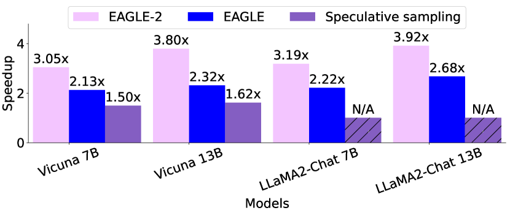
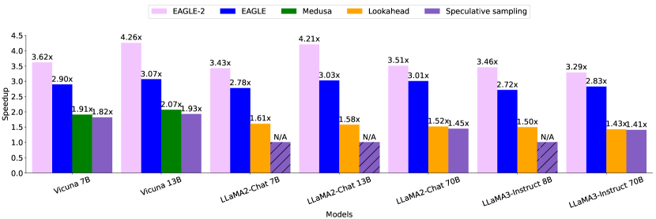
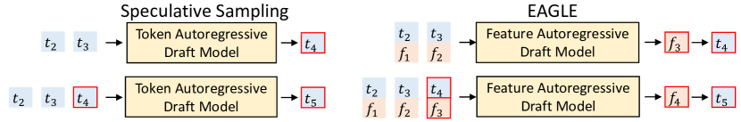
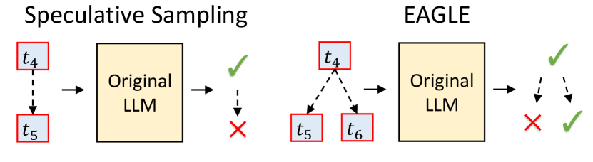
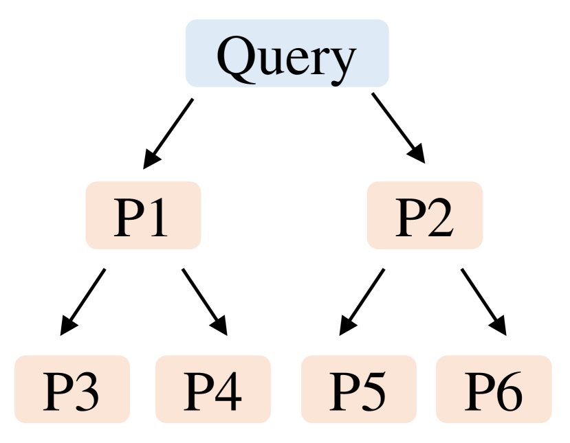
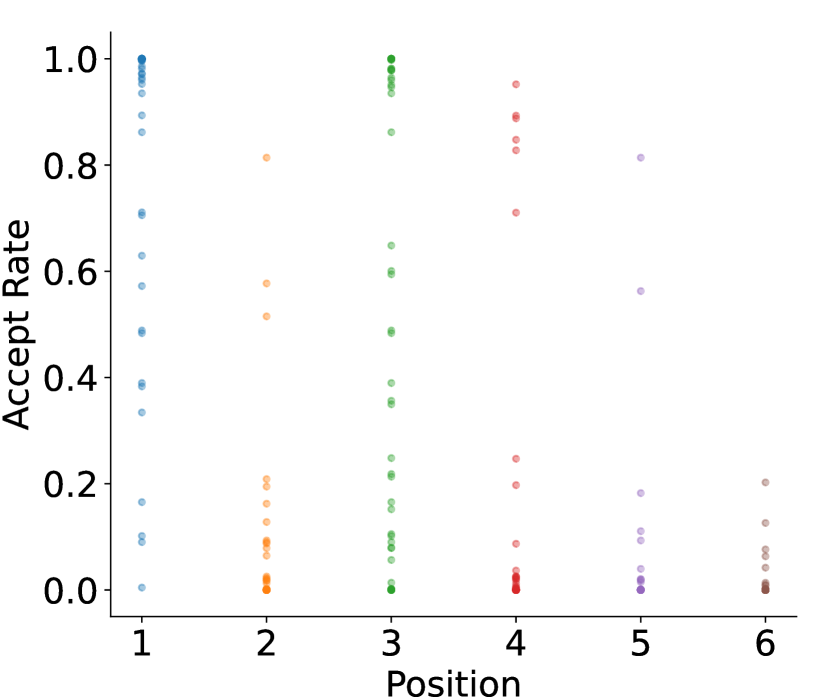
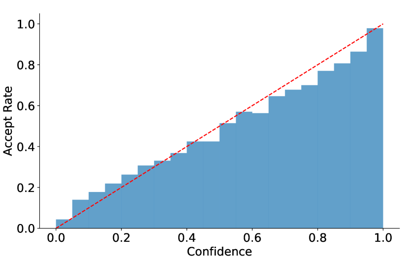
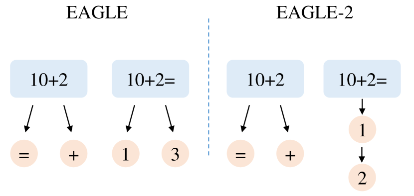
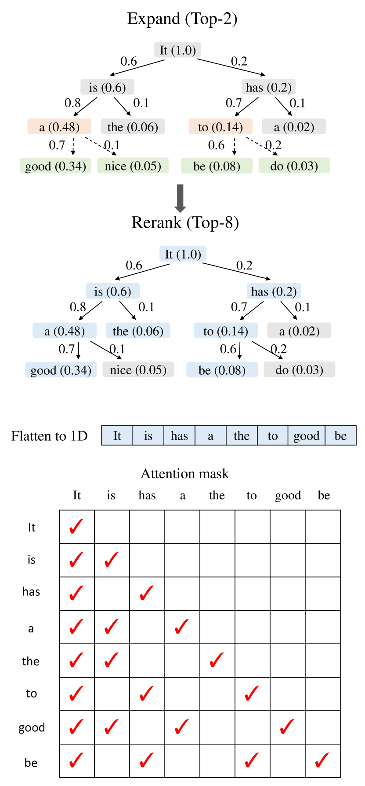

# EAGLE-2：用动态 Draft Tree 加速投机解码

!!! info "论文信息"
    - 论文：`EAGLE-2: Faster Inference of Language Models with Dynamic Draft Trees`
    - 链接：[arXiv:2406.16858](https://arxiv.org/abs/2406.16858)
    - 版本：2024-06-24 首版，2024-06-30 修订为 v2
    - 代码：[GitHub: SafeAILab/EAGLE](https://github.com/SafeAILab/EAGLE)
    - 关键词：speculative sampling、dynamic draft tree、tree attention、confidence calibration、lossless acceleration、average acceptance length

!!! info "事实版本"
    | Checked Date | Official Source | Repro Status | Notes |
    | --- | --- | --- | --- |
    | 2026-05-16 | [arXiv:2406.16858](https://arxiv.org/abs/2406.16858) | Author Code / Official Repo | 未见本站记录的第三方独立复现；按论文与作者代码/模型资源保守引用。 |

### Evidence Snapshot

| Claim | Direct Source | Figure/Table/Setting | Evidence Type | Repro Status | Can Support | Cannot Prove |
| --- | --- | --- | --- | --- | --- | --- |
| `EAGLE-2: Faster Inference of Language Models with Dynamic Draft Trees` 的核心结果在论文设置下成立 | [arXiv:2406.16858](https://arxiv.org/abs/2406.16858) | 主实验、架构图或 benchmark setting | Paper Result | Paper Only | 支撑本页对该方法机制、任务设置和局部收益的介绍 | 不证明跨数据分布、跨硬件、真实部署或第三方独立复现成立 |
| 本页把方法接回世界模型/效率主线 | 本站综合判断 | 成本账、失败边界与相邻专题链接 | Site Inference | Site Inference | 支撑阅读路线、实验设计和工程优先级假设 | 不能替代原论文 claim，也不能证明 closed-loop 或生产收益 |

!!! warning "读数边界"
    本页若引用结果表，只能按论文 benchmark、数据集、硬件和评测协议解释；需额外确认是否 closed-loop、是否真实机器人、是否系统吞吐、是否独立复现，不能把单项分数直接外推为规划收益或部署安全。

EAGLE-2 的核心很漂亮：**不重新训练 draft model，只用 draft model 自己的 confidence score 动态调整 draft tree 的形状。** 它抓住了 EAGLE 里一个被低估的事实：draft token 的接受率不仅和它在树里的位置有关，也和当前上下文有关。

如果 EAGLE 是“用 feature-level draft 提高草稿质量”，EAGLE-2 就是“把固定草稿树改成按上下文自适应的草稿树”。它仍然使用原 LLM 做验证，不微调原模型，也不放宽接受条件，因此在标准 speculative sampling 规则下保持 lossless acceleration。

## 它的效率贡献是什么

| Dimension | EAGLE-2 |
| --- | --- |
| Saved cost | Autoregressive decode steps、target model forward calls per generated token、static draft tree 中低价值分支的 verification overhead |
| Main idea | Use the draft model confidence score to approximate acceptance probability and build a context-aware dynamic draft tree |
| Algorithm core | Expansion by path value \(V_i\), reranking all draft nodes, flattening selected nodes for target-model verification |
| Training requirement | No additional model training beyond the existing EAGLE draft model; no separate tree predictor is trained |
| Inference role | Lossless speculative sampling when standard target-model verification is used |
| Main risk | Benefit depends on draft confidence calibration, tree attention efficiency, batch scheduling, and whether task distribution matches draft-model training data |
| Connect to | [缓存、路由与投机解码](../../inference/caching-routing-and-speculative.md)、[推理运行时](../../inference/serving-runtimes-vllm-sglang-and-tensorrt-llm.md)、[EAGLE-3](eagle-3.md) |

## 证据等级与外推边界

这篇论文的证据链很清楚：先证明 static draft tree 的位置假设不够，再证明 confidence score 可以近似 acceptance rate，然后给出动态建树算法和消融。

| 论文结论 | 证据来源 | 证据等级 | 可外推到高效推理 | 不能直接外推 |
| --- | --- | --- | --- | --- |
| Draft token 接受率有上下文差异 | Figure 5：同一树位置的 acceptance rate 有明显方差 | Diagnostic evidence | draft tree 不应只按固定位置模板建 | 不能说明所有 draft model 都可动态树化 |
| Draft confidence 可近似 acceptance rate | Figure 6：confidence interval 与平均接受率强相关 | Calibration evidence | 可以用 draft 侧低成本信号做 tree policy | confidence 失准时动态树会误选分支 |
| Dynamic tree 提高 acceptance length | Table 1/2：EAGLE-2 的 \(\tau\) 普遍高于 EAGLE | Benchmark | 更长接受前缀能减少 target model 调用 | 不等于所有 runtime 都有同等端到端 speedup |
| Value + reranking 都有贡献 | Table 3 消融 | Ablation | 不能只做局部 confidence top-k，还要看路径概率和最终树结构 | 真实系统还要考虑 attention mask 和 flatten 开销 |
| 不改变输出分布 | 标准 speculative sampling 验证规则 | Algorithm guarantee | 适合高质量线上服务的保守加速 | 若放宽接受条件或改采样规则，lossless 保证不自动成立 |

## 论文位置：从 Static Tree 到 Dynamic Tree

标准 speculative sampling 通常是一条 draft chain。EAGLE 把它改成 tree-structured draft，这样某个分支被拒绝时还可以尝试其他分支。但 EAGLE 的树形状是固定的：无论 prompt 简单还是困难，都按同一套 tree shape 扩展。

EAGLE-2 认为这个假设太粗。比如问题是 `10+2=`，下一个 token 很可能是 `1`，继续扩多个低概率分支是在浪费；但如果 prompt 是 `10+2`，下一步可能还没形成确定答案，多保留候选分支就更合理。

{ width="760" }

<small>图源：`EAGLE-2`，Figure 1。原论文图意：temperature=1 时，EAGLE-2 在 MT-bench 上相对多种 speculative sampling 方法取得更高 speedup；论文只比较保持输出分布不变的 speculative sampling 方法。</small>

!!! note "这张图怎么读"
    **输入输出**：输入是上下文特征、候选草稿树和置信度信号，输出是动态 draft tree 与被接受 token。  
    **效率机制**：动态树把计算集中到更可能被接受的位置，减少低收益 draft 分支。  
    **对主线意义**：它适合说明推理成本里的“平均吞吐”和“acceptance 分布”要一起看。  
    **不能证明什么**：动态 draft tree 不能证明模型知识、推理能力或闭环任务质量提升。

{ width="760" }

<small>图源：`EAGLE-2`，Figure 2。原论文图意：temperature=0 时，EAGLE-2 在 MT-bench 上同样优于 EAGLE 等方法；部分模型缺少合适 draft model 时标为 N/A。</small>

!!! note "这两张图怎么读"
    图里的重点不是每个柱子的绝对值，而是 EAGLE-2 在非贪心和贪心设置下都能保留优势。它不靠放宽接受条件换速度，而是让同样数量或相近数量的 draft token 更集中在高接受概率路径上。

## 背景：EAGLE 的 Feature-level Draft

EAGLE 不像普通 speculative sampling 那样用小 LLM 直接预测 token chain。它在 target model 的 feature space 里自回归预测，然后复用原 LLM 的 LM head 得到 draft token。为了处理采样带来的 feature uncertainty，EAGLE 还把前一步采样 token 的 embedding 输入 draft model。

{ width="760" }

{ width="760" }

<small>图源：`EAGLE-2`，Figure 3。原论文图意：EAGLE 在 drafting stage 做 feature-level autoregression，在 verification stage 使用 tree-structured draft；图中 \(e_i\) 表示 token embedding，\(f_i\) 表示 LM head 前的 feature vector。</small>

EAGLE-2 没有改变这个 draft model，也没有改变 target model verification。它只问一个更系统的问题：**既然 EAGLE 已经能给每个 draft token 一个概率，为什么还要用固定树形状？**

## 观察一：Acceptance Rate 不是只由位置决定

EAGLE、Medusa 这类 static draft tree 隐含一个假设：树里某个位置的 token 接受率相对稳定，所以 tree shape 可以固定。但 Figure 5 显示，同一位置的 acceptance rate 在不同 query 上有很大方差。

{ width="620" }

{ width="620" }

<small>图源：`EAGLE-2`，Figure 5。原论文图意：左图标出 draft tree 里的 P1-P6 位置；右图显示 Alpaca + Vicuna 7B 上这些位置的 acceptance rate，点代表不同 query。</small>

这张图支撑的判断是：位置当然重要，P1 通常比 P6 更容易接受；但上下文同样重要，同一 P3 或 P4 在不同 query 上接受率可能差很多。固定树会把 token budget 浪费在一些当前上下文里明显低概率的分支上。

## 观察二：Draft Confidence 可以近似 Acceptance Rate

如果要动态建树，最自然的信号是每个 draft token 的真实接受率。但真实接受率需要 target model forward 才知道，这会抵消 speculative decoding 的目标。EAGLE-2 的关键发现是：EAGLE draft model 的 confidence score 和 acceptance rate 相关性很强。

{ width="680" }

<small>图源：`EAGLE-2`，Figure 6。原论文图意：Vicuna 7B 上，draft confidence score 分桶后的平均 acceptance rate 接近红色 \(y=x\) 参考线；低于 0.05 的 confidence 对应约 0.04 的接受率，高于 0.95 的 confidence 对应约 0.98 的接受率。</small>

这就是 EAGLE-2 可行的原因：不用 target model 先验验证，也不用训练额外 policy model，直接用 draft model 已经输出的概率来估计接受概率。

## 方法：Expansion + Reranking

EAGLE-2 的动态树分两步：先扩展，再重排。

在 draft tree 里，某个 token 是否最终被接受，不只取决于它自己，还取决于从 root 到它的所有祖先是否被接受。因此论文定义节点 \(t_i\) 的 value：

\[
V_i=\prod_{t_j \in \mathrm{Path}(\mathrm{root},t_i)}p_j
\approx
\prod_{t_j \in \mathrm{Path}(\mathrm{root},t_i)}c_j
\]

其中 \(p_j\) 是真实 acceptance rate，\(c_j\) 是 draft model confidence score。因为真实 \(p_j\) 昂贵，所以 EAGLE-2 用 \(c_j\) 的路径乘积近似全局接受概率。

| Phase | What EAGLE-2 does | Why it matters |
| --- | --- | --- |
| Expansion | Select top-\(k\) nodes with the highest value in the latest layer and expand them with the draft model | 避免指数扩展，把 draft compute 用在更可能被接受的路径上 |
| Reranking | Rerank all draft nodes by value and select top-\(m\) nodes | 深层节点 value 会自然变小，浅层未扩展节点可能更值得验证 |
| Tie-breaking | For same value, prioritize shallower nodes | 保证最终选出的 top-\(m\) nodes 仍能形成 connected tree |
| Flattening | Flatten selected nodes into a 1D sequence for verification | 让 target model 可以一次 forward 验证候选 |
| Attention mask | Each token can only see its ancestor nodes | 保持 tree branch 之间不可见，避免破坏自回归一致性 |

{ width="760" }

<small>图源：`EAGLE-2`，Figure 4。原论文图意：EAGLE 使用固定 draft shape；EAGLE-2 根据上下文调整分支数量，简单上下文少扩分支，困难上下文多保留候选。</small>

{ width="760" }

<small>图源：`EAGLE-2`，Figure 7。原论文图意：边上的数字是 draft model confidence，方块中的括号数字是节点 value；expansion phase 选择当前层 value 最高的节点扩展，rerank phase 从所有节点里选 top nodes，最后根据树结构构造 attention mask。</small>

!!! tip "这里最容易漏掉的工程点"
    Dynamic tree 不是只改变候选 token 排序，还会改变 target verification 的 attention mask。flatten 后的一维序列里，不同分支 token 不能互相看见，只能看见祖先节点。否则验证阶段就不再等价于原始自回归分布。

## 训练相关细节：EAGLE-2 本身不额外训练，但很依赖 Draft Model

论文明确强调：EAGLE-2 相比 EAGLE **不需要训练任何额外模型**。它不训练 tree predictor，不更新 original LLM，也不放宽接受条件。它只是利用 draft model 本来就会输出的 probability/confidence。

但这不代表训练不重要。EAGLE-2 的动态树建立在两个前提上：

1. draft model 本身要够准；
2. draft model 的 confidence 要和真实 acceptance rate 校准得足够好。

论文里和训练有关的细节可以整理成下面这张表：

| Component | Training / setup detail |
| --- | --- |
| EAGLE-2 algorithm | No additional training; no separate model for tree structure prediction |
| Original LLM | Not fine-tuned or updated |
| EAGLE draft model | Vicuna and LLaMA2-Chat draft models use officially released weights |
| LLaMA3-Instruct draft model | Trained using the ShareGPT dataset, consistent with Medusa and Hydra |
| PLD / Lookahead | No training required |
| Medusa / Hydra / EAGLE / EAGLE-2 | Use SFT datasets for draft-model training |
| Standard Speculative Sampling | Uses Vicuna-68M as draft model; it uses both pre-training and SFT datasets, with pre-training data much larger |

这解释了论文里一个重要现象：Natural Questions 和 CNN/Daily Mail 上，Medusa、Hydra、EAGLE、EAGLE-2 的 \(\tau\) 与 speedup 都比其他任务低一些。作者认为原因可能是 draft model 只用了 SFT 数据，世界知识问答主要来自 pretraining，summarization 在 SFT 数据里覆盖也不足。也就是说，**EAGLE-2 不新增训练，但它的上限仍然被 draft model 的训练数据分布卡住。**

Appendix A 还给了具体实现设置：

| Method | Implementation detail |
| --- | --- |
| Vanilla | HuggingFace Transformers with PyTorch backend and pre-allocated KV cache |
| Standard Speculative Sampling | Assisted generation feature from HuggingFace Transformers |
| PLD / Lookahead / Medusa / Hydra | Default settings and officially released weights |
| EAGLE | Official draft weights for Vicuna and LLaMA2-Chat; ShareGPT-trained draft for LLaMA3-Instruct |
| EAGLE-2 | Total draft tokens: `60` for 7B/8B, `50` for 13B, `48` for 70B; draft tree depth `6`; select `10` nodes during expansion |

## 实验设置：模型、任务和指标

论文实验覆盖三组模型和六类任务：

| Category | Details |
| --- | --- |
| Models | Vicuna 7B/13B, LLaMA2-Chat 7B/13B/70B, LLaMA3-Instruct 8B/70B |
| Tasks | MT-bench, HumanEval, GSM8K, Alpaca, CNN/Daily Mail, Natural Questions |
| Baseline | Vanilla autoregressive decoding, speedup ratio `1.00x` |
| Metrics | Speedup Ratio and Average Acceptance Length \(\tau\) |
| Quality evaluation | Not separately evaluated because EAGLE-2 keeps original LLM verification and is lossless under standard rules |

论文强调 \(\tau\) 是硬件无关指标：它表示每次 drafting-verification cycle 平均生成多少 token。缺点是它不反映 draft model 开销，所以最终仍要看真实 speedup。

## Table 1：EAGLE vs EAGLE-2 的核心结果

Table 1 很大，下面抽出 EAGLE 和 EAGLE-2 的关键行，保留原表的英文列名和 \(\tau\) 指标。完整表还包括 SpS、PLD、Medusa、Lookahead、Hydra。

| Model | Temperature | Method | MT-bench Speedup | MT-bench \(\tau\) | Mean Speedup | Mean \(\tau\) |
| --- | ---: | --- | ---: | ---: | ---: | ---: |
| V 13B | 0 | EAGLE | 3.07x | 3.98 | 2.95x | 3.82 |
| V 13B | 0 | EAGLE-2 | 4.26x | 4.83 | 4.04x | 4.65 |
| L2 13B | 0 | EAGLE | 3.03x | 3.90 | 3.09x | 3.89 |
| L2 13B | 0 | EAGLE-2 | 4.21x | 4.75 | 4.10x | 4.68 |
| V 7B | 0 | EAGLE | 2.90x | 3.94 | 2.78x | 3.79 |
| V 7B | 0 | EAGLE-2 | 3.62x | 4.98 | 3.39x | 4.68 |
| L2 7B | 0 | EAGLE | 2.78x | 3.62 | 2.78x | 3.71 |
| L2 7B | 0 | EAGLE-2 | 3.43x | 4.70 | 3.43x | 4.64 |
| V 13B | 1 | EAGLE | 2.32x | 3.20 | 2.39x | 3.39 |
| V 13B | 1 | EAGLE-2 | 3.80x | 4.40 | 3.65x | 4.26 |
| L2 13B | 1 | EAGLE | 2.68x | 3.45 | 2.64x | 3.53 |
| L2 13B | 1 | EAGLE-2 | 3.92x | 4.51 | 3.88x | 4.51 |
| V 7B | 1 | EAGLE | 2.13x | 3.17 | 2.18x | 3.20 |
| V 7B | 1 | EAGLE-2 | 3.05x | 4.28 | 2.94x | 4.20 |
| L2 7B | 1 | EAGLE | 2.22x | 3.30 | 2.32x | 3.37 |
| L2 7B | 1 | EAGLE-2 | 3.19x | 4.41 | 3.15x | 4.41 |

<small>表源：`EAGLE-2`，Table 1 摘录。原论文表意：EAGLE-2 在多模型、多任务、temperature=0/1 设置下普遍提高 speedup ratio 和 average acceptance length。</small>

读这张表要注意两点。第一，EAGLE-2 对 temperature=1 也有效，说明它不是只服务 greedy decoding。第二，它的平均 \(\tau\) 通常提升到约 `4-5.5` token/cycle，这就是 target model 调用次数下降的直接来源。

## Table 2：70B 与 LLaMA3 设置

| Model | Method | Speedup | \(\tau\) |
| --- | --- | ---: | ---: |
| LLaMA2-Chat 70B | PLD | 1.31x | 1.39 |
| LLaMA2-Chat 70B | Lookahead | 1.52x | 1.64 |
| LLaMA2-Chat 70B | EAGLE | 3.01x | 3.81 |
| LLaMA2-Chat 70B | EAGLE-2 | 3.51x | 4.48 |
| LLaMA3-Instruct 70B | EAGLE | 2.83x | 3.62 |
| LLaMA3-Instruct 70B | EAGLE-2 | 3.29x | 4.16 |
| LLaMA3-Instruct 8B | EAGLE | 2.72x | 3.65 |
| LLaMA3-Instruct 8B | EAGLE-2 | 3.46x | 4.53 |

<small>表源：`EAGLE-2`，Table 2。原论文表意：在 MT-bench、temperature=0 上，EAGLE-2 在 LLaMA2-Chat 70B、LLaMA3-Instruct 70B/8B 上均优于 EAGLE。</small>

70B 上的速度提升很关键，因为投机解码真正有价值的场景通常是 target model 足够大、decode 足够贵。EAGLE-2 没有增加新训练流程，能在这一级别上提升 \(\tau\)，说明动态树本身确实带来了更好的 draft token budget 分配。

## Table 3：Value 和 Reranking 的消融

| Method | MT-bench Speedup | MT-bench \(\tau\) | GSM8K Speedup | GSM8K \(\tau\) |
| --- | ---: | ---: | ---: | ---: |
| w/o both | 2.81x | 3.92 | 2.85x | 3.93 |
| w/o value | 3.21x | 4.39 | 2.93x | 3.96 |
| w/o reranking | 3.48x | 4.86 | 3.50x | 4.85 |
| EAGLE-2 | 3.62x | 4.98 | 3.63x | 4.97 |

<small>表源：`EAGLE-2`，Table 3。原论文表意：路径 value 和 reranking 都对速度与接受长度有贡献；同时使用二者效果最好。</small>

这张消融能解释 EAGLE-2 为什么不是“confidence top-k”这么简单。只看当前 token 的 confidence 是局部判断，不能反映祖先链路的全部接受概率；只扩展不 rerank，又可能把一些浅层高 value 节点排除在 verification 之外。

## 和 EAGLE-3 的关系

EAGLE-2 和 EAGLE-3 很适合连读：

| Paper | It changes | It does not change | Main bottleneck it targets |
| --- | --- | --- | --- |
| EAGLE-2 | Draft tree shape and node selection | Draft model training objective | Static tree wastes token budget under context-dependent acceptance |
| EAGLE-3 | Draft model training objective and feature input | Standard target-model verification | Feature prediction constraint and multi-step draft distribution shift |

所以 EAGLE-2 更像一个 inference-time policy：用已校准 draft confidence 建更好的树。EAGLE-3 则更像 training-time and architecture upgrade：让 draft model 本身在多步预测上更强、更可扩展。

## 局限与工程风险

第一，EAGLE-2 的前提是 confidence calibration。如果 draft model 对某类任务过度自信或系统性低估，dynamic tree 会把预算投错分支。

第二，动态树会改变 verification 阶段的 mask 和 token flatten 方式。实现不当时，branch 之间互相可见会破坏分布一致性；实现太重时，tree attention 和调度开销会吃掉 speedup。

第三，\(\tau\) 高不等于线上 P95 一定好。真实 serving 还要看 batch、prefill/decode 混合、KV cache 临时分支、scheduler 合批，以及哪些请求桶启用 speculative。

第四，训练数据覆盖会影响 draft model 能力。论文已经观察到 Natural Questions 和 CNN/Daily Mail 上的收益相对低，提示 world knowledge 与 summarization 这类数据在 SFT draft 训练里可能不足。

## 项目启发

EAGLE-2 最值得记住的是：**推理时的候选结构也可以用模型自己的置信度动态调度。**

这给高效推理带来一个通用思路：不要只优化模型前向本身，还要优化“把哪些候选送去昂贵验证”的策略。对 speculative decoding、检索重排、工具调用候选、甚至多步 agent plan 来说，昂贵模块前面的 cheap confidence signal 都可能决定端到端成本。

落地时可以按这几个问题验收：

| Question | Why it matters |
| --- | --- |
| Draft confidence 是否校准 | EAGLE-2 的 value 近似依赖 confidence 与 acceptance rate 的相关性 |
| Acceptance 是否按任务分桶统计 | 不同任务、温度、输出长度会改变动态树收益 |
| Tree mask 是否严格按 ancestor 构造 | 这是保持 lossless verification 的关键 |
| \(\tau\) 和 speedup 是否一起看 | \(\tau\) 衡量算法，speedup 衡量系统 |
| Draft training data 是否覆盖目标任务 | SFT-only draft 在知识问答和总结任务上可能吃亏 |

如果把 EAGLE-2 接到线上推理系统，它不是一个孤立算法，而是一套 draft policy、tree attention、verification mask、runtime scheduler 和观测指标共同组成的工程路径。
