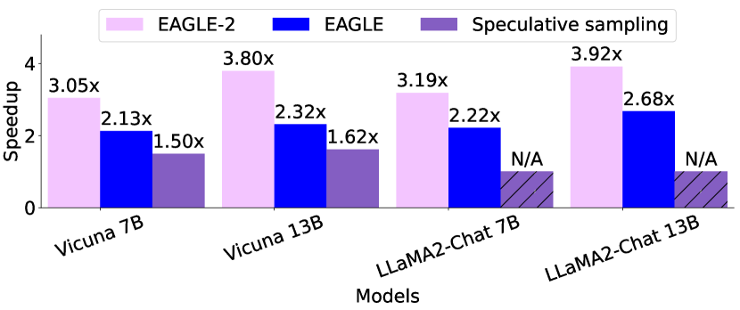
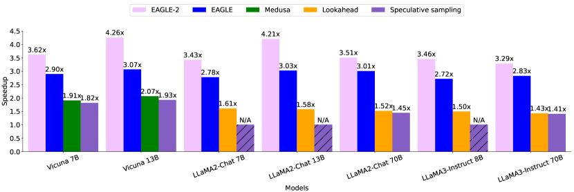
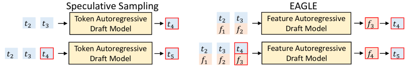
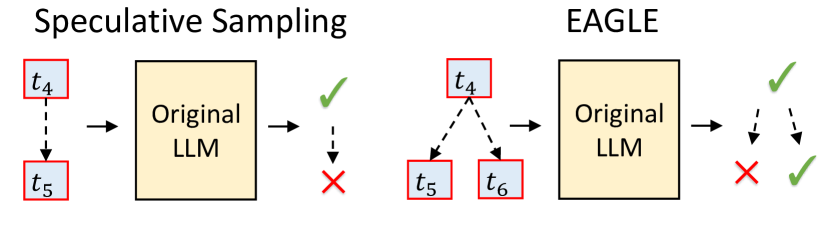
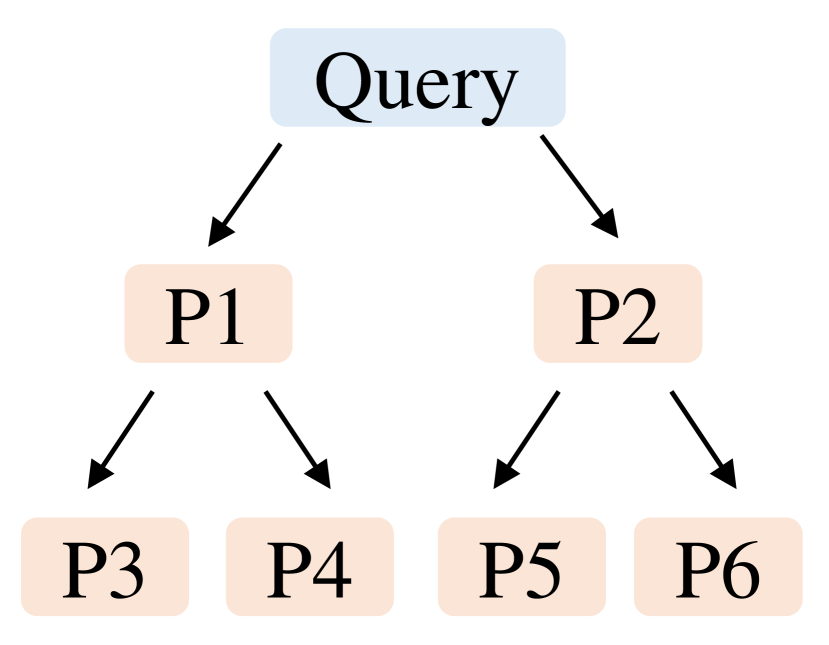
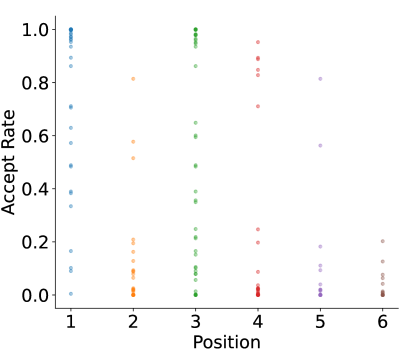
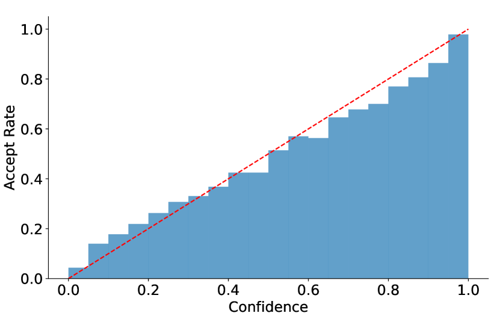
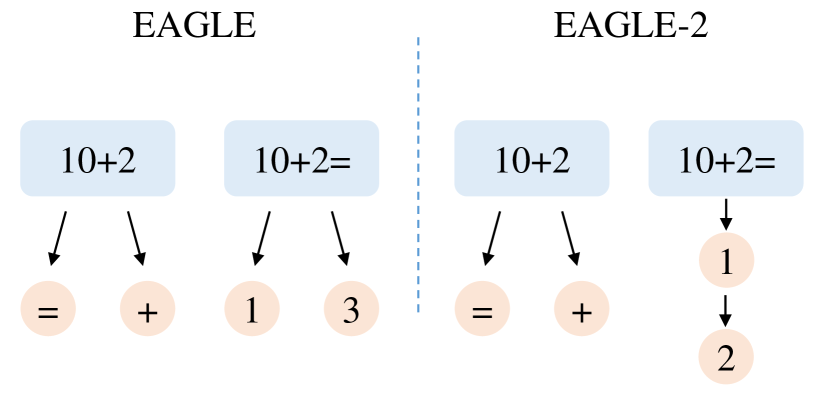
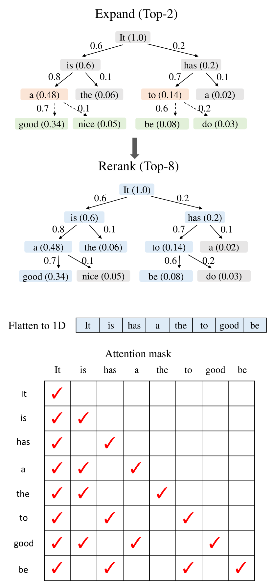

# EAGLE-2：用动态 Draft Tree 加速投机解码

!!! info "论文信息"
    **论文题名：** EAGLE-2: Faster Inference of Language Models with Dynamic Draft Trees。 
    **作者：** Yuhui Li、Fangyun Wei、Chao Zhang、Hongyang Zhang。 
    **机构：** 未在公开元数据中稳定解析；以 arXiv/PDF 或官方页 affiliation block 为准。 
    **时间 / 主题：** 2024-06；高效推理。 
    **arXiv / 官方报告：** arXiv：[2406.16858](https://arxiv.org/abs/2406.16858)；官方材料：[huggingface.co/papers/2406.16858](https://huggingface.co/papers/2406.16858)。 
    **GitHub / 项目：** GitHub：未找到官方链接；项目页：[huggingface.co/papers/2406.16858](https://huggingface.co/papers/2406.16858)。 
    **元数据来源与核验口径：** 来源：[arXiv](https://arxiv.org/abs/2406.16858)；[官方 / 项目材料](https://huggingface.co/papers/2406.16858)；Checked Date：2026-06-04；Repro Status：Paper / official materials reviewed, independent reproduction not claimed。

## 同一棵草稿树，为什么会在不同上下文里浪费预算

EAGLE 已经能通过目标模型特征生成高接受率草稿，但它始终按预设树形状分配候选。有些上下文下一 token 几乎确定，应把预算用于往深处走；另一些上下文有多个合理分支，增加宽度可能更有用。固定树无法根据这一差别调整。

EAGLE-2 保留 EAGLE 草稿模型和精确验证规则，把改动集中在树的扩展与筛选。它利用草稿置信度估计候选被接受的可能性，并且考虑整条祖先路径；因此不需要再训练一个专门预测树形状的网络。[↗](https://arxiv.org/pdf/2406.16858v2#page=4)

草稿树的预算有两个方向。增加深度，是希望一次验证后连续走出更多 token；增加宽度，是给同一位置准备替代续写。二者都消耗目标模型的验证容量。若某条分支在很早的地方就被拒绝，为它准备的深层后代也无法进入输出，即使那些后代在各自条件下很容易预测。因此，树形状不是展示草稿的方式，而是决定这次大模型 forward 把计算花在哪里。

原 EAGLE 给所有上下文使用同一个预先安排的形状。EAGLE-2 则把每次草拟过程中已经产生的概率拿来调度：较确定时继续深入，有歧义时为多个分支保留位置。它没有修改目标模型权重，也没有另加一个树结构预测器。本文的核心问题因此可以精确表述为：**草稿模型相同、目标分布相同，怎样重新分配候选预算，让每次验证推进更多有效 token？**[↗](https://arxiv.org/pdf/2406.16858v2#page=2)

下面的温度 1 与温度 0 图是两个独立条件。相同模型在采样更随机时通常更难连续预测；不同温度的倍数不能拼成一个统一排行榜。

{ width="690" }

{ width="690" }

## 基础接口没变，变的是把哪些草稿交给大模型

EAGLE 的草稿 head 接收 LM head 前的特征和提前一个时间步的 token embedding。它预测下一特征，再经目标 LM head 得到 token 分布。下面的草稿图说明这种内部特征复用与独立小 LLM 的差别。

{ width="690" }

验证阶段，目标模型用 tree attention 一次计算多个候选的条件分布。不同分支不可互相看见；接受或拒绝仍服从 speculative sampling 规则。对目标分布 $p$、草稿分布 $q$，接受概率是 $\min(1,p(\hat t)/q(\hat t))$，拒绝后使用归一化的 $\max(0,p-q)$ 残差分布。

{ width="690" }

动态树只改变候选集合及其组织方式，不靠放宽接受规则获得加速。这是“无损”的来源，也解释了为什么草稿预测得不好时主要损失速度，而不是由算法主动牺牲目标模型的分布。

这里有两个不同的概率用途。构树时，confidence 决定哪些候选值得准备，它可以是近似信号；验证时，目标模型的条件概率和精确接受规则决定哪些 token 真正输出，不能用 confidence 阈值替代。假如直接把草稿概率高于 0.9 的候选当作“足够可信”而跳过目标验证，就已经改变了本文的正确性条件。

被接受路径对应的目标模型特征与 KV cache 会用于下一轮草拟，其他候选的临时状态不成为正式前缀。一次循环因此包含草拟、组织树、并行验证、提交接受路径四个环节。动态选择发生在中间，下一轮仍从已经确认的上下文继续。随机采样下的“无损”指输出分布保持一致，不要求不同实现消耗随机数的次序相同，因而也不是承诺同一个 seed 会逐字得到同一个回答。

## 两个观察让动态树成为可计算的方案

第一个问题是同一树位置的接受率是否随上下文变化。作者在 Vicuna 7B 与 Alpaca 上测量若干固定位置：整体上较浅、较高概率的节点更容易接受，但同一位置的不同 query 有很大方差。

先看位置示意，再对照散点图。横轴相同位置上的纵向离散程度，才是“不能只按位置分配预算”的证据。

{ width="620" }

{ width="620" }

第二个问题是能否在调用目标模型之前估计这种差别。实验发现草稿 confidence 与接受率强相关：低于 0.05 的区间平均接受率约 0.04，高于 0.95 的区间约 0.98。下面的校准图支持把它用作廉价调度信号。[↗](https://arxiv.org/pdf/2406.16858v2#page=4)

{ width="690" }

位置散点与校准图回答的不是同一个问题。Figure 5 告诉我们，固定位置不能充分决定接受机会，所以静态树会浪费预算；Figure 6 才提供一个在真正验证前就可取得的替代信号。对于特征自回归的 EAGLE，草稿复用目标模型的内部表示和 LM head，置信度在该实验中有较好的校准关系，这使在线调度不必再运行昂贵的预测网络。

但不能只保留 Figure 6 的斜线而忽略它的统计口径。每根柱汇总的是落入某个置信度区间的候选接受情况，并未声称某个具体 token 的接受概率就等于它的 softmax 值。调度只需这种排序信号整体有用；精确采样则由后续验证保证。

这里 confidence 并不在数学上等于接受概率。真实接受还涉及目标分布与草稿分布之比，图中关系是该模型与任务上的经验观察。动态树可以用近似信号来提高效率，最终正确性仍交给精确验证。

## 路径 value 解决“局部很稳、祖先不稳”的问题

一个深层节点只有在祖先路径被接受后才有机会进入结果。假设节点 $t_i$ 的路径上各点接受概率为 $p_j$，作者定义全局 value：

$$
V_i=\prod_{t_j\in\operatorname{Path}(root,t_i)}p_j
\approx\prod_{t_j\in\operatorname{Path}(root,t_i)}c_j,
$$

其中 $c_j$ 是草稿 confidence。路径上的概率应理解为对应前缀条件下的概率；乘积表达连续到达该节点的机会。

例如，作为解释性例子，一个节点自己的 confidence 为 0.95，但到达它之前要经过 confidence 0.2 的分支，路径值只有约 0.19；另一个节点局部只有 0.7、祖先为 0.9，路径值约 0.63。只按局部 confidence 选节点会偏向前者，按 value 则会优先后者。

下面的静态/动态示例用“10+2”展示直觉：加入等号后，某个续写更确定，预算应改变。具体树形是调度结果，而不是另一个语言模型的输出。

{ width="690" }

## 扩展与重排分别控制草稿成本和验证成本

扩展阶段只从最新一层选 value 最大的 $k$ 个节点并行继续生成，避免每层全部分支造成指数增长。它控制的是草稿模型下一次 forward 的输入规模。

重排阶段则回看已经生成的所有节点，从全树挑 value 最大的 $m$ 个送给目标模型。不能直接把扩展阶段选中的路径当成最终树，因为某个未继续扩展的浅层候选，可能比深层新节点更值得验证。

由于每个置信度在 0 到 1 之间，子节点 value 不会大于祖先。相等时优先浅层节点，就能使 top-$m$ 结果保持祖先连通。随后把树 flatten 为一维 token 输入，并根据父子关系构造 attention mask，让每个节点只看祖先。

这一连通性质让算法省去了一类复杂修补。若用任意局部打分从全树挑节点，可能选出孙节点却漏掉它的父节点，无法构成可验证的续写路径。路径乘积则保证，一旦深层节点进入 top-$m$，它分值不低的祖先也会优先进入；相同分值时再用深度处理并列。这个结论适用于论文这里的乘积打分与排序方式，不是所有“动态树”自动具备的性质。[↗](https://arxiv.org/pdf/2406.16858v2#page=5)

下面的总图上半部分展示局部逐层扩展，下半部分展示全局重排与 mask。两次选择发生在不同候选范围，作用也不同。

{ width="690" }

### 沿 Figure 7 把一次决策算完

根节点是 `It`，value 设为 1。第一层有 `is` 和 `has`，置信度分别为 0.6 与 0.2，对应路径值也为 0.6、0.2。第二层的数值开始体现祖先影响。

| Candidate path | Local confidence | Path value |
| --- | ---: | ---: |
| It → is → a | 0.8 | 0.6 × 0.8 = 0.48 |
| It → is → the | 0.1 | 0.6 × 0.1 = 0.06 |
| It → has → to | 0.7 | 0.2 × 0.7 = 0.14 |
| It → has → a | 0.1 | 0.2 × 0.1 = 0.02 |

图中扩展预算为 top-2，于是下一次并行草拟选择最新一层的 `a` 与 `to`。注意这两个 token 属于不同前缀，虽然会放进同一次草稿 forward，不能彼此混用上下文。`a` 分支继续产生 `good` 与 `nice`，其 value 为 $0.48\times0.7=0.336$、$0.48\times0.1=0.048$；`to` 分支产生 `be` 与 `do`，value 为 $0.14\times0.6=0.084$、$0.14\times0.2=0.028$。原图将这些数四舍五入为 0.34、0.05、0.08、0.03。

到了全局重排阶段，预算改为图示的 top-8，包含根节点。浅层 `the` 的 0.06 高于深层 `nice` 的约 0.05，因此虽然 `the` 没得到继续扩展的机会，最终却进入验证树；`nice` 被去掉。这个选择就是 reranking 的必要性：扩展阶段负责发现更深的候选，最终验证应重新比较所有已经发现的位置。

图中的一维排列为 `It, is, has, a, the, to, good, be`。它只是张量的存放顺序，不是一句连起来读的文本。检查 attention mask 中的 `good` 行，只允许读取 `It`、`is`、`a` 和它自己；`be` 行则读取 `It`、`has`、`to` 和它自己。两行共享 `It`，其余祖先不同。目标模型由此能在一次 forward 中处理两条条件正确的路径。[↗](https://arxiv.org/pdf/2406.16858v2#page=5)

这个小例子用了 top-2 与 top-8 便于展示，实际实验的预算更大。它展示的是同一套扩展与筛选规则，不是论文给所有模型采用的固定八节点树。

论文实现对 7B/8B、13B、70B 目标模型分别使用 60、50、48 个总草稿 token，树深 6，扩展阶段选 10 个节点。模型大小不同，验证额外候选的成本不同，这些预算是实验配置而非通用最佳值。EAGLE-2 复用原 EAGLE head；新目标模型仍需要自己的 head，所谓无需额外训练是相对于已经有合适 EAGLE 草稿权重而言。[↗](https://arxiv.org/pdf/2406.16858v2#page=12)

## 测试时固定了什么，又在比较什么

实验覆盖 Vicuna、LLaMA2-Chat、LLaMA3-Instruct 的多个规模。六类任务包括 MT-bench 对话、HumanEval 代码、GSM8K 数学、Alpaca 指令、CNN/DM 摘要和 Natural Questions 知识问答。同一个目标模型的草稿权重跨这些任务使用，而不是为每个测试集另训练一个 head。

普通自回归基线采用 Hugging Face Transformers、PyTorch backend 和预分配 KV cache；其余方法也基于相同模型实现。作者通过 Spec-Bench 组织比较，在同一设备上测试对应方法。Vicuna 与 LLaMA2-Chat 的 EAGLE head 使用已发布权重，LLaMA3-Instruct 的 head 则用 ShareGPT 训练。因此，“EAGLE-2 无需额外训练”指从已存在的 EAGLE 草稿到动态调度不增加训练，不意味着新目标模型不需要适配草稿。[↗](https://arxiv.org/pdf/2406.16858v2#page=12)

两个主要指标各自承担一个问题。**Average Acceptance Length $\tau$** 衡量每轮草拟—验证能够推进多少 token，较少受硬件影响；**Speedup Ratio** 衡量实际时间相对普通解码改善多少，同时包含草稿与验证开销。论文没有另用接受率作为主要指标，因为 head 的预测能力没有被重新训练；树的组织却能使同样的预测能力换来更长的有效路径。

可用一个成本分解帮助理解二者。这是解释性表达，不是论文单独测得的耗时分项：若普通解码每 token 需要 $T_{\mathrm{AR}}$，一轮动态树需要草拟 $T_D$、构树 $T_C$ 和验证 $T_V$，则稳态速度收益近似为

$$
\mathrm{Speedup}\approx
\frac{\tau\,T_{\mathrm{AR}}}{T_D+T_C+T_V}.
$$

增加节点可能同时提高分子和分母。模型规模、树深和节点总数的选择，实际是在这个关系中寻找平衡。所以既要检查 $\tau$ 是否增加，也要检查 wall-clock 是否真的下降。

## 主表把动态预算的收益与任务差异分开

Vicuna 13B、temperature 0 的同组比较如下。$\tau$ 是每轮平均接受长度，speedup 是相对普通解码的实测时间改善。

| 任务 | EAGLE speedup | EAGLE $\tau$ | EAGLE-2 speedup | EAGLE-2 $\tau$ |
| --- | ---: | ---: | ---: | ---: |
| MT-bench | 3.07× | 3.98 | 4.26× | 4.83 |
| HumanEval | 3.58× | 4.39 | 4.96× | 5.41 |
| GSM8K | 3.08× | 3.97 | 4.22× | 4.79 |
| Alpaca | 3.03× | 3.95 | 4.25× | 4.89 |
| CNN/DM | 2.49× | 3.52 | 3.40× | 4.21 |
| Natural Questions | 2.42× | 3.11 | 3.13× | 3.74 |
| 六任务平均 | 2.95× | 3.82 | 4.04× | 4.65 |

接受长度提高，说明同一草稿模型的候选被组织得更有效；wall-clock 提高则说明收益超过动态构树的额外成本。HumanEval 与 Natural Questions 的差异也提醒我们，投机收益依赖任务。作者将知识问答、摘要上的较弱表现与 SFT 草稿训练数据覆盖联系起来，这是对观察的解释，并非独立控制数据类型的因果消融。[↗](https://arxiv.org/pdf/2406.16858v2#page=7)

六任务平均加速从 2.95 倍到 4.04 倍，若按两个表中均值的比值计算，是约 $4.04/2.95-1=37\%$ 的相对提高。这是对汇总数值的换算，不是把各任务相对增幅再平均。平均接受长度从 3.82 到 4.65，增幅约 22%；两种比值不要求相等，因为树形组织也影响草拟与验证成本，且原表汇总的是不同任务上的指标。

对照其他方法时，可以进一步看到“多接受”为什么不能独立代表“更快”。同为 Vicuna 13B、temperature 0 的 CNN/DM，PLD 的 $\tau=2.50$、速度 2.42 倍；原 EAGLE 的 $\tau=3.52$，速度却只有 2.49 倍。PLD 通过检索构造草稿，开销低，能够把较短的接受长度转成接近同样的速度。EAGLE-2 则以 $\tau=4.21$ 达到 3.40 倍，在这组条件下将新增接受长度转化为更明显的实际收益。[↗](https://arxiv.org/pdf/2406.16858v2#page=7)

论文指出，代码中常见的固定模式有利于连续草拟；摘要里的上下文重叠则有利于检索式草稿。这些任务结构解释了为何选择草稿方式不能只按参数量。对于 QA 与摘要，作者还提出扩大草稿训练数据的可能价值，但本文没有通过重新配置数据的控制实验检验这一建议。

### 温度变化后，动态树是否仍然有效

| Vicuna 13B, Temperature = 1 | EAGLE speedup | EAGLE $\tau$ | EAGLE-2 speedup | EAGLE-2 $\tau$ |
| --- | ---: | ---: | ---: | ---: |
| MT-bench | 2.32× | 3.20 | 3.80× | 4.40 |
| HumanEval | 2.65× | 3.63 | 4.22× | 4.89 |
| Mean, six tasks | 2.39× | 3.39 | 3.65× | 4.26 |

这里仍能观察到更长的接受路径和更高的时间收益，说明动态调度的效果不限于贪心解码。非贪心主表没有把所有方法都列入：对放宽接受条件、不能保证相同目标分布的设置，作者不纳入这组无损比较。缺失的列不能当作方法不能运行，也不能与另一张采用不同接受标准的成绩直接混排。[↗](https://arxiv.org/pdf/2406.16858v2#page=7)

temperature 1 下，Vicuna 13B 的 MT-bench 从 2.32 倍提高到 3.80 倍。不能因为采样条件下仍有收益，就断言任意高温度、任意校准误差下都有同样提升。

### 更大目标模型与新模型家族的结果

Table 2 固定 MT-bench、temperature 0，单独检查 70B 目标和 LLaMA3 家族。这里的三行是同任务比较，不应与上一表的六任务平均直接相除。

| Target model | EAGLE speedup | EAGLE $\tau$ | EAGLE-2 speedup | EAGLE-2 $\tau$ |
| --- | ---: | ---: | ---: | ---: |
| LLaMA2-Chat 70B | 3.01× | 3.81 | 3.51× | 4.48 |
| LLaMA3-Instruct 70B | 2.83× | 3.62 | 3.29× | 4.16 |
| LLaMA3-Instruct 8B | 2.72× | 3.65 | 3.46× | 4.53 |

三组都提高了接受长度和实际速度，支持调度机制可以复用于不同目标模型。增益并不恒定：按表中比值，LLaMA3 8B 的相对速度改善约 27%，70B 约 16%。这种差异同时涉及草稿与目标模型的成本、预测表现和节点预算，论文没有通过只改变参数规模的一组控制实验把原因完全拆开。[↗](https://arxiv.org/pdf/2406.16858v2#page=8)

## 消融证明两次选择都在发挥作用

| Vicuna 7B，temperature 0 | MT-bench speedup | MT-bench $\tau$ | GSM8K speedup | GSM8K $\tau$ |
| --- | ---: | ---: | ---: | ---: |
| 不用 value，也不重排 | 2.81× | 3.92 | 2.85× | 3.93 |
| 用局部 confidence 替代 value | 3.21× | 4.39 | 2.93× | 3.96 |
| 不做最终重排 | 3.48× | 4.86 | 3.50× | 4.85 |
| 完整 EAGLE-2 | 3.62× | 4.98 | 3.63× | 4.97 |

value 的作用是把祖先路径纳入选择，重排的作用是把浅层未扩展节点重新纳入验证竞争。结果支持二者互补，但贡献大小随任务变化，不能把单个增量当成固定百分比。[↗](https://arxiv.org/pdf/2406.16858v2#page=8)

从 MT-bench 看，加入路径 value 但没有最终重排时，速度已达到 3.48 倍，重排再提高到 3.62 倍；如果有重排却只按局部 confidence 扩展，则为 3.21 倍。GSM8K 中局部 confidence 版本只有 2.93 倍，完整方法为 3.63 倍，祖先信息在这里尤其重要。两项设计各有作用，却并非相互独立、可以简单相加的固定增益。

还有一个细节值得保留：`w/o both` 的 MT-bench 为 2.81 倍，与主表原 EAGLE 的 2.90 倍并不相同。前者仍属于这套动态生成与预算配置的消融，不能把它直接改名为“原 EAGLE”，再用差值宣称完全隔离了全部改动。消融的可靠读法，是在它明确移除的组件范围内解释变化。

## 怎样把动态树接进已有推理服务

已有 EAGLE 实现时，最直接的改动落在候选调度与树张量构造。每个候选保存父节点、局部 confidence、累积 value；每轮扩展从最新层取 top-$k$，结束后从全部候选取 top-$m$，再生成目标模型所需的 ancestry mask 与节点映射。接受路径返回后，KV 与特征的提交必须使用同一套节点映射，否则即使排序正确也会把另一条分支的状态带入下一轮。

调参时应把展开深度、每层扩展数和最终验证节点数分开。扩大前两项主要增加候选发现成本，扩大最后一项直接增加目标验证规模。先固定论文给出的预算作为起点，再在目标任务上测量单轮开销与接受长度，才有依据决定应减少宽度还是深度。本文的 60、50、48 节点配置给出了可复用的实验起点，没有证明在所有设备、上下文长度和并发数下都最优。

论文这里没有进行完整的并发服务吞吐研究。把它接到大 batch 服务时，需要额外测量排队延迟、最大可用 batch、KV 占用与总 tokens/s；这些是部署决策中的检查项目，不是本文已经报告的实验结论。

工程上最有用的迁移是把草稿预算视为在线决策。应同时测接受长度、草稿耗时、验证耗时和临时缓存占用，而不是只优化 confidence 排序。如果目标模型在大 batch 下已经计算饱和，更多候选可能不再便宜；如果新领域 confidence 校准变差，动态树也可能误分配预算。EAGLE-2 提供了可复用的调度方法，其实际收益仍应在目标服务负载中测量。
