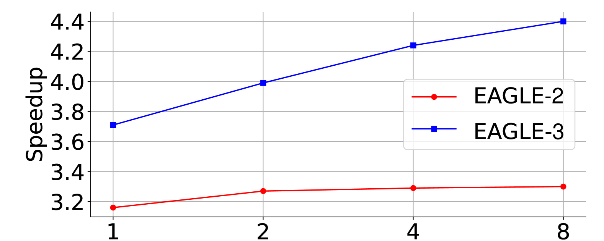
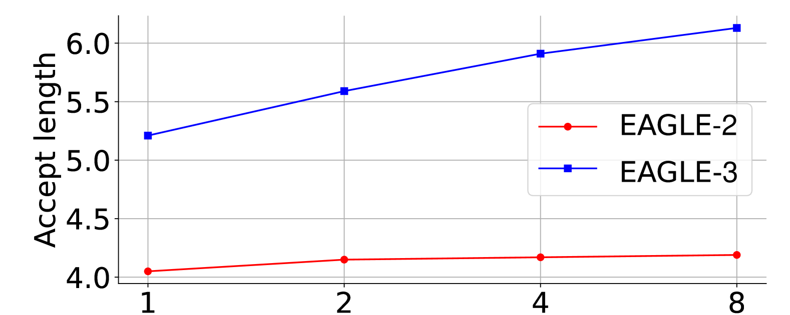
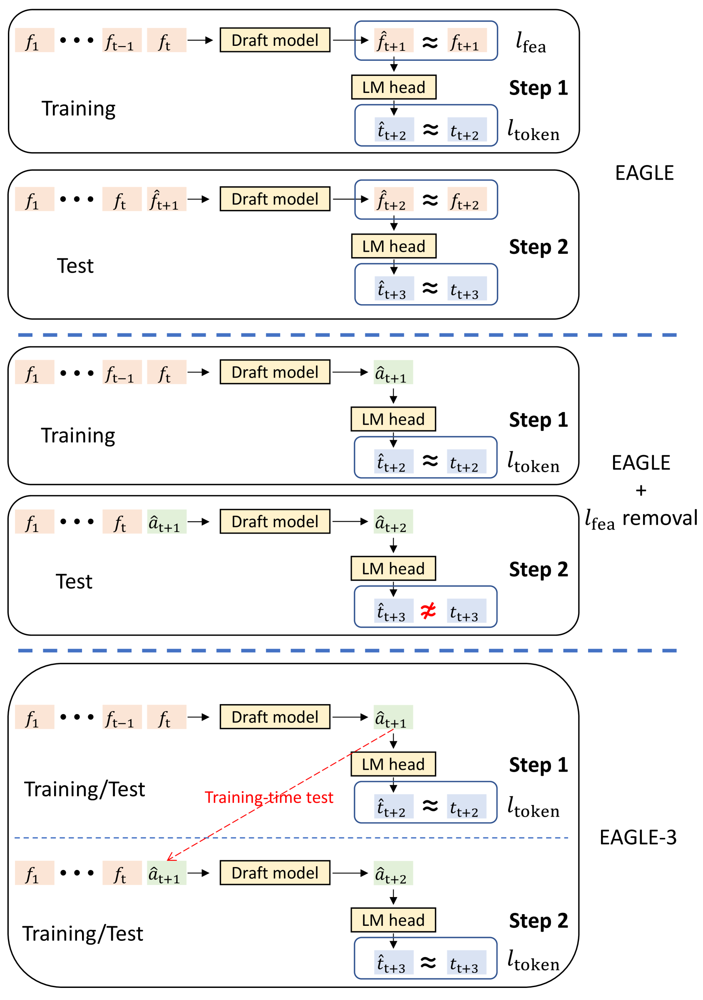
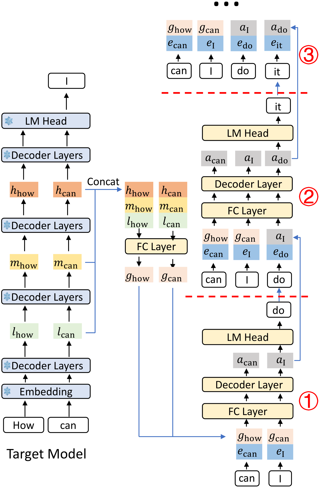
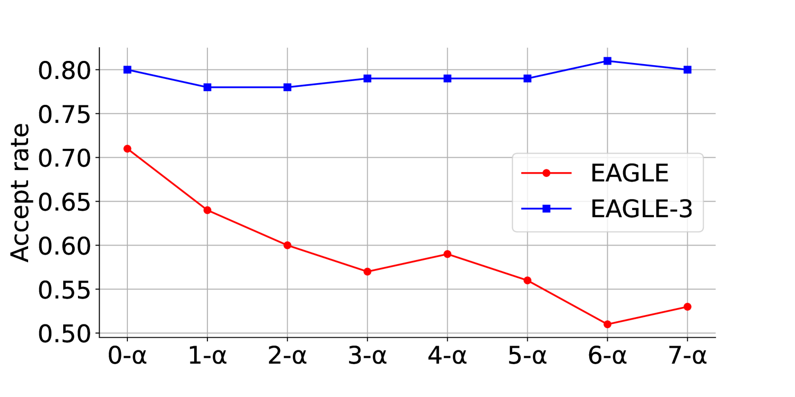

# EAGLE-3：为什么 draft model 要在训练时“见过自己犯错”

!!! info "本站判断"
    这页把《EAGLE-3：为什么 draft model 要在训练时“见过自己犯错”》当作机制和证据案例来读：先看它真正改变了哪个接口，再看实验、消融、scaling 或失败边界是否支撑这个 claim。

    Checked Date: 2026-06-04；Repro Status: Paper / official materials reviewed, independent reproduction not claimed.

EAGLE-3 继续解决投机解码里的同一个问题：怎么让便宜 draft path 猜出 target LLM 更可能接受的未来 token。它和 EAGLE 的关键差别不是“又换了一个小模型”，而是指出：**draft model 训练时如果只看真实前缀，推理时却要吃自己上一轮生成的前缀，多步 draft 就会分布偏移。**

EAGLE-3 的回答是 training-time test：在训练阶段就模拟测试时的递归 draft，让 draft model 见过自己生成的中间状态。这样它往后猜第 2、第 3、第 4 个 token 时，不会因为输入分布突然变成“自己造出来的前缀”而崩。

## 从 EAGLE 到 EAGLE-3：放弃 feature regression 约束

EAGLE 用 target LLM 的 second-to-top-layer feature 做 draft。这个思路很聪明，但原版 EAGLE 要求 draft head 预测 target feature，本质上有一个 feature regression constraint。这个约束让第一步 draft 比较稳，但也把 draft model 的表达空间绑死在“像不像 target feature”上；训练数据继续变多时，speedup 和 acceptance 的提升会变钝。

EAGLE-3 做了三件事：

| 改动 | 解决什么 |
| --- | --- |
| Direct token prediction | 不再强迫 draft output 回归 target feature，直接服务 token acceptance |
| Training-time test | 训练时模拟多步 draft，缓解推理时 exposure bias |
| Multi-layer feature fusion | 不只看 top-layer feature，而是融合低层、中层、高层特征 |

{ width="720" }

{ width="720" }

<small>图源：[EAGLE-3](https://arxiv.org/abs/2503.01840)，Figure 1。原图表达：在 LLaMA-Instruct 3.1 8B + MT-bench 上，EAGLE 随 draft 训练数据增加收益有限，而 EAGLE-3 的 speedup 和 acceptance length 随数据规模继续提高。本站读法：这张图的关键是“数据规模能不能转成更多 accepted tokens”。</small>

## Training-time test 是什么

普通训练类似 teacher forcing：模型总是看到真实前缀。投机解码的测试时刻不是这样。第 1 个 draft token 由 target feature 条件生成；第 2 个 draft token 的输入已经包含 draft model 自己刚才的输出；第 3 步又吃第 2 步的输出。越往后，输入越不像训练数据。

EAGLE-3 把这个过程搬到训练里：

```text
target features
  -> draft step 1 -> draft hidden/output a1
  -> feed a1 and sampled token back
  -> draft step 2 -> draft hidden/output a2
  -> feed a2 and sampled token back
  -> draft step 3 ...
```

训练时已经让 draft model 处理自己的中间输出，推理时多步递归就不再陌生。这就是 training-time test 的名字来源：把 test-time 的 draft 过程提前放进 training。

{ width="760" }

<small>图源：[EAGLE-3](https://arxiv.org/abs/2503.01840)，Figure 3。原图表达：EAGLE-3 不再预测 target feature，而是直接预测 token；训练阶段模拟测试阶段的多步生成。本站读法：看箭头如何把 draft model 自己的输出继续喂回下一步。</small>

## 多层 feature fusion 为什么有用

EAGLE-3 推理时仍然依赖 target LLM 的一次前向。target model 会产生低层、中层、高层 feature，论文记作 \(l,m,h\)。它把这些 feature 拼接后投影成融合 feature：

\[
g = W[l;m;h]
\]

这里 \([l;m;h]\) 表示把三层 feature 串接，\(W\) 是全连接投影，\(g\) 是给 draft model 的条件表示。读这行式子时，重点不是矩阵乘，而是信息来源：低层 feature 保留局部和词法线索，中层 feature 保留结构，高层 feature 更接近语义和 logits。

{ width="760" }

<small>图源：[EAGLE-3](https://arxiv.org/abs/2503.01840)，Figure 5。原图表达：target model 的低层、中层、高层 feature 被融合后送入 draft model；后续 draft step 使用 draft model 自己的中间输出继续递归生成。本站读法：第一步依赖 target feature，后续步骤逐渐转为 draft 自回归。</small>

相比只用 top-layer feature，多层融合给 draft model 更完整的上下文条件。再配合 direct token prediction，draft model 不必先“像 target feature”，而是直接学习“哪些 token 更可能被 target 接受”。

## 消融实验怎么读

论文 Table 2 清楚展示了三步增益。这里的 \(\tau\) 是 average acceptance length，也就是一次 target verification 平均能接受多少 draft token。

| Method | MT-bench Speedup | MT-bench \(\tau\) | GSM8K Speedup | GSM8K \(\tau\) |
| --- | ---: | ---: | ---: | ---: |
| EAGLE-2 | 3.16x | 4.05 | 3.39x | 4.24 |
| + remove feature constraint | 3.82x | 5.37 | 3.77x | 5.22 |
| + fused features (EAGLE-3) | 4.40x | 6.13 | 4.48x | 6.23 |

<small>表源：[EAGLE-3](https://arxiv.org/abs/2503.01840)，Table 2。原表表达：去掉 feature constraint 已经显著提高 acceptance length，多层 feature fusion 进一步提升 speedup。</small>

这张表的读法是：EAGLE-3 的核心收益先来自“解除 feature regression 约束”，再来自“用多层 feature 补足条件信息”。如果只看最终 speedup，很容易误以为是更大 draft 或更多数据；其实训练目标和输入分布才是关键。

## 接受率为什么没有随深度崩掉

投机解码最怕 draft 越往后越不准。EAGLE-3 的 Figure 7 比较了不同 draft 位置的接受率：EAGLE 随递归步数下降更明显，而 EAGLE-3 保持更平稳。

{ width="760" }

<small>图源：[EAGLE-3](https://arxiv.org/abs/2503.01840)，Figure 7。原图表达：在 LLaMA-Instruct 3.1 8B + MT-bench 上，EAGLE-3 的 draft 接受率随递归步数增加仍保持稳定。本站读法：这张图是 training-time test 的机制证据，不只是速度结果。</small>

这里的直觉是：如果训练时已经模拟了第 2、第 3 步会看到的“draft 自己生成的输入”，推理时往后滚就不会快速偏离。接受率平稳意味着更深的 draft tree 变得值得验证。

## Runtime 结果不能只看单请求

EAGLE-3 报告了 SGLang 和 vLLM 的集成结果。SGLang 表中，LLaMA-Instruct 3.1 8B 在 batch size 64 时仍有约 1.38x throughput improvement；单请求下，SGLang + EAGLE-3 的 token/s 高于无投机和 EAGLE-2。

这说明 EAGLE-3 不是只在离线 benchmark 上好看，它能进入 runtime 的 batch、KV、verify 路径。但线上判断仍然要分桶：

| 请求桶 | 可能更适合 EAGLE-3 的原因 |
| --- | --- |
| 低温、长输出 | draft 更容易连续被接受 |
| 数学/代码/格式稳定任务 | 模式更强，acceptance 更高 |
| 小 batch 交互请求 | target decode 更容易有空闲计算可利用 |
| 高温创作、短输出、工具 agent | draft 不确定性高，overhead 可能吃掉收益 |

EAGLE-3 的 speedup 不是免费午餐。draft model 训练、feature export、tree attention、verification mask、KV 生命周期和 runtime 集成都要一起做。

## 和 EAGLE、EAGLE-2 的连续关系

| 论文 | 关键问题 | 解法 |
| --- | --- | --- |
| EAGLE | draft 不一定是完整小 LLM | feature-level draft + shifted-token |
| EAGLE-2 | 静态 draft tree 浪费候选预算 | dynamic draft tree |
| EAGLE-3 | draft 训练分布不像测试时多步输入 | direct token prediction + training-time test + fused features |

把三篇连起来看，主线很清楚：先找到 target feature 这个低成本接口，再把候选树按上下文动态分配，最后让 draft model 在训练时见过推理时的递归输入。

## 外部精读

- [EAGLE-3 论文](https://arxiv.org/abs/2503.01840)：方法、scaling、消融和 runtime 表。
- [EAGLE GitHub](https://github.com/SafeAILab/EAGLE)：系列实现入口。
- [EAGLE 原论文](eagle.md)：理解 feature-level draft 和 shifted-token 的起点。
- [缓存、路由与投机解码](../../inference/caching-routing-and-speculative.md)：把 EAGLE-3 放回服务系统的请求生命周期里看。

## 阅读结论

EAGLE-3 的核心不是“更强的草稿模型”，而是“draft 训练分布要像线上推理分布”。它放弃 feature regression 约束，直接服务 token acceptance；用多层 target feature 给 draft 更完整的条件；用 training-time test 让 draft model 在训练时就处理自己的递归输出。理解这三点后，EAGLE-3 的 speedup 表才有意义：收益来自 accepted tokens 增多，但能否落地还取决于请求桶、batch size、runtime 集成和 verification overhead。
