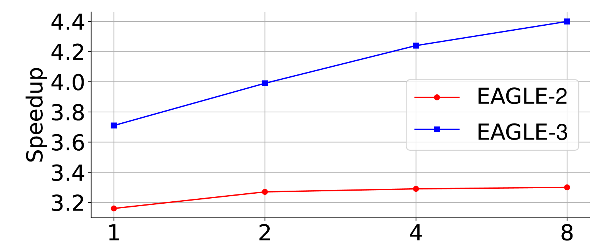
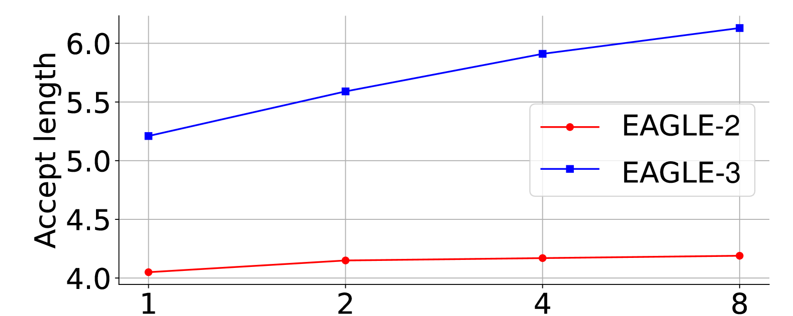
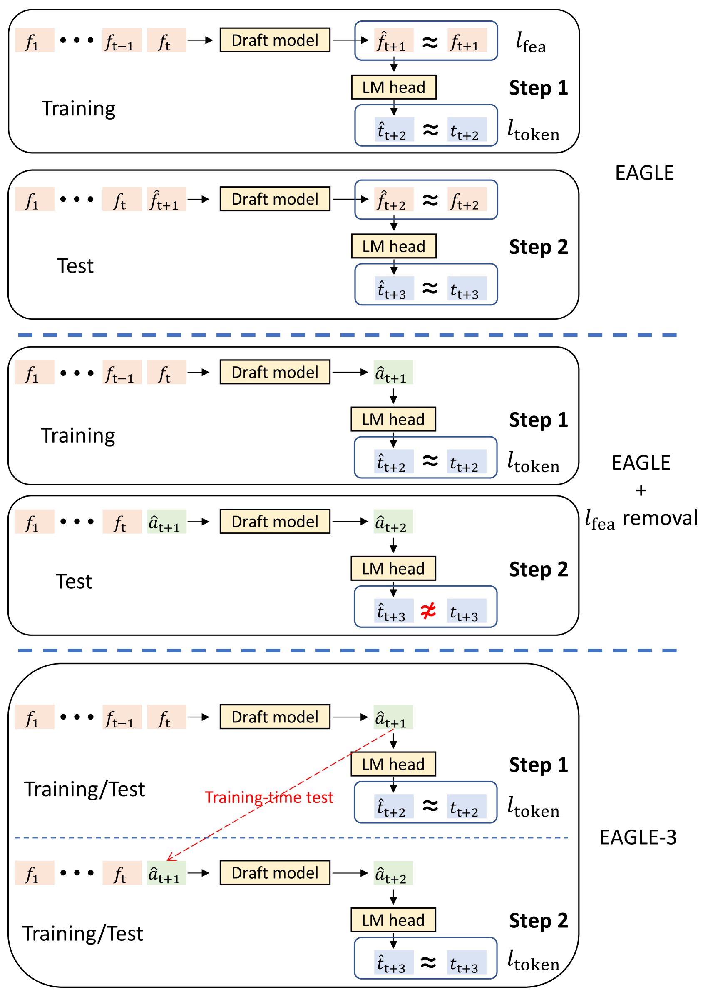
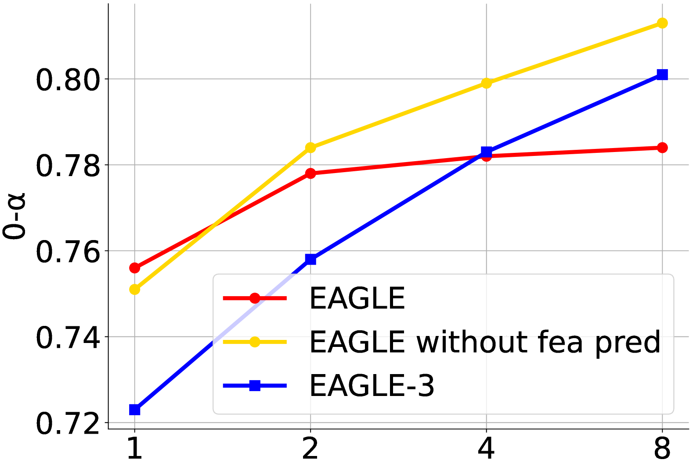
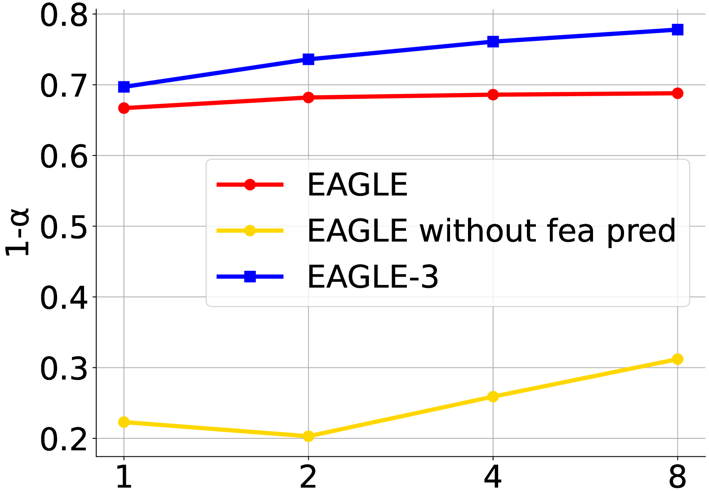
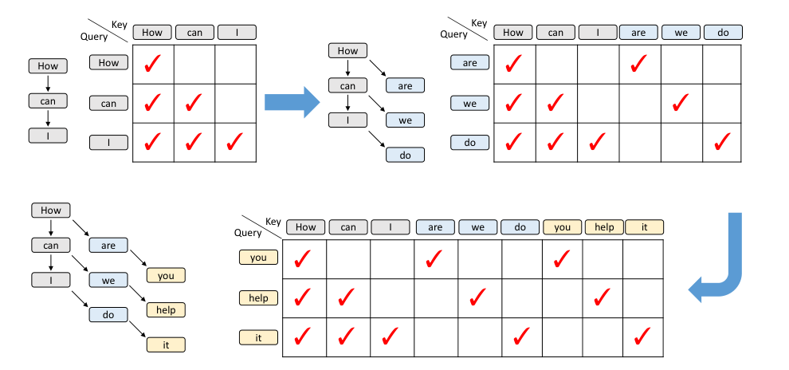
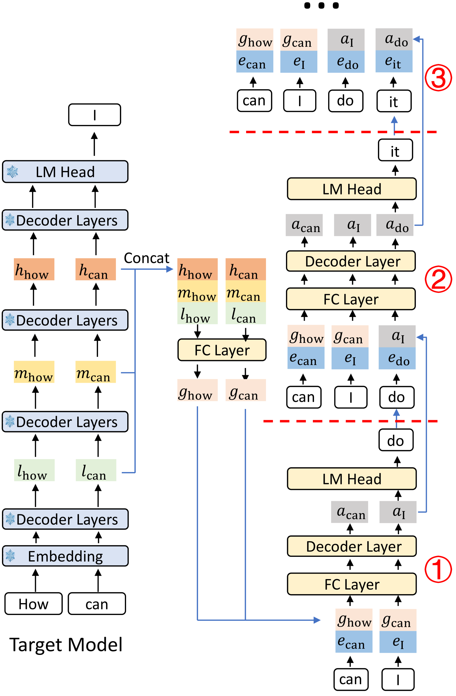
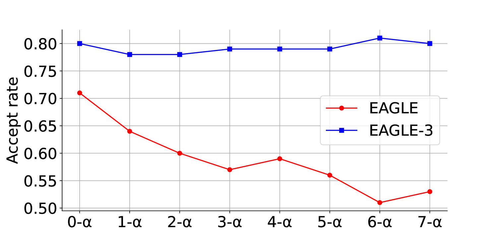

# EAGLE-3：为什么 draft model 要在训练时“见过自己犯错”

!!! info "论文信息"
    **论文题名：** EAGLE-3: Scaling up Inference Acceleration of Large Language Models via Training-Time Test。 
    **作者：** Yuhui Li、Fangyun Wei、Chao Zhang、Hongyang Zhang。 
    **机构：** Peking University、Microsoft Research、University of Waterloo、Vector Institute。 
    **时间 / 主题：** 2025-03；高效推理。 
    **arXiv / 官方报告：** arXiv：[2503.01840](https://arxiv.org/abs/2503.01840)。 
    **GitHub / 项目：** GitHub：[github.com/SafeAILab/EAGLE](https://github.com/SafeAILab/EAGLE)。 
    **元数据来源与核验口径：** 来源：[arXiv](https://arxiv.org/abs/2503.01840)；[GitHub API / repo](https://github.com/SafeAILab/EAGLE)；Checked Date：2026-06-15；Repro Status：Paper / official materials reviewed, independent reproduction not claimed。

## 数据加到八倍，为什么 EAGLE-2 几乎不再变快

ShareGPT 数据从 1 倍加到 8 倍时，EAGLE-2 的速度大约只从 3.2 倍涨到 3.3 倍；EAGLE-3 却从约 3.7 倍涨到 4.4 倍。两者采用相近的草稿推理框架，差别落在草稿模型的训练方式上。

先用三步草稿把“接受长度”落到一笔小账。假设 draft 选出的三个 token，在各自位置上的 $q$ 概率是 $[0.80,0.60,0.50]$，目标模型给出的 $p$ 概率是 $[0.64,0.60,0.25]$。无损验证的逐位置接受概率为

$$
\min(1,p/q)=[0.80,1.00,0.50].
$$

如果第三个位置被拒绝，本轮能直接提交的只是前两个 token，后续候选要按实现重新计算。这个构造例子只说明接受规则，不能把三个数的平均值当作 speedup；真实速度还受目标模型验证、树结构、KV 管理和调度开销影响。

第一代 EAGLE head 同时做两件事。它要把下一个 token 预测对，还要把输出拉到目标模型指定的顶层 hidden feature 附近。后一个约束让输出更像目标模型的内部表示，却不一定提高后续 token 被目标模型接受的概率。

作者去掉特征回归项，让 head 直接围绕 token 预测优化。第二个草稿位置随即暴露出问题。第一步输出已经不是目标特征，推理时却会把它送回 decoder；原来的训练样本从未包含这种输入。EAGLE-3 因此在训练中先生成自己的草稿，再把这个输出反馈给 decoder，同时使用目标模型低、中、高层的特征。[↗](https://arxiv.org/pdf/2503.01840v3#page=2)

这里要区分两种成本。草稿 head 每多展开一轮，服务时都要多算一次；训练阶段多做的展开可以提前付掉。EAGLE-3 改的是训练条件与推理条件的对应关系，不是简单把旧 head 加宽或多训练几轮。

三代方法的接口也不同。EAGLE 用目标特征和已采样 token 生成下一步草稿；EAGLE-2 沿用这个 head，再用动态树安排候选位置；EAGLE-3 重写 head 的输入、监督和递归训练，推理时仍使用动态树。比较它们时，接受长度和树的节点预算要一起看，否则容易把调度变化误算成 head 本身的收益。[↗](https://arxiv.org/pdf/2503.01840v3#page=4)

两张图放在一起才有意义。横轴都是相对 ShareGPT 的数据量，一张画速度，一张画接受长度。EAGLE-3 的四个点说明，在这组模型、任务和训练设置里，新增数据还转化成了更好的草稿；它们没有证明无限加数据会继续遵循同一条规律。

{ width="720" }

{ width="720" }

两幅图都使用 LLaMA-Instruct 3.1 8B、MT-bench，横轴为 1、2、4、8 倍 ShareGPT 数据。EAGLE-2 的加速约从 3.2 倍升到 3.3 倍后接近平坦，EAGLE-3 约从 3.7 倍升到 4.4 倍；接受长度则从约 5.2 增长到 6.1。这里的近似值按图读取，最终满量配置的精确表值在后文列出。

在最小的数据配置上，EAGLE-3 已经比旧 head 快；数据继续加到 8 倍时，速度和接受长度仍在上升。四个点只能说明这组训练设置还没有明显饱和，无法推出无限扩展的函数规律。数据组成、目标回答生成和总训练成本也没有被逐项拆开。

## 删掉 feature loss 后，第二个草稿位置先坏掉

第一代 EAGLE 的输出 $\hat f$ 同时接受特征回归和 token 分类监督。EAGLE-3 的输出改记为 $a$：它仍是能送进 LM head 的隐藏向量，但不需要等于目标模型某一层的特征。所谓 direct token prediction 指优化目标直接围绕 token，不意味着模型内部完全没有连续表示。

原来的回归约束有双重作用。一方面，它要求容量很小的 decoder 复现大模型内部的特定向量，这比只让正确 token 获得足够概率更苛刻；另一方面，正因为输出被拉回目标特征附近，下一步才可以把它当作训练时常见的输入。删去约束不能只看到释放表达能力这一面，也要接住它原来承担的接口匹配作用。

一个能正确预测 token 的向量，并不必然是原目标特征的良好近似。即使两个向量都让某个词成为 top-1，其余 logits、几何位置与后续 decoder 响应也可以不同。于是第一步 token prediction 做得更好，与第二步输入更难处理，完全可能同时发生。论文的诊断正是把这两个问题分别测量。

如果训练永远输入真实目标特征，推理却从第二步开始输入自生成 $a$，训练和使用条件就不一致。Training-time test 在训练中执行若干步草稿，把产生的 $a$ 继续反馈给同一个 decoder layer，并在后续 token 目标上学习。它让模型学会处理“真实目标信息加一段自己的输出”这种混合历史。

图中上、中、下三组对应不同训练条件。中间仅删除特征 loss 的方法可以提高第一步接受率，却会损害递归后的表现；底部在训练中加入测试式展开，才把解除约束的好处带到多步草稿。[↗](https://arxiv.org/pdf/2503.01840v3#page=3)

{ width="760" }

### Figure 4 如何识别“第一步很好、第二步失效”

左图的 $0$-$\alpha$ 中，不带 feature prediction 的黄色曲线随数据扩大，从约 0.75 升到 0.81，甚至高于完整 EAGLE-3 的第一步接受率。若只检查这一指标，很容易得出删 loss 已经足够的判断。

右图的 $1$-$\alpha$ 把一次草稿输出放回输入。输入里已经含有一次草稿自己的输出时，同一个黄色方案只有约 0.20–0.31，远低于 EAGLE 的约 0.67–0.69；加入 training-time test 的蓝线则约为 0.70–0.78。两图合起来显示，单步分类能力并非唯一问题，输出回到输入后出现了训练分布缺口。[↗](https://arxiv.org/pdf/2503.01840v3#page=3)

“训练时见过自己犯错”指的是一个具体操作。EAGLE-3 先生成自己的内部向量，再把它送回 decoder，在后续 token 上继续计算 loss。训练样本于是同时包含目标特征和自生成表示。模型仍会犯错，区别在于它训练过这种混合输入。

训练展开还涉及 attention mask。不同原序列位置产生的续写属于不同分支，不能互相看见。论文根据这些依赖调整 mask，并利用后续展开中稀疏的对应关系减少无效注意力计算。这属于训练数据依赖的正确表达，不是单纯把同一份 teacher-forcing 数据重复几次。

### 同一训练序列怎样并行展开多个起点

Figure 6 用 token 标记解释依赖，真实模型输入仍是前面讨论的特征和 embedding。第一轮有原序列 `How can I`，三个位置分别生成 `are`、`we`、`do`。它们对应三个不同前缀：`How are`、`How can we`、`How can I do`，并不是把 `are we do` 当作一句完整续写。

*原论文 Figure 6。灰色是原训练位置，蓝色和黄色是后续两轮草稿位置；矩阵中的勾表示允许的 attention。*

第二轮的 `are` 只能看到 `How` 与自身，不能看到原序列的 `can I`，否则会获得不属于自己前缀的信息；`we` 能看到 `How can` 与自身；`do` 才能看到完整的 `How can I`。继续展开后，`you` 连接的是 `How → are`，`help` 连接的是 `How → can → we`，`it` 连接的是 `How → can → I → do`。读取矩阵时，先固定一行沿祖先追溯，最容易检查有没有串到其他分支。

原序列作为 key 的部分保留因果关系；不同 rollout 轮次之间，每个 query 只连接自己对应的历史位置，因此块内主要是对角依赖。论文据此用对应向量的点积计算这些 attention scores，避免先算一个稠密矩阵再把绝大部分位置屏蔽。这样，mask 同时保证训练条件正确，并减少多步训练的无效计算。[↗](https://arxiv.org/pdf/2503.01840v3#page=5)

HASS 也在训练中模拟多步草稿，并对注意力作类似处理。两者都使用训练展开，EAGLE-3 进一步取消特征回归约束，并允许输入使用多层融合表示。HASS 仍预测顶层特征、保留特征损失，主要处理特征误差累积；EAGLE-3 将优化直接对准可接受的 token，并让新的内部表示在递归中学会工作。这是论文陈述的机制区别，收益不能全部归给 mask。[↗](https://arxiv.org/pdf/2503.01840v3#page=5)

## 三层 hidden feature 为什么能帮上递归草稿

顶层特征紧邻 LM head，强烈服务于下一个 token 的预测。要连续预测更远处的 token，来自不同深度的表示可能提供额外信息。第一代强迫输出拟合某个顶层状态，使输入与输出接口绑定；移除这个约束并训练递归后，EAGLE-3 可以选择更丰富的目标特征。

若目标 hidden size 为 $d$，低、中、高层特征分别是 $l_i,m_i,h_i$，融合可写成

$$
g_i=W_g[l_i;m_i;h_i],\qquad g_i\in\mathbb R^d.
$$

这是对论文 FC 融合操作的记号化表达。三组 $d$ 维特征先拼成 $3d$，再降回 $d$。接着把融合特征与已采样 token 的 embedding 拼接，经另一个 FC 和单层 decoder 产生 $a$，由 LM head 预测下一个 token。

作者的解释是，最上层表示紧邻 LM head，在满秩线性读出条件下，与下一 token 的 logits 有很强的对应关系；它未必是预测更远位置最方便的接口。较低与中间层可以提供不同抽象程度的信息。这个论证说明为什么值得尝试多层融合，并不证明顶层完全不含未来语义，也不保证随意增加更多层就一定更好；融合是否有用，最终由后面的组件消融支持。

推理流程图从目标模型最近一次 prefill/verification 开始。第一步使用真实融合特征 $g$；尚未通过目标模型验证的新位置没有对应 $g$，于是使用上一草稿步输出 $a$ 替代。已采样 token 仍显式输入，保留 EAGLE 对采样不确定性的处理。

{ width="760" }

EAGLE-3 不会在每个草稿步重新读取目标模型中间层。真实特征在目标模型本来就要运行的阶段采集，草稿内部自行递归；验证完成后再更新接受路径上的状态。这样才保留了减少目标模型调用的意义。[↗](https://arxiv.org/pdf/2503.01840v3#page=5)

沿 Figure 5 的 “How can I” 可以把时间对齐说明得更具体。目标模型处理 `How can` 后已经采样到 `I`，草稿使用 $(g_{\mathrm{How}},e_{\mathrm{can}})$ 与 $(g_{\mathrm{can}},e_{\mathrm I})$，输出 $a_{\mathrm I}$，再从 LM head 采样 `do`。下一个草稿位置没有经过目标模型计算的 $g_{\mathrm I}$，便用 $(a_{\mathrm I},e_{\mathrm{do}})$ 接着预测 $a_{\mathrm{do}}$，再采样 `it`。

`I` 虽然已由目标分布采样出来，却还没有作为输入 token 经过下一次目标 forward，因此此时缺的是它的目标特征，并非不知道它是什么 token。显式提供 embedding 正好解决后一种采样分支的不确定性，训练自反馈则解决前一种目标特征尚不可得的问题。两项设计处理的依赖不同，缺少任何一项都会改变草稿过程。

## 草稿树仍由动态调度和无损验证负责

EAGLE-3 与 EAGLE-2 的动态树兼容：用草稿 confidence 的路径乘积选择扩展节点，再从全树重排候选。第三代主要提高草稿模型本身的能力，而第二代负责把有限候选预算用得更有效。

最终验证仍由目标模型完成。标准规则对草稿 token $\hat t$ 以 $\min(1,p(\hat t)/q(\hat t))$ 接受，拒绝后按归一化的正残差 $\max(0,p-q)$ 采样；树形输入要求每个节点只能看到祖先。分布一致性来自这些规则，不来自草稿模型在 benchmark 上接近目标的程度。

训练使用 ShareGPT 约 68K 与 UltraChat 约 464K 条数据，并调用目标模型生成回答；推理模型 DeepSeek-R1-Distill-LLaMA 8B 还使用 OpenThoughts-114k-math。AdamW 学习率为 $5\times10^{-5}$，$\beta=(0.9,0.95)$，梯度裁剪 0.5。约八倍数据既包含规模变化，也伴随目标回答生成等训练设置，采用时应计入离线训练与目标调用成本。[↗](https://arxiv.org/pdf/2503.01840v3#page=6)

附录 A 还改变了一项与主结果相关的预算：EAGLE-2 的树深为 6，EAGLE-3 因多步接受更稳定，将树深提高到 8；总节点数保持不变，8B、13B、70B 目标分别仍为 60、50、48。也就是说，新增能力用于把候选预算放得更深，而非无限增加验证节点。原 EAGLE-2 扩展阶段每次选择 10 个节点。[↗](https://arxiv.org/pdf/2503.01840v3#page=12)

这类比较要保留两层含义。相同总节点预算下更长的有效路径是方法的实际收益；主结果却不是严格固定所有树深配置后，仅替换训练 loss 的单变量实验。若想判断一个工程实现中的具体收益来自 head 还是树深，应分别测试，这也正是组件消融存在的理由。

## 表里的提升分别来自哪里

表中是 LLaMA-Instruct 3.1 8B 上的逐步改动。$\tau$ 表示平均接受长度。

| 方法 | MT-bench speedup | MT-bench $\tau$ | GSM8K speedup | GSM8K $\tau$ |
| --- | ---: | ---: | ---: | ---: |
| EAGLE-2 | 3.16× | 4.05 | 3.39× | 4.24 |
| 去掉特征约束的改进 | 3.82× | 5.37 | 3.77× | 5.22 |
| 再融合多层特征，EAGLE-3 | 4.40× | 6.13 | 4.48× | 6.23 |

这组实验支持解除约束后的训练设计和融合特征都有增益。不能把表中“去掉特征约束”理解成前述完全不处理递归分布偏移的失败版本；应与论文整体 training-time test 设计一起理解。[↗](https://arxiv.org/pdf/2503.01840v3#page=8)

接受率图把草稿递归深度单独拉出来。$n$-$\alpha$ 是输入已有 $n$ 个自生成状态、且此前 token 被接受的条件下，下一 token 的接受率。越往后越能暴露递归问题，所以第一步准确率不能替代这组检查。

{ width="760" }

Figure 7 的蓝线在 0 到 7 个自身输出位置上约保持 0.78–0.81，红线则从约 0.71 降到约 0.53，中间有波动。这里专门采用链式草稿测接受率，避免把树的备用分支计入分母。它支持递归稳定性的改善，但不能读成“一次连续接受八个 token 的概率约为 80%”：各点都以此前候选已被接受为条件，整条路径同时成功是另一种联合事件。[↗](https://arxiv.org/pdf/2503.01840v3#page=8)

消融表与这张图共同建立了较完整的解释。取消特征约束并配合适当训练后，模型可以选择更适合 token 的内部表示；多层融合进一步提供信息；递归接受率说明改善能够延续到后续步骤。单看第一步 $0$-$\alpha$，反而可能选中 Figure 4 中递归最差的方案。

主实验在对话、代码、数学、指令和摘要上报告约 3.0–6.5 倍加速，最高值属于特定模型与任务配置。测试覆盖 Vicuna 13B、LLaMA 3.1 8B、LLaMA 3.3 70B 和蒸馏版 R1 8B，没有覆盖 405B 或 671B 目标模型，因此最高倍数不应直接套到更大模型部署。

## 论文里的 6.5 倍，部署时还剩多少

主表相对 Hugging Face Transformers、PyTorch、预分配 KV cache 的普通自回归基线计算 speedup。五种任务共用对应目标模型的一套草稿权重，未为各测试集分别微调。temperature 0 下的五任务均值和典型任务行应分开读，这样不会只取最大的一个数。

| Target model, Temperature = 0 | EAGLE-2 Mean speedup | EAGLE-2 Mean $\tau$ | EAGLE-3 Mean speedup | EAGLE-3 Mean $\tau$ |
| --- | ---: | ---: | ---: | ---: |
| Vicuna 13B | 4.22× | 4.83 | 5.51× | 6.62 |
| LLaMA-Instruct 3.1 8B | 3.23× | 4.11 | 4.44× | 6.23 |
| LLaMA-Instruct 3.3 70B | 2.85× | 3.78 | 4.12× | 5.88 |
| DeepSeek-R1-Distill-LLaMA 8B | 3.26× | 3.92 | 4.16× | 5.84 |

不同目标的均值均有提高。较大模型的绝对参数量并没有直接决定加速倍数，例如 70B 的 EAGLE-3 平均为 4.12 倍，低于 Vicuna 13B 的 5.51 倍。草稿对目标分布的拟合、任务类型与目标验证成本共同决定结果，不能用这四行推导参数越大、收益越大的规律。

| Target / Task, Temperature = 0 | EAGLE-2 speedup / $\tau$ | EAGLE-3 speedup / $\tau$ |
| --- | ---: | ---: |
| Vicuna 13B / HumanEval | 4.96× / 5.41 | 6.47× / 7.54 |
| LLaMA 3.1 8B / MT-bench | 3.16× / 4.05 | 4.40× / 6.13 |
| LLaMA 3.3 70B / CNN/DM | 2.44× / 3.55 | 3.27× / 5.02 |
| DeepSeek R1 Distill 8B / GSM8K | 3.40× / 4.40 | 5.01× / 6.93 |
| DeepSeek R1 Distill 8B / CNN/DM | 3.53× / 3.33 | 3.52× / 4.92 |

最高的约 6.5 倍来自 Vicuna 13B 的代码任务，精确值为 6.47；平均接受长度为 7.54。作者将代码的优势联系到较多固定模式。推理模型则在 GSM8K 上最好，作者认为额外数学训练数据可能有帮助，但没有通过去掉该数据的控制实验单独证明因果关系。

CNN/DM 这一行给出了反例。R1 蒸馏模型的接受长度从 3.33 提高到 4.92，速度却从 3.53 倍微降为 3.52 倍。两次测量的时间基本相当，所以不能把主文“所有任务都最高”的概括套到这里，也不能由较长的 $\tau$ 推断 wall-clock 一定更短。草稿、构树和验证的额外成本仍要放进同一张时间表。[↗](https://arxiv.org/pdf/2503.01840v3#page=7)

temperature 1 下，四个目标的五任务平均速度分别从 EAGLE-2 的 3.76、2.80、2.65、2.77 倍，提高到 4.65、3.45、3.95、3.52 倍。更随机的采样条件下仍有收益，但数值通常低于对应的贪心配置。论文在这组比较中排除了放宽接受条件的非无损设置；不能把不同接受标准的结果补成同一个排名。

## 运行时测出来的收益比论文峰值小

论文在 SGLang v0.4.4 上由 SGLang 团队评估单张 H100、LLaMA 3.1 8B、MT-bench。这里使用链式草稿，长度 3，没有使用树。batch 1 时，吞吐为：

| SGLang 配置 | Throughput，tokens/s ↑ |
| --- | ---: |
| 无投机解码 | 158.34 |
| EAGLE-2 | 244.10 |
| EAGLE-3 | 373.25 |

因此第三代相对这个已优化基线约为 $373.25/158.34\approx2.36$ 倍，相对 EAGLE-2 约 1.53 倍。它们与较早基线上的最高 6.5 倍不冲突，但测量口径不同。

大 batch 的收益更小，却更能说明新增草稿计算是否值得：

| Batch size | EAGLE 相对无投机吞吐 | EAGLE-3 相对无投机吞吐 |
| --- | ---: | ---: |
| 8 | 1.23× | 1.62× |
| 16 | 1.02× | 1.48× |
| 24 | 0.93× | 1.39× |
| 32 | 0.94× | 1.32× |
| 64 | 0.99× | 1.38× |

随着 batch 增大，目标模型原有的闲置算力减少，验证额外候选不再那么便宜。EAGLE-3 在 batch 64 仍提高 38% 吞吐，支持它在这组生产运行时配置中的价值，但不保证所有并发规模都持续获益。[↗](https://arxiv.org/pdf/2503.01840v3#page=8)

SGLang 的两张表还要保留行名差异：batch 1 的 Table 4 写的是 EAGLE-2，较大 batch 的 Table 3 写的是 EAGLE。不能悄悄将后者改成 EAGLE-2，再给出一个论文未报告的跨 batch 第二代曲线。Table 3 的全部 EAGLE-3 比值在 1.32–1.82 之间波动，并非 batch 越大收益严格单调下降；总趋势是较大 batch 的额外算力更难摊销。

### vLLM 的收益边界更早出现

vLLM 实验同样使用 LLaMA-Instruct 3.1 8B、MT-bench，但采用最大长度 2 的链式草稿，没有动态树。Table 5 的相对吞吐如下。

| Batch size | EAGLE / no speculation | EAGLE-3 / no speculation |
| --- | ---: | ---: |
| 2 | 1.30× | 1.75× |
| 4 | 1.25× | 1.68× |
| 8 | 1.21× | 1.58× |
| 16 | 1.10× | 1.49× |
| 24 | 1.03× | 1.42× |
| 32 | 0.93× | 1.36× |
| 48 | 0.82× | 1.21× |
| 56 | 0.71× | 1.01× |

EAGLE 从 batch 32 开始低于基线，而 EAGLE-3 到 batch 56 仍略高于基线；不过 1.01 倍只剩约 1% 增益，不能称为仍有很大加速。表中的比值也没有给出每个 batch 的绝对 tokens/s，不能由它直接判断绝对吞吐峰值发生在哪个 batch。

这组实验的正文写 RTX3090，表题却写 A100。两处不一致影响硬件成本解释，因此这里只将其作为原文报告的相对曲线，不据此宣称某张 GPU 的确定绝对性能。它仍支持一个有用判断：更稳定的多步草稿能把“投机解码还值得”的负载范围推得更远，但收益最终会被额外计算抵消。[↗](https://arxiv.org/pdf/2503.01840v3#page=8)

## 落地时要对齐四个接口

为新目标训练草稿时，需要从目标 forward 中取得对应的低、中、高层特征，并保证融合后的 $g$、自生成的 $a$ 与 shifted token embedding 在时间上对齐。训练只保留第一步分类，而不执行后续自反馈，就回到了 Figure 4 暴露的失败设置。训练展开中的分支 mask 和推理时的树 mask 也应分别检查，它们表达的依赖并不完全相同。

数据准备应包含目标模型生成回答的成本。68K 与 464K 是数据条目数量，并非 token 数；模型回答长度会影响特征提取和训练总量，推理模型的长回答尤其如此。论文没有给出足以还原所有目标模型完整 GPU 小时的训练账单，因此不能用“约八倍数据”直接换算精确成本倍数。

部署端需要选择匹配的运行时路径。完整动态树能利用较深且高接受率的候选；SGLang 与 vLLM 的本文测试采用短链，也仍能受益。是否采用树，应由目标 batch、验证 kernel、KV 管理与模型结构决定。实验给出的是这些已测配置中的收益，不意味着必须先实现全部动态树功能才能获得第三代 head 的价值。

EAGLE-3 的实际启发是让训练目标与最终用途一致：草稿需要生成能被接受的 token，并在递归使用自己的输出时保持稳定，而不必模仿大模型某个指定中间表示。工程采用时则要同时考虑目标特征采集、草稿训练数据、运行时支持与 batch 分布；接受长度提高是必要证据，真正的交付指标仍是目标负载上的延迟和吞吐。

后续可把[缓存、路由与投机解码](../../inference/caching-routing-and-speculative.md)作为运行时背景，了解草稿、验证和 KV 的请求生命周期；[EAGLE-2](eagle-2.md)则提供动态树的对照。若想从模型输出一路追到端到端 SLO，可接[推理服务系统](../../inference/serving-systems.md)复核 TTFT、TPOT、batch 和队列时间。
