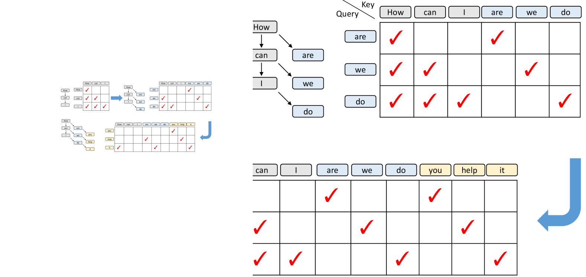
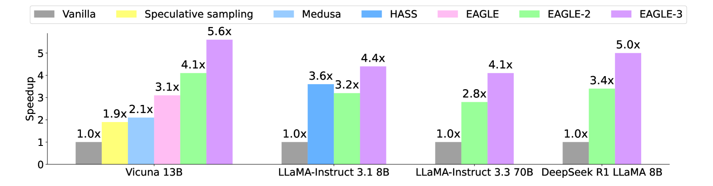
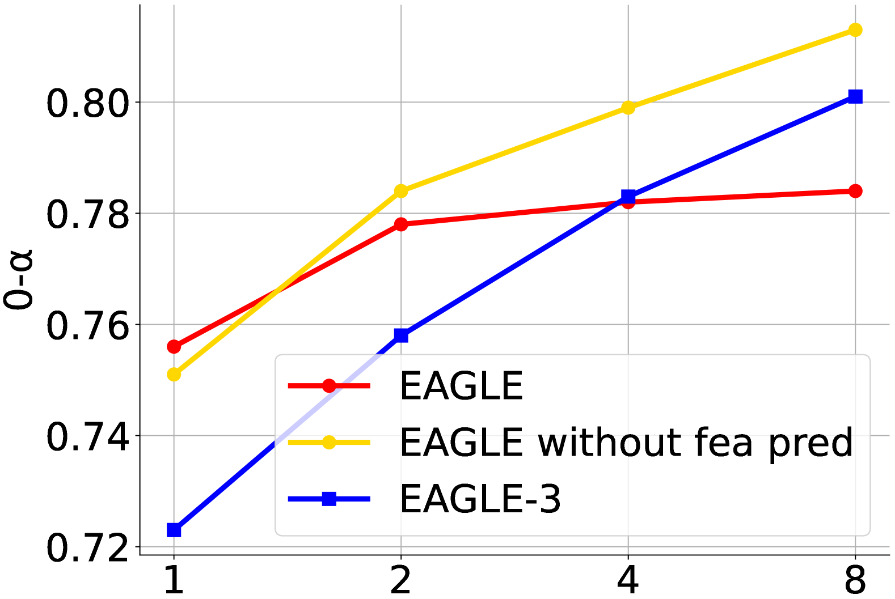
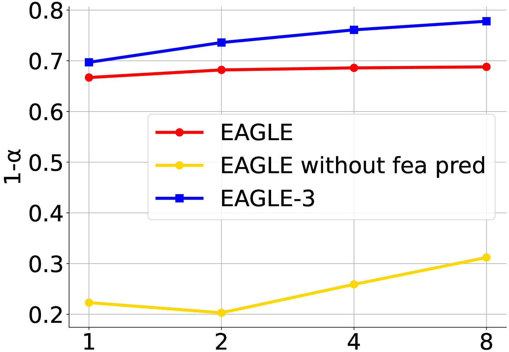

# EAGLE-3：Training-time Test 的投机推理加速

!!! info "论文信息"
    - 论文：`EAGLE-3: Scaling up Inference Acceleration of Large Language Models via Training-Time Test`
    - 链接：[arXiv:2503.01840](https://arxiv.org/abs/2503.01840)
    - 代码：[GitHub: SafeAILab/EAGLE](https://github.com/SafeAILab/EAGLE)
    - 关键词：speculative decoding、draft model、training-time test、feature fusion、dynamic draft tree、SGLang、vLLM


!!! info "事实版本"
    | Checked Date | Official Source | Repro Status | Notes |
    | --- | --- | --- | --- |
    | 2026-05-16 | [arXiv:2503.01840](https://arxiv.org/abs/2503.01840) | Author Code / Official Repo | 未见本站记录的第三方独立复现；按论文与作者代码/模型资源保守引用。 |

### Evidence Snapshot

| Claim | Direct Source | Figure/Table/Setting | Evidence Type | Repro Status | Can Support | Cannot Prove |
| --- | --- | --- | --- | --- | --- | --- |
| `EAGLE-3: Scaling up Inference Acceleration of Large Language Models via Training-Time Test` 的核心结果在论文设置下成立 | [arXiv:2503.01840](https://arxiv.org/abs/2503.01840) | 主实验、架构图或 benchmark setting | Paper Result | Paper Only | 支撑本页对该方法机制、任务设置和局部收益的介绍 | 不证明跨数据分布、跨硬件、真实部署或第三方独立复现成立 |
| 本页把方法接回世界模型/效率主线 | 本站综合判断 | 成本账、失败边界与相邻专题链接 | Site Inference | Site Inference | 支撑阅读路线、实验设计和工程优先级假设 | 不能替代原论文 claim，也不能证明 closed-loop 或生产收益 |

!!! warning "读数边界"
    本页若引用结果表，只能按论文 benchmark、数据集、硬件和评测协议解释；需额外确认是否 closed-loop、是否真实机器人、是否系统吞吐、是否独立复现，不能把单项分数直接外推为规划收益或部署安全。

这篇论文的核心不是“再训练一个更小的 draft model”，而是指出 EAGLE 系列原来的 feature prediction 约束会限制 draft model 的表达能力。EAGLE-3 直接预测 token，同时在训练时模拟推理时会发生的多步自回归输入分布，把 draft model 真的会遇到的错误前缀暴露给训练。

一句话概括：**EAGLE-3 把投机解码里的 draft model 训练成更像线上推理时的自己，从而提高多步 draft 的接受率。**

## 它的效率贡献是什么

| Dimension | EAGLE-3 |
| --- | --- |
| Saved cost | Autoregressive decoding latency、target model forward calls per accepted token、small-batch decode idle time |
| Main idea | Replace feature prediction with direct token prediction, and train the draft model under simulated test-time multi-step generation |
| Architecture | Fuse low/middle/high-level target features, pass them into a single-layer decoder draft model, then use the target LM head to sample draft tokens |
| Inference role | Lossless speculative decoding when standard target-model verification is used; inherits EAGLE-2 dynamic draft tree |
| Training role | Training-time test reduces exposure bias in draft recursion, so scaling draft training data gives clearer speedup gains |
| Main risk | Extra draft-model training and runtime integration are needed; benefit depends on acceptance rate, task bucket, batch size, tree attention and verification overhead |
| Connect to | [缓存、路由与投机解码](../../inference/caching-routing-and-speculative.md)、[推理运行时](../../inference/serving-runtimes-vllm-sglang-and-tensorrt-llm.md)、[MTP 与投机解码](../../training/mtp-and-speculative-decoding.md) |

## 证据等级与外推边界

EAGLE-3 的证据比单纯 benchmark 更扎实：它有 scaling law 图、训练方法消融、接受率随 draft 深度变化的诊断，以及 SGLang/vLLM 的系统吞吐表。但它仍然是围绕特定模型族、任务、runtime 和硬件配置得到的结果，不能直接推断到所有线上流量。

| 论文结论 | 证据来源 | 证据等级 | 可外推到高效推理 | 不能直接外推 |
| --- | --- | --- | --- | --- |
| Training-time test 能缓解多步 draft 分布偏移 | Figure 7 接受率曲线、Table 2 消融 | Mechanism + ablation | draft model 训练要模拟服务时递归输入 | 不能保证所有自投机结构都同样受益 |
| 去掉 feature constraint 后，数据规模更能转成 speedup | Figure 1 / Figure 4 scaling 曲线 | Scaling evidence | draft 训练数据规模应和线上 acceptance 一起评估 | 不能只靠更多数据修复 runtime overhead |
| EAGLE-3 比 EAGLE-2 更快 | Table 1、Figure 2，多模型多任务 | Benchmark | 低温、长输出、格式稳定任务更值得先试 | 不能保证高温创作、工具 agent、短输出请求也收益明显 |
| SGLang/vLLM 集成能提高吞吐 | Table 3/4/5 | System evidence | speculative 要进入 runtime 的 batch、KV 和 verify 路径 | 不能用单请求速度直接替代线上 P95/P99 |
| 大模型上仍有未覆盖边界 | 作者说明未测 405B/671B 级模型 | Scope boundary | 70B 内可作为强参考 | 不能默认扩展到超大 MoE 或异构服务池 |

## 论文位置

投机解码的基本形态是：便宜的 draft model 先草拟多个 token，昂贵的 target model 一次性并行验证这些 token，接受最长正确前缀。如果采用标准 speculative sampling 接受规则，输出分布可以保持和 target model 一致。

EAGLE 系列的特别之处在于，它不是用一个普通小语言模型做草稿，而是让 draft model 消费 target model 的中间 feature。EAGLE 和 EAGLE-2 的问题在于：为了让 draft feature 接近 target model feature，它们给 draft model 加了 feature prediction loss。这个约束让第一步 draft 比较稳，但也把 draft model 的表达空间绑在了 target feature regression 上，训练数据继续增加时收益会变钝。

EAGLE-3 的改动有三件：

1. **直接预测 token**：不再把 draft output 强行回归到 target top-layer feature；
2. **训练时模拟测试**：训练过程中把 draft model 自己生成的中间输出继续喂回去，模拟推理时的第 2、第 3 步；
3. **融合多层特征**：不用单一 top-layer feature，而是融合 target model 的低层、中层、高层表示。

{ width="720" }

{ width="720" }

<small>图源：`EAGLE-3`，Figure 1。原论文图意：在 LLaMA-Instruct 3.1 8B + MT-bench 上，EAGLE 随 draft 训练数据增加的收益有限，而 EAGLE-3 的 speedup 和 acceptance length 随数据规模继续提高。</small>

!!! note "这张图怎么读"
    **输入输出**：输入是训练时 test 特征、草稿模型和目标模型状态，输出是更贴近测试分布的 draft token。  
    **效率机制**：训练时模拟 test 行为，提升 draft acceptance，从而压低 decode 成本。  
    **对主线意义**：它把投机解码从纯 serving trick 拉回训练-推理一致性问题。  
    **不能证明什么**：acceptance 提升不能替代答案质量、长上下文稳定性或 agent 安全评测。

!!! note "这张图怎么读"
    横轴是相对 ShareGPT 的训练数据规模，纵轴分别看 speedup 和 average acceptance length。EAGLE-3 的关键不是“某个点更高”，而是斜率还在：draft model 训练数据增加后，线上可接受 token 数也继续增加。

## 方法主线：为什么叫 Training-time Test

EAGLE-3 的名字有点绕，真正意思是：**把测试时会发生的递归 draft 过程搬到训练时。**

普通 teacher-forcing 训练只看真实前缀。投机解码推理时却不是这样：第 1 个 draft token 通过 target feature 生成，第 2 个 draft token 的输入已经包含 draft model 自己上一轮输出。这个输入分布和训练时看到的 target feature 不一样，所以多步 draft 很容易越走越偏。

EAGLE-3 直接在训练里模拟这个过程。对于一个前缀：

```text
target features -> draft step 1 -> draft output a1
a1 + sampled token embedding -> draft step 2 -> draft output a2
a2 + sampled token embedding -> draft step 3 -> draft output a3
```

训练时已经让 draft model 学会消费自己的输出，推理时再走多步 draft，分布偏移就小得多。

{ width="760" }

<small>图源：`EAGLE-3`，Figure 3。原论文图意：EAGLE-3 不再预测 target feature，而是直接预测 token；训练阶段模拟测试阶段的多步生成，使 draft model 学会处理自己的中间输出。</small>

!!! note "和 MTP 的关系"
    MTP 通常是在主模型训练目标里增加未来 token 监督，EAGLE-3 则是给独立 draft model 设计训练分布。两者都关心多 token 预测，但 EAGLE-3 更像“服务端 draft model 的分布校准”：它直接为 speculative verification 的 acceptance 服务。

## 推理流程：多层特征融合 + 单层 draft decoder

EAGLE-3 推理时仍然依赖 target model 的一次前向。prefill 或上一轮 verification 完成后，target model 会给出下一 token，并暴露低层、中层、高层 feature，论文记作 \(l,m,h\)。EAGLE-3 把三层 feature 拼接成 \(3k\) 维，再通过全连接层压回 \(k\) 维融合 feature \(g\)。

接着 draft model 使用一个单层 Transformer decoder。第 1 步 draft 的输入来自 \(g\) 和上一 token 的 embedding；后续未验证 token 没有 target feature，所以输入改成 draft model 上一步输出 \(a\) 和当前采样 token embedding。

{ width="760" }

<small>图源：`EAGLE-3`，Figure 5。原论文图意：target model 的低层、中层、高层 feature 被融合后送入 draft model；后续 draft step 使用 draft model 自己的中间输出继续递归生成。</small>

!!! tip "为什么要融合多层 feature"
    EAGLE 原来偏向 top-layer feature，但 top-layer 更贴近最终 logits，语义压缩也更强。EAGLE-3 引入低层、中层、高层信息，相当于让 draft model 同时看到词法、局部结构和高层语义线索。Table 2 里 `+ fused features` 比只去掉 feature constraint 进一步提高 speedup 和 acceptance length。

## 训练细节：这里是论文最值得补的部分

EAGLE-3 的训练目标从“feature regression + token prediction”转成更直接的 token-level draft 训练。论文的关键不是把 draft model 做大，而是改变它看到的数据分布。

| Training component | Detail |
| --- | --- |
| Draft model core | A single Transformer decoder layer |
| Target features | Low-level, middle-level and high-level features from the target model |
| Feature fusion | Concatenate three \(k\)-dimensional features into \(3k\), then project to \(k\) with a fully connected layer |
| Draft recursion | Step 1 uses fused target feature \(g\); later steps use previous draft output \(a\) |
| Main loss direction | Direct token prediction, removing EAGLE-style feature prediction constraint |
| Tree policy | Inherits EAGLE-2 dynamic draft tree; EAGLE-3 increases tree depth because acceptance is higher |

### 训练数据

论文使用的训练数据不是简单拿公开对话原文做 next-token。作者会调用 target model 生成响应，让 draft model 学 target model 的输出分布。这一点很重要：draft model 不是要拟合人类数据分布，而是要在 speculative decoding 里尽量拟合 target model 的条件分布。

| Dataset | Usage |
| --- | --- |
| ShareGPT | About 68K entries |
| UltraChat-200K | About 464K entries |
| OpenThoughts-114k-math | Added for DeepSeek-R1-Distill-LLaMA 8B math/reasoning setting |
| Generated responses | Target model is called to generate responses for draft-model training |

这也解释了一个实验现象：DeepSeek-R1-Distill-LLaMA 8B 在 GSM8K 上的收益尤其高，论文把它和额外使用 OpenThoughts 数学数据训练 draft model 联系起来。换句话说，draft model 的训练数据分布会直接影响某类任务的 acceptance。

### 优化器与训练超参

论文给出的优化配置比较明确：

| Hyperparameter | Value |
| --- | --- |
| Optimizer | AdamW |
| Adam betas | `(0.9, 0.95)` |
| Gradient clipping | `0.5` |
| Learning rate | `5e-5` |

这些超参看起来普通，但和方法目标放在一起才有意义：训练不是为了让 draft model 成为通用小模型，而是让它在 target model 已经提供 feature 的条件下，尽可能高接受率地预测后续 token。

### Attention mask 怎么改

Training-time test 的实现难点在 attention mask。原始训练序列仍然是标准 causal mask，但模拟出来的 draft step 之间有树状依赖：第 2 步、第 3 步应该看见哪些原始 token、哪些 draft output，需要和推理时保持一致。

{ width="760" }

<small>图源：`EAGLE-3`，Figure 6。原论文图意：原始训练 token 使用标准 causal mask；模拟测试步中，draft output 之间形成对应位置的递归依赖，因此需要调整 mask 以匹配测试时上下文关系。</small>

论文里还提到一个工程点：模拟 step 的 attention mask 很稀疏，很多位置只是对角关系。如果直接按完整矩阵乘法做会浪费计算，可以对对应位置做向量点积来减少额外开销。这个细节说明 training-time test 不只是概念，它会影响训练吞吐。

### Draft tree 配置

EAGLE-3 继承 EAGLE-2 的动态 draft tree。Appendix 里给出的对照设置是：EAGLE-2 对 7B/8B、13B、70B 原模型分别使用总 draft token 数 `60`、`50`、`48`，树深 `6`，每次扩展选择 `10` 个节点。由于 EAGLE-3 接受率更高，作者把 draft tree depth 从 `6` 提到 `8`，同时保持节点数量和 EAGLE-2 一致。

工程含义是：EAGLE-3 不只是让每个 draft token 更准，还让更深的候选树变得值得验证。tree 更深时，verify 仍需 target model 高效并行处理，否则理论 acceptance 不能完全转成端到端吞吐。

## 实验设置：模型、任务和系统

论文覆盖了多个 target model 和任务：

| Category | Details |
| --- | --- |
| Target models | Vicuna 13B, LLaMA-Instruct 3.1 8B, LLaMA-Instruct 3.3 70B, DeepSeek-R1-Distill-LLaMA 8B |
| Tasks | MT-bench, HumanEval, GSM8K, Alpaca, CNN/Daily Mail |
| Runtime integration | SGLang and vLLM experiments are reported separately |
| Not covered | 405B and 671B level models are not tested because of GPU constraints |

同一组 draft 权重会跨任务使用，没有为每个 benchmark 单独微调。这一点让结果比“任务专用 draft”更接近真实部署，但也意味着实际线上仍要按任务桶看 acceptance。

{ width="760" }

<small>图源：`EAGLE-3`，Figure 2。原论文图意：在温度为 0 的设置下，EAGLE-3 在 MT-bench 和 GSM8K 上相对 EAGLE-2 保持更高 speedup；DeepSeek R1 LLaMA 8B 指 DeepSeek-R1-Distill-LLaMA 8B。</small>

## 消融：三步叠加带来收益

Table 2 很适合看清 EAGLE-3 的因果链：先去掉 feature constraint，再加入 fused features。指标里的 \(\tau\) 是 average acceptance length。

| Method | MT-bench Speedup | MT-bench \(\tau\) | GSM8K Speedup | GSM8K \(\tau\) |
| --- | ---: | ---: | ---: | ---: |
| EAGLE-2 | 3.16x | 4.05 | 3.39x | 4.24 |
| + remove fea con | 3.82x | 5.37 | 3.77x | 5.22 |
| + fused features (ours) | 4.40x | 6.13 | 4.48x | 6.23 |

<small>表源：`EAGLE-3`，Table 2。原论文表意：去掉 feature constraint 已能明显提高接受长度，多层 feature fusion 进一步提升 MT-bench 和 GSM8K 的 speedup。</small>

这张表的读法是：EAGLE-3 的收益不只来自“多看几层特征”，而是先释放 draft model 表达能力，再用多层特征补足条件信息。直接 token prediction 是前提，feature fusion 是放大器。

## 接受率诊断：为什么多步不会快速崩

EAGLE 系列最怕的是 draft 越往后越不准。Figure 7 直接比较 EAGLE 和 EAGLE-3 在不同 draft 位置的接受率。EAGLE 的接受率会随 draft-model-generated input 增加而明显下降，EAGLE-3 基本保持平稳。

{ width="760" }

<small>图源：`EAGLE-3`，Figure 7。原论文图意：在 LLaMA-Instruct 3.1 8B + MT-bench 上，EAGLE-3 的 draft 接受率随递归步数增加仍保持稳定，支撑 training-time test 对分布偏移的缓解作用。</small>

论文还用 Figure 4 展示了训练数据规模和接受率之间的关系：

{ width="720" }

{ width="720" }

<small>图源：`EAGLE-3`，Figure 4。原论文图意：随着 draft 训练数据增加，EAGLE-3 在不同 draft 位置的接受率提升更明显，说明 training-time test 让数据规模更能转成多步 draft 质量。</small>

## 系统结果：SGLang 和 vLLM 里是否真的更快

单请求 speedup 有意义，但线上推理最终要回到 runtime。EAGLE-3 报告了 SGLang 和 vLLM 的集成结果，下面保留论文表格的英文列名。

### Table 3: Speedup in SGLang with different batch sizes

实验设置：LLaMA-Instruct 3.1 8B，MT-bench，H100。基线是未启用 speculative decoding 的 SGLang，记为 `1.00x`。这里不使用 tree，chain length 为 `3`。

| Method | Batch size=2 | Batch size=4 | Batch size=8 | Batch size=16 | Batch size=24 | Batch size=32 | Batch size=48 | Batch size=56 | Batch size=64 |
| --- | ---: | ---: | ---: | ---: | ---: | ---: | ---: | ---: | ---: |
| EAGLE | 1.40x | 1.38x | 1.23x | 1.02x | 0.93x | 0.94x | 0.88x | 0.99x | 0.99x |
| EAGLE-3 | 1.81x | 1.82x | 1.62x | 1.48x | 1.39x | 1.32x | 1.38x | 1.34x | 1.38x |

<small>表源：`EAGLE-3`，Table 3。原论文表意：EAGLE-3 在 SGLang 多 batch 设置下仍能保持吞吐收益，batch size 64 时约为 `1.38x`。</small>

### Table 4: Latency in SGLang

| Method | Latency (bs=1) |
| --- | ---: |
| SGLang (w/o speculative, 1xH100) | 158.34 tokens/s |
| SGLang + EAGLE-2 (1xH100) | 244.10 tokens/s |
| SGLang + EAGLE-3 (1xH100) | 373.25 tokens/s |

<small>表源：`EAGLE-3`，Table 4。原论文表意：在单请求设置下，EAGLE-3 集成到 SGLang 后 token/s 高于 EAGLE-2 和无投机基线。</small>

### Table 5: Speedup in vLLM with different batch sizes

论文正文附近和表注对硬件描述存在不完全一致之处，阅读时建议回到原文复核；下面只保留表中 speedup 数值和英文表头。

| Method | Batch size=2 | Batch size=4 | Batch size=8 | Batch size=16 | Batch size=24 | Batch size=32 | Batch size=48 | Batch size=56 |
| --- | ---: | ---: | ---: | ---: | ---: | ---: | ---: | ---: |
| EAGLE | 1.30x | 1.25x | 1.21x | 1.10x | 1.03x | 0.93x | 0.82x | 0.71x |
| EAGLE-3 | 1.75x | 1.68x | 1.58x | 1.49x | 1.42x | 1.36x | 1.21x | 1.01x |

<small>表源：`EAGLE-3`，Table 5。原论文表意：EAGLE-3 在 vLLM 多 batch 设置下整体优于 EAGLE，并在较大 batch 时仍尽量保持正收益。</small>

## 怎么把结果放回推理系统

EAGLE-3 报告的主线结果可以压成三句话：

1. 相比 vanilla autoregressive decoding，论文报告的 speedup 大约覆盖 `3.0x-6.5x`；
2. 相比 EAGLE-2，EAGLE-3 在多个设置下约有 `20%-40%` 的额外加速；
3. HumanEval 这类模板稳定、长输出较多的代码任务接受长度最高，可到约 `7.5`，因此最容易体现 speculative decoding 的收益。

但系统落地时，不能只看平均 speedup。建议至少分桶观察：

| Bucket | Why it matters |
| --- | --- |
| Output length | Speculative decoding主要省 decode，短输出请求可节省空间有限 |
| Temperature / sampling | 高温生成会降低 draft 和 target 的一致性 |
| Task format | 代码、表格、模板化回答通常更容易高接受率 |
| Batch size | 大 batch 下 target model 已更饱和，draft/verify overhead 更容易吃掉收益 |
| Runtime path | Tree attention、KV branch、verification kernel 和 scheduler 都会影响端到端收益 |

这也是为什么 EAGLE-3 的 SGLang 表很重要：它说明方法不是只在离线脚本里好看，进入 runtime 后仍能保留一部分收益。

## 局限与工程风险

第一，EAGLE-3 需要训练和维护独立 draft model。它比普通小模型 draft 更贴近 target model，但也更绑定 target model 的 feature 接口、层选择、LM head 和 runtime 集成方式。

第二，training-time test 解决的是 draft 递归分布偏移，不自动解决所有线上问题。如果请求很短、温度很高、工具调用频繁，或者生成路径高度分叉，acceptance 可能仍然不够高。

第三，系统吞吐不只由 acceptance 决定。draft model 自身开销、候选树构造、target verification、KV cache 临时分支、scheduler 合批和回退逻辑都可能改变最终 P95/P99。

第四，论文没有覆盖 405B/671B 级模型。对于超大 MoE、跨节点 serving、异构 batch 和多租户系统，draft/verify 的通信与调度成本需要重新测。

## 项目启发

EAGLE-3 最值得带走的不是某个具体速度数字，而是一个训练-推理一体化原则：

**如果推理时模块要消费自己的输出，训练时就不能只让它看 teacher-forced 的干净输入。**

这条原则可以迁移到很多地方：MTP、self-speculative decoding、工具 agent 的候选动作生成、世界模型 rollout、甚至多步 verifier。只要线上会递归使用模型自己的中间结果，就应该在训练或评测时显式模拟这个分布。

落地时可以按这条 checklist 判断是否值得做：

| Question | EAGLE-3 gives this hint |
| --- | --- |
| Draft model 是否真的便宜 | 单层 decoder + target feature conditioning，而不是完整小 LLM |
| Draft 训练目标是否对齐线上 | 训练时模拟多步测试，直接优化 token draft 质量 |
| Acceptance 是否随深度快速掉 | 用 draft position 分桶看接受率，而不是只看平均 speedup |
| Runtime 是否吃掉收益 | 必须在 SGLang/vLLM 这类真实 runtime 里测 batch throughput |
| 数据规模是否还能变成收益 | 看 scaling curve，而不是只看固定训练集下的单点结果 |

EAGLE-3 因此适合放在高效推理专题里：它把“投机解码”从一个推理 trick，推进到 draft model 训练分布、feature 接口和 serving runtime 共同设计的问题。
