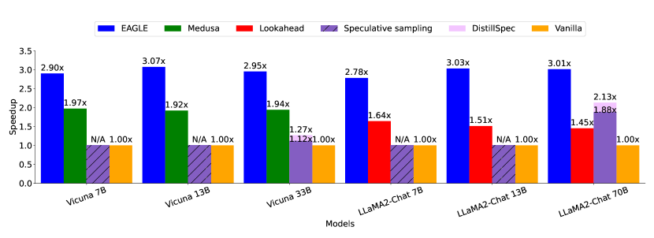
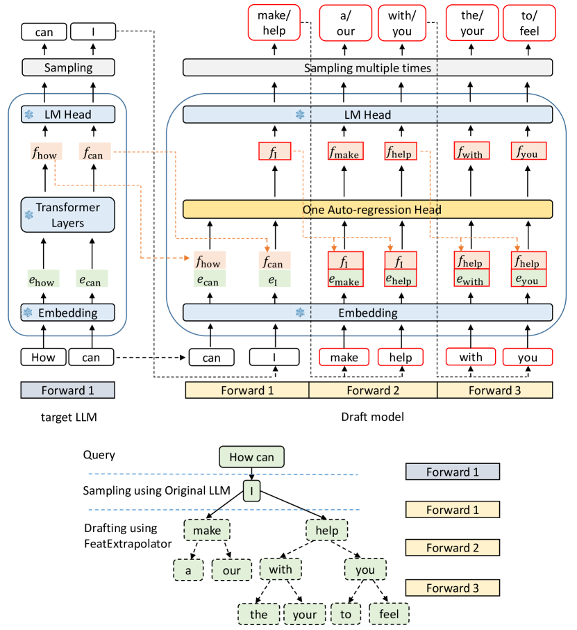
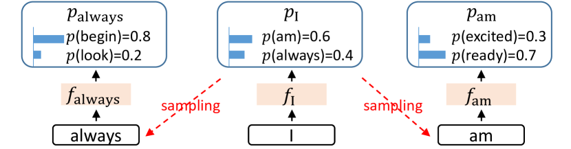
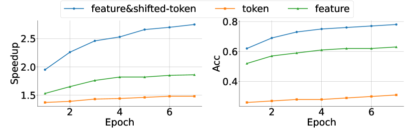
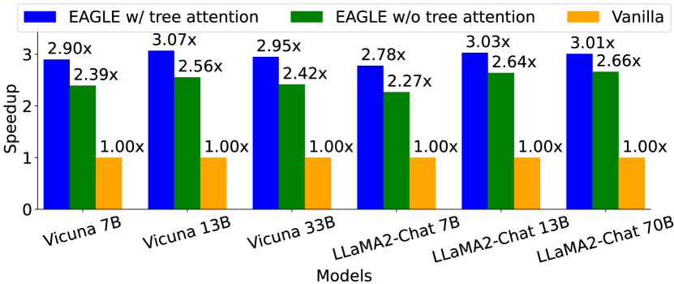

# EAGLE：为什么 draft 不一定要是一个小模型

!!! info "论文信息"
    **论文题名：** EAGLE: Speculative Sampling Requires Rethinking Feature Uncertainty。<br>
    **作者：** Yuhui Li、Fangyun Wei、Chao Zhang、Hongyang Zhang。<br>
    **机构：** 未在公开元数据中稳定解析；以 arXiv/PDF 或官方页 affiliation block 为准。<br>
    **时间 / 主题：** 2024-01；高效推理。<br>
    **arXiv / 官方报告：** arXiv：[2401.15077](https://arxiv.org/abs/2401.15077)。<br>
    **GitHub / 项目：** GitHub：[github.com/SafeAILab/EAGLE](https://github.com/SafeAILab/EAGLE)。<br>
    **元数据来源与核验口径：** 来源：[arXiv](https://arxiv.org/abs/2401.15077)；[GitHub API / repo](https://github.com/SafeAILab/EAGLE)；Checked Date：2026-06-15；Repro Status：Paper / official materials reviewed, independent reproduction not claimed。

投机解码的基本想法很简单：让一个便宜 draft model 先猜几个 token，再让昂贵 target LLM 并行验证；猜对越多，target LLM 逐 token decode 的次数越少。EAGLE 的问题是：**draft model 一定要是另一个小语言模型吗？**

它的答案是否定的。EAGLE 用 target LLM 已经算出来的高层 feature 做草稿：预测下一步 feature，再复用 target LLM 的 LM head 得到候选 token。这样 draft head 贴着 target 模型内部接口训练，不需要重新预训练一个完整小 LLM。

## 普通 speculative sampling 的瓶颈

经典 speculative sampling 的流程是：

```text
context
  -> draft model 连续生成 k 个候选 token
  -> target model 一次性并行验证这些 token
  -> 接受连续通过验证的前缀
  -> 第一个失败位置由 target 修正
```

收益来自 average acceptance length。draft 猜得越准，一次 target forward 接受的 token 越多；draft 太弱，接受率低；draft 太强，自己的计算开销又会变大。对 13B 或 70B target 来说，用一个不小的 draft LLM 可能吃掉大部分收益。

EAGLE 的直觉是：target LLM 在上一轮 forward 已经产生了 second-to-top-layer hidden feature。这些 feature 比离散 token 更平滑、更接近 target 的内部计算轨迹。与其从 token 层重新学一个小模型，不如预测 target feature 的下一步。

{ width="690" }

<small>图源：[EAGLE: Speculative Sampling Requires Rethinking Feature Uncertainty](https://arxiv.org/abs/2401.15077)，Figure 1。原图表达：temperature=0 的 MT-bench 上，EAGLE 相比 Medusa、Lookahead、speculative sampling 等方法有更高 speedup。本站读法：这张图只证明在论文设置下 latency 更低，不证明回答质量更高；质量保持来自后面的 target verification。</small>

## EAGLE 预测的是 feature，不是直接预测 token

EAGLE 的 draft path 可以读成：

```text
target LLM feature prefix F_{1:i}
shifted token sequence T_{2:i+1}
  -> target embedding(T)
  -> concatenate feature and token embedding
  -> small autoregression head predicts next feature f_{i+1}
  -> frozen target LM head maps feature to token distribution
  -> speculative verification by target LLM
```

{ width="690" }

<small>图源：[EAGLE](https://arxiv.org/abs/2401.15077)，Figure 6。原图表达：绿色是 shifted token embedding，橙色是 target feature，红框是 trainable draft head，蓝色雪花表示复用并冻结 target embedding / LM head。本站读法：EAGLE 只训练一个轻量 autoregression head，但候选 token 仍经过 target LM head 和 target verification。</small>

这个设计有两个关键点。

第一，draft head 贴着 target feature 学。它不是独立小 LLM，所以训练成本低得多。论文报告对 LLaMA2-Chat 70B，只训练少于 1B 参数，用约 68K ShareGPT 对话，4 张 A100 40G 上 1-2 天可完成。

第二，EAGLE 保持 lossless speculative sampling 的语义。draft 只是提案者，最终接受与否由 target model verification 决定。因此在标准验证算法下，输出分布保持 target LLM 的原始分布。

## 为什么会有 feature uncertainty

feature-level draft 有一个不明显但很重要的问题：token 是离散采样，feature 是连续轨迹。假设前文是 `I`，下一 token 可能采到 `am`，也可能采到 `always`。这两个离散结果会进入不同未来分支，只看上一 feature \(f_I\)，draft head 并不知道实际采样到了哪个 token。

{ width="690" }

<small>图源：[EAGLE](https://arxiv.org/abs/2401.15077)，Figure 3。原图表达：token `I` 后可能采样出 `am` 或 `always`，对应不同 feature sequence；仅靠 \(f_I\) 预测下一 feature 会出现歧义。本站读法：feature 虽然平滑，但必须知道离散采样实际走了哪条分支。</small>

EAGLE 的修正是把 token sequence 提前一个 time step 输入 draft head。也就是说，预测下一 feature 时，不只看 feature prefix，还看上一轮真实采样出来的 token。论文称为 `feature&shifted-token`。这不是小技巧，而是整篇论文的核心：**feature 负责连续轨迹，shifted-token 负责告诉模型离散分支。**

{ width="690" }

<small>图源：[EAGLE](https://arxiv.org/abs/2401.15077)，Figure 4。原图表达：在 Vicuna 7B + MT-bench + temperature=0 上，feature-level draft 优于 token-level draft；加入 shifted-token 后进一步提升 speedup。本站读法：这张消融支撑“feature 和已采样 token 必须一起看”。</small>

## Loss 为什么要同时看 feature 和 token

EAGLE 训练 draft head 时，首先让预测 feature \(\hat f_{i+1}\) 接近 target feature \(f_{i+1}\)：

\[
L_{\mathrm{reg}}
=
\mathrm{SmoothL1}
\left(
f_{i+1},
\mathrm{DraftModel}(T_{2:i+1},F_{1:i})
\right)
\]

这里 \(F_{1:i}\) 是已有 feature 序列，\(T_{2:i+1}\) 是 shifted token 序列。公式读法是：draft head 要沿着 target LLM 的 feature 轨迹预测下一步。

但最终被验证的是 token，不是 feature。因此 EAGLE 还把真实 feature 和预测 feature 都送入 frozen LM head，比较它们诱导的 token 分布：

\[
p_{i+2}
=
\mathrm{Softmax}(\mathrm{LMHead}(f_{i+1})),
\qquad
\hat p_{i+2}
=
\mathrm{Softmax}(\mathrm{LMHead}(\hat f_{i+1}))
\]

再用 classification loss：

\[
L_{\mathrm{cls}}
=
\mathrm{CrossEntropy}(p_{i+2},\hat p_{i+2})
\]

最终目标是：

\[
L=L_{\mathrm{reg}}+w_{\mathrm{cls}}L_{\mathrm{cls}},
\qquad
w_{\mathrm{cls}}=0.1
\]

这组公式的读法是：regression 保证 feature 轨迹像 target，classification 保证这些 feature 经过 LM head 后能产生 target 会接受的 token 分布。论文把 \(w_{\mathrm{cls}}\) 设成 0.1，是因为 classification loss 数值通常比 regression loss 大。

EAGLE 还在训练时给 feature 加均匀噪声：

\[
\epsilon\sim\mathcal U(-0.1,0.1)
\]

这里 \(\epsilon\) 是注入到 feature 的扰动，用来让 draft head 提前适应推理时的递归误差。EAGLE-3 后来把这个思想推进得更彻底：直接把 test-time 多步递归过程搬进训练。

## Tree attention 为什么能提高接受长度

EAGLE 不只生成一条 token 链，还可以生成 tree-structured draft。Tree attention 的意义是：同样几次 draft forward，可以覆盖多个候选分支；target model 再用 tree mask 并行验证这些候选。

{ width="690" }

<small>图源：[EAGLE](https://arxiv.org/abs/2401.15077)，Figure 7。原图表达：MT-bench、temperature=0 上，使用 tree attention 的 EAGLE 比 chain draft 有更高 average acceptance length。本站读法：tree 不是让 target 少验证，而是让一次 verify 覆盖更有希望的候选前缀。</small>

论文 Table 5 显示，tree attention 把 average acceptance length 提高约 0.6-0.8。这个提升来自候选预算更丰富，但也带来工程复杂度：tree mask 必须保证分支 token 只能看祖先，不能偷看兄弟分支；候选 token 变多后，verify 的实际 kernel 和 KV 管理也要跟上。

## 实验应该怎么读

EAGLE 的主实验有三个层次。

| 证据 | 支撑什么 | 不能证明什么 |
| --- | --- | --- |
| MT-bench speedup 图 | feature-level draft 可以降低单请求 latency | 不代表答案更好 |
| 输入消融 | feature + shifted-token 是关键组合 | 不代表所有层 feature 都适合 draft |
| tree attention 消融 | tree draft 能提高接受长度 | 不代表静态树是最优候选分配 |
| batch size 实验 | 小 batch 更容易获得单请求加速 | 不代表高吞吐大 batch 永远同样快 |
| Mixtral 8x7B 实验 | MoE 上收益较弱 | 不代表所有 MoE 都无法投机 |

论文报告 temperature=0 时 HumanEval、GSM8K、Alpaca 等任务上常见 2.7x-3.7x speedup；temperature=1 时 speedup 通常下降。直觉很简单：采样更随机，draft 更难连续猜中，acceptance length 变短。

Batch size 也是关键边界。小 batch decode 时，target LLM 往往是 memory bandwidth / latency bound，GPU 计算资源没有完全吃满；投机验证能把更多 token 合到一次 target forward。大 batch 时 target 已更接近饱和，draft、tree token 和 verification overhead 会竞争资源，single-request speedup 会收缩。

MoE 上也会变复杂。Dense target 每个 token 都读同一套权重，多 token verification 更容易摊薄开销；Mixtral 这类 MoE 每个 token 只激活部分 experts，tree verification 可能触发更多 experts，导致收益不如 dense 模型明显。

## 和 EAGLE-2、EAGLE-3 的关系

EAGLE 系列的演化线很清楚：

| 论文 | 解决的缝隙 |
| --- | --- |
| EAGLE | 证明 feature-level draft + shifted-token 可以低成本加速 |
| EAGLE-2 | 静态 draft tree 会浪费候选预算，所以改成 dynamic draft tree |
| EAGLE-3 | feature prediction constraint 限制 scaling，所以改成 direct token prediction + training-time test |

所以读 EAGLE 不要把它当成系列终点。它的价值是找到一个服务端可训练的 hidden-state draft interface；后续两篇分别在“候选预算怎样分配”和“draft 训练分布怎样贴近推理”上继续修补。

## 落地时要检查什么

EAGLE 最有工程价值的一句话是：**draft model 不必是完整语言模型，它可以是贴着 target feature 接口训练出来的预测头。**

但落地时要检查这些问题：

| 问题 | 为什么重要 |
| --- | --- |
| target feature 是否稳定可导出 | EAGLE 依赖 second-to-top-layer feature 和 LM head |
| draft head 是否足够便宜 | overhead 太高会吃掉 acceptance 收益 |
| shifted-token 是否严格对齐采样 | 多步 feature draft 必须知道实际 token 分支 |
| tree attention mask 是否正确 | 分支之间不能泄漏上下文 |
| 训练数据是否覆盖目标流量 | ShareGPT 成本低，但专业域、代码、工具流量可能需要重训 |
| 是否按请求桶看 acceptance | 长输出、低温、模板化任务更适合；高温、agent、短输出可能收益差 |

## 证据链和验收口径

EAGLE 的实验需要按 speculative decoding 的工作流读，而不是按普通模型能力榜读。target model 的输出分布由验证算法保证，因此方法证据主要落在“减少多少 target decode step”和“额外 draft 成本是否值得”。

| 证据节点 | 论文想证明 | 工程验收要补什么 |
| --- | --- | --- |
| Figure 1/2 speedup | feature-level draft 在 MT-bench 上降低延迟 | 同硬件、同 runtime、同 sampling 配置的端到端延迟 |
| Figure 3 feature uncertainty | 只预测 feature 会遇到离散采样分支歧义 | 检查 shifted-token、position id 和 sampled token 是否严格对齐 |
| Figure 4 输入消融 | feature + shifted-token 是更强 draft 条件 | 按业务流量复测 acceptance，而不是只看公开对话 |
| Figure 7 tree attention | tree draft 提高 average acceptance length | 验证 tree mask、KV 提交和 batch scheduler 是否正确 |
| Mixtral 结果 | MoE target 的收益更复杂 | 对 MoE route、expert 并发和 kernel shape 做单独 profiling |

这里还有一个常见误读：EAGLE 的 draft head 小，不等于服务一定省钱。训练和推理阶段都要额外保存 target feature、运行 draft head、构造候选树、再让 target 验证更多 token。只有当 accepted prefix 足够长，target 少跑的逐 token step 才能覆盖这些开销。

因此一套可复用验收标准应该包含四个数字：平均接受长度、draft tokens / target verify tokens、端到端 tokens/s、P95 latency。再加两个安全检查：输出分布是否和 target sampling 一致，拒绝分支是否不会污染后续 KV。没有这两个检查，speedup 数字越好越危险。

## 为什么它仍然是系列的起点

EAGLE 后来的改进很多，但原论文有一个不可替代的位置：它把 draft model 从“另一个小 LLM”改成“target 内部状态的轻量预测器”。这个接口变化带来两点长期影响。

第一，draft 训练可以更贴近目标模型。小 LLM draft 学的是外部 token distribution，和 target 的内部计算未必一致；EAGLE 让 draft head 直接追随 target feature，再经 frozen LM head 映射回 token distribution。第二，draft 的成本边界更清楚。它不用完整 transformer stack 重算上下文，而是利用 target 上一步已经产生的 feature，适合被塞进 serving runtime 的 decode 循环。

这也解释了为什么 EAGLE-2 和 EAGLE-3 都没有推翻 EAGLE。EAGLE-2 改的是候选预算分配，EAGLE-3 改的是训练分布和目标约束；它们仍然在回答 EAGLE 打开的同一个问题：怎样从 target 已有计算中榨出一个便宜但高接受率的 draft path。

## 最小复现路径

如果要把 EAGLE 的机制复现到一个新 target LLM 上，最小路径可以分成四步。

1. 固定 target model，导出同一层 hidden feature 和 LM head 输出，确认 feature、token、position id 在训练样本中严格对齐。
2. 用一小批真实对话或业务 prompt 训练 draft head，只做 feature + shifted-token 输入，不先引入复杂 tree。
3. 在线下 prompt 集上统计 single-chain acceptance length，确认 feature-level draft 比简单 token draft 更准。
4. 再接 tree attention 和 target verification，测端到端 latency。

这个顺序很重要。tree attention 能增加候选覆盖，但如果基础 feature draft 不准，树只会放大无效候选；runtime integration 能提高吞吐，但如果 shifted-token 对齐错了，输出分布会先被破坏。EAGLE 的核心 bug 面通常不是“模型不够大”，而是接口错位：取错层、错位一个 token、mask 泄漏、拒绝分支 KV 没清干净。

因此，工程复现时可以先设置一个很朴素的门槛：在固定公开 prompt 集上，draft head 的 average acceptance length 明显超过 1，且目标模型验证后的输出和无投机采样一致。只有通过这个门槛，后续 tree 和 batch 优化才值得做。

## 和传统小模型 draft 的差异

传统 speculative decoding 通常训练或选择一个小语言模型作为 draft。它的优点是接口清晰：小模型看到 token 前缀，直接生成候选 token。缺点也明显：小模型和 target 的分布差距会限制 acceptance，且小模型本身也要完整跑 transformer forward。

EAGLE 的差异在于 draft 不再从零理解上下文。target 已经在上一轮 forward 中把上下文压进 hidden feature，EAGLE 的 draft head 只需要沿着这个 feature 轨迹往前预测。这让 draft 更像 target 内部计算的延伸，而不是外部模型的猜测。

这个差异解释了它的适用边界。若 target feature 很稳定、LM head 可复用、请求模式接近训练分布，EAGLE 很有优势；若 target 是高度定制架构、feature 导出困难、或 serving runtime 无法承受额外 feature/KV 管理，传统小模型 draft 或其他投机方案可能更容易上线。

所以 EAGLE 的工程价值不是替代所有 speculative decoding，而是提供一个新的设计维度：draft 可以贴着 target 内部状态生长。

## 外部精读

- [EAGLE 论文](https://arxiv.org/abs/2401.15077)：方法、公式、消融和系统实验。
- [EAGLE GitHub](https://github.com/SafeAILab/EAGLE)：看实现、模型权重和后续版本入口。
- [Fast Inference from Transformers via Speculative Decoding](https://arxiv.org/abs/2211.17192)：理解 draft-verify 为什么可以保持目标模型分布。
- [SpecInfer](https://arxiv.org/abs/2305.09781)：理解 token tree verification 的另一条系统路线。

## 阅读结论

EAGLE 的核心不是某个 speedup 数字，而是一个接口判断：target LLM 的 hidden feature 可以成为低成本 draft 的工作空间。Feature-level draft 比 token-level draft 更贴近 target 内部轨迹，但必须用 shifted-token 解决离散采样分支带来的 feature uncertainty；tree attention 能提高一次 verify 的候选覆盖；batch、MoE、draft overhead 和 acceptance 分桶决定收益能不能落到线上。把这些点看清，EAGLE 就不再是一张加速表，而是一种设计推理服务 draft path 的方法。

## 相关阅读与下一步

- 外部材料：[论文标题 arXiv 检索](https://arxiv.org/search/?query=EAGLE%3A+Speculative+Sampling+Requires+Rethinking+Feature+Uncertainty&searchtype=title)。
- 外部材料：[Semantic Scholar 标题检索](https://www.semanticscholar.org/search?q=EAGLE%3A+Speculative+Sampling+Requires+Rethinking+Feature+Uncertainty)。
- 外部材料：[Papers with Code 检索](https://paperswithcode.com/search?q=EAGLE%3A+Speculative+Sampling+Requires+Rethinking+Feature+Uncertainty)。
- 站内下一步：[论文精读专题](../index.md)。
- 站内下一步：[论文专题写作规范](../writing-standard.md)。
- 站内下一步：[外部精读来源台账](../../references/external-reading-ledger.md)。
