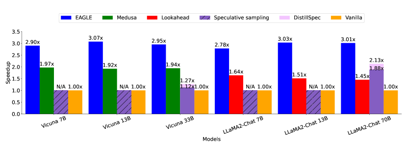
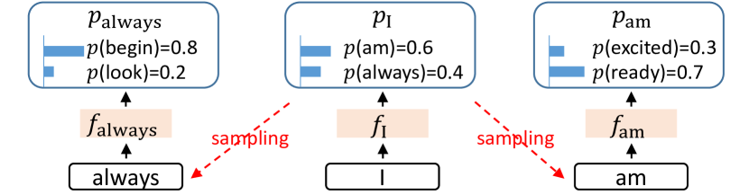
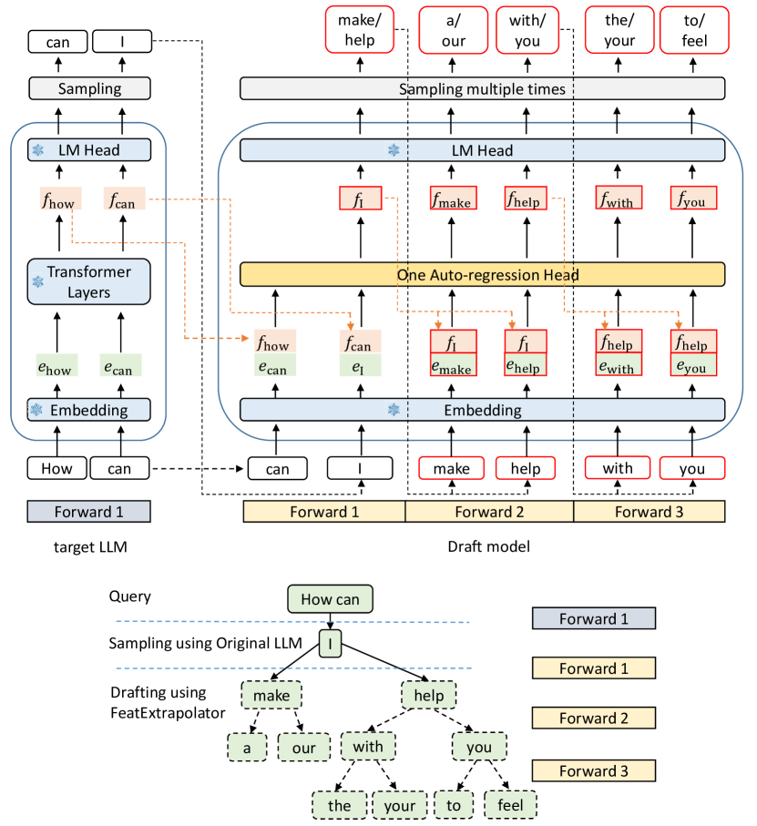
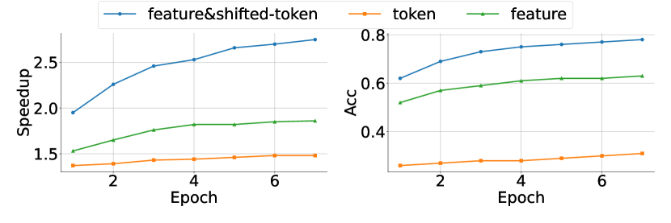
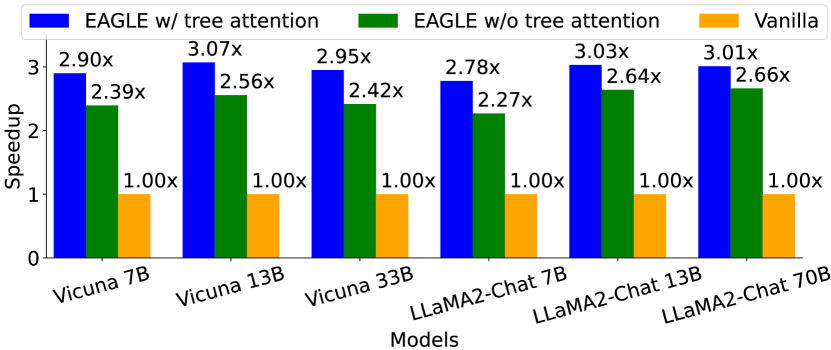

# EAGLE：为什么 draft 不一定要是一个小模型

!!! info "论文信息"
    **论文题名：** EAGLE: Speculative Sampling Requires Rethinking Feature Uncertainty。 
    **作者：** Yuhui Li、Fangyun Wei、Chao Zhang、Hongyang Zhang。 
    **机构：** 未在公开元数据中稳定解析；以 arXiv/PDF 或官方页 affiliation block 为准。 
    **时间 / 主题：** 2024-01；高效推理。 
    **arXiv / 官方报告：** arXiv：[2401.15077](https://arxiv.org/abs/2401.15077)。 
    **GitHub / 项目：** GitHub：[github.com/SafeAILab/EAGLE](https://github.com/SafeAILab/EAGLE)。 
    **元数据来源与核验口径：** 来源：[arXiv](https://arxiv.org/abs/2401.15077)；[GitHub API / repo](https://github.com/SafeAILab/EAGLE)；Checked Date：2026-06-15；Repro Status：Paper / official materials reviewed, independent reproduction not claimed。

## 小草稿模型的困难，不只是参数不够少

自回归解码每生成一个 token 都要调用目标模型。小 batch 下，这常常受到模型参数读取和顺序依赖限制。Speculative sampling 让便宜的草稿模型先走几步，再由目标模型并行验证；收益取决于草稿是否便宜，以及连续多少 token 能被接受。

普通方案用一个独立小语言模型来拟合大模型。EAGLE 改为复用目标模型已经算出的 hidden features，只训练一个较轻的自回归 head。它的关键发现是：沿特征序列预测更容易，但下一步特征还取决于刚刚采样出了哪个 token。把这个采样结果明确输入草稿模型，才能消除不必要的不确定性。[↗](https://arxiv.org/pdf/2401.15077v3#page=2)

这里需要同时满足两个条件。草稿必须足够接近目标模型，否则连续接受不了几个词；草稿自己又必须便宜，否则省下的大模型调用被小模型调用抵消。论文用 LLaMA2 系列举例：用 7B 草拟 70B 的输出还有空间，用 7B 草拟 13B 时，草稿开销就可能吃掉收益。给 7B 目标寻找更小而又匹配聊天模板的现成模型也不容易。EAGLE 因而把问题改成：目标模型已经支付了计算代价，能否让它的内部状态直接帮助下一轮草拟？

这也解释了它与 Medusa 的差别。Medusa 的多个预测头从同一特征分别预测不同未来位置；EAGLE 保留轻量的自回归过程，后一个预测可以知道前一个位置究竟采样了什么。增加这条依赖会付出若干草稿 forward，但能提高连续预测的可靠性。设计是在草稿开销和接受长度之间找平衡，不能仅凭“一层”或“并行”判断谁更快。[↗](https://arxiv.org/pdf/2401.15077v3#page=4)

下面的主结果图比较 MT-bench、temperature 0 下的 wall-clock 加速。图中标为 N/A 的普通投机配置包含找不到合适草稿模型或草稿开销过大的情形；不能把 N/A 当成零性能。部分比较方法数字来自各自报告，详细评测还需看论文统一实验设置。

{ width="690" }

## 目标模型的特征提供了什么额外信息

设 token 序列为 $T_{1:j}$，embedding 为 $E$，目标模型在 LM head 前的特征为 $f_j$。正常生成路径是

$$
T_{1:j}\rightarrow E_{1:j}\rightarrow f_j\rightarrow p_{j+1}\rightarrow t_{j+1}.
$$

这里论文称为 second-to-top-layer feature 的量，是 LM head 之前的 hidden state，不应机械理解成 Transformer 倒数第二个 block 的输出。它已经融合上下文，比只给一个小模型离散 token 提供更多目标模型内部信息。

但同一个 $f_j$ 经采样可能产生不同 $t_{j+1}$。继续处理“am”与“always”显然应得到不同的后续状态。如果只给特征序列，不告诉草稿实际选择了哪个 token，模型就不得不对不同未来做平均。

下面的不确定性图应在同一个前缀处分叉阅读：分歧来自采样结果，随后才进入新的特征。EAGLE 把提前一个时间步的 token 序列与特征序列一起输入，使“预测下一状态”成为已知所选 token 条件下的问题。

{ width="690" }

## 一层自回归 head 如何连续产生草稿

输入 $F_{1:i}$ 和 $T_{2:i+1}$，token 先经目标模型 embedding，得到与特征同宽的向量。二者在通道维拼接，从 $2d$ 经全连接层降到 $d$，再通过一个 decoder layer 预测 $\hat f_{i+1}$。复用目标模型 LM head，便得到下一个草稿 token 的分布。

$$
\hat f_{i+1}=\operatorname{Draft}(T_{2:i+1},F_{1:i}),\qquad
\hat p_{i+2}=\operatorname{Softmax}(W_{\mathrm{LM}}\hat f_{i+1}).
$$

第一步可以使用目标模型提供的真实特征；后续目标模型尚未验证，便把预测特征和采样 token 反馈到草稿 head。这样保持轻量自回归，而不必每一步重新运行完整目标模型。

下面的流程图先看冻结的 embedding/LM head，再跟随草稿预测出的特征和新 token。下半部分展示树状候选：一次草稿层可以并行扩展多个分支，若某个候选失败，验证仍可考虑同位置的替代分支。

{ width="690" }

EAGLE 的树形状预先设定。tree attention 让每个节点只看自己的祖先，避免把互不兼容的候选当成同一条连续文本。目标模型验证后，接受路径上的真实特征会被保存，供下一轮草稿使用。[↗](https://arxiv.org/pdf/2401.15077v3#page=4)

### 把一次草拟与验证接起来

图 6 的 “How can I” 可以作为具体执行例子。目标模型处理前缀 “How can”，计算出 $f_{\mathrm{How}},f_{\mathrm{can}}$，再采样出 “I”。草稿看到的是对齐后的 $(f_{\mathrm{How}},e_{\mathrm{can}})$ 与 $(f_{\mathrm{can}},e_{\mathrm{I}})$。第二对告诉它：已知上一个状态，也已知进入下一个位置的 token，所以现在可以预测 $\hat f_{\mathrm{I}}$。

这个预测特征经 LM head 产生 “make / help” 等候选。若沿 “help” 分支继续，下一次草稿计算使用 $(\hat f_{\mathrm{I}},e_{\mathrm{help}})$；沿 “make” 分支则使用不同 embedding。因此，同一批草稿特征能分叉成不同续写，而每个分支的后续预测都有自己的条件。图中的红框越来越多，表示越往后越依赖草稿自己预测的特征；下一轮目标模型验证后，会把接受路径重新锚定到真实目标特征。

树形验证的节省来自共享前缀与一次并行调用。各候选可在同一次 forward 中计算，但 “help with” 的节点只能关注自己的祖先，不能读到 “make our” 的内容。否则计算出的就不是该候选路径应有的目标分布，精确接受规则也失去了适用前提。图 6 为说明流程画了三次草稿 forward；附录 A.1 的实际实验树使用五次草稿 forward、一次目标模型验证，所有模型沿用同一预设形状。[↗](https://arxiv.org/pdf/2401.15077v3#page=12)

## 训练同时约束特征与最终 token 分布

第一代草稿 head 的目标由回归和分类两部分组成：

$$
\mathcal L_{\mathrm{reg}}=\operatorname{SmoothL1}(f_{i+1},\hat f_{i+1}),
$$

$$
\mathcal L_{\mathrm{cls}}=\operatorname{CrossEntropy}(p_{i+2},\hat p_{i+2}),\qquad
\mathcal L=\mathcal L_{\mathrm{reg}}+0.1\mathcal L_{\mathrm{cls}}.
$$

回归使预测特征接近目标模型，分类使特征经过 LM head 后产生有用草稿。第二项的标签是目标分布，不只是单个离散 token。论文因两项数值尺度不同而给分类项较小权重。

训练时目标模型冻结，使用约 68K 条 ShareGPT 对话；学习率 $3\times10^{-5}$，AdamW 的 $\beta=(0.9,0.95)$，梯度裁剪 0.5。为模拟递归预测误差，在真实特征上加入 $U(-0.1,0.1)$ 噪声。7B、13B、33B、70B 对应的可训练 head 约为 0.24B、0.37B、0.56B、0.99B；70B 的 head 训练报告使用 4 张 A100 40GB，约 1–2 天。[↗](https://arxiv.org/pdf/2401.15077v3#page=5)

这个成本与重新预训练一个完整小语言模型不同，但也意味着每个目标模型需要合适的草稿权重。换了目标参数或领域分布后，原 head 的接受率不由架构自动保证。

### 特征距离为什么还要配合 token 分布

$\mathcal L_{\mathrm{reg}}$ 约束连续空间中的位置，$\mathcal L_{\mathrm{cls}}$ 约束读出后的语义选择。若两个预测特征的几何误差接近，但一个让 LM head 把高概率 token 排错了，实际接受率可以相差很大。分类项让草稿直接关心验证阶段会使用的分布，回归项则把它限制在目标模型的特征结构附近。

按论文的定义，分类交叉熵可展开为

$$
-\sum_{v\in\mathcal V}p_{i+2}(v)\log\hat p_{i+2}(v),
$$

其中 $\mathcal V$ 是词表。这里用整个目标分布加权，能保留多个合理续写的相对概率。$p$ 来自冻结目标模型，梯度更新的是草稿 head；目标 embedding 和 LM head 提供共同的输入、输出坐标系。

训练与使用仍有差别。训练时可以获得真特征，连续草拟时却要喂回 $\hat f$。均匀噪声增强让 head 在略偏离真值的特征上也能工作，但并没有把训练输入完全换成自身 rollout。这个残余差异在下面的多步接受率实验中仍能看到。原文还区分“用固定文本提取目标特征”与“让目标模型先重新生成训练回答”：前者同样需要目标模型的特征计算，只省去了额外生成回答的成本。[↗](https://arxiv.org/pdf/2401.15077v3#page=5)

## 无损来自验证规则，不能由草稿准确率代替

令目标分布为 $p$，草稿分布为 $q$。对草稿采样出的 $\hat t$，标准投机采样的接受概率是

$$
a(\hat t)=\min\left(1,\frac{p(\hat t)}{q(\hat t)}\right).
$$

拒绝后从归一化的正残差分布采样：

$$
p_{\mathrm{res}}(t)=\frac{\max(0,p(t)-q(t))}{\sum_v\max(0,p(v)-q(v))}.
$$

因此，被拒绝的候选不会强行写进最终结果，草稿误差影响速度而不改变理论目标分布。树状版本需要递归执行相应验证与分布更新，并保持祖先可见性；并不是简单选目标模型打分最高的整条树路径。

可以把单候选规则展开，直观看出概率质量如何守恒。草稿首先以 $q(t)$ 提出 token $t$，被接受并输出它的联合概率是

$$
q(t)\min\left(1,\frac{p(t)}{q(t)}\right)=\min(p(t),q(t)).
$$

总拒绝概率为 $1-\sum_v\min(p(v),q(v))$，也就是 $\sum_v[p(v)-q(v)]_+$。从正残差分布补采样后，token $t$ 得到的额外概率恰好是 $[p(t)-q(t)]_+$。两条路径相加得到

$$
\min(p(t),q(t))+[p(t)-q(t)]_+=p(t).
$$

这是对原文接受规则的解释性展开。以一个两 token 例子说明：若 $p=(0.6,0.4)$、$q=(0.8,0.2)$，第一种 token 被提议后以 $0.75$ 概率接受，第二种总是接受。接受路径贡献 $(0.6,0.2)$；剩余 $0.2$ 拒绝概率全部补给第二种 token，最终正好恢复 $(0.6,0.4)$。拒绝机制修正了草稿对第一种 token 的过度偏好。

树的同一父节点下可能有多个候选。附录 A.2 的 multi-round speculative sampling 在一个候选被拒绝后更新剩余分布，再尝试下一候选；全部候选都拒绝，才从最终残差分布直接采样。每一步都沿用相应提议分布和更新后的目标分布。因此，不能在拒绝后仍用最初的 $p$ 检验所有兄弟节点，也不能把“挑最可能的一条路径”当成同一算法。[↗](https://arxiv.org/pdf/2401.15077v3#page=13)

这个保证适用于论文采用的精确规则。temperature 0 的贪心结果与非零温度下的分布一致性是相关但不同的检查；若实现额外放宽接受条件，就不能继续直接引用同一保证。[↗](https://arxiv.org/pdf/2401.15077v3#page=3)

## 实验分别检验特征输入、树结构与最终速度

输入消融比较 token、feature 以及加入 shifted token 的配置。下面的图应同时看草稿准确率和速度，而不是只看哪条线更高：更准确但更昂贵的草稿未必更快。论文的结果支持特征复用有帮助，显式输入采样 token 进一步改善预测。

{ width="690" }

但三条曲线还不能区分“加入 token 的额外信息”和“token 向前错一位以告知采样结果”各自的作用。Section 4.3.2 因而增加 **feature & unshifted-token** 对照。它也融合特征和 token，但没有把刚采样出的下一 token 提供给对应特征预测。除融合输入需要 FC 降维外，草稿网络结构保持一致。

四组比较回答了更细的问题：feature-only 相对 token-only 有优势；加入未移位 token 后，初次预测接受率变化较小，喂入一次预测特征后的接受率有所改善，说明离散、准确的 token 有助于抵御特征误差；进一步前移 token，才把采样分支明确告诉 head，产生最大的性能增益。这里的核心设计是**输入的时间对齐关系**，不只是多拼一个 embedding。[↗](https://arxiv.org/pdf/2401.15077v3#page=7)

树状草稿的实验再问，额外候选是否值得计算。下面的比较显示 tree attention 能把更多候选的潜力转成接受长度与速度；收益仍受树宽、深度和验证成本约束。

{ width="690" }

Table 5 与 Figure 7 合起来还可以检查“多接受的词是否值得”。Vicuna 7B 从链式的 $\tau=3.20$、2.39 倍加速，升到树式的 $\tau=3.94$、2.90 倍；LLaMA2-Chat 70B 从 $\tau=3.12$、2.66 倍，升到 $\tau=3.81$、3.01 倍。两种配置的 forward 次数相同，树增加的是每次处理的候选 token。因此接受长度增幅通常大于速度增幅，额外候选并不是免费计算。附录明确，这棵树按“高概率分支更深、更宽”的直觉设计，没有穷尽优化上下文与 batch 对树形状的影响。[↗](https://arxiv.org/pdf/2401.15077v3#page=12)

### 接受率、接受长度和速度是三个不同观测

论文的 $\tau$ 统计每次目标 forward 最终推进的 token 数；$\alpha$ 统计候选接受比例。树中同位置只能选择一条路径，其余分支不被写入不能直接算成预测失败，因此测 $\alpha$ 时作者切换到**链式草稿**。读表时不能用树的总节点数作为 $\alpha$ 的分母，再和论文报告值比较。

$n$-$\alpha$ 则检查草稿递归误差：输入中已有 $n$ 个位置来自预测特征，$0$-$\alpha$ 使用准确目标特征。MT-bench 上的两组结果如下。

| Model / Temperature | $\tau$ | $0$-$\alpha$ | $1$-$\alpha$ | $2$-$\alpha$ | $3$-$\alpha$ | $4$-$\alpha$ |
| --- | ---: | ---: | ---: | ---: | ---: | ---: |
| Vicuna 7B / 0 | 3.94 | 0.79 | 0.74 | 0.72 | 0.73 | 0.67 |
| Vicuna 7B / 1 | 3.17 | 0.71 | 0.68 | 0.66 | 0.66 | 0.65 |
| LLaMA2-Chat 70B / 0 | 3.81 | 0.75 | 0.69 | 0.65 | 0.64 | 0.64 |
| LLaMA2-Chat 70B / 1 | 3.46 | 0.73 | 0.67 | 0.64 | 0.66 | 0.65 |

从真特征换成预测特征后，接受率首先下降；继续递归没有每步都急剧恶化，也不是完全不变。这支持噪声增强和 token 条件能缓解误差累积，但仍留有继续改进训练方式的空间。温度改变了采样条件，$\tau$ 与 $\alpha$ 的变化也不能混成一次相同设置的消融。[↗](https://arxiv.org/pdf/2401.15077v3#page=6)

### 任务不同，额外计算被摊销的程度也不同

主实验大多采用 batch 1，覆盖对话、代码、数学和指令任务。MT-bench 的代表结果如下，基线都是普通自回归解码的 1 倍：

| 目标模型 | Temperature 0 加速 | Temperature 1 加速 |
| --- | ---: | ---: |
| Vicuna 7B | 2.90× | 2.13× |
| Vicuna 13B | 3.07× | 2.32× |
| LLaMA2-Chat 13B | 3.03× | 2.68× |
| LLaMA2-Chat 70B | 3.01× | 2.67× |

LLaMA2-Chat 70B 在 HumanEval、GSM8K、Alpaca 的 temperature 0 加速分别为 3.52、3.03、2.97 倍；任务不同，连续接受长度也不同。代码模板较多是作者解释其较高收益的因素，不应据此假定任意代码服务都能达到相同倍数。

理解速度时可以使用一个明确的成本近似：若每轮平均产出 $\tau$ 个有效 token，草稿与验证时间分别为 $T_d,T_v$，普通单步时间为 $T_1$，则加速约为 $\tau T_1/(T_d+T_v)$。这是对执行成本的解释，不是论文承诺的常数。接受长度提高只有超过新增草稿、树验证和缓存成本，才会变成端到端改善。

## 训练数据、MoE 与服务负载决定采用成本

### 为目标模型重新生成回答，收益有多大

Table 6 固定 LLaMA2-Chat 7B、MT-bench、temperature 0，比较两种训练数据。问题都来自 ShareGPT，区别只在回答沿用数据集还是让目标模型生成。

| Training data | Speedup | $\tau$ |
| --- | ---: | ---: |
| Fixed dataset | 2.78× | 3.62 |
| Data generated by target LLM | 2.88× | 3.75 |

目标模型生成数据有一定收益，但本实验只有 0.10 个加速倍数、0.13 个接受长度的提高。对已有通用对话数据的场景，作者选择固定文本以降低准备成本是有依据的；这不等于在领域迁移、特殊词表或不同聊天格式下训练数据都不重要。相同 head 跨评测任务使用说明了其迁移能力，不能替代专门的领域失配实验。[↗](https://arxiv.org/pdf/2401.15077v3#page=7)

### MoE 的验证成本为什么更难摊销

在 Mixtral 8x7B Instruct 上，MT-bench、temperature 0 的结果是 1.50 倍加速、$\tau=3.25$。接受长度已经超过三个 token，但速度仍明显低于同文稠密模型。原因不仅是草稿准确度：稠密模型无论这次验证一个还是多个 token，都会读取同一组权重；MoE 普通解码单 token 只激活部分 experts，多 token 验证可能让更多 experts 被读取。新增候选会扩大权重访问集合，削弱原本想摊销的内存成本。这是原文对结果的系统解释，不能仅按总参数量预测 EAGLE 加速幅度。[↗](https://arxiv.org/pdf/2401.15077v3#page=6)

### batch 变大后，要重新选择树和并发量

单请求解码时，GPU 常有闲置计算能力，可用于并行验证；增加服务 batch 后，这部分余量减少。Table 7 给出相同 MT-bench、temperature 0 下的实际变化。

| Target model | Batch 1 | Batch 2 | Batch 3 | Batch 4 | Peak throughput ratio |
| --- | ---: | ---: | ---: | ---: | ---: |
| Vicuna 7B | 2.90× | 2.87× | 2.65× | 2.76× | 1.97× |
| LLaMA2-Chat 70B | 3.01× | 2.81× | 2.50× | 2.40× | 1.99× |

前四列比较相同 batch 的延迟，最后一列比较各自能达到的最高吞吐，它们不是同一种计算。FP16、24 GB RTX 3090 上，Vicuna 7B 的普通解码最大 batch 为 8，EAGLE 为 7；4 张 A100 40 GB 上，70B 的两者最大 batch 分别为 5 和 4。草稿模块和候选验证会占用额外显存，因而提升单请求速度也可能降低最大并发。

Vicuna 7B 在 batch 4 的加速略高于 batch 3，作者把它归因于具体多 token forward 的执行效率，而非接受率单调改善。到 batch 7，作者发现不使用树更有利。这些结果给出的工程结论很具体：**固定显存下，应共同调 batch、草稿树和验证工作量**，不能先拿 batch 1 的三倍速度，再假定服务吞吐也必然三倍。[↗](https://arxiv.org/pdf/2401.15077v3#page=8)

### 与量化、编译组合时重新定义比较基线

在 RTX 3090、LLaMA2-Chat 7B、MT-bench、temperature 0 上，论文进一步结合 gpt-fast 的编译和量化。

| Implementation | FP16 (tokens/s) | INT4 (tokens/s) |
| --- | ---: | ---: |
| Vanilla (Hugging Face) | 24.5 | N/A |
| gpt-fast | 55.1 | 106.9 |
| EAGLE + gpt-fast | 100.2 | 160.4 |

这说明投机解码能与降低单次调用成本的技术叠加。但 EAGLE 在 INT4 gpt-fast 上的增量应按 $160.4/106.9\approx1.50$ 倍计算；相对 FP16 Hugging Face 的约 6.55 倍则包含量化、编译和投机全部变化。精确采样保证针对所选择的目标分布，不能用它证明量化后的目标模型与原 FP16 模型等价。[↗](https://arxiv.org/pdf/2401.15077v3#page=6)

## 从这篇论文带走的实现思路

采用 EAGLE 时，先固定目标 checkpoint、tokenizer 与采样设置，再训练或选择对应 head。接入推理后，重点核对特征和 token 的一步错位、树的祖先 mask、拒绝后残差更新，以及接受路径真实特征的回填。随后分别记录草稿耗时、目标验证耗时、$\tau$、额外显存与服务 batch 下的吞吐。这个顺序把“分布是否正确”和“是否真的更快”变成两项可独立检查的工作。

EAGLE 留下的核心接口是“目标特征 + 已采样 token → 轻量草稿 → 精确验证”。后续 [EAGLE-2](eagle-2.md) 调整同一个 head 的候选预算，[EAGLE-3](eagle-3.md) 再改变训练目标与多步输入。理解第一代时，应把特征信息的收益与验证保证分开，前者决定能快多少，后者决定输出分布是否保持。
