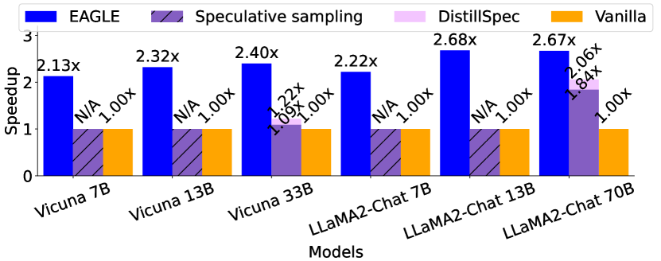
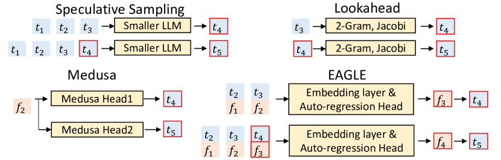
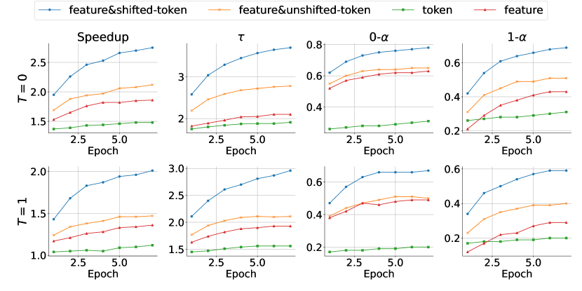

# EAGLE：Feature-level Draft 的投机推理

!!! info "论文信息"
    - 论文：`EAGLE: Speculative Sampling Requires Rethinking Feature Uncertainty`
    - 链接：[arXiv:2401.15077](https://arxiv.org/abs/2401.15077)
    - 版本：2024-01-26 首版，2025-03-04 修订为 v3
    - 代码：[GitHub: SafeAILab/EAGLE](https://github.com/SafeAILab/EAGLE)
    - 关键词：speculative sampling、feature-level autoregression、feature uncertainty、tree attention、Autoregression Head、lossless acceleration

EAGLE 是 EAGLE 系列的第一块地基。它解决的问题不是“再找一个更小的 LLM 当 draft model”，而是：**能不能用 target LLM 已经算出来的高层 feature 来生成草稿，从而避免小 draft model 太慢、太弱、还要重新预训练的问题？**

它的答案是 feature-level autoregression：用 target LLM 的 second-to-top-layer feature 作为连续表示，让一个很小的 Autoregression Head 预测下一步 feature，再复用 target LLM 的 LM head 采样 token。为了处理采样随机性带来的 feature uncertainty，EAGLE 又把提前一位的 token sequence 输入 draft model，让 draft model 知道上一轮到底采到了哪个 token。

## 它的效率贡献是什么

| Dimension | EAGLE |
| --- | --- |
| Saved cost | Target LLM autoregressive decoding steps、per-token parameter reads、single-request latency |
| Main idea | Draft in feature space, then reuse the target LM head to obtain draft tokens |
| Architecture | Frozen target embedding + frozen target LM head + trainable Autoregression Head |
| Key fix | Use feature sequence plus shifted-token sequence to handle sampling-induced feature uncertainty |
| Training role | Train only a small draft head on ShareGPT with regression + classification loss; target LLM remains frozen |
| Inference role | Lossless speculative sampling when standard target-model verification is used |
| Main risk | Speedup depends on draft overhead, tree attention implementation, batch size, and draft data coverage |
| Connect to | [EAGLE-2](eagle-2.md)、[EAGLE-3](eagle-3.md)、[缓存、路由与投机解码](../../inference/caching-routing-and-speculative.md)、[MTP 与投机解码](../../training/mtp-and-speculative-decoding.md) |

## 证据等级与外推边界

EAGLE 的证据包括方法图、输入消融、训练数据消融、tree attention 消融、多模型多任务 speedup，以及 batch/throughput 分析。它证明 feature-level draft 是有效路线，但还保留了 static draft tree 和 feature prediction constraint，这正是后续 EAGLE-2、EAGLE-3 分别继续推进的地方。

| 论文结论 | 证据来源 | 证据等级 | 可外推到高效推理 | 不能直接外推 |
| --- | --- | --- | --- | --- |
| Feature-level draft 比 token-level draft 更有效 | Figure 4 / Figure 8 输入消融 | Mechanism + ablation | draft 不一定要是完整小 LLM，也可以接 target feature | 不代表所有中间层 feature 都适合作草稿 |
| Shifted-token 输入能缓解 feature uncertainty | Figure 3 / Figure 4 / Figure 8 | Mechanism + ablation | 多步 draft 要把采样结果纳入下一步输入 | 不能完全消除递归 feature error |
| Tree attention 提高 acceptance length | Figure 7 / Table 5 | Ablation | tree draft 能用同样 forward 次数验证更多候选 | tree mask 和 token 数增加会带来额外开销 |
| 训练成本低于重训 draft LLM | 训练设置：68K ShareGPT、0.24B-0.99B trainable params | Training recipe | 可作为服务端低成本 draft head 训练参考 | target/domain 改变后仍需重新校准 |
| batch 越大加速越收缩 | Table 7 | System evidence | speculative 更适合 decode 计算资源空闲的小 batch | 大 batch、高吞吐服务不一定保持单请求 speedup |

## 论文位置：为什么不用普通小 LLM 做 Draft

经典 speculative sampling 用一个小 draft model 先生成候选 token，再让 target LLM 一次性并行验证。问题是，小模型如果太小，接受率不够；如果够强，自己的 forward overhead 又会变大。对 13B 级模型，用 7B 当 draft 可能还不如直接 vanilla decoding。

EAGLE 的判断是：target LLM 在上一轮 forward 已经产生了非常有用的 feature。与其再训练一个完整小 LLM，不如训练一个轻量 Autoregression Head，沿着 target feature 的轨迹预测下一步。

{ width="760" }

<small>图源：`EAGLE`，Figure 1。原论文图意：temperature=0 的 MT-bench 上，EAGLE 相比 Medusa、Lookahead、speculative sampling 等方法取得更高 speedup；论文只比较不微调 backbone 且保持输出分布不变的方法。</small>

{ width="760" }

<small>图源：`EAGLE`，Figure 2。原论文图意：temperature=1 的 MT-bench 上，Lookahead 仅限 greedy decoding，Medusa 非贪心生成不保证 lossless，因此 EAGLE 不与这些非 lossless 设置直接比较。</small>

!!! note "和后两篇怎么接"
    EAGLE 先证明 feature-level draft 可行；EAGLE-2 发现 EAGLE 的 static draft tree 仍会浪费候选预算，于是改成 dynamic draft tree；EAGLE-3 发现 feature prediction constraint 会限制 draft model 表达能力，于是改成 direct token prediction + training-time test。

## 核心问题：Feature Uncertainty

Feature-level draft 看起来很自然，但有一个麻烦：token 是离散采样的，feature 是连续轨迹。如果当前 token 可能采到 `am`，也可能采到 `always`，那么下一步 feature 应该沿哪条分支走？只看前一 feature \(f_I\)，draft model 无法知道实际采样结果。

{ width="760" }

<small>图源：`EAGLE`，Figure 3。原论文图意：在 token `I` 后，采样结果可能是 `am` 或 `always`，对应不同 feature sequence；仅靠 \(f_I\) 预测下一 feature 会产生歧义。</small>

EAGLE 的修正是把 token sequence 向前移动一个 time step 输入 draft model。也就是说，预测下一 feature 时，不只看 feature prefix，还看上一轮实际采出来的 token。论文把这个输入称为 `feature&shifted-token`。

{ width="760" }

<small>图源：`EAGLE`，Figure 4。原论文图意：在 Vicuna 7B + MT-bench + temperature=0 上，feature-level draft 优于 token-level draft；加入 shifted-token 后进一步提升 speedup。</small>

这张图就是 EAGLE 的方法动机：feature 比 token 更规则，但 feature 需要知道采样分支；shifted-token 提供了这个分支信息。

## Drafting Phase：EAGLE 到底预测什么

EAGLE 与其他 draft 方法的区别在 drafting phase。普通 speculative sampling 和 Lookahead 从 token 到 token；Medusa 从 target feature 直接预测多个未来 token；EAGLE 从 feature + shifted token 预测下一步 feature，再经 LM head 得到 token。

{ width="760" }

<small>图源：`EAGLE`，Figure 5。原论文图意：对比 speculative sampling、Lookahead、Medusa 和 EAGLE 如何 draft 第四、第五个 token；红框是 draft model 的预测部分。</small>

EAGLE 的 draft model 包含三块：

| Module | Trainable | Role |
| --- | --- | --- |
| Embedding layer | No | Reuses target LLM embedding to embed shifted token sequence |
| Autoregression Head | Yes | FC layer + decoder layer; predicts next feature |
| LM Head | No | Reuses target LLM LM head to map predicted feature to token distribution |

输入输出流程可以写成：

```text
feature sequence F_{1:i}
shifted token sequence T_{2:i+1}
  -> target embedding(T)
  -> concatenate feature and token embedding
  -> FC projection
  -> decoder layer predicts f_{i+1}
  -> target LM head samples t_{i+2}
```

{ width="760" }

<small>图源：`EAGLE`，Figure 6。原论文图意：绿色块是 token embedding，橙色块是 feature，红框是 draft model prediction，蓝色雪花模块复用 frozen target LLM 参数。</small>

EAGLE 还用 tree attention 生成 tree-structured draft。比如 Figure 6 里用 3 次 draft forward 生成 10-token tree，然后 target LLM 一次性并行验证候选树。

## 训练细节：这里是 EAGLE 真正的成本优势

EAGLE 训练时固定 target LLM，只训练 Autoregression Head。论文强调，对 LLaMA2-Chat 70B，EAGLE 只训练少于 1B 参数，用不超过 70K 条 ShareGPT 对话，4 张 A100 40G 上 1-2 天完成；7B、13B、33B 对应训练甚至可以在 RTX 3090 服务器上完成。它还提到训练大约使用 `2B-4B` tokens，而 TinyLLaMA 这类小 LLM 预训练需要约 `3000B` tokens，量级完全不同。

| Training component | Detail |
| --- | --- |
| Target LLM | Fixed; not fine-tuned |
| Training dataset | ShareGPT, 68,000 dialogue iterations |
| Learning rate | `3e-5` |
| Optimizer | AdamW |
| Adam betas | `(0.9, 0.95)` |
| Gradient clipping | `0.5` |
| Trainable params for 7B target | `0.24B` |
| Trainable params for 13B target | `0.37B` |
| Trainable params for 33B target | `0.56B` |
| Trainable params for 70B target | `0.99B` |
| Trainable params for Mixtral 8x7B | `0.28B` |
| 70B training cost | 1-2 days on 4x A100 40G |

### Loss：Feature Regression + Token Classification

EAGLE 的 draft target 首先是 feature，所以用 Smooth L1 regression loss：

\[
L_{\mathrm{reg}}
=
\mathrm{Smooth\ L1}
\left(
f_{i+1},
\mathrm{Draft\_Model}(T_{2:i+1},F_{1:i})
\right)
\]

但 feature prediction 只是中间目标，最终目的是让 LM head 采到 target LLM 会接受的 token。因此论文又加入 classification loss：

\[
p_{i+2}
=
\mathrm{Softmax}(\mathrm{LM\_Head}(f_{i+1}))
\]

\[
\hat p_{i+2}
=
\mathrm{Softmax}(\mathrm{LM\_Head}(\hat f_{i+1}))
\]

\[
L_{\mathrm{cls}}
=
\mathrm{Cross\_Entropy}(p_{i+2},\hat p_{i+2})
\]

最终训练目标是：

\[
L=L_{\mathrm{reg}}+w_{\mathrm{cls}}L_{\mathrm{cls}},
\qquad
w_{\mathrm{cls}}=0.1
\]

论文说明 classification loss 的数值通常比 regression loss 大一个数量级，所以设置 \(w_{\mathrm{cls}}=0.1\)。

### 噪声增强：提前暴露 Feature Error

EAGLE 推理时会自回归使用自己预测的 feature，错误会累积。训练时为了让 Autoregression Head 对 feature error 更鲁棒，论文对 target LLM feature 加入均匀噪声：

\[
\epsilon \sim \mathcal{U}(-0.1,0.1)
\]

这点和后来的 EAGLE-3 有清晰延续关系：EAGLE 用 feature noise 做鲁棒性增强，EAGLE-3 则更进一步，把 test-time 多步递归过程直接搬进训练。

## 训练数据消融：固定 ShareGPT 已经够用吗

EAGLE 理想上可以用 target LLM 自己生成的文本训练 draft head，但那会显著增加成本。论文比较了固定 ShareGPT 数据和 target LLM 生成回答的数据。

| Training data | Speedup | \(\tau\) |
| --- | ---: | ---: |
| Fixed dataset | 2.78x | 3.62 |
| Data generated by target LLM | 2.88x | 3.75 |

<small>表源：`EAGLE`，Table 6。原论文表意：在 LLaMA2-Chat 7B + MT-bench + temperature=0 上，target LLM 生成数据略好，但增益有限，因此固定 ShareGPT 数据能显著降低训练成本。</small>

这张表很重要：EAGLE 的低成本不是完全没代价，而是一个取舍。固定数据足够让 feature draft 起效，但后续 EAGLE-3 会重新强调：如果要继续 scale draft model，训练数据和训练分布会再次变关键。

## 实验设置

论文主要评估单 batch latency，也补充了 batch size 和 throughput：

| Category | Details |
| --- | --- |
| Models | Vicuna 7B/13B/33B, LLaMA2-Chat 7B/13B/70B, Mixtral 8x7B Instruct-v0.1 |
| Tasks | MT-bench, HumanEval, GSM8K, Alpaca |
| Metrics | Speedup ratio, average acceptance length \(\tau\), acceptance rate \(\alpha\) |
| Quality evaluation | Not evaluated separately because standard verification preserves target LLM output distribution |
| Batch / throughput | Batch-size experiments on Vicuna 7B and LLaMA2-Chat 70B |

## Table 1：HumanEval、GSM8K、Alpaca 上的速度

| T | Model | HumanEval Speedup | HumanEval \(\tau\) | GSM8K Speedup | GSM8K \(\tau\) | Alpaca Speedup | Alpaca \(\tau\) |
| ---: | --- | ---: | ---: | ---: | ---: | ---: | ---: |
| 0 | V 7B | 3.33x | 4.29 | 3.01x | 4.00 | 2.79x | 3.86 |
| 0 | V13B | 3.58x | 4.39 | 3.08x | 3.97 | 3.03x | 3.95 |
| 0 | V 33B | 3.67x | 4.28 | 3.25x | 3.94 | 2.97x | 3.61 |
| 0 | LC 7B | 3.17x | 4.24 | 2.91x | 3.82 | 2.78x | 3.71 |
| 0 | LC 13B | 3.76x | 4.52 | 3.20x | 4.03 | 3.01x | 3.83 |
| 0 | LC 70B | 3.52x | 4.42 | 3.03x | 3.93 | 2.97x | 3.77 |
| 1 | V 7B | 2.39x | 3.43 | 2.34x | 3.29 | 2.21x | 3.30 |
| 1 | V13B | 2.65x | 3.63 | 2.57x | 3.60 | 2.45x | 3.57 |
| 1 | V 33B | 2.76x | 3.62 | 2.77x | 3.60 | 2.52x | 3.32 |
| 1 | LC 7B | 2.61x | 3.79 | 2.40x | 3.52 | 2.29x | 3.33 |
| 1 | LC 13B | 2.89x | 3.78 | 2.82x | 3.67 | 2.66x | 3.55 |
| 1 | LC 70B | 2.92x | 3.76 | 2.74x | 3.58 | 2.65x | 3.47 |

<small>表源：`EAGLE`，Table 1。原论文表意：V 表示 Vicuna，LC 表示 LLaMA2-Chat；EAGLE 在 temperature=0 时通常更快，在 HumanEval 代码任务上 speedup 最高。</small>

代码任务更容易加速，是因为固定模板和局部模式更多，draft token 更容易被 target LLM 接受。

## Table 2：MT-bench 的接受长度和 Feature Error 鲁棒性

| T | Model | \(\tau\) | \(0\text{-}\alpha\) | \(1\text{-}\alpha\) | \(2\text{-}\alpha\) | \(3\text{-}\alpha\) | \(4\text{-}\alpha\) |
| ---: | --- | ---: | ---: | ---: | ---: | ---: | ---: |
| 0 | Vicuna 7B | 3.94 | 0.79 | 0.74 | 0.72 | 0.73 | 0.67 |
| 0 | Vicuna 13B | 3.98 | 0.79 | 0.74 | 0.72 | 0.74 | 0.70 |
| 0 | Vicuna 33B | 3.68 | 0.74 | 0.69 | 0.67 | 0.67 | 0.66 |
| 0 | LLaMA2-Chat 7B | 3.62 | 0.76 | 0.69 | 0.67 | 0.68 | 0.68 |
| 0 | LLaMA2-Chat 13B | 3.90 | 0.77 | 0.69 | 0.69 | 0.70 | 0.71 |
| 0 | LLaMA2-Chat 70B | 3.81 | 0.75 | 0.69 | 0.65 | 0.64 | 0.64 |
| 1 | Vicuna 7B | 3.17 | 0.71 | 0.68 | 0.66 | 0.66 | 0.65 |
| 1 | Vicuna 13B | 3.20 | 0.73 | 0.68 | 0.68 | 0.67 | 0.69 |
| 1 | Vicuna 33B | 3.22 | 0.71 | 0.67 | 0.64 | 0.64 | 0.64 |
| 1 | LLaMA2-Chat 7B | 3.30 | 0.71 | 0.66 | 0.66 | 0.66 | 0.64 |
| 1 | LLaMA2-Chat 13B | 3.45 | 0.73 | 0.69 | 0.66 | 0.67 | 0.67 |
| 1 | LLaMA2-Chat 70B | 3.46 | 0.73 | 0.67 | 0.64 | 0.66 | 0.65 |

<small>表源：`EAGLE`，Table 2。原论文表意：\(\tau\) 是 average acceptance length；\(0\text{-}\alpha\) 表示输入 feature 完全精确时的接受率，\(1\text{-}\alpha\) 到 \(4\text{-}\alpha\) 表示输入中包含不同数量不精确 feature 时的接受率。</small>

这张表说明两件事。第一，EAGLE 每轮 target forward 平均可以接受约 3.2-4.5 个 token。第二，\(0\text{-}\alpha\) 高于 \(1\text{-}\alpha\)，说明 feature error 确实伤害 draft；但从 \(1\text{-}\alpha\) 到 \(4\text{-}\alpha\) 下降不大，说明噪声增强和 shifted-token 让模型对误差累积有一定鲁棒性。

## MoE、量化编译和 Batch Size

EAGLE 在 Mixtral 8x7B 上只有 `1.50x` speedup。论文解释是 MoE speculative verification 不像 dense decoder 那样天然复用所有权重读取：vanilla 每个 token 只读少数专家，而一次验证多个 draft token 可能读更多专家，收益会变小。

| Speedup | \(\tau\) | \(0\text{-}\alpha\) | \(1\text{-}\alpha\) | \(2\text{-}\alpha\) | \(3\text{-}\alpha\) | \(4\text{-}\alpha\) |
| ---: | ---: | ---: | ---: | ---: | ---: | ---: |
| 1.50x | 3.25 | 0.67 | 0.62 | 0.61 | 0.64 | 0.63 |

<small>表源：`EAGLE`，Table 3。原论文表意：Mixtral 8x7B Instruct-v0.1 在 MT-bench、temperature=0 上的 speedup、\(\tau\) 和 acceptance rate。</small>

EAGLE 也可以和底层加速叠加。论文把 EAGLE 接到 gpt-fast 上，展示了量化和编译加速可以继续叠加：

| Precision | FP16 | int4 |
| --- | ---: | ---: |
| Vanilla (Huggingface) | 24.5 tokens/s | N/A |
| gpt-fast | 55.1 tokens/s | 106.9 tokens/s |
| EAGLE + gpt-fast | 100.2 tokens/s | 160.4 tokens/s |

<small>表源：`EAGLE`，Table 4。原论文表意：LLaMA2-Chat 7B + MT-bench + temperature=0 下，EAGLE 与 gpt-fast 结合可进一步提升 generation speed。</small>

但 batch size 上来后，single-request speedup 会下降：

| Batch size | 1 | 2 | 3 | 4 | Throughput |
| --- | ---: | ---: | ---: | ---: | ---: |
| Vicuna 7B | 2.90x | 2.87x | 2.65x | 2.76x | 1.97x |
| LLaMA2-Chat 70B | 3.01x | 2.81x | 2.50x | 2.40x | 1.99x |

<small>表源：`EAGLE`，Table 7。原论文表意：MT-bench、temperature=0 下，batch size 增大时 speedup ratio 下降，但最大吞吐仍约有 2x 提升。</small>

这就是 speculative decoding 的典型系统边界：小 batch decode 时 GPU 计算资源空着，draft/verify 更容易把空闲算力转成速度；大 batch 时 target LLM 已更接近饱和，draft 和 tree attention 的额外 token 会开始竞争资源。

## Tree Attention：为什么一轮能验更多 token

EAGLE 使用 tree attention 生成和验证 tree-structured draft。相比 chain draft，tree attention 不增加 target LLM 和 draft model 的 forward 次数，但会让每次 forward 处理更多候选 token。

{ width="760" }

<small>图源：`EAGLE`，Figure 7。原论文图意：MT-bench、temperature=0 上，使用 tree attention 的 EAGLE 比 chain draft 有更高 speedup。</small>

| Vicuna Size | Chain | Tree | LLaMA2-Chat Size | Chain | Tree |
| --- | ---: | ---: | --- | ---: | ---: |
| 7B | 3.20 | 3.94 (+0.74) | 7B | 3.00 | 3.62 (+0.62) |
| 13B | 3.23 | 3.98 (+0.75) | 13B | 3.18 | 3.90 (+0.68) |
| 33B | 2.97 | 3.68 (+0.71) | 70B | 3.12 | 3.81 (+0.69) |

<small>表源：`EAGLE`，Table 5。原论文表意：tree attention 将 average acceptance length 提高约 0.6-0.8。</small>

Appendix 还给了 EAGLE 使用的静态树结构：

{ width="760" }

<small>图源：`EAGLE`，Figure 9。原论文图意：左侧是使用 tree attention 时的 draft structure，右侧是不使用 tree attention 的 chain draft structure。</small>

论文也承认这棵树不是严格优化出来的，而是基于直觉：高概率分支应该更深、更宽。这个限制后来直接变成 EAGLE-2 的切入点：tree shape 应该随 context 动态调整。

## 输入消融：Feature、Token、Shifted-token 谁重要

Figure 8 是 EAGLE 最关键的消融之一：

{ width="760" }

<small>图源：`EAGLE`，Figure 8。原论文图意：Vicuna 7B + MT-bench 上比较 `feature&shifted-token`、`feature&unshifted-token`、`token`、`feature` 四类 draft input；指标包括 speed、\(\tau\)、\(0\text{-}\alpha\)、\(1\text{-}\alpha\)。</small>

可以拆成三个结论：

1. 在 draft model 参数量有限时，feature input 通常比 token input 更有效；
2. feature 和 token 融合会提升性能，因为 token 是离散且无误差的，可以缓解 feature error accumulation；
3. shifted-token 是最大增益来源，因为它把实际采样结果告诉下一步 feature predictor。

## 局限与工程风险

第一，EAGLE 的 static draft tree 仍然粗糙。论文自己也说树结构是直觉设计，不是严格优化；后续 EAGLE-2 正是沿着这个缝隙做 dynamic draft tree。

第二，feature prediction constraint 后来被证明会限制数据规模继续转成 speedup。EAGLE-3 放弃 feature regression，改成 direct token prediction，并用 training-time test 处理多步分布偏移。

第三，EAGLE 对 batch size 敏感。它适合小 batch、长输出、decode-bound 的在线交互；大 batch throughput 场景仍有收益，但 speedup 会收缩。

第四，MoE 上收益较弱。对 Mixtral 8x7B，vanilla decoding 每 token 只读少数专家，而 speculative verification 可能触发更多专家，这会削弱 dense 模型上那种“多 token 一次验证”的收益。

## 项目启发

EAGLE 最值得带走的不是某个 speedup 数字，而是一个设计范式：

**Draft model 不必是完整语言模型，它可以是贴着 target model feature 接口训练出来的服务端预测头。**

这个思路对高效推理很实用：如果 target model 的内部表示可以稳定导出，那么推理加速可以发生在 hidden-state interface，而不是只在 token interface。代价是系统必须一起管理 feature cache、draft head、tree attention、verification mask 和接受率观测。

落地时可以用这张 checklist：

| Question | Why it matters |
| --- | --- |
| Feature 接口是否稳定 | EAGLE 依赖 target model second-to-top-layer feature 和 LM head |
| Draft head 是否便宜 | 如果 draft overhead 太高，接受率提升也转不成 speedup |
| Shifted-token 是否对齐采样 | 多步 feature draft 必须知道上一轮采样结果 |
| Tree attention 是否正确实现 | 分支 token 只能看祖先，不能互相泄漏上下文 |
| 训练数据是否覆盖目标流量 | 固定 ShareGPT 成本低，但专业域/工具流量可能需要重训或校准 |
| batch 分桶是否开启 | 小 batch 长输出优先，饱和大 batch 要单独测 throughput |

把 EAGLE、EAGLE-2、EAGLE-3 连起来看，会看到一条很清楚的演化线：先找到 feature-level draft 这个低成本接口，再让 draft tree 按上下文动态分配预算，最后把 draft model 的训练分布改得更接近真正的多步推理。
