# Fast-FoundationStereo：实时 Zero-Shot 双目匹配


这篇论文解决的是一个很典型的高效推理矛盾：**强泛化的 stereo foundation model 太慢，实时 stereo 网络又常常依赖目标域微调，泛化不稳。**

Fast-FoundationStereo 的路线不是从零设计一个小模型，而是从 FoundationStereo 出发，把它的三个主要瓶颈分别拆开处理：feature backbone 用蒸馏压缩，cost filtering 用分块 NAS 找低延迟结构，disparity refinement 用结构化剪枝压掉冗余，再用 1.4M in-the-wild stereo pseudo labels 补真实数据分布。

一句话概括：**它把一个慢但泛化强的双目基础模型，拆成可训练、可搜索、可剪枝的实时感知模型。**

## 它的效率贡献是什么

| Dimension | Fast-FoundationStereo |
| --- | --- |
| Saved cost | Stereo perception latency、feature extraction cost、cost filtering cost、iterative refinement cost |
| Main idea | Divide-and-conquer acceleration of FoundationStereo: distill backbone, search cost filtering blocks, prune refinement GRU |
| Training role | Teacher-student feature distillation, blockwise distillation for NAS candidates, refinement retraining, pseudo-labeled in-the-wild data |
| Inference role | Real-time zero-shot stereo matching for robotics / AR / embodied perception, with TensorRT path further reducing latency |
| Main result | More than 10x faster than FoundationStereo while keeping close zero-shot accuracy |
| Main risk | It inherits teacher limitations, especially challenging translucent / non-Lambertian surfaces; pseudo-label quality gates become part of the model |
| Connect to | [推理系统路线图](../../inference/index.md)、[相机、深度与机器人视觉](../../embodied-ai/cameras-depth-and-robot-vision.md)、[具身部署模式与安全案例](../../embodied-ai/deployment-patterns-and-safety-cases.md) |

这里的“推理”不是 LLM decode，而是实时机器人/AR 感知里的 dense stereo depth 推理。它很适合放进高效推理专题，因为它展示了另一类 foundation model acceleration：不是只做量化或 kernel，而是把大模型里的不同阶段拆开，用不同的训练和搜索手段分别降成本。

## 证据等级与外推边界

| 论文结论 | 证据来源 | 证据等级 | 可外推到高效推理 | 不能直接外推 |
| --- | --- | --- | --- | --- |
| FoundationStereo 可以被系统性加速到实时 | Figure 2、Table 1、Table 5、runtime decomposition | Benchmark + system profiling | 强 teacher 不一定要整块部署，可以按瓶颈拆成可蒸馏/可搜索/可剪枝模块 | 不能说明所有 vision foundation models 都能无损压到实时 |
| Backbone 蒸馏保留 monocular + stereo priors | Figure 4、Table 3 | Mechanism + ablation | 先让 student 继承 teacher 的中间表征，比直接训练小 backbone 更稳 | 不能保证目标域外所有几何 cue 都被 student 保留 |
| Cost filtering 更适合分块 NAS，而不是直接剪枝 | Figure 8、Figure 11、supplement search-space details | Architecture search evidence | 小通道 cost volume 模块未必有足够剪枝冗余，搜索替代块可能更好 | NAS proxy 仍然只是局部替换近似，不等价于全空间端到端搜索 |
| Refinement GRU 存在可剪冗余 | Figure 5、Figure 9、Figure 12 | Pruning + retraining evidence | 对迭代 refinement 模块，结构化剪枝可以转成真实硬件收益 | 过高 pruning ratio 会让迭代 refinement 容量不足 |
| 伪标签真实数据提升 zero-shot 泛化 | Figure 6、Figure 15、pseudo-label ablation | Data pipeline + ablation | 高效模型不能只压结构，还要补真实分布数据和质量门禁 | pseudo-label teacher 错误会被学生继承，需要持续过滤和验收 |

对本站主线来说，最值得吸收的是“拆瓶颈”的工程方式。它没有把加速压成一个统一 trick，而是承认 feature、cost volume、refinement 三个阶段的冗余形态不同，所以分别用蒸馏、搜索和剪枝。

## 论文位置

双目匹配要从左右相机图像估计 disparity，再转成深度。它在机器人、AR、自动驾驶和工业感知里很常见，因为 stereo camera 可以给出稠密几何信号。

问题在于，近年来强泛化 stereo 模型开始借用视觉基础模型，例如 DepthAnythingV2、DINO 或复杂 Transformer cost reasoning。它们 zero-shot 很强，但推理太慢。传统实时 stereo 网络虽然快，却往往靠 SceneFlow 或目标域数据训练，遇到真实世界里的反光、透明、纹理少、光照复杂场景时容易掉。

Fast-FoundationStereo 想填中间空白：

```text
FoundationStereo 的强泛化
  -> 分阶段压缩与搜索
  -> 真实数据伪标签补充分布
  -> 实时 zero-shot stereo model
```

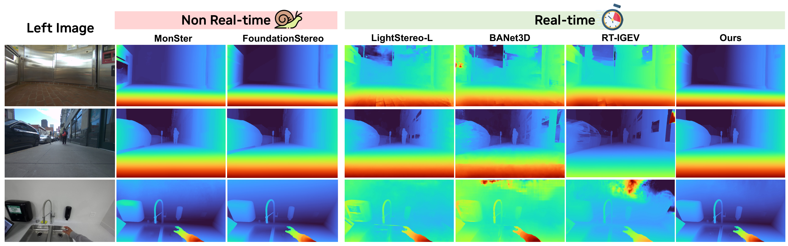{ width="920" }

<small>图源：`Fast-FoundationStereo`，Figure 1。原论文图意：Fast-FoundationStereo 在 in-the-wild stereo images 上接近 MonSter 和 FoundationStereo 的 disparity 质量，同时运行速度接近实时方法。</small>

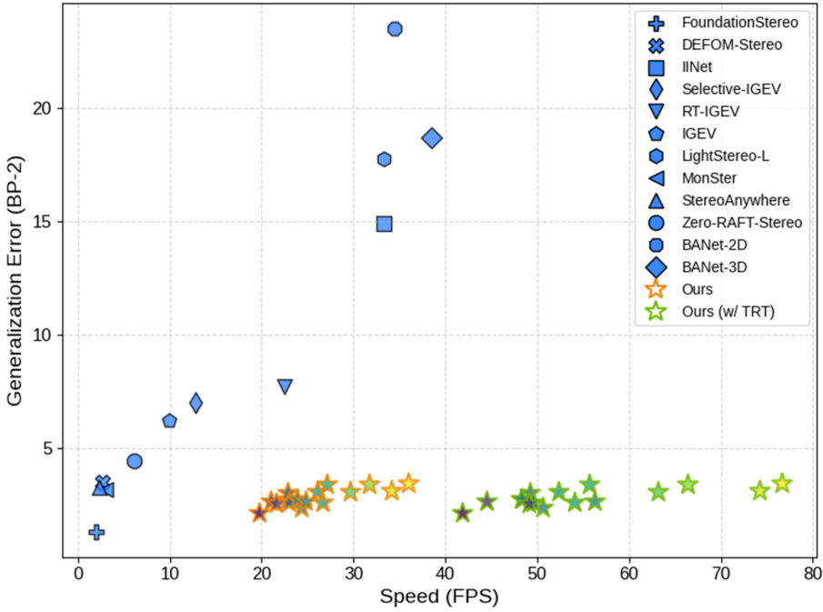{ width="680" }

<small>图源：`Fast-FoundationStereo`，Figure 2。原论文图意：在 NVIDIA 3090 上，比较不同 stereo 方法在 Middlebury-Q 上的 zero-shot generalization error 和 speed；Fast-FoundationStereo model family 进入实时区域，TensorRT 版本进一步加速。</small>

这张 scatter 是整篇论文的定位图。左上是慢且错，右下是快且准。FoundationStereo 精度强但速度慢；传统实时方法速度快但 zero-shot error 高；Fast-FoundationStereo 试图把点推到右下区域。

## 总体框架

论文把 FoundationStereo 拆成三段：

| Stage | Teacher bottleneck | Acceleration method | Why this method |
| --- | --- | --- | --- |
| Feature extraction | DepthAnything V2 + side-tuning CNN is expensive | Knowledge distillation into one student backbone | Backbone architecture is mature, teacher features are good supervision |
| Cost filtering | 3D hourglass + Disparity Transformer is heavy | Blockwise NAS with distillation and ILP search | Direct pruning hurts because cost volume channels are already small |
| Disparity refinement | ConvGRU iterative refinement has redundancy | Structured pruning + retraining | Iterative update module has repeated channels and recurrent dependencies |

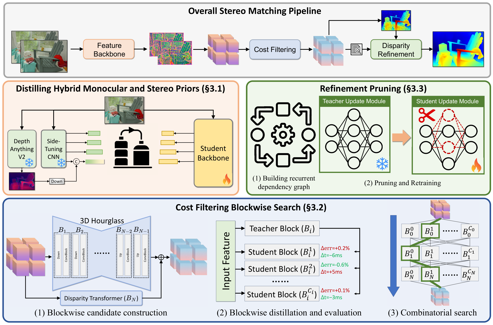{ width="920" }

<small>图源：`Fast-FoundationStereo`，Figure 3。原论文图意：FoundationStereo pipeline 包含 feature extraction、cost filtering 和 disparity refinement；论文分别用 hybrid prior distillation、cost filtering blockwise search、refinement pruning 三条路线加速。</small>

!!! note "这张系统图在讲什么"
    这张图的关键是“不要用同一种压缩方法打所有模块”。feature backbone 适合蒸馏，因为 teacher 的 multi-level features 可以直接当监督；cost filtering 适合搜索，因为模块结构空间大，直接剪小通道 cost volume 不划算；refinement 适合剪枝，因为 ConvGRU 重复迭代里存在结构冗余。

## 第一段：Backbone 蒸馏

FoundationStereo 的 backbone 把 DepthAnything V2 和 side-tuning CNN 组合起来。DepthAnything V2 提供大规模 monocular prior，side-tuning CNN 把单目先验适配到 binocular stereo 设置。这很强，但也是很重的推理瓶颈。

Fast-FoundationStereo 用一个 student backbone 替换这套双模块。训练时：

1. 冻结 FoundationStereo 里的 DepthAnything V2 和 side-tuning CNN；
2. teacher 对左右图像产生 multi-level feature pyramid；
3. student 学这些 feature，主损失是 MSE；
4. 如果 channel dimension 不一致，加 linear projection 对齐；
5. 虽然每个 feature extractor 只看单张图，训练 batch 仍放入左右 stereo images，以保留 stereo pair 的统计相似性。

公式上，可以把 teacher feature 记作 \(\bar f^{(i)}\)，student feature 记作 \(f^{(i)}\)，蒸馏目标就是让多个 pyramid level 的 feature 接近：

\[
\mathcal{L}_{\text{backbone}}
\approx
\sum_i \left\| P_i(f^{(i)}) - \bar f^{(i)} \right\|_2^2
\]


其中 \(P_i\) 是必要时加入的 projection。

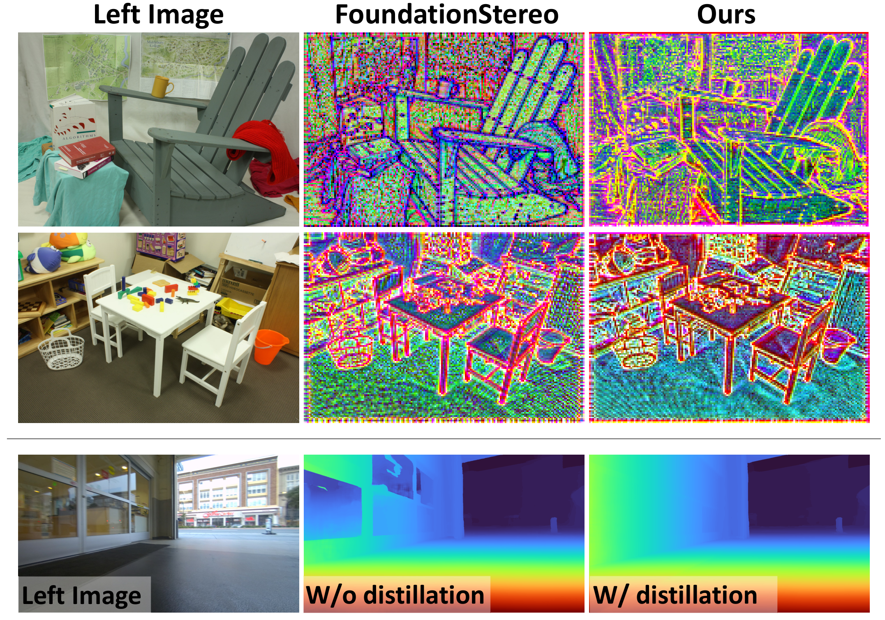{ width="820" }

<small>图源：`Fast-FoundationStereo`，Figure 4。原论文图意：上半部分展示 student backbone 蒸馏后能捕捉类似 teacher 的高频边缘和相对深度；下半部分展示 distillation 对 translucent 场景更稳。</small>

!!! note "为什么这里不用直接剪 teacher"
    论文明确提到直接剪 teacher 有两个问题。第一，DepthAnything V2 的 ViT 本身仍然是瓶颈，剪外层很难摆脱双模块结构；第二，如果破坏 teacher 的大规模视觉先验，想恢复精度可能需要互联网级图像重新训练。蒸馏成单一 backbone 更像“继承能力后换执行形态”。

Table 3 给出了 backbone distillation 的消融，下面保留原论文英文表头。

| Variants | Midd.-H BP-2 | ETH3D BP-1 | KITTI-12 D1 | KITTI-15 D1 |
| --- | ---: | ---: | ---: | ---: |
| No Distillation | 2.87 | 2.11 | 2.67 | 4.32 |
| Cosine Similarity | 2.29 | **1.19** | 2.39 | 3.31 |
| MSE (Ours) | **2.20** | 1.22 | **2.35** | **3.25** |

<small>表源：`Fast-FoundationStereo`，Table 3。原论文表意：相比不做蒸馏，feature distillation 明显改善 zero-shot generalization；MSE 在多数指标上最好。</small>

## 第二段：Cost Filtering 分块搜索

Stereo matching 的核心不是只看左右图像特征，还要构造 cost volume 并判断哪些 disparity 合理。论文里 cost volume 写作：

\[
\mathbf{V_C} \in \mathbb{R}^{C \times \frac{D}{4} \times \frac{H}{4} \times \frac{W}{4}},
\]


其中 \(D\) 是 maximum disparity。FoundationStereo 使用双分支 cost filtering：一边是带 Axial-Planar Convolution 的 3D hourglass，一边是 Disparity Transformer，对 4D cost volume 做长程上下文推理。

这部分不能简单剪枝。论文的解释很实在：cost volume 的 channel dimension 多数已经小于 100，直接 structured pruning 只会拿到很小速度收益，却可能明显伤精度。因此它改用 blockwise NAS。

### 搜索空间

Cost filtering module 被拆成 \(N=8\) 个 blocks。候选 layer 包括：

| Candidate layer type | Search detail |
| --- | --- |
| 3D conv layer | Output channels are `0.5x`, `1x` or `2x`; kernel size is 3; BN and activation optional |
| 3D deconv layer | Used for spatial upsampling, following FoundationStereo counterparts |
| APC layer | Output channels are `0.5x` or `1x`; axial kernel from `{3, 9, 17}`; planar kernel is 3 |
| Residually connected 3D conv layers | ResNet-style two conv layers, output channels `0.5x` or `1x` |
| Feature guided volume excitation | Left image multi-level unary features guide cost-volume excitation |
| Disparity Transformer block | Encoder repeats from 1 to 6; FFN hidden dimension is `2x` or `4x`; heads are 2 or 4 |

Appendix 里给出的数量很关键：

| Search item | Value |
| --- | ---: |
| Number of blocks | `N = 8` |
| Full cost filtering designs | `5.5 x 10^24` |
| Faster-than-teacher combinations | `5.8 x 10^19` |
| Blocks actually trained | `2584` |
| Blockwise distillation compute | `14 days on 128 NVIDIA A100 GPUs` |
| ILP solve time | Under a second |
| Latency budget for Table 1 model | `Delta tau = -0.04s` |

这就是 blockwise search 的意义：不是训练 \(5.8 \times 10^{19}\) 个完整网络，而是把候选 block 单独蒸馏、单独评估，再用 ILP 组合。

### Blockwise distillation

对第 \(i\) 个 block，teacher counterpart 记作 \(\bar B_i\)，student candidate 记作 \(B_i\)。训练目标是：

\[
\left\| B_i(f_{i-1})-\bar{B}_i(f_{i-1}) \right\|_2^2
\]


其中 \(f_{i-1}\) 来自前一个 teacher block 的输出。最后一个预测 initial disparity 的 block 额外用 smooth \(L_1\) 对 ground truth disparity 做监督。teacher 在整个 block distillation 过程中冻结。

每个候选 block 训练完后，论文把它替换进完整 teacher model 的对应位置，在 validation dataset 上端到端跑一遍，记录：

| Measured quantity | Meaning |
| --- | --- |
| \(\Delta m_i^c\) | Relative error metric change caused by candidate \(B_i^c\) |
| \(\Delta t_i^c\) | Runtime change caused by candidate \(B_i^c\) |

然后用 ILP 找组合：

\[
\min_{\mathcal{E}} \sum_{i=1}^{N} (\Delta \mathbf{m}_i)^\top \mathbf{e}_i,
\quad
\text{s.t.}
\quad
\sum_{i=1}^{N} (\Delta \mathbf{t}_i)^\top \mathbf{e}_i \leq \Delta \tau.
\]


这里 \(\mathbf{e}_i\) 是 one-hot candidate selection，\(\Delta \tau\) 是相对 teacher 的 runtime budget。

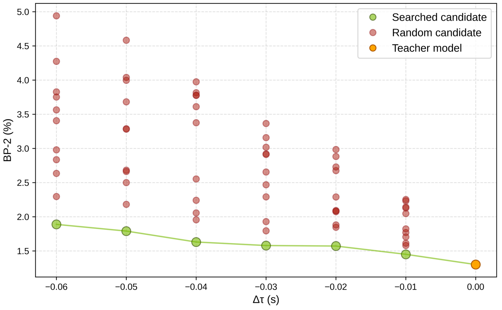{ width="720" }

<small>图源：`Fast-FoundationStereo`，Figure 8。原论文图意：在不同 latency budget \(\Delta \tau\) 下，searched candidate 稳定优于 random candidate，说明 blockwise proxy + ILP search 能找到更好的 cost filtering 结构。</small>

!!! note "为什么这不是普通 NAS"
    普通 NAS 要在完整网络里反复训练/评估候选结构，成本太高。这里的技巧是把 teacher block 当局部监督，把全局搜索转成“局部误差变化 + 局部耗时变化”的组合优化。它牺牲了一点全局精确性，但换来可并行、可承受的搜索成本。

## 第三段：Refinement 结构化剪枝

FoundationStereo 的 refinement module 是迭代式 ConvGRU。它从 initial disparity \(d_0\) 和 hidden feature 出发，每轮消费 \(d_{k-1}, h_{k-1}\)，输出更新后的 \(d_k, h_k\)。这种 recurrent dependency 不能像普通顺序 CNN 一样随便剪，因为 hidden state 的输入输出 channel 之间有跨迭代约束。

论文先构建 recurrent dependency graph，再做 structured pruning。

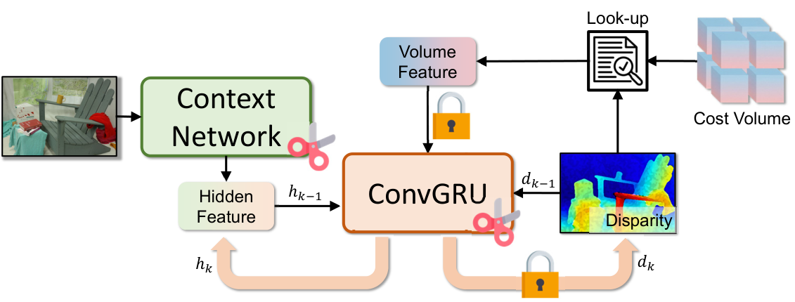{ width="720" }

<small>图源：`Fast-FoundationStereo`，Figure 5。原论文图意：Refinement module 的 ConvGRU 存在 recurrent dependencies；剪枝位置和固定 channel 位置需要按依赖图约束。</small>

论文额外加入三类剪枝约束：

| Constraint | Why it matters |
| --- | --- |
| Final layers for disparity map and convex upsampling mask keep fixed output channels | 输出格式不能被剪坏 |
| The layer consuming \(h_{k-1}\) and the layer outputting \(h_k\) are jointly pruned | ConvGRU hidden state has recurrent channel dependency |
| Motion encoder consuming indexed volume feature keeps fixed input channels | Look-up volume feature interface不能改变 |

剪枝重要性用 first-order Taylor expansion 估计。做法是把输入送进完整 teacher model，端到端跑多个 refinement iterations，对 refinement module 累积梯度，然后全局排序并剪掉最不重要的 \(\alpha\) 参数。论文尝试过 isomorphic pruning，但效果略差。

剪枝后只 retrain refinement module，其他 teacher 部分冻结。恢复损失是：

\[
\mathcal{L}
=
\sum_{k=1}^{K}
\gamma^{K-k}
\left\| d_k-\overline{d} \right\|_1
+
\lambda
\sum_{i=1}^{L}
\left\| x_i-\overline{x}_i \right\|_2^2
\]


其中 \(\gamma=0.9\)，\(\lambda=0.1\)。第一项监督每轮 refine 后的 disparity，越靠后的 iteration 权重越高；第二项让 student refinement 的 latent features 贴近 teacher。

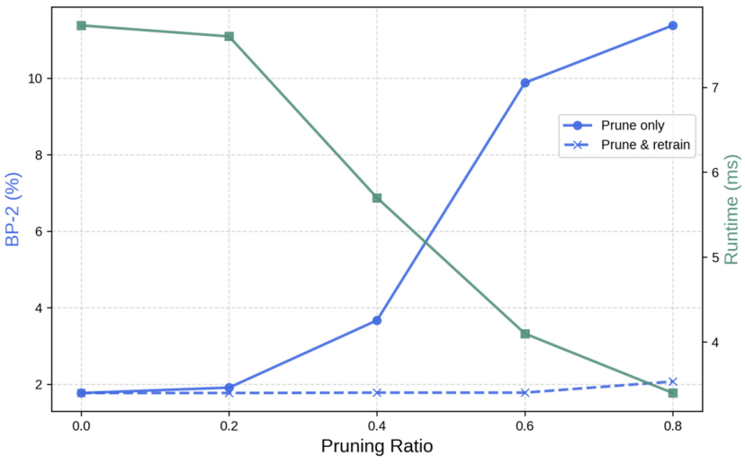{ width="680" }

<small>图源：`Fast-FoundationStereo`，Figure 9。原论文图意：只剪不训会明显伤 BP-2，剪后 retrain 能恢复精度；更高 pruning ratio 带来更低 runtime，但也更容易伤容量。</small>

!!! note "为什么 refinement 可以剪"
    和 cost filtering 不同，refinement 模块的迭代更新有明显冗余。每次 refinement 都在相似结构里更新 disparity，通道冗余更容易被硬件友好的 structured pruning 转成真实加速。但这也有边界：Appendix 里 Figure 12 显示 pruning ratio 0.8 时，增加 refinement iterations 带来的精度收益变小，说明剪得太狠会限制迭代 refinement 的容量。

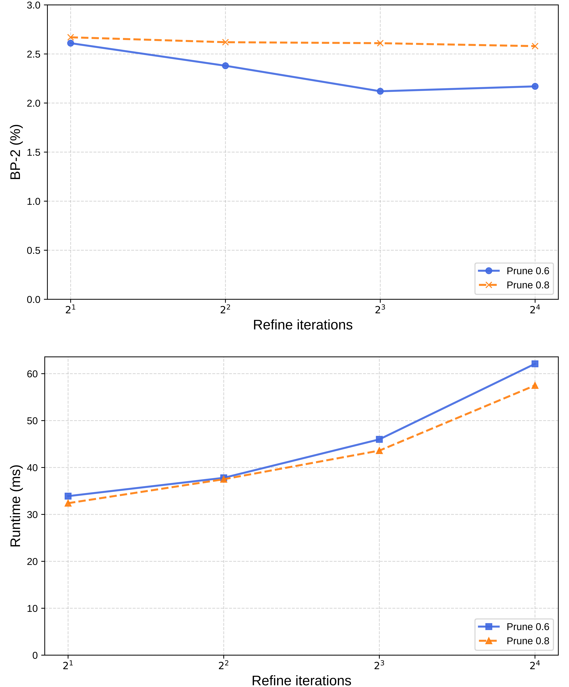{ width="640" }

<small>图源：`Fast-FoundationStereo`，Figure 12。原论文图意：比较 pruning ratio 0.6 和 0.8 下，refinement iterations 对 Middlebury-Q accuracy 与 runtime 的影响；论文最终表中模型采用 pruning ratio 0.6。</small>

## 第四段：In-the-wild pseudo-labeling

这篇论文的训练细节里，最容易被低估的是伪标签数据。结构变小后，如果仍只在合成数据或窄分布数据上训练，实时模型可能会回到传统 stereo 的问题：快但泛化差。

Fast-FoundationStereo 从 Stereo4D 取 rectified stereo pairs，用自动 pipeline 生成 1.4M in-the-wild stereo pseudo labels。

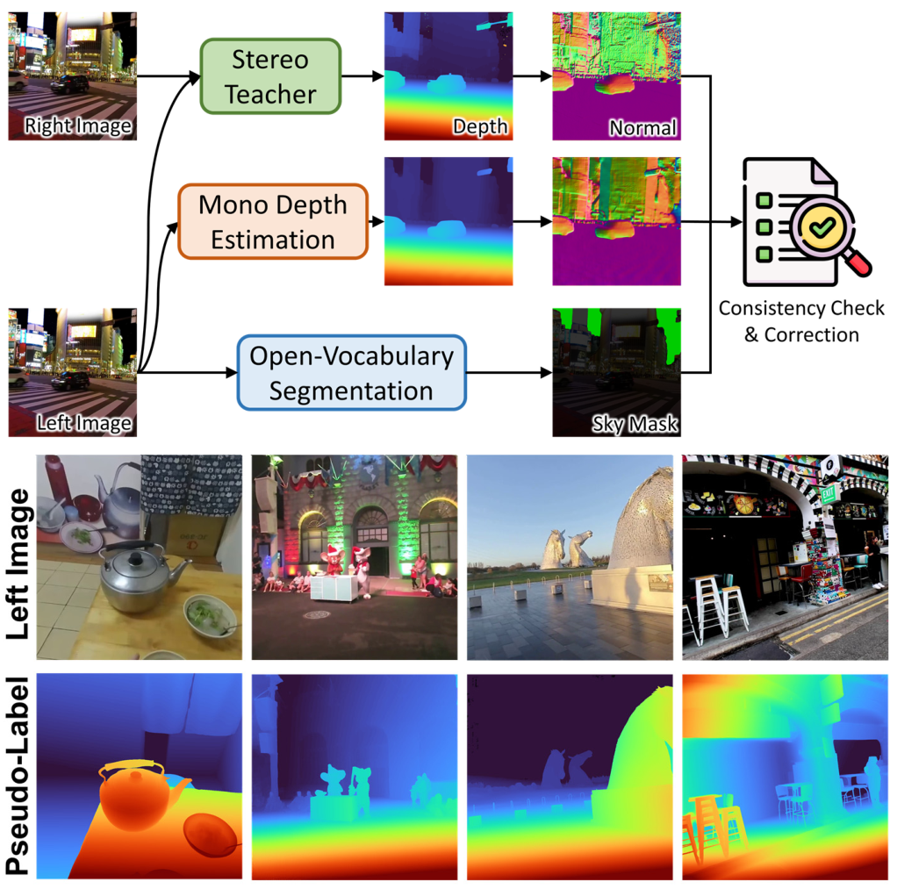{ width="720" }

<small>图源：`Fast-FoundationStereo`，Figure 6。原论文图意：对 in-the-wild internet stereo data，先用 stereo teacher 预测 disparity，再用 monocular depth estimator 和 normal consistency 做质量检查，最后生成可用于训练的 pseudo labels。</small>

具体流程是：

1. 输入 Stereo4D rectified stereo pair；
2. FoundationStereo teacher 预测左图 disparity；
3. monocular depth estimator 对左图估计 depth；
4. disparity map 和 monocular depth 都用 Stereo4D camera parameters 做 3D unprojection；
5. 对 unprojected geometry 用 Sobel operator 转成 normal maps；
6. 计算两个 normal maps 的 per-pixel cosine similarity；
7. threshold 后得到 consistency mask，过滤局部几何不一致样本；
8. sky regions 用 open-vocabulary segmentation 检出，similarity computation 排除 sky；
9. 最终 pseudo-label 里 sky regions 设置为 zero disparity；
10. video temporal stride 为 10，得到 1.4M suitable stereo pairs。

Supplement 里还给了一个保留门槛：consistency mask 中 positive pixels 超过 `60%` 的样本会被保留，计算时排除 sky regions。

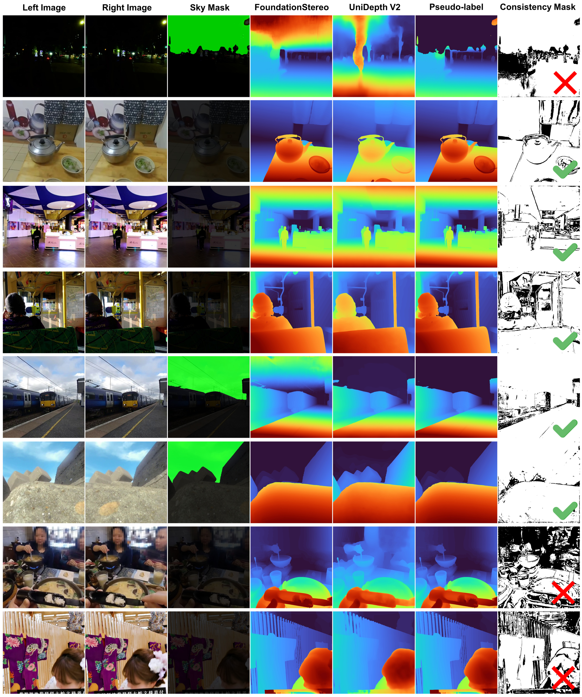{ width="840" }

<small>图源：`Fast-FoundationStereo`，Figure 15。原论文图意：展示 pseudo-labeling 的中间结果，右侧 check / cross 表示样本是否通过 consistency mask；pipeline 可以过滤字幕、马赛克和过难样本，也能修正 sky regions 上的错误预测。</small>

!!! note "为什么用 normal consistency，而不是直接比 depth"
    in-the-wild stereo 的 depth range 差异很大，直接比较 disparity 或 depth 容易被尺度、远近范围和 noisy prediction 影响。normal map 更偏局部几何方向，可以更稳地判断两个估计是否在局部表面结构上相互支持。对 student 来说，这一步就是数据质量门禁。

Pseudo-label ablation 说明这批数据不只帮助 Fast-FoundationStereo，也能帮助其他实时方法。下面保留论文英文表头，括号内是 with pseudo-labeling。

| Method | Midd.-H BP-2 | ETH3D BP-1 | KITTI-12 D1 | KITTI-15 D1 |
| --- | ---: | ---: | ---: | ---: |
| RT-IGEV | 11.52 (8.69) | 5.66 (5.12) | 4.54 (3.55) | 6.00 (4.40) |
| LightStereo-L | 23.76 (18.41) | 45.46 (21.12) | 13.98 (5.27) | 12.08 (7.63) |
| Ours | 2.53 (2.20) | 1.31 (1.22) | 2.44 (2.35) | 3.48 (3.25) |

<small>表源：`Fast-FoundationStereo`，Table 4。原论文表意：加入 pseudo-labeled in-the-wild data 后，多个实时 stereo 方法的 zero-shot generalization 都提升，LightStereo-L 的 ETH3D 改善尤其明显。</small>

## 训练配方总表

把论文的训练路径拆开看，会更清楚它不是一次性 train from scratch。

| Training phase | Trainable part | Frozen / teacher part | Objective / signal | Key detail |
| --- | --- | --- | --- | --- |
| Backbone distillation | Student backbone | DepthAnything V2 + side-tuning CNN from FoundationStereo | Multi-level feature MSE | Linear projection if channels mismatch; both stereo images included in batch |
| Cost block distillation | Candidate block \(B_i^c\) | Teacher block \(\bar B_i\) and teacher input feature \(f_{i-1}\) | Block output MSE; final block also smooth \(L_1\) to disparity GT | Complexity reduced from \(O(n^N)\) to \(O(n)\) |
| Cost block selection | None, selection only | Trained candidate blocks | ILP over \(\Delta m_i^c\) and \(\Delta t_i^c\) | Search different \(\Delta \tau\) for speed-accuracy family |
| Refinement pruning | Pruned refinement module during retraining | Remaining teacher model frozen | Iterative \(L_1\) disparity + latent feature distillation | \(\gamma=0.9\), \(\lambda=0.1\), pruning ratio \(\alpha\) |
| Pseudo-label generation | None | FoundationStereo teacher + monocular depth estimator + segmentation models | Normal consistency mask and filtered pseudo labels | Temporal stride 10; 1.4M pairs; positive mask > 60% kept |
| Final model training | Assembled candidate model | Teacher used as prior/source, not deployed | Same mixed datasets as FoundationStereo plus pseudo-labeled real data | 8 refinement iterations and max disparity 192 unless otherwise mentioned |

这张表里最重要的是“trainable part”和“frozen part”的分工。Fast-FoundationStereo 不是简单用一个小网络拟合最终 disparity，而是在不同阶段让 student 学 teacher 的中间能力：feature prior、cost filtering behavior、refinement latent dynamics，以及输出空间的 pseudo labels。

## 实验结果：速度、参数和成本账

> **这个实验说明了什么**：这一节主要检查论文主张是否在作者设定的数据、模型和评测口径下成立；阅读时要把指标提升、消融贡献和未覆盖场景分开看。


Table 5 是最直接的效率账，下面保留论文英文格式。

| Method | Runtime (ms) 3090 | Runtime (ms) 4090 | Runtime (ms) A100 | #Param (M) | MACs (G) |
| --- | ---: | ---: | ---: | ---: | ---: |
| FoundationStereo | 496 | 295 | 308 | 374.5 | 5413.9 |
| Ours | 49 | 30 | 41 | 14.6 | 309.9 |

<small>表源：`Fast-FoundationStereo`，Table 5。原论文表意：Fast-FoundationStereo 相比 FoundationStereo 在 3090 / 4090 / A100 上都大幅降低 runtime，同时参数量和 MACs 显著下降。</small>

从这张表能算出三个直观比例：

| Quantity | Rough reduction |
| --- | ---: |
| 3090 runtime | `496 ms -> 49 ms`, about `10.1x` faster |
| #Param | `374.5M -> 14.6M`, about `25.7x` smaller |
| MACs | `5413.9G -> 309.9G`, about `17.5x` fewer |

论文还给出 runtime decomposition，说明收益不是来自某一个模块单点优化，而是 feature extraction、cost filtering、refinement 都被压下来。

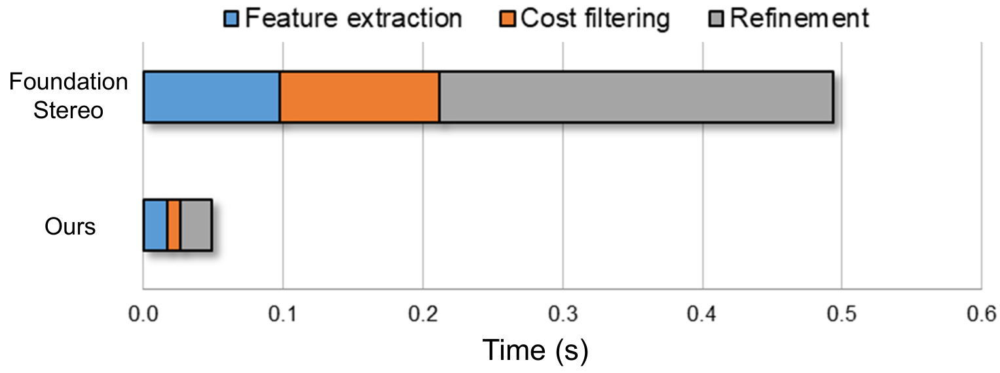{ width="760" }

<small>图源：`Fast-FoundationStereo`，Figure 10。原论文图意：在 NVIDIA 3090 上，FoundationStereo 的 feature extraction、cost filtering 和 refinement 都比 Fast-FoundationStereo 更耗时，三段共同构成超过 10x 的总加速。</small>

!!! note "为什么这个结果比单纯 FPS 更有用"
    如果只知道最终 runtime 从 496ms 到 49ms，很难判断下一步还能优化哪里。runtime decomposition 让我们看到，论文的三段加速都真实进入了热路径。后续如果要继续做 TensorRT、量化或 kernel 优化，也应该分别看 feature、cost volume construction、ConvGRU refinement 的剩余占比。

## Zero-shot 结果怎么读

Table 1 很宽，完整表覆盖 Middlebury-H、Middlebury-Q、ETH3D、KITTI 2012、KITTI 2015 和 runtime。这里保留几行最能说明速度-精度权衡的结果，列名沿用论文英文。

| Method | Middlebury-H BP-2 | Middlebury-Q BP-2 | ETH3D BP-1 | KITTI 2012 D1 | KITTI 2015 D1 | Runtime (ms) |
| --- | ---: | ---: | ---: | ---: | ---: | ---: |
| FoundationStereo | **1.10** | **1.30** | **0.50** | **2.30** | **2.80** | 496 |
| MonSter | 4.24 | 3.19 | 0.99 | 2.84 | 3.41 | 336 |
| Zero-RAFT-Stereo | 4.68 | 4.42 | 2.14 | 2.76 | 4.48 | 164 |
| LightStereo-L | 12.55 | 7.70 | 16.34 | 3.73 | 4.51 | 30 |
| RT-IGEV | 7.82 | 5.59 | 5.05 | 3.25 | 4.00 | 45 |
| Ours | **2.20** | **2.12** | **1.22** | **2.35** | **3.25** | 49 (21) |

<small>表源：`Fast-FoundationStereo`，Table 1 摘要。原论文表意：Fast-FoundationStereo 在实时组里各数据集表现最好，并且在多个指标上接近 FoundationStereo；括号中的 `21` 是 TensorRT runtime。</small>

这张表的读法是：

1. Fast-FoundationStereo 不是最强精度，FoundationStereo 仍然更准；
2. 但它把 runtime 从 496ms 拉到 49ms，TensorRT 到 21ms；
3. 同样实时范围内，它比 LightStereo-L、RT-IGEV、BANet 等方法的 zero-shot error 明显低；
4. 所以论文 claim 是“实时里强泛化”，不是“所有 setting 下超过 teacher”。

## 部署和工程启发

这篇论文对推理系统有几条很实用的经验。

第一，foundation model acceleration 要先做瓶颈归因。Fast-FoundationStereo 不是直接说“用蒸馏压缩模型”，而是先拆成 feature、cost filtering、refinement 三段，再决定每段用什么工具。

第二，student 不一定只学最终输出。中间 feature、block output、latent feature 和 pseudo-label 都可以成为训练信号。尤其当 teacher 很强但很慢时，中间监督能让 student 更像 teacher 的内部计算过程，而不只是拟合最终 disparity。

第三，真实数据质量门禁是效率的一部分。高效模型容量更小，对 noisy labels 更敏感。如果 1.4M pseudo labels 没有 normal consistency / sky filtering / sample filtering，student 很可能学到 teacher 的错误或互联网图像噪声。

第四，搜索和剪枝要看模块形态。cost volume channel 已经小，剪枝收益有限；ConvGRU refinement 有迭代冗余，剪枝更合适。这个判断可以迁移到其他视觉和世界模型系统：不是所有模块都适合同一种压缩策略。

第五，TensorRT / ONNX / runtime path 要进入模型设计。论文主表的 `49 (21)` 说明模型结构和 deployment toolchain 是联动的。一个结构如果理论 MACs 少但 runtime 难融合、难导出、难 TensorRT 化，线上收益可能会缩水。

## 局限与风险

第一，模型继承 teacher 的边界。论文自己指出，translucent surfaces 仍然有挑战，虽然加入相关训练数据可能缓解，但它不是已经完全解决透明/反光几何。

第二，pseudo-label pipeline 是能力来源，也是风险来源。normal consistency 能过滤很多错误，但 teacher、monocular depth estimator、segmentation model 都会带来偏差。真实部署时要针对自己的相机、baseline、曝光和场景重新做质量验收。

第三，zero-shot benchmark 不能替代闭环任务收益。对机器人来说，disparity 更准不一定直接等于抓取、避障或导航成功率更高。还要看 depth-to-control pipeline、时延抖动、失败恢复和安全阈值。

第四，输入假设仍然重要。官方实现也强调 stereo images 应该 rectified / undistorted，左右图不能交换。真实硬件如果标定漂移、同步不准或镜头畸变未校正，再快的模型也会被输入质量拖垮。

第五，进一步低比特量化是未来方向而不是本文主线。论文结论提到 quantization 可以作为正交加速路线，但正文主证据主要来自蒸馏、搜索、剪枝和 TensorRT。

## 阅读结论

Fast-FoundationStereo 最适合记成一句工程原则：

**把强 foundation model 变成实时模型时，先拆开热路径，再让每个瓶颈用适合自己的训练信号和结构约束降成本。**

它对高效推理专题的补充价值在于跨出了 LLM decode：在实时机器人感知里，推理优化同样要同时考虑模型结构、训练蒸馏、数据质量、runtime 导出和 zero-shot 泛化。快不是目标本身，快且在真实场景里可靠才是目标。
