# Fast-FoundationStereo：实时 Zero-Shot 双目匹配

!!! info "论文信息"
    **论文题名：** Fast-FoundationStereo: Real-Time Zero-Shot Stereo Matching。 
    **作者：** Bowen Wen、Shaurya Dewan、Stan Birchfield。 
    **机构：** NVIDIA。 
    **时间 / 主题：** 2025-12；高效推理。 
    **arXiv / 官方报告：** arXiv：[2512.11130](https://arxiv.org/abs/2512.11130)；官方材料：[nvlabs.github.io/Fast-FoundationStereo/](https://nvlabs.github.io/Fast-FoundationStereo/)。 
    **GitHub / 项目：** GitHub：[github.com/NVlabs/Fast-FoundationStereo](https://github.com/NVlabs/Fast-FoundationStereo)；项目页：[nvlabs.github.io/Fast-FoundationStereo/](https://nvlabs.github.io/Fast-FoundationStereo/)。 
    **元数据来源与核验口径：** 来源：[arXiv](https://arxiv.org/abs/2512.11130)；[GitHub API / repo](https://github.com/NVlabs/Fast-FoundationStereo)；[官方 / 项目材料](https://nvlabs.github.io/Fast-FoundationStereo/)；Checked Date：2026-06-04；Repro Status：Paper / official materials reviewed, independent reproduction not claimed。

## 从零样本双目匹配到实时部署，真正要压缩什么

Fast-FoundationStereo 研究的不是单纯把一个双目网络变小，而是把基础模型在陌生场景中的匹配能力保留下来，同时把推理预算压到几十毫秒。在论文的 Middlebury-Q、RTX 3090 测试条件下，FoundationStereo 用时 496 ms，本文主模型用时 49 ms，TensorRT 版本为 21 ms。代价是精度有所下降，例如 Middlebury-Q BP-2 从 1.30% 增加到 2.12%。因此，这项工作的主张是找到更实用的泛化能力与延迟折中，并非无损复刻教师。[↗](https://arxiv.org/pdf/2512.11130v2#page=7)

双目匹配依靠同一场景在左右相机中的位移估计深度。在已校正的图像中，对应点主要沿水平方向寻找；视差越小，通常意味着物体越远。困难在于很多位置没有可靠的局部匹配证据：白墙缺乏纹理，重复图案产生多个候选，玻璃和镜面又会破坏左右视图的外观一致性。一个只在有限合成数据上学会匹配的轻量模型，换到真实场景后很容易把这些歧义当成几何。

FoundationStereo 的解决办法是加入强单目先验、容量更大的代价过滤网络和多次迭代修正。它们能在局部匹配不可靠时借助物体结构及更大范围上下文判断视差，但也分别引入了昂贵的特征提取、四维体处理和循环计算。Fast-FoundationStereo 的关键判断是，三个模块的冗余性质不同，应该分别选择压缩方法。

先看 Figure 1 的三行场景：第一行的室内门窗、第二行的街道、第三行的水槽，都包含较难仅靠局部纹理判断的区域。右侧本文结果保留了接近大型模型的连续结构，部分实时基线则出现明显散乱区域。这说明值得争取的是跨场景几何的稳定性；图中的视觉平滑程度本身仍不能代替真实误差指标。

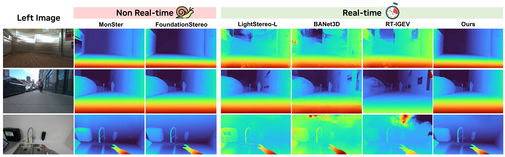{ width="920" }

Figure 2 把这个目标放在速度—误差平面上。横轴 FPS 越大越好，纵轴 Middlebury-Q BP-2 越小越好；橙色星号是一组不同架构组合，绿色星号额外使用 TensorRT。应先比较橙色星号与其他模型的位置，再观察绿色星号带来的后端收益。绿色点同时包含模型选择与编译优化，不能全部归因于某一项蒸馏技巧。[↗](https://arxiv.org/pdf/2512.11130v2#page=1)

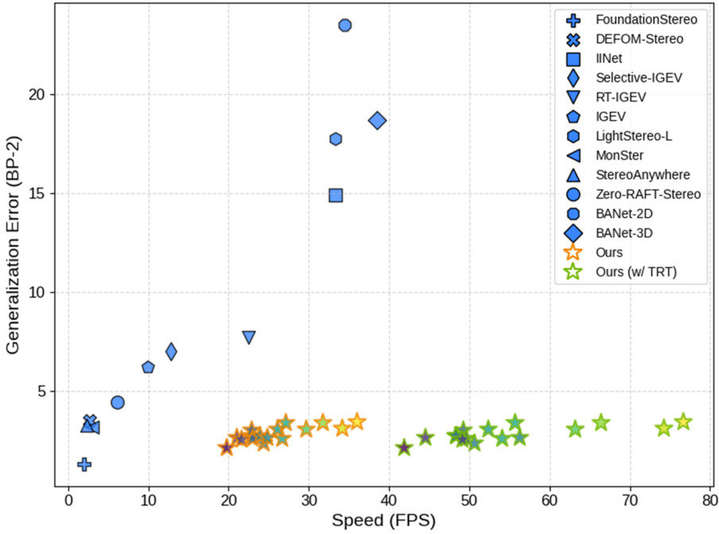{ width="680" }

## 先沿信息流理解三个待压缩模块

输入是校正后的左右图像 $I_l,I_r\in\mathbb R^{H\times W\times3}$。骨干分别提取尺度 $i\in\{4,8,16,32\}$ 的特征金字塔，每层形状为 $C_i\times H/i\times W/i$。这里骨干一次处理一张图像，双目关系主要在后续代价体构造时显式进入。

接下来，模型为每个位置和候选视差建立匹配表示。它结合 group-wise correlation 与特征拼接，形成

$$
V_C\in\mathbb R^{C\times D/4\times H/4\times W/4},
$$

其中 $D$ 是构造代价体时的最大视差，$C$ 是表示匹配关系的通道数。这个张量同时展开视差、高和宽三个维度，所以它的处理成本与普通二维图像特征很不一样。代价过滤网络利用邻域和长距离上下文消除歧义，并产生初始视差 $d_0$。最后，ConvGRU 按当前视差查询代价特征，结合隐藏状态迭代修正，输出细化后的视差。[↗](https://arxiv.org/pdf/2512.11130v2#page=4)

Figure 3 顶部就是这条信息流，下面三个区域分别对应本文修改的部分：左侧把双模块骨干蒸馏为单个学生，底部搜索代价过滤块的组合，右侧对循环更新器进行结构化剪枝。三项优化独立设计，但组装后的网络还需要端到端训练；局部模块拟合良好并不自动意味着整体接口分布完全吻合。

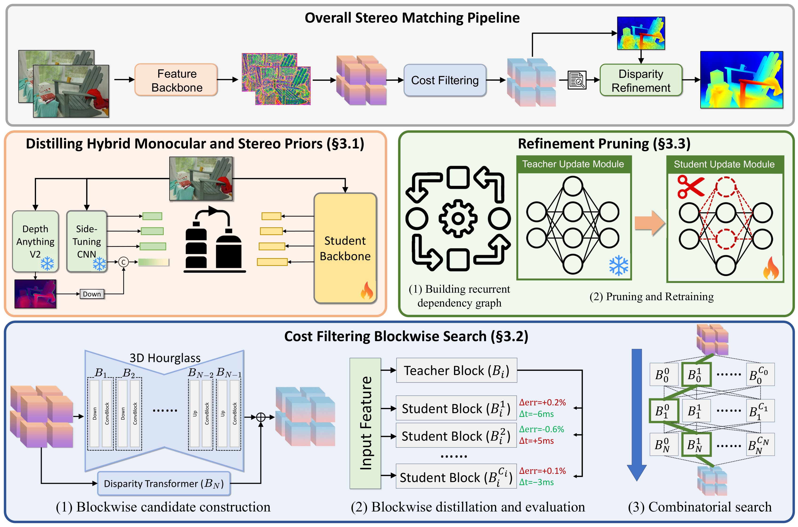{ width="920" }

### 骨干为什么适合整体蒸馏

教师的特征提取器由 Depth Anything V2 与 side-tuning CNN 共同构成。前者提供从大规模图像中学习的单目结构先验，后者把这些表示适配到双目任务。如果只在原结构上剪枝，两个模块都必须保留，ViT 的计算瓶颈仍然存在；大幅损伤其能力后，又很难以小规模双目训练恢复原本来自互联网图像的知识。

作者因此直接用一个高效学生骨干替换这两个模块。教师冻结，学生在四个尺度拟合教师特征；通道不匹配时增加线性投影。将论文的训练描述写成便于理解的形式，就是对不同尺度的师生特征计算 MSE：

$$
\mathcal L_{\mathrm{feature}}
\propto\sum_{i\in\{4,8,16,32\}}
\left\|P_i\bigl(f_s^{(i)}(I)\bigr)-\bar f^{(i)}(I)\right\|_2^2.
$$

这里 $f_s^{(i)}$ 是学生特征，$\bar f^{(i)}$ 是冻结教师的混合特征，$P_i$ 表示必要时的通道投影；公式表达监督关系，具体归一化不由这个写法规定。训练 batch 同时包含左、右图像，以保持双目数据的统计特征，但这不意味着骨干内部进行左右交叉注意力。作者训练了不同高效骨干变体，因此最后可以提供一族速度不同的模型。[↗](https://arxiv.org/pdf/2512.11130v2#page=4)

这种蒸馏保留的是供后续匹配使用的多尺度表示，不只是最终深度图。Figure 4 上半部分的特征可视化呈现相近的高频边缘和相对深度结构，下半部分则比较有无蒸馏时玻璃门附近的视差。后者把表示学习与实际匹配效果联系起来：模型获得的先验必须帮助代价体判断几何，才对双目任务有用。

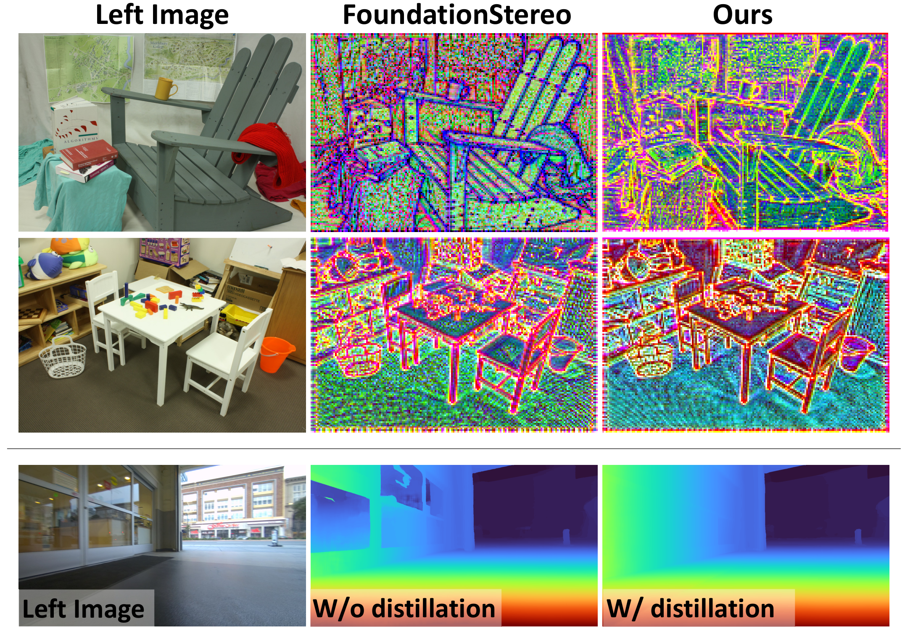{ width="820" }

蒸馏消融进一步检验这条联系。下表保持原文 Table 3 的指标，所有数字为误差百分比，越低越好。

| Variants | Midd.-H BP-2 ↓ | ETH3D BP-1 ↓ | KITTI-12 D1 ↓ | KITTI-15 D1 ↓ |
| --- | ---: | ---: | ---: | ---: |
| No Distillation | 2.87 | 2.11 | 2.67 | 4.32 |
| Cosine Similarity | 2.29 | 1.19 | 2.39 | 3.31 |
| MSE (Ours) | 2.20 | 1.22 | 2.35 | 3.25 |

No Distillation 使用仅在 ImageNet 上预训练的特征骨干。MSE 蒸馏在 KITTI-15 上减少 1.07 个百分点误差，在 ETH3D 上减少 0.89 个百分点；这支持教师的几何知识能转移到学生。但 Cosine Similarity 在 ETH3D 的 1.19 略好于 MSE 的 1.22，因此选择 MSE 是整体表现上的折中，并非逐列绝对最优。[↗](https://arxiv.org/pdf/2512.11130v2#page=8)

## 代价过滤为什么需要搜索，而不是继续剪枝

教师的代价过滤包含两类互补结构。3D hourglass 使用 Axial-Planar Convolution（APC），把空间方向和视差方向的卷积分开，从而扩大视差感受野；另一条 Disparity Transformer 分支把代价体组织为 token，用自注意力处理更长距离的关系。它们处理的是几何匹配空间，不能简单拿一个图像分类骨干代替。

作者先尝试直接剪枝，但代价体的通道维度本来就很小，通常不到 100。压缩这些通道会直接破坏有限的匹配表示，延迟却未必按比例减少。附录 Figure 11 中，剪枝率达到 0.4 后 BP-2 接近 100%，对应时间仍约为 62 ms，而未剪枝约为 70 ms。这里的实验是代价过滤剪枝研究，不是最终整网主结果。它说明同样的结构剪枝工具，在这一模块上收益很差。[↗](https://arxiv.org/pdf/2512.11130v2#page=13)

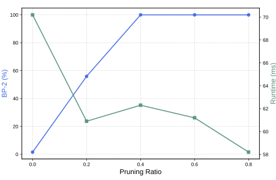

替代方案是把教师拆成接口固定的块，然后为每块寻找更便宜的内部结构。3D hourglass 在通道数和空间分辨率变化处切分；整个 Disparity Transformer 视作一个块，总计 $N=8$ 个块。候选块必须保持原块的输入输出维度，同时比教师对应块更快。这个限制让不同候选能够直接拼接，避免搜索过程中还要学习接口转换。

### 搜索空间允许哪些具体变化

附录给出的候选并非抽象的“随机网络”，而是围绕已有几何算子变化容量。下表列出决定搜索空间的主要选项。[↗](https://arxiv.org/pdf/2512.11130v2#page=13)

| Candidate component | Search choices | Role |
| --- | --- | --- |
| 3D convolution | 输出通道为输入的 0.5×、1× 或 2×；kernel size 3；可带归一化与激活 | 改变局部体处理容量 |
| 3D deconvolution | 沿用教师对应上采样结构 | 恢复空间分辨率 |
| APC | 通道 0.5× 或 1×；axial kernel 3 / 9 / 17；planar kernel 3 | 调整视差方向感受野 |
| Residual 3D convolution block | 两个 kernel size 3 的卷积；通道 0.5× 或 1× | 保留残差路径的局部处理 |
| Feature-guided volume excitation | 使用左图的多尺度特征引导代价体 | 把图像结构信息注入几何表示 |
| Disparity Transformer | 1–6 层；FFN 隐层为输入的 2× 或 4×；2 或 4 heads | 调整长距离推理容量 |

每块层数不超过教师对应块。可变的是块内部容量，固定的是模块之间的输入输出契约。这样才能把搜索分为“训练候选块”和“选择候选组合”两个规模不同的问题。

### 候选块如何独立训练，又如何测量好坏

假设第 $i$ 块有 $C_i$ 个候选，直接训练所有组合需要考察 $\prod_i C_i$ 个网络。即使每块仅 200 个候选，8 块也会产生 $200^8\approx2.56\times10^{18}$ 个组合。本文不逐个训练这些整网，而是让每个候选单独学习教师相同位置的操作：

$$
\mathcal L_i^{\mathrm{block}}
=\left\|B_i(f_{i-1})-\bar B_i(f_{i-1})\right\|_2^2.
$$

$\bar B_i$ 为教师块，$B_i$ 为候选学生块，$f_{i-1}$ 来自**教师前一块**。这个输入来源很关键：候选训练时不必等待其他学生块完成，也不会被它们不断变化的误差影响。最后负责预测初始视差的块另用对 ground truth 的 Smooth L1 损失，而不是只拟合教师中间特征。[↗](https://arxiv.org/pdf/2512.11130v2#page=5)

训练结束后，作者把某个候选放回教师网络，只替换它对应的一块，其他块保持教师版本，然后在独立验证集跑完整网络。由此得到两项增量：误差变化 $\Delta m_i^c$，以及运行时间变化 $\Delta t_i^c$。候选能否拟合特征与它最终能否维持视差精度并不完全等价，因此这一步整网测量是必要的。

训练的候选数量从组合数变为 $\sum_i C_i$。当各块约有 $n$ 个候选时，这是 $O(Nn)$；论文所写 $O(n)$ 是把块数 $N$ 视作固定常量。它缩小的是候选训练的组合规模，并不意味着整个架构搜索无需大量算力。

### 用整数规划选择组合，仍要接受代理误差

用 one-hot 向量 $\mathbf e_i$ 选择第 $i$ 块的一个候选，原文的组合优化为

$$
\min_{\{\mathbf e_i\}}
\sum_{i=1}^{N}(\Delta\mathbf m_i)^\top\mathbf e_i,
\qquad
\text{s.t.}\quad
\sum_{i=1}^{N}(\Delta\mathbf t_i)^\top\mathbf e_i
\leq\Delta\tau.
$$

每个候选的测量结果被放入 $\Delta\mathbf m_i$ 与 $\Delta\mathbf t_i$。$\Delta\tau$ 是相对教师的时间预算，例如主模型选择 $-0.04$ s，表示要求代价过滤相对教师至少节省约 40 ms。one-hot 的约束则确保每块选且只选一个候选。[↗](https://arxiv.org/pdf/2512.11130v2#page=5)

这个目标把单块替换误差相加，隐含了各块影响近似可分的假设。真实网络可能出现误差放大、抵消或输入分布变化，所以它只是选择架构的代理。选出组合后，作者把完整模型端到端训练，让学生块彼此适应。

Figure 8 检验代理是否具有实际选型价值：每个时间预算抽取 10 个随机组合，与搜索选出的组合比较；这些候选均与其余教师模块一起端到端训练后再评估。沿同一个横坐标看，绿色搜索结果低于该预算中的红色随机候选；预算越紧，随机结构的错误尤其容易增大。它支持这个代理在所测搜索空间中有用，但不证明它找到所有可能架构的全局最优。

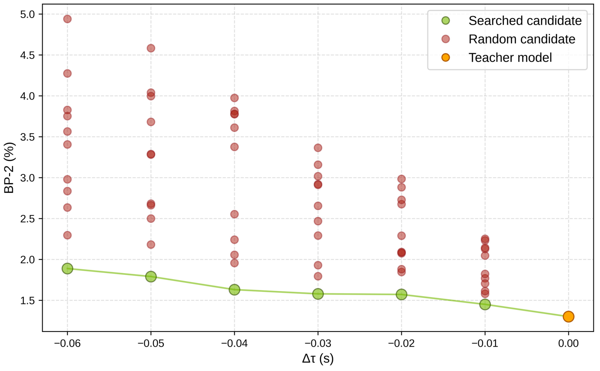{ width="720" }

实际搜索空间比前面的 200 候选示例更大：未过滤时约有 $5.5\times10^{24}$ 种组合，限制为比教师更快的块后仍有 $5.8\times10^{19}$ 种。最终只需分别训练 2,584 个候选块，但整套块级蒸馏仍用了 **128 张 A100、14 天**；之后的整数线性规划求解才是不到一秒。把“搜索不到一秒”理解成模型设计总成本，会遗漏最昂贵的候选训练阶段。[↗](https://arxiv.org/pdf/2512.11130v2#page=13)

## 循环更新器的剪枝必须保持跨迭代依赖

代价过滤不能有效剪枝，并不意味着其他模块也如此。Refinement 用同一个 ConvGRU 反复更新隐藏状态和视差，具有可观的通道冗余。它在第 $k$ 次迭代消费 $d_{k-1}$、$h_{k-1}$ 与查询得到的代价特征，输出 $d_k$ 和 $h_k$；隐藏状态在下一次迭代又成为输入。

因此，剪掉某一层的通道会影响相邻层，也会通过循环影响下一次使用该层时的维度。作者先构建依赖图，在常规相邻层关系之外补上三条约束：预测视差和 convex upsampling mask 的最终输出通道固定；消费 $h_{k-1}$ 的输入通道与输出 $h_k$ 的通道联合剪枝；读取 cost volume 查询特征的 motion encoder 输入通道固定。[↗](https://arxiv.org/pdf/2512.11130v2#page=5)

Figure 5 中剪刀标出可删减的位置，锁标出必须保留的接口。沿底部隐藏状态回路看，就能理解为何不能把 ConvGRU 当作只执行一次的普通前馈网络。结构化剪枝删除整个相关通道，得到的是更小的稠密算子，也更容易被 GPU 后端实际加速。

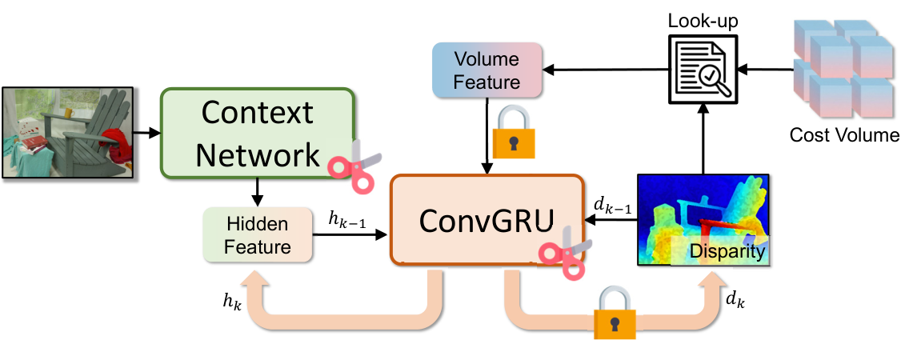{ width="720" }

作者把输入送入完整教师，展开多次 refinement 并累积梯度，用一阶 Taylor 近似估计参数的重要性，再在 refinement 模块内进行全局排序、按比例 $\alpha$ 剪枝。这里的梯度来自多次迭代，才能反映参数在循环中的累计作用。论文还试过 isomorphic pruning，但效果略有下降。

剪枝后的更新器需要恢复训练。此时教师其余模块冻结，更新器接受两类信号：每次迭代的视差要接近 ground truth，内部特征也要接近教师。

$$
\mathcal L
=\sum_{k=1}^{K}\gamma^{K-k}\left\|d_k-\bar d\right\|_1
+\lambda\sum_{i=1}^{L}\left\|x_i-\bar x_i\right\|_2^2,
\qquad\gamma=0.9,\quad\lambda=0.1.
$$

$K$ 是迭代次数，$\bar d$ 是真实视差，$x_i,\bar x_i$ 为对应层的师生特征。因为 $\gamma<1$，越晚的预测权重越大，但前面的中间结果仍受到监督。第二项约束被压缩网络保留教师的表示。这个阶段没有初始视差 $d_0$ 的监督项，因为它由冻结的上游模块产生，refinement 的更新不会改变它。[↗](https://arxiv.org/pdf/2512.11130v2#page=5)

Figure 9 的实线蓝色曲线表示只剪枝，误差随高剪枝率显著增大；虚线蓝色表示剪枝后再训练，大部分精度得以恢复。绿色时间曲线的口径是**一次 refinement 迭代**，不能把它当作整网延迟。它证明更新器有可恢复的冗余，也说明直接删参数而跳过恢复训练不是同一个方法。

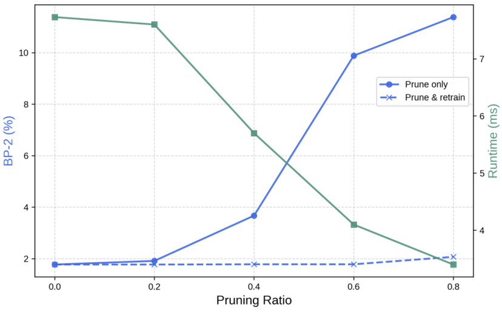{ width="680" }

进一步看 Figure 12：这里固定骨干和代价过滤，比较剪枝率 0.6 与 0.8，同时改变迭代次数，下面测量的是**完整模型**时间。剪枝率 0.6 的准确度在约 8 次迭代后趋于饱和；剪枝率 0.8 则只能从增加迭代中获得很小改善。迭代可以重复利用容量，却不能凭空恢复被删掉的表达能力。主配置最终选择 0.6 剪枝率与 8 次 refinement。[↗](https://arxiv.org/pdf/2512.11130v2#page=13)

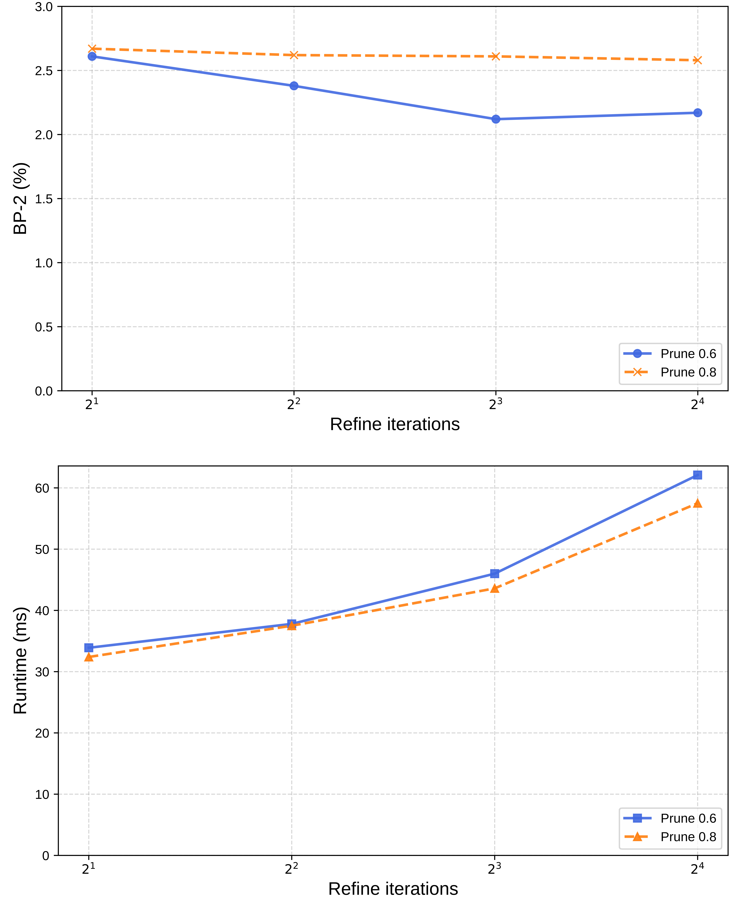{ width="640" }

## 140 万真实双目对如何变成可信一些的监督

压缩教师解决的是计算成本，真实数据仍然决定学生见过哪些场景。作者沿用 FoundationStereo 的混合训练数据，并增加从 Stereo4D 视频中整理出的真实双目伪标签。难点在于教师也会预测错误；如果直接把所有输出当成真值，学生就会把错误一起学进去。

Figure 6 展示了第二条几何线索的作用。FoundationStereo 从左右图像预测视差，单目深度模型 **UniDepth V2** 从左图独立预测深度。这里的 UniDepth V2 与骨干蒸馏中使用的 Depth Anything V2 是不同角色，不能混为同一个教师。两种几何结果使用同一组相机参数反投影，并通过 Sobel 算子形成法线图，再比较每个像素的法线方向。[↗](https://arxiv.org/pdf/2512.11130v2#page=6)

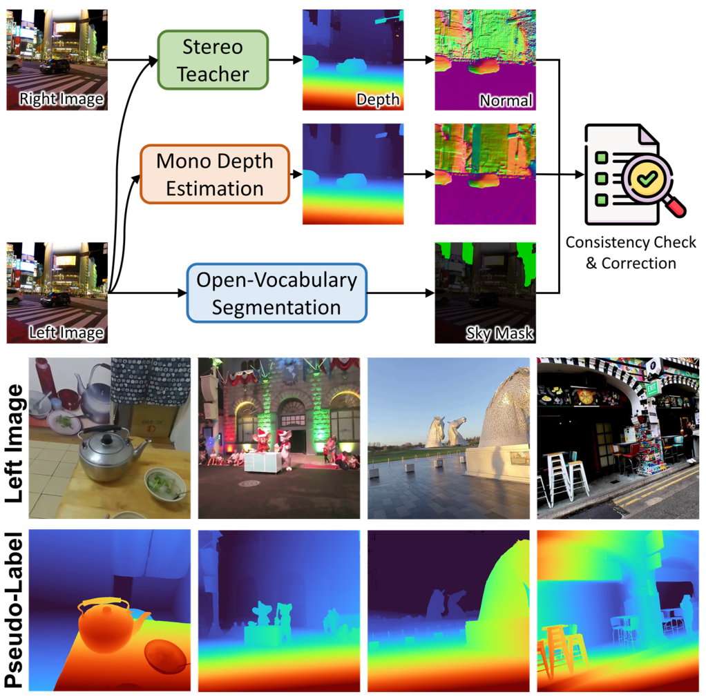{ width="720" }

为什么比较法线？直接比较深度或视差的差值，容易受场景深度范围和数值尺度影响。法线更直接表达局部表面的朝向，两条预测链如果对局部几何结构有一致判断，这一位置更适合保留。法线一致性仍不是绝对距离正确的证明，也不能保证两种模型不会共同出错；它是筛选伪标签的信号。

具体处理包含两个层次。逐像素法线余弦相似度经过阈值化形成 consistency mask；然后按样本统计非天空像素中一致像素的比例，**超过 60% 才保留整个双目对**。60% 是样本保留阈值，不是法线余弦相似度阈值；论文没有给出后者的具体数值。[↗](https://arxiv.org/pdf/2512.11130v2#page=15)

天空必须单独处理。它近似对应无穷远，在常见合成数据中又不足，因此作者用开放词汇分割识别天空，将其排除在一致性比例之外，并在最终伪标签中设为零视差。视频按时间 stride 10 采样，最终得到约 1.4M 个合适的双目对。consistency mask 还可以选择性地约束逐像素监督区域，但原文并没有要求所有训练都必须用这个 mask 屏蔽全部不一致像素。

Figure 15 应从左向右对齐看：左右图像、天空 mask、双目教师、单目模型、最终伪标签、几何一致性。倒数两行分别包含马赛克与字幕，右侧红叉表示被剔除；第一行的困难夜间样本也被拒绝。第五、六行可以观察天空视差如何被修正。它说明数据整理不仅是挑“看起来正常”的整张图，还包含对特定几何区域的规则修正。

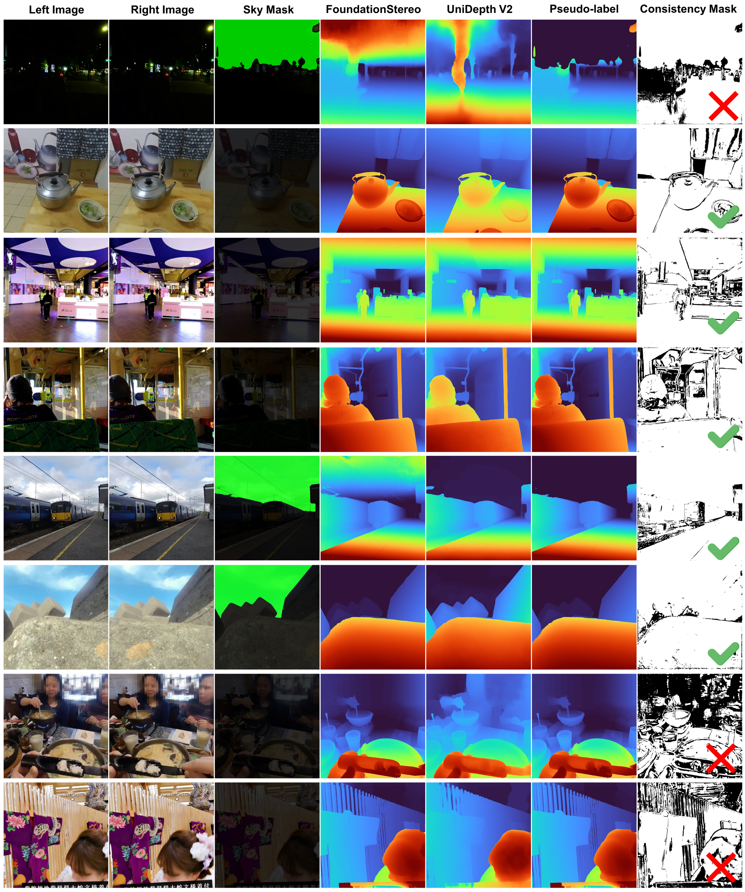{ width="840" }

这样得到的视差伪标签提供输出空间监督，与前面的特征蒸馏互补：前者让学生看到更多真实场景中的目标几何，后者传递教师内部如何组织表示。最终组装网络再在原混合数据与新增真实数据上端到端训练。默认构造代价体使用最大视差 192，但评估输出不被截断在这个范围；Middlebury-H 上支持动态最大视差设置的方法采用 416，以适应较高分辨率。[↗](https://arxiv.org/pdf/2512.11130v2#page=6)

### 数据消融能否解释全部收益

Table 4 分别对三个模型比较不使用与使用本文伪标签的结果。括号中为加入伪标签后的误差，指标均越低越好。

| Method | Midd.-H BP-2 ↓ | ETH3D BP-1 ↓ | KITTI-12 D1 ↓ | KITTI-15 D1 ↓ |
| --- | ---: | ---: | ---: | ---: |
| RT-IGEV | 11.52 (8.69) | 5.66 (5.12) | 4.54 (3.55) | 6.00 (4.40) |
| LightStereo-L | 23.76 (18.41) | 45.46 (21.12) | 13.98 (5.27) | 12.08 (7.63) |
| Ours | 2.53 (2.20) | 1.31 (1.22) | 2.44 (2.35) | 3.48 (3.25) |

伪标签对三者都有帮助。LightStereo-L 在 ETH3D 从 45.46 降到 21.12，说明真实场景数据可以显著缓解只依靠合成数据时的域差异；本文模型从 1.31 降到 1.22，增量更小，因为其教师先验与模型结构已经提供了较强泛化。即使加入相同伪标签，轻量基线仍有明显差距，因此不能把本文全部收益解释为“多了真实数据”。[↗](https://arxiv.org/pdf/2512.11130v2#page=8)

这里的消融也要与主表区分。主表中带 † 的 RT-IGEV 和 LightStereo-L 是在与本文**完全相同的完整训练数据**上重训，包含原混合数据与伪标签；上表的“加入伪标签”比较不是同一设置。比如 RT-IGEV 在这里得到 Middlebury-H 8.69，而主表同数据版本为 7.82，不能混用来算某一项技术的独立收益。

## 主实验同时衡量泛化误差与实时预算

论文在未用于目标域训练的 Middlebury、ETH3D、KITTI-2012、KITTI-2015 上评估零样本匹配。Middlebury 以室内场景为主，ETH3D 包含室内外灰度图像，KITTI 是道路场景。指标统计在非遮挡区域：BP-X 是视差误差大于 $X$ 像素的百分比；D1 是同时超过 3 像素和真实视差 5% 的像素百分比。这里 D1 的两个阈值使用“且”，不应改写为任一条件满足。[↗](https://arxiv.org/pdf/2512.11130v2#page=6)

下表从 Table 1 选择每个数据集最能代表判断的一列。† 表示按本文完整数据重新训练；SceneFlow 表示原文标记只用该合成数据集训练的版本。**所有 runtime 均在同一 RTX 3090、Middlebury-Q 分辨率上测量**，不能把同一行的时间直接当成 Middlebury-H 或 KITTI 输入的延迟。

| Method | Middlebury-H BP-2 ↓ | Middlebury-Q BP-2 ↓ | ETH3D BP-1 ↓ | KITTI 2012 D1 ↓ | KITTI 2015 D1 ↓ | Runtime (ms) ↓ |
| --- | ---: | ---: | ---: | ---: | ---: | ---: |
| StereoAnywhere | 4.75 | 3.25 | 1.43 | 2.81 | 3.52 | 427 |
| DEFOM-Stereo | 3.76 | 3.50 | 2.16 | 3.12 | 4.58 | 371 |
| MonSter | 4.24 | 3.19 | 0.99 | 2.84 | 3.41 | 336 |
| Zero-RAFT-Stereo | 4.68 | 4.42 | 2.14 | 2.76 | 4.48 | 164 |
| FoundationStereo | 1.10 | 1.30 | 0.50 | 2.30 | 2.80 | 496 |
| IINet (SceneFlow) | 16.69 | 14.90 | 21.21 | 9.30 | 7.58 | 30 |
| LightStereo-L (SceneFlow) | 23.76 | 17.75 | 45.46 | 13.98 | 12.08 | 30 |
| LightStereo-L† | 12.55 | 7.70 | 16.34 | 3.73 | 4.51 | 30 |
| RT-IGEV (SceneFlow) | 11.52 | 7.71 | 5.66 | 4.54 | 6.00 | 45 |
| RT-IGEV† | 7.82 | 5.59 | 5.05 | 3.25 | 4.00 | 45 |
| BANet-2D (SceneFlow) | 28.45 | 23.51 | 44.89 | 13.88 | 13.88 | 29 |
| BANet-3D (SceneFlow) | 30.10 | 18.69 | 29.27 | 16.59 | 16.87 | 26 |
| Ours | 2.20 | 2.12 | 1.22 | 2.35 | 3.25 | 49 (21 with TensorRT) |

先与速度相近的 RT-IGEV† 比较。本文只多约 4 ms，Middlebury-H BP-2 从 7.82 降到 2.20，ETH3D BP-1 从 5.05 降到 1.22，KITTI-2015 D1 从 4.00 降到 3.25。训练数据被尽量对齐后仍然保留差距，支持来自基础模型的先验与按模块设计的压缩方式具有实际价值。

再与教师比较。本文在 KITTI-2012 的误差只从 2.30 增到 2.35，但 Middlebury-H 从 1.10 增到 2.20，ETH3D 从 0.50 增到 1.22。不同数据域的压缩损失很不均匀，不能用一个“接近教师”掩盖全部差异。它也不是所有数据集上仅次于教师：ETH3D 上 MonSter 的 0.99 仍好于本文 1.22。[↗](https://arxiv.org/pdf/2512.11130v2#page=7)

按表中时间直接计算，原生模型加速为 $496/49\approx10.12$ 倍，49 ms 对应约 20.4 FPS；21 ms 对应约 47.6 FPS，并包含 TensorRT 后端收益。论文没有单独列出 TensorRT 版本的逐数据集误差表，所以不能把这两种后端的精度一致性当作另一项已独立测量的结论。

### 非朗伯表面揭示保留下来的能力，也暴露剩余差距

透明、半透明和镜面物体对局部双目外观匹配尤其困难。Booster-Q 专门考察这类非朗伯表面。Table 2 同时给出不同像素阈值的坏点比例与 EPE，后者是平均视差误差，单位 px。

| Methods | BP-2 ↓ | BP-4 ↓ | BP-6 ↓ | BP-8 ↓ | EPE (px) ↓ | Real-time |
| --- | ---: | ---: | ---: | ---: | ---: | --- |
| RAFT-Stereo | 17.84 | 13.06 | 10.76 | 9.24 | 3.59 | No |
| PSMNet | 34.47 | 24.83 | 20.46 | 17.77 | 7.26 | No |
| GMStereo | 32.44 | 22.52 | 17.96 | 15.02 | 5.29 | No |
| PCVNet | 22.63 | 16.51 | 13.81 | 12.08 | 4.70 | No |
| DLNR | 18.56 | 14.55 | 12.61 | 11.22 | 3.97 | No |
| Selective-IGEV | 18.52 | 14.24 | 12.14 | 10.77 | 4.38 | No |
| IGEV | 16.90 | 13.23 | 11.40 | 10.20 | 3.94 | No |
| NMRF | 27.08 | 19.06 | 15.43 | 13.21 | 5.02 | No |
| StereoAnywhere | 9.01 | 5.40 | 4.12 | 3.34 | 1.21 | No |
| FoundationStereo | 5.18 | 4.07 | 2.91 | 2.59 | 1.13 | No |
| RT-IGEV | 23.09 | 16.86 | 14.10 | 12.47 | 5.03 | Yes |
| RT-IGEV† | 18.19 | 13.39 | 11.37 | 10.16 | 4.20 | Yes |
| Ours | 6.61 | 4.62 | 3.91 | 3.49 | 1.54 | Yes |

本文相对 RT-IGEV† 的 EPE 从 4.20 降到 1.54 px，是实时预算下的明显改善；相对教师则从 1.13 增到 1.54 px，透明场景的困难并没有消失。StereoAnywhere 的 EPE 1.21 也优于本文，虽然本文在 BP-2、BP-4 和 BP-6 上更低。这说明坏点比例与平均误差反映不同的误差分布，不能只用一列宣称全面领先。该表部分基线数字取自 StereoAnywhere 论文，不是所有方法都由本文作者在同一实现中重测。[↗](https://arxiv.org/pdf/2512.11130v2#page=7)

## 结构压缩之外，代价体构造也需要改写计算方式

v2 附录给出一个容易被宏观架构描述盖住的实现优化：group-wise correlation（GWC）体的构造。传统实现对每个视差使用 Python 循环，移动左右特征的相对位置，计算分组内积，再写入代价体的一片。视差级数越多，需要重复启动的 GPU kernel 越多，编译器也难以跨循环把它们合成一次高效计算。[↗](https://arxiv.org/pdf/2512.11130v2#page=14)

用特征分辨率下的视差索引 $\delta$ 表示匹配偏移，分组相关性的含义可以写为

$$
V_{b,g,\delta,y,x}
\propto\sum_{c\in\mathcal C_g}
F_l(b,c,y,x)F_r(b,c,y,x-\delta).
$$

这里 $\mathcal C_g$ 为第 $g$ 个通道组，$G$ 为组数，每组有 $C/G$ 个通道；边界外位置通过补零处理。比例符号省略了内积的归一化项，这个索引展开用于解释分组与位移关系。待优化的是怎样把所有 $\delta$ 一起组织成适合 GPU 的操作，数学上的相关性目标并没有变化。

作者先在目标特征左侧 padding $D-1$ 个位置，再沿宽度 unfold，一次构造所有位移对应的 strided views；通过 flip 和维度置换对齐视差顺序。参考特征通过增加维度进行广播，双方通道重排为 $G$ 组，然后执行融合的逐元素乘法与求和。这里 $D$ 表示该构造操作的视差级数，不应与前面原始图像尺度的 $D/4$ 混淆。

unfold 的滑窗可以用 view 表达，因此不必复制每一个位移后的完整特征图。配合 PyTorch 编译或 TensorRT，编译器能够跨代价体构造和相关性计算进行融合，减少 kernel launch 与不理想的访存。最终 $B\times G\times D\times H\times W$ 的相关性体仍然需要存储，padding 或其他中间操作也可能分配内存；“滑窗是零拷贝”不等于整个流水线没有内存成本。

在 Middlebury-Q 尺度上，论文报告 **GWC 构造约快 6 倍、内存用量减少约 3 倍**。这是该操作的收益，不是完整网络再快 6 倍。它补充了本文的系统观点：替换大网络结构解决一部分计算量，重排张量操作和减少启动开销才能让剩余计算在实际硬件上高效执行。

## 延迟、参数、训练成本需要分别结算

Figure 10 把教师与本文主模型的延迟分解为 Feature extraction、Cost filtering 和 Refinement。应先看每种颜色都缩短，再看总长度：三段共同降本，才把近半秒的推理压到约 0.05 秒。教师中 refinement 占据最长的一段，本文中它也仍是显著部分，因此仅替换特征骨干不会产生完整的十倍收益。

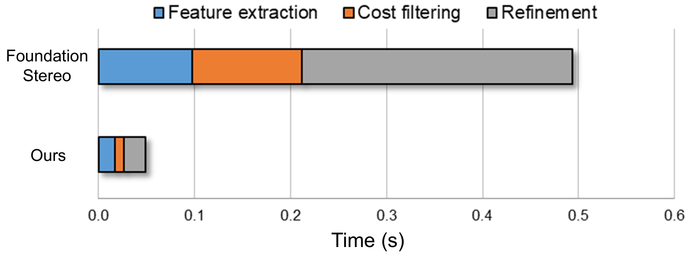{ width="760" }

附录 Table 5 进一步显示，同一模型的加速比会随 GPU 改变。下表保持其参数和 MAC 统计口径。[↗](https://arxiv.org/pdf/2512.11130v2#page=14)

| Method | RTX 3090 Runtime (ms) ↓ | RTX 4090 Runtime (ms) ↓ | A100 Runtime (ms) ↓ | #Param (M) | MACs (G) |
| --- | ---: | ---: | ---: | ---: | ---: |
| FoundationStereo | 496 | 295 | 308 | 374.5 | 5413.9 |
| Ours | 49 | 30 | 41 | 14.6 | 309.9 |

按这张表计算，参数量缩至教师的约 1/25.7，MAC 缩至约 1/17.5；实际延迟在 RTX 3090 上快 10.1 倍、RTX 4090 上快 9.8 倍、A100 上快 7.5 倍。算术操作数量不会直接等比例变成延迟收益，内存访问、kernel 启动及不同算子的硬件效率都会介入。MAC 是乘加操作计数，也不应未经定义就与另一个报告中的 FLOPs 直接等同。

参数量存在一个需要保留的原文边界：同页 Table 6 将 Ours 写为 **17.65M**，而 Table 5 写为 **14.6M**；论文未解释两者口径差异。因此上面的 25.7 倍仅按 Table 5 计算，不能用未交代的“另一模型版本”替作者消除冲突。

作者还报告 Middlebury-Q 推理的峰值显存约 0.63 GB，并指出容量上适合 Jetson Orin、Thor 一类设备。显存装得下与能以目标控制频率运行是两件不同的事；论文没有给出这些设备的实测 FPS。类似地，RTX 3090 上 21 ms 的网络推理不自动包括相机采集、图像校正、传输、深度转换及机器人控制链路。

训练成本则是另一笔账。部署者使用已训练权重时不必承担 128 张 A100、14 天的候选块训练；若想针对新硬件重新定义候选空间和时间预算，就需要重新测量候选延迟，并考虑是否重做蒸馏与搜索。论文给出了模块训练关系、剪枝损失和主推理配置，但不足以仅凭文中数值重建一套包含全部优化器与学习率调度的训练方案。

## 可以复用的设计原则与仍未解决的问题

这篇论文最值得迁移的是**根据模块冗余性质选择压缩工具**。当成熟替代骨干很多、接口可以通过特征监督对齐时，整体蒸馏能摆脱教师架构束缚；当内部结构组合极多、块之间接口稳定时，可以先做独立候选蒸馏，再用预算约束选择组合；当冗余集中在循环更新器时，保持跨迭代依赖的结构化剪枝更合适。最终端到端训练负责修复这些局部优化之间的分布差异。

真实数据的处理同样可迁移：引入另一条几何预测链，以局部方向一致性筛选伪标签，针对天空这种具有明确几何意义的类别增加规则修正。但两个模型的一致不能替代真值，透明物体也仍是教师与学生共同的薄弱区域。训练数据越接近实际使用环境，越应检验筛选器会不会恰好删除最需要学习的困难情况。

如果将本文方法接入具体系统，应先确定分辨率、视差范围和允许的迭代次数，再在目标硬件上选择骨干与代价过滤组合，最后同时检查平均延迟和关键场景误差。49 ms、21 ms、0.63 GB 分别回答了论文特定配置下的速度和容量问题；真正可复用的技术路径，是把这些预算同每个模块的接口、恢复训练和误差代价联系起来。[↗](https://arxiv.org/pdf/2512.11130v2#page=15)
