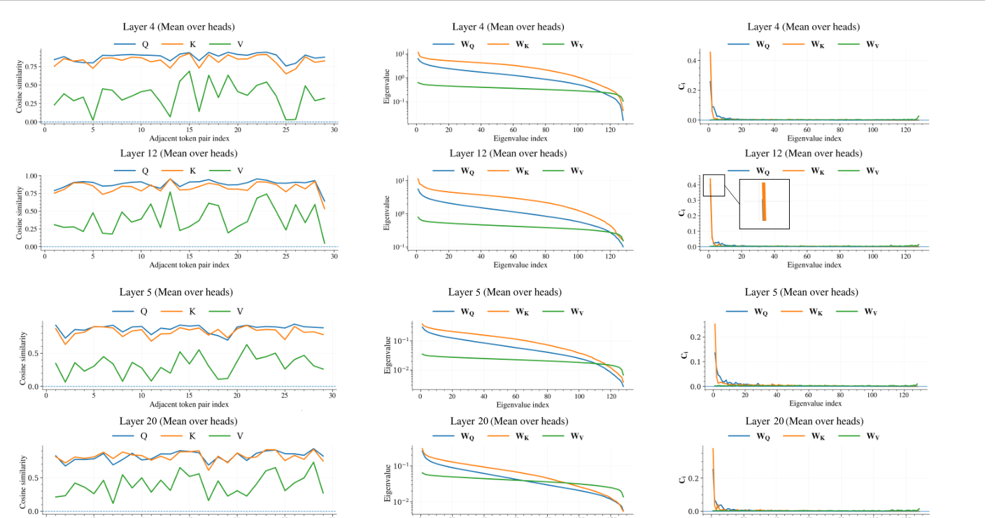
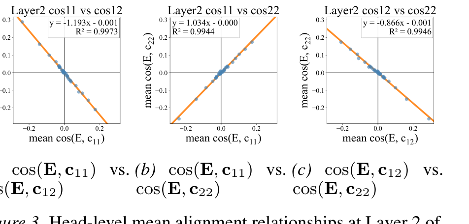
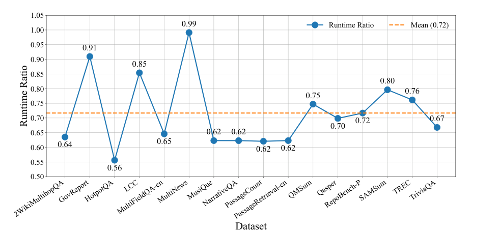
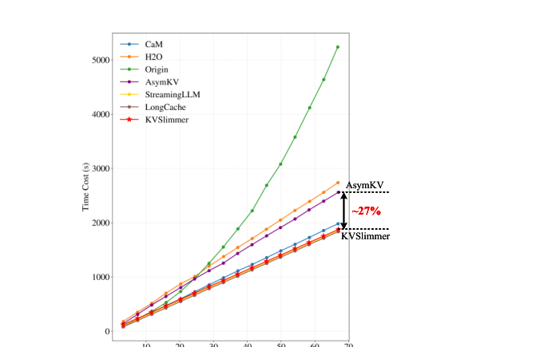
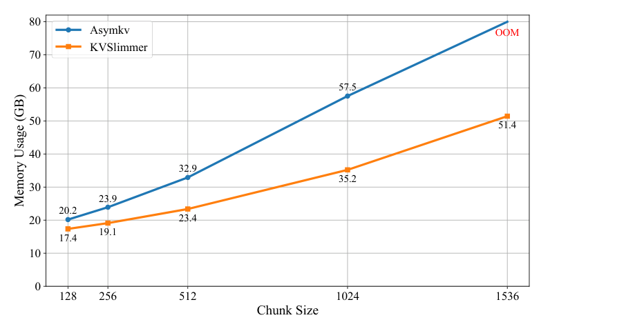

# KVSlimmer：非对称 KV 合并的数学与工程

!!! note "读法定位"
    这页先按“论文证据节点”读：先问它解决哪一个瓶颈，再看核心图表、实验 setting 和不能外推的边界。背景概念先回 [论文专题讲解](../index.md) 和 [推理](../../inference/index.md)。
    **前置**：不必先读完所有相关论文，但要知道本篇的输入、训练/推理路径和评测口径分别对应什么。
    **主线关系**：读完后把结论回填到「推理」路线里，判断它改变的是机制、成本、数据配方、评测口径，还是仍停留在前沿假设。

!!! info "论文信息"
    - 论文：`KVSlimmer: Theoretical Insights and Practical Optimizations for Asymmetric KV Merging`
    - 链接：[arXiv:2603.00907](https://arxiv.org/abs/2603.00907)
    - 代码：[GitHub: KVSlimmer](https://github.com/lianjunl13-sudo/KVSlimmer)
    - 关键词：KV cache compression、KV merging、long-context inference、Hessian、spectral analysis、forward-only compression

这篇论文解决的是长上下文推理里很具体、也很痛的瓶颈：**KV cache 太大，但不能随便删 token，也不能把 Key 和 Value 当成同一种东西合并。**

KVSlimmer 的核心判断是：相邻 token 的 `Key` 往往更同质，适合合并；`Value` 更异质，直接合并容易丢信息。它进一步把这个经验现象用谱分布解释清楚，再把 Key 合并的二阶 Hessian 推导成一个只依赖 forward-pass 变量的闭式解。这样它比 AsymKV 少了反向传播开销，同时保留了 off-diagonal Key-Key coupling。

## 它的效率贡献是什么

| Dimension | KVSlimmer |
| --- | --- |
| Saved cost | KV cache memory、decoder latency、backprop-based merge overhead |
| Main idea | Use Q/K/V spectral asymmetry to merge homogeneous Keys while preserving heterogeneous Values |
| Math core | Exact Hessian block derivation plus closed-form Key merge weights using only forward variables |
| Inference role | Long-context KV compression during serving; no model weight update required |
| Main risk | Local adjacent merging may miss non-local redundancy; uniform compression ratio may be suboptimal |
| Connect to | [上下文压缩与 KV 内存管理](../../inference/context-compression-kv-eviction-and-memory-hierarchies.md)、[推理系统路线图](../../inference/index.md)、[Transformer 输入与注意力](../../foundations/transformer-attention-and-tokenization.md) |

## 证据等级与外推边界

KVSlimmer 的证据来自谱分析、二阶推导、公开长上下文任务和推理效率对比。它很适合作为 KV cache compression 的工程参考，但世界模型 rollout 里的 KV 还会承载动作分叉、视频 latent 和风险判断，不能只按文本长上下文指标验收。

| 论文结论 | 证据来源 | 证据等级 | 可外推到世界模型高效训练 | 不能直接外推 |
| --- | --- | --- | --- | --- |
| Key 比 Value 更适合合并 | Q/K/V 相似度和投影谱分布分析 | Mechanistic evidence | KV 压缩应区分 K/V，不要统一删或统一合并 | 不能说明视频 latent KV 也有同样谱结构 |
| forward-only 合并可避免 backprop 开销 | Hessian 化简和闭式权重推导 | Algorithm + System | 在线压缩最好不引入反向传播路径 | 不能替代真实 runtime benchmark |
| 长上下文任务保持质量 | 文本 benchmark、长上下文评测 | Benchmark | 适合作为 rollout KV 压缩的候选 baseline | 不能证明动作候选排序和 risk calibration 不变 |
| decoder latency 和 cache memory 可降 | 推理测量和压缩率对比 | System throughput | bandwidth-bound KV 读取场景优先考虑 cache 压缩 | 不能保证端到端收益等于 KV kernel 收益 |
| 相邻合并有局部性假设 | 方法设计本身和风险讨论 | Assumption boundary | world model 可先压远期 memory KV，再保护当前窗口 | 不能激进压接触帧、动作分叉帧和失败 replay |

如果用于世界模型，应额外做三类验证：低精/合并 KV 下不同动作未来是否仍分叉，risk head 的 near-miss recall 是否下降，规划器 top-k 候选排序是否和高精版本一致。

## 论文位置

长上下文推理有三类常见省 KV 路线：

1. **eviction**：删掉一部分 KV，只保留 attention heavy hitters 或 recent tokens；
2. **compression / prompt compression**：把输入上下文在进入模型前压短；
3. **KV merging**：把相近 KV cache entry 合并，让模型仍保留某种压缩后的历史。

KVSlimmer 属于第三类。它不是重新训练长上下文模型，也不是改 attention 架构；它是在推理阶段压缩已有 KV cache。它和 AsymKV 的关系最直接：AsymKV 已经发现相邻 `K` 更同质、`V` 更异质，但 KVSlimmer 认为 AsymKV 还有三个问题：

1. 为什么会有这种 `K/V` 非对称，理论解释不够；
2. Hessian 近似忽略了相邻 Key 之间的 off-diagonal coupling；
3. 需要 gradient/backprop 近似 Hessian，推理时有额外时间和显存开销。

{ width="760" }

<small>图源：[KVSlimmer](https://arxiv.org/abs/2603.00907)，Figure 1。原论文图意：AsymKV 依赖反向传播和近似 Hessian；KVSlimmer 使用 forward-only 变量构造 exact Hessian 相关合并权重，避免 gradient 路径。</small>

!!! note "这张图支撑什么判断"
    图里的核心不是“又一种 KV 压缩框架”，而是 merge 计算路径发生了变化：AsymKV 为了估计 Hessian 走 backprop，KVSlimmer 把二阶信息化简成 forward variables 上的范数和线性组合。对在线推理来说，这意味着 KV 压缩本身不应成为新的长上下文瓶颈。

## 数学主线一：为什么 Key 更能合并，Value 不能简单合并

论文首先解释一个现象：相邻 token 的 `Q/K` 表征通常相似，而 `V` 表征差异更大。它不是只用经验图说明，而是从投影矩阵的谱能量分布推出来。

设输入相邻 token 表示为 \(x_t, x_{t+1}\)，某个投影矩阵为 \(W\)，输出为：

\[
y_t = x_t W,\qquad y_{t+1}=x_{t+1}W.
\]

相邻输出的点积可以写成：

\[
y_t y_{t+1}^{\top}
= x_t W W^{\top} x_{t+1}^{\top}.
\]

令

\[
M = W W^{\top} = U\Lambda U^{\top},
\]

其中 \(\Lambda\) 是特征值对角阵。把输入投到 \(U\) 的谱模态上：

\[
p_{t,i}=x_t u_i.
\]

那么点积可以展开为：

\[
x_t M x_{t+1}^{\top}
=
\sum_i \lambda_i p_{t,i}p_{t+1,i}.
\]

相邻输出的 cosine similarity 进一步可以写成每个谱模态贡献的和：

\[
\cos(y_t,y_{t+1})
=
\frac{\sum_i \lambda_i p_{t,i}p_{t+1,i}}
{\sqrt{\sum_i \lambda_i p_{t,i}^2}
\sqrt{\sum_i \lambda_i p_{t+1,i}^2}}
=
\sum_i c_i.
\]

这一步的含义很关键：

- 如果 \(W\) 的谱能量很集中，少数大 \(\lambda_i\) 主导输出，相邻 token 会被投到类似的低维主方向上，输出更同质；
- 如果 \(W\) 的谱能量更分散，很多模态都保留下来，输出保留更多 token-specific 信息，输出更异质。

论文的观察是：\(W_Q\) 和 \(W_K\) 的谱能量更集中，所以 `Q/K` 更容易同质；\(W_V\) 的谱能量更分散，所以 `V` 保留更多异质信息。直觉上，`Q/K` 服务于“匹配/对齐”，同质有利于稳定 attention；`V` 服务于“信息传输”，异质才不容易把内容压扁。

{ width="920" }

<small>图源：[KVSlimmer](https://arxiv.org/abs/2603.00907)，Figure 2。原论文图意：左列展示 Q/K/V 相邻 token cosine similarity，中列展示 \(W_Q,W_K,W_V\) 特征值分布，右列展示谱模态贡献系数 \(c_i\)。</small>

!!! note "这张图支撑什么判断"
    左列说明 Q/K 的相邻相似度通常高于 V；中列和右列给出原因：Q/K 投影的谱能量更集中，少数模态主导相似度；V 的谱更分散，保留更多异质信息。因此，“Key 可以更激进地合并，Value 不能照搬同一合并策略”不是单纯经验规则，而是和投影矩阵的谱结构有关。

## 数学主线二：Key 合并为什么要看 Hessian

给定一段 Key：

\[
K=[k_1,\ldots,k_n],
\]

目标是把相邻两个 Key \((k_m,k_{m+1})\) 合成一个 \(k^*\)，并尽量让 loss 变化最小：

\[
k^*=\arg\min_k L(k,k).
\]

如果只做平均：

\[
k^*=\frac{k_m+k_{m+1}}{2},
\]

就默认两个 Key 对 loss 的影响一样大。但 attention 里不同 Key 的影响取决于 query、attention weight、Value residual 和下游 loss，所以更合理的是用二阶近似衡量“改动这个 Key 会让 loss 变多少”。

更完整地说，如果把两个位置都替换成同一个 \(k\)，对应扰动是：

\[
\Delta_m=k-k_m,\qquad \Delta_{m+1}=k-k_{m+1}.
\]

只看这两个 Key 的二阶项，loss 变化可以近似成：

\[
\Delta L(k)
\approx
\frac{1}{2}
\begin{bmatrix}
\Delta_m\\
\Delta_{m+1}
\end{bmatrix}^{\top}
\begin{bmatrix}
h_{mm} & h_{m,m+1}\\
h_{m+1,m} & h_{m+1,m+1}
\end{bmatrix}
\begin{bmatrix}
\Delta_m\\
\Delta_{m+1}
\end{bmatrix}.
\]

如果把每个 Hessian block 的有效标量写成 \(g_{11},g_{12},g_{22}\)，那么目标等价于最小化：

\[
g_{11}\|k-k_m\|^2
+2g_{12}(k-k_m)^\top(k-k_{m+1})
+g_{22}\|k-k_{m+1}\|^2.
\]

对 \(k\) 求导并令导数为 0：

\[
(g_{11}+g_{12})(k-k_m)
+(g_{12}+g_{22})(k-k_{m+1})
=0.
\]

整理后得到：

\[
k^*
=
\frac{(g_{11}+g_{12})k_m+(g_{12}+g_{22})k_{m+1}}
{g_{11}+2g_{12}+g_{22}}.
\]

所以 \(g_{12}\) 不是可有可无的小修正。它同时进入分子和分母，决定两个相邻 Key 的 coupling 会把合并结果推向哪一边。

AsymKV 也沿着 Hessian 思路走，但它近似掉了 off-diagonal block \(h_{m,m+1}\)，并用 gradient/Fisher 近似 Hessian。KVSlimmer 的关键是：直接推 exact Hessian block，并最终消掉反传依赖。

## 数学主线三：从 attention 到 exact Hessian

对单个 query \(q\)，attention 写作：

\[
e_i=\frac{qk_i^\top}{\sqrt{d_k}},
\qquad
\alpha_i=\frac{\exp e_i}{\sum_t \exp e_t},
\qquad
o=\sum_t \alpha_t v_t.
\]

令 loss 对 attention 输出的梯度为：

\[
E=\frac{\partial L}{\partial o}.
\]

先看 Key 的一阶梯度。因为 \(k_i\) 只影响 \(e_i\)，而 \(e_i\) 通过 softmax 改变所有 \(\alpha\)，最终得到：

\[
\frac{\partial o}{\partial k_i}
=
\frac{1}{\sqrt{d_k}}\alpha_i(v_i-o)q^\top.
\]

所以：

\[
g_i=\nabla_{k_i}L
=
\frac{1}{\sqrt{d_k}}\alpha_i
\left[E^\top(v_i-o)\right]q.
\]

这条式子很有解释力：

- \(q\) 给出 Key 梯度的公共方向；
- \(\alpha_i\) 表示这个位置被当前 query 关注多少；
- \(v_i-o\) 表示这个 Value 和当前输出的残差；
- \(E^\top(v_i-o)\) 表示这个残差是否沿着下游 loss 想改变的方向。

再看 Hessian block：

\[
h_{ij}=\frac{\partial g_i}{\partial k_j^\top}.
\]

论文把

\[
s_i=\alpha_i(v_i-o)
\]

代入，可以得到统一形式：

\[
h_{ij}
=
\frac{1}{d_k}
\left[
E^\top\frac{\partial s_i}{\partial e_j}
\right]qq^\top.
\]

这说明每个 Hessian block 都是 \(qq^\top\) 这个 rank-one 矩阵乘一个标量敏感度。真正的区别藏在 \(\partial s_i/\partial e_j\)。

对 diagonal case：

\[
\frac{\partial s_i}{\partial e_i}
=
\alpha_i(1-2\alpha_i)(v_i-o).
\]

对 off-diagonal case：

\[
\frac{\partial s_i}{\partial e_j}
=
-\alpha_i\alpha_j(v_i+v_j-2o),
\qquad i\ne j.
\]

这就是 KVSlimmer 说的 exact Hessian coupling：相邻两个 Key 的二阶影响不只是各自的 self-sensitivity，还包括 softmax 归一化带来的交叉项。忽略 \(h_{m,m+1}\)，就会漏掉“改一个 Key 会通过 softmax 影响另一个 Key”的耦合。

## 数学主线四：怎么从 Hessian 变成 forward-only 权重

对相邻 Key \((k_m,k_{m+1})\)，论文定义三个只由 forward 变量构造的向量：

\[
c_{11}=\alpha_m(1-2\alpha_m)(v_m-o),
\]

\[
c_{22}=\alpha_{m+1}(1-2\alpha_{m+1})(v_{m+1}-o),
\]

\[
c_{12}=-\alpha_m\alpha_{m+1}(v_m+v_{m+1}-2o).
\]

对应的 Hessian 标量敏感度是：

\[
g_{ij}=E^\top c_{ij}.
\]

如果直接用这个式子，仍需要 \(E=\partial L/\partial o\)，也就是仍要反向传播。KVSlimmer 的关键化简在这里。

先把 \(g_{ij}\) 分解成范数和角度：

\[
g_{ij}
=
\|E\|_2\|c_{ij}\|_2\cos(E,c_{ij}).
\]

论文经验和附录分析给出一个关系：

\[
\cos(E,c_{11})
\approx
\cos(E,c_{22})
\approx
-\cos(E,c_{12}).
\]

{ width="760" }

<small>图源：[KVSlimmer](https://arxiv.org/abs/2603.00907)，Figure 3。原论文图意：在 Llama-3.1-8B-Instruct 的 Layer 2 上展示 \(\cos(E,c_{11})\)、\(\cos(E,c_{12})\)、\(\cos(E,c_{22})\) 的 head-level 线性关系。</small>

!!! note "这张图支撑什么判断"
    图中三组关系接近线性，且 \(c_{12}\) 与 diagonal 项呈相反符号关系。这正是 KVSlimmer 能把 \(E\) 消掉的实验证据：如果角度关系稳定，合并权重只需要看 \(\|c_{11}\|_2,\|c_{12}\|_2,\|c_{22}\|_2\)，不必真的反传求 \(E\)。

原始二阶合并可以写成：

\[
k^* = w_m k_m + w_{m+1}k_{m+1},
\]

其中：

\[
w_m=\frac{g_{11}+g_{12}}{g_{11}+2g_{12}+g_{22}},
\qquad
w_{m+1}=\frac{g_{12}+g_{22}}{g_{11}+2g_{12}+g_{22}}.
\]

利用上面的角度关系，\(\|E\|_2\) 和共同角度项被消去，得到 forward-only 形式：

\[
k^*
=
\left(
\|c_{11}\|_2-2\|c_{12}\|_2+\|c_{22}\|_2
\right)^{-1}
\left[
(\|c_{11}\|_2-\|c_{12}\|_2)k_m
+
(\|c_{22}\|_2-\|c_{12}\|_2)k_{m+1}
\right].
\]

这条式子是全文最重要的工程结果。它说明：

1. 合并 Key 仍然保留了 Hessian 的 self 和 coupling 信息；
2. 计算只需要 \(\alpha_i,v_i,o\) 等 forward-pass 变量；
3. 不需要 loss、label、反向传播或额外训练；
4. 合并操作退化成 norm 计算和线性组合，适合推理时执行。

## 算一遍：KV cache 为什么值得压

以 Llama-3.1-8B 这类 GQA 模型做一个粗略估算：假设 `32` 层、`8` 个 KV heads、head dim `128`、BF16。每个 token 的 KV cache 大约是：

\[
32 \times 2 \times 8 \times 128 \times 2\text{ bytes}
=131{,}072\text{ bytes}
\approx128\text{KiB}.
\]

于是单个请求只看 KV cache：

| Context | KV cache / request |
| ---: | ---: |
| `8K` tokens | `~1 GiB` |
| `32K` tokens | `~4 GiB` |
| `128K` tokens | `~16 GiB` |

如果 batch 是 `8`，`32K` 上下文就可能让 KV cache 接近 `32 GiB`。这还没有算参数、激活、runtime workspace、fragmentation 和并发请求。KVSlimmer 这类方法的价值不只是“省一点显存”，而是让系统能在同一张卡上保住更大的 batch、更长上下文或更低 P99。

但压缩不是免费午餐。若合并策略丢掉了长文档中的关键 evidence token，LongBench 平均分可能还行，RAG 或 agent 的具体任务会失败。因此 KV 压缩必须同时看 memory、latency 和任务质量。

## 实验设置

论文没有重新训练模型，而是在已有指令模型上做推理时 KV 压缩评测。

| Item | Setting |
| --- | --- |
| Base Models | Llama3.1-8B-Instruct, Mistral-7B-Instruct-v0.3, Qwen2-1.5B-Instruct |
| Baselines | StreamingLLM, LongCache, H2O, LLMLingua-2, CaM, AsymKV |
| Default compression context budget | 2048 tokens |
| Default chunk size | 512 |
| Preserved initial tokens | 32 tokens |
| Hardware | one NVIDIA A100 80GB |
| Training | No model training or fine-tuning; forward-only KV merging during inference |

这里最值得注意的是最后一行。KVSlimmer 的“数学逻辑”虽然用了 loss gradient 和 Hessian 语言，但最终算法并不需要训练数据标签，也不需要在 serving 时反传；它把训练目标中的 \(E\) 通过角度关系消掉，落成推理时可用的闭式合并。

## LongBench 结果

下面重绘论文 Table 1 的核心数据，保留原始英文列名。KVSlimmer 在三个模型上都优于 AsymKV 的平均分，尤其在 Synthetic 类任务上收益明显。

| Model / Method | Single-Doc | Multi-Doc | Sum | Few-shot | Synthetic | Code | Avg. |
| --- | ---: | ---: | ---: | ---: | ---: | ---: | ---: |
| **Llama3.1-8B-Instruct / Full Context** | 43.73 | 44.49 | 29.12 | 69.36 | 53.56 | 50.95 | 48.07 |
| StreamingLLM | 28.15 | 27.19 | 25.15 | 63.17 | 16.33 | 52.15 | 35.50 |
| LongCache | 28.98 | 27.84 | 25.35 | 64.73 | 19.68 | 51.61 | 36.46 |
| H2O | 33.30 | 34.43 | 26.60 | 66.23 | 14.75 | 52.65 | 38.53 |
| LLMLingua-2 | 32.02 | 32.24 | 24.99 | 27.87 | 17.67 | 50.07 | 30.43 |
| CaM | 32.14 | 32.63 | 24.91 | 63.09 | 16.77 | 52.13 | 37.26 |
| AsymKV | 39.42 | 38.93 | 27.30 | 65.66 | 39.39 | 48.57 | 43.12 |
| **KVSlimmer** | **40.24** | **39.61** | 27.19 | 65.00 | **44.52** | 49.73 | **44.04** |
| **Mistral-7B-Instruct-v0.3 / Full Context** | 38.74 | 38.29 | 29.04 | 70.70 | 51.00 | 53.05 | 46.15 |
| AsymKV | 33.71 | 32.81 | 27.04 | 67.21 | 34.56 | 51.33 | 40.88 |
| **KVSlimmer** | 33.42 | 32.62 | 26.83 | **67.86** | **36.78** | **52.34** | **41.28** |
| **Qwen2-1.5B-Instruct / Full Context** | 30.03 | 28.68 | 26.16 | 66.68 | 5.50 | 41.49 | 34.29 |
| AsymKV | 26.14 | 27.70 | 23.33 | **62.99** | 4.75 | 40.89 | 31.98 |
| **KVSlimmer** | **26.54** | **29.54** | **23.90** | 61.54 | **5.50** | **41.84** | **32.45** |

<small>表源：[KVSlimmer](https://arxiv.org/abs/2603.00907)，Table 1。原表完整列名和任务类别保留；此处突出 Full Context、AsymKV 和 KVSlimmer 的关键对比，并保留其它 Llama3.1 baseline 以说明整体位置。</small>

## 长上下文极限与效率结果

论文还在 LongBenchV2 上用 `Llama3.1-8B-Instruct`、cache size `8192` 做极长上下文评测。Table 2 显示 KVSlimmer 在 Overall、Easy、Short、Long 上最好，但 Hard 和 Medium 不是最好。

| Model | Overall | Easy | Hard | Short | Medium | Long |
| --- | ---: | ---: | ---: | ---: | ---: | ---: |
| Full Context | 30.02 | 30.73 | 29.58 | 35.00 | 27.91 | 25.93 |
| StreamingLLM | 27.04 | 27.60 | 26.69 | 32.78 | 23.26 | 25.00 |
| LongCache | 28.43 | 28.13 | 28.62 | 32.78 | 25.58 | 26.85 |
| H2O | 28.23 | 28.12 | 28.29 | 31.67 | 26.98 | 25.00 |
| CaM | 28.23 | 28.64 | 27.97 | 31.67 | 26.98 | 25.00 |
| AsymKV | 30.02 | 30.23 | **29.90** | 32.78 | **27.44** | 28.85 |
| **KVSlimmer** | **30.22** | **32.81** | 28.62 | **36.11** | 25.12 | **30.56** |

<small>表源：[KVSlimmer](https://arxiv.org/abs/2603.00907)，Table 2。</small>

效率图更直接说明工程价值。

{ width="760" }

<small>图源：[KVSlimmer](https://arxiv.org/abs/2603.00907)，Figure 4。原论文图意：KVSlimmer 相对 AsymKV 的 runtime ratio，均值约 0.72。</small>

{ width="520" }

<small>图源：[KVSlimmer](https://arxiv.org/abs/2603.00907)，Figure 5。原论文图意：长上下文 decoder stage 中，KVSlimmer 相比 AsymKV 约有 27% 时间开销下降。</small>

{ width="620" }

<small>图源：[KVSlimmer](https://arxiv.org/abs/2603.00907)，Figure 6。原论文图意：不同 chunk size 下，KVSlimmer 的峰值 GPU memory 明显低于 AsymKV；chunk size 越大差距越明显。</small>

!!! note "这些效率图支撑什么判断"
    Figure 4/5/6 支撑的是系统层判断：KVSlimmer 不是只在 LongBench 分数上小幅超过 AsymKV，而是把 AsymKV 的反传合并开销拿掉后，在 decoder 时间和峰值显存上也更稳。尤其 Figure 6 说明 chunk size 变大时，AsymKV 的内存压力增长更快，KVSlimmer 更适合受限 GPU 上的长上下文服务。

## 工程上怎么用

如果把 KVSlimmer 接进推理系统，建议按下面顺序判断，而不是一上来就全局开启：

```text
症状：长上下文请求 KV cache 撑爆显存，或 batch 一大 P99 decode 延迟上升
指标：KV memory/request、decode TPOT、cache compression ratio、LongBench/RAG bucket score、lost-evidence rate
机制：相邻 Key 同质，可合并；Value 异质，不能按同一规则粗暴合并
修复：在长上下文、低价值或后台请求中开启 KVSlimmer；保留初始 sink tokens 和 recent window
反例：代码定位、needle retrieval、法律条款引用等任务可能对少数 token 极敏感
边界：KVSlimmer 当前主要是 local adjacent merging，非局部冗余和 layer/head adaptive ratio 仍未充分解决
```

## 和世界模型高效训练主线的关系

KVSlimmer 不是世界模型训练算法，但它服务同一条效率主线：长上下文、多模态历史、agent memory 和 VLA rollout 都会把 KV cache 推高。它降低的是**推理成本、部署成本和长上下文评测成本**。

对世界模型和 VLA 来说，典型场景包括：

1. 多轮 agent 需要保留长工具轨迹；
2. VLA 需要读取长历史观测、语言和动作；
3. world model rollout 需要比较多个候选未来；
4. 离线评测要批量跑长上下文任务。

KVSlimmer 这类方法的价值在于让这些请求能塞进更小显存或更大 batch。但它也可能把成本转移到质量侧：如果压掉关键证据 token，系统会更快地产生错误答案。因此它必须和任务分桶评测、证据追踪、cache policy 和降级策略一起用。

## 局限与边界

第一，KVSlimmer 主要针对 local adjacent merging。相邻 token 冗余很常见，但很多长文档冗余是跨段、跨页面或跨工具调用的，非局部合并可能还需要额外检索或聚类。

第二，论文默认使用 uniform compression ratio。真实线上服务里，不同 layer、head、任务和请求长度的重要性并不一样。统一比例更简单，但可能不是最优。

第三，LongBench 类平均分不能覆盖所有业务失败。尤其是 RAG、代码修复、法律/医疗引用、agent tool trace 这类任务，一个被合并掉的 token 可能正好是关键证据。

第四，KVSlimmer 是推理时压缩方法，不会让模型本身学会更好地使用压缩记忆。如果希望模型原生适应压缩 KV，还需要训练时注入类似扰动或做 compression-aware finetuning。

## 本页结论

KVSlimmer 最值得记住的不是“又省了 29% memory / 28% latency”，而是它把 KV merging 的数学解释补上了：**Q/K 的谱能量集中导致相邻同质，V 的谱能量分散保留异质；Key 合并应保留 Hessian off-diagonal coupling，但这个二阶信息可以被化简成 forward-only 的闭式权重。**这让它从经验压缩技巧变成一个更可解释、也更适合在线推理的 KV cache 合并方法。

## 参考

1. [KVSlimmer: Theoretical Insights and Practical Optimizations for Asymmetric KV Merging](https://arxiv.org/abs/2603.00907).
2. [KVSlimmer GitHub](https://github.com/lianjunl13-sudo/KVSlimmer).

!!! tip "下一站"
    - 回到论文总入口：[论文专题讲解](../index.md)，用同一套 claim / 图表 / 边界口径横向比较。
    - 把本篇结论接回主题：[推理](../../inference/index.md)。
    - 按导航顺序继续：[DPM-Solver++：Guided Sampling 求解器](../diffusion/dpm-solver-plus-plus.md)。
