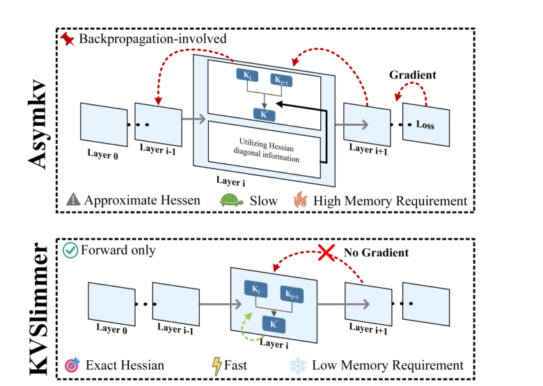
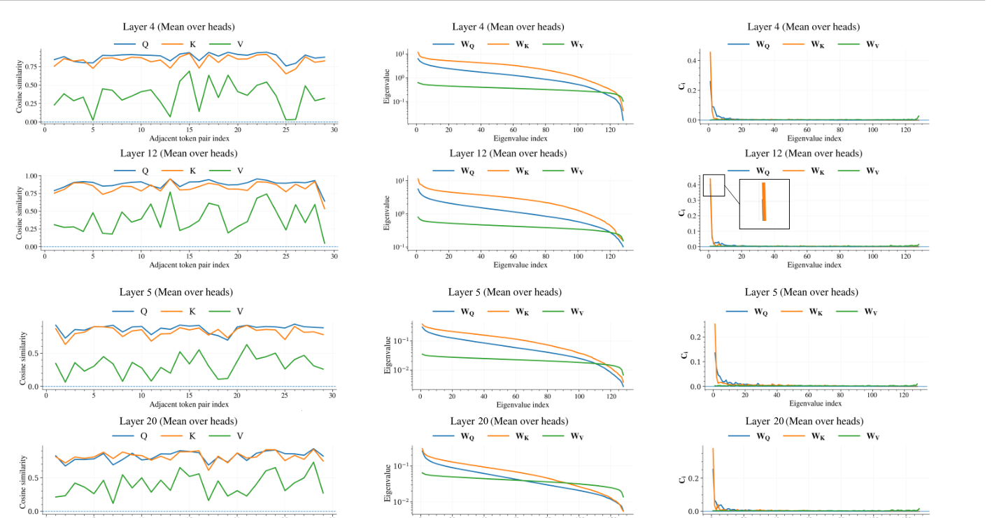
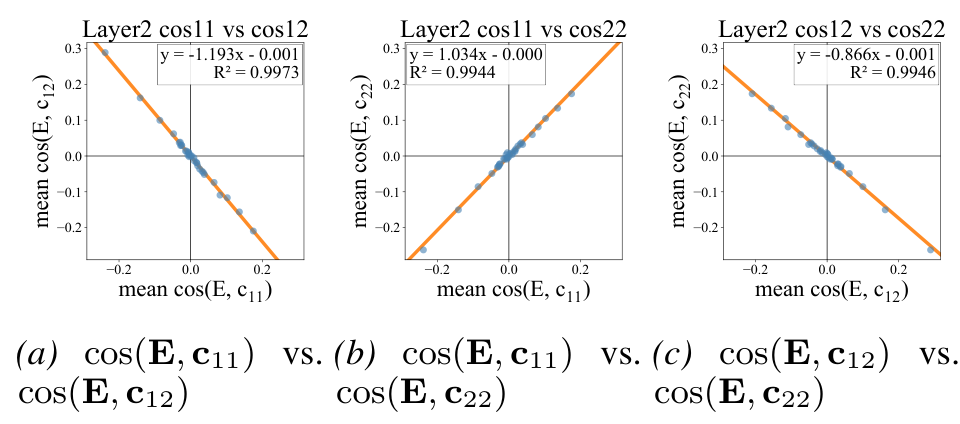
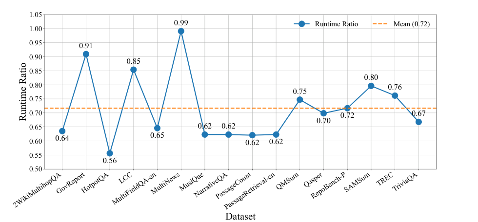
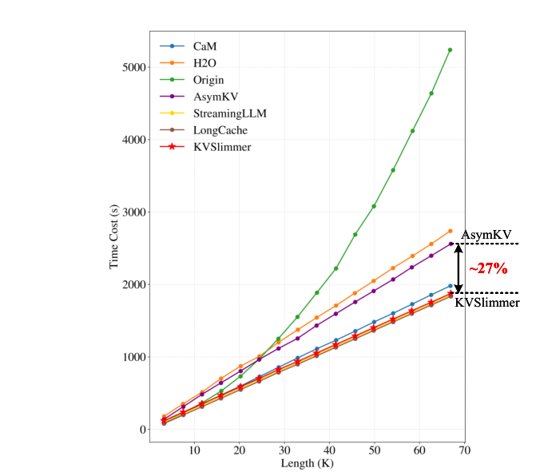
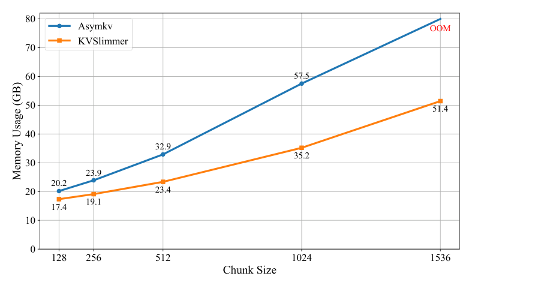
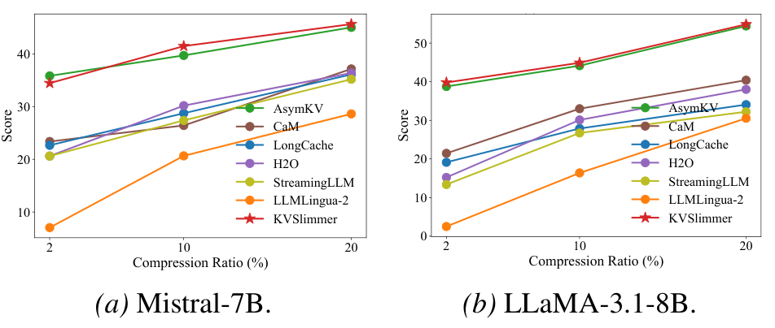

# KVSlimmer：非对称 KV 合并的数学与工程

!!! info "论文信息"
    **论文题名：** KVSlimmer: Theoretical Insights and Practical Optimizations for Asymmetric KV Merging。 
    **作者：** Lianjun Liu、Hongli An、Weiqi Yan、Xin Du、Shengchuan Zhang、Huazhong Liu、Yunshan Zhong。 
    **机构：** 未在公开元数据中稳定解析；以 arXiv/PDF 或官方页 affiliation block 为准。 
    **时间 / 主题：** 2026-03；高效推理。 
    **arXiv / 官方报告：** arXiv：[2603.00907](https://arxiv.org/abs/2603.00907)。 
    **GitHub / 项目：** GitHub：[github.com/lianjunl13-sudo/KVSlimmer](https://github.com/lianjunl13-sudo/KVSlimmer)。 
    **元数据来源与核验口径：** 来源：[arXiv](https://arxiv.org/abs/2603.00907)；[GitHub API / repo](https://github.com/lianjunl13-sudo/KVSlimmer)；Checked Date：2026-06-04；Repro Status：Paper / official materials reviewed, independent reproduction not claimed。

## 压缩历史信息之前，先看压缩本身有多贵

长上下文解码需要反复读取此前的 Key 和 Value。随着历史增长，KV cache 占用更多显存，每个新 query 也要查询更多位置。删除部分历史可以降低开销，但被删掉的位置可能恰好包含下一步才需要的证据。KV merging 尝试另一种折中，把多个位置合成较少的表示，让一部分信息继续留在缓存里。

合并又带来新的问题。Key 决定一段历史何时被检索，Value 决定检索后送出什么内容。两个相邻位置可能具有相似的 Key，却包含不同的 Value；对两者使用相同平均规则，未必同时保住检索方式与内容。AsymKV 据此采用非对称合并，但它估计 Key 重要性时需要反向传播。原本用于降低推理成本的操作，反过来引入了反向图、额外计算和峰值显存。

KVSlimmer 主要改动这个环节。它先用投影矩阵的谱分析解释 Q/K 与 V 的相似性差别，再把相邻 Key 的耦合纳入局部二阶模型，最后用一个经验性的夹角关系消去梯度依赖。实际运行的规则只读取前向 attention 权重、Value 与 attention 输出，不再为合并执行反向传播。[↗](https://arxiv.org/pdf/2603.00907v2#page=2)

下面的原图应先比较红色反向箭头。上方 AsymKV 从损失回传到需要合并的层，下方 KVSlimmer 在该层利用前向变量构造合并权重。两者都保留了压缩操作，只是计算权重的路径不同。

{ width="760" }

<small>原论文 Figure 1。图中 “Exact Hessian” 是作者对局部推导的表述，后文会区分这部分求导与最终无梯度规则采用的近似。[↗](https://arxiv.org/pdf/2603.00907v2#page=1)</small>

它的主要实证价值也落在这条路径上。Llama3.1-8B-Instruct 的 LongBench 平均分相对 AsymKV 从 43.12 提高到 44.04，同时默认 chunk size 512 下的平均峰值显存从 32.9 GB 降到 23.4 GB。质量增益不算巨大，减少压缩本身的时间与显存才使这项改动更有实际意义。完整上下文的平均分仍是 48.07，因此这里讨论的是压缩方案之间的折中。

## 一次压缩怎样改变后续 attention

KVSlimmer 是针对已训练模型的推理期缓存处理，不需要重新训练基础模型。默认 context budget 为 2048，chunk size 为 512，并保留最初 32 个 attention sink tokens。缓存随新块增长后，一次并行合并 512 对相邻位置，把位置数从 budget 加 chunk size 降回 budget。每对变成一个位置，才会净减少 512 个槽位；这与“只挑出 512 个 token 两两配对”不同。[↗](https://arxiv.org/pdf/2603.00907v2#page=3)

可以把一次压缩拆成几个相连的操作。

1. 根据已有 attention 信息选择适合合并的相邻位置。附录说明，方法主要合并累积 attention mass 较小的相邻 Key。
2. 用这些位置的 attention 权重、Value 和输出计算局部敏感性代理，得到 Key 的非均匀合并权重。
3. 两个 Key 变成一个代表 Key；两个 Value 按沿用的非对称规则相加，同时保留它代表多少原始位置的基数信息。
4. 后续 query 读取压缩后的缓存。合并不再发生时，模型仍按自回归方式继续计算与生成。

这里的 budget 控制常驻缓存规模，chunk size 控制多长时间集中做一次压缩。较大的 chunk 可以减少触发频率，却也让压缩前的瞬时缓存、attention 中间量及工作区变大。后面的显存实验正是改变 chunk size 来观察这一代价，不能把它理解成只改变了最终保留的 token 数。

### Value 相加为什么还需要基数

论文沿用 AsymKV 的 $v^*=v_m+v_{m+1}$ 与 cardinality normalization（基数归一化）。只保存这个和，然后当普通单位置 Value 使用，会改变 attention 输出的尺度。一个解释性恒等式可以说明基数的作用。

假设组 $G$ 内的 Key 完全相同，对某个 query 都产生 logit $e_G$。令 $n_G$ 为组大小，$V_G=\sum_{i\in G}v_i$，原 attention 可以精确整理成

$$
o=\frac{\sum_G \exp(e_G)V_G}
        {\sum_G n_G\exp(e_G)}.
$$

分子仍保留组内所有 Value 的和，分母则保留这一 logit 原本出现了多少次。等价地，也可以使用组平均 Value 与加上 $\log n_G$ 的 logit。这个式子是对相同 Key 情况的代数解释，说明“合并后位置减少”不能同时悄悄减少原有归一化质量。

实际相邻 Key 只是近似相同，所以还需要选择一个合适的 $k^*$。即使 Value 聚合在相同 Key 的条件下可以等价，替换不相同的 Key 仍可能改变未来 attention。不能把 Value 路径中的“无损”扩展成整个压缩过程对所有 query 都无损。[↗](https://arxiv.org/pdf/2603.00907v2#page=3)

## 为什么相邻 Key 容易相似，Value 却不一定

Q、K、V 都从隐藏状态投影而来，但三套投影矩阵可以保留不同的方向。对一个 attention head，把任意一种投影统一写成 $y_t=x_tW$。相邻投影结果的余弦相似度为

$$
\cos(y_t,y_{t+1})=
\frac{(x_tW)(x_{t+1}W)^\top}
{\|x_tW\|_2\|x_{t+1}W\|_2}.
$$

令 $M=WW^\top$，它就变成输入空间中由 $M$ 加权的相似度

$$
\cos(y_t,y_{t+1})=
\frac{x_tMx_{t+1}^\top}
{\sqrt{x_tMx_t^\top}\sqrt{x_{t+1}Mx_{t+1}^\top}}.
$$

这一步没有近似。它说明同一对 $x_t,x_{t+1}$，经过不同投影后可以有完全不同的相似度，因为不同的 $W$ 改变了哪些方向更重要。[↗](https://arxiv.org/pdf/2603.00907v2#page=3)

### 将相似度拆到各个谱方向

对 $W$ 做 SVD，写成 $W=U\Sigma V^\top$，则 $M=U\Sigma^2U^\top$。记 $\lambda_i=\sigma_i^2$，$p_{t,i}=x_tu_i$，其中 $u_i$ 是第 $i$ 个左奇异向量。原文式 7 给出

$$
\cos(y_t,y_{t+1})=
\frac{\sum_i\lambda_i p_{t,i}p_{t+1,i}}
{\sqrt{\sum_i\lambda_i p_{t,i}^2}
 \sqrt{\sum_i\lambda_i p_{t+1,i}^2}}.
$$

每个方向对分子的贡献还可单独写成

$$
c_i=
\frac{\lambda_i p_{t,i}p_{t+1,i}}
{\sqrt{\sum_j\lambda_j p_{t,j}^2}
 \sqrt{\sum_j\lambda_j p_{t+1,j}^2}},
\qquad \cos(y_t,y_{t+1})=\sum_i c_i.
$$

若谱衰减很快，少数大的 $\lambda_i$ 会主导分子和分母。相邻输入在这些主导方向上同向时，投影后的相似度就容易较高；许多原本不同的次要方向被压低了。若能量分散，更多输入差异继续影响输出，相邻向量就可能保留更大的差别。

关键条件是“主导方向上同向”。仅有谱集中，不能保证任意两个向量相似。例如同一主方向上的两个输入符号相反，投影后仍可能反向。谱分解提供了分析工具，模型内相邻 token 的实际对齐还要看数据。[↗](https://arxiv.org/pdf/2603.00907v2#page=4)

原图将三类证据放在同一行。先看左列相邻 token 的余弦，Q/K 多数较高，V 更低且波动更大；再看中列按大小排序的特征值；最后用右列的 $c_i$ 检查相似度是否主要来自前几个方向。只看中间的权重谱，解释还不完整，右列把权重与实际输入联系起来了。

{ width="920" }

<small>原论文 Figure 2。前两行为 Llama3.1-8B-Instruct 的第 4、12 层，后两行为 Mistral-7B-Instruct-v0.3 的第 5、20 层；相似度按 head 平均。[↗](https://arxiv.org/pdf/2603.00907v2#page=4)</small>

附录 Figures 8、9 又展示了两个模型的其他层，说明观察不只来自这四行样例。不过这些图不是“所有模型所有层必然如此”的证明，也没有单独改变投影谱后测量压缩质量的干预实验。可用于算法设计的认识是，Key 的局部冗余与 Value 的内容差异值得分别处理，而不是先假定两类向量适合相同聚合。[↗](https://arxiv.org/pdf/2603.00907v2#page=13) [↗](https://arxiv.org/pdf/2603.00907v2#page=14)

## 改一个 Key，为什么会改变所有位置的权重

对固定 query $q$，写出 attention 的三个步骤

$$
e_i=\frac{q^\top k_i}{\sqrt{d_k}},\qquad
\alpha_i=\frac{\exp(e_i)}{\sum_t\exp(e_t)},\qquad
o=\sum_t\alpha_tv_t.
$$

$e_i$ 是位置 $i$ 的 logit，$\alpha_i$ 是归一化权重，$d_k$ 是 Key 维度。增加一个 logit，不仅提高对应位置的权重，还通过共同分母压低其他位置。因此，两个 Key 一起变化时，输出变化不能只由各自独立的重要性相加描述。

Softmax 导数为 $\partial\alpha_j/\partial e_i=\alpha_j(\delta_{ji}-\alpha_i)$。把所有 Value 的贡献都加起来，得到

$$
\frac{\partial o}{\partial e_i}=\alpha_i(v_i-o).
$$

$v_i-o$ 是该位置内容相对当前加权输出的残差。即使一个位置 attention 较大，若它的 Value 与当前输出很接近，改变其权重也未必明显改变输出。仅用 attention 大小排序，会丢掉这一层信息。

令 $E=\partial L/\partial o$，沿链式法则得到原文式 12

$$
\nabla_{k_i}L=
\frac{\alpha_i}{\sqrt{d_k}}
\big[E^\top(v_i-o)\big]q.
$$

这一式子把敏感性拆成了 attention 质量、Value 残差与下游梯度的对齐，再乘以共同方向 $q$。在固定 query 的局部分析里，所有 Key 梯度都沿 $q$，不同位置改变的是标量系数。[↗](https://arxiv.org/pdf/2603.00907v2#page=5)

### 相邻位置的交叉项来自共同分母

对需要合并的 $m,m+1$ 两个位置，定义三个前向向量

$$
c_{11}=\alpha_m(1-2\alpha_m)(v_m-o),
$$

$$
c_{22}=\alpha_{m+1}(1-2\alpha_{m+1})(v_{m+1}-o),
$$

$$
c_{12}=-\alpha_m\alpha_{m+1}(v_m+v_{m+1}-2o).
$$

前两个描述本位置权重改变时的局部曲率，第三个描述一处改变如何通过 Softmax 影响另一处。固定上游信号 $E$ 后，论文对应的二阶块具有统一形式

$$
\widetilde H_{ij}=\frac{g_{ij}}{d_k}qq^\top,
\qquad g_{ij}=E^\top c_{ij},
\qquad ij\in\{11,12,22\}.
$$

这里用波浪号明确它是按论文局部求导得到的块。AsymKV 在实用近似里忽略相邻 Key 的非对角块，并用梯度平方近似对角重要性；KVSlimmer 保留 $c_{12}$ 所对应的相互影响。算法改变的是合并权重的构造，不是给基础模型增加一层新的 attention。[↗](https://arxiv.org/pdf/2603.00907v2#page=3) [↗](https://arxiv.org/pdf/2603.00907v2#page=5)

### “精确二阶信息”需要限定到哪个对象

上面的 attention 导数可以直接核对，但从 $E^\top c_{ij}$ 推到任意最终损失的完整 Hessian，还差一步。若下游损失对输出 $o$ 存在曲率，$E$ 本身也会随 Key 变化。令 $J_i=\partial o/\partial k_i$、$H_o=\partial^2L/\partial o^2$，完整链式法则还包含

$$
H_{ij}=\widetilde H_{ij}+J_i^\top H_oJ_j.
$$

后项在固定 $E$、或者局部下游目标对 $o$ 为线性时消失；一般神经网络损失并不自动满足这个条件。因此，论文的求导更适合被理解为保留 Softmax 耦合的局部曲率模型，不能直接声称恢复了整个模型最终损失的完整精确 Hessian。这个区别影响对理论保证的理解，却不妨碍单独评价最终规则的实测质量与成本。

## 从秩一线性系统到 Key 合并权重

论文从将两个 Key 替换成同一个 $k$ 的目标 $L(k,k)$ 出发，采用其所称的 modified Newton 形式。将三个二阶块代入，得到

$$
\mathcal M k^*=N,
\qquad
\mathcal M=\frac{\gamma}{d_k}qq^\top,
\qquad
\gamma=g_{11}+2g_{12}+g_{22},
$$

$$
N=\frac1{d_k}qq^\top b,
\qquad
b=(g_{11}+g_{12})k_m+(g_{12}+g_{22})k_{m+1}.
$$

交叉项在这里出现两次，因为两个位置都要一起移动到新代表。若直接删掉它，就退回只根据两个位置各自敏感性加权的形式。

这个模型也不应被误读为一般二阶 Taylor 展开的无条件最小解。对 $L(k,k)$ 保留完整一阶项时，驻点方程还应包含两处梯度之和；原文采用的 modified Newton 合并式没有保留该项，局部二阶型也未必正定。后续代数是在这一合并模型之内成立的。[↗](https://arxiv.org/pdf/2603.00907v2#page=3)

### 为什么伪逆解与实际加权 Key 不必相同

$qq^\top$ 是秩一矩阵，无法在全部 Key 维度上普通求逆。对于 $q\ne0$、$\gamma\ne0$，原文用 Moore–Penrose pseudoinverse 得到

$$
k^*_{\mathrm{proj}}=\frac1\gamma P_qb,
\qquad P_q=\frac{qq^\top}{q^\top q}.
$$

它是落在 $q$ 所在一维空间里的解。实际使用的加权代表则为

$$
\bar k=\frac b\gamma
=\frac{g_{11}+g_{12}}\gamma k_m
 +\frac{g_{22}+g_{12}}\gamma k_{m+1}.
$$

二者具有相同的 $q^\top k$，都满足这条秩一线性约束，但通常不是逐元素相同的向量。$\bar k$ 保留了原 Key 平面中一些与当前 $q$ 垂直的分量，而投影解删掉了这些分量。下一条 query 若方向不同，会重新读到这些差别。

因此，式 29 到式 30 可以理解为在同一局部约束下选择一个 Key 空间中的代表，不能理解为已经证明一个向量对所有未来 query 都最优。这个结论也解释了为何论文的理论分析之后仍需要长上下文任务实验。[↗](https://arxiv.org/pdf/2603.00907v2#page=6)

## 真正省掉反向传播的，是夹角近似

到这里仍然需要 $E$，所以还没有实现无梯度压缩。作者把三个标量敏感性拆成

$$
g_{ij}=\|E\|_2\|c_{ij}\|_2\cos(E,c_{ij}).
$$

共同的 $\|E\|_2$ 可以约掉，三个夹角却一般不同。关键经验观察是，在相邻 Key 较同质的区域

$$
\cos(E,c_{11})\approx\cos(E,c_{22})
\approx-\cos(E,c_{12}).
$$

Figure 3 用 Llama3.1-8B-Instruct 第 2 层的 head 均值检验这一关系。先看中图，同一 head 的 $c_{11}$ 与 $c_{22}$ 平均对齐近似同向；左右两图中 $c_{12}$ 与它们近似反向。三组拟合的 $R^2$ 分别为 0.9973、0.9944、0.9946，但斜率分别是 −1.193、1.034、−0.866，并不精确等于 −1、1、−1。

{ width="760" }

<small>原论文 Figure 3，2WikiMQA 上每个点为一个 attention head 的全局平均对齐。高相关性支持采用近似，但不能代替逐 token、逐 query 的误差界。[↗](https://arxiv.org/pdf/2603.00907v2#page=5)</small>

附录在 Llama 的第 5、22 层和 Mistral 的第 9、15、20 层补充了同类图。例如 Mistral 第 20 层，$c_{11}$ 与 $c_{22}$ 的拟合斜率为 0.917、$R^2=0.9519$。方向关系仍然明显，接近程度却会变化。把这些结果写成经验规律，比把每个位置都当成严格相等更符合证据。[↗](https://arxiv.org/pdf/2603.00907v2#page=14) [↗](https://arxiv.org/pdf/2603.00907v2#page=16)

### 代入之后，剩下前向向量的范数

用同一个夹角因子近似前两个方向，对第三个取相反符号，公共因子在分子、分母中消去，得到原文式 33

$$
k^*=
\frac{(\|c_{11}\|_2-\|c_{12}\|_2)k_m
     +(\|c_{22}\|_2-\|c_{12}\|_2)k_{m+1}}
{\|c_{11}\|_2-2\|c_{12}\|_2+\|c_{22}\|_2}.
$$

每个 $c$ 都由 $\alpha,v,o$ 得到。推理实现可以先从前向结果计算三个向量，再求范数、生成两个系数、线性组合 Key。此时不需要保留完整反向图，也不需要先选一个最终损失再从后层回传。

这个式子保留了交叉项的结构，又将不能直接从前向得到的角度替换为经验近似。不能因为最后消公共因子的代数步骤是精确的，就把前一步的近似也变成精确保证。[↗](https://arxiv.org/pdf/2603.00907v2#page=6)

两个系数在分母非零时相加为 1，但不一定都非负。例如仅用于解释代数，若 $\|c_{11}\|_2=0.4$、$\|c_{12}\|_2=0.3$、$\|c_{22}\|_2=0.25$，则分母为 0.05，两个权重为 2 和 −1。它已经是外推型组合，而不是普通凸平均。这个数例不是论文测量，也不声称任意范数组合都会在实际 attention 中出现；它说明实现需要认真处理分母接近零、权重放大与低精度误差。

### 附录解释可以支持到哪一步

附录将合并对象限制到较小 attention mass 的相邻位置，通常 $\alpha_i<1/2$。此时 $\alpha_i(1-2\alpha_i)>0$，所以 $c_{11},c_{22}$ 分别保留对应 Value 残差的方向，$c_{12}$ 则与两段残差的和方向相反。这有助于解释符号关系。

但夹角的大小还取决于两个残差怎样排列。梯度范数变小并不会自行改变余弦；“与两个残差分别有近似相同夹角”也不自动保证“与它们的和仍是同一个夹角”。附录提供的是这条经验规律的动机，尚不足以替代一般误差证明。

原文附录还有两处求导式需要与主文区分。式 37 比主文式 12 多出 $(1-\alpha_i)$，而对所有 Softmax 输出应用链式法则得到的是前面的式 12。式 41 将部分一阶导数形式写成了 Softmax Hessian；例如正确的同坐标二阶导数应为 $\partial^2\alpha_i/\partial e_i^2=\alpha_i(1-\alpha_i)(1-2\alpha_i)$。理解和实现合并规则时，应依照主文完整的 attention 求导，不把附录这两式继续代入。最终的无梯度公式仍应作为有实验支持的局部代理来评价。[↗](https://arxiv.org/pdf/2603.00907v2#page=16) [↗](https://arxiv.org/pdf/2603.00907v2#page=17)

## 相同缓存规模下，质量究竟保住了多少

主实验覆盖 Llama3.1-8B-Instruct、Mistral-7B-Instruct-v0.3 和 Qwen2-1.5B-Instruct，使用单张 A100 80GB。LongBench 选取 16 个英文任务，分成 Single-Doc、Multi-Doc、Sum、Few-shot、Synthetic、Code 六类。默认 budget 2048、chunk size 512；H2O 则沿用 recent 2048 加 heavy 512 的独立配置，不能说所有方法最终都只保留完全相同数量的槽位。[↗](https://arxiv.org/pdf/2603.00907v2#page=6)

### 先用全套基线判断它处在哪条折中曲线上

| Method · Llama3.1-8B-Instruct | Single-Doc | Multi-Doc | Sum | Few-shot | Synthetic | Code | Avg. |
| --- | ---: | ---: | ---: | ---: | ---: | ---: | ---: |
| Full Context | 43.73 | 44.49 | 29.12 | 69.36 | 53.56 | 50.95 | 48.07 |
| StreamingLLM | 28.15 | 27.19 | 25.15 | 63.17 | 16.33 | 52.15 | 35.50 |
| LongCache | 28.98 | 27.84 | 25.35 | 64.73 | 19.68 | 51.61 | 36.46 |
| H2O | 33.30 | 34.43 | 26.60 | 66.23 | 14.75 | 52.65 | 38.53 |
| LLMLingua-2 | 32.02 | 32.24 | 24.99 | 27.87 | 17.67 | 50.07 | 30.43 |
| CaM | 32.14 | 32.63 | 24.91 | 63.09 | 16.77 | 52.13 | 37.26 |
| AsymKV | 39.42 | 38.93 | 27.30 | 65.66 | 39.39 | 48.57 | 43.12 |
| KVSlimmer | 40.24 | 39.61 | 27.19 | 65.00 | 44.52 | 49.73 | 44.04 |

<small>原文 Table 1 的完整 Llama 部分，分数越高越好。Avg. 沿用论文对任务的汇总，不重新对六个显示类别做等权平均。[↗](https://arxiv.org/pdf/2603.00907v2#page=7)</small>

AsymKV 与 KVSlimmer 相比其他压缩方法，更好地保留了文档问答和合成任务的表现。两者之间最显著的变化在 Synthetic，39.39 升到 44.52，增加 5.13 分；Single-Doc 与 Multi-Doc 分别增加 0.82、0.68。这个分布比平均只增加 0.92 更能说明哪些任务对合并方式敏感。

同时，Sum 从 27.30 降至 27.19，Few-shot 从 65.66 降至 65.00；Code 虽比 AsymKV 高，仍低于 H2O 的 52.65。完整上下文平均分还高出 4.03，Synthetic 也高出 9.04。方法没有把所有被压缩的信息恢复回来，它改善的是既定预算下的信息保留方式。

### 换模型后，增益没有固定落在同一类别

| Model / Method | Single-Doc | Multi-Doc | Sum | Few-shot | Synthetic | Code | Avg. |
| --- | ---: | ---: | ---: | ---: | ---: | ---: | ---: |
| Mistral / Full Context | 38.74 | 38.29 | 29.04 | 70.70 | 51.00 | 53.05 | 46.15 |
| Mistral / AsymKV | 33.71 | 32.81 | 27.04 | 67.21 | 34.56 | 51.33 | 40.88 |
| Mistral / KVSlimmer | 33.42 | 32.62 | 26.83 | 67.86 | 36.78 | 52.34 | 41.28 |
| Qwen2 / Full Context | 30.03 | 28.68 | 26.16 | 66.68 | 5.50 | 41.49 | 34.29 |
| Qwen2 / AsymKV | 26.14 | 27.70 | 23.33 | 62.99 | 4.75 | 40.89 | 31.98 |
| Qwen2 / KVSlimmer | 26.54 | 29.54 | 23.90 | 61.54 | 5.50 | 41.84 | 32.45 |

<small>原文 Table 1 节选。Mistral 为 7B-Instruct-v0.3，Qwen2 为 1.5B-Instruct。</small>

Mistral 的平均分提高 0.40，贡献来自 Few-shot、Synthetic、Code，Single-Doc、Multi-Doc、Sum 都略降。Qwen2 平均提高 0.47，但 Few-shot 下降 1.45。Qwen2 的 Multi-Doc 和 Code 甚至略高于完整上下文，这只能说明特定测试上压缩结果有时更好，不能推断压缩普遍增强模型能力。尤其 Qwen2 的 Synthetic 绝对分数只有 5.50，不能只看它“追平 Full Context”就认为模型已经可靠解决了这类任务。

三种模型都出现平均收益，提供了跨模型的支持；收益在哪些任务上出现，则仍然受模型与输入影响。论文没有用一组独立消融分别测“只加交叉项”“只换夹角代理”“只去掉反向”，因此不能把全部质量增益单独归给某一个部件。

## 更长任务中，平均领先掩盖了哪些退步

LongBenchV2 覆盖原始上下文从 8K 到 2M 的任务，论文用 Llama3.1-8B-Instruct 和更大的 8192 cache budget 评测。这个数据集范围不能直接证明模型在每个样本上都无截断地处理了 2M 输入；表中结果应理解为作者报告的评测配置。[↗](https://arxiv.org/pdf/2603.00907v2#page=7)

| Method | Overall | Easy | Hard | Short | Medium | Long |
| --- | ---: | ---: | ---: | ---: | ---: | ---: |
| Full Context | 30.02 | 30.73 | 29.58 | 35.00 | 27.91 | 25.93 |
| StreamingLLM | 27.04 | 27.60 | 26.69 | 32.78 | 23.26 | 25.00 |
| LongCache | 28.43 | 28.13 | 28.62 | 32.78 | 25.58 | 26.85 |
| H2O | 28.23 | 28.12 | 28.29 | 31.67 | 26.98 | 25.00 |
| CaM | 28.23 | 28.64 | 27.97 | 31.67 | 26.98 | 25.00 |
| AsymKV | 30.02 | 30.23 | 29.90 | 32.78 | 27.44 | 28.85 |
| KVSlimmer | 30.22 | 32.81 | 28.62 | 36.11 | 25.12 | 30.56 |

<small>原文 Table 2，保留全部对照及难度、长度分组。[↗](https://arxiv.org/pdf/2603.00907v2#page=8)</small>

KVSlimmer 的 Overall 比 AsymKV 高 0.20，Easy、Short、Long 分别高 2.58、3.33、1.71；但 Hard 低 1.28，Medium 低 2.32。难度与长度是不同分类轴，不能把“Long 有提升”改写成“越难越有优势”。

0.20 的总体差距也很小，表中没有置信区间，无法仅凭这个数字判断稳定的统计优势。对实际部署更有用的是保留分组结果。如果目标是难题长文推理，应直接测那一类请求的错误，而不是借 Overall 的最高值替代任务匹配。

## 时间与显存省在哪里，要分三个实验读

无反向规则的目标首先是降低合并成本。论文分别给出真实任务的相对运行时间、长序列 decoder 的累计耗时，以及不同 chunk 下的峰值显存。三者回答不同问题，不能混成同一个“加速百分比”。

### 任务运行时间，先看分母与平均口径

Figure 4 的纵轴是 KVSlimmer 时间除以 AsymKV 时间。低于 1 表示更快，0.56 表示相同任务耗时减少 44%。先看 HotpotQA 的最低点，再看接近 1 的 MultiNews，可以直接看到任务差异。

{ width="760" }

<small>原论文 Figure 4。图中虚线为 16 个任务运行时间比的平均值 0.72。[↗](https://arxiv.org/pdf/2603.00907v2#page=7)</small>

| Dataset | Runtime ratio | Reduction versus AsymKV |
| --- | ---: | ---: |
| HotpotQA | 0.56 | 44% |
| MusiQue / NarrativeQA / PassageCount / PassageRetrieval-en | 0.62 | 38% |
| 2WikiMultihopQA | 0.64 | 36% |
| LCC | 0.85 | 15% |
| GovReport | 0.91 | 9% |
| MultiNews | 0.99 | 1% |

不同任务中压缩触发次数、输入输出结构和其他计算占比不同，去掉反向能省下的总时间也不同。图中的 0.72 是任务比值的平均，不是把全库运行秒数加起来后得到的总耗时比，更不等于所有线上请求都提高相同吞吐。作者将差异主要联系到长上下文开销，但图本身没有隔离长度、生成预算和触发次数各自的贡献。

### 长序列 decoder，比较增长趋势与压缩开销

下面的图把横轴 Length 以 K 为单位，纵轴 Time Cost 以秒为单位。绿色 Origin 曲线随长度增长越来越陡；多种压缩方法更接近线性，其中 KVSlimmer 的红色星形曲线靠近 StreamingLLM、LongCache，低于 AsymKV。

{ width="520" }

<small>原论文 Figure 5，保留 Length (K) 与 Time Cost (s) 坐标。右端约 65K 处的标注为相对 AsymKV 节省约 27%。[↗](https://arxiv.org/pdf/2603.00907v2#page=8)</small>

按图读取，右端 AsymKV 大约 2500 秒，KVSlimmer 大约 1900 秒，图中另以约 27% 标出两者差距。这些是曲线上的近似读数，不是额外披露的一张精确计时表。实验支持无梯度合并能把开销压到接近较简单的上下文截断方案，同时前面的质量表说明它通常保留了更多任务信息。

曲线没有给出足以恢复每项计时的完整输入与生成配置，因此不能将这些秒数直接转换成其他服务的 token/s。实际采用时，仍要测固定模型、输出长度和 batch 下的 decoder 成本。

### 峰值显存，chunk 越大差距越明显

Figure 6 按 16 个 LongBench 任务汇总峰值显存。先比较相同 chunk 下两条线，再看间距随 chunk 增大而扩大。它测到的既包括模型与缓存，也包括压缩过程中的临时资源。

{ width="620" }

<small>原论文 Figure 6。1536 处 AsymKV 标记为 OOM；曲线顶端不是一个有效的 80 GB 成功运行测量。[↗](https://arxiv.org/pdf/2603.00907v2#page=8)</small>

| Chunk Size | AsymKV Peak Memory (GB) | KVSlimmer Peak Memory (GB) | Reduction |
| --- | ---: | ---: | ---: |
| 128 | 20.2 | 17.4 | 13.9% |
| 256 | 23.9 | 19.1 | 20.1% |
| 512 | 32.9 | 23.4 | 28.9% |
| 1024 | 57.5 | 35.2 | 38.8% |
| 1536 | OOM | 51.4 | — |

<small>Reduction 由图中数据按 $(M_{\rm AsymKV}-M_{\rm KVSlimmer})/M_{\rm AsymKV}$ 计算，其余数值为原图标注。</small>

默认 512 时少用 9.5 GB，1024 时少用 22.3 GB。这里的 29%、39% 是整体峰值相对 AsymKV 的减少，不是最终 KV cache 槽位又少了相同比例。较大 chunk 下，节约反向相关中间状态的收益更明显；但 KVSlimmer 自身也从 17.4 GB 增至 51.4 GB，不能据此认为任意增大 chunk 都没有成本。

## 保留得越少，质量下降是否还能接受

Figure 7 在 HotpotQA 上改变保留比例。论文把 compression ratio 定义为保留 token 数除以原始长度，因此 2% 比 20% 压缩得更强。这个定义与有些文献使用的“删除比例”相反，必须先弄清再读曲线。

{ width="960" }

<small>原论文 Figure 7，左为 Mistral-7B，右为 Llama3.1-8B。横轴为保留比例 2%、10%、20%，纵轴是 Score。[↗](https://arxiv.org/pdf/2603.00907v2#page=9)</small>

AsymKV 与 KVSlimmer 两条曲线总体接近，明显高于图中多数其他压缩方案。随着保留比例增加，质量提高；KVSlimmer 在多数点略高，但 Mistral 的 2% 点略低于 AsymKV。这项实验支持局部合并在不同预算下维持较好的质量，并没有显示在最激进压缩时也必然占优。

正文还报告，在 10% 保留比例下，相对 AsymKV 的时间与显存分别减少约 20%、27%。这组值属于该压缩率实验，不能与默认配置的 28%、29% 互换。Figure 7 本身只画质量，没有给出完整成本曲线；使用时应同时指定保留比例与测量场景。[↗](https://arxiv.org/pdf/2603.00907v2#page=8)

## 从公式走向可用实现，还缺哪些接口

论文给出的核心计算输入很明确，即相邻 Key、对应 Value、attention 权重和输出。但推导主要针对一条 query、一个 head；批量压缩还需要确定怎样跨 query 聚合统计、怎样处理 GQA 多个 query heads、怎样避免相邻配对冲突，以及分母接近零时采取什么回退。它们都会影响稳定性与实际速度。

官方仓库当前公开的评测入口也提示，论文公式与可运行工程需要分开核对。在提交 `cdb3daf7010c29b3319d83dd3b219dcc844309c1` 中，`pred.py` 导入 `kvslimmer.cache` 与 `kvslimmer.patch`，但该提交的文件树没有这两个核心模块；`setup.py` 只调用 `find_packages()`，不会自动补出它们。README 仍将更多复现材料列为后续发布内容。因此，这个提交提供了部分评测入口，尚不能据此得到完整的端到端实现。[代码快照](https://github.com/lianjunl13-sudo/KVSlimmer/tree/cdb3daf7010c29b3319d83dd3b219dcc844309c1)

可见的 `build_hessian_proxy_from_ratio` 还与论文式 33 有具体区别。它先对 query 维度求和，再对同一 KV head 对应的 query heads 求平均，结合基数重新归一化；残差大小使用逐维绝对值之和，并构造 $\alpha(1-2\alpha)$ 乘残差大小的对角代理。这个可见函数没有计算式 33 的两个相邻位置及 $c_{12}$ 的 L2 范数。缺失的缓存模块也使最终合并行为无法从这段入口代码完整推出。[评测入口](https://github.com/lianjunl13-sudo/KVSlimmer/blob/cdb3daf7010c29b3319d83dd3b219dcc844309c1/pred.py)

这不是对论文全部实验的否定，而是实现采用时的具体差距。直接根据入口中的函数名认定已经复现了全部 Hessian 合并式，会跳过真正改变结果的步骤。该入口还使用 eager attention、额外取得 attention 权重的前向调用；README 将支持 KVSlimmer 的 Triton FlashAttention kernel 列为 TODO。论文的无反向优势不能直接解释成已经兼容所有高吞吐 attention 内核的零成本替换。

对已有推理系统，较稳妥的复用顺序是先确认压缩后基数与 attention 归一化一致，再核对无梯度权重公式和数值回退，最后测量取得前向统计本身的开销。质量测试需要保留 Full Context、AsymKV 和目标方案，并分别记录任务分数、压缩次数、压缩耗时及峰值显存。这样才能区分“合并更准确”与“只是压缩触发得更少”。

KVSlimmer 留下的可用认识是，缓存算法的成本不仅由最后保留多少位置决定，还由每次压缩怎样取得决策信息决定。前向敏感性代理让局部非对称合并更接近实用，但它仍依赖相邻位置、经验对齐和均匀的逐层压缩设置。若下一步要处理相隔很远的相关证据，或按层分配不同预算，就需要重新验证代理的条件与任务质量，而不能直接沿用当前曲线上的收益。

KVslimmer 的压缩取舍可以先对照[上下文压缩、KV 驱逐与内存层级](../../inference/context-compression-kv-eviction-and-memory-hierarchies.md)，明确保留、合并和删除历史分别改变什么；系统侧再看[Serving attention 与 KV kernel](../../operators/serving-attention-and-kv-kernels.md)核对 page、scale、mask 和真实长度。最终结论应绑定质量桶、长上下文长度和 p95，而不是只报压缩率。
