# Low-bit LLM Survey：低比特大模型从格式到推理系统

!!! info "论文信息"
    **论文题名：** A Survey of Low-bit Large Language Models: Basics, Systems, and Algorithms。 
    **作者：** Ruihao Gong、Yifu Ding、Zining Wang、Chengtao Lv、Xingyu Zheng、Jinyang Du、Haotong Qin、Jinyang Guo、Michele Magno、Xianglong Liu。 
    **机构：** 未在公开元数据中稳定解析；以 arXiv/PDF 或官方页 affiliation block 为准。 
    **时间 / 主题：** 2024-09；高效推理。 
    **arXiv / 官方报告：** arXiv：[2409.16694](https://arxiv.org/abs/2409.16694)。 
    **GitHub / 项目：** GitHub：未找到官方链接。 
    **元数据来源与核验口径：** 来源：[arXiv](https://arxiv.org/abs/2409.16694)；Checked Date：2026-06-15；Repro Status：Paper / official materials reviewed, independent reproduction not claimed。

## 先把“4-bit 模型”拆成一组可以比较的选择

一个模型文件变成原来的四分之一，不意味着每个请求也只需要四分之一时间。权重是否在显存中保持压缩、矩阵乘法是否真正使用低比特指令、激活与 KV cache 如何处理，以及为了恢复精度新增多少操作，都会改变最终结果。这篇综述把数值表示、量化算法和系统实现放在一起，正是为了回答这个经常被“压缩率”掩盖的问题。

它提供的是路线之间的关系和选型依据。全文没有把所有算法放到统一模型、硬件与预算上重测，因此不能从方法目录读出一个通用排行榜。本文讨论采用综述的 2025 年 11 月 v3 内容；其中框架支持表应理解为该版本的资料快照。[↗](https://arxiv.org/pdf/2409.16694v3#page=1)

先看 Figure 1 的分叉。左侧同属 LLM Quantization，右侧却在回答不同问题：Basics 讨论数字怎样表示；Systems 讨论压缩数据怎样进入硬件；Training 与 Inference 讨论怎样得到可用的低比特模型。它们不是四种互斥算法。

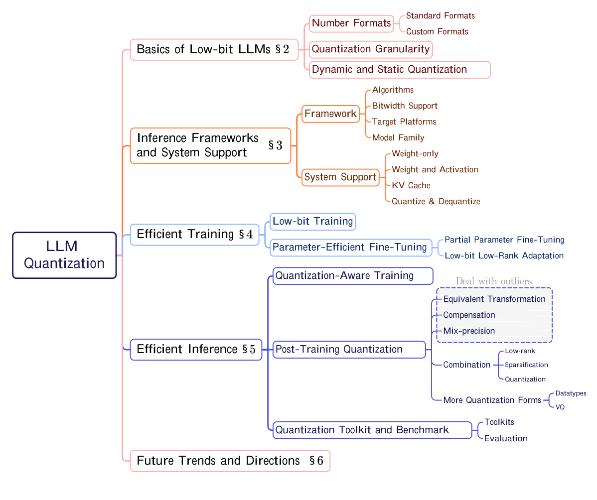{ width="690" }

| 分类轴 | 可选项 | 它实际决定什么 |
| --- | --- | --- |
| Quantization target | Weight / Activation / KV cache / Gradient / Optimizer state | 哪部分容量、带宽或计算得到改变 |
| Number format | INT、FP、NF/SF、binary/ternary、vector codebook | 同样的 bits 能表达哪些近似值 |
| Granularity | Tensor / Token / Channel / Group / Element | 哪些数共享 scale，哪些位置需要独立适应 |
| Parameter timing | Static / Dynamic | 量化参数在准备阶段确定，还是随输入在线计算 |
| Adaptation | PTQ / QAT / Quantized PEFT | 怎样适应量化误差，需要哪些数据与优化成本 |
| Execution | Packed storage、dequantization、low-bit MatMul、mixed kernels | 压缩如何转成真实显存和时间收益 |

例如，一个方案完全可以同时是“PTQ、4-bit weight-only、group-wise、非均匀码本、运行时反量化后用 FP16 计算”。AWQ 与 GPTQ 也不必互斥：前者可以调整进入量化器的权重尺度，后者继续补偿舍入造成的输出误差。认识这种可组合性，比背诵方法名单更有用。[↗](https://arxiv.org/pdf/2409.16694v3#page=17)

## 有限的格点怎样产生误差，又怎样产生额外存储

### 均匀整数把截断与舍入放进同一个操作

综述式 8–9 的仿射量化可以合写为

$$
q=\operatorname{clip}\left(\operatorname{round}(x/s)+z,q_{\min},q_{\max}\right),
\qquad \hat x=s(q-z).
$$

这里 $s>0$ 是 scale，决定相邻两个代表值的间距；$z$ 是整数零点；$q$ 是保存的低比特码；$\hat x$ 是它对应的近似实数。对称方案通常围绕零选范围，非对称方案允许通过零点移动可覆盖区间。两种方案都存在两类损失：区间内的值被舍入到有限格点，区间外的值被截到边界。

这解释了 outlier 为什么会伤害大量普通值。若用最大绝对值确定整个张量的范围，一个很大的数就能拉大 $s$，让密集分布在零附近的普通值失去区分度。缩小范围会改善普通值，却增加异常值的截断误差；异常值可能承载有效信息，不能默认将其删掉。

原文给出从初始 scale 搜索较小候选值、最小化重建误差的做法。关键是优化目标的选择：最小化 $\|X-\hat X\|_p$ 只关心这个张量本身，最小化一层或一个 Transformer block 的输出误差，才进一步考虑这些数对后续计算的影响。后面的 AWQ、GPTQ 和 OmniQuant，分别从不同角度利用了这种区别。[↗](https://arxiv.org/pdf/2409.16694v3#page=12)

### “每个权重 4 bits”通常只是主要编码的成本

把每 $g$ 个权重分为一组，权重编码为 $b$ bits，每组另存一个 $b_s$-bit scale，则忽略其他开销时，平均成本为

$$
b_{\mathrm{eff}}=b+\frac{b_s}{g}.
$$

这是按存储结构作的解释性核算。4-bit、group size 128、16-bit scale 对应 $4+16/128=4.125$ bits/weight；若组缩小到 32，则是 4.5 bits/weight。相对 FP16，仅这两种设置的理想压缩比就分别约为 $16/4.125=3.88$ 倍和 $16/4.5=3.56$ 倍。zero-point、特殊通道、异常值索引、码本和对齐填充还要另算。

因此，细粒度可以提高表示质量，也会消耗更多元数据。这不是量化之外的小修饰，而是同一精度—容量选择的一部分。

### 指数与尾数把相同的位宽用在不同地方

正规浮点数可写成综述式 1 的形式

$$
x=(-1)^{\sigma}2^{p-\mathrm{bias}}
\left(1+\sum_{i=1}^{m}d_i2^{-i}\right).
$$

$\sigma$ 为符号位，$p$ 是编码的指数，bias 将其转换为实际指数，$d_i$ 为尾数位。增加指数 bits 扩展动态范围，增加尾数 bits 细化局部间隔。正规数的这个公式不覆盖 subnormal、零和特殊值的全部编码规则。

下面摘录原文 Table 1 的表示范围。表中的 `Min (normal)` 实际列出最负值，并非“最小正正规数”，阅读时应按数值范围理解。

| Format | Maximum finite value | Most negative value |
| --- | ---: | ---: |
| INT4 | 7 | −8 |
| INT8 | 127 | −128 |
| FP8 E4M3 | 448 | −448 |
| FP8 E5M2 | 57344 | −57344 |
| FP16 E5M10 | 65504 | −65504 |
| BF16 E8M7 | $3.39\times10^{38}$ | $-3.39\times10^{38}$ |
| FP32 E8M23 | $3.40\times10^{38}$ | $-3.40\times10^{38}$ |

E5M2 比 E4M3 有更宽的范围，但尾数更短；BF16 与 FP16 的相似取舍则发生在 16 bits 内。这些是表中具体格式的范围，不能把一个名称下不同特殊值、饱和和舍入规则混为一谈。[↗](https://arxiv.org/pdf/2409.16694v3#page=4)

降低浮点位宽也不只是截掉尾数。数值先按目标格式缩放，检查超出范围与进入 subnormal 区间的情况，再按目标精度舍入；扩大位宽恢复时，仍需正确处理指数编码和尺度。原文式 8–9 的整数反量化同样只是恢复近似值，不能恢复已经舍去的信息。这些转换既有数值语义，也会占用执行时间。[↗](https://arxiv.org/pdf/2409.16694v3#page=11)

## 自定义格式在拟合分布，系统仍要负责把它算出来

NF 和 SF 不是简单地把 INT 的整数格点变密。NF 根据正态分布分位数选择非均匀代表值，让有限编码更多地覆盖常见区域，并处理零的精确表示；SF 则根据更重尾的 Student’s t 分布设计代表值，借助自由度参数改变分布形状。其效果依赖真实张量是否符合设计假设，不能从“信息论最优”的条件性结论跳到所有模型都最优。

它们适合先存一个小编码，再查表恢复浮点值的 weight-only 路线。查表后的乘加仍可用普通浮点硬件，因此不必为 NF/SF 定义一整套原生加法、乘法指令，但需要高效解码。这也解释了为什么更贴合分布的格式可以提高精度，却未必比均匀 INT 更快。[↗](https://arxiv.org/pdf/2409.16694v3#page=4)

综述另外介绍了两类把异常值处理写进编码的方案。Flint 利用 leading-zero 等编码规则，在有限位数内兼顾整数与浮点的范围；Abfloat 为异常值使用扩大范围的表示，普通值仍用 INT4/8 或 Flint4。这类格式会改变基础计算或转换规则，系统配合要求不同于单纯查表。

Microscaling 则把问题从“每个数怎样编码”扩展到“一小块数怎样共享尺度”。例如块内使用 FP8、FP6、FP4 或 INT8，块外共享 E8M0 scale。块中元素不用各自携带完整的大动态范围，但块大小、scale 布局与硬件消费方式必须一致。[↗](https://arxiv.org/pdf/2409.16694v3#page=3)

Binary 与 ternary 走向更少的可取值。二值码在硬件里是 0/1，算法却可能把它解释成 $\{-1,+1\}$ 或 $\{0,1\}$；相应点积的位运算与累加规则也要改变。三值权重的 $\log_2 3\approx1.585$ bits 表示三个状态的信息量，不能直接当作任意存储布局、寄存器和乘法单元的实际位宽。极低表示容量通常需要训练适应或残差补偿，后文的 BitNet 与混合精度路线正是在解决这个问题。[↗](https://arxiv.org/pdf/2409.16694v3#page=13)

## 粒度控制误差共享范围，动态性控制计算发生时间

Figure 2 的关键是 scale 的形状。设激活有 $T$ 个 token、$C$ 个 channel。tensor-wise 只存一个 scale；token-wise 给每行一个；channel-wise 给每列一个；group-wise 在指定轴上局部分组。图中的 group 示例沿 token 轴分组，不代表所有权重量化都沿这个方向。

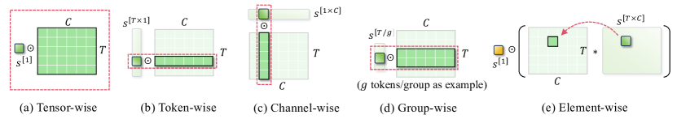{ width="690" }

同一通道跨 token 持续出现大值时，per-channel 可以把它与普通通道分开；不同 token 的整体范围差异明显时，per-token 更直接。element-wise 在图中用于训练阶段调节权重，随后合并进量化权重，不能据此假定部署时为每个激活额外保存一个浮点 scale。[↗](https://arxiv.org/pdf/2409.16694v3#page=5)

粒度还决定 scale 能否移出矩阵乘法的归约。采用行 token 约定 $X\in\mathbb R^{T\times K}$、$W\in\mathbb R^{K\times C}$，若对称量化满足 $X_{ik}\approx s_i^XQ^X_{ik}$、$W_{kj}\approx s_j^WQ^W_{kj}$，则

$$
Y_{ij}\approx s_i^Xs_j^W\sum_k Q^X_{ik}Q^W_{kj}.
$$

因为 scale 不随求和维 $k$ 变化，可以先做低比特点积，再给输出元素乘两个尺度。若沿 $k$ 维分组，每组 scale 不同，就需要分别缩放各组部分和再合并；若零点非零，还要处理相应修正项。因此，“粒度更细”同时改变数值误差和 kernel 工作量。[↗](https://arxiv.org/pdf/2409.16694v3#page=4)

Figure 3 再把离线准备与在线推理分开。看绿色区域：左图动态计算当前输入的激活 scale；中图使用已经校准好的激活参数；右图只量化权重，在推理时反量化权重，再与浮点激活相乘。

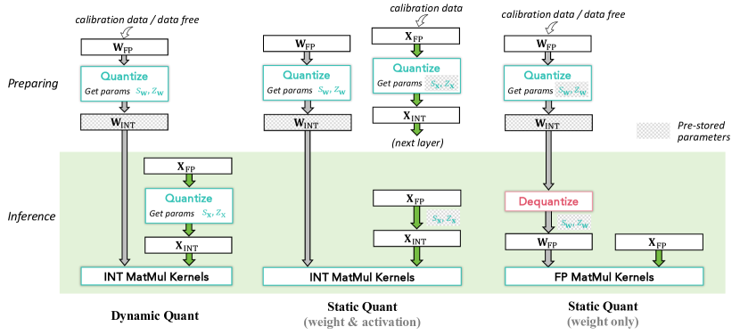{ width="690" }

动态 activation scale 更能跟随输入变化，但引入在线统计和转换；静态参数省去这部分工作，却依赖校准分布的代表性。这里的“动态”不意味着整个方法不需要任何校准数据：权重补偿、旋转或离线缩放仍可能用校准样本优化。反过来，PTQ 中优化少量量化参数，也不自动等于对整个模型进行端到端 QAT。[↗](https://arxiv.org/pdf/2409.16694v3#page=5)

## 压缩从哪个存储层级开始，决定加速发生在哪里

### 权重经过多级存储，低比特不能只停在文件里

Figure 4 沿权重流给出 host memory、GPU global memory、L2、shared memory 与 registers。它解释的是传输层级的差异；对权重常驻显存的模型，每轮 decode 并不需要重新从 CPU 搬运全部权重。

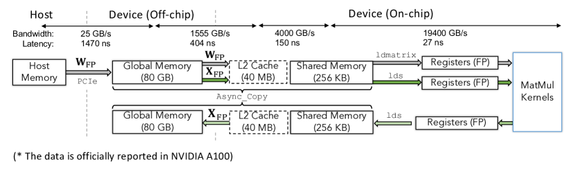{ width="690" }

原图列出的示意数据如下。它们用于解释量级，不是本文重新测量的端到端性能，也不能直接将各层时延相加预测一个请求。

| Data path in Figure 4 | Bandwidth, GB/s | Latency, ns |
| --- | ---: | ---: |
| Host → Device, PCIe | 25 | 1470 |
| Global memory → L2 | 1555 | 404 |
| L2 → Shared memory | 4000 | 150 |
| Shared memory → Registers | 19400 | 27 |

同样一份权重在越慢的通路上保持紧凑，减少 bytes 的潜在价值越大。如果只把磁盘文件压小，加载后立刻恢复一整份高精度常驻权重，就丢掉了许多显存和设备内带宽收益。有效实现通常让权重按紧凑格式进入计算附近，再按 tile 解包，避免长期保存完整高精度副本。[↗](https://arxiv.org/pdf/2409.16694v3#page=8)

### 打包、反量化与低比特计算是三个不同步骤

Figure 5(a) 先准备压缩权重，(b) 用 weight-only 数据流，(c) 同时量化权重和激活。绿色时间线表示节省的环节，深灰色表示新增工作；这些线是机制示意，并未给出各段的实测占比。

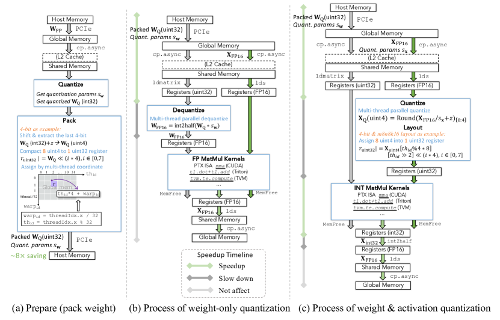{ width="690" }

以 INT4 为例，8 个 4-bit code 可放入一个 uint32。若 $q_i\in[0,15]$，其逻辑打包方式可解释为

$$
u=\bigvee_{i=0}^{7}\left(q_i\ll4i\right),
\qquad q_i=(u\gg4i)\;\&\;15.
$$

这里位移让每个 code 占据不同的 4-bit 区间，按位或把它们拼起来。原文 Algorithm 2 还会根据矩阵布局分配线程与取值顺序；实际 kernel 的排列不能仅由这个简化式决定。

“8 个值变成一个 uint32”相对每值 32-bit 的表示是 8 倍压缩，相对每值 FP16 是 4 倍，且都尚未计算 scale 等元数据。原文 Figure 5 标有约 8 倍存储节省，而 Algorithm 2 的文字又出现“四分之一”的表述；明确比较基线，才能避免把 code 数、矩阵维度和真实字节数混在一起。[↗](https://arxiv.org/pdf/2409.16694v3#page=12)

Weight-only 接着从压缩权重恢复 FP16 等数值，与原本的浮点激活做矩阵乘法。它省的是权重容量与传输时间，未必减少乘加位宽。只要节省的传输时间超过解包、查表和缩放成本，浮点 MatMul 也可以变快。FP6-LLM 专门优化 FP6 的密集存储及向 FP16 的转换；SpQR 的高精度稀疏异常值则需要相应解码与负载分配。

W&A 进一步把输入两侧交给低比特计算指令，但新增 activation quantization，并常在更高精度中累加、再转换输出。W4A4 并不表示全程只用 4 bits。QQQ 所处理的 FP16→INT8、INT4→INT8、INT32→FP16 转换，就是这条链上的实际成本；某个地方省下 bits，另一个地方可能多出转换或布局操作。[↗](https://arxiv.org/pdf/2409.16694v3#page=10)

### 把 kernel 收益与请求收益分开看

综述转述 EETQ 的 GEMV 比 GEMM kernel 快 13%–27%，但这里没有给出足以重建完整比较的模型、矩阵形状与硬件组合。这能说明专用 kernel 值得优化，不能推导整个服务必然快 13%–27%。类似地，支持某个低比特格式，既可能是原生矩阵指令，也可能是专门解码、查表或多个操作组合，必须沿实际实现判断。[↗](https://arxiv.org/pdf/2409.16694v3#page=10)

作为解释性时间核算，若某一操作占原耗时比例 $f$，该操作被加速 $r$ 倍，而新增转换占原耗时比例 $h$，总加速为

$$
S=\frac{1}{(1-f)+f/r+h}.
$$

这不是综述的实验结果，而是说明不能直接套用 kernel 倍数：若 $f=0.6$、$r=2$、$h=0.1$，总加速只有 1.25 倍。prefill、逐 token decode 和大 batch 服务的 $f$ 会不同。应分别测量这些阶段，才能判断 weight-only 的带宽收益或 W&A 的计算收益是否落在目标瓶颈上。

## KV cache 把静态权重问题变成持续写入的问题

权重可以离线压缩一次，KV 却随着请求不断产生。Figure 6 中，新 token 经过 K/V projection，量化并追加进缓存；后续 attention 读取历史 KV，按所需精度计算。Q 是当前查询，不需要像全部历史 K/V 一样永久保留。

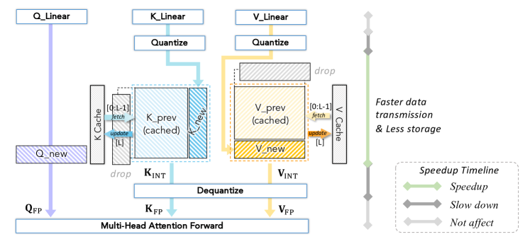{ width="620" }

图中的 drop 是超出容量后丢弃旧缓存的窗口示意。减少每个值的 bits 和删除历史 token 是两种不同的损失机制，KV quantization 本身不要求必须淘汰最早 token。[↗](https://arxiv.org/pdf/2409.16694v3#page=11)

对每层缓存形状一致的普通 attention，可用下面的解释性式子估算主体存储：

$$
M_{KV}\approx2N_{\mathrm{layer}}B L H_{KV}d_{\mathrm{head}}\frac{b}{8}.
$$

其中 2 对应 K 与 V，$B$ 为 batch，$L$ 为已缓存长度，$H_{KV}$ 是 KV 头数，$d_{\mathrm{head}}$ 是每头维度，$b$ 是每值位宽。它忽略元数据、残差、高精度窗口和特殊缓存结构，作用是说明为什么长度与并发会放大这笔账；不能将 KV 的压缩倍数当作整个模型峰值显存的压缩倍数。

综述把实际策略分成几类。QoQ 通过 SmoothAttention 配合 4-bit KV；KIVI 探索 tuning-free 的 2-bit KV。更低位宽提高容量收益，但需要适配 K/V 各自的分布和注意力敏感性。窗口方案则先把近期 KV 留在高精度中，达到窗口条件后再成批量化，减少频繁小操作；SKVQ 也利用窗口确定量化参数。

WKVQuant 的区别在新 token 的计算路径：先让新 K/V 以浮点形式参加当前 attention，再在满足条件时量化存入缓存。这样可以避免刚生成的新值立即经历一次量化—反量化。保留特殊初始 token、重要 token 或敏感通道的高精度，则是另一种误差分配，不与窗口策略等价。[↗](https://arxiv.org/pdf/2409.16694v3#page=10)

因此 KV 方案需要同时报告三个结果：历史容量减少多少，读写和 attention 总时间如何变化，长上下文任务保留多少能力。短文本 perplexity 相近，不能代替跨长距离检索与生成的验证；高精度近期窗口的大小，也必须计入容量比较。

## 训练阶段要分清计算精度、可训练状态与最终部署格式

### FP16 和 FP8 训练首先处理数值范围

综述 Algorithm 3 的 FP16 流程保留 FP32 主权重，生成 FP16 副本做前向与反向；loss 乘以 $S$，反向得到的梯度再除以 $S$，随后更新主权重。这样使小梯度在 FP16 中较不容易下溢，同时避免把每次很小的权重更新直接丢在低精度副本里。

BF16 的指数范围更大，缓解了部分范围问题，但尾数精度较低，不能理解为所有训练状态都不再需要精度管理。FP8 又把范围压得更紧：不同 activation 和 gradient 的尺度不同，用单一 loss scale 处理全部张量通常不够。[↗](https://arxiv.org/pdf/2409.16694v3#page=13)

原文式 13–15 用 FP8 格式的最大可表示值与张量绝对最大值 amax 的比值确定二次幂 scale。这里的 scale 是把数值放入 FP8 范围的乘法因子，与前文反量化步长的约定要区分。每次先遍历完整张量求最大值、再遍历量化，会增加访存，因此 delayed scaling 利用前几次迭代保存的 amax 历史确定当前尺度。它交换的是额外历史状态与对当前范围的近似，细粒度分块则继续缩小共享范围。[↗](https://arxiv.org/pdf/2409.16694v3#page=13)

低比特训练还可能压缩梯度、投影矩阵或优化器状态。Q-GaLore 对梯度子空间使用自适应更新，保存 INT4 投影矩阵与 INT8 权重；Jetfire 讨论 INT8 数据流及块量化；4-bit optimizer 则需要处理二阶矩量化中的零点问题。它们的压缩对象不同，不能只用“INT8 training”推断完整状态的显存。

QST 又是另一类：低比特底座结合独立侧网络、低秩适配等，减少需要保存反向信息的范围。它不等于给所有底座梯度统一换成 INT8。真正的训练内存还包括 activation、梯度、优化器、主权重和临时工作空间，单独减少权重 bits 只能改变其中一项。[↗](https://arxiv.org/pdf/2409.16694v3#page=14)

### QAT 的目标是让模型适应将来的低比特推理

低比特训练关心训练过程本身；QAT 则在训练中体现量化约束，使最终模型在低精度下保持质量。QAT 仍可能用高精度主权重、梯度与优化器，不能因名字里有 quantization 就推断训练更便宜。

原文 Table 4 的五条代表路线如下。`Train. time` 是原文的定性标签，没有统一 GPU-hours 与数据规模，不能把 fast、slow 当作受控计时结果。

| Algorithm | Quantization target | Target bits | Data in Table 4 | Train. time |
| --- | --- | --- | --- | --- |
| LLM-QAT | W-A-KV | 4/8-bit W-A-KV | Data-free | medium |
| BitDistiller | W-only | 2/3-bit W | Alpaca, Evol-Instruct-Code, WikiText-2, MetaMathQA | fast |
| EfficientQAT | W-only | 2/3/4-bit W | RedPajama | fast |
| BitNet | W-A | 1-bit W, 8/16-bit A | Pile, Common Crawl snapshots, RealNews, CC-Stories | slow |
| BitNet b1.58 | W-A | Ternary W, 8/16-bit A | RedPajama | slow |

LLM-QAT 通过教师与量化学生的 logits 对齐提供训练信号，`Data-free` 指不依赖原训练数据，并非不需要样本和计算。BitDistiller 针对极低比特使用自蒸馏与非对称 clipping。EfficientQAT 先逐 block 优化全部相关参数，再在全网络范围只优化量化参数，将局部适应与整体校正分开。BitNet 与 b1.58 则从训练阶段适应二值或三值权重，预算与直接处理一个已有高精度模型的 PTQ 完全不同。[↗](https://arxiv.org/pdf/2409.16694v3#page=16)

## 量化 LoRA 的差异要看到训练后的模型怎样部署

LoRA 冻结大部分底座，只更新低秩矩阵，减少了可训练状态，却仍需保存底座。QLoRA 在这一步再压缩底座。采用前面的行 token 约定，前向为

$$
W_q=Q(W),\qquad
Y=X\operatorname{dequant}(W_q)+XAB,
\quad A\in\mathbb R^{K\times r},\;B\in\mathbb R^{r\times C}.
$$

$W_q$ 固定，优化器只需为可训练的 $A,B$ 保存相应梯度与状态。低比特是底座的存储形式，参与乘法时可以恢复到更高精度；它与更新完整底座的 QAT 不同。一般 LoRA 初始化令一个因子随机、另一个为零，起始更新分支为零；量化底座本身仍存在对原模型的近似误差。[↗](https://arxiv.org/pdf/2409.16694v3#page=14)

Figure 7 的三幅图应同时看冻结底座是什么格式、火焰标出的参数在哪里，以及最终是否能把分支合并。只看都有 $A,B$，会漏掉它们最实际的差别。

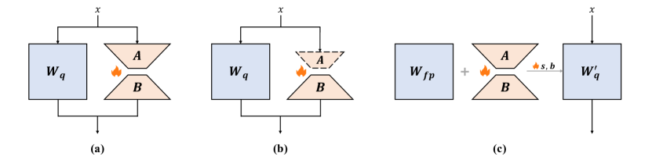{ width="690" }

| Route | Stored base during adaptation | Main updated part | Deployment implication |
| --- | --- | --- | --- |
| QLoRA-like | Quantized $W_q$ | LoRA $A,B$ | 低比特底座加浮点更新，不能默认直接合并成同一低比特格式且无额外误差 |
| QA-LoRA-like | Quantized $W_q$ | 适配分组结构的低秩分支 | 通过结构约束支持合并，部署不必保留独立 adapter 计算 |
| L4Q-like | Full-precision $W_{fp}$ | LoRA 与量化器参数 | 训练中处理合并后量化，可产出直接部署的量化模型；底座存储收益不同 |
| PEQA / OWQ tuning | 量化模型及必要的高精度部分 | Scale / Weak columns | 通过更少的可训练位置进行任务适应 |

QA-LoRA 将低秩分支的输入结构与组量化匹配，涉及分组聚合与较小的 $A$ 输入维度。L4Q 则保留高精度底座，对 $W+AB$ 的量化过程一起优化。两者都考虑最终的量化模型，但训练内存的来源不同，不能拿 QLoRA 的底座压缩收益直接套给 L4Q。[↗](https://arxiv.org/pdf/2409.16694v3#page=15)

LoftQ、LQ-LoRA 进一步处理“初始化时已经存在的量化误差”。用统一维度的说明式表达，其思路是交替寻找

$$
Q_t=Q(W-A_{t-1}B_{t-1}),\qquad
A_tB_t\approx\operatorname{SVD}_r(W-Q_t).
$$

第一步把当前低秩分支能承担的部分从 $W$ 中减去，再量化剩余部分；第二步对量化残差求秩 $r$ 近似。这里写的是相同信息流下的记号整理，原文不同方法对因子转置和目标还有具体约定。LQ-LoRA 还考虑用 Fisher 信息加权，让重要参数的重建误差受到更大惩罚。随后为新任务训练 adapter，又是另一种优化目的：补底座量化误差与学习下游任务可以先后发生，不能视为同一个目标。[↗](https://arxiv.org/pdf/2409.16694v3#page=15)

## PTQ 先改变进入量化器的分布

### 等价变换保留浮点函数，再改变量化后的近似

Figure 8 将 PTQ 分为等价变换、误差补偿、混合精度和组合方法。看这些分支各自修改的对象：变换修改坐标或尺度，补偿修改尚未量化的权重，混合精度修改精度分配，低秩或码本修改表示结构。它们可以在一个模型中连续出现。

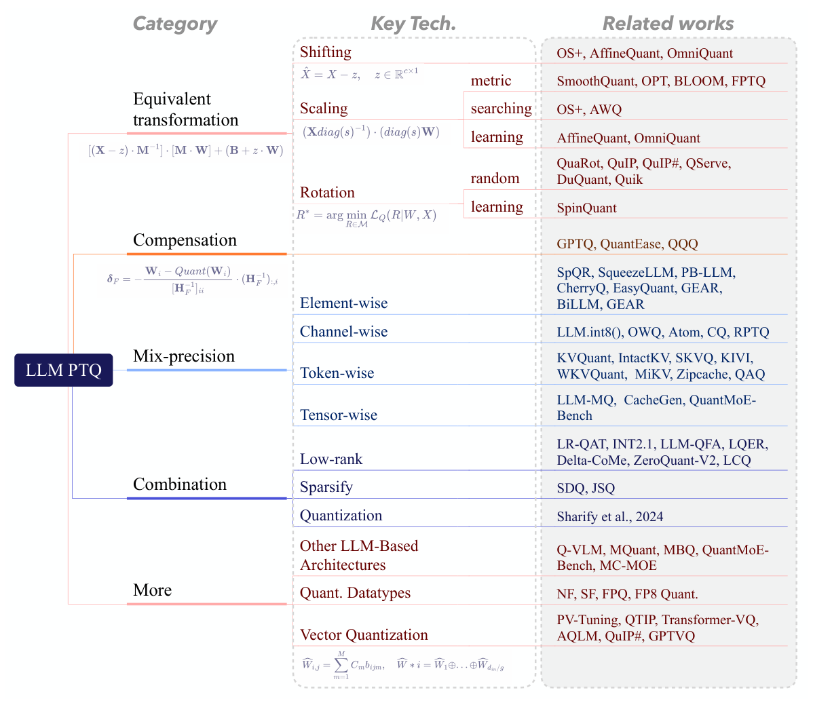{ width="690" }

综述式 20 用一个恒等式概括主要变换：

$$
Y=XW+B
=\big[(X-\Delta)M^{-1}\big]\big[MW\big]+(B+\Delta W).
$$

$\Delta$ 是按通道广播的平移，$M$ 是可逆变换。展开右侧得到 $(X-\Delta)W+B+\Delta W=XW+B$，所以浮点精确运算下输出不变。变化发生在随后分别量化两个乘数时：不同坐标或尺度会使同一个低比特格点覆盖不同的误差分布。

等价性也不是任意移动操作的许可证。平移或旋转一般不能直接穿过 Swish、softmax、RoPE 或非线性归一化；能否吸收进前后权重，取决于具体网络位置。这决定了数值上的改进是否带来在线代价。[↗](https://arxiv.org/pdf/2409.16694v3#page=16)

### 平移解决通道中心不同，不能消除通道内的宽范围

OS+ 取每个通道范围的中点

$$
\Delta_j=\frac{\max(X_{:,j})+\min(X_{:,j})}{2},
\qquad \hat X=X-\Delta.
$$

原来中心偏正、偏负的通道被移向零，使整个 tensor 不必同时覆盖两端的偏移。单个通道的最大值减最小值却没有改变，因此它首先改善的是通道间中心不同导致的整体范围膨胀，不能单靠平移消除某通道内部的大异常值。[↗](https://arxiv.org/pdf/2409.16694v3#page=17)

Figure 9 要注意两类平移的位置。$\Delta_1$ 可合并到 LayerNorm 的 $\beta$ 与相邻权重、bias 中；value 与 output projection 之间的 $\Delta_2$ 则保留在线操作，图注明确指出它可能增加计算。原文随后“平移没有额外开销”的概括，不能覆盖图中这个例外。

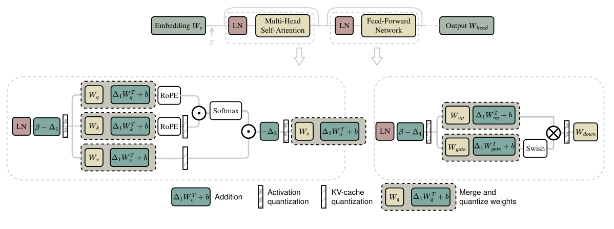{ width="690" }

OmniQuant 不只按极值手工决定平移，而是最小化量化前后 Transformer block 的输出差异，学习 shift 与 scale。这个优化会看到同一 block 内误差的组合，比只拟合单个 activation 的范围更接近最终作用，但需要校准数据与局部优化成本；它也不意味着重新训练整个模型。[↗](https://arxiv.org/pdf/2409.16694v3#page=17)

### 缩放把一侧的量化困难转移给另一侧

SmoothQuant 将 $M$ 取为对角矩阵：

$$
XW=\big(X\operatorname{diag}(\Phi)^{-1}\big)
\big(\operatorname{diag}(\Phi)W\big),
\qquad
\Phi_j=\frac{\max|X_j|^{\alpha}}{\max|W_j|^{1-\alpha}}.
$$

一个 activation 通道被除以较大的 $\Phi_j$ 后，其范围缩小；对应权重通道则乘以同样的因子以保持乘积。$\alpha$ 控制向权重转移多少困难。原文举出 $\alpha=0.5$ 对 OPT、BLOOM 的平衡设置，不应推广成所有模型与位宽的固定最优值。[↗](https://arxiv.org/pdf/2409.16694v3#page=18)

Figure 10 将可合并位置画在 LayerNorm 的 $\gamma$ 及线性权重上。它与 Figure 9 对比的意义是，具体变换不仅影响异常值，还影响哪些操作可以在部署前消掉。

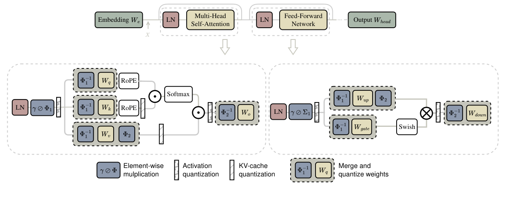

AWQ 也用 activation 信息，但侧重 weight-only。它观察哪些通道对输出更重要，用 activation 的平均幅值构造缩放候选，再搜索一个控制强度的参数，选择量化后输出误差较小的设置。对重要通道放大权重，相当于让其量化后再缩回时拥有更细的有效误差；保护重要权重不必一律通过保留 FP16 来实现。

OS+ 的搜索则可以缩成对异常范围阈值 $t$ 的网格搜索；OmniQuant 学习对角 scale；AffineQuant 把可学习范围扩到一般可逆矩阵。搜索空间更大可能提供更多适应能力，也增加校准优化和可部署性的要求。它们都使用等价关系，但不是同一个损失、同一个搜索变量或同一个系统成本。[↗](https://arxiv.org/pdf/2409.16694v3#page=19)

### 旋转分散异常方向，在线变换仍然需要付费

对正交 $R$，$RR^\top=I$，所以

$$
XW=(XR)(R^\top W).
$$

若异常值集中在少数坐标方向，旋转可以把能量分散到更多坐标，使单个坐标不再支配量化范围。QuIP 还关注权重与 Hessian 敏感方向是否过度对齐坐标轴，即 incoherence 的问题；QuIP# 使用可快速计算的 Hadamard 变换，并配合适合相应分布的码本。Hadamard 的 $O(n\log n)$ 加法复杂度降低了在线变换成本，却没有让它变成零成本。

QuaRot 把旋转用于 W、A 与 KV；SpinQuant 则发现不同随机旋转会造成明显质量差异，学习正交约束下的旋转矩阵，而不是固定一次随机选择。原文的目标为

$$
R^*=\arg\min_{R\in\mathcal M}\mathcal L_Q(R\mid W,X),
$$

$\mathcal M$ 是满足正交约束的矩阵集合，$\mathcal L_Q$ 是量化网络的任务损失；Cayley SGD 用于在这样的约束下优化。这说明“随机旋转能改善分布”与“这次旋转最适合量化后的模型”是两回事。[↗](https://arxiv.org/pdf/2409.16694v3#page=19)

Figure 11 中先看灰色融合框，再看框外的 $R_3,R_4$。$R_1,R_2$ 可以进入权重，$R_3,R_4$ 通常仍作为在线 Hadamard；涉及分头和 attention 的等价性，还要按具体结构处理。

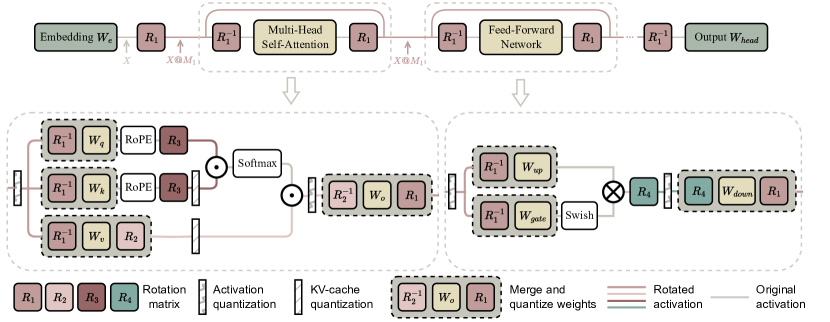{ width="690" }

QServe 组合缩放与旋转，并在在线旋转不划算的位置使用缩放替代。由此可见，算法选型不只是追求分布最平滑，还要考虑变换在实际网络里能合并多少、剩下多少在线工作。[↗](https://arxiv.org/pdf/2409.16694v3#page=20)

## GPTQ 用输出敏感性决定怎样补偿已经发生的舍入

单独将每个权重舍入到最近格点，优化的是权重自身误差。相邻输入通道可能高度相关，同样大小的权重误差对层输出的影响并不相同；一个尚未量化的权重变化，还可能补偿另一个权重的舍入损失。

为解释综述式 33，下面切换到 GPTQ 的常见列样本约定：$X\in\mathbb R^{K\times N}$，每列是校准样本；一个输出通道的权重写成列向量 $w\in\mathbb R^K$，输出为 $w^\top X$。它与前面 $X\in\mathbb R^{T\times K}$ 的行 token 约定互为转置，不能直接混用。对权重扰动 $\delta$，局部输出误差为

$$
\|\delta^\top X\|_2^2
=\delta^\top XX^\top\delta
=\frac12\delta^\top H\delta,
\qquad H=2XX^\top.
$$

这个 $H$ 是校准激活下线性层重建目标的 Hessian，不是整个 LLM 所有参数的任务损失 Hessian。若选定第 $i$ 个权重必须变成 $Q(w_i)$，就施加约束 $\delta_i=Q(w_i)-w_i$。对仍可调整的集合 $R$ 求这个二次问题，得到综述的补偿形式

$$
\delta_R=-\frac{w_i-Q(w_i)}{[H_R^{-1}]_{ii}}
(H_R^{-1})_{:,i}.
$$

这也提供一个检查符号的方法：取向量的第 $i$ 项，分母与分子中的对角项约掉，恰好得到 $Q(w_i)-w_i$，使当前权重落到目标格点；其他分量则沿逆 Hessian 给出的相关方向调整。仅按当前权重大小衡量重要性，无法表达这些输入相关性。[↗](https://arxiv.org/pdf/2409.16694v3#page=20)

实际 GPTQ 为了扩展到大模型，采用逐列处理与批量更新等计算安排。综述式 32 同时回顾了二阶方法按误差代价选择权重的思想，不应把它直接写成实际 GPTQ 每次都在全模型贪心搜索下一枚权重。

等价变换与补偿因此具有明确分工：先通过缩放或旋转改善待量化数据，再用校准激活下的补偿减小剩余输出误差。QuantEase 用 coordinate descent 进一步求补偿，QQQ 将相关变换与 GPTQ 结合。组合是否有效仍取决于共同的校准数据、数值稳定性与最终 kernel；组合名称本身不保证质量或速度相加。[↗](https://arxiv.org/pdf/2409.16694v3#page=21)

## 不均匀分配 bits，比统一降低每个值更灵活

混合精度保存不同位置的不同精度。这里的“重要”也有多种定义：幅值、Hessian 敏感性、位置、任务作用或访问模式，不一定得到相同集合。

| Precision allocation | Representative route | What stays more precise | Additional cost to account for |
| --- | --- | --- | --- |
| Element-wise | SpQR、SqueezeLLM、PB-LLM | 敏感或异常权重 | 稀疏索引、额外高精度值、解码与不规则访存 |
| Channel-wise | LLM.int8()、OWQ、Atom | 异常或 weak channels | 分路计算、重排、合并输出 |
| Token-wise KV | IntactKV、KIVI、SKVQ、QAQ | 初始、近期或按指标选择的 token | 高精度窗口、token 元数据与动态管理 |
| Layer / Tensor-wise | LLM-MQ、CacheGen | 敏感层或缓存块 | 多种格式、不同 kernel 与整体预算分配 |
| Expert-wise | QuantMoE-Bench、MC-MOE | 不同重要程度的 experts | 路由和专家结构下的精度及负载差异 |

SpQR 把少量敏感元素存为高精度稀疏部分；LLM.int8() 则按异常通道拆开权重与激活。OWQ 的 weak columns 由敏感度选择，还可以作为任务适应时更新的子集。RPTQ 将范围相近的通道重排到一起；Atom 的激活动态重排与权重静态重排要保持对应关系，否则矩阵乘法本身就被改变。[↗](https://arxiv.org/pdf/2409.16694v3#page=20)

极低比特方案尤其需要看尾部成本。综述指出 PB-LLM 仍为约 10%–30% 的 salient weights 保留高精度；因此“其余权重二值化”不等于整个模型每权重只占 1 bit。BiLLM 的代表值约 1.08 bits，则来自它的残差近似与分组方案；两者需要连同质量、索引和实现一起读，不能仅凭标称位宽比较。[↗](https://arxiv.org/pdf/2409.16694v3#page=20)

KV 的 token-wise 分配也不能只按年龄处理。近期值值得保留高精度，初始或特殊 token 却可能因 attention 中的作用而同样敏感。CacheGen 又讨论早层 KV 更敏感的情况。时间位置、层位置和语义作用是不同维度，统一一个规则可能只适合特定模型与任务。[↗](https://arxiv.org/pdf/2409.16694v3#page=21)

### 低秩补偿与稀疏化有不同的误差接口

低秩补偿将量化后的残差再用一个小矩阵近似。LQER、ZeroQuant-V2 等围绕量化误差构造低秩项，LQER 还利用激活诱导的缩放引导分解。它与前面的 LoRA 共享低秩工具，却可能只以恢复原模型输出为目标，而非学习一个新任务。若最终保留额外低秩计算，容量节省需要与这条分支的延迟一起核算。

稀疏化删除权重，量化降低剩余权重的精度，两者并不天然独立。按幅值保留大的权重可能帮助稀疏模型，却让剩余权重或输出的范围更宽，增加低比特量化难度。综述中的 SDQ 先按允许的质量损失稀疏化，例如以 perplexity 增加约 1% 作为某种停止条件，再进行混合精度量化；这个 1% 是流程中的阈值例子，不是所有任务的质量保证。

JSQ 则把保留重要信息与量化友好的 activation range 同时纳入稀疏性度量。它要解决的具体冲突是，删除“对浮点网络不那么重要”的值，并不一定最有利于随后量化的网络。这类联合目标比把两种压缩率直接相乘更贴近实际误差来源。[↗](https://arxiv.org/pdf/2409.16694v3#page=21)

## 码本量化改变“一个 code 代表什么”

均匀标量量化让一个 code 对应一个标量值。向量量化让一个 code 选择一组权重的代表向量，利用这些维度之间的结构；加性量化又允许多个码本的向量相加。

将综述式 35 的维度写明确，设每组包含 $g$ 个输入维度，每个码本 $C_m\in\mathbb R^{g\times2^B}$ 含 $2^B$ 个候选向量，$d_{ijm}\in\{0,1\}^{2^B}$ 为 one-hot 选择，则输出通道 $i$、输入分组 $j$ 的权重近似为

$$
\hat W_{i,j}=\sum_{m=1}^{M}C_m d_{ijm}.
$$

所有分组再按输入维度拼起来。one-hot 是公式记号，实际不需要为每组选中项存一整个 one-hot 向量，只需存每个码本的 $B$-bit 索引。忽略码本等开销时，每个标量分摊 $MB/g$ bits；码本自身的存储、scale 与布局仍要加入。码本可以被大量权重组共享，因此分组大小、码本规模与共享范围共同决定真实压缩率。[↗](https://arxiv.org/pdf/2409.16694v3#page=22)

AQLM 联合优化加性码本及 block 中的相关参数，利用输入信息衡量近似效果。QuIP# 将旋转后的分布与 E8 lattice codebook 结合；GPTVQ 在量化若干列后，利用二阶信息更新剩余权重。PV-Tuning 则交替处理连续参数与离散分配，避免把离散 code 的优化简单视为普通连续权重更新。QTIP 使用有状态解码，把有效维度、码率与码本大小之间的关系进一步分开。

这些方案追求的是相同平均 bits 下更强的表示能力。代价可能是查表、状态解码、码本读取或专用 MatMul。若后端最终先恢复完整权重再做普通计算，压缩文件很小也不自动带来吞吐优势；专用实现能否直接消费紧凑表示，是选型的一部分。

### 多模态与 MoE 需要重新定义敏感位置

视觉 token 与语言 token 的分布和任务作用不同，统一 activation scale 可能把一类模态的异常范围施加到另一类上。MQuant 分别设置视觉与语言量化参数；MBQ 通过模态敏感度影响重建目标；Q-VLM 考虑跨层依赖。这些做法都在改变“哪些误差值得优先控制”，不能把 dense text LLM 的最佳参数无条件移植过去。

MoE 又把参数分成不同专家，并通过路由决定每个 token 使用哪些部分。QuantMoE-Bench 讨论 block、expert、linear layer 的结构相关位宽；MC-MOE 将位宽分配写成优化问题。专家参数总量、实际激活量与各专家敏感性并不相同，所以容量最省的分配未必对应最好的质量或运行时行为。[↗](https://arxiv.org/pdf/2409.16694v3#page=22)

## 数值案例与框架表应怎样用于真实选型

综述中一些数字说明路线可行，但承担的证据作用不同。下面把它们的指标和比较范围放在一起，而不做方法排名。

| Representative report in the survey | Stated quantity | What the number supports |
| --- | --- | --- |
| QLoRA | Fine-tune 65B on one 48GB GPU | 冻结量化底座配合低秩更新，可以显著降低适配所需内存 |
| Q-GaLore | Train Llama-7B from scratch on one 16GB GPU | 权重、投影与梯度子空间策略可以扩展可容纳训练规模 |
| LR-QAT | 7B on one 24GB consumer GPU | 低秩更新可降低量化适应的训练状态成本 |
| PB-LLM | 10%–30% salient weights at higher precision | 标称二值部分之外仍有显著精度预算 |
| BiLLM | About 1.08 bits for weights | 极低平均位宽需要残差近似与分组等额外设计 |
| EETQ | GEMV kernel 13%–27% faster than GEMM | 专用计算实现可以改变量化后的局部效率 |

这些是综述转述的代表实例，训练目的、模型、序列长度、优化预算和 kernel 协议不同。65B/48GB 不表示任意 batch 与上下文都能微调，7B/16GB 也不表示训练吞吐已适合任意生产任务。它们最直接证明的是某种资源约束下的可行性，不能相互换算为“谁更省”或“谁更快”。[↗](https://arxiv.org/pdf/2409.16694v3#page=14) [↗](https://arxiv.org/pdf/2409.16694v3#page=21)

原文 Table 2 的框架信息则用来缩小实现候选。以下选择几行保留关键区别，均为综述版本中的支持描述；同一行的格式、模型与设备不能任意做笛卡尔积。

| Framework | Representative algorithms | Selected weight / compute formats | Selected KV formats |
| --- | --- | --- | --- |
| TensorRT-LLM | AWQ, GPTQ, SmoothQuant | INT4/INT8 weight-only; FP8, INT8 W&A; WINT4–AFP8 | FP16, FP8, INT8 |
| vLLM | AQLM, AWQ, GPTQ, SmoothQuant, SqueezeLLM | INT4/INT8/FP6 weight-only; FP8/INT8 W&A | FP16, FP8 |
| LMDeploy | AWQ, GPTQ | INT4 weight-only; INT8 W&A | INT4, INT8 |
| QServe | QoQ | WINT4–AINT8, WINT8–AINT8 | FP16, INT8, INT4 |
| MLC-LLM | Table does not specify one algorithm | INT3/INT4/INT8 weight-only; FP8 W&A | FP16 |
| llama.cpp | AWQ in the survey table | INT2/INT3/INT4/INT5/INT6/INT8 weight-only | FP16 in the survey table |

例如框架同时支持某 GPU 与某量化算法，不保证该算法在这块 GPU 的目标矩阵形状上有快速 kernel；同样，能导入 dense LLM 也不保证多模态或 MoE 的全部算子都覆盖。原文专门提醒了这种支持范围的交叉限制。部署前应确认具体版本、格式、粒度、模型结构和后端的共同支持，表格本身不能代替兼容性验证。[↗](https://arxiv.org/pdf/2409.16694v3#page=6) [↗](https://arxiv.org/pdf/2409.16694v3#page=8)

生成量化模型的 toolkit 与运行模型的 serving framework 也要区分。原文 Table 5 的五个例子分别偏向算法比较、评估覆盖或后端对接：

| Toolkit | Main role visible in Table 5 | Evaluation / Backend |
| --- | --- | --- |
| LMQuant | AWQ、GPTQ、QuaRot、SmoothQuant、QoQ 等配方 | Perplexity、Throughput / QServe |
| LLMC | 多种 PTQ 方法及组合，连接多个部署后端 | Perplexity、OpenCompass、lm-evaluation-harness / TensorRT-LLM、vLLM、MLC 等 |
| MI-optimize | 多算法比较与模型压缩 | BOSS、Perplexity、lm-evaluation-harness / Transformers |
| QLLM-Eval | 跨任务、长上下文、对话等质量评价 | LongEval、Lost-in-the-middle、MT-Bench 等 / Transformers |
| LLM Compressor | GPTQ、SmoothQuant、FP8 等生成流程 | vLLM |

这里有三类成本和效果需要分别比较。**Production efficiency** 是校准或训练一个量化模型要花多少时间与资源；**Inference efficiency** 是目标部署能容纳什么负载、得到多少吞吐和延迟；**Generation quality** 才是 perplexity、任务准确率、对话、长上下文、鲁棒性等。昂贵的离线优化换来更低输出误差，是一种有成本的选择；只报告量化后的请求速度会遮住这部分代价。[↗](https://arxiv.org/pdf/2409.16694v3#page=23)

## 把路线选择落到自己的瓶颈上

| Current bottleneck | Routes worth testing first | Decisive measurement |
| --- | --- | --- |
| 权重放不下，或小 batch decode 被权重传输限制 | 紧凑 weight-only，匹配模型的解包与 GEMV kernel | 峰值显存、实际 bytes、每 token 延迟及反量化开销 |
| Prefill 或较大 batch 的矩阵计算占主导 | 有有效硬件实现的 W&A / FP8 等 | 同形状、同质量条件下的 prefill 与吞吐，含在线转换 |
| 长上下文或并发使 KV 成为主要内存 | KV 量化、近期窗口、按层或 token 分配精度 | 实际最大长度/并发、读写时间、长文本能力退化 |
| 微调受底座和优化器状态限制 | 量化 PEFT、部分参数更新 | 总训练峰值内存、训练速度、任务质量与合并产物 |
| 极低位宽下普通 PTQ 质量不足 | QAT、蒸馏、补偿、混合精度、码本 | 额外校准/训练预算、敏感任务保留程度与可部署格式 |

一项有效比较应固定模型和任务，写清输入/输出长度、batch、硬件与后端；使用同条件高精度基线，分别观察 prefill、decode、峰值显存和目标任务质量。分组 scale、异常值、高精度窗口和低秩分支，都应计入最终资源账。

综述最后讨论异常值成因、语义相关的 KV 压缩、跨层精度分配、新模型结构与更低比特硬件。它们共同指向一个尚未结束的问题：哪些信息可以用更少的 bits 保留，哪些误差需要模型适应，哪些表示能被硬件高效消费。已有方法给出的价值，是把这些问题拆成可以组合、测量和取舍的具体环节。[↗](https://arxiv.org/pdf/2409.16694v3#page=24)
