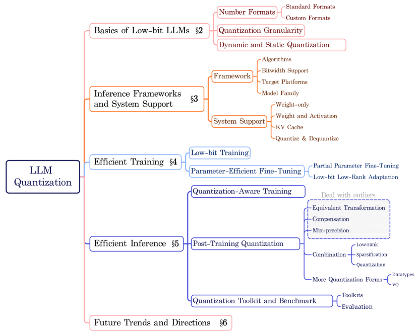
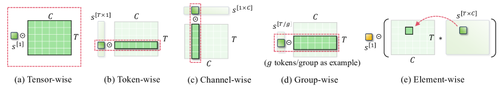
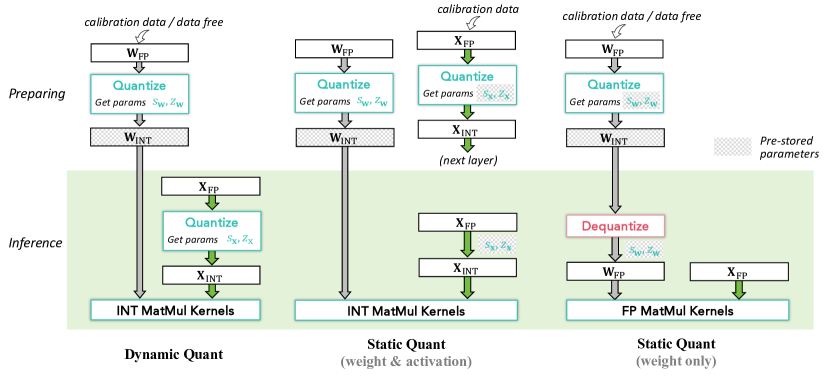
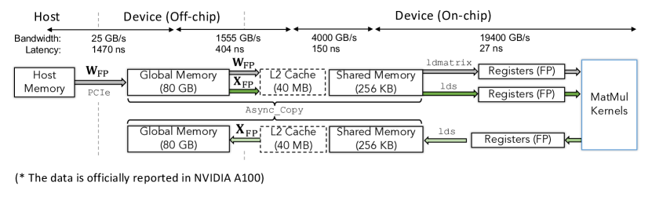
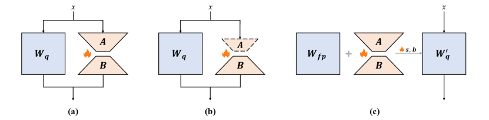
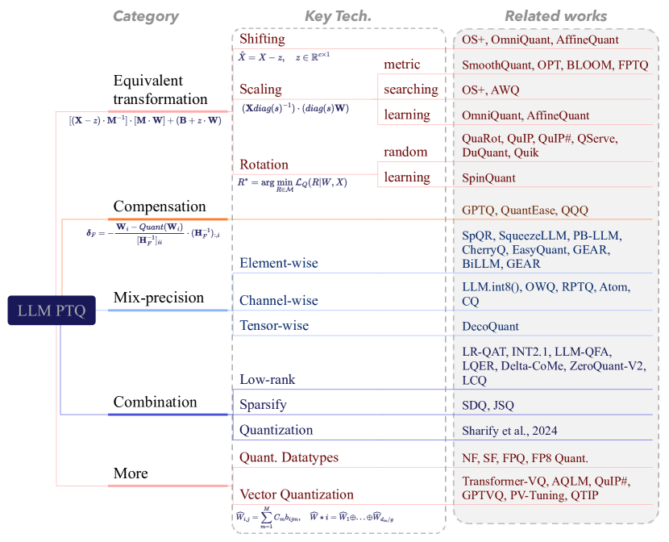
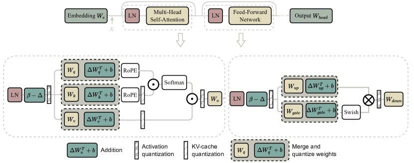
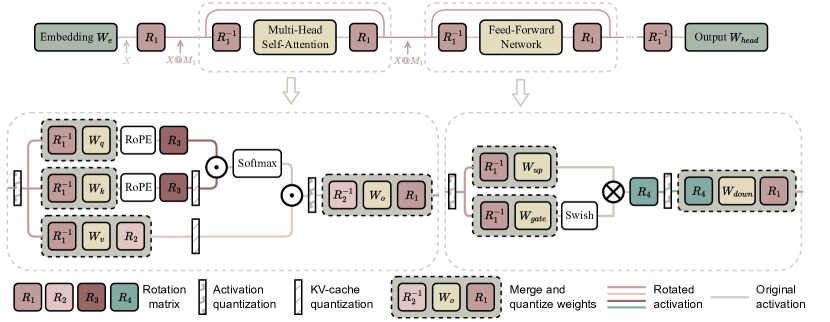

# Low-bit LLM Survey：低比特大模型从格式到推理系统

!!! info "论文信息"
    - 论文：`A Survey of Low-bit Large Language Models: Basics, Systems, and Algorithms`
    - 链接：[arXiv:2409.16694](https://arxiv.org/abs/2409.16694)
    - 版本：2024-09-25 首版，2025-11-12 修订为 v3
    - 关键词：LLM quantization、low-bit inference、low-bit training、FP8、INT4、KV cache quantization、PTQ、QAT、QLoRA

这篇综述的价值不是提出一个新算法，而是把低比特 LLM 拆成了三层：**基础格式、系统实现、训练与推理算法**。读它时不要只问“INT4 / FP8 哪个更好”，而要问一个更工程的问题：量化到底省的是权重、激活、KV cache、带宽、通信，还是训练 optimizer state？

## 它的效率贡献是什么

| 维度 | 贡献 |
| --- | --- |
| 节省的成本 | 权重显存、activation/KV cache 显存、host-device / global-memory / shared-memory 数据搬运、部分低比特 MatMul 计算成本 |
| 核心机制 | 用低比特格式、细粒度 scale、动态/静态校准、packing、dequant fusion、KV cache quantization 和 PTQ/QAT 误差修正共同兑现收益 |
| 对推理主线的意义 | 说明量化不是 checkpoint 变小，而是必须落到 runtime、kernel、cache、Q/DQ 路径和硬件指令上 |
| 对训练主线的意义 | FP16/FP8/INT8 训练要分别处理 loss scaling、per-tensor scaling、delayed scaling、gradient/optimizer state 和 PEFT 适配 |
| 主要风险 | 算法表面支持低比特，不代表目标硬件真的有低比特 kernel；dequant、scale 读取和格式转换可能吃掉节省的时间 |
| 应接到本站哪里 | [推理系统路线图](../../inference/index.md)、[FP8 与混合精度推理](../../quantization/fp8-and-mixed-precision-serving.md)、[QAT、Kernel 与 KV Cache](../../quantization/qat-kernels-and-kv-cache.md) |

## 证据等级与外推边界

这篇是 survey，不是 benchmark 论文。它能给出分类框架、系统账本和代表性方法谱系，但不能直接证明某个量化方案在你的模型、硬件和业务流量上最好。

| 论文结论 | 证据来源 | 证据等级 | 可外推到高效推理 | 不能直接外推 |
| --- | --- | --- | --- | --- |
| 低比特 LLM 要同时看格式、粒度、动态/静态策略 | Section 2 的概念整理和 Table 1 | Survey taxonomy | 选型时先确定数据格式、scale 粒度和校准方式 | 不能仅凭 bit 数预测质量 |
| 量化能否加速取决于数据传输和 kernel 支持 | Section 3 的系统图与框架表 | System analysis | 需要检查 packing、Q/DQ、低比特 MatMul、KV cache 路径 | 不能假设权重变小就端到端更快 |
| FP8/INT8 训练要有额外稳定性机制 | Section 4 的训练策略综述 | Training recipe survey | 训练低比特时要单独设计 scaling、gradient 和 optimizer state | 不能证明所有模型都能低比特预训练 |
| PTQ 是当前更常见的部署路径 | Section 5 对 PTQ/QAT 的分类 | Algorithm taxonomy | 现成模型优先从 PTQ、校准和 runtime 支持入手 | 不能说明 PTQ 在极低 bit 下总优于 QAT |
| KV cache 压缩是长上下文重点方向 | Section 3/6 对 KV cache 的讨论 | System trend | 长上下文服务要单独计算 KV cache 的显存和带宽成本 | 不能只用困惑度判断多轮/长程任务质量 |

## 论文位置

低比特 LLM 不是一个单点优化，而是一条部署链：

```text
number format
  -> quantization granularity
  -> calibration / dynamic scaling
  -> packed storage
  -> low-bit or dequantized MatMul
  -> KV cache and activation policy
  -> runtime / hardware support
  -> quality regression and fallback
```

论文 Figure 1 很适合作为全篇地图：Section 2 讲基础，Section 3 讲系统和框架，Section 4 讲训练，Section 5 讲推理算法，最后再讨论未来方向。

{ width="820" }

<small>图源：`A Survey of Low-bit Large Language Models`，Figure 1。原论文图意：低比特 LLM 被拆成 basics、inference frameworks、efficient training、efficient inference 和 future trends。</small>

!!! note "这张图怎么读"
    图里最关键的是分层，而不是方法名数量。`Number Formats` 和 `Granularity` 决定误差形态；`Framework / System Support` 决定速度是否兑现；`Low-bit Training / PEFT` 决定训练显存和稳定性；`QAT / PTQ` 决定现成模型如何低成本部署。

## 基础层：低比特不是只有 INT4

量化的基本形式可以写成：

\[
X_{\mathrm{INT}_k}=\operatorname{clamp}\left(\operatorname{round}\left(\frac{X_{\mathrm{FP}}}{s}\right)+z,q^{\min},q^{\max}\right)
\]

反量化则是：

\[
\hat X=s\left(X_{\mathrm{INT}_k}-z\right)
\]

这里的 \(s\) 是 scale，\(z\) 是 zero point。工程上真正难的不是这两行公式，而是：scale 按多粗粒度算、是否需要校准数据、scale 存在哪里、什么时候 dequant、目标硬件有没有对应低比特指令。

### 数值格式：bit 数相同，动态范围可以完全不同

论文 Table 1 的重点是：同样是低比特，整数和浮点的误差形态不同；同样是 FP8，E4M3 和 E5M2 的动态范围也不同。

| Format | Max (normal) | Min (normal) |
| --- | ---: | ---: |
| INT4 | 7 | -8 |
| INT8 | 127 | -128 |
| FP8 (E4M3) | 448 | -448 |
| FP8 (E5M2) | 57344 | -57344 |
| FP16 (E5M10) | 65504 | -65504 |
| BF16 (E8M7) | 3.39e38 | -3.39e38 |
| FP32 (E8M23) | 3.40e38 | -3.40e38 |

<small>表源：`A Survey of Low-bit Large Language Models`，Table 1。表格保留原论文英文列名，用来说明不同 number formats 的 normal range。</small>

读这张表时要抓住两个点：

1. **整数格式**通常便于硬件高效计算，但对离群值和长尾分布不友好；
2. **低比特浮点格式**用指数换动态范围，适合处理 activation / gradient 的大范围变化，但 mantissa 少会带来更粗的有效精度。

论文还提到几类面向 LLM 分布定制的格式：`NF` 用正态分布分位数做 weight-only quantization；`Micro Scaling FP` 给小块 tensor 配共享 scale；`Flint` 把整数和浮点思想结合；`Abfloat` 主要服务 outlier；`Student Float` 假设参数更接近 Student-t 分布。它们共同说明一个事实：LLM 的低比特格式通常要服务 heavy-tail 和 outlier，而不是只追求更小 bit。

### 量化粒度：scale 越细，误差越小，元数据和计算越贵

{ width="840" }

<small>图源：`A Survey of Low-bit Large Language Models`，Figure 2。原论文图意：展示 tensor-wise、token-wise、channel-wise、group-wise 和 element-wise 五类 quantization granularity。</small>

| Granularity | 典型作用 | 工程取舍 |
| --- | --- | --- |
| Tensor-wise | 整个 tensor 一个 scale | 最省元数据，误差最大，适合不敏感路径 |
| Token-wise | 每个 token 一个 activation scale | 适合生成模型的动态 activation，但推理时要实时计算 |
| Channel-wise | 每个 weight channel 一个 scale | 常和 token-wise activation 配合，质量/成本比较均衡 |
| Group-wise | 每组 token 或 channel 一个 scale | GPTQ/AWQ 类权重量化常用，平衡 scale 元数据和误差 |
| Element-wise | 训练时可用更细 scale | 推理前通常要合并进 weight，否则元数据和计算太重 |

!!! note "为什么粒度会影响推理速度"
    细粒度 scale 不只是精度问题，也会改变 kernel 读数据的方式。group-wise 或 channel-wise scale 如果不能和 dequant / GEMM 融合，就会增加额外 global memory 读取和寄存器压力。量化方案是否快，往往取决于这些 scale 是否能被布局、packing 和 kernel 一起消化。

### 动态和静态量化：一个省准备成本，一个省在线成本

{ width="840" }

<small>图源：`A Survey of Low-bit Large Language Models`，Figure 3。原论文图意：比较 dynamic quant、static weight & activation quant 和 static weight-only quant 的准备阶段与推理阶段。</small>

动态量化在推理时根据当前 batch 计算 activation scale，部署准备简单，对输入分布变化更灵活，但会增加在线计算。静态量化用校准数据提前固定 scale，推理更快，但校准集必须覆盖真实流量。weight-only quantization 则更保守：权重低比特存储，推理时常把权重 dequant 到浮点，再和 FP activation 做 MatMul。

这三种策略没有绝对胜负。短上下文、小 batch、频繁冷启动时，Q/DQ 开销可能盖过收益；长上下文、高并发、权重或 KV 带宽受限时，低比特收益会更明显。

## 系统层：为什么“量了”不等于“快了”

论文第 3 节最值得放进高效推理专题，因为它把量化收益拉回到数据流。一个线性层推理不是抽象的 \(Y=XW\)，而是一串数据搬运：

```text
host memory / model storage
  -> device global memory
  -> L2 cache
  -> shared memory
  -> registers
  -> MatMul / dequant / accumulation
  -> write back
```

{ width="860" }

<small>图源：`A Survey of Low-bit Large Language Models`，Figure 4。原论文图意：以 NVIDIA A100 为例展示 weight 和 activation 在 host、global memory、L2、shared memory、registers 与 MatMul kernel 之间的数据传输。</small>

!!! note "这张图支撑什么判断"
    量化收益最容易发生在慢链路：模型从 host / storage 到 device、global memory 到 on-chip cache、KV cache 读写等。如果低比特只减少了存储，但每次计算前都要高成本 dequant，或者 runtime 没有命中低比特 kernel，端到端延迟未必下降。

### Weight-only、W&A 和 KV cache 是三种不同系统问题

{ width="920" }

<small>图源：`A Survey of Low-bit Large Language Models`，Figure 5。原论文图意：展示 quantized weight preparation、weight-only quantization 和 weight & activation quantization 的数据传输过程。</small>

| Scope | What is quantized | MatMul path | 真正的收益来源 | 主要风险 |
| --- | --- | --- | --- | --- |
| Weight-only | 权重低比特，activation 保持 FP | 常先 dequant weight，再做 FP MatMul | 模型常驻显存和权重搬运减少 | dequant 时间、scale 读取和非融合路径吃掉收益 |
| Weight & Activation | 权重和 activation 都低比特 | 需要真实低比特 MatMul kernel | 权重/activation 带宽和计算都可能下降 | 需要硬件指令、layout 和 kernel 支持 |
| KV Cache | 生成时的 Key/Value cache 低比特 | 常 dequant 到 FP 后进入 attention | 长上下文和高 batch 下显存显著下降 | 长程记忆、检索细节和多轮一致性可能受损 |

weight-only 的好处是适配面广，许多非均匀量化和任意 bitwidth 都可以通过 dequant 到 FP 路径兼容；坏处是它的计算核心未必变快。W&A 更可能带来真实算力收益，但要求硬件、driver、runtime 和 kernel 支持对应数据类型。论文特别提醒，框架表里写着支持某个 bitwidth，不等于任意模型在任意硬件上都能稳定部署。

### KV cache：长上下文服务里的动态显存大户

自回归解码时，KV cache 显存粗略为：

\[
M_{\mathrm{KV}}
\approx
B \cdot L \cdot N_{\mathrm{layer}}
\cdot 2 \cdot N_{\mathrm{kv\_head}} \cdot d_{\mathrm{head}}
\cdot \text{bytes}
\]

其中 \(B\) 是 batch size，\(L\) 是缓存序列长度，前面的 \(2\) 对应 Key 和 Value。这个量随上下文长度和 batch 线性增长，长上下文服务里很容易超过静态模型权重。

{ width="820" }

<small>图源：`A Survey of Low-bit Large Language Models`，Figure 6。原论文图意：展示 quantized KV cache 如何减少缓存存储和数据传输，并在 attention forward 前 dequantize。</small>

!!! note "KV cache 量化不能只看平均精度"
    KV cache 承载的是历史 token 对当前 token 的可访问信息。普通问答上掉点小，不代表长文档、多轮 agent、工具轨迹、代码 repo 和 VLA 历史状态都安全。真正上线前要按请求类型验收：长上下文引用、跨轮一致性、数字/代码细节、检索引用和安全分类是否退化。

## 训练层：低比特训练不是把 dtype 改小

用户读这篇时最容易漏掉第 4 节。论文把训练分成两类：一类是低比特训练本身，另一类是量化结合 PEFT。两者解决的问题不同。

### FP16：需要 FP32 master weights 和 loss scaling

FP16 的指数位更少，训练中更容易 underflow / overflow。典型做法是保留 FP32 主权重，forward/backward 使用 FP16 copy，并对 loss 做 scaling：

```text
keep FP32 master weights
  -> copy to FP16 weights
  -> FP16 forward / backward
  -> multiply loss by scale S
  -> unscale gradients by 1/S
  -> update FP32 master weights
```

BF16 通常更稳，因为 exponent bits 和 FP32 一样多，但需要对应硬件。论文提到 A100、4090、H100 这类较新架构常支持 BF16；较老的 Volta/Turing 设备更常依赖 FP16。

### FP8：单个 loss scale 不够，要 per-tensor scale 和 delayed scaling

FP8 的动态范围足以覆盖某一个 tensor 的 activation 或 gradient，但很难用一个全局 scale 同时覆盖所有 tensor。因此 FP8 训练通常需要为每个 FP8 tensor 单独维护 scale。

论文把 FP8 scaling 思路写成三步：

1. 根据目标 FP8 format 找到该格式的最大可表示值；
2. 统计当前 tensor 的最大绝对值 `amax`；
3. 用 `FP8_MAX / amax` 得到新的 scale。

但这个 scale 不能每次在线即时算完就无成本使用，因为会带来额外 memory access。实际更常用的是 **delayed scaling**：根据前若干 iteration 记录的 `amax` 历史来选 scale。这能保持 FP8 计算性能，但每个 FP8 operator 需要额外保存历史最大值。

| Institution | Format | Framework | Engine | Hardware |
| --- | --- | --- | --- | --- |
| NVIDIA | BF16 | Deepspeed, Megatron-LM | AMP | Ampere, Hopper GPUs |
| NVIDIA | FP16 | Deepspeed, Megatron-LM | AMP | Ampere, Hopper, Volta, Turing GPUs |
| NVIDIA | FP8 | Deepspeed, Megatron-LM | Transformer Engine (TE) | Ampere, Hopper GPUs |
| Intel | FP8 | Deepspeed, Megatron-LM | Transformer Engine (TE) | Intel Gaudi 2 AI accelerator |
| GraphCore | FP8 | PyTorch | UnitScaling | Graphcore C600 IPU-Processor PCIe Card |

<small>表源：`A Survey of Low-bit Large Language Models`，Table 3。表格保留原论文英文列名，用来定位低比特训练系统与硬件支持。</small>

!!! note "训练细节：FP8 不是自动省显存"
    FP8 训练能降低部分矩阵乘和激活带宽，但它同时引入 scale、amax history、格式转换和 kernel 约束。训练吞吐是否提升，要看 Transformer Engine / AMP 是否真正覆盖热路径，以及 activation checkpointing、optimizer state、通信和 loss 稳定性有没有一起处理。

### INT8 训练：显存目标更激进，稳定性更难

INT8 training 试图进一步降低训练中的梯度、activation、optimizer state 或中间状态显存。但反向传播对量化误差更敏感，可能导致不稳定甚至训练崩溃。

论文列的几条路线可以这样理解：

| Method family | 训练侧核心想法 | 要解决的成本 |
| --- | --- | --- |
| QST | 4-bit LLM weights + side network + low-rank adapters + gradient-free downsampling | 同时压模型权重、optimizer state 和中间 activation |
| Q-GaLore | 改进 GaLore 的梯度子空间更新，projection matrix 用 INT4，weights 用 INT8 | 降低梯度投影和训练显存，据论文可让 Llama-7B 在单张 16GB GPU 上从头训练 |
| Jetfire | INT8 data flow + per-block quantization | 减少 memory access，同时保 pretrained transformer 精度 |
| 4-bit Optimizer | 更小 block size，结合 row-wise / column-wise 信息，修正 second moment 的 zero-point 问题 | 压 optimizer state，尤其是二阶矩相关状态 |

这里的要点是：低比特训练不是只压权重。训练显存还包括梯度、optimizer states、activation、master weights、scale 元数据和通信 buffer。只看 checkpoint bitwidth 会严重低估真实训练成本。

### 量化 PEFT：QLoRA 省微调显存，但不总是直接给可部署低比特模型

低比特 PEFT 的基本路线是：

\[
W_q \leftarrow \operatorname{quant}(W)
\]

\[
Y=X\cdot \operatorname{dequant}(W_q)+X\cdot AB
\]

其中 \(W_q\) 是低比特底座，\(A,B\) 是 LoRA 低秩增量。训练时冻结 \(W_q\)，只更新 LoRA 参数，因此 optimizer 只需要保存 LoRA 的梯度和状态。

{ width="780" }

<small>图源：`A Survey of Low-bit Large Language Models`，Figure 7。原论文图意：比较 QLoRA 类完整 LoRA、QA-LoRA 类修改 LoRA 结构、L4Q 类接近 QAT 的 LoRA 结构。</small>

这张图里的三种结构很有工程意义：

| Structure | 代表方法 | 微调时是否改底座 | 部署含义 |
| --- | --- | --- | --- |
| (a) complete original LoRA | QLoRA, IR-QLoRA, LoRA+, LoftQ | 不改 LLM 主体，只训练 LoRA | 主要省 fine-tuning 成本；部署时常仍要处理 LoRA 合并或 adapter 路径 |
| (b) modified LoRA structure | QA-LoRA | 不改 LLM 主体，但调整 LoRA 形态 | 微调后更容易合并成 deployable quantized model |
| (c) QAT-like LoRA | L4Q | 需要保留 full-precision pretrained weights | 成本更高，但可得到更直接可部署的量化模型 |

!!! note "训练细节：为什么初始化 LoRA 也会影响量化"
    低比特底座已经有量化误差，如果 LoRA 初始化不能补到 \(W-W_q\) 的主要残差，微调会先花很多步数修量化误差，而不是学习下游任务。LoftQ / LQ-LoRA 这类方法先用 SVD 或 Fisher 信息近似 \(W\approx W_q+AB\)，本质上是在让 LoRA 从“补量化残差”的位置开始。

## 推理算法层：QAT 与 PTQ 的分工

论文第 5 节把推理量化算法分成 QAT 和 PTQ。工程上可以这样记：

- **QAT**：训练或微调时就模拟量化，成本高，但适合极低 bit 和训练新架构；
- **PTQ**：给定预训练 FP 模型和少量校准数据，离线生成量化模型，成本低，是现成模型部署更常见路径。

| Algorithms | Category | Target bits | Dataset | Train. time | Affiliation |
| --- | --- | --- | --- | --- | --- |
| LLM-QAT | W-A-KV Quant. | 4/8-bit W-A-KV | Data-free | medium | Meta |
| BitDistiller | W-only Quant. | 2/3-bit W | Alpaca, Evol-Instruct-Code, WikiText-2, MetaMathQA | fast | HKUST, SJTU, Microsoft |
| EfficientQAT | W-only Quant. | 2/3/4-bit W | RedPajama | fast | OpenGVLab, HKU |
| BitNet | W-A Quant. | 1-bit W, 8/16-bit A | Pile, Common Crawl snapshots, RealNews, CC-Stories | slow | Microsoft, UCAS, THU |
| BitNet b1.58 | W-A Quant. | Ternary W, 8/16-bit A | RedPajama | slow | Microsoft, UCAS |

<small>表源：`A Survey of Low-bit Large Language Models`，Table 4。表格保留原论文英文列名，用来比较若干 QAT 方法的目标 bit、数据和训练成本。</small>

QAT 的代表逻辑是：LLM-QAT 用 data-free knowledge distillation 对齐 full-precision teacher 和 quantized student 的 logits；BitDistiller 在自蒸馏中加入 asymmetric clipping；EfficientQAT 把 QAT 分成 block-wise 参数优化和全网量化参数优化两阶段；BitNet / BitNet b1.58 则更像从模型结构阶段就为二值或三值权重训练。

### PTQ：最像部署工程的算法集合

{ width="820" }

<small>图源：`A Survey of Low-bit Large Language Models`，Figure 8。原论文图意：把 LLM PTQ 分为 equivalent transformation、compensation、mix-precision、combination 和更多 quantization forms。</small>

PTQ 的核心难点是：你不想重新训练整个模型，却要让低比特模型接近高精模型。论文把常见方法拆成几组：

| PTQ family | 代表思想 | 解决的主要问题 |
| --- | --- | --- |
| Equivalent transformation | shifting、scaling、rotation，在保持函数近似等价的前提下移动 outlier 或平滑 activation | activation outlier 让 W&A 量化困难 |
| Compensation | 用 Hessian、block reconstruction 或 layer output 对齐补偿量化误差 | 权重量化后输出偏差累积 |
| Mixed-precision | outlier / salient weight / weak column 保高精，其他部分低比特 | 少量敏感值决定大部分误差 |
| Combination | 低秩、稀疏、量化组合 | 单一压缩方式不够平衡 |
| More quantization forms | NF/SF/FPQ/vector quantization 等 | 标准 INT/FP 格式不能充分贴合参数分布 |

### Equivalent transformation：把难量化的分布变得更好量

{ width="880" }

<small>图源：`A Survey of Low-bit Large Language Models`，Figure 9。原论文图意：shifting transformation 通过可合并的偏移项调整 activation 分布，并把对应变换合并进权重路径。</small>

SmoothQuant 一类 scaling 方法的直觉是：

\[
Y=XW=(X\operatorname{diag}(\Phi)^{-1})(\operatorname{diag}(\Phi)W)
\]

如果 activation 某些 channel 的离群值很大，可以把一部分量化难度迁移到 weight 上，让 activation 更平滑。OmniQuant / AffineQuant 则把 shift 和 scale 设成可学习参数。Rotation 路线更进一步，用正交变换打散 outlier，使激活分布更均匀。

{ width="900" }

<small>图源：`A Survey of Low-bit Large Language Models`，Figure 11。原论文图意：rotation transformation 让 activation outlier 减少，其中部分 rotation 可以合并进权重，部分通常不能合并。</small>

!!! note "这张图怎么读"
    rotation 的吸引力在于它不只是“发现 outlier 后保高精”，而是尝试改变坐标系，让 outlier 变少。代价是并非所有旋转都能合并进权重；不能合并的 Hadamard / rotation 操作会增加在线计算或 kernel 复杂度。

### Compensation 与 mixed precision：承认有些误差不能平均抹掉

Compensation 方法常围绕二阶信息、Hessian 或局部重建来做：量化某个 weight block 后，用后续权重或残差补偿输出变化。GPTQ 类路线就属于这一类。

Mixed precision 则承认一个更现实的问题：少量 outlier 或 salient weights 可能决定主要误差。于是把高敏感值、弱列、特殊 channel 或 KV residual 保留为高精，其余部分压低。这条路线比“全层统一 bitwidth”更适合真实系统，但也更依赖 runtime 支持。因为混合精度如果不能高效分流，会把 kernel 做复杂，甚至拖慢推理。

## 放回高效推理：一张成本账

低比特方案选型最好不要从算法名开始，而要从瓶颈开始。

| 瓶颈 | 优先看什么 | 为什么 |
| --- | --- | --- |
| 模型放不进显存 | weight-only INT4 / NF4 / GPTQ / AWQ | 先降低静态权重常驻成本 |
| 长上下文并发爆显存 | KV cache INT8/INT4、KV eviction、K/V 分别处理 | KV cache 随 batch 和 context 线性增长 |
| decode 带宽受限 | W&A 量化、FP8/INT8 kernel、Q/DQ fusion | 只有命中真实低比特热路径才会明显提速 |
| activation outlier 掉质量 | SmoothQuant、rotation、mixed precision | 先处理分布，再压 bit |
| 微调显存不足 | QLoRA、QA-LoRA、低比特 optimizer | 训练瓶颈在 optimizer state、gradient 和 adapter |
| 极低 bit 或新结构 | QAT、BitNet 类训练 | PTQ 可能不够，需要训练时适应量化 |

对线上推理服务来说，最稳的验收顺序是：

1. 固定模型、runtime、硬件和请求分布，先测 FP16 / BF16 baseline；
2. 分别测 weight-only、W&A、KV cache quantization，不要混在一起看；
3. 记录 TTFT、TPOT、显存水位、kernel hit rate、Q/DQ 时间和 cache 命中；
4. 按任务桶做质量回归，尤其是长上下文、代码、数学、工具调用和多轮记忆；
5. 设计 fallback：长尾任务或高风险请求可以回退到高精模型或保守量化配置。

## 局限和后续问题

这篇 survey 给出了地图，但它的边界也很清楚。

第一，它不是统一 benchmark。不同方法的硬件、runtime、模型、bitwidth、校准数据和评测协议不一致，不能直接用表格排名做选型。

第二，它主要围绕 LLM。多模态模型、VLA、视频世界模型里的视觉连接器、动作头、坐标/几何表示、风险头和长时记忆，对量化误差更敏感，不能简单套文本 LLM 经验。

第三，KV cache 是后续重点。论文未来方向也提到，长上下文下 KV cache 会成为主要内存瓶颈，语义引导的 KV cache 压缩和混合 bit 分配会越来越重要。这一点可以和 [KVSlimmer](kvslimmer.md) 一起读：前者给低比特量化全景，后者深入一个具体 KV 压缩机制。

## 最值得带走的结论

低比特 LLM 的核心不是“把模型压到几 bit”，而是把数值格式、量化粒度、校准方式、低比特 kernel、KV cache、训练稳定性和质量回归放进同一条工程链里。一个量化方案是否高效，取决于它省掉的内存和带宽是否大于它引入的 scale、packing、Q/DQ、kernel 分支和质量回退成本。

如果只能记一句话：**量化是系统工程，不是单个压缩算法。**
