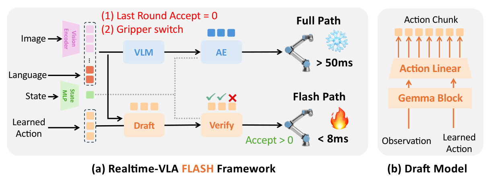
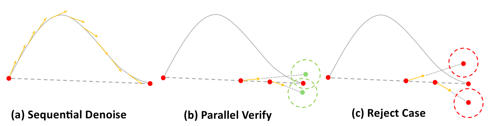

# Realtime-VLA FLASH：用并行 Flow 验证减少完整 VLA 重规划

!!! info "论文信息"
    **论文题名：** Realtime-VLA FLASH: Speculative Inference Framework for Diffusion-based VLAs。 
    **作者：** Jiahui Niu、Kefan Gu、Yucheng Zhao、Shengwen Liang、Tiancai Wang、Xing Hu、Ying Wang、Huawei Li。 
    **机构：** 中科院计算所、国科大、南京大学、Dexmal。 
    **时间 / 主题：** 2026-05；连续动作 VLA 的投机推理与运行时优化。 
    **版本 / 发表状态：** arXiv:2605.13778v1，2026-05-13；arXiv preprint。 
    **arXiv / 官方报告：** [摘要](https://arxiv.org/abs/2605.13778)、[PDF](https://arxiv.org/pdf/2605.13778v1)。 
    **GitHub / 项目：** [dexmal/realtime-vla-flash](https://github.com/dexmal/realtime-vla-flash)、[项目页](https://dexmal.github.io/realtime-vla-flash)。 
    **元数据来源与核验口径：** arXiv v1 全文、附录及作者仓库 README；Checked Date：2026-09-28；Repro Status：Author Code available，本文未进行独立训练、仿真或真机复现。

## 原论文故事线

### 研究背景

π0 一类 diffusion / flow-matching VLA 把图像、语言和机器人状态变成连续动作块。动作块让机器人可以在两次模型调用之间继续运动，但新的观测通常要等下一次重规划才会影响动作。对移动中的物体而言，模型延迟直接决定动作是否已经过时。

### 问题（Challenge）

每次重规划都完整执行图像编码、VLM prefill 和多步 Action Expert 去噪，成本很高。LLM 投机解码的办法是先猜 token 再并行验证，但 flow-based VLA 没有同样的离散 token 概率接口。假如验证候选动作还要重跑完整去噪，就没有省下多少计算。

### Finding

Flow matching 的训练路径提供了一个可利用的结构。把 draft 动作终点与高斯噪声插值到若干中间时刻，Action Expert 可以分别预测局部速度，再重建动作终点。各检查点相互独立，能够并行执行；重建终点是否接近 draft，则成为便宜的局部一致性信号。

### 方法

FLASH 增加一条 flash path。当前图像经过 encoder，约 110M 参数的 draft model 一次提出完整动作块；Action Expert 复用最近 full path 的视觉语言 KV，在少量 flow timestep 上并行验证。系统执行所有检查点共同接受的最长前缀，零接受或夹爪切换等情形触发 full-path fallback。LIBERO-10 的最终配置还包含周期性 full-path refresh。

### 结论

在单张 RTX 4090D 的 LIBERO 评测中，FLASH+Triton 相对 Torch-π0 将平均 replanning latency 从 58.0 ms 降到 19.1 ms，作者报告 3.04× 加速；平均成功率由 94.1% 变为 93.8%。这是算法与 Triton 优化的组合结果。仅 FLASH 的结果为 34.9 ms、1.66×；7.8 ms 则是快速分支的单轮耗时。

### 关键术语

- **Action Expert（动作专家）**：接收视觉语言条件并生成连续动作的模块，本文同时承担候选验证。
- **Flow Consistency（流一致性）**：检查候选诱导的插值状态经速度场重建后是否回到相近动作终点。
- **Executable Prefix（可执行前缀）**：从动作块起点开始连续通过所有检查点的动作序列。
- **Phase-aware Fallback（阶段感知回退）**：利用夹爪状态切换提示精细操作阶段，返回完整推理。
- **Periodic Full-path Refresh（周期性完整路径刷新）**：定期更新视觉语言上下文并纠正长期漂移。

## 论文位置：省掉一次完整调用，比单步去噪更快更关键

[EAGLE-3](eagle-3.md)优化 draft 质量，以减少 target 的逐 token 调用；FLASH 把问题移到连续动作重规划。它保留原主策略的 flow-matching 形式，通过便宜路径承接一部分调用。与[扩散少步采样](../../diffusion/inference.md)相比，这里的核心改动是“哪些重规划轮次需要完整策略”，并不把主策略统一蒸馏成一步模型。

原文 Section 3.1 对 Torch-π0 的分解为 image encoder 11.3 ms、VLM prefill 26.7 ms、action denoise 20.0 ms。只加速去噪还会留下较贵的 prefill；FLASH 因而复用视觉语言 KV，并让验证取代多步串行去噪。图像编码仍然存在，不能说快速路径完全跳过视觉处理。

## 两条路径怎样交换状态

{ width="800" }

<small>图源：[Realtime-VLA FLASH v1](https://arxiv.org/abs/2605.13778v1)，Figure 3，PDF 第 4 页。原图裁切保留框架与 draft 结构。读图时看 Full Path 如何刷新上下文，以及 Draft 和 Verify 如何构成较短分支；图内延迟标注不能代替任务平均耗时。</small>

| 状态或输入 | Flash path 的处理 | 为什么影响可靠性 |
| --- | --- | --- |
| 当前图像 | 仍调用主模型 image encoder，供 draft 使用 | draft 可以利用新观测 |
| 视觉语言 KV | verifier 复用最近 full path 的结果 | 验证条件可能比当前图像更旧 |
| 机器人 state | 每次验证使用最新 state | 不能把本体状态也解释成旧缓存 |
| 连续动作候选 | draft 输出，经过多时刻验证后截取前缀 | 接受长度决定实际可执行动作数 |
| 完整推理结果 | 回退时重新计算，同时刷新缓存 | 修正上下文失配与动作漂移 |

这个信息新鲜度差异是理解论文的关键。draft 看到当前图像，并不意味着 verifier 也已获得当前图像经过 VLM prefill 后的完整语义条件。因此，局部一致性检查还需要回退机制配合。

## Draft 怎样从一个 Gemma Block 变成动作块预测器

Draft 包含单个 Gemma block 和共享 linear action head，参数量约 110M，论文用于比较的 VLM 约 2.7B。输入包括视觉、语言、投影后的机器人状态，以及 \(H\) 个可学习的 action queries。每个 query 对应未来一个动作位置，queries 可以在同一前向中并行产生整块动作。

注意力采用 blockwise mask。视觉与语言构成条件前缀，state 单独成块，action queries 可以读取条件并在动作块内交互。固定的 action slots 明确了“动作写到哪里”，共享 action head 则把各位置 hidden state 映射为连续控制量。

Appendix A 说明 draft 回归到冻结 full-path policy 的输出，并对早期动作给予更高权重。原因与部署直接相关：模型虽然预测长度 50 的 chunk，默认重规划窗口只有 12 个执行动作，早期前缀误差对下一轮控制更直接。

| Item | Value |
| --- | --- |
| Optimizer | AdamW |
| Learning rate | \(2\times10^{-3}\) |
| Weight decay | 0.01 |
| Batch size | 64 |
| Epochs | 100 |
| Precision | FP32 |
| Loss | Weighted Smooth L1 / Huber loss, \(\beta=1.0\) |
| Prefix weighting | Sampled prefix up to 16 steps, \(\gamma_{\mathrm{prefix}}=0.9\), tail weight 0.1 |
| Checkpoint | Best validation RMS over the first 12 executable steps |
| Compute cost | 4 NVIDIA RTX 4090D GPUs, approximately 6 hours per draft model |

<small>表源：原论文 Appendix A，Table 5。保留英文列名与配置含义。仿真为每个 LIBERO suite 分别训练 draft，不能把每个模型约 6 小时理解为全部实验总训练成本。</small>

## 连续动作怎样并行验证

记 draft 动作块为 \(\hat A_t^{(d)}\)，所有验证时刻共享同一份高斯噪声 \(\epsilon\)。对选定时刻 \(\tau\)，构造

\[
\tilde A_\tau=\tau\hat A_t^{(d)}+(1-\tau)\epsilon,
\qquad
\hat A_t(\tau)=\tilde A_\tau+(1-\tau)v_\theta(\tilde A_\tau,\tau\mid c_t,s_t).
\]

\(c_t\) 是复用的视觉语言 KV，\(s_t\) 是当前机器人状态。第一步把候选终点放回 flow 的中间状态，第二步根据局部速度外推剩余区间，得到该检查点认可的终点估计。多个 \(\tau\) 都从同一个 draft 构造输入，不必沿上一个检查点的输出继续计算。

{ width="800" }

<small>图源：原论文 Figure 4，PDF 第 5 页。左侧顺序去噪逐步推进，中间与右侧展示从若干中间点重建终点。绿色聚合提示一致，红色偏离提示拒绝。图表示局部检查机制，不是严格的轨迹等价证明。</small>

对第 \(k\) 个时刻和第 \(h\) 个动作，计算连续平移与旋转通道的距离 \(d_h^{(k)}\)，找出从开头连续满足 \(d_h^{(k)}\leq\delta\) 的长度 \(L^{(k)}\)，最终

\[
L=\min_k L^{(k)}.
\]

因此某个后续动作通过检查，也不能绕过前面被拒绝的动作直接执行。夹爪通道具有开闭语义，单独用于阶段判断。论文基础 verifier 配置为 \(K=2\)、\(\delta=0.15\)；阈值依赖动作标准化，不能直接读成厘米或角度。

## 为什么通过验证仍然需要回退

Appendix B 明确将此检查解释为 heuristic local consistency test。Action Expert 在训练时学习的是目标动作诱导的插值路径，而验证时输入来自 draft 诱导的路径；单次速度外推也不等于完整积分。再叠加旧 KV 的条件失配，通过检查不足以保证与 full path 产生相同轨迹或任务结果。

FLASH 在两个地方返回较贵路径。其一是 \(L=0\)，候选没有任何可执行前缀；其二是验证分支中出现夹爪状态切换，提示抓取或释放等精细阶段。LIBERO 的夹爪值经标准化后两种模式仍分处零点两侧，作者以过零判断切换。这是该接口下的启发式，不能不经校准迁移到所有夹爪。

更长任务还需要周期性刷新。下面的消融比平均 speedup 更能解释它的作用。

| Configuration | SR (%) | Lat. (ms) |
| --- | ---: | ---: |
| Baseline (Flash-path only) | 58.4 | 13.3 |
| + PF = 2 | 80.6 | 21.0 |
| + FB | 66.8 | 17.7 |
| + FB & PF = 2 | 84.6 | 24.1 |

<small>表源：原论文 Table 3，摘录 LIBERO-10 的四种配置；\(\delta=0.15\)、\(K=2\)。PF = 2 表示每两轮 flash path 强制进行一次 full-path refresh；FB 表示 phase-aware fallback。</small>

快速路径单独运行虽然延迟低，成功率只有 58.4%。增加完整推理把延迟抬高，但最终成功率恢复到 84.6%。所以回退是最终算法的一部分，其成本和质量贡献都不能从 headline result 中删掉。

## 实验与结论：把三张速度账分开

仿真使用 π0、单张 RTX 4090D、chunk size 50、默认执行 12 个动作后重规划。四套 LIBERO 各含 10 个任务，每任务 50 次试验。以下为 Table 1 的完整方法行，合并表头展开为一层以便网页阅读。

| Methods | Spatial | Object | Goal | 10 | Average SR | Lat. (ms) | /Act (ms) | ΔSR | Speedup |
| --- | ---: | ---: | ---: | ---: | ---: | ---: | ---: | ---: | ---: |
| Torch-π0 | 96.8 | 98.8 | 95.8 | 85.2 | 94.1 | 58.0 | 5.0 | – | 1.00× |
| Triton-π0 | 96.4 | 98.8 | 95.0 | 86.6 | 94.2 | 39.7 | 3.5 | +0.1 | 1.46× |
| FLASH-π0 | 96.4 | 99.2 | 94.6 | 83.4 | 93.4 | 34.9 | 3.0 | -0.7 | 1.66× |
| FLASH+Triton-π0 | 96.8 | 99.2 | 94.4 | 84.6 | 93.8 | 19.1 | 1.9 | -0.3 | 3.04× |

<small>表源：原论文 Table 1。Success Rate 与 Average SR 的单位为 %，ΔSR 为百分点；Speedup 相对 Torch-π0。数字为作者报告，没有独立复现。</small>

第一张账是运行时组合。3.04× 来自 FLASH 与 Triton 的共同作用。若与同样采用 Triton 的 39.7 ms 基线比较，19.1 ms 对应约 **2.08×**，这是本文根据表中延迟计算的比值。不同基线应分别注明，不能把全部 3.04× 归为投机算法本身。

第二张账是快速分支与任务平均。Table 6 的 FLASH+Triton 快速分支由 image encoder 4.7 ms、draft 0.9 ms、verifier 2.2 ms 构成，共 7.8 ms；完整路径仍为 39.7 ms。Table 2 报告约 66.8% 的重规划轮次走快速路径，所以任务平均还包含大量完整推理。

第三张账是动作数量。论文报告 per-action latency 从 5.0 ms 变为 1.9 ms，约 2.63× 改善；它与 replanning latency 的 3.04× 不相同，因为各轮接受和执行的前缀长度不同。接受前缀覆盖率 69.7% 是相对 12 步重规划窗口归一化的统计，不是“候选 token 正确率”。

### 真机结果证明了什么

作者在 UR5 与两台 RealSense D435i 上做传送带分拣，对 toy dog、hairbrush 各收集 200 条示范并进行 LoRA 适配。每种物体、每种速度评测 10 次，所有方法使用同步推理，不叠加异步执行或 real-time chunking，以隔离推理延迟影响。

| Methods | Medium: Toy dog | Medium: Hairbrush | High: Toy dog | High: Hairbrush | Extra High: Toy dog | Extra High: Hairbrush |
| --- | ---: | ---: | ---: | ---: | ---: | ---: |
| JAX-π0 | 20.0 | 50.0 | 0.0 | 0.0 | 0.0 | 0.0 |
| Triton-π0 | 80.0 | 40.0 | 30.0 | 10.0 | 0.0 | 0.0 |
| FLASH+Triton-π0 | 80.0 | 90.0 | 50.0 | 30.0 | 20.0 | 10.0 |

<small>表源：原论文 Table 4，表头合并单元格展开；单位为成功率 %。Medium / High / Extra High 分别为 10 / 13 / 15 m/min，示范采集速度为 6 m/min。</small>

在 15 m/min 下 FLASH 有成功案例，而两个对照均为零；但其成功率仅为 20% 和 10%，不能改写成该速度下的稳定可靠抓取。每条件 10 次也意味着一个成功案例就改变 10 个百分点。这组实验支持“降低延迟有助于动态操作”，对泛化可靠性的证明仍有限。

## 主要贡献与工程入口

本文最有价值的贡献，是为连续动作构造了可并行的候选检查，并把验证、缓存和回退组织成完整运行时。单独把 draft 做快不足以获得这些收益，还需要正确记录 KV 来自哪一轮、最新 state 对应何时、哪些候选真正提交给执行器。

作者仓库 README 提供了 `scripts/spec/enc_cache.py`、`spec_draft_train.py`、`spec_serve_policy.py` 和 `spec_client_libero.py` 等入口，分别对应缓存准备、draft 训练、服务和 LIBERO 客户端；本文只核对文档，没有执行这些脚本。复现实验时应先建立 Torch / Triton full-path 对照，再测 draft、verify、fallback 和完整 episode，避免只测最短路径。

## 局限与风险

阈值与验证时刻带有启发式，论文没有给出严格的分布保持或轨迹等价保证。旧视觉语言 KV、局部外推误差与 draft 分布偏移可能共同影响接受质量。夹爪切换也只覆盖部分精细操作，不能捕获所有接触和环境突变。

结果主要围绕 π0、指定 GPU、LIBERO 与两个传送带物体。跨动作空间、跨平台和异步控制的收益需要重新验证。训练每套任务的 draft、维护 Triton 权重布局和回退策略也有工程成本，不能仅由 110M 参数量判断部署代价。

## 阅读结论

FLASH 让连续动作投机推理有了可执行的验证接口，但可靠性来自整条路径，包括最新观测、缓存条件、多时刻检查和必要的完整推理。最值得带走的实验是 LIBERO-10 的回退消融，它解释了为什么“少调用主策略”必须与“何时重新调用主策略”一起设计。

## 外部精读与延伸阅读

- [原论文 HTML 与附录](https://arxiv.org/html/2605.13778v1)：重点看 Algorithm 1、Table 1/3/6 和 Appendix B。
- [作者代码与复现入口](https://github.com/dexmal/realtime-vla-flash)：核对 checkpoint、Triton 转换与套件配置。
- [VLA 投机推理路线综述](../../inference/vla-speculative-decoding-0928-1144.md)：与离散动作、剪枝和执行期验证对照。
- [WA-SpecDec](wa-specdec-0928-1144.md)：比较“改善验证条件表征”和“改变连续动作验证接口”两种思路。
- [VLA 动作分块](../../vla/action-chunking-hierarchical-policies-and-latent-skills.md)：接回执行长度与反馈频率。
