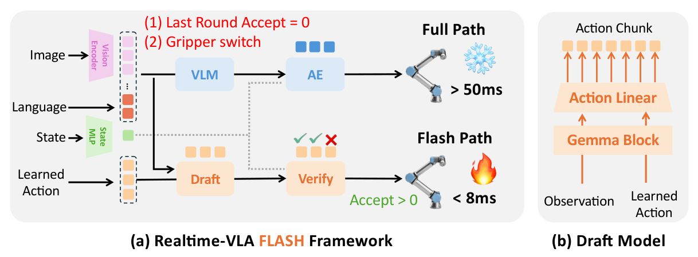
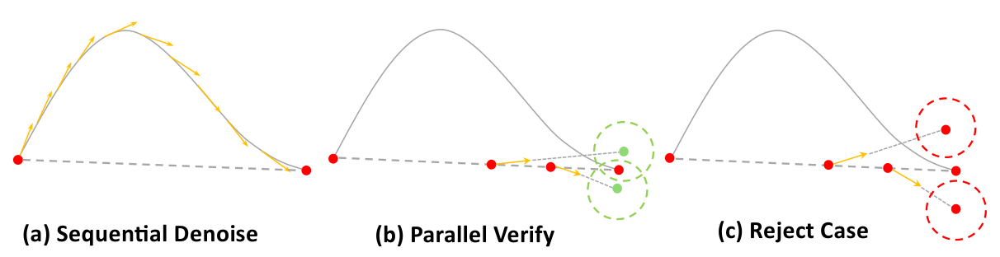
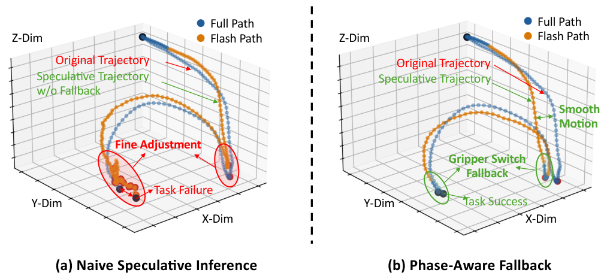
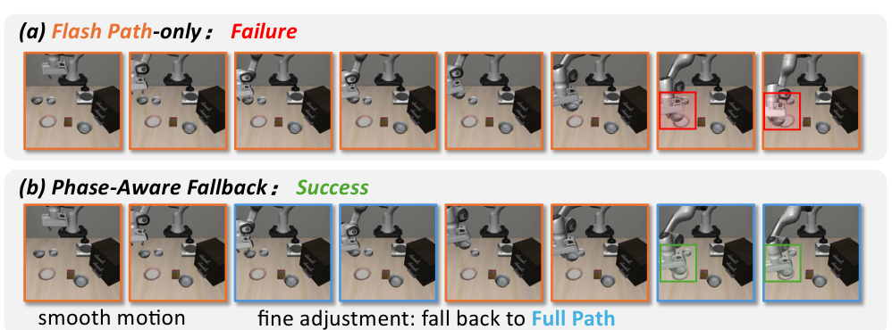
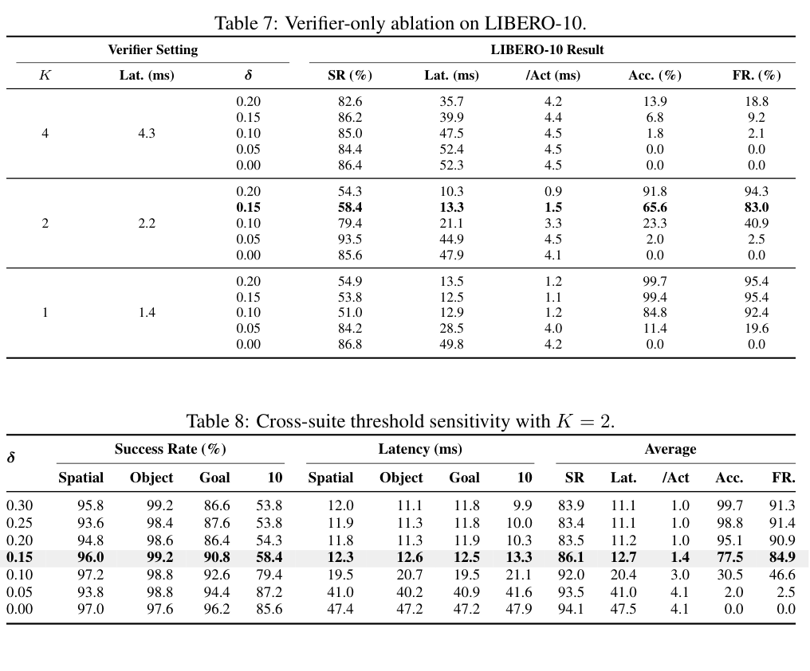
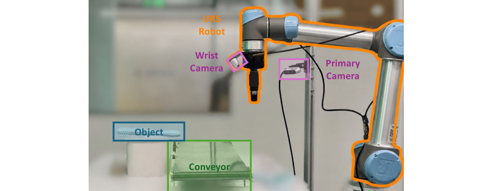

# Realtime-VLA FLASH：用并行 Flow 验证减少完整 VLA 重规划

!!! info "论文信息"
    **论文题名：** Realtime-VLA FLASH: Speculative Inference Framework for Diffusion-based VLAs。 
    **作者：** Jiahui Niu、Kefan Gu、Yucheng Zhao、Shengwen Liang、Tiancai Wang、Xing Hu、Ying Wang、Huawei Li。 
    **机构：** 中科院计算所、国科大、南京大学、Dexmal。 
    **时间 / 主题：** 2026-05；连续动作 VLA 的投机推理与运行时优化。 
    **版本 / 发表状态：** arXiv:2605.13778v1，2026-05-13；arXiv preprint。 
    **arXiv / 官方报告：** [摘要](https://arxiv.org/abs/2605.13778)、[PDF](https://arxiv.org/pdf/2605.13778v1)。 
    **GitHub / 项目：** [dexmal/realtime-vla-flash](https://github.com/dexmal/realtime-vla-flash)、[项目页](https://dexmal.github.io/realtime-vla-flash)。 
    **元数据来源与核验口径：** arXiv v1 全文、附录及作者仓库 README；Checked Date：2026-09-28；Repro Status：Author Code available，本文未进行独立训练、仿真或真机复现。

## 真正要减少的是机器人等待完整重规划的次数

Realtime-VLA FLASH 把一个常被当成模型吞吐问题的瓶颈，放回了机器人控制循环中。π0 一类策略已经能一次输出未来几十步动作，机器人也能先执行其中一段，再观察、再规划。但新的动作块仍需等待图像编码、视觉语言模型 prefill 和多步动作去噪全部完成。如果传送带上的物体一直在移动，这段等待会让动作建立在过时的位置上。增大动作块只能降低调用频率，无法让本次观测更快变成新的控制命令。

论文的回答是让多数重规划采用一条便宜的路径。一个小模型根据新观测提出连续动作块，原策略的 Action Expert 在几个 flow 时刻并行检查它，系统只执行通过检查的前缀；当局部一致性不足、即将抓取或释放，或者缓存需要刷新时，再调用完整策略。最终的收益由这几部分共同产生，既依赖草稿够便宜，也依赖验证能筛掉不合适的动作，更依赖运行时知道什么时候应恢复完整计算。[↗](https://arxiv.org/pdf/2605.13778v1#page=2)

在四个 LIBERO suite 上，FLASH 与 Triton 优化结合，把平均重规划延迟从 58.0 ms 降到 19.1 ms，平均成功率从 94.1% 变为 93.8%。最短的 7.8 ms 是一次快路径调用，并非所有调用的平均。真机实验则检验这部分节省能否让机器人抓住更快移动的物体。理解这篇论文，需要始终区分“某一轮很快”“整条任务少等了多久”和“任务是否完成”三个层次。[↗](https://arxiv.org/pdf/2605.13778v1#page=8)

## 完整路径为何慢，快路径留下了哪些新旧信息

对时刻 $t$ 的观测，论文写成

$$
o_t=[I_t^1,\ldots,I_t^n,\ell_t,q_t],
\qquad
A_t=[a_t,a_{t+1},\ldots,a_{t+H-1}].
$$

$I_t^i$ 是不同相机的图像，$\ell_t$ 是语言指令，$q_t$ 是机器人状态。每个动作包含末端位置、旋转和夹爪通道。$H$ 表示预测时域，不意味着会不经观察就执行所有 $H$ 步。实验取 $H=50$，每次至多执行 12 步便重规划；快路径通过的前缀更短时，执行长度还会缩短。

完整 π0 路径先编码当前图像，再由 VLM 处理图像和语言前缀，得到条件 KV Cache，最后由 Action Expert 求解从高斯噪声到动作的 ODE。原文在 RTX 4090D 上测得 Image Encoder 为 11.3 ms、VLM prefill 为 26.7 ms、10 步 Action Denoise 为 20.0 ms，总计 58.0 ms。其 roofline 分析把前两部分放在主要受计算限制的一侧，把 Action Denoise 放在主要受内存访问限制的一侧。后者的十次调用顺序依赖，又反复访问条件缓存，使部分算力没有用满。这是本文在该硬件上尝试“跳过 prefill、把验证时刻并成 batch”的出发点，不能直接推广成所有设备上的瓶颈排序。[↗](https://arxiv.org/pdf/2605.13778v1#page=4)

框架图应沿上下两条路线阅读。上路经过 VLM 和 AE，负责生成高保真的动作并更新条件缓存；下路仍经过 Vision Encoder，但把视觉特征交给轻量 Draft，再由 Verify 检查。右侧的 learned action queries 则给草稿网络提供固定的动作输出位置。

{ width="800" }

*原论文 Figure 3。快路径绕过 VLM prefill，但没有绕过当前图像编码；两个路径共享动作表示与主策略的 Action Expert。*

这里最容易混淆的是“复用上下文”究竟复用了什么。Draft 看到的是当前图像特征、语言和当前机器人状态；Verifier 读取的是最近一次完整路径建立的视觉语言 KV Cache，同时读取当前机器人状态。各部分的输入可按下表区分：

| Information | Draft | Verifier |
| --- | --- | --- |
| Current image features | 本轮重新编码并输入 | 不重新做完整 VLM prefill |
| Visual-language context | 由轻量 block 处理当前前缀 | 使用最近 full path 的 KV |
| Robot state | 本轮状态 | 本轮状态 |
| Action chunk | 一次预测候选 | 检查候选诱导的中间状态 |

因此，验证失败可能与旧视觉上下文不再适合有关，但也可能来自草稿误差或局部场预测误差。失败会触发刷新，不等于它已经识别出唯一原因。反过来，机器人状态每次都会更新，不能把所有条件误差都归结为“用了上一轮状态”。这个区分也是附录解释验证边界时专门强调的内容。[↗](https://arxiv.org/pdf/2605.13778v1#page=13)

## 草稿模型学的是主策略动作，训练目标偏向近期执行段

草稿网络用一个 Gemma block 和一个共享线性 action head。视觉与语言组成条件前缀，机器人状态映射到相同 hidden space，随后接上 $H$ 个可学习的输出查询：

$$
Q=[q_1,\ldots,q_H],
\qquad
\hat a^d_{t+h-1}=W_{\mathrm{act}}z_h+b_{\mathrm{act}}.
$$

这里 $q_h$ 表示第 $h$ 个未来动作的查询位置，$z_h$ 是该位置经过 block 后的 hidden state。它与上一节用 $q_t$ 表示的机器人状态承担不同角色。action block 可以读取视觉语言前缀与状态，内部查询也能相互交互，因此所有未来动作在一次前向中共同生成。它没有逐步生成动作 token，也没有用十次去噪慢慢构成候选。约 110M 参数指这套轻量草稿模块，约 2.7B 是对照中的 VLM 规模；快路径仍然需要原图像编码器与验证器，不能把 110M 当成整个部署系统的参数量。[↗](https://arxiv.org/pdf/2605.13778v1#page=5)

主文把监督目标概括为

$$
\mathcal L_{\mathrm{draft}}
=\sum_{h=1}^{H}w_h\,
\ell(\hat a^d_{t+h-1},a_{t+h-1}).
$$

附录明确说明，回归目标来自冻结的 full-path policy。特别在真机适配中，观测来自采集的示范，动作标签则由微调后的主模型生成，并非直接把原始示范动作作为草稿标签。这样训练直接服务于验证所要求的“草稿与主策略一致”：如果草稿逼近的是另一套动作目标，即使行为看起来合理，也可能频繁被原 Action Expert 拒绝。[↗](https://arxiv.org/pdf/2605.13778v1#page=12) [↗](https://arxiv.org/pdf/2605.13778v1#page=14)

为什么给前段更大权重，也与运行时有关。50 步候选中，当前最多执行 12 步，远期动作通常会被下一次重规划覆盖。训练因此使用 prefix-weighted Smooth L1 / Huber loss，把更多容量留给近期可执行动作，同时以非零 tail weight 约束后段。四个 LIBERO suite 分别训练各自的草稿模型，设置如下。

| Item | Simulation draft training |
| --- | --- |
| Optimizer | AdamW |
| Learning rate / Weight decay | $2\times10^{-3}$ / 0.01 |
| Batch size / Epochs | 64 / 100 |
| Precision | FP32 |
| Loss | Weighted Smooth L1 / Huber, $\beta=1.0$ |
| Prefix weighting | sampled prefix up to 16 steps, $\gamma_{\mathrm{prefix}}=0.9$, tail weight 0.1 |
| Checkpoint selection | best validation RMS over first 12 executable steps |
| Compute per draft model | 4 RTX 4090D GPUs, approximately 6 hours |

这些设置使 FLASH 成为需要训练草稿的加速方案。主策略的 flow 形式可以保留，但更换任务域、主策略或动作标准化以后，小模型是否仍能保持较高接受率，需要重新评估。[↗](https://arxiv.org/pdf/2605.13778v1#page=13)

官方实现把标签生成进一步具体化。在公开 commit `da6cecc` 的 `enc_cache.py` 中，默认 `teacher_zero_noise` 先计算当前观测的完整前缀，再用全零初始噪声调用主策略生成 teacher chunk；脚本另有 `gt` 分支。这是该版本的离线标签构造方式，能够为同一输入提供确定的回归目标。它不表示草稿已拟合主策略在所有随机初始噪声下的完整分布。训练脚本还对 Huber 的动作维度取平均，再按归一化步权重加权，具体落实了“近期优先”的设计。[↗](https://github.com/dexmal/realtime-vla-flash/blob/da6ceccad603695a8a3d6fa14dd410c3aadb536f/scripts/spec/enc_cache.py#L199) [↗](https://github.com/dexmal/realtime-vla-flash/blob/da6ceccad603695a8a3d6fa14dd410c3aadb536f/scripts/spec/spec_draft_train.py#L76)

## 已知候选终点，顺序生成就能改造成并行检查

原策略按照论文的时间约定，从 $\tau=0$ 的噪声走向 $\tau=1$ 的动作：

$$
\frac{dA_t^\tau}{d\tau}
=v_\theta(A_t^\tau,\tau,o_t),
\qquad A_t^0\sim\mathcal N(0,I).
$$

真正生成时，第 $k+1$ 步的输入依赖第 $k$ 步积分得到的状态，因此不能直接把十步互换成十个独立任务。FLASH 改变了要回答的问题。它已经拿到草稿终点 $\hat A_t^{(d)}$，现在只想知道这个终点是否与主模型学到的局部速度场相容。

对同一份高斯噪声 $\epsilon$，任取检查时刻 $\tau$，都能直接构造

$$
\widetilde A^\tau
=\tau\hat A_t^{(d)}+(1-\tau)\epsilon.
$$

这个状态位于噪声与草稿之间的直线上。接着让 Action Expert 预测局部速度，以一次剩余区间外推得到终点估计：

$$
\widehat A_t(\tau)
=\widetilde A^\tau
 +(1-\tau)v_\theta(\widetilde A^\tau,\tau\mid c_t,s_t).
$$

$c_t$ 是旧的视觉语言缓存，$s_t$ 是新的机器人状态。多个 $\tau_k$ 的输入都能从同一草稿直接构造，互不依赖，所以可以合并成一次 batch 来调用 Action Expert。共享 $\epsilon$ 使不同分支的差异主要反映所选检查位置，而不是混进多份互不相关的噪声路径。[↗](https://arxiv.org/pdf/2605.13778v1#page=5)

原图左侧画的是沿场顺序积分，中间画的是从几处草稿插值点向终点作局部重建。应注意中间的黄色箭头并没有复现左边整条曲线；它们提供几个局部检验。右侧的终点估计偏离候选较大，就会使相应动作拒绝。

{ width="800" }

*原论文 Figure 4。Parallel Verify 的可并行性来自候选终点已经给定，不能据此认为原始 ODE 的顺序依赖消失了。*

把这两个公式相减，可以更直接地看出验证器在量什么。下面是对原式的代数展开：

$$
\widehat A_t(\tau)-\hat A_t^{(d)}
=(1-\tau)
\left[
 v_\theta(\widetilde A^\tau,\tau\mid c_t,s_t)
 -(\hat A_t^{(d)}-\epsilon)
\right].
$$

如果局部速度正好等于该直线的速度 $\hat A_t^{(d)}-\epsilon$，重建终点就与候选相同。但实际网络学习的是条件速度场，草稿也未必是训练数据中的真实终点，等式右侧一般不为零。验证比较的是这个局部残差，不能把“小残差”直接换成“沿完整 ODE 一定会到达同一终点”。

这个展开还说明，检查时刻与接受阈值不能独立理解。在 $0≤\tau<1$ 内采用同一种齐次距离时，固定终点阈值 $\delta$ 对应的速度残差阈值是 $\delta/(1-\tau)$；越靠近终点，外推区间越短，同样的速度偏差在终点距离中就越小。如果取 $\tau=1$，重建就恒等于草稿，检验本身失去作用。这个关系是公式推得的解释，不是论文额外测得的精度结果。

官方代码使用相反时间方向，写成 $x_u=u\epsilon+(1-u)x_0$ 与 $\hat x_0=x_u-u v_u$。因此代码的 `t_list=(0.10,0.05)` 对应论文的 $\tau=(0.90,0.95)$，速度方向也随时间变换反转。直接把这两个代码数值写成论文坐标下“靠近噪声端的检查”会得出相反结论。实现还把这些状态展成 $B K$ 的 batch，同时扩展状态与缓存供验证使用；并行减少顺序等待，但增加 $K$ 仍需更多计算与条件访问。[↗](https://github.com/dexmal/realtime-vla-flash/blob/da6ceccad603695a8a3d6fa14dd410c3aadb536f/src/openpi/models_pytorch/spec_pi0_pytorch.py#L665)

## 只接受连续前缀，距离阈值并不包含所有动作语义

对第 $k$ 个检查时刻、第 $h$ 个动作，算法先计算连续通道距离

$$
d_h^{(k)}
=\operatorname{Dist}_{\mathrm{cont}}
\left(\hat a^d_{t+h-1},\hat a^{(k)}_{t+h-1}\right).
$$

每个分支的最长连续通过前缀为

$$
L^{(k)}
=\sum_{h=1}^{H}\prod_{j=1}^{h}
\mathbf1[d_j^{(k)}\le\delta],
\qquad
L=\min_{k=1,\ldots,K}L^{(k)}.
$$

乘积保证一旦某个位置失败，后面位置即使单独通过也不能被接到可执行前缀中；跨分支取最小值，保证执行的每一步都经过所有时刻的检查。例如，一个分支的通过模式是“通过、通过、失败、通过”，其前缀只能是 2；另一个分支通过前三步，最终仍只能执行前两步。这是解释公式的例子，并非实验轨迹。[↗](https://arxiv.org/pdf/2605.13778v1#page=6)

论文把位置与旋转视为连续通道，把夹爪单独处理。公开实现的 `_compute_radius_prefix_acceptance` 对选中的维度计算

$$
d_h^{(k)}
=\frac{\|\hat a_{h,1:d}^{(k)}-\hat a_{h,1:d}^{\mathrm{draft}}\|_2}{\sqrt d},
$$

也就是通道 RMS；当动作至少有 7 维时，函数把距离维数上限设为 6，排除夹爪。尽管配置中可见 `dist_dims=7`，真正执行的函数会进行这个截断。$\delta=0.15$ 因而是策略动作表示空间的距离阈值，不能直接解释成 15 厘米或某个旋转角。实现仅在下一次重规划前最多会执行的 12 个位置上计算前缀，论文 Algorithm 1 则用一般的 $H$ 写法。[↗](https://github.com/dexmal/realtime-vla-flash/blob/da6ceccad603695a8a3d6fa14dd410c3aadb536f/src/openpi/models_pytorch/spec_pi0_pytorch.py#L126)

如果 $L=0$，草稿没有可执行前缀，运行时转回完整路径。$L>0$ 也不表示整个 50 步块已获批准，更不表示任务后续都可以保持当前缓存。执行一段后仍要获得新观测，再次生成与验证。

附录 B 用一个非正式关系概括剩余误差：

$$
\|\hat A_t^{(d)}-A_t^\star\|
\lesssim
\delta+\epsilon_{\mathrm{AE}}
+\epsilon_{\mathrm{cond}}+\epsilon_{\mathrm{path}}.
$$

$A_t^\star$ 是当前条件下完整路径的输出；$\epsilon_{\mathrm{AE}}$ 包含速度场近似和单步终点重建误差，$\epsilon_{\mathrm{cond}}$ 来自复用视觉语言条件，$\epsilon_{\mathrm{path}}$ 则来自草稿诱导的插值点与训练终点路径、真实积分路径的差别。作者将其表述为 informal interpretation，没有给出能直接计算的严格全局界。它帮助解释为什么还需要多个检查时刻、保守阈值和回退，不能用来证明草稿与原策略分布相同，或保证接受后必然成功。[↗](https://arxiv.org/pdf/2605.13778v1#page=13)

## 抓取与释放附近，局部一致性仍可能不够

距离验证关注当前候选在几个位置上的局部一致性，但任务中的误差敏感性并不均匀。空旷运动时，一点位置偏差可能在下次观测后被纠正；把碗放到盘边时，同样的偏差可能直接使任务失败。FLASH 用夹爪切换作为进入精细操作阶段的启发式信号。

在 LIBERO 中，夹爪开闭编码为 $-1/+1$。经过策略使用的标准化以后，两种模式仍可用零阈值分开。论文规则是：只要任一验证分支的候选动作中出现夹爪模式切换，就回到完整路径，以更高保真的条件和动作规划处理抓取、释放附近的变化。它检测的是预测动作中的模式变化，不是一个独立的接触传感器，也不等价于识别了所有高风险阶段。[↗](https://arxiv.org/pdf/2605.13778v1#page=7)

Figure 5 的阅读重点是轨迹末端。左边的绿色 speculative trajectory 在最终放置处偏离原轨迹，右边则在夹爪切换相关位置恢复 full path。蓝色与橙色点分别标出完整、快路径调用，不能把右图理解为整条运动都换回了完整模型。

*原论文 Figure 5。示例说明平滑运动中可容忍的偏差，在最终放置时可能变成失败。*

对应关键帧进一步显示失败的物理含义。上排一直沿快路径完成最后放置，碗与盘没有对齐；下排在部分阶段使用蓝框标出的完整路径，完成了放置。这个单任务示例为设计提供直观动机，跨任务可靠性仍要由后面的主实验和消融判断。

*原论文 Figure 6。橙框是 flash path，蓝框是 full path；回退按阶段发生。*

周期性刷新处理的是另一类问题。即使没有夹爪切换，连续使用旧 KV 和短前缀也可能逐步积累误差，因此运行时允许每若干快路径轮次强制一次 full path。夹爪触发、验证拒绝和周期刷新分别根据任务阶段、当前不一致和经过的轮次决定恢复计算，不能把完整系统的结果全部归因于单个距离阈值。

## 主实验的 3.04 倍加速，是系统与运行时共同产生的

LIBERO 实验在单张 RTX 4090D 上在线推理。四个 suite 各有 10 个任务，每任务 50 次试验。Table 1 同时比较原始 Torch、仅 Triton、仅 FLASH 和两者结合，能够区分“把一次计算做快”与“减少完整计算次数”的作用。

| Methods | Spatial SR (%) | Object SR (%) | Goal SR (%) | LIBERO-10 SR (%) | Average SR (%) | Lat. (ms) | /Act (ms) | Speedup |
| --- | ---: | ---: | ---: | ---: | ---: | ---: | ---: | ---: |
| Torch-π0 | 96.8 | 98.8 | 95.8 | 85.2 | 94.1 | 58.0 | 5.0 | 1.00× |
| Triton-π0 | 96.4 | 98.8 | 95.0 | 86.6 | 94.2 | 39.7 | 3.5 | 1.46× |
| FLASH-π0 | 96.4 | 99.2 | 94.6 | 83.4 | 93.4 | 34.9 | 3.0 | 1.66× |
| FLASH+Triton-π0 | 96.8 | 99.2 | 94.4 | 84.6 | 93.8 | 19.1 | 1.9 | 3.04× |

原文 Table 1。[↗](https://arxiv.org/pdf/2605.13778v1#page=8)

这里有三个具体判断。第一，仅 Triton 就把 58.0 ms 降到 39.7 ms，说明系统实现贡献很大。第二，在 Triton 基础上再加入 FLASH，平均延迟进一步降到 19.1 ms，按表值计算约为 $39.7/19.1=2.08$ 倍；论文的 3.04 倍则以最初 Torch 为分母，不能全部归为投机算法本身。第三，成功率变化是混合的：组合方案在 Spatial 与 Torch 相同、Object 高 0.4 个百分点，但 Goal 低 1.4、LIBERO-10 低 0.6。平均下降 0.3 个百分点支持“基本保留性能”，并非精确无损；表中也没有给出足以将这些小差异全部判为显著的置信区间。

附录的组件成本进一步解释两条路线各花了什么。

| Component | Torch-π0 | Triton-π0 | FLASH-π0 | FLASH+Triton-π0 |
| --- | ---: | ---: | ---: | ---: |
| Full path: Image encoder (ms) | 11.3 | 4.7 | 11.3 | 4.7 |
| Full path: VLM prefill (ms) | 26.7 | 22.4 | 26.7 | 22.4 |
| Full path: Action denoise (ms) | 20.0 | 12.6 | 20.0 | 12.6 |
| Full-path total (ms) | 58.0 | 39.7 | 58.0 | 39.7 |
| Flash path: Image encoder (ms) | — | — | 11.0 | 4.7 |
| Flash path: Draft model (ms) | — | — | 3.5 | 0.9 |
| Flash path: Parallel verifier (ms) | — | — | 3.4 | 2.2 |
| Flash-path total (ms) | — | — | 17.9 | 7.8 |

原文 Table 6，单位均为 ms。[↗](https://arxiv.org/pdf/2605.13778v1#page=13)

快路径中的 7.8 ms 由当前图像编码 4.7、draft 0.9、parallel verifier 2.2 构成。完整路径的 VLM prefill 22.4 ms 被跳过，12.6 ms 的顺序去噪则换成 2.2 ms 的局部检查，这解释了为什么两个层面的优化可以叠加。与此同时，编码图像已占快路径一半以上，继续只压小 draft 的绝对收益会受到其他环节限制。

将 7.8 ms 取倒数约为 128 次/秒，只能描述这一类调用的理想吞吐尺度，不能说整条机器人闭环已经实现 128 Hz。平均重规划加速按 $58.0/19.1\approx3.04$ 计算，每动作延迟改善按 $5.0/1.9\approx2.63$ 计算。两者不同，是因为不同轮次可能执行不同长度的前缀；最终还存在机器人执行、通信与观测环节，模型调用倒数不是物理控制频率。

## 接受长度与快路径占比，决定一次省下的时间能否留到任务末尾

Table 2 定义了两个容易混用的量。Acc. 是快路径轮次中平均接受前缀长度相对于 12 步重规划窗口的比例；FR. 是全部重规划轮次中采用快路径的比例。一个描述每次快路径能执行多长，另一个描述多常使用快路径。下表保留完整 suite 对照。

| LIBERO Suite | FLASH Acc. (%) | +Triton Acc. (%) | FLASH FR. (%) | +Triton FR. (%) | FLASH Lat. (ms) | +Triton Lat. (ms) | FLASH /Act (ms) | +Triton /Act (ms) |
| --- | ---: | ---: | ---: | ---: | ---: | ---: | ---: | ---: |
| Spatial | 75.8 | 60.2 | 71.6 | 68.9 | 34.3 | 19.2 | 3.0 | 2.1 |
| Object | 78.1 | 89.3 | 72.4 | 86.4 | 34.6 | 12.6 | 3.0 | 1.2 |
| Goal | 81.4 | 66.9 | 63.7 | 62.4 | 37.5 | 20.5 | 3.3 | 2.1 |
| 10 | 82.4 | 62.5 | 57.5 | 49.6 | 33.2 | 24.1 | 2.8 | 2.3 |
| Average | 79.4 | 69.7 | 66.3 | 66.8 | 34.9 | 19.1 | 3.0 | 1.9 |

原文 Table 2。[↗](https://arxiv.org/pdf/2605.13778v1#page=8)

组合方案在 Object 中的 FR. 为 86.4%，接受长度为窗口的 89.3%，平均延迟最低，为 12.6 ms；在 LIBERO-10 中，FR. 只有 49.6%，延迟升到 24.1 ms。它仍然受益于快路径，但任务需要更频繁恢复完整计算。平均 69.7% 的 Acc. 若按定义换算，对应约 $12\times0.697=8.36$ 个动作位置，而不是“69.7% 的整块 50 步动作都能执行”。这个换算只是指标含义的说明。

还应保留一个反向观察：纯 FLASH 的平均接受长度 79.4% 高于结合 Triton 的 69.7%，但延迟反而更高。接受率不是单独决定系统快慢的指标。两套执行的轨迹与接受统计也并不完全相同，不能把表中结果理解为固定同一串动作、只替换底层 kernel 的逐位等价对照。

## 回退消融说明，最快配置可以非常不可靠

LIBERO-10 对误差积累最敏感，因此作者固定 $K=2,\delta=0.15$，比较周期刷新 PF 与 phase-aware fallback FB。PF=$n$ 表示每经过 $n$ 个快路径轮次，强制一个完整路径轮次。

| Configuration | SR (%) | Lat. (ms) |
| --- | ---: | ---: |
| Baseline (Flash-path only) | 58.4 | 13.3 |
| + PF = 2 | 80.6 | 21.0 |
| + PF = 3 | 82.0 | 18.6 |
| + PF = 4 | 75.4 | 17.2 |
| + FB | 66.8 | 17.7 |
| + FB & PF = 2 | 84.6 | 24.1 |
| + FB & PF = 3 | 81.6 | 21.9 |
| + FB & PF = 4 | 78.4 | 20.2 |

原文 Table 3；这里的 flash-path-only 基线仍属于该验证配置下的运行时比较。[↗](https://arxiv.org/pdf/2605.13778v1#page=8)

只有快路径配置时，13.3 ms 很有吸引力，但成功率只有 58.4%。加入夹爪阶段回退得到 66.8%，说明有帮助，却远不足以恢复原策略水平；再结合 PF=2 才达到 84.6%，该配置也进入主表。相对最快配置，它多花 10.8 ms，换来 26.2 个百分点的成功率提升。这组实验使“何时不应该继续走快路径”成为方法不可缺少的一部分。

结果也没有支持无限加强刷新必然更好。在仅 PF 的行中，PF=3 的 82.0%、18.6 ms 同时优于 PF=2 的 80.6%、21.0 ms；加入 FB 后，PF=2 才表现最好。可成立的判断是不同恢复机制相互作用、需要按任务选取，不能从几行数据总结成严格单调规律。

## 多检查几个时刻，为什么会逐渐失去加速

前一节在固定验证器上比较运行时。附录 C.1 则先不加 phase-aware 与周期刷新，单独扫描检查数 $K$ 和阈值 $\delta$，回答验证器自身的取舍。应先看下图上表的 $K=1,2,4$ 三组，再看下表固定 $K=2$ 的跨 suite 变化。

{ width="980" }

*原论文 Tables 7–8。上表的第一列 Lat. 是 verifier 本身成本，右侧 Lat. 才是任务中的平均推理延迟，两个数不能混用。*

在 $\delta=0.15$ 时，Table 7 中 $K=1,2,4$ 的成功率分别为 53.8%、58.4%、86.2%，对应任务延迟 12.5、13.3、39.9 ms。检查更多时刻能在这个设置下提高可靠性，但更严格的联合通过条件让更多候选被拒绝。特别是 $K=4$ 时，快路径比例只有 9.2%，已经接近主要依赖完整路径。verifier 本身也从 $K=1$ 的 1.4 ms 增至 $K=2$ 的 2.2、$K=4$ 的 4.3 ms，批量并行并非免费。[↗](https://arxiv.org/pdf/2605.13778v1#page=14)

把阈值压得很小还可能比直接完整推理更慢。$K=4,\delta=0.05$ 的 FR. 已为 0，平均延迟却是 52.4 ms，高于主表中 Triton full path 的 39.7 ms。这种配置支付了投机检查成本，却没有得到可用前缀。$\delta=0$ 也只是使此距离测试中的草稿被拒绝，不能反过来作为 FLASH 保留原分布的证明。

跨 suite 的结果显示了相同的覆盖率变化，同时保留任务间差异。

| $K=2$, $\delta$ | Average SR (%) | Average Lat. (ms) | Average FR. (%) | LIBERO-10 SR (%) |
| --- | ---: | ---: | ---: | ---: |
| 0.30 | 83.9 | 11.1 | 91.3 | 53.8 |
| 0.25 | 83.4 | 11.1 | 91.4 | 53.8 |
| 0.20 | 83.5 | 11.2 | 90.9 | 54.3 |
| 0.15 | 86.1 | 12.7 | 84.9 | 58.4 |
| 0.10 | 92.0 | 20.4 | 46.6 | 79.4 |
| 0.05 | 93.5 | 41.0 | 2.5 | 87.2 |
| 0.00 | 94.1 | 47.5 | 0.0 | 85.6 |

原文 Table 8。表中只提炼跨 suite 平均与最敏感的 LIBERO-10，完整四 suite 数值见原表。[↗](https://arxiv.org/pdf/2605.13778v1#page=14)

从 0.15 收紧到 0.10，平均成功率上升 5.9 个百分点，平均延迟增加 7.7 ms；收紧到 0.05 时，FR. 降到 2.5%，加速空间几乎消失。成功率也并非逐任务单调，例如 Spatial 从 $\delta=0.10$ 的 97.2% 变成 $0.05$ 的 93.8%。作者选择 $K=2,\delta=0.15$，是为了让基础验证器保留足够的快路径覆盖，再由完整运行时恢复可靠性，并非这个点单独就验证得最准确。

原文两张表在 $K=2,\delta=0.05$ 的 LIBERO-10 行还存在具体差异：Table 7 写 93.5% 与 44.9 ms，Table 8 对应列写 87.2% 与 41.6 ms。两表都标为上述验证器研究，却未解释该点差别。因而可以据各自表格讨论局部趋势，不能挑出较好的一项并与另一表的较低成本合成新的“最佳配置”。

## 真机检验的是同步推理下可完成任务的速度范围

真机使用 UR5 和两台 RealSense D435i，一台主视角、一台腕部视角。任务是在传送带上抓取 toy dog 或 hairbrush 并放入盒子，每类采集 200 条示范，示范采集速度为 6 m/min。部署比较采用相同的同步循环，不叠加异步推理、real-time chunking 等隐藏延迟的机制，因此能较直接地观察模型等待时间对追踪移动物体的影响。[↗](https://arxiv.org/pdf/2605.13778v1#page=8)

平台图应同时看相机和目标的运动位置。模型需要从当前画面判断物体在哪里，但动作抵达时传送带已经继续前进；腕部视角提供近处信息，也不能自动消除计算期间的位移。

*原论文 Figure 8。在线结果来自单臂、两视角的这一平台；训练资源与在线推理资源分开报告。*

| Methods | 10 m/min: Toy dog SR (%) | 10 m/min: Hairbrush SR (%) | 13 m/min: Toy dog SR (%) | 13 m/min: Hairbrush SR (%) | 15 m/min: Toy dog SR (%) | 15 m/min: Hairbrush SR (%) |
| --- | ---: | ---: | ---: | ---: | ---: | ---: |
| JAX-π0 | 20.0 | 50.0 | 0.0 | 0.0 | 0.0 | 0.0 |
| Triton-π0 | 80.0 | 40.0 | 30.0 | 10.0 | 0.0 | 0.0 |
| FLASH+Triton-π0 | 80.0 | 90.0 | 50.0 | 30.0 | 20.0 | 10.0 |

原文 Table 4，每个对象、速度、方法条件各测试 10 次。[↗](https://arxiv.org/pdf/2605.13778v1#page=9)

10 m/min 时，toy dog 在 Triton 与组合方案下都是 80%，hairbrush 则从 40% 变为 90%；到了 13 m/min，组合方案仍有 50% 和 30%，但显然已不是高成功率区间。15 m/min 下的 20% 与 10% 只对应 2/10 和 1/10 次成功，支持“在基线全失败的设置中仍有非零成功”，不能改写成可靠完成高速分拣。JAX 与 Triton 在 10 m/min hairbrush 上还分别为 50% 和 40%，也提醒人们，有限试验中的成功率不会仅按计算速度严格排序。

作者观察到的慢基线失败，多是机器人赶到旧位置、落在物体后方，或者夹爪闭合太晚；hairbrush 的薄形状给时机和姿态留下的余量更小。这与延迟瓶颈的解释一致，但实验没有把每一类失败单独做成受控因果干预。可用一个明确标为计算例子的尺度帮助理解：15 m/min 等于 0.25 m/s，等待 40 ms 时物体前进约 1 cm。这个计算说明毫秒级差别为何可能影响抓取，不是论文测得的平均末端误差。

为了得到这些策略，主模型先由预训练 π0 进行 LoRA 适配，随后训练同域草稿。主模型使用 batch 128、20K steps、500 步 warmup，学习率从峰值 $10^{-4}$ 余弦衰减到 $10^{-5}$。真机 draft 使用每 GPU batch 64、100 epochs、一个 warmup epoch、最低学习率 $10^{-5}$、global norm 1.0 的梯度裁剪；prefix cap 从仿真的 16 改为 20。论文报告 8 张 H20 上主模型微调约 12 小时、草稿训练约 2 小时。这个离线适配预算不能遗漏，也不能混成线上推理需要 8 张 H20。[↗](https://arxiv.org/pdf/2605.13778v1#page=15)

## 采用时要复用完整的条件与回退接口

公开代码给出了可落地的顺序：先产生前缀 embedding 与 teacher 动作缓存，训练相应 suite 的 draft；再将主模型与 draft 权重转换成 Triton 布局，由 policy server 维护缓存、接受长度和回退状态，客户端按接受前缀执行并回传新观测。单纯拿小网络替换原 Action Expert，会丢掉论文真正用于控制错误的验证与上下文刷新。[↗](https://github.com/dexmal/realtime-vla-flash/blob/da6ceccad603695a8a3d6fa14dd410c3aadb536f/README.md)

同一个公开 commit 的 `main_exp.json` 还说明，实验配置并非所有 suite 一套通用参数。下面是该配置文件的值，属于具体代码版本，不能据此反推论文每次运行都恰好使用这个版本。

| Suite | Code `t_list` | Distance threshold | Gripper verification / post-check | Periodic full refresh |
| --- | --- | ---: | --- | --- |
| Spatial | [0.10, 0.05] | 0.15 | enabled / enabled | disabled |
| Object | [0.10, 0.05] | 0.15 | disabled / disabled | disabled |
| Goal | [0.10, 0.05] | 0.15 | enabled / enabled | every 4 draft rounds |
| 10 | [0.10, 0.05] | 0.15 | enabled / enabled | every 2 draft rounds |

代码时刻需按前文转换到论文的时间方向。服务脚本的默认距离阈值是 0.3、默认周期刷新关闭，与此主实验配置不同，因此直接启动默认服务不等于复现主表。实现的夹爪检查也限制在待执行窗口，并另有接受前缀的 post-check；这些都是动作块输出以后仍需维护的运行时状态。[↗](https://github.com/dexmal/realtime-vla-flash/blob/da6ceccad603695a8a3d6fa14dd410c3aadb536f/scripts/spec/exp/config/main_exp.json) [↗](https://github.com/dexmal/realtime-vla-flash/blob/da6ceccad603695a8a3d6fa14dd410c3aadb536f/scripts/spec/spec_serve_policy.py#L83)

FLASH 最有用的认识是，连续动作模型的投机机制可以建立在“已知候选终点后的局部一致性”上，而不必先为每个动作构造离散 token 概率。但这也决定了它的证据标准：看完整任务成功率、真正执行的前缀、恢复完整条件的频率与平均延迟。对于新的任务域，优先确定哪些条件能够暂时复用、哪些阶段必须刷新，再联动选择草稿训练与验证参数，比只追求更短的单次调用更接近论文已经证明可行的用法。

## 继续阅读

VLA 的并行验证要放到[推理中的投机与缓存](../../inference/caching-routing-and-speculative.md)看请求生命周期；动作块与重规划边界见[VLA 动作 chunking](../../vla/action-chunking-hierarchical-policies-and-latent-skills.md)。
