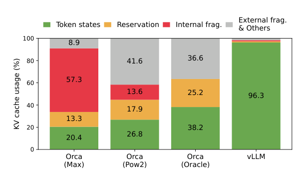
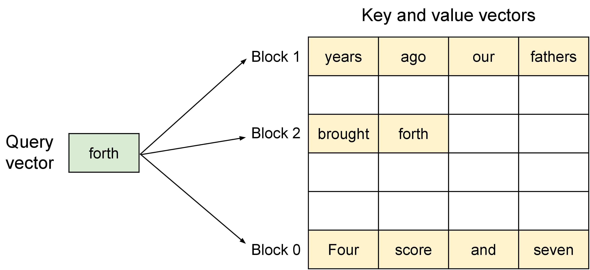
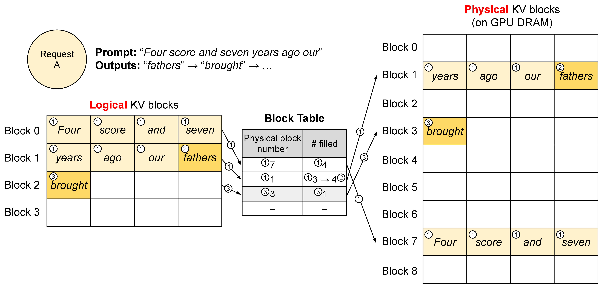
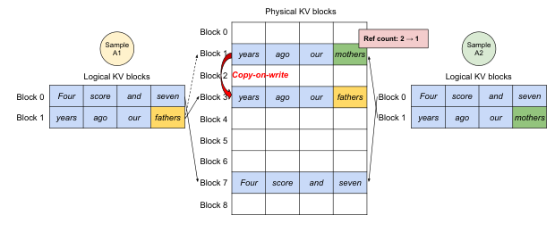
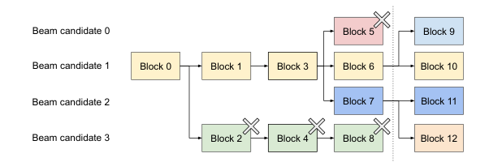
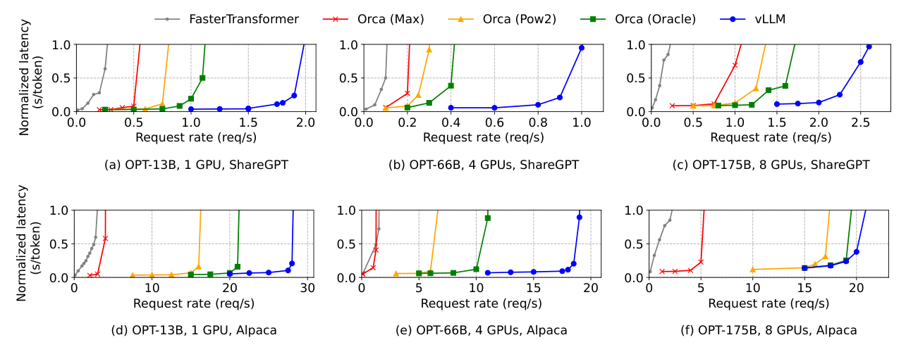
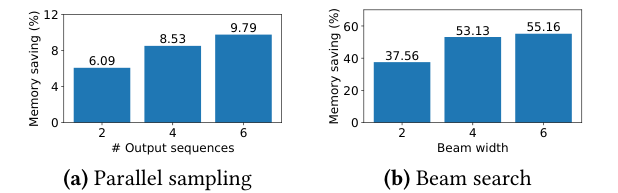
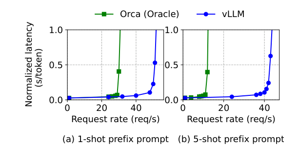
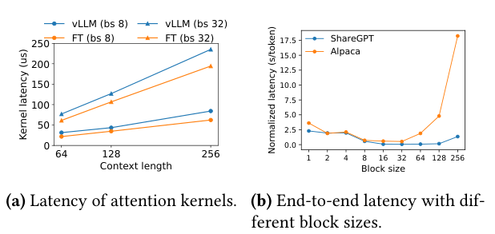
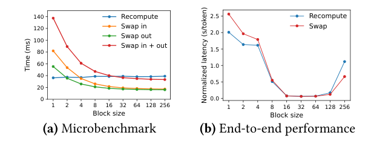

# vLLM / PagedAttention：为什么 KV cache 需要分页管理

!!! info "论文信息"
    **论文题名：** Efficient Memory Management for Large Language Model Serving with PagedAttention。 
    **作者：** Woosuk Kwon、Zhuohan Li、Siyuan Zhuang、Ying Sheng、Lianmin Zheng、Cody Hao Yu、Joseph E. Gonzalez、Hao Zhang、Ion Stoica。 
    **机构：** 未在公开元数据中稳定解析；以 arXiv/PDF 或官方页 affiliation block 为准。 
    **时间 / 主题：** 2023-09；高效推理。 
    **arXiv / 官方报告：** arXiv：[2309.06180](https://arxiv.org/abs/2309.06180)；官方材料：[vllm.ai/blog/2023-06-20-vllm](https://vllm.ai/blog/2023-06-20-vllm)。 
    **GitHub / 项目：** GitHub：[github.com/vllm-project/vllm](https://github.com/vllm-project/vllm)；项目页：[vllm.ai/blog/2023-06-20-vllm](https://vllm.ai/blog/2023-06-20-vllm)。 
    **元数据来源与核验口径：** 来源：[arXiv](https://arxiv.org/abs/2309.06180)；[GitHub API / repo](https://github.com/vllm-project/vllm)；[官方 / 项目材料](https://vllm.ai/blog/2023-06-20-vllm)；Checked Date：2026-06-15；Repro Status：Paper / official materials reviewed, independent reproduction not claimed。

## GPU 还有计算能力，为什么服务却装不下更多请求

PagedAttention 的出发点是一个系统层面的矛盾。自回归模型一次为每个请求生成一个 token，单请求计算往往不能充分利用 GPU；把多个请求放进同一批次，可以摊薄读取模型权重的成本。然而，每个活跃请求都带着不断增长的 KV cache。计算资源尚有余量时，显存已经可能阻止 batch 继续扩大。

论文发现，问题不只在于历史本身很长，还在于历史怎样被保存。将每个请求的 KV 放进一段预先分配的连续空间，需要为未知输出预留容量；不同请求的长度和生命周期又制造碎片。多个候选回答明明拥有相同前缀，连续张量管理却往往为它们复制整份缓存。在论文的对照实验中，已有方案真正用于 token states 的 KV 显存只有 20.4%–38.2%。[↗](https://arxiv.org/pdf/2309.06180v1#page=2)

**PagedAttention 将逻辑上的连续历史与物理存储位置分开。** attention kernel 按块表访问分散的 KV 块，管理器只为已经到来的 token 分配空间，并允许不同序列共享相同块。vLLM 把这种内存表示与迭代调度、抢占恢复和多卡执行组合起来，让更多请求进入有效 batch。

这篇论文的关键结果是相同延迟水平下的服务吞吐提升。它没有要求每个 attention kernel 都更快；恰恰相反，微基准显示分页 kernel 存在额外延迟。只有把“单次算子成本”和“整个服务能处理多少并发”连起来，才能理解其贡献。

## Prefill、decode 与 KV 的增长发生在什么时刻

prompt 已经完整给出时，模型可以同时处理其中所有位置，用矩阵乘法计算各层表示和 KV，并预测第一个输出 token。论文称为 prompt phase，也就是通常所说的 prefill。接下来的 decode 每次输入最新一个 token，读取历史 KV，计算该 token 的新 KV，再预测下一个 token。

这里有一个容易混淆的时间点。prefill 预测出第一个输出 token 时，缓存里已有的是 prompt 的 KV；这个输出 token 自身的 KV，要在它作为下一次 decode 的输入经过模型后才产生。块分配因此跟随实际进入模型的位置增长，而不是把刚采样出的所有 token 都视为已经有完整 KV。

单条 decode 的矩阵规模很小，却要反复读取大量权重和历史状态。批处理能让不同请求共享一次权重读取所支持的计算，但请求并不会同时到达、同时结束。如果一个 batch 必须等其中最长请求生成完才能换人，短请求结束后就留下闲置位置，新请求则继续排队。

Orca 等工作已经提出 iteration-level scheduling：每轮迭代结束，移除完成请求并加入新请求，配合变长 kernel 避免 padding。vLLM 沿用这种细粒度调度思想，进一步处理它尚未解决的容量问题。调度器能够加入新请求，不等于缓存管理器有空间接纳它；两者解决的是不同环节。[↗](https://arxiv.org/pdf/2309.06180v1#page=3)

## 先把实际历史、未来预留和碎片分开计算

对普通多头 attention，一条长度为 $T$ 的序列，KV 占用可以展开为

$$
M_{\mathrm{KV}}=2\,T\,L\,d_{\mathrm{KV}}\,b_e.
$$

前一个 2 表示 K 与 V，$L$ 是层数，$d_{\mathrm{KV}}$ 是每层所有 KV heads 的总宽度，$b_e$ 是每个元素的字节数。这是原文 OPT 例子的记账方式；若用于不同 KV-head 配置，必须使用实际 KV 宽度。

OPT-13B 的 $L=40$、$d_{\mathrm{KV}}=5120$、FP16 每元素 2 bytes，所以每 token 为 819200 bytes，即 800 KiB；2048 tokens 为 1677721600 bytes，约 1.56 GiB。原文将后者概述为约 1.6 GB。A100 40GB 还要容纳约 26 GB 权重和运行空间，实际留给 KV 的预算约为 12 GB，因此长请求数量很快受限。[↗](https://arxiv.org/pdf/2309.06180v1#page=4)

连续预分配在这份真实需求之外又增加三类占用。**Reservation（预留）** 是未来会用、现在尚未生成的 token 槽；**Internal fragmentation（内部碎片）** 是超过最终长度、始终不会使用的槽；**External fragmentation（外部碎片）** 则是分配器中难以用于新请求的间隙。预留最终有用途，但在它尚未使用的时间内，同样阻止其他请求进入。

Figure 2 的绿色部分才是正在保存有效 token states 的比例。先比较 Oracle 与 vLLM，能排除一个过于简单的解释：即使提前知道最终输出长度，也没有自动消除所有浪费。

{ width="615" }

*图源：[PagedAttention 论文](https://arxiv.org/abs/2309.06180)，Figure 2。四种设置的有效 token states 比例依次为 20.4%、26.8%、38.2%、96.3%；灰色还包含 external fragmentation 以外的其他开销。*

Orca Oracle 不再需要为错误的最大长度多留内部空间，但图中仍有 25.2% reservation，以及 36.6% external fragmentation & others。它从请求开始就为整个已知最终长度占住一段连续空间，当前未生成的位置仍不能交给别的请求。vLLM 的 96.3% 正是在按需增长与固定尺寸分配两方面同时改善的结果，而不是预测输出长度更准确。

压紧所有活跃张量也可以减少外部碎片，但 KV 很大，反复移动它们会产生传输成本；压紧本身还没有解决多候选共享。论文因此选择改变缓存的表示和消费者接口，使不连续物理布局直接成为可计算的布局。[↗](https://arxiv.org/pdf/2309.06180v1#page=5)

## 分页 attention 怎样保持同一个概率计算

设每块容纳 $B$ 个 token 的 K/V，逻辑块 $j$ 保存连续位置的一段历史。块本身可以位于任意可用物理位置，kernel 通过 block table 找到它。图中三个物理块的排列顺序不影响 query 对全部历史的注意力。

{ width="860" }

*图源：[PagedAttention 论文](https://arxiv.org/abs/2309.06180)，Figure 5。沿 query 到各个 K/V 块的箭头读，块中的位置仍属于同一条序列。分页改变地址映射，不删除历史。*

为展开原文式（4），令 $\mathcal B_j$ 表示第 $j$ 个块内、当前 query 能看见的有效位置，$d_h$ 是单个 head 的维度。完整 softmax 分母为

$$
Z_i=\sum_j\sum_{t\in\mathcal B_j}
\exp(q_i^\top k_t/\sqrt{d_h}),
$$

输出为

$$
o_i=\frac{1}{Z_i}\sum_j\sum_{t\in\mathcal B_j}
\exp(q_i^\top k_t/\sqrt{d_h})v_t.
$$

物理块分散，但分母仍覆盖所有可见位置，尾块未填充的槽不能参加计算。这是原 attention 的块式组织，数学上没有引入滑动窗口、稀疏丢弃或历史压缩。[↗](https://arxiv.org/pdf/2309.06180v1#page=5)

不能对每块独立做 softmax，再简单平均块输出。一个解释性例子是，第一块两个位置的未归一化权重为 1、1，value 都为 0；第二块一个位置权重为 3，value 为 1。全局输出是 $3/(1+1+3)=0.6$，分别归一化后的块输出却是 0 和 1，平均仅为 0.5。块内权重总量不同，跨块组合必须保留统一的归一化信息。

这套机制由应用内的块管理器、映射表和 CUDA kernel 实现。它借用了虚拟内存的逻辑与物理解耦思想，并不是让操作系统通过 GPU 页故障自动完成 attention 张量管理。论文实现为不同层和 heads 的 KV 使用独立块组织，以便实现；这些块仍服从相同序列位置的管理语义。

## 用七个 prompt tokens 看一次完整的块增长

Figure 6 采用 $B=4$。prompt 是 “Four score and seven years ago our”，共七个 tokens；逻辑块 0、1 分别映射到物理块 7、1。第一个块填满四个位置，第二个块已有三个位置，还留一个槽。

{ width="760" }

*图源：[PagedAttention 论文](https://arxiv.org/abs/2309.06180)，Figure 6。表中既记录 physical block number，也记录已填位置数。重点看第二个逻辑块从 3 个位置变成 4 个位置，以及下一个新块何时出现。*

prefill 后预测出 “fathers”。下一轮把它作为输入执行 decode，其新 KV 写入物理块 1 的最后一格，同时预测 “brought”。再下一轮处理 “brought” 时，原有块已满，管理器才分配物理块 3，并将新逻辑块映射过去。整个过程不需要找到一段能容纳未来最大输出长度的连续内存。

GPU worker 的 block engine 会预先分配一块物理显存池，并将它划成固定尺寸块；按需分配发生在这个池的块级管理中。因而，进程已经占住显存池与某个请求已经用掉全部槽位，是两件不同的事。判断利用率应检查池内有效 token states、共享引用与空闲块，不能只看进程的显存占用数字。

对一条没有共享的活跃序列，逻辑块按顺序填满后才开新块，因此未使用位置只出现在最后一块，上界为 $B-1$ 个 token 槽。请求结束后，所有引用计数归零的块都能重新分配。不同请求可以交错使用物理块，释放出的固定尺寸块不需要与相邻空闲区域拼接才能服务新请求。[↗](https://arxiv.org/pdf/2309.06180v1#page=6)

以 $B=16$、长度 33 为解释性例子，请求需要三块、共 48 个槽，最后空 15 个；长度增长到 48 仍无需新增块，处理第 49 个位置时才申请第四块。这个上界说明按需分配为何有效，也揭示短序列下大块可能浪费很多相对空间。不能把“每条序列只浪费一个尾块”理解成任何负载下浪费比例都接近零。

## 共享前缀之后，如何防止一个分支覆盖另一个分支

### Parallel sampling 的共享边界

同一 prompt 生成多个答案时，prompt KV 完全相同，可以让各序列映射到相同物理块。每个物理块维护 reference count；只要有一个序列仍引用它，就不能释放。已经填满的共享前缀块不再写入，可以持续共享。

问题在于不满的最后一块。不同分支接下来可能生成不同 token，如果继续向同一物理块写，就会互相覆盖。Figure 8 沿用七 token prompt：两条样本都引用物理块 7 和 1，引用计数均为 2。当 A1 需要在尾块写入自己的新 KV 时，系统先将物理块 1 复制到新块 3，调整 A1 的映射，并把原块引用计数减到 1。A2 随后就能在原块中直接写入自己的分支。[↗](https://arxiv.org/pdf/2309.06180v1#page=7)

{ width="620" }

*图源：[PagedAttention 论文](https://arxiv.org/abs/2309.06180)，Figure 8。红色箭头只复制发生分叉的尾块，完整 prompt 块 7 仍由两条序列共享。先读 ref count 的变化，再看 “fathers” 与 “mothers” 的写入位置。*

这个 **Copy-on-write（写时复制）** 将成本限制在真正需要修改的共享块。它并不意味着任意相同 token 都可共享 KV：同一个词出现在不同前文或不同位置，其表示通常不同。共享成立的条件是相同有效前缀及对应模型计算上下文。

### Beam search 还会共享生成中的历史

beam search 每轮保留最有希望的候选，多个新候选可能来自同一个旧候选，所以共享关系随搜索树变化。Figure 9 中，四个旧候选都分享块 0，候选 0–2 还分享块 1、3；下一轮保留下来的四个候选全部源于旧候选 1、2。

{ width="618" }

*图源：[PagedAttention 论文](https://arxiv.org/abs/2309.06180)，Figure 9。虚线表示候选更新边界，打叉的块失去全部引用；新候选沿已有树枝共享历史，再为后续位置申请新块。*

淘汰旧候选 0、3 后，块 2、4、5、8 的引用归零，可以释放。新候选获得块 9–12，共享块 0、1、3，并按来源进一步共享块 6 或 7。传统连续张量若重新排列 beam，可能复制很长的历史；块表只需重建引用关系，在分叉落入不满旧块时才触发一个块的写时复制。

这种操作被抽象成 `fork`、`append`、`free`。`fork` 创建带共享历史的新序列，`append` 增长一个 token，`free` 删除序列并处理引用。parallel sampling、beam search 和公共前缀都能由这三类操作组合，kernel 只看到每条序列的物理块列表，无需理解上层属于哪种搜索算法。[↗](https://arxiv.org/pdf/2309.06180v1#page=9)

## 公共系统提示的共享，为什么又不同于聊天历史缓存

服务提供方可以预先为一组固定公共提示计算 KV。新请求只需将相应逻辑前缀映射到已有物理块，prefill 重点处理本次任务输入；末尾不满的共享块仍按 copy-on-write 管理。论文用带翻译示例的提示展示这种跨请求共享。[↗](https://arxiv.org/pdf/2309.06180v1#page=8)

它直接减少了重复计算，也减少了重复状态占用。这两类收益可以叠加：长公共前缀不必每次重算，释放出的 KV 空间又使更多请求同时运行。反之，几乎没有公共前缀的负载，主要收益仍来自按需分配。

这里描述的是服务端预定义前缀的共享接口。论文的聊天实验却明确选择不在不同轮对话之间保留 KV，以免用户等待下一次输入时，缓存持续占用其他请求的空间。因此，公共前缀实验不能被扩写成“本文聊天加速全部来自跨轮缓存复用”；两组实验实际采用了不同的状态保留策略。

## 所有块都用完以后，抢占为什么以序列组为单位

未知输出长度意味着，只接纳当下能装下的请求仍可能在后续增长时用完显存。vLLM 使用 FCFS 优先级，优先服务早到请求，需要抢占时从晚到请求开始。它没有提前承诺每个已接纳请求都能无抢占地生成到最大长度。

一般缓存替换会猜测哪个块最晚再用，但完整 attention 每轮都需要该序列的全部历史。只换出其中一块，会让整个序列无法继续。因此本文使用 all-or-nothing 策略，整条序列的块一起处理。一个请求中的多个候选可能共享状态，还需要作为 sequence group 一起调度、抢占和恢复。[↗](https://arxiv.org/pdf/2309.06180v1#page=8)

两种恢复方法保留的信息不同。

| Method | What is retained | How the request resumes | Main cost |
| --- | --- | --- | --- |
| Swapping | CPU RAM 中的 KV 块 | 将块搬回 GPU 后继续 decode | CPU–GPU 传输及小块搬运开销 |
| Recomputation | prompt 与已生成 token 序列 | 将它们作为一个新 prompt 重算 KV | 一次已知序列的前向计算 |

重计算不必把过去的随机采样重新做一遍，也不必逐 token 重放旧 decode。已生成 tokens 已知，可以合并为一个序列，在一次 prefill 中并行恢复其缓存。原来的结果保留，重建的是中间状态。这是 LLM 应用语义提供的恢复方式，普通操作系统无法对任意被换出页都这样重算。

原文 swapping 策略还有一个限制 CPU 占用的配套规则：出现抢占以后，暂停接纳新请求，直到被抢占序列全部完成；已有请求完成释放空间后，逐步换回等待序列。这样 CPU 中的换出块不会超过 GPU KV 池的总块数。这个上界依赖接纳策略，不能只保留“换到 CPU”一句，就推断任意调度器的主存占用都有相同保证。

分页使回收和恢复可控，并没有消除过载。当到达率长期高于系统服务能力，仍会产生越来越长的队列。后面的延迟曲线正是通过这个拐点比较各系统能承受的请求率。

## 多卡执行与三个融合 kernel 如何承接块管理

中央 scheduler 决定本轮参与的请求和新增块，将 input token IDs 与各请求的 block table 广播给 GPU workers；worker 执行模型并返回采样结果。图中 cache engine 负责物理块操作，模型 shard 负责计算，二者通过同一映射接口衔接。

{ width="860" }

*图源：[PagedAttention 论文](https://arxiv.org/abs/2309.06180)，Figure 4。先沿 scheduler 到 worker 的控制路径读，再看 CPU/GPU block allocator 与 cache engine 的关系。调度策略没有进入每个 attention head 的数值计算。*

模型采用 Megatron-LM 风格张量并行时，各 GPU 处理相同 tokens，保存不同 attention heads 的 KV。所有 worker 使用相同物理块编号和逻辑映射，但编号对应的具体数据是本卡的 KV 分片。中央管理器因而只需统一广播管理决定；worker 之间的模型 all-reduce 由分布式执行本身完成，无需每次都经 scheduler 协调。[↗](https://arxiv.org/pdf/2309.06180v1#page=9)

间接寻址会引入新开销，论文用三种融合操作减少它。第一，生成新 KV 后，将 reshape、适配块读取的布局转换和按地址写入融合，减少 kernel launch。第二，读取块表与 attention 计算融合，让 warp 按块读取并当场计算，同时支持 batch 中不同序列长度。第三，将多个不连续块的 copy-on-write 复制合并为一次 kernel，避免为每个小块都发出单独的 `cudaMemcpyAsync`。

这说明块管理不能只停在 Python 中维护一个字典。消费者必须直接读取分块布局，写入和复制路径也要适配。如果每轮先把所有散块拼成完整连续 KV 再运行原 kernel，就会重新支付大规模搬运，削弱分页所要获得的收益。

## 吞吐实验的硬件、负载和基线如何限定结论

论文主要使用 Google Cloud A2 实例上的 OPT 模型，公共前缀实验另外使用 LLaMA-13B。Table 1 的容量如下。

| Model size | GPUs | Total GPU memory | Parameter size | Memory for KV cache | Max. KV cache slots |
| --- | --- | ---: | ---: | ---: | ---: |
| 13B | 1 × A100 | 40 GB | 26 GB | 12 GB | 15.7K |
| 66B | 4 × A100 | 160 GB | 132 GB | 21 GB | 9.7K |
| 175B | 8 × A100-80GB | 640 GB | 346 GB | 264 GB | 60.1K |

这些是整个模型并行组的总量。66B 使用更多 GPU，却因为权重和每 token KV 都更大，总 token slots 还低于 13B；175B 则有明显更宽裕的 KV 空间。模型规模不能独立于硬件配置解释并发能力。[↗](https://arxiv.org/pdf/2309.06180v1#page=9)

负载从 ShareGPT 和 Alpaca 中取得输入、输出长度，再用 Poisson 到达过程合成请求时间。ShareGPT 平均输入 161.31 tokens、输出 337.99；Alpaca 平均输入 19.31、输出 58.45。前者平均输入约长 8.4 倍、输出约长 5.8 倍，方差也更大。它们提供实际文本的长度分布，但没有原始线上时间戳，所以实验不是对真实突发流量的原样回放。

大部分实验使用一小时 trace，OPT-175B 因成本限制使用十五分钟。比较对象也需要明确。[↗](https://arxiv.org/pdf/2309.06180v1#page=10)

| Baseline | Scheduling / allocation assumption |
| --- | --- |
| FasterTransformer | 作者外接动态 batch scheduler，按容量选择最大 batch，取最早到达的一组请求执行 |
| Orca (Max) | 迭代调度；为模型最大长度 2048 预留空间 |
| Orca (Pow2) | 依据实际输出长度向上取二次幂，如 25 个输出位置预留 32 个 |
| Orca (Oracle) | 假定提前知道真正输出长度，按该长度预留 |

Orca 当时未公开可用，论文作者自行实现，并假定使用 buddy allocator。这是带明确假设的复现基线，不是直接运行原 Orca 发布版本。Oracle 显然拥有线上不可得的未来信息，Pow2 在实验中也依据真实输出长度构造理想预留量；两者用于观察不同过度预留程度，不能当成已经解决了输出长度预测的可部署策略。

FasterTransformer 主要优化推理计算，作者为它加的调度方式又不同于迭代级调度。因此，它与 vLLM 的差异包含内存和调度两方面；最高加速比不能全部归因于某个页表操作。

### Normalized latency 不是单步 decode 时间

论文指标可写为

$$
L_{\mathrm{norm}}=\frac1N\sum_{r=1}^{N}
\frac{L_r^{\mathrm{end\text{-}to\text{-}end}}}{T_r^{\mathrm{output}}}.
$$

它先将每个请求从到达至完成的延迟除以其输出长度，再对请求求均值。排队、prefill 和 decode 都进入分子。这不是只在相邻输出 token 之间测量的 TPOT，也不是总延迟之和除以总输出 tokens；后者会按输出长度隐式给请求不同权重。

例如两个请求分别用 2 秒产生 10 tokens、用 10 秒产生 100 tokens，按论文口径得到 $(0.2+0.1)/2=0.15$ 秒/token；用总量相除则为 $12/110\approx0.109$。这个解释性例子说明，报告同一个单位仍可能对应不同统计量。评估时必须保留指标定义。

## 单输出结果怎样连接到内存利用率

Figure 12 每个面板固定模型与数据集，横轴是请求到达率，纵轴是 normalized latency。应在相近纵轴高度比较横向能承受多少请求，而不是只比较低负载下曲线起点。曲线突然陡升时，系统已难以消化到达流量，排队成为延迟的主要来源。

{ width="1000" }

*图源：[PagedAttention 论文](https://arxiv.org/abs/2309.06180)，Figure 12。上排为 ShareGPT，下排为 Alpaca；各列分别是 OPT-13B、66B、175B。右下角是分页优势缩小的重要条件。*

ShareGPT 上，相同延迟水平下 vLLM 相对 Orca Oracle 可承受约 1.7–2.7 倍请求率，相对 Orca Max 为约 2.7–8 倍。相对 FasterTransformer 的最高值达到 22 倍，但同时包含后者缺少细粒度调度和预留浪费的影响。论文概述的 2–4 倍不是所有面板、所有基线、所有负载下恒定的加速系数。[↗](https://arxiv.org/pdf/2309.06180v1#page=11)

Figure 13 进一步检查中间变量：在 OPT-13B 的固定到达率下，究竟有多少请求同时进入 batch。

| System | ShareGPT, 2 req/s | Alpaca, 30 req/s |
| --- | ---: | ---: |
| Orca (Max) | 7.00 | 7.00 |
| Orca (Pow2) | 9.81 | 43.24 |
| Orca (Oracle) | 13.62 | 72.75 |
| vLLM | 30.42 | 132.44 |

ShareGPT 的 30.42 相对 Oracle 的 13.62 约为 2.2 倍，相对 Max 的 7.00 约为 4.3 倍。这与有效 KV 状态比例提高共同支持论文的机制解释：更多请求的工作集装得下，才有机会用更大 batch 摊薄权重访问。这里的 batch 数是持续服务过程中的平均值，不是强制固定 batch 的单次 kernel 对比。

右下角 OPT-175B、Alpaca 则展示了限制。它有 264 GB KV 预算，而请求很短，Oracle 和 Pow2 即使浪费一部分空间，也能放进足够多请求。系统更接近计算受限，分页再提高内存利用率，吞吐优势就缩小。这个反例直接说明，优化有效的前提是容量确实限制了并发。

## 多候选和公共前缀如何放大共享收益

### 共享的是 prompt，还是搜索过程中的更长历史

Figure 15 的分母是“不共享时所需的总块数”，衡量共享减少了多少 KV 块。先比较左右两个面板，再比较每个面板中候选数增加的趋势。

{ width="618" }

*图源：[PagedAttention 论文](https://arxiv.org/abs/2309.06180)，Figure 15。OPT-13B、Alpaca 负载。左侧只共享 prompt，右侧还可以共享生成树中的历史。*

| Decoding method | 2 outputs / beams | 4 outputs / beams | 6 outputs / beams |
| --- | ---: | ---: | ---: |
| Parallel sampling | 6.09% | 8.53% | 9.79% |
| Beam search | 37.56% | 53.13% | 55.16% |

parallel sampling 的答案很快分叉，只共享 prompt，所以在短 prompt 的 Alpaca 上节省有限。beam search 的新候选可能来自同一个高分旧候选，生成历史也可以继续共享，六 beams 时节省超过一半。ShareGPT 前缀更长，同组实验中 parallel sampling 节省 16.2%–30.5%，beam search 为 44.3%–66.3%。这些百分比属于 KV 块，不能直接写成整张 GPU 显存下降相同比例。

相应地，OPT-13B、Alpaca 上相对 Oracle 的吞吐优势，从单输出约 1.3 倍扩大到 beam width 6 的约 2.3 倍。它把共享机制与最终服务结果连接起来，也说明一个只测单输出的 benchmark 会漏掉动态前缀共享的价值。[↗](https://arxiv.org/pdf/2309.06180v1#page=11)

### 跨请求前缀同时减少计算与存储

公共前缀实验使用 LLaMA-13B 和 WMT16 英译德任务。一个前缀包含一条翻译示例、共 80 tokens，另一个包含五条示例、共 341 tokens。注意正文任务是英译德，方法示意图中的英法示例不应替代实际实验设置。

{ width="613" }

*图源：[PagedAttention 论文](https://arxiv.org/abs/2309.06180)，Figure 16。先比较相同延迟下蓝绿曲线的横向距离，再比较单示例与五示例前缀。*

共享 80-token 前缀时，相对 Orca Oracle 的吞吐约提高 1.67 倍；341-token 前缀时提高到 3.58 倍。更长公共上下文提供了更大的重复计算与重复状态消除空间。这个实验支持预定义前缀接口的价值，并没有评测所有自动发现、淘汰或持久化前缀的策略。[↗](https://arxiv.org/pdf/2309.06180v1#page=12)

### 聊天实验主要检验长输入下的分配行为

聊天负载使用 OPT-13B，将历史和当前输入拼接，只保留最后 1024 prompt tokens，最多再生成 1024 tokens；不同轮次不保留 KV。由于大部分长对话的输入已接近 1024，作者的 buddy allocation 基线会为输出再保留约 1024 个位置，三种 Orca 设置表现接近。vLLM 在这组负载下可承受约两倍请求率，收益主要来自减少长请求的预留与碎片，而不是跨轮跳过历史计算。

## 为什么单个 kernel 更慢，服务却更快

动态块表要求额外读取地址、执行分支并处理变长序列。Figure 18a 在 batch 8、32，以及 context length 64、128、256 下比较 attention kernel；vLLM 的延迟相对优化后的 FasterTransformer 高约 20%–26%。这个代价真实存在。

{ width="618" }

*图源：[PagedAttention 论文](https://arxiv.org/abs/2309.06180)，Figure 18。左图说明间接寻址的局部代价，右图说明不同工作负载对块大小的响应。两个面板的横轴与纵轴含义不同。*

但这项开销只发生在相应 attention 操作，不能直接等同于整个模型每步变慢 20%–26%。与此同时，分页让系统装下更多请求、减轻排队，并摊薄每请求承担的其他模型运算和访存成本。这就是局部微基准与整体吞吐可以朝不同方向变化的原因。[↗](https://arxiv.org/pdf/2309.06180v1#page=12)

块大小消融进一步展示折中。太小的块增加寻址与管理粒度，难以充分利用 GPU 读取和处理 KV 的并行性；太大的块增加尾部空洞，也降低前缀能够完整共享的机会。ShareGPT 中 16–128 表现较好，Alpaca 中 16、32 较好，更大块明显恶化，因为许多序列比块还短。论文据此选择默认 16，属于该实现与负载下的经验配置。

这个结果也纠正了一个常见直觉：把块做到一个 token 可以最小化尾部浪费，却不保证服务最快。系统需要在有效存储比例、GPU 并行访问和管理开销之间找到平衡。

## 重算与换入换出，怎样随块大小改变优劣

Figure 19 左图测恢复操作本身，右图测相同请求率下的 OPT-13B、ShareGPT 服务。应先看小块处红色 swapping 曲线，再看中间块大小处两种方法的端到端曲线是否仍有明显差异。

{ width="613" }

*图源：[PagedAttention 论文](https://arxiv.org/abs/2309.06180)，Figure 19。左侧将 swap in、swap out 与往返总成本分开；右侧包含这些恢复操作对整个服务的影响。*

小块导致大量 CPU–GPU 小传输，PCIe 有效带宽利用不好，swapping 开销很大。recomputation 通过一次已知序列前向完成，不依赖这些 KV 块的搬运粒度，所以微基准曲线相对平坦。块变大后，传输更有效，swapping 可以更有利；在 16–64 的中等块大小下，两种方法端到端表现接近。[↗](https://arxiv.org/pdf/2309.06180v1#page=13)

恢复策略因此不能只按“传数据总比重算便宜”选择。模型计算能力、CPU–GPU 带宽、序列长度、块大小与发生抢占的频率共同决定代价。微基准中某个操作快，也未必会等比例改变整体延迟，因为大部分执行时间可能仍在正常请求处理。

## 这套设计适合什么样的系统问题

PagedAttention 提供的是一种让动态状态可以增长、共享和回收的接口。迭代 batching 让请求在时间上灵活组合，分页让它们在显存中更容易共同驻留；词表、模型权重和完整 attention 的数学语义无需为此改变。对长序列、多候选、公共前缀较多且并发受 KV 容量限制的服务，这个接口尤其有用。

它与 FlashAttention 也处在不同层面。后者主要通过分块计算和 kernel 组织减少 attention 的中间存储与 I/O；这里管理的是跨解码步长期驻留、随请求变化的 KV 状态。论文 prefill 本身可以使用传统高效 attention，包括其引用的 FlashAttention。二者不能只因都出现 “block” 就视为同一个算法。[↗](https://arxiv.org/pdf/2309.06180v1#page=14)

采用时最值得复用的检查方式，是把四层指标连起来：有效 token states 占了多少 KV 池、平均同时运行多少请求、相同延迟下承受多少到达率，以及共享和恢复分别花了多少时间。若前三者没有相应变化，仅比较一个更复杂的分页 kernel，可能只看到间接寻址的代价。

对于形状静态、分配可提前规划的训练任务，或者计算已经饱和的短请求服务，提高内存利用率未必带来吞吐提升。论文既给出了按需管理与共享的正例，也用短序列、大显存及 kernel 微基准划出了边界。可迁移的认识是沿请求生命周期管理状态，并让计算接口直接消费这种状态布局；具体收益仍由真实长度分布、到达流量与硬件决定。

读实现时先看[上下文压缩、KV 驱逐与内存层级](../../inference/context-compression-kv-eviction-and-memory-hierarchies.md)，把“分页存放”和“删除历史”区分开；再看[服务系统总览](../../inference/serving-systems.md)，把 batching、队列和 SLO 放回请求生命周期。需要落到 kernel 地址计算时，可接[Serving attention 与 KV kernel](../../operators/serving-attention-and-kv-kernels.md)，对照逻辑 token、物理 block 和真实长度 mask。
