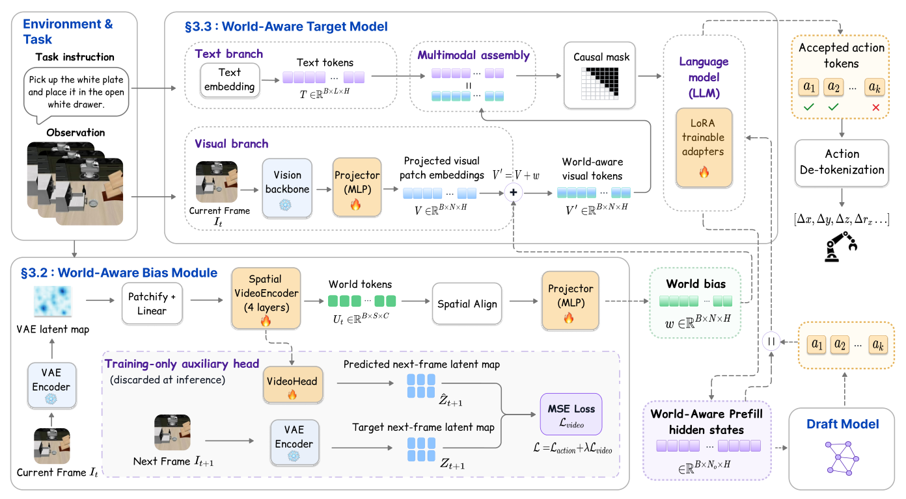
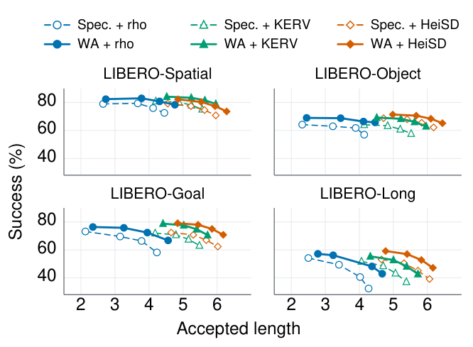
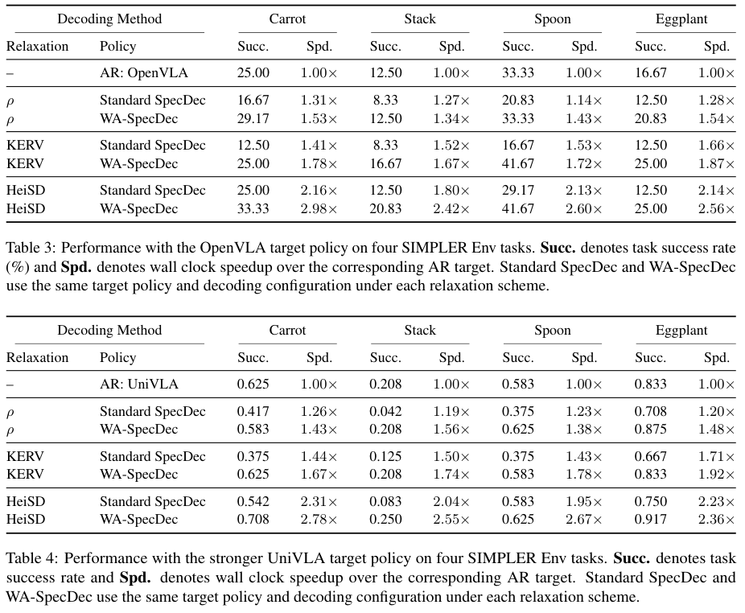
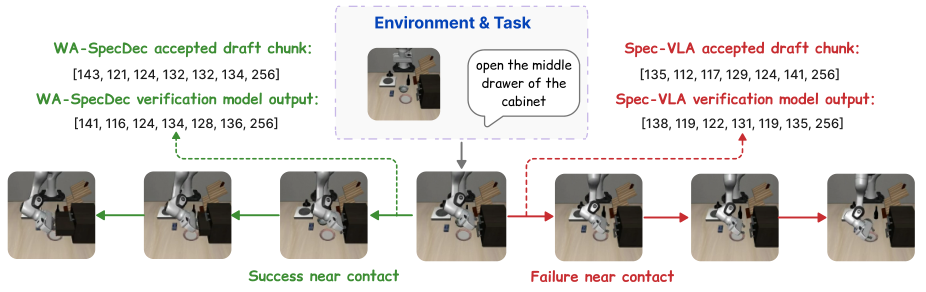

# WA-SpecDec：让 Draft 与 Target 共享物理场景表征

!!! info "论文信息"
    **论文题名：** WA-SpecDec: World-Aware Speculative Decoding for Vision-Language-Action Models。 
    **作者：** Zikang Wen、Yuning Zhang、Dong Yuan。 
    **机构：** The University of Sydney。 
    **时间 / 主题：** 2026-08；VLA 投机解码与物理场景表征。 
    **版本 / 发表状态：** arXiv:2608.08725v1，2026-08-09；arXiv preprint。 
    **arXiv / 官方报告：** [摘要](https://arxiv.org/abs/2608.08725)、[PDF](https://arxiv.org/pdf/2608.08725v1)。 
    **GitHub / 项目：** 论文 Section 4.1 写明代码与评测脚本将在接收后发布，本次未确认公开实现。 
    **元数据来源与核验口径：** arXiv v1 全文及 Appendix A–C；Checked Date：2026-09-28；Repro Status：Paper Only，未进行独立复现。

## 接受的动作足够接近目标，为什么仍会抓空

离散动作 VLA 的推理接口很像语言模型。它先把指令和当前图像编码成上下文，再逐 token 产生机器人动作，最后由 detokenizer 转成连续控制量。目标模型越大，每次自回归调用越昂贵；同一条控制指令又常常包含多个动作 token，于是机器人需要等待多次大模型前向才能行动。投机解码让轻量 draft 先提出一段动作，再由 target 一次并行验证，希望用较少的大模型调用完成同一条控制查询。

机器人动作与普通文本有一个区别。两个离散 token 即使不完全相同，反量化后的控制量也可能很接近。Spec-VLA 因而允许草稿与目标相差一定距离，KERV 和 HeiSD 则进一步把运动学信息或混合判据纳入验证。放宽规则通常能接纳更长前缀，但动作距离相近只说明数值接近，不能直接回答它在当前场景里是否有效。夹爪离物体较远时，少量偏移可能无关紧要；同样偏移发生在把手边缘，就可能使原本能接触把手的动作变成擦过表面。[↗](https://arxiv.org/pdf/2608.08725v1#page=3)

WA-SpecDec 改进的是草稿和目标共同使用的场景表征。它从当前图像中提取另一组保留空间布局的 latent 特征，经过训练得到逐 patch 的偏置，加到原视觉 token 上，然后才进入目标模型的 prefill。目标的验证参考和草稿的生成条件随之一起改变。验证器仍使用原来的容差或运动学规则，部署时也不会先生成一段未来视频再决定是否执行。

这篇论文应当用三个相连的问题来读。第一，额外视觉支路究竟向目标模型输入了什么，为什么训练时需要下一帧。第二，改变了目标策略之后，投机解码还保留哪些保证。第三，成功率、接受长度和真实计算时间是否一起改善，所谓“接触附近失败减少”又用了什么分母。只有把这三层接起来，才能理解它比单纯调大容差多做了什么。

## 把场景信息放到双方共享的 prefill 之前

### 当前图像沿两条路线进入模型

Figure 2 应先沿当前图像向右读，再看下方的辅助训练支路。上方仍是 VLA 原有的视觉编码和多模态投影，下方增加冻结的 VAE encoder 与 World-Aware Bias（WAB）模块。两路在视觉 token 进入语言模型前相加；右下方的 draft 使用由这一新输入得到的 prefill hidden states。[↗](https://arxiv.org/pdf/2608.08725v1#page=4)

{ width="900" }

对当前 RGB 图像 $I_t$，冻结的 Wan 2.2 VAE encoder 先产生空间 latent：

$$
Z_t=E_{\mathrm{vae}}(I_t)
\in\mathbb R^{B\times H_z\times W_z\times C_{\mathrm{vae}}}.
$$

$B$ 为 batch size，$H_z,W_z$ 是 latent 的空间尺寸，$C_{\mathrm{vae}}$ 是通道数。这里使用 Wan 的组件是为了压缩当前图像，并没有调用它的完整视频生成模型。相对于已经承担视觉语义理解的原骨干，这条支路希望补入重建型表示保留的外观、位置与局部布局信息。它并没有直接输出物体位姿、接触标签或距离真值。

接下来把二维网格展开并线性投影，再送入四层 spatial VideoEncoder：

$$
U_t=F_\omega(\phi_{\mathrm{tok}}(Z_t))
\in\mathbb R^{B\times S\times C},
\qquad S=H_zW_z.
$$

$\phi_{\mathrm{tok}}$ 负责把 VAE 通道变成 WAB 使用的 token 宽度 $C$，$F_\omega$ 在这组空间 token 上学习与动作有关的表示。虽然模块名带有 VideoEncoder，但推理时这里的输入来自当前帧；不能仅凭名字把它理解成多帧历史建模或在线视频预测器。

原 VLA 的视觉 patch 网格与 VAE latent 网格不一定同分辨率，因此还不能直接相加。SpatialAlign 先把 $U_t$ 恢复为二维布局，插值到 VLA 的 patch 网格，再展开成序列；偏置投影器把通道变成语言模型需要的宽度：

$$
w_t=f_{\mathrm{bias}}\bigl(\operatorname{SpatialAlign}(U_t)\bigr)
\in\mathbb R^{B\times N_v\times d_{\mathrm{LM}}},
\qquad
V_t^{\mathrm{wa}}=V_t+w_t.
$$

这里 $N_v$ 为视觉 patch 数，$d_{\mathrm{LM}}$ 表示原文这一处记作 $H$ 的 hidden width。每个 patch 得到自己的偏置，局部空间差异因而能够保留下来；如果先把所有 world tokens 平均成一个向量，再给每个 patch 加同样的值，就不再是论文这条逐位置的注入路线。[↗](https://arxiv.org/pdf/2608.08725v1#page=5)

### 加法改变上下文，token 数保持原规模

将新的视觉表示与指令 embedding $T_x$ 拼接，经过带 LoRA 的目标语言模型：

$$
P_t^{\mathrm{wa}}=[T_x;V_t^{\mathrm{wa}}],
\qquad
h_t^{\mathrm{wa}}
=\operatorname{Prefill}_{\theta+\Delta\theta}(P_t^{\mathrm{wa}}).
$$

$\theta$ 是基础 VLA 参数，$\Delta\theta$ 是训练得到的 LoRA 适配。把偏置放在 prefill 之前，意味着它从第一轮 Transformer 计算起就参与 query、key、value 与前馈变换，进而影响 hidden states、KV cache 和后续动作 logits。它并非在动作已经生成后加一个修正值，也不是只给 draft 一份额外视觉输入。

这种接口设计有两个直接后果。其一，原有视觉 token 的数量仍为 $N_v$，没有为了 world tokens 扩大目标模型的上下文，因此避免了新增 token 带来的目标 self-attention 开销。其二，WAB、VAE encoder 和空间适配本身仍然需要计算。“没有额外目标 token”只能说明一类开销被避免，不能据此认为整个方法零成本。后面的 target-only 消融正好能检验这笔代价。[↗](https://arxiv.org/pdf/2608.08725v1#page=6)

## 下一帧用于训练表示，示范动作用于训练策略

### 完整 latent 网格提供什么监督

只加入一组可训练偏置，并不能保证它学到对接触控制有用的场景信息。论文为 WAB 增加了训练专用的 VideoHead $g_\eta$，从当前 world tokens 预测下一帧 VAE latent：

$$
\mathcal L_{\mathrm{video}}
=\frac{1}{H_zW_zC_{\mathrm{vae}}}
\left\|g_\eta(U_t)-E_{\mathrm{vae}}(I_{t+1})\right\|_2^2.
$$

监督对象是完整空间网格，并非图像整体的 pooled embedding。因此，预测误差会保留空间位置差异，促使 $U_t$ 记住对短期外观和布局变化有用的线索。冻结 VAE 则提供相对稳定的目标空间，使适配网络不能通过任意改变编码目标来降低这个损失。

这个目标的能力边界也能直接从输入看出来。式中 $g_\eta$ 接受 $U_t$，没有显式把某条候选动作送入预测头；论文没有在这里构造“分别执行多个动作、预测各自未来、再挑最佳动作”的规划过程。它利用数据中的相邻帧做辅助表示学习。将其称为具有预测性的场景表示是合适的，将其当成能准确评估任意候选动作后果的物理模拟器，则超出了这条公式。[↗](https://arxiv.org/pdf/2608.08725v1#page=5)

### 动作交叉熵把表示拉向实际控制任务

辅助视频损失之外，目标策略仍然需要学习示范动作。为避免与前文 hidden width 混淆，下面用 $N_a$ 表示一条控制查询中的动作 token 数，等价于原文动作序列长度的 $H$：

$$
\mathcal L_{\mathrm{action}}
=-\sum_{(x,I_t,a^\star_{1:N_a})\in\mathcal D}
\sum_{i=1}^{N_a}
\log p_\theta^{\mathrm{wa}}
\left(a_i^\star\mid x,I_t,a_{<i}^\star\right),
$$

$$
\mathcal L=\mathcal L_{\mathrm{action}}
+\lambda\mathcal L_{\mathrm{video}},
\qquad\lambda=0.1.
$$

动作项使用示范前缀进行 teacher forcing，推动模型在正确的指令、当前图像与历史动作条件下给示范 token 较高概率；视频项约束 WAB 保留下一帧预测所需的信息。两者共同更新 token projector、spatial VideoEncoder、bias projector、VideoHead 与 LoRA。按照 Section 3.3 和 Algorithm 1 的训练描述，VAE 与基础视觉栈保持冻结。[↗](https://arxiv.org/pdf/2608.08725v1#page=6)

Figure 2 的原视觉 Projector 旁画了可训练的火焰，但 Section 3.3 将原视觉骨干及多模态 projector 描述为冻结，Algorithm 1 的可训练模块清单也未列入该 projector。复现训练范围时需要区分这处图文冲突；上面的更新清单采用正文与算法明确列出的设置。[↗](https://arxiv.org/pdf/2608.08725v1#page=14)

训练完成后，$g_\eta$ 被移除，$I_{t+1}$ 不再作为输入，也不需要 VAE decoder。每次新观测只计算当前帧的 $w_t$，再构造共享 prefill。辅助任务通过已经学到的参数影响推理，而非通过部署时持续运行的未来预测支路影响推理。

### 先训练新目标，再蒸馏匹配它的草稿

WAB 和 LoRA 共同改变了目标策略。论文把这个目标定义为

$$
p_\theta^{\mathrm{wa}}(a_i\mid x,I_t,a_{<i})
=p_{\theta+\Delta\theta}(a_i\mid h_t^{\mathrm{wa}},a_{<i}).
$$

随后冻结这个 world-aware target，用其完整输出分布训练轻量 draft：

$$
\mathcal L_{\mathrm{draft}}
=\mathbb E_{(x,I_t,a_{<i})}
\left[
\operatorname{KL}\left(
p_\theta^{\mathrm{wa}}(\cdot\mid x,I_t,a_{<i})
\,\Vert\,
q_\phi(\cdot\mid h_t^{\mathrm{wa}},a_{<i})
\right)
\right].
$$

这里 KL 的方向是 target 到 draft。目标分布认为重要的候选动作会在蒸馏中得到相应权重，而草稿也能看到同一份 world-aware prefill。这样，额外场景信息既影响“提出什么”，也影响“拿什么作验证参考”。如果只给 draft 换输入，target 仍使用旧的视觉表示，两侧并没有共享论文所设计的条件；如果训练完目标却沿用未经重新蒸馏的草稿，也没有完整实现这里的训练顺序。[↗](https://arxiv.org/pdf/2608.08725v1#page=6)

## 验证的是连续前缀，放宽后的动作不再等同目标输出

一次控制查询首先计算共享 prefill。随后 draft 根据已接受序列 $A$ 提议最多 $\gamma$ 个 token，target 在一次前向中给出各位置的参考。对于候选块中的第 $j$ 个位置，验证上下文包含 $A$ 与该位置之前提出的草稿 token，不能把每个候选都当成只依赖初始图像的独立动作。

在最直接的 token-distance 版本中，目标参考和接受条件为

$$
a_j^{\mathrm{wa}}
=\arg\max_a p_\theta^{\mathrm{wa}}
\left(a\mid h_t^{\mathrm{wa}},A,\hat a_{i:j-1}\right),
\qquad
\operatorname{Accept}_\rho(\hat a_j)
=\mathbf 1\left[d(\hat a_j,a_j^{\mathrm{wa}})\le\rho\right].
$$

$d$ 是所用规则定义的 token 空间或反量化动作空间距离，$\rho$ 为容差。算法从块首开始依次收下满足条件的 token；一旦某个位置拒绝，就使用该位置的 target token 替换，丢弃这一块余下的草稿，再进入下一轮。如果整块都接受，则推进这个块的长度。Algorithm 1 在全接受分支没有额外追加一个 target bonus token，不应照搬其他投机采样算法的细节。[↗](https://arxiv.org/pdf/2608.08725v1#page=14)

一个纯粹用于解释算法的例子是：某块提出四个 token，前两个通过、第三个被拒绝。此轮输出就是“两个草稿 token 加第三位置的目标 token”；第四个即使在并行计算中看起来接近自己的参考，也不能继续采用，因为它的验证条件曾包含被拒绝的第三个草稿。新的第三个 token 已经改变了后续上下文。

在算法层面，完整动作 token 序列构造好以后由 Detok 转成控制序列。这里的 accepted length 计量的是每轮验证接受的**动作 token 数**，不能直接当成机器人运行了多少秒、执行了多少个控制周期，或成功完成了多少个子任务。

WAB 保留验证接口，但不恢复精确采样保证。只要 $\rho>0$ 允许草稿与 target argmax 不同，最后执行的序列就可以偏离 target 的逐步贪心输出；论文的规则也没有使用概率比接受与残差分布重采样来证明分布保持。Section 3.3 将分布保持的参照对象从 vanilla VLA 改成 world-aware target，但仅改变参照对象不足以让式中的 relaxed acceptance 变成无损采样。[↗](https://arxiv.org/pdf/2608.08725v1#page=6)

因此，需要分开两个变化：训练 WAB 和 LoRA 已经使目标策略不同于原 OpenVLA；放宽验证又允许加速执行序列偏离这个新目标。本文的可靠性证据来自实际任务成功率及失败统计。对 KERV、HeiSD 的实验，则是在各自验证规则内部比较加入 WAB 前后，并未把三种验证器拼成一个新公式。

## LIBERO 主表证明了什么，也留下了哪些成功率损失

主实验使用 OpenVLA-7B，在 LIBERO-Spatial、Object、Goal、Long 四个 suite 上评估。每个 suite 含 10 个任务，每任务执行 50 次 rollout，共 500 个 episode。树解码最大 50 个节点、深度 4、top-8 候选；主表中距离规则使用 $\rho=10$，KERV 和 HeiSD 使用各自默认设置。每一规则内比较 Standard SpecDec 与 WA-SpecDec，并保留自回归 AR 作为可靠性参照。[↗](https://arxiv.org/pdf/2608.08725v1#page=14)

论文将比较条件描述为使用相同 target policy。结合前面的训练流程与后面的 target-only 消融，这应理解为相同基础策略体系和解码配置下比较 WAB 的加入，不能理解为两边具有完全相同的最终条件分布。否则会掩盖 WAB 对 target 本身的改善。

先把 Table 1 中决定速度与成功率判断的数字放在一起。每格依次为 **Succ. (%) / Spd.**，所有 speedup 的基准都是该表的 AR target，而非相邻的 Standard SpecDec：

| Relaxation | Policy | Spatial | Object | Goal | Long |
| --- | --- | ---: | ---: | ---: | ---: |
| — | AR: OpenVLA | 82.8 / 1.00× | 69.8 / 1.00× | 78.2 / 1.00× | 57.8 / 1.00× |
| $\rho$ | Standard SpecDec | 79.4 / 1.26× | 63.0 / 1.13× | 69.6 / 1.23× | 49.4 / 1.18× |
| $\rho$ | WA-SpecDec | 83.0 / 1.54× | 68.8 / 1.24× | 75.8 / 1.32× | 56.2 / 1.21× |
| KERV | Standard SpecDec | 80.2 / 1.52× | 63.4 / 1.54× | 70.8 / 1.61× | 48.6 / 1.41× |
| KERV | WA-SpecDec | 83.4 / 1.59× | 68.4 / 1.64× | 77.6 / 1.67× | 52.8 / 1.45× |
| HeiSD | Standard SpecDec | 77.4 / 1.74× | 68.0 / 2.26× | 70.8 / 2.10× | 50.4 / 1.71× |
| HeiSD | WA-SpecDec | 80.4 / 1.77× | 70.6 / 2.31× | 78.0 / 2.12× | 57.0 / 1.79× |

这 12 个成对比较都同时提高了成功率和 speedup。距离规则下的 Goal 从 69.6% 到 75.8%，而速度从 1.23× 到 1.32×，说明额外场景支路的成本没有吞掉投机收益。HeiSD 的 Goal 更能说明增益侧重：成功率提高 7.2 个百分点，speedup 仅从 2.10× 到 2.12×。这一组主要改善了近似速度下的可靠性，并不是又获得一次大幅算力加速。[↗](https://arxiv.org/pdf/2608.08725v1#page=7)

同时，大多数点仍未完全达到 AR。Long 的 KERV-WA 为 52.8%，低于 AR 的 57.8%；$\rho$-WA 的 Object、Goal、Long 也分别低于对应 AR。Spatial 出现 83.0% 或 83.4% 高于 82.8% 的点，既可能包含新目标表征的收益，也不能在没有重复试验误差的情况下把小幅差异单独夸大。主表更稳妥的结论是同一规则下可靠性与速度共同改善，不能概括为所有设置都无损。

## NCF 的分母是失败 episode，含义比“碰撞率”窄

### 从仿真几何到一个条件比例

论文引入 Near-contact Failure（NCF）以检验接触敏感性的动机。对每个**失败** episode，计算整段轨迹中夹爪 fingertip sites 到任务相关物体或目标容器的最小距离；如果任意时刻低于阈值 $\delta$，就计入 NCF。默认 $\delta=2$ cm，作者以 LIBERO 中单根夹爪手指的近似宽度作为这一尺度的依据。[↗](https://arxiv.org/pdf/2608.08725v1#page=13)

把这一定义写成统计式更容易看清分母。设 $F_e$ 表示 episode $e$ 失败，$D_e$ 表示它在所有时刻、相关 fingertip 与两类目标之间取得的最小距离，则

$$
\operatorname{NCF}(\delta)
=100\,\frac{\sum_e\mathbf 1[F_e\land D_e<\delta]}
{\sum_e\mathbf 1[F_e]}.
$$

这是对文字定义的等价整理。它不要求失败恰好发生在接触时刻，也不区分碰撞、错抓、放置失败等具体原因。一个曾经靠近物体、后来因别的阶段失败的 episode 仍可能被计入；始终没靠近物体的失败则不会被计入。因此，NCF 是失败集合的组成指标，不是全部轨迹中的碰撞概率，也不是已确认由接触误差造成的失败比例。

Table 1 的 NCF 数值如下，单位为失败 episode 中的百分比，越低越好：

| Relaxation | Policy | Spatial | Object | Goal | Long |
| --- | --- | ---: | ---: | ---: | ---: |
| — | AR: OpenVLA | 73.3 | 49.7 | 46.8 | 45.5 |
| $\rho$ | Standard SpecDec | 78.6 | 60.0 | 64.5 | 52.2 |
| $\rho$ | WA-SpecDec | 72.9 | 48.7 | 46.3 | 44.7 |
| KERV | Standard SpecDec | 75.8 | 63.9 | 61.6 | 54.1 |
| KERV | WA-SpecDec | 72.3 | 48.1 | 47.3 | 42.8 |
| HeiSD | Standard SpecDec | 69.0 | 63.8 | 66.4 | 51.6 |
| HeiSD | WA-SpecDec | 65.3 | 49.0 | 43.6 | 42.3 |

例如 Goal 的距离规则从 64.5 降到 46.3，是 **18.2 个百分点**，相对于 Standard 的下降为 $18.2/64.5\approx28.2\%$。按表中 12 对结果各自计算相对降幅，再做算术平均，得到约 **18.586%**，对应论文摘要的 18.6%。它不是 NCF 平均降低 18.6 个百分点。[↗](https://arxiv.org/pdf/2608.08725v1#page=8)

成功率提升会改变失败集合的大小，所以两个指标需要一起看。仍以 Goal 的距离规则为例，用公布的四舍五入数值估算，Standard 的“失败且曾近接触”占全部 episode 比例为 $(1-0.696)\times0.645\approx19.6\%$，WA 为 $(1-0.758)\times0.463\approx11.2\%$。这个由原表计算的联合比例更接近全体试验中的发生频率，但同样不能证明所有减少的失败都由某一种接触机制导致。

### 改动接触距离阈值后，趋势是否还在

Table 7 将阈值从 1 cm 扩到 4 cm，报告四 suite 汇总的 NCF。每一列都应在相同 verifier 的 Standard 与 WA 之间比较：

| Relaxation | Policy | 1 cm | 2 cm | 3 cm | 4 cm |
| --- | --- | ---: | ---: | ---: | ---: |
| — | AR | 36.83 | 51.17 | 59.72 | 62.87 |
| $\rho$ | Standard SpecDec | 44.64 | 60.89 | 67.93 | 72.35 |
| $\rho$ | WA SpecDec | 35.20 | 50.26 | 58.07 | 63.12 |
| KERV | Standard SpecDec | 46.85 | 61.46 | 68.15 | 73.34 |
| KERV | WA SpecDec | 32.82 | 49.24 | 56.75 | 62.78 |
| HeiSD | Standard SpecDec | 45.31 | 60.72 | 67.43 | 70.21 |
| HeiSD | WA SpecDec | 31.17 | 48.25 | 56.07 | 65.90 |

四个阈值下，WA 都低于对应 Standard。跨三种 verifier 平均的差值依次约为 12.54、11.77、10.87、8.03 个百分点，说明改善趋势不只出现在默认的 2 cm 定义。不过阈值变宽时，统计收进了更多“只是曾经比较接近”的失败，指标的接触针对性也随之改变；4 cm 下 HeiSD-WA 的 65.90 仍高于 AR 的 62.87。[↗](https://arxiv.org/pdf/2608.08725v1#page=11)

这张表还有一个会影响汇总解读的原文差异：2 cm 列不能由 Table 1 同方法的四 suite 数值简单平均得到。例如 AR 在 Table 1 的均值为 53.825，Table 7 写 51.17；距离规则的 Standard 分别为 63.825 和 60.89。论文没有说明造成差异的汇总或评测设置。因此，Table 7 可以支持其内部的阈值敏感性比较，但不应直接与 Table 1 拼成同一组均值，也不能把这里的 11.77 个百分点和前面的 18.6% 相对降幅混用。

## 容差曲线揭示了收益，也暴露了长任务的脆弱处

固定 $\rho=10$ 只回答一个工作点。Figure 3 在每种验证器内部扫描放宽程度，横轴为平均 accepted length，纵轴为成功率。先比较相同颜色和形状的实线、虚线：实线代表 WA，虚线代表 Standard；不同 verifier 的候选配置不要混成一次统一参数扫描。

{ width="620" }

WA 曲线通常向上或向右移动。向上表示相近接受长度下任务更可靠；向右表示相近成功率下能接受更长前缀。Long 面板也明确显示，两类方法在向右推进时都付出了成功率下降的代价。这幅图支持接受长度与成功率的折中改善，但横轴并不是 wall-clock speedup：前缀更长能减少验证轮数，最终收益还取决于草稿、WAB、验证及缓存更新的时间。[↗](https://arxiv.org/pdf/2608.08725v1#page=8)

距离容差扫描在 Table 5 中给出了更直接的数值。下表每格为 **Spec-VLA / WA-SpecDec 的成功率 (%)**，保留 AR 供判断偏离程度：

| Suite | AR target | $\rho=5$ | $\rho=10$ | $\rho=15$ | $\rho=20$ |
| --- | ---: | ---: | ---: | ---: | ---: |
| Spatial | 82.8 | 79.0 / 82.4 | 79.4 / 83.0 | 76.0 / 80.8 | 72.6 / 78.4 |
| Object | 69.8 | 64.2 / 69.0 | 63.0 / 68.8 | 61.8 / 66.4 | 57.0 / 65.8 |
| Goal | 78.2 | 73.2 / 76.4 | 69.6 / 75.8 | 66.4 / 72.4 | 58.2 / 66.8 |
| Long | 57.8 | 54.2 / 57.2 | 49.4 / 56.2 | 40.6 / 48.2 | 32.4 / 43.0 |
| Mean | 72.2 | 67.7 / 71.3 | 65.4 / 71.0 | 61.2 / 67.0 | 55.1 / 63.5 |

从 $\rho=5$ 到 20，Standard 均值下降 12.6 个百分点，WA 下降 7.8 个百分点。WAB 减缓了退化，但 Long 在最大容差时仍只有 43.0%，相对自己的 AR 参照低 14.8 个百分点。长任务更容易暴露近似动作积累后的影响，选择容差时不能只依据跨 suite 平均值。[↗](https://arxiv.org/pdf/2608.08725v1#page=10)

摘要另报告在可比成功率工作点上，相对普通 VLA 投机解码取得 1.5× matched-success speedup。它与主表“相对 AR 的 speedup”使用不同分母，也与 Figure 3 的 accepted length 不同。正文没有列出这项 1.5× 对应的完整数值工作点，因此具体配置的速度判断应落在可核对的表格设置上，不能把 Table 1 某个 1.54× 直接当作摘要主张的来源。[↗](https://arxiv.org/pdf/2608.08725v1#page=1)

## 消融将更好的目标策略、辅助监督和解码收益拆开

如果 WAB 提高了成功率，究竟是因为它让 target 本身变好了，还是因为 draft 更容易匹配 target？Table 6 先增加不做投机的 WA target-only，再逐步比较投机与视频辅助损失，所有投机变体使用 $\rho=10$：

| Method | Success | Accepted Len. | Speedup |
| --- | ---: | ---: | ---: |
| AR target | 72.2% | — | 1.00× |
| WA target-only | 73.5% | — | 0.97× |
| Spec-VLA | 65.4% | 3.59 | 1.20× |
| WA w/o video loss | 69.4% | 4.09 | 1.31× |
| WA-SpecDec full | 71.0% | 4.22 | 1.34× |

target-only 行先排除一种误读：WAB 即使不配 draft，也会改变任务表现。它把成功率从 72.2% 提到 73.5%，但 speedup 降至 0.97×，按倒数换算相当于耗时约增加 3.1%。WAB 自身是一笔表征计算成本，真正减少解码时间仍需要后续投机机制。[↗](https://arxiv.org/pdf/2608.08725v1#page=10)

去掉 video loss 后，WAB 仍把投机成功率从 65.4% 提到 69.4%，accepted length 从 3.59 提到 4.09。这说明利用当前帧 latent、空间适配及动作监督已经有作用；不能把全部收益归于“学会预测未来”。加入辅助损失后，成功率再提高 1.6 个百分点，接受长度再增加 0.13，速度从 1.31× 到 1.34×，提供了预测性监督的增量证据。

另一个应保留的比较是完整方法相对于自身 world-aware AR target。71.0% 比 WA target-only 的 73.5% 仍低 2.5 个百分点。完整方法恢复了相当一部分原投机损失，却没有消除放宽验证带来的可靠性代价。消融也没有在完全冻结同一最终 target 的条件下，分别开关 draft 输入和 target 输入的场景信息，所以不能从这五行中精确分出两侧各贡献多少。

Table 6 的 1.34× 是该表报告的汇总值。Table 1 四个 $\rho$-WA speedup 的算术平均为 1.3275×，并不等于它；论文未解释此处聚合差异。保留表内比较即可，不应声称由主表四列直接推导出了消融速度。

## 换成更强动作策略，收益是否仍然存在

OpenVLA 的基础成功率并非所有任务都高。如果 WAB 只是在补一个较弱目标的表征缺口，换更强策略后可能不再有收益。Table 2 使用 ActionCodec 的 LIBERO-Goal 设置，其 AR 成功率为 95.8%，把同样三类验证规则重新比较：

| Relaxation | Policy | Succ. (%) | Spd. | NCF (%) |
| --- | --- | ---: | ---: | ---: |
| — | AR ActionCodec | 95.8 | 1.00× | 76.2 |
| $\rho$ | Standard SpecDec | 88.6 | 1.18× | 88.7 |
| $\rho$ | WA-SpecDec | 95.2 | 1.25× | 70.8 |
| KERV | Standard SpecDec | 91.2 | 1.57× | 84.1 |
| KERV | WA-SpecDec | 95.6 | 1.72× | 77.3 |
| HeiSD | Standard SpecDec | 88.0 | 2.41× | 86.7 |
| HeiSD | WA-SpecDec | 94.2 | 2.63× | 72.4 |

KERV-WA 的 95.6% 接近 95.8% 的 AR，同时达到相对 AR 的 1.72×；若采用更快的 HeiSD-WA，速度为 2.63×，成功率则是 94.2%。这两个点比“更强 target 也有效”提供了更具体的采用依据：较高保真度和更大吞吐提升仍对应不同工作点。与 Standard 相比三组 NCF 都下降，但 KERV-WA 的 77.3 仍略高于 AR 的 76.2，而且在总体失败较少时，失败集合中的比例更需要结合样本数理解。[↗](https://arxiv.org/pdf/2608.08725v1#page=7)

### SIMPLER 同时检验环境与基础策略的变化

论文又在 SIMPLER-Env 的 Carrot、Stack、Spoon、Eggplant 上分别使用 OpenVLA 和 UniVLA。下面保留两张原表，以便检查每个任务的对照。上半部分 Table 3 的成功率使用百分数；下半部分 Table 4 使用 0 到 1 的比例，不能把 0.625 读成 0.625%。速度都相对于各自模型的 AR。[↗](https://arxiv.org/pdf/2608.08725v1#page=9)

两张表所有对应的 Standard/WA 行都显示成功率和速度同时提升。OpenVLA 的 HeiSD 平均成功率从约 19.8% 到 30.2%，平均 speedup 从约 2.06× 到 2.64×。其中 Carrot 的 WA speedup 达到 2.98×，但成功率只有 33.33%。这证明了低成功率区域也能得到相对改善，不能把最快一点包装成已经可靠解决了该任务。

UniVLA 把检验推进到更强的基础策略。HeiSD 的平均成功率从 0.490 到 0.625，平均 speedup 从 2.13× 到 2.59×；四任务 WA 成功率依次为 0.708、0.250、0.625、0.917。Stack 仍是明显弱项，距离规则和 KERV 的 WA 都为 0.208，HeiSD-WA 为 0.250，均远低于另外几个任务。距离规则下 Carrot 的 WA 0.583 也仍低于 AR 的 0.625，所以跨环境收益同样不等于每个点都恢复 AR。

这里支持的是方法可以在另一环境、另一策略上建立相同形式的改善。实验没有给出将 LIBERO 训练好的 WAB 原封不动搬到 SIMPLER 的零样本协议，因此“跨环境有效”不能自动改写成无需再训练的跨环境泛化。

## 抽屉案例说明了容差规则的盲区，不能替代统计对照

Figure 4 把“距离通过但执行失败”具体化。任务是打开柜子的中间抽屉。先看中间相同任务场景，再沿绿色箭头向左看 WA 的成功过程、沿红色箭头向右看 Standard 的失败过程；上方分别列出两者被接受的草稿与各自 verifier 的参考输出。

WA 的草稿为 `[143,121,124,132,132,134,256]`，参考为 `[141,116,124,134,128,136,256]`；Standard 的草稿为 `[135,112,117,129,124,141,256]`，参考为 `[138,119,122,131,119,135,256]`。按图中 token ID 逐项计算，两组最大绝对偏差分别为 5 和 7，都满足此处 $\rho=10$ 的放宽条件，执行结果却不同。[↗](https://arxiv.org/pdf/2608.08725v1#page=15)

这个例子使论文动机变得具体：通过固定 token 容差并不能推出动作在把手附近一定有效。不过两组的 target 参考、草稿和偏差大小都不同，图中也没有在固定同一动作扰动下只改变场景距离的对照。它能展示一种失败现象，不能单独证明世界表征对接触因果机制的识别，更不能代替前面大批 rollout 的成功率与 NCF 统计。

## 实际可复用的是共享条件的注入位置

WA-SpecDec 给离散动作 VLA 提供了一个清楚的改造接口：保留原动作 tokenizer、解码器和验证规则，在视觉 patch 进入 target prefill 之前加入经过动作监督与辅助预测训练的空间信息，再用这个新 target 蒸馏共享条件的 draft。这个位置能同时影响提议和参照，也避免了额外扩展目标上下文。

代价包括新增当前帧 VAE/WAB 计算、目标适配训练，以及重新蒸馏 draft。论文报告 batch size 32、1,000 个 warm-up steps，训练、蒸馏和评估合计约 192 GPU hours，即四张 RTX A6000 运行约 48 小时；这笔预算包含多项工作，不能解释成单个 draft 的训练成本。已报告 speedup 包含 draft proposal、target verification、WAB 与 KV cache 更新，因而比只测某个模块的吞吐更接近实际推理收益。不过缺少分模块毫秒数、WAB 参数规模和真实机器人执行结果，使这些加速倍数不能直接换算成某款机器人可达到的控制频率。[↗](https://arxiv.org/pdf/2608.08725v1#page=14)

采用时最有信息量的基线正是论文中的三层比较：原 target 的自回归表现、加入 WAB 后的新 target 自回归表现，以及新 target 配投机后的表现。它们分别回答表征有没有改善策略、表征花了多少时间、近似解码又付出了多少成功率。再按任务类型扫描容差，而不是只选平均 accepted length 最大的点，才能把这项设计转成明确的速度与可靠性选择。

## 继续阅读

共享物理表征的 speculative decoding 适合与[缓存、路由与投机解码](../../inference/caching-routing-and-speculative.md)的标准路径对照；若关心具身输入接口，再看[VLA 动作接口](../../vla/action-chunking-hierarchical-policies-and-latent-skills.md)。
