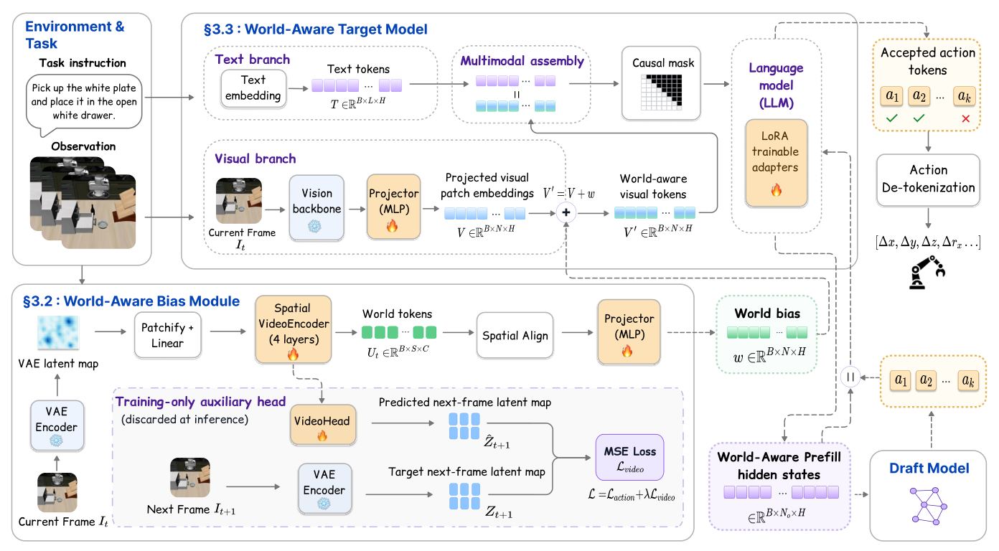
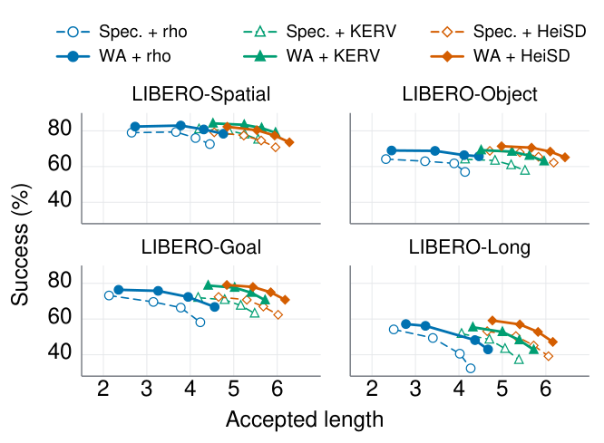

# WA-SpecDec：让 Draft 与 Target 共享物理场景表征

!!! info "论文信息"
    **论文题名：** WA-SpecDec: World-Aware Speculative Decoding for Vision-Language-Action Models。 
    **作者：** Zikang Wen、Yuning Zhang、Dong Yuan。 
    **机构：** The University of Sydney。 
    **时间 / 主题：** 2026-08；VLA 投机解码与物理场景表征。 
    **版本 / 发表状态：** arXiv:2608.08725v1，2026-08-09；arXiv preprint。 
    **arXiv / 官方报告：** [摘要](https://arxiv.org/abs/2608.08725)、[PDF](https://arxiv.org/pdf/2608.08725v1)。 
    **GitHub / 项目：** 论文 Section 4.1 写明代码与评测脚本将在接收后发布，本次未确认公开实现。 
    **元数据来源与核验口径：** arXiv v1 全文及 Appendix A–C；Checked Date：2026-09-28；Repro Status：Paper Only，未进行独立复现。

## 原论文故事线

### 研究背景

[Spec-VLA](https://aclanthology.org/2025.emnlp-main.1367/)通过 relaxed acceptance 允许 draft 与 target 的动作 token 有小幅偏差，提高一次验证能够接受的长度。KERV、HeiSD 再加入运动学与历史动作等信号。这些方法都在追求同一件事：在任务成功率可接受的前提下，少调用昂贵的 target。

### 问题（Challenge）

动作距离相同，物理后果未必相同。远离物体时的一点偏移可能无关紧要，靠近把手或接触边界时则可能造成漏抓、碰撞或放置失败。如果 draft 和 target 的视觉条件没有保留充分的局部物理信息，调一个全局接受阈值很难同时兼顾自由运动与精细接触。

### Finding

除了接受规则本身，产生候选与参考动作的共享条件也是瓶颈。用下一帧 latent prediction 辅助训练当前帧的物理场景表征，再把它注入 prefill，可以同时改善 draft proposal 和 target reference，使已有 relaxed acceptance 在较宽松配置下仍保留较高成功率。

### 方法

World-Aware Bias（WAB）从当前图像的冻结 VAE latent 出发，经 spatial VideoEncoder、空间对齐和投影，形成与 VLA visual patches 同形状的偏置。偏置在 prefill 前加入视觉 embeddings，随后 target 与 draft 使用同一 world-aware 条件。训练时联合 action-token loss 与 next-frame latent loss，再冻结 target、蒸馏 draft；推理时删除未来预测头，沿用原 relaxed acceptance。

### 结论

作者在 LIBERO 与 SIMPLER-Env、多个 target 及三类 verifier 上比较成功率、接受长度和速度。固定 \(\rho=10\) 的四套 LIBERO 平均消融中，Spec-VLA 为 65.4% 成功率、1.20× 相对 AR 加速，完整 WA-SpecDec 为 71.0%、1.34×。摘要另报告 matched-success 1.5× 相对投机基线加速，以及 NCF 平均相对下降 18.6%；这些数字的比较条件不同。

### 关键术语

- **World-Aware Bias（世界感知偏置）**：由当前帧 latent 计算的逐视觉 patch 表征修正。
- **Shared Prefill States（共享预填充状态）**：draft 与 target 使用同一场景条件，既影响候选也影响验证参考。
- **Relaxed Acceptance（放宽接受）**：允许候选与 target 参考动作存在有限距离，属于近似解码。
- **Matched-success Speedup（匹配成功率加速比）**：在成功率相近的配置间比较速度，而非固定阈值直接比较。
- **Near-contact Failure（近接触失败，NCF）**：失败 episode 中曾进入指定近接触区域的比例，分母是失败 episode。

## 论文位置：World-aware 改的是参考动作的生成条件

理解这篇最容易出错的地方，是把“自由空间和接触阶段容错不同”的动机直接写成“运行时按阶段调整阈值”的实现。原论文明确保留既有 relaxed acceptance，主要改动发生在视觉输入与 prefill。

它也没有在部署时为每条 draft 生成未来视频，然后用预测碰撞决定接受。未来帧只用于训练监督。推理时运行当前帧 VAE encoder 与轻量 WAB，把获得的偏置加到已有视觉 token；没有 next-frame prediction、VAE decoding 或完整视频生成。

这与[FLASH](realtime-vla-flash-0928-1144.md)形成互补的观察角度。FLASH 为连续动作构造 flow 一致性检查，WA-SpecDec 保留离散动作的距离规则，增强距离比较两侧的场景条件。两者都需要任务级实验证明质量，但它们改的接口不同。

## WAB 怎样把当前图像变成物理场景偏置

{ width="900" }

<small>图源：[WA-SpecDec v1](https://arxiv.org/abs/2608.08725v1)，Figure 2，PDF 第 4 页。上方是视觉语言策略，左下是 WAB，紫色分支是仅训练时存在的辅助预测头。读图时沿加号进入 prefill 的箭头看信息去向，随后确认 draft 与 target 共享该条件。</small>

原始视觉分支产生 \(V_t\in\mathbb{R}^{B\times N_v\times H}\)。WAB 使用冻结的 **Wan 2.2 VAE encoder** 将当前 RGB 图像编码为 latent map \(Z_t\)，再经线性 tokenization 与四层 spatial VideoEncoder 得到 world tokens \(U_t\)。它们保留二维空间布局，经过插值对齐到 VLA patch 网格，最后投影至相同 hidden width：

\[
Z_t=E_{\mathrm{vae}}(I_t),\qquad
U_t=F_\omega(\phi_{\mathrm{tok}}(Z_t)),
\]

\[
w_t=f_{\mathrm{bias}}(\operatorname{SpatialAlign}(U_t)),\qquad
V_t^{\mathrm{wa}}=V_t+w_t.
\]

空间对齐使每个视觉位置得到对应的局部偏置；逐元素相加使多模态序列长度保持不变。这里的 \(w_t\) 随当前图像变化，不是一个与场景无关的可学习常数。

不增加 token 数可以避免因为序列变长而增加 target attention 成本，但 WAB 的 VAE 编码、四层编码器和投影仍然有计算开销。论文用包含这些成本的 wall-clock speedup 判断净收益，不能把“无额外视觉 token”写成“零推理成本”。

## 训练分成 target 适配和 draft 蒸馏

第一阶段训练 world-aware target。action loss 是示范动作 token 的交叉熵，辅助 VideoHead 从当前 world tokens 预测下一帧 VAE latent，使用全空间网格 MSE：

\[
\mathcal L_{\mathrm{video}}
=\frac{\|g_\eta(U_t)-E_{\mathrm{vae}}(I_{t+1})\|_2^2}
{H_zW_zC_{\mathrm{vae}}},
\qquad
\mathcal L=\mathcal L_{\mathrm{action}}+0.1\mathcal L_{\mathrm{video}}.
\]

全网格监督保留位置分辨率，促使表示记录与短期变化相关的空间细节。动作损失则约束这些特征为策略服务。论文将 VAE encoder 与基础视觉堆栈冻结，更新 WAB、辅助头与目标语言模型 LoRA；Figure 2 对 projector 的训练标注与正文“base visual stack frozen”的范围并不完全清晰，复现时需要以公开实现明确原视觉 projector 的冻结边界。

第二阶段冻结适配后的 world-aware target，用 \(\mathrm{KL}(p_\theta^{\mathrm{wa}}\Vert q_\phi)\) 蒸馏轻量 draft。draft 从同一 world-aware prefill states 提出候选，target 也基于这些 states 给出参考。目标是让双方在同一物理场景条件下对齐，减少验证拒绝，而非只给 draft 单方面增加一个额外 encoder。

| Item | Value / disclosed scope |
| --- | --- |
| Primary target | OpenVLA-7B |
| Frozen latent encoder | Wan 2.2 VAE encoder; used as a latent compressor |
| Spatial VideoEncoder | 4 layers |
| Auxiliary weight | \(\lambda=0.1\) |
| Target adaptation | WAB and LoRA with action-token loss + next-frame latent loss |
| Draft objective | KL distillation from the frozen world-aware target |
| Batch size | 32 |
| Warm-up | 1,000 steps |
| Speculative tree | Maximum 50 nodes; depth 4; top-8 candidates |
| Relaxation sweep | \(\rho\in\{5,10,15,20\}\) |
| Evaluation budget | 50 rollouts per task; 500 episodes per LIBERO suite |
| Total compute | Approximately 192 GPU hours; 48 hours on 4 NVIDIA RTX A6000 GPUs |

<small>来源：Section 3、Appendix A。此表整理公开配置，英文列名为本文编排，并非原论文已有表格。192 GPU hours 包含训练、蒸馏与评测，不是单独 draft 的训练时间。</small>

原文未完整披露 optimizer、学习率、总训练步数、LoRA rank、数值精度与 draft 详细架构，不能直接补写成 OpenVLA 的常见默认值。公开代码之前，这些是复现所需的缺口。

## 验证规则保留了什么，又改变了什么

给定 draft token \(\hat a_i\)，目标策略基于共享条件生成参考

\[
a_i^{\mathrm{wa}}=\arg\max_a p_\theta^{\mathrm{wa}}(a\mid x,I_t,a_{<i}),
\qquad
\operatorname{Accept}_\rho^{\mathrm{wa}}(\hat a_i)
=\mathbf 1[d(\hat a_i,a_i^{\mathrm{wa}})\leq\rho].
\]

距离测试形式不变，但参考动作已经来自经过 WAB 与 LoRA 适配的 target。每轮 draft 提出候选后，target 并行验证，保留连续接受前缀；第一个被拒绝的 token 用对应 target token 替换，然后继续下一轮。Appendix B 给出线性块形式的算法伪码，Appendix A 则补充实验所用树节点、深度和 top-k 设置，两者不应被误写成完全相同的实现细节。

这里有两层分布边界。首先，world-aware target 与原始 vanilla VLA 不是同一个策略。其次，即使固定 world-aware target，\(\rho>0\) 时也允许接受不等于其参考输出的 token。原文关于 distribution preservation 的表述不能替代标准无损 speculative sampling 的证明；本文将其理解为受任务指标约束的近似加速。

## 实验与结论：先看固定规则下的对照

主实验在四套 LIBERO 上用 OpenVLA 比较 \(\rho\)、KERV、HeiSD 三种 relaxed verification；另用 ActionCodec 检查更强 target，并在 SIMPLER-Env 上评测 OpenVLA 与 UniVLA。不同 target 的原始成功率差异很大，不能只汇总一个 speedup 排名。

下面摘录 Table 1 的 LIBERO-Goal 子列，保留全部方法行。\(\rho\) 配置为 10；KERV、HeiSD 采用论文所述默认设置。

| Relaxation | Policy | Succ. | Spd. | NCF |
| --- | --- | ---: | ---: | ---: |
| – | AR: OpenVLA | 78.2 | 1.00× | 46.8 |
| ρ | Standard SpecDec | 69.6 | 1.23× | 64.5 |
| ρ | WA-SpecDec | 75.8 | 1.32× | 46.3 |
| KERV | Standard SpecDec | 70.8 | 1.61× | 61.6 |
| KERV | WA-SpecDec | 77.6 | 1.67× | 47.3 |
| HeiSD | Standard SpecDec | 70.8 | 2.10× | 66.4 |
| HeiSD | WA-SpecDec | 78.0 | 2.12× | 43.6 |

<small>表源：原论文 Table 1，仅 LIBERO-Goal 子列。Succ. 与 NCF 单位为 %；Spd. 相对 AR target，并包含 WAB、draft、verify、cache updates。这里不是独立复现实验。</small>

这一组结果说明 WAB 可以与多种 verifier 配合。例如 HeiSD 条件下速度接近，成功率从 70.8% 上升到 78.0%。同时，\(\rho\) 分支的 75.8% 仍低于 AR 的 78.2%，不能概括成任何配置都完全保持 baseline 成功率。

更强 ActionCodec 的 Table 2 也值得看。LIBERO-Goal 的 AR 成功率为 95.8%；KERV 下 Standard SpecDec 为 91.2%、1.57×，WA-SpecDec 为 95.6%、1.72×。这提供了超出较弱 OpenVLA 基线的证据，但仍是指定 suite 与配置下的结果。

## 消融：到底是更强 target，还是更好的投机过程

| Method | Success | Accepted Len. | Speedup |
| --- | ---: | ---: | ---: |
| AR target | 72.2% | – | 1.00× |
| WA target-only | 73.5% | – | 0.97× |
| Spec-VLA | 65.4% | 3.59 | 1.20× |
| WA w/o video loss | 69.4% | 4.09 | 1.31× |
| WA-SpecDec full | 71.0% | 4.22 | 1.34× |

<small>表源：原论文 Table 6，四套 LIBERO 平均；所有 speculative variants 使用 \(\rho=10\)。英文表头和方法行与原表一致。</small>

WA target-only 提高成功率，但速度只有 0.97×，说明表示模块本身带来成本。加入投机后才获得净加速。去掉 video loss 的版本已经达到 69.4%，完整版本进一步到 71.0%，接受长度从 4.09 增到 4.22；这支持辅助预测的增益，但不能把全部收益都归于 next-frame loss。

同一张表也限制了结论：完整版本仍低于 AR 的 72.2%，更低于 WA target-only 的 73.5%。对照说明成功率损失有所减小，并不提供精确无损的证据。

## Matched-success 与固定阈值不能混用

{ width="620" }

<small>图源：原论文 Figure 3，PDF 第 8 页。实线为 WA-SpecDec，虚线为 Standard SpecDec；横轴 Accepted length，纵轴 Success (%)。同一 verifier family 内扫 relaxation，观察曲线是否向右上方移动。</small>

向上移动表示接受长度相近时成功率更高，向右移动表示成功率相近时能保留更长前缀。图中的横轴不是 wall-clock speedup；接受长度增加能减少 target 验证轮数，但还需要计入 WAB 和 draft 成本才能得到真实加速。

摘要的 **1.5× matched-success speedup** 比较 WA-SpecDec 与已有 VLA speculative decoding 在成功率相近的工作点，不能替换 Table 6 中相对 AR 的 **1.34×**。若只用该表的固定配置计算，1.34 / 1.20 约为 **1.12×**，不是 1.5×。本文保留前者为作者汇总 claim，不从曲线重新估计或伪造逐配置匹配过程。

Table 5 进一步展示容错上限。\(\rho\) 从 5 增到 20 时，WA-SpecDec 四套平均成功率从 71.3% 降到 63.5%；Spec-VLA 从 67.7% 降到 55.1%。世界感知表征改善了退化曲线，但没有消除放宽接受造成的质量损失。

## NCF 的分母决定它能证明什么

论文对每个失败 episode，取整个轨迹中夹爪 fingertip sites 到任务物体或目标容器的最小距离；低于 \(\delta=2\,\mathrm{cm}\) 则计为 near-contact failure。可以写成

\[
\mathrm{NCF}
=\frac{\#\{\text{failed episodes that entered the near-contact region}\}}
{\#\{\text{failed episodes}\}}\times100\%.
\]

因此 NCF 不是所有 episode 中的碰撞率，也没有直接证明失败由接触造成。一次轨迹曾经靠近物体、随后因别的原因失败，同样可能被计入；如果总失败数变化，分母也随之变化。需要把 NCF 与 overall success 一起读。

作者报告相对配对投机基线的 NCF 平均下降 18.6%，这里是相对百分比变化，不是下降 18.6 个百分点。Table 7 给出 1–4 cm 的阈值敏感性结果，有助于判断方向是否只来自某个阈值，但不能代替碰撞、接触力或真实机器人失效统计。

## 主要贡献与局限

论文把 VLA 投机推理的改进位置从“候选与接受规则”扩展到双方共享的视觉条件，并用 target-only、去辅助损失及阈值扫描尝试区分表征、推理与质量的作用。对[世界模型与 VLA 的关系](../../embodied-ai/vla-wam-world-model-system-map.md)而言，它展示的是预测式训练如何改善控制表示，部署阶段并不运行世界模型规划。

需要保留四个边界。第一，场景偏置、LoRA target 适配与重新蒸馏 draft 同时发生，收益不等于单纯更换 decoder。第二，算法输出允许动作偏差，缺少严格的分布或安全保证。第三，LIBERO 和 SIMPLER-Env 是仿真评测，不能从后者名称或示例外观推断进行了真机闭环实验。第四，代码与完整训练配方尚待公开，无法由论文数字独立确认所有时间开销与配置细节。

## 阅读结论

WA-SpecDec 的核心是让 draft 与 target 在更合适的场景条件下比较动作。读这篇时，应同时保留三条证据：共享 prefill 的结构、target-only 与 video loss 的消融、成功率随 relaxation 变化的曲线。它们共同解释净加速从哪里来，也说明“world-aware”仍需由闭环任务结果检验。

## 外部精读与延伸阅读

- [原论文 HTML 与附录](https://arxiv.org/html/2608.08725v1)：重点核对 Eq. 3–15、Table 5/6/7 与 Appendix A。
- [Spec-VLA 原论文](https://aclanthology.org/2025.emnlp-main.1367/)：建立离散动作 relaxed acceptance 的前置知识。
- [VLA 投机推理路线综述](../../inference/vla-speculative-decoding-0928-1144.md)：对照 KERV、HeiSD、剪枝及执行期验证。
- [Realtime-VLA FLASH](realtime-vla-flash-0928-1144.md)：连续动作块没有 action-token 接口时怎样构造验证。
- [VLA 闭环恢复与失败分析](../../vla/closed-loop-recovery-and-failure-analysis.md)：把接受质量接回 episode 失败与恢复。
