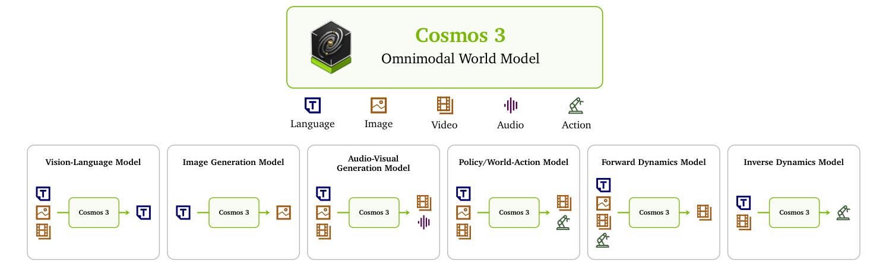
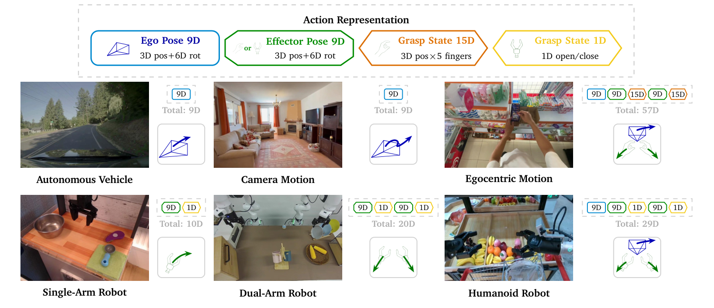
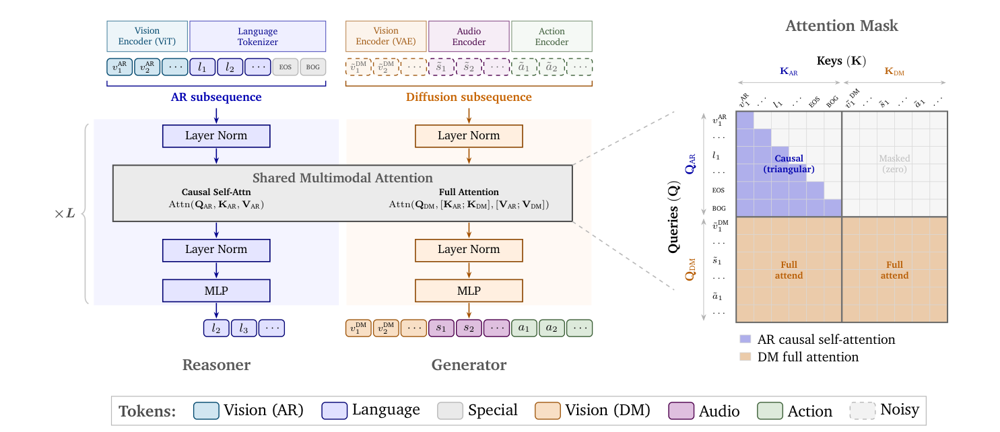
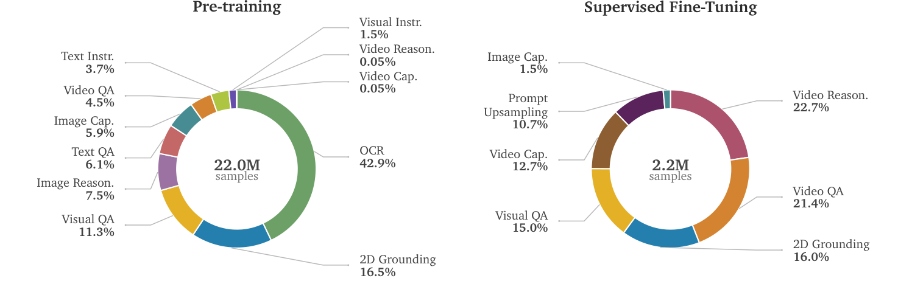
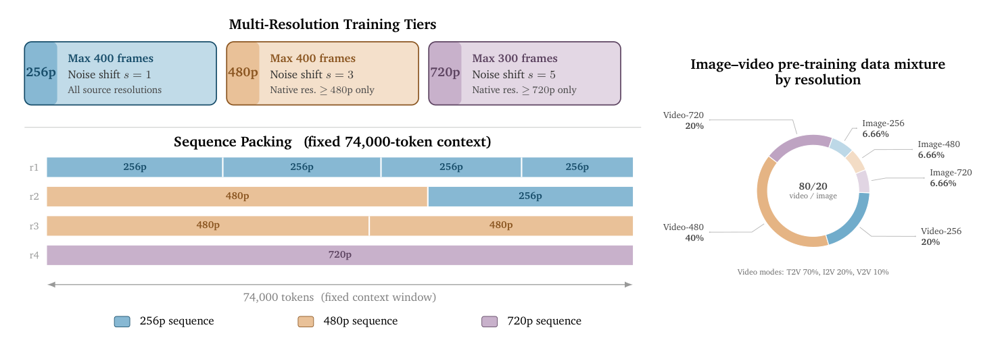
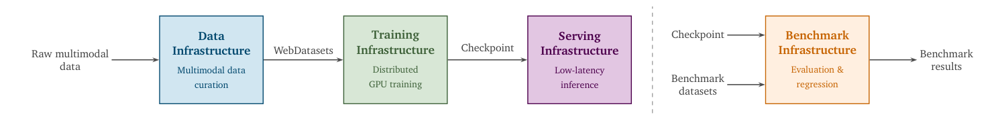
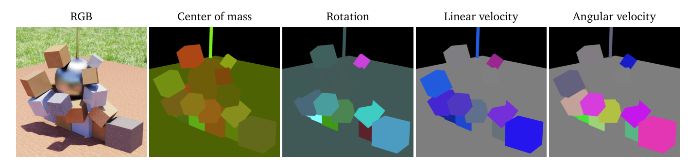
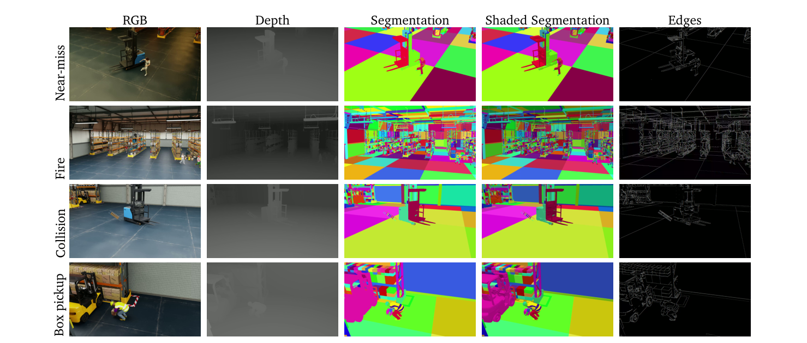
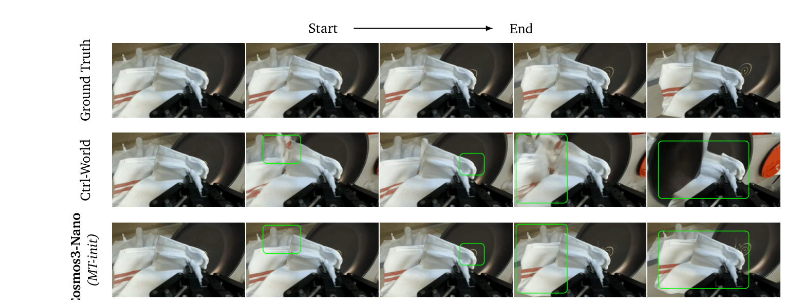

# Cosmos 3：面向 Physical AI 的全模态世界模型平台

!!! info "论文信息"
    **论文题名：** Cosmos 3: Omnimodal World Models for Physical AI。 
    **作者：** NVIDIA。 
    **机构：** NVIDIA。 
    **时间 / 主题：** 2026-06-22；技术报告 / Physical AI / Omnimodal World Model。 
    **arXiv / 官方报告：** 官方 PDF：[research.nvidia.com/labs/cosmos-lab/cosmos3/technical-report.pdf](https://research.nvidia.com/labs/cosmos-lab/cosmos3/technical-report.pdf)；项目页：[research.nvidia.com/labs/cosmos-lab/cosmos3](https://research.nvidia.com/labs/cosmos-lab/cosmos3/)。 
    **GitHub / 项目：** GitHub：[github.com/NVIDIA/cosmos](https://github.com/NVIDIA/cosmos)；Cosmos-Framework：[github.com/NVIDIA/cosmos-framework](https://github.com/NVIDIA/cosmos-framework)；Hugging Face collection：[huggingface.co/collections/nvidia/cosmos3](https://huggingface.co/collections/nvidia/cosmos3)。 
    **元数据来源与核验口径：** 来源：官方 PDF、项目页和论文首页资源清单；Checked Date：2026-07-06；Repro Status：Paper / official code / model cards / synthetic datasets reviewed, independent reproduction not claimed。

## 原报告故事线

### 研究背景

Cosmos 3 技术报告面向 Physical AI：机器人、自动驾驶、具身智能和仿真系统都需要理解现实世界、预测未来、生成合成数据并把视觉世界接到动作。过去这些能力常由 VLM、视频生成器、world model、policy model 和合成数据工具分开承担。Cosmos 3 试图把多模态理解、图像/视频/音频生成、forward / inverse dynamics、robot policy 和 synthetic data generation 放进一个平台化路线。

### 问题（Challenge）

报告要解决的问题是：如何构建一个 omnimodal world model 平台，使 Physical AI 的感知、模拟和动作数据生成共享底座。挑战在于理解路径和生成路径目标不同：自回归模型擅长语言/多模态推理，扩散模型擅长高保真图像视频；机器人动作和物理动态又需要时序一致、因果和可控接口。这个问题有价值，因为 Physical AI 的稀缺数据、危险场景和长尾事件很难只靠真实采集覆盖。

### Finding

Cosmos 3 的 finding 是：Physical AI 不应把“理解模型”和“生成模型”割裂，而应让 Reasoner 和 Generator 共享上下文并分工。Mixture-of-Transformers 让自回归理解路径和扩散生成路径各自保持适合的计算形态，同时通过共享 attention / context 让 diffusion tokens 看到 AR context。这个 insight 把世界模型平台从单一视频生成器翻转为“可理解、可生成、可动作条件化、可合成数据”的统一训练设施。

### 方法

方法分为 Reasoner 和 Generator。Reasoner 做多模态理解、长上下文和任务推理；Generator 从 Reasoner 初始化，并进行 image / video / audio pre-training、action / transfer mid-training、T2I / I2V / policy post-training。报告还包含 synthetic data generation pipeline，用仿真和生成模型产生 Physical AI 训练数据；模型接口覆盖文本、图像、视频、音频、动作、forward dynamics、inverse dynamics 和 robot policy。输出既可以是多模态回答，也可以是视频/音频生成、未来预测或策略相关结果。

### 结论

报告展示 Cosmos 3 在多模态理解、图像/视频/音频生成、forward / inverse dynamics、机器人 policy、合成数据等任务上的官方评测和样例。关键结论是：统一平台能把生成式世界模拟和 Physical AI 数据引擎连接起来，尤其适合补足危险、稀有或难标注场景。边界是这类官方报告的 demo、benchmark 和模型卡不等同独立复现；真实机器人闭环安全、sim-to-real 和合成数据偏差仍要单独验证。

### 关键术语

- **Physical AI（物理 AI）**：面向真实物理世界感知、模拟、规划和控制的 AI 系统
- **Omnimodal World Model（全模态世界模型）**：统一处理文本、图像、视频、音频和动作/动态的世界建模系统
- **Mixture-of-Transformers（Transformer 混合架构）**：用不同 Transformer 路径处理理解和生成任务，并共享上下文
- **Forward Dynamics（正向动力学）**：给定当前状态和动作预测未来状态
- **Synthetic Data Generation（合成数据生成）**：用仿真或生成模型构造训练数据，覆盖真实采集困难场景

## 它的贡献位置

如果把 Cosmos 3 放在 LingBot-World、DreamZero、Fast-WAM、Qwen3.5-Omni 旁边看，它回答的是一个更平台化的问题：Physical AI 能不能有一个统一 backbone，让感知、世界模拟和动作生成共享表示，而不是把 VLM、视频生成器、forward dynamics model、VLA/WAM 分开拼接。

{ width="920" }

<small>图源：`Cosmos 3: Omnimodal World Models for Physical AI`，Figure 1。原论文图意：Cosmos 3 同时建模 language、image、video、audio、action，并以不同输入输出配置覆盖 VLM、image generation、audio-visual generation、policy/world-action、forward dynamics 和 inverse dynamics。</small>

**这张图怎么读。**
图里的关键不是任务很多，而是这些任务不再要求完全不同的网络。Language / image / video / audio / action 都进入同一个 omnimodal world model；当输出是文本时，它像 VLM；当输出是视觉或音频 latent 时，它像生成器；当输出是 action 或 action+future video 时，它变成 world-action model。

论文的强主张可以压缩成这张表：

| Claim | Cosmos 3 的做法 | 证据边界 |
| --- | --- | --- |
| 一个 backbone 覆盖理解、生成和动作 | AR subsequence + diffusion subsequence + MoT dual tower | 证明统一接口可训练，不等于所有任务都达到闭源最强模型 |
| Physical AI 需要 action 作为核心模态 | action token 映射 autonomous vehicle、camera、egocentric、robot 等控制空间 | action 表示能统一多域，但真实部署仍取决于控制器和任务数据 |
| Reasoner 能给 Generator 更好的物理语义起点 | Generator 从 Reasoner 初始化；Appendix E.1 做 understanding tower ablation | 主要是 PAIBench domain score 改善，不等价于闭环策略收益 |
| action mid-training 形成可迁移动作先验 | mid-training 加入 FD、ID、policy、transfer 数据；MT-init 优于 PT-init | 多个域有收益，但不同动作域也可能出现 mixture dilution |
| Synthetic data 是训练设施的一部分 | 发布 SDG-PhyxSim、RobotSim、DriveSim、SynHuman、Warehouse | 合成数据补长尾和 dense label，不自动保证真实域无偏迁移 |

## 总体架构

Cosmos 3 先用 modality-specific encoder 把不同输入投到统一空间，再交给 MoT backbone。文本和 ViT visual tokens 走 autoregressive subsequence，视频 VAE tokens、audio tokens 和 action tokens 走 diffusion subsequence。推理时，文本用 next-token prediction，非文本模态用 iterative denoising。

| Modality | Encoder / Representation | Training detail |
| --- | --- | --- |
| Language | tokenizer + AR subsequence | next-token prediction |
| Image / Video understanding | ViT encoder, 16 x 16 patch, MLP merges 2 x 2 tokens | ViT encoder jointly trained with backbone |
| Visual generation | Wan2.2-TI2V-5B video VAE | VAE temporally compresses 4x and spatially 32 x 32; VAE frozen |
| Audio generation | audio VAE from Lee et al. 2025b | stereo 48 kHz, hop size 1920, 25 tokens/s; VAE frozen |
| Action | domain-aware input/output projection | projection initialized from scratch and optimized with MoT |

### Action 不是附属条件

论文把 action 定义为引起世界状态变化的 causal variable。对连续 video token 来说，动作 \(a_t\) 表示从 \(v_{t-1}\) 到 \(v_t\) 的转移。这个定义让 action 可以同时服务三个任务：

| Action mode | Conditioning | Prediction |
| --- | --- | --- |
| Forward dynamics | observed video context + clean action tokens | future visual states |
| Inverse dynamics | observed visual transition | action tokens |
| Policy / joint video-action | observed context | action tokens + future video tokens |

{ width="920" }

<small>图源：`Cosmos 3: Omnimodal World Models for Physical AI`，Figure 3。原论文图意：不同 embodiment 的控制量被映射为 ego pose、effector pose、grasp state 等共享几何组件，再用 domain-aware projection 接入共同 latent action space。</small>

**这张图怎么读。**
Cosmos 3 没有把机器人、相机、自动驾驶和第一人称动作都硬编码成同一种低层控制命令，而是提取更上层的几何结构。ego pose 和 effector pose 用 3D translation + 6D rotation，grasp state 用手指位置或 gripper open/close。这样做的好处是 action token 能在多个 embodiment 之间共享 MoT backbone；代价是具体执行仍要回到各自域的 output projection 和控制器。

## MoT：一条序列，两套参数

{ width="920" }

<small>图源：`Cosmos 3: Omnimodal World Models for Physical AI`，Figure 5。原论文图意：同一 token sequence 被分成 AR subsequence 和 diffusion subsequence；两者在 LayerNorm / MLP / attention projections 上用独立参数，但通过 shared multimodal attention 交互。</small>

**这张图怎么读。**
左边是结构，右边是 attention mask。AR tokens 只能 causal self-attend，保持语言/理解路径的自回归性质；DM tokens 可以 full attend 到 AR 和 DM tokens，因此扩散生成可以利用文本、图像或视频上下文，也能在生成模态内部保持时空一致。

这个设计比“所有 token 进一个 Transformer”更保守，也更像工程上可控的统一模型：

| MoT piece | 作用 | 为什么重要 |
| --- | --- | --- |
| Reasoner tower | 处理 AR subsequence，输出 next-token prediction | 保留 VLM 的语言和视觉理解能力 |
| Generator tower | 处理 diffusion subsequence，预测 denoised / velocity target | 专门承载 image/video/audio/action generation |
| Shared multimodal attention | AR 和 DM 在 attention 中交互 | 让生成被 AR context 条件化，但不污染 AR causal path |
| Independent LN / MLP / projections | 双塔参数分离 | 避免扩散生成目标过度冲击语言理解参数 |

位置编码也做了 Physical AI 适配。Cosmos 3 使用 3D MRoPE，并把 video、audio、action 对齐到同一个物理时间轴。报告里给出的 base rate 是 \(TPS_{base}=24/4=6\)，因为视频 tokenizer 的 temporal compression ratio 是 4；audio 的 TPS 来自 48 kHz / 1920 hop，约 25 tokens/s。论文还在 AR 和 diffusion token 之间插入固定 temporal gap 15000，用来缓解初始视频帧的 oversaturation 和 checkerboard artifacts。

## 模型规模

论文训练了 Edge、Nano、Super 三个尺度；本报告中释放 Nano 和 Super，Edge 计划后续释放。表格保留原英文列名：

| Variant | LLM Layers | Hidden Dim | Attn Heads | KV Heads | Head Dim | FFN Dim |
| --- | ---: | ---: | ---: | ---: | ---: | ---: |
| Cosmos3-Edge | 28 | 2,048 | 16 | 8 | 128 | 9,216 |
| Cosmos3-Nano | 36 | 4,096 | 32 | 8 | 128 | 12,288 |
| Cosmos3-Super | 64 | 5,120 | 64 | 8 | 128 | 25,600 |

<small>表源：`Cosmos 3 Technical Report`，Table 2。原表说明：所有模型共享 dual-tower MoT；Nano/Super 初始化自 Qwen3-VL 权重，Edge 使用从零训练的 dense 2B transformer。</small>

## 数据：Reasoner 和 Generator 分开配方

Cosmos 3 的数据部分要分成两条线读：Reasoner 学理解和推理，Generator 学合成、模拟和动作。两者共享 transformer block 形态，但训练数据和目标不同。

{ width="920" }

<small>图源：`Cosmos 3: Omnimodal World Models for Physical AI`，Figure 7。原论文图意：Reasoner pre-training 含 22.0M samples，SFT 含 2.2M samples；SFT 阶段明显转向 video QA、video reasoning、2D grounding 和 prompt upsampling。</small>

**这张图怎么读。**
Pre-training 里 OCR 占 42.9%，2D grounding 占 16.5%，video 相关比例很小；SFT 里 video reasoning 22.7%、video QA 21.4%、video caption 12.7%。这说明 Reasoner 不是靠预训练阶段把所有 temporal/Physical AI 能力学满，而是先建立图文和 OCR/grounding 基础，再用 SFT 把能力转向机器人、自动驾驶和空间/时间理解。

Reasoner 数据 curriculum 原表如下：

| Modality | Pre-training | Supervised Fine Tuning |
| --- | ---: | ---: |
| Image-text | 18,814,952 | 1,051,513 |
| Video-text | 1,016,299 | 1,079,200 |
| Text only | 2,170,762 | 40,960 |
| Total | 22,002,013 | 2,171,673 |

<small>表源：`Cosmos 3 Technical Report`，Table 3。原表值表示 image/video media samples 或 text-only conversations。</small>

数据清洗也值得注意。Reasoner pre-training 先做 semantic deduplication，再用 Gemma-4-31B-it 作为 AI judge，从 Faithfulness、Completeness、Correctness 三个维度打 1-5 分。预训练主混合使用最低非平凡阈值 2，SFT 使用阈值 5。论文报告：multimodal deduplication 去掉 4.23% 近重复监督；AI-judge filter 在阈值 2 和 5 下分别保留 78% 和 46% 数据。

## 训练路线

### Reasoner Training

Reasoner 训练分两段：

| Stage | Training recipe |
| --- | --- |
| Pre-Training | 从 language model + ViT encoder + multimodal projector 开始；Edge 使用内部预训练模型，Nano 用 Qwen3-VL-8B，Super 用 Qwen3-VL-32B；所有组件从一开始 joint training；next-token prediction；两轮 full pre-training mixture；max sequence 16k tokens；per-sample limits: 2048 image tokens, 8192 video tokens |
| Supervised Fine-Tuning | 使用 curated Physical AI mixture；importance-aware sampling；按 1:4 的 pre-training-to-SFT sampling-budget 混入高质量预训练子集；额外加入 800K instruction-following samples；8200 iterations, global batch size 512 |

优化参数也给得比较细：

| Stage | Optimizer detail |
| --- | --- |
| Reasoner pre-training | AdamW；peak lr 5e-5 for language model/projector, 5e-6 for ViT；cosine decay to 0.1x after 10% warmup；betas (0.9, 0.999)；weight decay 0.05；grad clip 1.0 |
| Reasoner SFT | AdamW；peak lr 1e-5 for language model/projector, 1e-6 for ViT；cosine decay to 0.1x after 1000-step warmup；betas (0.9, 0.95)；weight decay 0.1；grad clip 1.0 |

这里有个重要判断：Reasoner 没有先冻结 VLM 只训 projector 做单独 alignment stage，报告明确说他们发现这一步不必要，而是从 pre-training 开始 joint train all components。这个选择减少阶段复杂度，但也要求数据质量和 loss balancing 足够稳。

### Generator Training

Generator 从训练好的 Reasoner 权重初始化，训练目标是 rectified flow matching。对任一模态 target latent \(x_0\)，构造

$$
x_\sigma = \sigma \epsilon + (1-\sigma)x_0,
$$

模型预测 velocity \(v^*=\epsilon-x_0\)，用 masked MSE 训练；conditioning tokens 不计入 loss。噪声水平按模态独立采样：image/audio/action 用 logit-normal，video 用 mode sampling。报告还使用 rectified-flow shift reparameterization，让高分辨率或更难生成的样本偏向更高噪声区间。

{ width="920" }

<small>图源：`Cosmos 3: Omnimodal World Models for Physical AI`，Figure 10。原论文图意：Generator pre-training 同时训练 256p、480p、720p 三个分辨率层级，并把可变长度样本 pack 到固定 74,000-token context window。</small>

**这张图怎么读。**
图左是分辨率和 packing，右是预训练混合。256p/480p 最多 400 frames，720p 最多 300 frames；noise shift 分别是 1、3、5；训练时用固定 74K token context 做 sequence packing。右侧说明 pre-training 不是纯视频：video/image 比例是 80/20，视频模式里 T2V 70%、I2V 20%、V2V 10%。

训练规模表：

| Stage | Cosmos3-Nano | Cosmos3-Super |
| --- | ---: | ---: |
| Generator pre-training tokens | 31.05T tokens on 1024 NVIDIA GB200 GPUs | 17.86T tokens on 2048 NVIDIA GB200 GPUs |
| Generator mid-training tokens | 2.4T tokens on 1024 NVIDIA GB200 GPUs | 1.9T tokens on 2048 NVIDIA GB200 GPUs |

Generator pre-training 只更新 generation-specific parameters，Reasoner tower 冻结，以保留语言和视觉理解能力。优化用 FusedAdamW，learning rate 1e-4，betas (0.9, 0.99)，weight decay 0.05，grad clip 1.0，并用 10% text-dropout 支持 classifier-free guidance。

Mid-training 是 Cosmos 3 变成 Physical AI 模型的关键阶段。它在保留视觉生成模式的同时加入 action 和 transfer：

| Training stream | Modes / Conditioning | Share |
| --- | --- | ---: |
| Image | T2I | 10% |
| Video | T2V, I2V, V2V | 32% |
| Video + Audio | T2(V+Audio), I2(V+Audio), V2(V+Audio) | 8% |
| Action | Forward dynamics, inverse dynamics, policy | 25% |
| General Transfer | Edge, blur, depth, and segmentation controls | 20% |
| Driving Transfer | World-scenario-map controls | 5% |

<small>表源：`Cosmos 3 Technical Report`，Table 6。原表说明：pre-training 之后，在 mid-training 阶段引入 action 和 transfer 新模态。</small>

Mid-training 继续使用 rectified flow objective。action 继承 vision noise schedule；总 loss 是各模态 velocity MSE 之和，并对 action loss 乘 10x，以补偿 normalized action vectors 的 per-element MSE 较小。这里能看出 Cosmos 3 的训练重点：不是只让模型“看懂动作”，而是让 action 在 FD、ID、policy 三种方向里参与同一生成目标。

### Post-Training 分支

Cosmos 3 的后训练不是一个统一 RL 阶段，而是针对目标任务做 specialization：

| Post-training target | Recipe |
| --- | --- |
| Cosmos3-Super-Text2Image | two-stage SFT；Stage 1 20k steps，45% general real image、40% synthetic image、15% text-rendering-only；Stage 2 2k steps，470k ultra-high-quality image-caption pairs；fixed 70k context；only images higher than 720p |
| Cosmos3-Super-Image2Video | I2V SFT；filtered pre-training data + 1000 manually curated videos + about 20k synthetic clips；20% T2I image tokens 保持 semantic alignment；480p，189 frames，约 8s at 24fps；10k iterations, lr 1e-5, about 50B tokens |
| Cosmos3-Nano-Policy-DROID | 从 mid-trained Nano resume；fresh action encoder/action-decoding MLP/action embedding tokens；action-related params 用 5x lr multiplier；三视角视觉 + proprioception；预测 32 future absolute joint-position actions 和辅助 RGB frames；15Hz |

Robot policy 的细节尤其重要。DROID post-training 用 76k trajectories、350 hours interaction data、86 tasks、564 scenes；输入画布是 540 x 640：上方 wrist view 360 x 640，下方两个 external views 各 180 x 320。推理时用 4 diffusion steps、shifted noise schedule 5、CFG scale 3，并跳过 video-latent decoding 降低延迟，最终可在 2 NVIDIA RTX Pro 6000 GPUs 上部署 policy server。

## 基础设施：为什么报告花这么多篇幅写系统

{ width="820" }

<small>图源：`Cosmos 3: Omnimodal World Models for Physical AI`，Figure 11。原论文图意：Cosmos 3 平台包含 Data Infrastructure、Training Infrastructure、Serving Infrastructure、Benchmark Infrastructure 四个支柱。</small>

**这张图怎么读。**
Cosmos 3 不是单篇模型论文式的训练 recipe，而是一个训练设施报告。数据侧要从 raw multimodal data 生成 WebDatasets；训练侧要支撑跨模态、长序列、大模型；服务侧要支持 Reasoner 和 Generator 推理；benchmark 侧要做回归验证。对 Physical AI 来说，这四块缺一块都很难闭环。

训练基础设施中几个点值得记：

| System component | Reported design |
| --- | --- |
| Data loader | token-budgeted packed sequences, JointDataLoader, rank-synchronous stream selection, bounded look-ahead packing |
| Distributed training | Hybrid Sharded Data Parallelism (HSDP) + Context Parallelism (CP) |
| Video tokenizer | Wan2.2 VAE on-the-fly encoding；chunked encoding；torch.compile；45 static-shape AOT graphs |
| Checkpointing | asynchronous checkpointing through dedicated Gloo process group；save plan memorization |
| Serving | Reasoner: TensorRT-LLM / vLLM；Generator: vLLM-Omni + PyTorch reference path |

吞吐表保留原英文列名：

| Model | Iter (s) | TFLOPS | MFU | Iter/hr | Img Tok/hr/GPU (M) | Vid Tok/hr/GPU (M) |
| --- | ---: | ---: | ---: | ---: | ---: | ---: |
| Cosmos3-Nano | 7.1 | 520 | 0.23 | 507 | 4.56 | 16.23 |
| Cosmos3-Super | 19.5 | 673 | 0.30 | 185 | 1.66 | 5.91 |

<small>表源：`Cosmos 3 Technical Report`，Table 8。原论文说明：指标在 NVIDIA GB200 系统上测得，TFLOPS 和 MFU 为 per GPU，image/video token throughput 为 million tokens per GPU-hour。</small>

这个表的读法是：Nano token throughput 更高，Super 单 GPU TFLOPS 和 MFU 更高。也就是说，规模变大后每 token 更贵，但更能吃满单卡算力。

## Synthetic Data Generation

Cosmos 3 发布的 SDG 数据集不是附录装饰，而是 mid-training 的重要来源。报告把合成数据当作 Physical AI 训练设施：用仿真补真实世界少见、难标、危险或无法公开的数据。

| Dataset | Clips | Resolution / FPS | RGB | Depth | Seg | BBox | Phys | Cam | Cap |
| --- | ---: | --- | --- | --- | --- | --- | --- | --- | --- |
| SDG-PhyxSim | 76,489 | 1920x1080 / 30 | yes | yes | yes | -- | yes | yes | yes |
| SDG-RobotSim | 208,022 | varies | yes | part. | part. | -- | part. | yes | yes |
| SDG-DriveSim | 264,000 | 3840x2160 / 24 | yes | -- | -- | -- | -- | -- | yes |
| SDG-SynHuman | 236,937 | 1920x1080 / 30 | yes | yes | -- | -- | -- | yes | -- |
| SDG-Warehouse | 122,952 | 1920x1080 / 30 | yes | yes | yes | yes | -- | yes | -- |

<small>表源：`Cosmos 3 Technical Report`，Table 22。原表保留英文列名，`part.` 表示部分覆盖。</small>

{ width="860" }

<small>图源：`Cosmos 3: Omnimodal World Models for Physical AI`，Figure 31。原论文图意：SDG-PhyxSim 在物理仿真中提供 RGB、center-of-mass displacement、cumulative rotation、linear velocity、angular velocity 等同步标注。</small>

{ width="920" }

<small>图源：`Cosmos 3: Omnimodal World Models for Physical AI`，Figure 35。原论文图意：SDG-Warehouse 为 near-miss、fire、collision、box pickup 等仓储事件提供 RGB、metric depth、instance segmentation、shaded segmentation 和 edge annotations。</small>

**这些合成图怎么读。**
重点不是“合成画面很像真实”，而是每帧都有真实视频很难规模化提供的 supervision：物理状态、深度、相机、分割、BBox、场景元数据。对世界模型训练来说，这些信号能让模型看到长尾动态和可控环境变化；风险是仿真器分布和真实域仍有 gap，所以报告还需要真实数据、mid-training mixture 和下游评测来约束结论。

SDG ablation 的结论也很克制：单个 SDG 源对 PAIBench-G T2V 的 Overall 只带来小幅变化，但不同数据源在不同 Physical AI domain 上有互补收益。这个结果说明合成数据更像补 domain coverage 的工具，而不是单独把总体分数大幅拉升的万能药。

## 实验结果怎么读

### 总览表

论文 Table 1 把 Cosmos 3 和专用开源/闭源模型放在一起。这里摘录主干数字：

| Model | General | Robotics | Smart infra. | Driving | Text2Image | Text2Video | Image2Video | Audio | FD: Robot | Policy: Robot |
| --- | ---: | ---: | ---: | ---: | ---: | ---: | ---: | ---: | ---: | ---: |
| Cosmos3-Super | 73.7 | 57.8 | 62.6 | 79.3 | 91.36* | 80.0 | 82.8 | 7.31 | 26.0* | -- |
| Cosmos3-Nano | 69.6 | 55.1 | 61.0 | 76.0 | 84.61 | 79.4 | 82.7 | 7.34 | 25.5* | 39.7* |
| Gemini 3.1 Pro | 77.5 | 58.2 | 58.6 | 47.2 | -- | -- | -- | -- | -- | -- |
| Qwen3-VL-32B | 72.8 | 52.6 | 56.1 | 40.7 | -- | -- | -- | -- | -- | -- |
| Wan2.2-A14B | -- | -- | -- | -- | -- | 78.0 | 81.3 | -- | -- | -- |
| Ctrl-World | -- | -- | -- | -- | -- | -- | -- | -- | 23.0 | -- |
| pi0.5 | -- | -- | -- | -- | -- | -- | -- | -- | -- | 28.1 |

<small>表源：`Cosmos 3 Technical Report`，Table 1 摘录。`*` 表示 post-trained Cosmos 3 variants；闭源模型和缺失能力按原表口径理解。</small>

这张表最容易误读。它不能证明 Cosmos 3 在每个单项任务都碾压所有闭源专用系统；它真正说明的是：同一 family 在理解、生成、动作和 policy 多个栏目都有可比较成绩，并且 post-trained variants 在几个开放榜单上给出强结果。

### 视觉生成和物理一致性

| Model | PAIBench-G T2V Overall | PAIBench-G I2V Overall | RBench I2V Score |
| --- | ---: | ---: | ---: |
| Cosmos3-Super | 80.0 | 82.8 | 58.1% |
| Cosmos3-Nano | 79.4 | 82.7 | 58.4% |
| Wan2.2-A14B | 78.0 | 81.3 | 50.7% |
| HunyuanVideo-1.5 | 76.5 | 81.7 | 46.0% |
| Cosmos-Predict2.5-2B | 76.5 | 81.2 | 46.4% |
| Veo-3.1 | 79.1 | 82.6 | 56.3% |

<small>表源：`Cosmos 3 Technical Report`，Table 12 摘录。原表同时报告 Domain 和 Quality 分数；这里保留总览列。</small>

Physics-IQ 更接近“世界模型是否遵守物理续写”的问题：

| Model | Mode | Score |
| --- | --- | ---: |
| Cosmos3-Super | I2V + WMReward (BoN) | 48.9 |
| Cosmos3-Super | I2V | 43.8 |
| Cosmos3-Super | V2V + WMReward (BoN) | 63.4 |
| Cosmos3-Super | V2V | 59.7 |
| Wan2.2-A14B | I2V + WMReward (BoN) | 44.4 |
| Magi-1 | V2V + WMReward (BoN) | 62.6 |

<small>表源：`Cosmos 3 Technical Report`，Table 13 摘录。Physics-IQ 用真实物理结果作为 continuation reference，分 I2V 和 V2V 两种条件。</small>

这里的边界是：PAIBench-G / RBench 评价 broad Physical AI generation，Physics-IQ 更聚焦物理续写；但视频指标仍不等价于真实机器人闭环成功率。

### Action generation 和 policy

{ width="920" }

<small>图源：`Cosmos 3: Omnimodal World Models for Physical AI`，Figure 24。原论文图意：在 DROID robotics forward dynamics 中，Cosmos3-Nano (MT-init) 的动作条件未来帧比 Ctrl-World baseline 少一些明显形变和伪影。</small>

**这张图怎么读。**
图展示的是 action-conditioned future observation，而不是 policy success。本质问题是：给定初始图像和 robot end-effector action chunk，模型预测的未来是否跟动作一致。绿色框强调 baseline 中局部形变/伪影，Cosmos3-Nano (MT-init) 看起来更贴近 ground truth；但定量仍要看 PSNR 和闭环评测。

Forward / inverse dynamics 表摘录如下：

| Model | Autonomous Vehicle ID RRE ↓ | AV ID RTE ↓ | AV ID ATE ↓ | Camera FD RRE ↓ | Camera FD RTE ↓ | Camera FD ATE ↓ | Egocentric FD PSNR ↑ | Robotics FD PSNR ↑ |
| --- | ---: | ---: | ---: | ---: | ---: | ---: | ---: | ---: |
| Cosmos3-Super (MT-init) | 0.232 | 0.014 | 0.90 | 0.142 | 0.026 | 0.99 | 16.19 | 26.04 |
| Cosmos3-Nano (MT-init) | 0.211 | 0.014 | 0.98 | 0.147 | 0.029 | 1.24 | 16.12 | 25.52 |
| Cosmos3-Super (PT-init) | 0.284 | 0.018 | 1.32 | 0.293 | 0.036 | 1.82 | 15.34 | 22.69 |
| Cosmos3-Nano (PT-init) | 0.249 | 0.017 | 1.20 | 0.172 | 0.034 | 1.61 | 15.22 | 23.24 |
| Ctrl-World | -- | -- | -- | -- | -- | -- | -- | 22.99 |

<small>表源：`Cosmos 3 Technical Report`，Table 18 摘录。FD 表示 forward dynamics，ID 表示 inverse dynamics；MT-init 是从 action mid-trained checkpoint 初始化，PT-init 是从 generic pre-trained checkpoint 初始化。</small>

这张表最能支撑 action mid-training 的价值：MT-init 在多个域上普遍优于 PT-init，特别是 robotics FD 从 23.24/22.69 提升到 25.52/26.04 PSNR。

RoboLab policy 表摘录：

| Model | Overall Vague | Overall Default | Overall Specific | Simple Specific | Moderate Specific | Complex Specific |
| --- | ---: | ---: | ---: | ---: | ---: | ---: |
| Cosmos3-Nano-Policy-DROID | 20.6 | 36.8 | 39.7 | 42.0 | 40.3 | 29.4 |
| Cosmos3-Nano (PT-init) | 16.7 | 28.1 | 30.2 | 32.8 | 29.5 | 21.8 |
| pi0.5 | 15.2 | 28.0 | 28.1 | 29.8 | 31.0 | 14.7 |
| DreamZero | 14.9 | 25.7 | 23.9 | 25.8 | 26.7 | 10.6 |

<small>表源：`Cosmos 3 Technical Report`，Table 19 摘录。原表报告 RoboLab-120 上不同语言 specificity 和难度级别的 task success rate。</small>

LIBERO-10 adaptation 也很说明问题：

| Model | 500 | 1000 | 1500 | 2000 |
| --- | ---: | ---: | ---: | ---: |
| Cosmos3-Nano (MT-init) | 24.6% | 91.4% | 95.8% | 97.4% |
| Cosmos3-Nano (PT-init) | 0.0% | 73.8% | 93.4% | 95.2% |

<small>表源：`Cosmos 3 Technical Report`，Table 20。原表说明：MT-init 在新 embodiment / environment 上适应更快，每个 checkpoint 用 500 rollouts 评估。</small>

## 诊断实验与失败边界

Appendix E 的 ablation 比主结果更适合拿来判断机制是否必要：

| Diagnostic / Ablation | 结果 | 怎么解释 |
| --- | --- | --- |
| Understanding tower ablation | Cosmos3 Reasoner 相比 Qwen3-VL 初始化，在 PAIBench domain score 上更好，尤其 robot / AV / industry 等 Physical AI 类别 | Reasoner 不只是 caption encoder，而是在 generator 条件路径里提供更物理相关的 embedding |
| FPS control ablation | Text Control + MRoPE FPS Modulation 得到最高 Avg. Composite 9.81，高于 Base 8.51 | FPS 不能只写进 prompt；位置编码也要反映真实时间尺度 |
| Audio data in pre-training | With Audio 在 T2V Overall 79.1 vs Without Audio 78.6，I2V Overall 82.2 vs 81.7 | 加 audio 没有伤害视频指标，并有小幅收益，但不是巨大跃迁 |
| PushT action-mode synergy | joint FD/ID/policy 降低 ID MSE、提高 policy coverage，但 FD PSNR 从 27.13 降到 26.22 | 动作模式之间共享结构，但 joint training 可能牺牲单一重建指标 |
| Video-action consistency | RoboLab 上 predicted video 与执行 predicted action chunk 的 simulator rollout 保持较高一致性 | policy 同时预测 action 和 video 有可解释性，但这仍是仿真一致性，不等同真实世界安全保证 |

这些诊断共同说明：Cosmos 3 的统一性不是免费的。MoT、Reasoner 初始化、FPS temporal modulation、audio/action 数据、joint action objective 都在不同角度帮助模型；但 unified training 也会带来资源成本、数据混合权重和任务间 trade-off。

## 阅读结论

Cosmos 3 最重要的结论是：Physical AI 的世界模型路线正在从“视频生成器能否生成合理未来”，转向“一个统一 backbone 能否同时理解、生成、模拟动作后果，并快速适配到机器人策略”。它的答案是一个系统工程组合：Reasoner 负责语义和物理相关理解，Generator 负责多模态 denoising，MoT 让两条路径共享上下文但分离参数，action token 和 mid-training 让模型接触可控世界变化。

模型训练相关最值得记住的细节有四个。第一，Reasoner 先用 22.0M pre-training + 2.2M SFT 样本建立 Physical AI 理解能力。第二，Generator 从 Reasoner 初始化，并用 rectified flow matching 统一 image/video/audio/action denoising。第三，pre-training 是 31.05T / 17.86T token 级别的大规模训练，mid-training 才加入 action 和 transfer，训练 2.4T / 1.9T tokens。第四，DROID policy post-training 不是简单微调输出头，而是加入 proprioception、三视角视觉、action encoder/decoder、4-step diffusion inference 和部署级延迟优化。

边界也要明确。Cosmos 3 的强证据来自官方报告中的多任务 benchmark、post-training 结果、action ablation 和系统规模；但它不能直接推出“任意机器人任务都可以由统一世界模型解决”。真实机器人闭环仍受数据分布、控制频率、动作接口、sim-to-real、失败恢复和安全约束影响。更稳的读法是：Cosmos 3 给出了一个可复用的 Physical AI 训练平台范式，而不是单个 benchmark 的最终答案。
