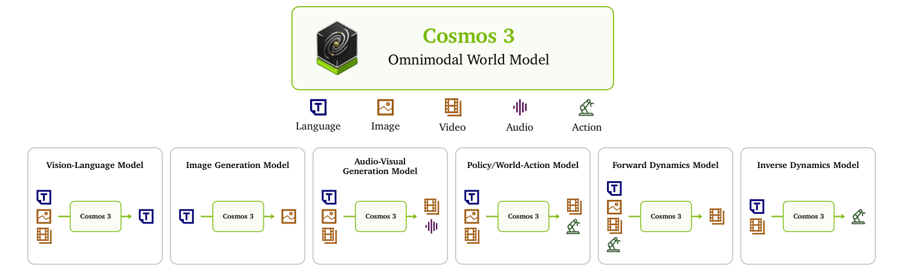
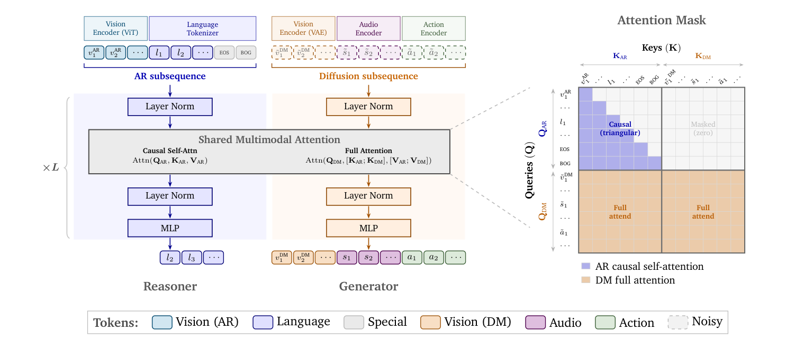
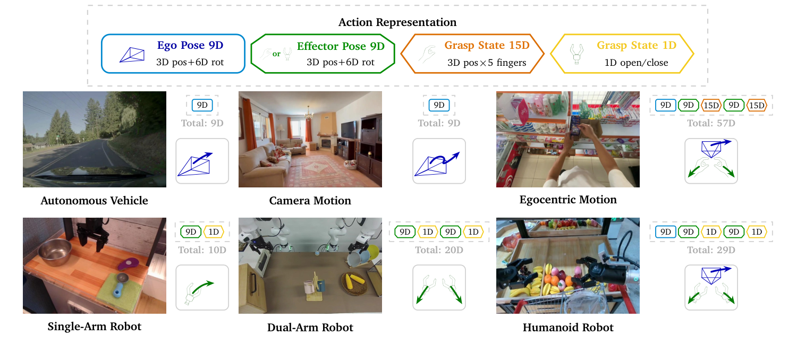
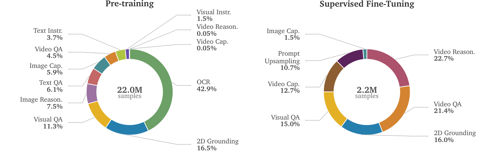
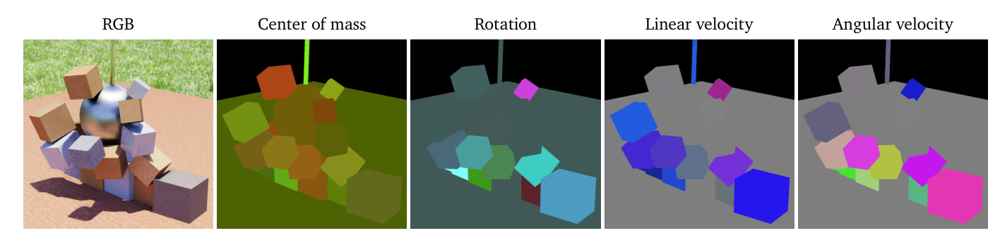
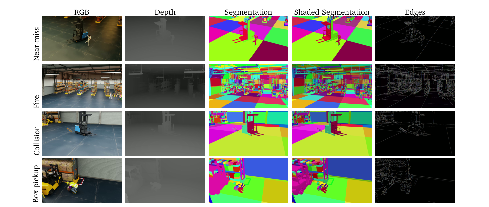
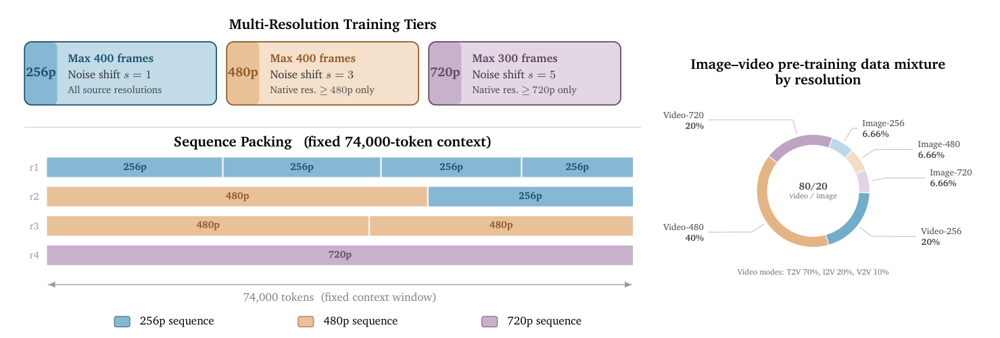
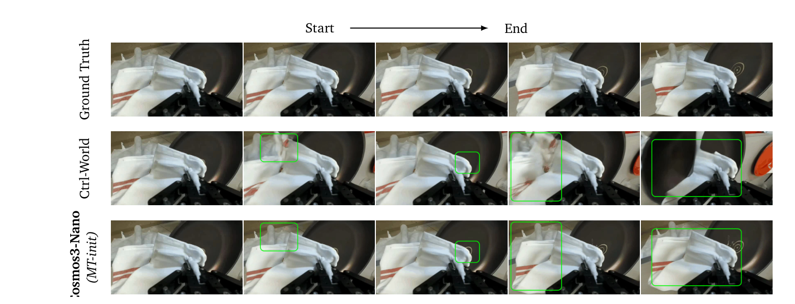
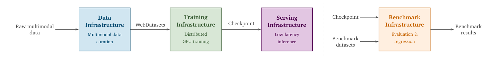

# Cosmos 3：面向 Physical AI 的全模态世界模型平台

!!! info "论文信息"
    **论文题名：** Cosmos 3: Omnimodal World Models for Physical AI。 
    **作者：** NVIDIA。 
    **机构：** NVIDIA。 
    **时间 / 主题：** 2026-06-22；技术报告 / Physical AI / Omnimodal World Model。 
    **arXiv / 官方报告：** 官方 PDF：[research.nvidia.com/labs/cosmos-lab/cosmos3/technical-report.pdf](https://research.nvidia.com/labs/cosmos-lab/cosmos3/technical-report.pdf)；项目页：[research.nvidia.com/labs/cosmos-lab/cosmos3](https://research.nvidia.com/labs/cosmos-lab/cosmos3/)。 
    **GitHub / 项目：** GitHub：[github.com/NVIDIA/cosmos](https://github.com/NVIDIA/cosmos)；Cosmos-Framework：[github.com/NVIDIA/cosmos-framework](https://github.com/NVIDIA/cosmos-framework)；Hugging Face collection：[huggingface.co/collections/nvidia/cosmos3](https://huggingface.co/collections/nvidia/cosmos3)。 
    **元数据来源与核验口径：** 来源：官方 PDF、项目页和论文首页资源清单；Checked Date：2026-07-06；Repro Status：Paper / official code / model cards / synthetic datasets reviewed, independent reproduction not claimed。

## 把“理解场景”和“改变场景”接到同一个模型里

Cosmos 3 面向的工作流比视频生成更长。一个物理智能系统先要理解观察、解释事件与任务，再预测动作可能带来的变化，最后输出可执行动作。过去这些环节通常由 VLM、视频扩散模型、动力学模型和机器人策略分别承担，模态之间需要额外接口，也难以共享训练得到的知识。

报告采用一套 Mixture-of-Transformers（MoT）架构，将文本推理与图像、视频、音频、动作生成放进同一个序列接口。文本仍逐 token 自回归生成，连续模态通过去噪生成；动作既可以作为条件控制未来视频，也可以作为待预测量，甚至与未来视频联合产生。其主要贡献是建立可迁移的多模态底座，再通过专门后训练得到图像、视频和机器人策略模型。

{ width="920" }

总览图表达的是同一基础架构能够服务多个方向，不代表所有排行榜成绩来自同一个不经修改的检查点。基础 Cosmos3-Nano / Super 与专门的 Text2Image、Image2Video、Policy-DROID 需要区分。机器人策略还改造了动作接口和推理配置，不能把通用模型的动作 token 直接视为任意机器人的电机命令。[原文 §1、§2](https://research.nvidia.com/labs/cosmos-lab/cosmos3/technical-report.pdf#page=5)

## 统一序列保留了两种计算方式

输入首先经过模态专用编码器。视觉理解使用 ViT，把图像或视频转为语义特征，并联合训练视觉编码器；视觉生成使用冻结的 Wan2.2-TI2V-5B VAE，将视频沿时间压缩 4 倍、空间最终压缩 $32\times32$。音频使用冻结 VAE，48 kHz 双声道波形以 1920 样本为 hop，得到每秒 25 个 token。连续模态经投影进入 Transformer 隐藏空间，另加可学习模态标识。

序列前半段是 AR 子序列，包含文本和 ViT 视觉 token；后半段是 DM 子序列，包含 VAE 视频、音频和动作 token。DM 内先放干净条件，再放需要去噪的目标。同一种打包方式就能表达文生图、文生视频、图生视频、视频续写、结构控制转视频及动作任务。

{ width="920" }

MoT 的两条路径各有独立归一化、注意力投影和 MLP 参数，在共享的注意力计算中交互。它不等于通过可学习路由器选择若干专家的稀疏 MoE。AR token 固定进入 Reasoner，DM token 固定进入 Generator。设两路 query、key、value 分别带下标 AR 与 DM，注意力为

$$
O_{\mathrm{AR}}=\operatorname{Attn}_{\mathrm{causal}}(Q_{\mathrm{AR}},K_{\mathrm{AR}},V_{\mathrm{AR}}),
$$

$$
O_{\mathrm{DM}}=\operatorname{Attn}_{\mathrm{full}}
(Q_{\mathrm{DM}},[K_{\mathrm{AR}};K_{\mathrm{DM}}],[V_{\mathrm{AR}};V_{\mathrm{DM}}]).
$$

Reasoner 只看 AR 的因果历史，Generator 可以读取全部 AR 条件和 DM token。信息因此从理解条件流向生成，当前噪声不会反过来改写 AR 状态。这保留了语言模型的自回归性质，也使固定条件的 Reasoner 结果可以只计算一次，在所有去噪步复用。这里的缓存具有结构上的依据，不能扩展成所有 DM 条件都必然不受其他 DM token 影响。[原文 §2.2–2.3](https://research.nvidia.com/labs/cosmos-lab/cosmos3/technical-report.pdf#page=9)

| 变体 | 两路合计参数量 | 初始化底座 | Transformer 层数 | 报告中的发布状态 |
|---|---:|---|---:|---|
| Edge | 4B | 自训 2B dense Transformer | 28 | 计划后续发布 |
| Nano | 16B | Qwen3-VL 8B | 36 | 发布基础模型 |
| Super | 64B | Qwen3-VL 32B | 64 | 发布基础模型 |

参数总量包括两条参数路径。纯理解任务不启用生成专用参数，因此“64B 模型”也不意味着每个文本 token 都执行两套完整路径。报告进一步发布基于 Super 的图像、视频专用模型和基于 Nano 的 DROID 策略。[原文 §2.5、Table 2](https://research.nvidia.com/labs/cosmos-lab/cosmos3/technical-report.pdf#page=14)

## 动作先变成共同的几何语言

统一动作面临的困难，是汽车、摄像机、人手和机械臂原本没有相同的控制向量。Cosmos 3 将动作拆为自身观察坐标系的位姿变化、末端执行器位姿变化和抓取状态。位姿部分由相邻状态差导出，避免直接混合不同机器人的 PID 参数或底层驱动协议。

{ width="920" }

图中摄像机和车辆使用 9 维位姿表示，单臂为 10 维，双臂为 20 维，人形机器人示例为 29 维，第一人称头部与双手为 57 维。位姿的 9 维由 3 维平移和 6 维连续旋转表示组成；旋转自由度仍为 3，6 维是便于学习的冗余表示。抓取状态则直接描述当前手指位置或夹爪开合，不是相邻帧的差值。

对于连续位姿 $T_{t-1},T_t\in SE(3)$，伪动作来自

$$
\Delta T_t=T_{t-1}^{-1}T_t.
$$

不同具身域 $k$ 保留各自的输入和输出线性投影，例如 $z=W_{\mathrm{in}}^{(k)}x+b_{\mathrm{in}}^{(k)}$，再共享主干。这样可以共享几何结构，同时保留各域向量长度与语义。它并没有消除相机标定、坐标约定、归一化和最终控制器转换的需求。

同一段视频—动作轨迹通过改变哪些 token 干净、哪些加噪，得到三种任务。

| 模式 | 已知条件 | 待生成量 | 能回答的问题 |
|---|---|---|---|
| Forward Dynamics，FD | 起始观察与动作 | 后续视频 | 给定动作会看到什么变化 |
| Inverse Dynamics，ID | 前后观察或视频轨迹 | 动作 | 怎样的动作解释这段变化 |
| Policy | 起始观察与语言任务 | 动作和后续视频 | 应采取什么行动，预期会看到什么 |

联合预测让动作与其视觉后果共享上下文，但训练格式本身不能保证两者始终一致。报告后来专门把预测动作送进模拟器，再比较实际 rollout 与同时生成的视频，才为这个一致性提供实验依据。[原文 §2.1.3、§2.2.2](https://research.nvidia.com/labs/cosmos-lab/cosmos3/technical-report.pdf#page=8)

## 不同采样率必须共享真实时间

视频 latent、音频 token 和机器人动作的采样率不同，序列中相邻一个 token 所经过的物理时间也不同。若位置编码只按整数序号递增，第十个音频 token 与第十个视频 token 并不对应同一时刻。

Cosmos 3 为视频使用时间、高度、宽度三个坐标，音频与动作只使用时间坐标。定义每秒 token 数 TPS，以 24 fps 视频经过 4 倍时间压缩得到的 $\mathrm{TPS}_{\mathrm{base}}=6$ 为基准，则相邻 token 的时间位置增量为

$$
\delta_t=\frac{\mathrm{TPS}_{\mathrm{base}}}{\mathrm{TPS}}.
$$

例如 25 token/s 音频的每步时间位置为 $6/25$；30 fps 视频 latent 的 TPS 为 7.5，每步增量为 0.8。由此，相同真实时长占据相同的位置区间。文本中还加入目标时长与 FPS，形成显式提示与位置编码两种互补控制。

附录在固定训练设置下比较四种配置，帧率控制综合分从无控制的 8.51，升至文本控制 9.28、MRoPE 调制 9.63、两者结合 9.81。视觉质量分基本接近，收益主要体现在运动幅度与跨种子稳定性。实验支持对时间语义的改善，并非证明任意动作或声画事件都达到帧级精确同步。[原文 §2.4、附录 E.2](https://research.nvidia.com/labs/cosmos-lab/cosmos3/technical-report.pdf#page=108)

## 理解数据、生成数据和动作数据承担不同监督

{ width="920" }

Reasoner 的基础数据约 22.0M 样本，物理智能 SFT 约 2.2M。图中预训练的最大部分是 OCR，随后是 grounding、VQA 与推理；SFT 将视频文本提升到约一半，增加事件定位、空间关系、机器人动作规划、驾驶事件与基础设施理解。它回答的训练问题是“根据观察应该说什么或输出什么结构化解释”。

这条数据管线先在图像、视频与问答的联合语义空间去重，再分别检查回答的忠实性、完整性和正确性。三个维度采用最低门槛约束，避免用详细但不忠实的回答靠平均分过关。报告采用较宽松门槛保留预训练覆盖，SFT 再使用更严格筛选。这种设计的实质是同时管理标注质量与能力分布，筛得越严未必越好，因为一些定位任务会更容易被裁掉。

Generator 的规模明显更大，预训练保留 767M 图像和 347.7M 视频片段，来自数十亿候选。图像与视频采用结构化 JSON 标注，覆盖主体、环境、光照、摄影，以及动作、交互和状态变化。作者发现自由文本往往“说出的内容准确，但漏掉很多”，所以用固定字段提高信息召回，并以原子断言检查幻觉与遗漏。[原文 §3.1–3.2](https://research.nvidia.com/labs/cosmos-lab/cosmos3/technical-report.pdf#page=15)

音频数据的关键是声画因果对应。预训练使用 138.9M 带可用音轨的片段，覆盖广泛声音；中训练保留 18.8M 更精确的音视频对。可见人物的同步说话能够保留，离屏解说和无关背景音乐则可能被分离或去除。处理后的声音必须重新标注，否则字幕仍描述已删除的音轨，会制造新的监督冲突。

动作中训练包含 8.4M episodes、约 61.3K 小时，约 67.4% 来自第一人称人手运动，16.3% 来自驾驶，8.7% 来自机器人，7.5% 来自相机运动。训练统一坐标与每维归一化，也保留部分失败轨迹和空闲操作，让模型看到偏离目标的动作后果。这样的数据混合是跨域先验的来源，却也意味着性能不能归因于只有机器人数据的一条训练路线。[原文 §3.2.2–3.2.3](https://research.nvidia.com/labs/cosmos-lab/cosmos3/technical-report.pdf#page=23)

## 仿真补足罕见交互，也会带来新的偏差

报告发布五组 SDG 数据，分别覆盖物理碰撞、机器人行为、驾驶场景、数字人和仓库操作。它们的作用是以可控方式补充真实数据中少见、难拍摄或难标注的事件，并从模拟器直接获得几何与状态信息。

{ width="860" }

PhyxSim 图中的同一碰撞时刻同时提供 RGB、质心位移、旋转、线速度和角速度表示。RGB 只显示结果，模拟器状态能够说明运动变量怎样变化。数据还保留深度、实例身份、相机参数与可重放场景，有助于研究视觉预测与显式物理量之间的联系。它覆盖的具体场景主要包括多米诺、台球、摆锤冲击、下落和斜坡滚动等，不能据此推成覆盖全部真实材料与动力学。

{ width="920" }

Warehouse 图展示近失碰撞、火灾、叉车碰货架和箱子搬运，并为各情景提供深度、分割和边缘等监督。仿真能固定事件结构后改变布局、照明、角色与相机，便于生成真实监控中很少出现的安全事件。控制输入到真实感视频的 transfer 任务也可直接利用这些表示。

不过，附录消融没有支持“仿真数据全面大幅提升”。同一 Nano 预训练底座加入全部 SDG 后，PAIBench-G T2V 总分从 79.67 到 79.77，仅提升 0.10；不同来源改善不同域，Human 分数在全部单来源与混合配置中都下降，混合配置下降 0.47。连 SynHuman 也未在该 Human 维度改善，提示模拟人体外观与动作仍有分布差异。合成数据的价值应由任务和混合比例判断，丰富标注并不自动消除 sim-to-real gap。[原文附录 C、Table 26](https://research.nvidia.com/labs/cosmos-lab/cosmos3/technical-report.pdf#page=104)

## 先训练 Reasoner，再逐步扩展 Generator

Reasoner 先以 next-token prediction 训练，再用物理智能任务 SFT。预训练直接联合更新语言模型、视觉编码器和投影器，最大序列为 16K；SFT 混入高质量基础数据，降低领域专门化对通用理解与指令能力的损伤。

完成的 Reasoner 用来初始化 Generator。生成预训练期间冻结 Reasoner 路径，更新生成专用参数，以保留理解能力。Generator 使用 rectified flow，对任一模态的干净目标 $x_0$ 与标准高斯噪声 $\epsilon$ 构造

$$
x_\sigma=(1-\sigma)x_0+\sigma\epsilon,\qquad v^*=\epsilon-x_0.
$$

模型学习预测速度 $v_\theta(x_\sigma,\sigma,c)$；$c$ 包含文本与干净条件。条件 token 不计入去噪损失，目标 token 的速度误差按模态汇总。可以将中训练目标概括为

$$
\mathcal L=\sum_m\lambda_m\,
\mathbb E\left[\operatorname{MSE}_{\mathrm{target},m}(v_\theta,v^*)\right].
$$

$m$ 是视觉、音频或动作模态，$\lambda_m$ 平衡尺度。动作归一化后每元素误差较小，中训练把动作损失乘以 10，避免它被大量视觉 token 的优化目标淹没。不同模态独立采样噪声等级，分辨率还对应不同噪声偏移；推理则从高噪声向干净目标积分。[原文 §4.1–4.2](https://research.nvidia.com/labs/cosmos-lab/cosmos3/technical-report.pdf#page=26)

{ width="920" }

多分辨率训练同时使用 256p、480p 与 720p，把可变时长和尺寸样本打包到 74K token 预算中。高分辨率只使用原始质量足够的数据，避免把低清视频放大当成高频监督。预训练任务抽样比为 T2I / T2V / I2V / V2V 的 20% / 56% / 16% / 8%；V2V 此阶段用前两个 latent 帧作为条件，对应前五个像素帧。

中训练再加入动作与结构控制。其混合为图像 10%、普通视频 32%、音视频 8%、动作 25%、通用 transfer 20%、驾驶 transfer 5%。Nano 和 Super 的生成预训练分别消耗 31.05T、17.86T token，中训练再用 2.4T、1.9T；这些是两种规模各自的训练预算，不能理解成 Super 只是把 Nano 同一训练配方扩大参数。

后训练则独立产生专用检查点。T2I 做语义与高质量图像两阶段 SFT；I2V 专门适配 480p、189 帧、约八秒生成；机器人策略引入 proprioception，并重新适配动作编码与解码。这些任务的最佳推理设置也不同，通用生成通常 50 步，DROID 策略使用 4 步。[原文 §4.2、Table 6、Table 21](https://research.nvidia.com/labs/cosmos-lab/cosmos3/technical-report.pdf#page=73)

## 理解模型的知识是否真的帮助了生成

报告对理解路径做了一个有针对性的对照。两组使用相同 Nano 架构，生成路径均从头训练，一组理解路径用 Qwen3-VL-8B，另一组用 Cosmos3-Nano Reasoner；在 256p / 480p、25K 序列和相同训练步数下比较。

PAIBench T2V 的 Domain 分数从 73.7 提高到 75.7，其中 Robot 从 66.5 到 71.3；Quality 两组均为 73.0。I2V Domain 从 80.0 到 80.8。这个结果更符合“物理智能理解特征改善领域生成”的解释，而非单纯提高画面美感。它也是受限规模下的消融，不能把最终 Super 所有收益都归给 Reasoner。[原文附录 E.1、Table 28](https://research.nvidia.com/labs/cosmos-lab/cosmos3/technical-report.pdf#page=107)

动作模式之间也有共享与竞争。PushT 上，以相同每模式优化预算比较单任务模型与 FD / ID / Policy 联合模型，ID MSE 从 $1.11\times10^{-3}$ 降到 $3.09\times10^{-4}$，策略 coverage 从 74.1% 到 77.3%，但 FD PSNR 从 27.13 降到 26.22。联合训练改善动作侧，却牺牲了一些像素重建保真度。跨域动作混合的矩阵同样出现正迁移与干扰，统一架构没有取消数据配比的取舍。[原文附录 E.4、Table 31](https://research.nvidia.com/labs/cosmos-lab/cosmos3/technical-report.pdf#page=109)

## Reasoner 的四组均值与局部短板

Reasoner 的 §6.1 在 Table 10 中汇总 48 个 benchmark，分成 General、Robotics、Smart Infrastructure 和 Driving 四组。Cosmos 3 Super 的四组均值分别为 73.7、57.8、62.6 和 79.3；这些均值把多个不同任务放在一起，适合看能力分布，不能替代单项任务分析。报告同时给出同一 VLMEvalKit 口径下的组均值与任务数：

| 模型 | General（19） | Robotics（17） | Smart Infrastructure（9） | Driving（3） |
|---|---:|---:|---:|---:|
| Cosmos3 Super | 73.7 | 57.8 | 62.6 | 79.3 |
| Qwen3-VL 32B | 72.8 | 52.6 | 56.1 | 40.7 |
| Gemini 3.1 Pro | 77.5 | 58.2 | 58.6 | 47.2 |

这张均值表仍受任务数量和任务难度影响，不能把每组差值理解成统一的能力增益。

单项结果也保留了明显边界。Super 在 DocVQA 为 90.4，低于 Qwen3-VL 32B 的 96.0；在 RynnBrain-Object 为 48.3，低于 Qwen3-VL 32B 的 57.0；RynnBrain 8B 在该项为 71.6。Reasoner 的优势不能概括为所有文档阅读或机器人物体理解任务都领先。

Driving 组包含 LingoQA，以及两个 NVIDIA 内部小基准。AVSpecialCollisionBench 有 collision、near collision、no collision 三类，每类 100 个视频，最终分数是三类准确率的均值；Super 为 79.3。AVSpecialStopBehaviorBench 有 full stop、rolling stop、no stop、not relevant、false sign 五类，每类 10 个视频，最终分数是五类准确率的均值；Super 为 81.6。这两个数字回答的是限定类别的视频分类，不能推成开放道路安全率、驾驶任务成功率或真实车辆控制能力。[原文 §6.1、Table 10](https://research.nvidia.com/labs/cosmos-lab/cosmos3/technical-report.pdf#page=51)

## 生成评测必须保留提示改写、候选选择与人工协议

图像专用模型在扩展后的 UniGenBench 上得分 91.36。该集合包含原始 600 个提示与新增 570 个 Physical AI 提示，采用 VLM 对测试点判定；评测前还用 Claude Opus 4.7 将提示改成模型偏好的 JSON 结构。这个分数反映完整评测流程，不能表述成任意原始短提示的单模型裸测结果。

其英文文字渲染较强，但中文 CVTG-102ch 的 GNED / PNED 为 32.02 / 41.22，低于表中多种对照。Artificial Analysis 图像榜的报告结果还使用 agent 循环，GPT-5.5 扩写与重写提示，Gemini 3.1 Pro 批评图像，最多重写两次后选择评分最高结果。报告于 2026 年 5 月 28 日记录开源权重第一、整体第四；这不能归因于一次 Cosmos 采样，也不是当前排行榜声明。[原文 §6.2.1、附录 B.7](https://research.nvidia.com/labs/cosmos-lab/cosmos3/technical-report.pdf#page=94)

视频侧的几类指标回答不同问题。

| 评测与设置 | Cosmos3-Super | 有代表性的对照 | 解释重点 |
|---|---:|---:|---|
| PAIBench-G T2V overall | 80.0 | Wan2.2-A14B 78.0；Veo-3.1 79.1 | 质量与领域分各占一半 |
| PAIBench-G I2V overall | 82.8 | Wan2.2-A14B 81.3；Veo-3.1 82.6 | 固定图像条件下的综合生成 |
| Physics-IQ I2V，直接采样 | 43.8 | Sora2 42.3 | 根据单帧预测真实物理后续 |
| Physics-IQ V2V，直接采样 | 59.7 | Magi-1 56.0 | 以三秒历史预测后五秒 |
| Cosmos HUE T2V | 89.3 | Veo-3.1 91.3；真实视频 93.6 | 人工原子问题验证 |
| Cosmos HUE I2V | 89.6 | Veo-3.1 89.7；真实视频 94.4 | 人工验证图生视频 |
| Human World Bench I2V | 71.9 | Veo-3.1 67.8 | instruction pass 与 physics pass 的均值 |

Physics-IQ 这里的表格行摘录直接采样结果：I2V 从单帧开始为 43.8，V2V 使用三秒历史预测后续五秒为 59.7。原文同一评测还另报了加入 WMReward 与 Best-of-N（BoN）候选选择的 Super I2V 48.9、V2V 63.4；它们应与直接采样分开阅读，不能把两种推理设置混成一个分数。报告仍使用基于 switch frame 或三秒 history 的迭代 prompt upsampler，不能把“直接采样”理解成完全不做提示改写。Claude Opus 4.6 是视频评测共同使用的提示预处理器，PAIBench-G 也采用它做 prompt rewrite，五个随机种子、720p、16:9、189 帧；公开 judge 结果难以复现时，报告改用 Qwen2.5-VL-72B，并将这一条件写在脚注中。自动指标的领先不能覆盖所有人工结果，HUE T2V 中两个闭源模型仍高于 Super。[原文 Table 13](https://research.nvidia.com/labs/cosmos-lab/cosmos3/technical-report.pdf#page=58)；[Table 14](https://research.nvidia.com/labs/cosmos-lab/cosmos3/technical-report.pdf#page=59)；[原文附录 B.7](https://research.nvidia.com/labs/cosmos-lab/cosmos3/technical-report.pdf#page=94)

HUE 取 100 个固定提示，每个模型每提示生成五个种子视频，再将视频拆成语义、物理、几何和视觉完整性的原子问题。每题由两人独立回答，冲突交第三人处理；Unclear 留在分母但不计作通过，避免模型通过不展示事件来逃避检查。总分按全部问题计数汇总，并非给每段视频同等权重后简单平均。真实视频也未到 100，说明问题设计和提示匹配仍有误差。报告给出的约 ±0.6 点区间建立在逐题独立假设上，同视频的问题可能相关，因此 0.1 点差异尤其不宜解释成明确胜负。Human World Bench 的 71.9 则是 instruction pass rate 与 physics pass rate 的均值，表示视频是否遵循人手操作指令以及是否通过物理检查，不能读成机器人在真实环境中的成功率。[原文附录 F](https://research.nvidia.com/labs/cosmos-lab/cosmos3/technical-report.pdf#page=110)

音视频结果再次出现维度分化。144 提示、每提示五种子的 SoundBench 中，Nano 在语义声画对齐上最高，但整体 AVQ 为 7.34，低于 Seedance-1.5-Pro 的 7.64 和 Veo-3.1 的 7.45，主要差距来自感知音频质量。声音在正确时刻出现与声音本身清晰自然，是两种不同能力。结构控制视频则在边缘、深度、分割和模糊条件下与 Cosmos-Transfer2.5 比较，表明统一主干可以替代多个 ControlNet 分支，但这不构成所有几何任务上的严格物理保证。[原文 §6.2.3–6.2.4](https://research.nvidia.com/labs/cosmos-lab/cosmos3/technical-report.pdf#page=61)

## 最有说服力的动作证据来自初始化对照与闭环执行

动作评估对比两种初始化。PT-init 来自未接受动作中训练的预训练检查点，MT-init 来自包含多域动作与多任务的中训练检查点；下游训练保持模型大小、数据、配方与计算预算一致。因此它直接检验中训练是否提供可复用动作先验。

{ width="920" }

机器人 FD 给定起始帧与长度 16 的末端动作，预测随后 16 帧。图中用布料交互展示动作条件与形变预测。DROID 上 Nano 的 PSNR 从 PT-init 的 23.24 提高到 MT-init 的 25.52，Super 从 22.69 到 26.04，Ctrl-World 为 22.99。PSNR 测短期画面重建，不能直接转译为机器人任务完成率；作者另做策略实验来回答能不能完成任务。[原文 §6.2.5、Table 18](https://research.nvidia.com/labs/cosmos-lab/cosmos3/technical-report.pdf#page=65)

DROID 策略输入三视角图像拼成的 540×640 画布、当前本体状态和语言指令，预测 32 个未来绝对关节位置动作，并辅以未来 RGB 视频。它重新初始化动作接口，采用 4 步去噪、CFG=3、双 GPU CFG 并行，跳过视频 latent 解码，服务器部署在两张 RTX Pro 6000 上。控制器以 15 Hz 执行动作块。15 Hz 描述动作执行频率，不能据此宣布每秒完成 15 次独立视觉重规划。[原文 §4.2.5](https://research.nvidia.com/labs/cosmos-lab/cosmos3/technical-report.pdf#page=31)

| RoboLab-120 overall success，按指令具体程度 | Vague | Default | Specific |
|---|---:|---:|---:|
| Cosmos3-Nano-Policy-DROID | 20.6% | 36.8% | 39.7% |
| Cosmos3-Nano，PT-init | 16.7% | 28.1% | 30.2% |
| π0.5 | 15.2% | 28.0% | 28.1% |
| DreamZero | 14.9% | 25.7% | 23.9% |

每个指令条件涵盖 120 个任务，每任务 10 次 rollout。整体结果支持 MT-init 与最终策略的优势，也显示任务仍远未可靠完成。复杂任务配 vague 指令时，最终策略只有 4.1%，低于 PT-init 的 7.1% 和 π0.5 的 5.3%，所以原文“所有难度都领先”的概括过强。DreamZero 的 Specific overall 这里采用 Table 19 的 23.9%，正文另出现 25.2%，两者不一致。[原文 Table 19](https://research.nvidia.com/labs/cosmos-lab/cosmos3/technical-report.pdf#page=68)

RoboArena 提供真实机器人双盲成对比较，报告记录 2026 年 5 月 30 日排名第一；MolmoSpaces 记录 6 月 20 日 All Combined oracle success 为 39.0%。它们补充真实环境偏好与模拟泛化证据，但排名的统计对象并不等于 RoboLab 的成功率。论文强调同一策略及超参数提交这些测试，避免为每榜另调配置。

新具身适配用 LIBERO-10，每检查点 500 次闭环 rollout。500 步后 MT-init / PT-init 为 24.6% / 0%，1000 步为 91.4% / 73.8%，2000 步为 97.4% / 95.2%。差距在早期更大，说明中训练尤其改善适配速度。联合预测的一致性测试则把同一动作块送入 RoboLab，模型视频与真实执行视频的 PSNR 在外部左视角为 23.19 dB、腕部为 17.33 dB；移动相机揭露新内容后仍更难预测。[原文 Table 20、附录 E.5](https://research.nvidia.com/labs/cosmos-lab/cosmos3/technical-report.pdf#page=109)

## 开放资源与工程设计怎样对应实际用途

{ width="820" }

基础设施图把数据工程、训练、服务与评测连接起来。数据侧统一存储多模态样本及元数据，训练侧用序列打包和并行策略处理不同模态长度，服务侧保留 PyTorch 参考实现，并提供 Reasoner 的 vLLM / TensorRT-LLM 和 Generator 的 vLLM-Omni 路径。评测把生成与评分解耦，同一批输出能够换指标重新评分，避免每次修改 judge 都重新生成一遍。

训练 loader 的关键约束是同一 modality/resolution stream 内，各 rank 都维护自己的 local buffer，并通过同步的 stream-selection 决策保持步进一致；各 rank 实际读到的是各自 local buffer 中的不同样本，不能表述为所有 rank 读取相同样本或相同样本顺序。它先做有界 look-ahead，收集能填满当前 token budget 的候选；没有被选中的样本按原到达顺序放回各自 local buffer 的 stream head，而不是随机重排；但单个样本若超过整个 $T_{\max}$，loader 会 warning 后丢弃，这是该规则的明确例外。这样既能减少变长样本造成的 padding，又能避免不同 rank 在同一 global step 选择不同 stream。工程上这比普通的随机 batch sampler 更接近“带回退队列的 token-budget packing”，也是复现吞吐数字时容易漏掉的状态。

变长注意力没有把整批样本拼成一条可相互访问的序列。Reasoner 使用 causal varlen SDPA，Generator 使用 bidirectional varlen SDPA，并通过每个样本的 cu-seqlens 边界阻止 attention 跨样本串扰。报告将这种 two-call 路径与 FlexAttention baseline 比较，在对应设置下吞吐提升 22%；相关基础设施细节见报告 pp.38–42。这个数字属于内核与打包组合，不能简单归因于换了一个 attention API。

并行策略分成参数复制与上下文切分两层。HSDP 在设备间分片参数、梯度和 optimizer states；Ulysses context parallel 再对序列做两次 all-to-all，把不同设备上的 token 与 attention head 重新布局。Ulysses 的并行度受 query head 数约束，报告给出的上限是 Nano 32、Super 64。Selective Activation Checkpointing（SAC）额外保留选定的 attention outputs，block inputs 仍作为反向所需的锚点，其余激活在反向时重算；在 Nano、74K token budget 的设置中，报告称吞吐提高 13%；这个数字不能泛化到 Super 或整个模型家族。这些优化改变的是显存与通信的折中，不会自动改善模型的物理预测质量。

表 8 的 GPU 数需要保留报告内部的不一致：caption / 表格行写 Nano 2048 GPUs、Super 4096 GPUs，而正文另一处写 1024 / 2048。这里不替它静默裁决，读者若按训练成本复现，应以自己采用的版本和原文上下文核对；本文只把两组数都标成报告中的说法。

对机器人而言，单请求延迟比离线吞吐更关键。Reasoner 缓存、上下文并行与 CFG 并行可以缩短一次推理，批量打包则主要提高离线样本生产效率。报告也明确，720p、189 帧在 74K 预算下只能容纳 batch 1，不能把低分辨率的批处理收益搬到高分辨率场景。这里的 token budget 是序列长度预算；TPS 指 temporal steps per second，用来把真实时间映射到位置坐标，不是空间 token 总数。视频 VAE 的时间压缩与空间压缩也要分开看，报告给出的 VAE 先做约 16×16 的 latent 网格，再经 2×2 patch merge 形成有效 32×32 空间步长。[原文 §5.3–5.4](https://research.nvidia.com/labs/cosmos-lab/cosmos3/technical-report.pdf#page=45)；基础设施细节见 [pp.38–42](https://research.nvidia.com/labs/cosmos-lab/cosmos3/technical-report.pdf#page=38)；PAIBench 协议见 [p.57](https://research.nvidia.com/labs/cosmos-lab/cosmos3/technical-report.pdf#page=57)；排行榜日期见 [p.56](https://research.nvidia.com/labs/cosmos-lab/cosmos3/technical-report.pdf#page=56)；Table 6 见 [p.30](https://research.nvidia.com/labs/cosmos-lab/cosmos3/technical-report.pdf#page=30)

[Cosmos 代码](https://github.com/nvidia/cosmos)、[Cosmos Framework](https://github.com/nvidia/cosmos-framework)、基础与专用模型权重，以及五组 SDG 数据，构成这项工作的主要复用入口。结构化提示 schema、采样设置、动作坐标与数据归一化要与权重一起使用。图像或视频专家适合视觉内容生成和数据扩充，基础 Nano / Super 适合动作条件建模与领域适配，Policy-DROID 对应具体机器人与控制接口。

Cosmos 3 最扎实的结果，是统一架构确实能成为多个下游任务的起点，动作中训练也能带来可量化的适配优势。它距离一个在任意物理环境中都能准确预测并可靠执行的通用模拟器仍有明显差距，证据就来自报告自身的闭环成功率、合成数据负迁移、声画质量差异和单步预测误差。理解这些差异，才能把它用作可检验的研究底座，而不把多模态支持范围当成已经解决的任务范围。
