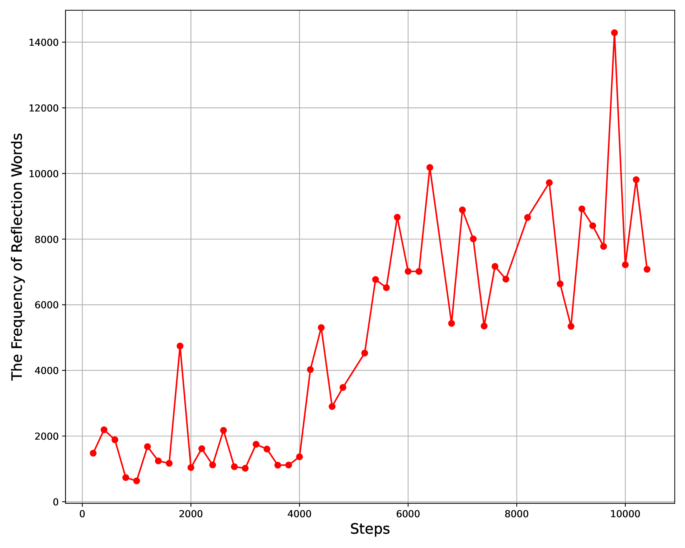
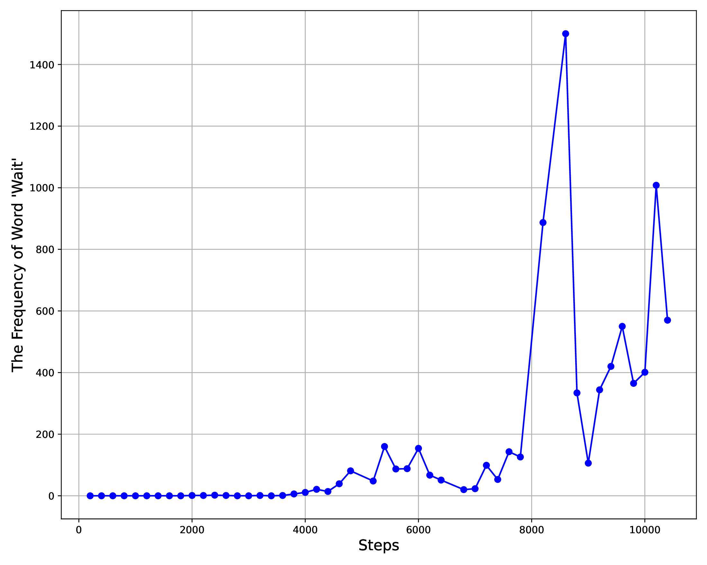
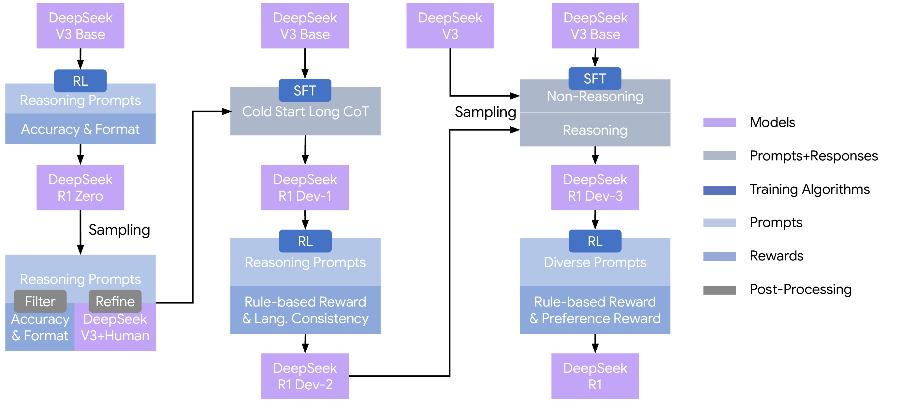
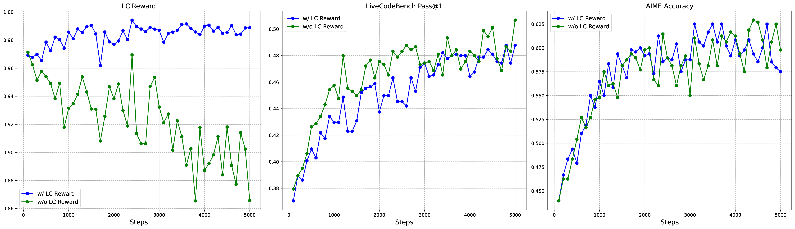
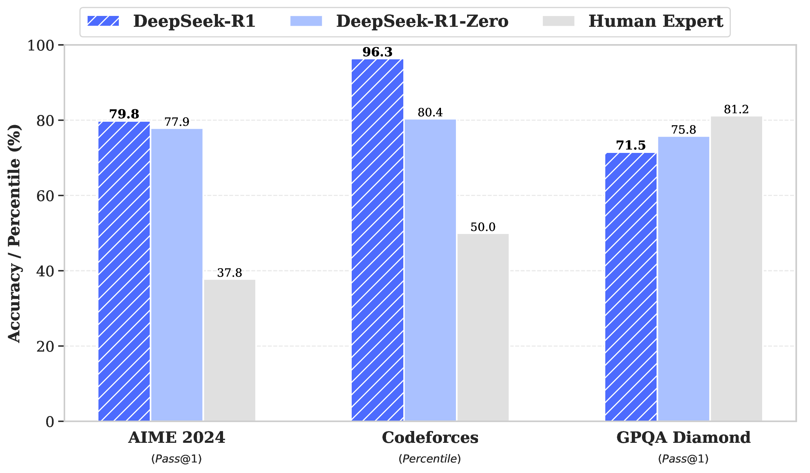
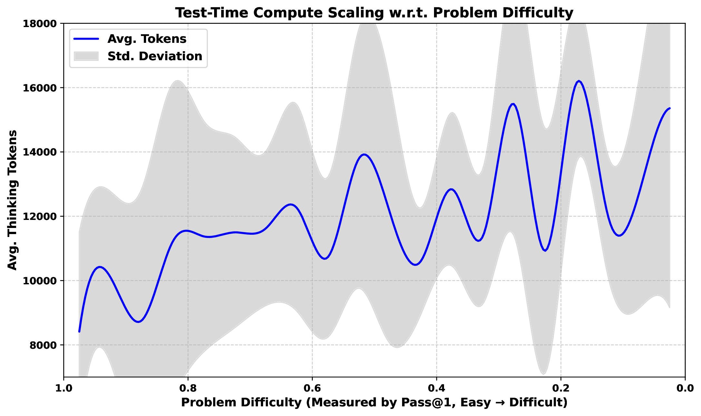

# DeepSeek-R1：RL 激发推理能力


<!-- [补充] -->
| 读者 | 建议读法 | 工程落点 |
| --- | --- | --- |
| 初学者 | 先抓“DeepSeek-R1：RL 激发推理能力”要解决的问题、关键术语和最小例子；公式只看变量方向。 | 能说清输入、输出和常见失败信号。 |
| 工程师 | 直接对照结构、指标、成本和边界条件，必要时回到前置页补概念。 | 落到数据、算力、延迟、显存、评测和回滚检查。 |

!!! note "读法定位"
    先按技术报告证据读：它证明 verifier + RL 能改变哪些推理行为，哪些训练成本和安全结论仍不能外推；背景回 [论文专题讲解](../index.md) 与 [Claim Ledger](../../references/claim-ledger.md)。

    **论文信息**：`DeepSeek-R1: Incentivizing Reasoning Capability in LLMs via Reinforcement Learning`，arXiv:2501.12948，当前 `v2` 更新于 2026-01-04；关键词包括 RLVR、GRPO、rule-based reward、long CoT、rejection sampling、SFT、distillation、reward hacking 和 test-time scaling。

这篇论文的核心不是“R1 分数很高”，而是：**有可靠 verifier 时，大模型可以通过大规模 RL 自己发现更长、更会反思和验证的推理行为。**

报告有两条主线：`R1-Zero` 验证纯 RL 能否涌现推理行为，`R1` 再加入 cold-start SFT、两阶段 RL、rejection sampling 和安全/有用性对齐。

!!! warning "阅读边界"
    这里按论文/技术报告自述来读。训练成本、数据规模、RL 超参、benchmark 分数和安全结论都应理解为作者报告的系统结果，而不是第三方独立复现实验。

<!-- [补充] -->
> **这个实验说明了什么**：这一节主要检查论文主张是否在作者设定的数据、模型和评测口径下成立；阅读时要把指标提升、消融贡献和未覆盖场景分开看。

## 论文位置

<!-- [融合：算法基础] 来源：llm-algo-leetcode《16. Decoding Strategies | 大模型解码策略：Top-K, Top-p (Nucleus) 与 Temperature》-->
> **算法视角**：推理服务可以拆成 prefill 的并行计算和 decode 的逐 token 循环；PagedAttention、prefix cache 与 speculative decoding 分别对应分页管理、前缀复用和 draft-verify 三类基础优化。
>
> 延伸阅读：[16. Decoding Strategies | 大模型解码策略：Top-K, Top-p (Nucleus) 与 Temperature](https://datawhalechina.github.io/llm-algo-leetcode/02_PyTorch_Algorithms/16_Decoding_Strategies.html)

<!-- [融合：复杂度分析] 来源：llm-algo-leetcode《16. Decoding Strategies | 大模型解码策略：Top-K, Top-p (Nucleus) 与 Temperature》-->
| 操作 | 时间复杂度 | 空间复杂度 | 说明 |
|------|-----------|-----------|------|
| prefill attention | $O(L_in^2 d)$ | $O(L_in d)$ KV 写入 | 长输入首先推高首 token 前成本；参考：[对应章节](https://datawhalechina.github.io/llm-algo-leetcode/02_PyTorch_Algorithms/16_Decoding_Strategies.html) |
| decode 单步 | $O(L_ctx d)$ | $O(L_ctx d)$ KV 读取 | 输出越长，访存循环越主导 TPOT。 |

传统 LLM 后训练通常是：

```text
base model
  -> supervised fine-tuning on human demonstrations
  -> reward model / preference data
  -> PPO or related RL algorithm
```

这个流程适合指令跟随和偏好对齐，但复杂推理会受人工 reasoning trace 限制。R1-Zero 的核心问题是：不给人工推理轨迹，只给可验证题目和最终正确性奖励，模型能否自己学出反思、回溯和验证策略。这里的 `RLVR` reward 来自标准答案、编译器、测试用例或格式检查器，而不是人类偏好模型。

## 为什么强化学习是核心

在这篇论文里，强化学习不是最后“调一下风格”的步骤，而是让推理行为出现的主发动机。

| 训练方式 | 学到的东西 | 对 reasoning 的限制 |
| --- | --- | --- |
| SFT | 模仿数据里的标准回答和推理写法 | 上限受数据质量、人工风格和标注覆盖限制 |
| Preference RLHF | 更符合人类偏好、语气和安全要求 | reward model 容易偏好表面风格，难以精确评估长推理正确性 |
| Rule-based RL / RLVR | 优化可验证任务的正确结果 | 需要可靠 verifier，开放式写作等任务很难直接套用 |

对 LLM 来说，一个 RL 样本可以这样对应：

| RL Term | DeepSeek-R1 里的对应 |
| --- | --- |
| state | prompt 加已经生成的 reasoning prefix |
| action | 下一个 token，或完整 response token 序列 |
| trajectory | 从问题到最终答案的完整输出 |
| reward | 最终答案正确性、代码测试、选择题匹配、格式和语言一致性 |
| policy | 正在训练的 DeepSeek-V3-Base / R1 checkpoint |
| reference policy | 用来约束 KL 的 reference model，训练中定期替换为最新 policy |

这里最关键的是：reward 多数只在完整回答结束后出现。模型不会逐步知道“第 7 行推理对不对”，而是最后才知道答案是否正确。因此它必须通过采样探索更容易拿高分的中间策略，比如检查、回溯和重新计算。

## GRPO：不用 critic 的组内相对策略优化

DeepSeek-R1 使用 `Group Relative Policy Optimization`，简称 GRPO。它的实用价值是：**不训练 value model / critic，而是对同一问题采样一组回答，用组内奖励均值和标准差构造 advantage。**

{ width="920" }

<small>图源：`DeepSeek-R1`，Supplementary Fig. 1。原论文图意：PPO 使用 value model 估计 advantage；GRPO 省去 value model，直接从同一问题的一组 sampled outputs 的 reward scores 中估计相对 advantage。</small>

!!! note "这张图怎么读"
    PPO 通常需要 actor、reference、reward model 和 value model。value model 要预测某个前缀未来能拿多少 reward，这在长 CoT 任务里很难：模型前面写的内容可能后面被推翻，最终答案是否正确也常常只能在完整输出后判断。

    GRPO 更贴合可验证推理任务：同一道题一次采样多个答案，谁正确、谁格式更好、谁通过测试，就能在组内排出相对高低。这样不用额外训练同规模 critic，显存和算力压力更低，也少了 value target 估计错误带来的不稳定。

论文里的 GRPO objective 写作：

$$
\mathcal{J}_{GRPO}(\theta)=
\mathbb{E}\left[
\frac{1}{G}\sum_{i=1}^{G}
\left(
\min\left(
\frac{\pi_\theta(o_i|q)}{\pi_{\theta_{old}}(o_i|q)} A_i,
\mathrm{clip}\left(
\frac{\pi_\theta(o_i|q)}{\pi_{\theta_{old}}(o_i|q)},
1-\epsilon,1+\epsilon
\right)A_i
\right)
-\beta D_{KL}(\pi_\theta||\pi_{ref})
\right)
\right].
$$

<!-- [补充：符号说明] -->
| 符号 | 含义 | 取值范围 / 常见值 |
| --- | --- | --- |
| \(\theta\) | 模型或策略参数 | 实值张量，形状由模型结构决定 |
| \(\pi_\theta\) | 模型或策略参数 | 实值张量，形状由模型结构决定 |
| \(\pi_{\theta_{old}\) | 模型或策略参数 | 实值张量，形状由模型结构决定 |
| \(\epsilon\) | 公式中的变量或中间量 | 按上下文定义 |
| \(\beta\) | 公式中的变量或中间量 | 按上下文定义 |
| \(\pi_{ref}\) | 策略或概率分布 | 非负概率分布，总和为 1 |


其中 advantage 由组内 reward 标准化得到：

$$
A_i=\frac{r_i-\mathrm{mean}(\{r_1,\ldots,r_G\})}
{\mathrm{std}(\{r_1,\ldots,r_G\})}.
$$

<!-- [补充：符号说明] -->
| 符号 | 含义 | 取值范围 / 常见值 |
| --- | --- | --- |
| \(A_i\) | 动作、优势或系数 | 动作空间/实数标量，依上下文而定 |
| \(r_i\) | 奖励、回报或时间索引相关量 | 实数标量或上下文定义的索引范围 |
| \(r_1\) | 奖励、回报或时间索引相关量 | 实数标量或上下文定义的索引范围 |
| \(r_G\) | 奖励、回报或时间索引相关量 | 实数标量或上下文定义的索引范围 |


这几个符号可以直观理解成：

!!! note "为什么组内比较很适合数学和代码"
    数学题和代码题往往不是“每个中间步骤都可验证”，但最终答案或测试结果可以验证。对同一道题采样 16 个回答以后，正确答案天然比错误答案好；同样正确时，格式、语言一致性或执行结果也能进一步区分。GRPO 把这个相对信号直接变成 policy update，比训练一个 value model 去猜“这个前缀未来是否会成功”更直接。

论文附录还比较了 PPO 和 GRPO。作者认为 PPO 若仔细调 GAE 的 \(\lambda\) 也能接近 GRPO，但需要额外 tuning，且 value model 训练会带来接近翻倍的计算和显存开销。

## R1-Zero：从 base model 直接做纯 RL

DeepSeek-R1-Zero 的核心实验设定非常激进：从 `DeepSeek-V3-Base` 出发，不做 reasoning SFT，直接用 GRPO 训练。

训练模板保留原论文英文格式：

| Template for DeepSeek-R1-Zero |
| --- |
| A conversation between User and Assistant. The user asks a question, and the Assistant solves it. The assistant first thinks about the reasoning process in the mind and then provides the user with the answer. The reasoning process and answer are enclosed within `<think>...</think>` and `<answer>...</answer>` tags, respectively, i.e., `<think>` reasoning process here `</think>` `<answer>` answer here `</answer>`. User: prompt. Assistant: |

这个模板只约束结构，不教模型“应该如何推理”。论文特意避免给内容级提示，是为了观察 RL 本身是否能诱导出反思和验证行为。

### Reward Design

R1-Zero 的 reward 由两部分构成：

$$
Reward_{rule}=Reward_{acc}+Reward_{format}.
$$

<!-- [补充：符号说明] -->
| 符号 | 含义 | 取值范围 / 常见值 |
| --- | --- | --- |
| \(R\) | 奖励、回报或时间索引相关量 | 实数标量或上下文定义的索引范围 |
| \(r\) | 奖励、回报或时间索引相关量 | 实数标量或上下文定义的索引范围 |
| \(a\) | 动作、优势或系数 | 动作空间/实数标量，依上下文而定 |
| \(f\) | 公式中的变量或中间量 | 按上下文定义 |


这行式子在说：规则奖励由正确性奖励 \(Reward_{acc}\) 和格式奖励 \(Reward_{format}\) 相加，前者看答案或代码测试是否通过，后者保证输出结构可解析。

| Reward Type | How it is computed | Why it matters |
| --- | --- | --- |
| Accuracy rewards | Math answers are matched against ground truth; code answers are evaluated with compiler/test cases; STEM/logic choices are matched to correct options | 让模型直接优化最终正确性 |
| Format rewards | Responses are encouraged to use designated tags such as `<think>` and `</think>` | 让采样输出可解析，便于后续训练和分析 |

作者强调没有在 reasoning tasks 上使用 neural reward model，也没有使用 process reward model。原因是大规模 RL 中 neural RM 容易被 reward hacking，而且训练/重训 RM 会显著增加 pipeline 复杂度。

!!! note "为什么不用 PRM 反而是重点"
    PRM 听起来更细：每一步推理都打分。但通用推理里“什么是一小步”很难定义，而且判断中间步骤正确性往往和解题本身一样难。DeepSeek-R1 选择 outcome-based verifier，是把奖励问题收缩到最可靠的一层：最终答案是否对、程序是否通过测试、选择是否正确。这个选择牺牲了中间监督密度，但换来了 reward 的可扩展性和可信度。

### R1-Zero RL Hyperparameters

保留原论文配置名：

| Setup | Value |
| --- | --- |
| Base model | DeepSeek-V3-Base |
| RL algorithm | GRPO |
| Learning rate | \(3 \times 10^{-6}\) |
| KL coefficient | 0.001 |
| Sampling temperature for rollout | 1 |
| Outputs per question | 16 |
| Max length before 8.2k step | 32,768 tokens |
| Max length after 8.2k step | 65,536 tokens |
| Total training steps | 10,400 |
| Training epochs | 1.6 |
| Unique questions per step | 32 |
| Training batch size | 512 |
| Reference model update | every 400 steps |
| Rollout size for acceleration | 8,192 outputs |
| Minibatches per rollout | 16 |
| Inner epochs | 1 |

!!! note "这些超参说明了什么"
    `16 outputs per question` 是 GRPO 的基础，因为 advantage 来自同题组内比较。`32 unique questions * 16 outputs = 512` 构成每步的训练 batch。最大长度在 8.2k step 后从 32K 提到 65K，是因为模型已经开始使用更长 reasoning，继续限制长度会压住 test-time compute scaling。每 400 step 替换 reference model，则是在“允许策略探索”和“防止离 base 太远”之间折中。

### 训练中自然出现的长 CoT

原论文把 R1-Zero 的训练曲线拆成两张子图：AIME 2024 表现和平均输出长度。

| AIME accuracy during training | Average response length during training |
| --- | --- |
|  |  |

<small>图源：`DeepSeek-R1`，Figure 1。原论文图意：左图展示 R1-Zero 在 RL 训练期间 AIME 2024 pass@1 和 cons@16 的提升；右图展示训练集上平均 response length 随训练增长，说明模型自然学会用更多 thinking time 解决推理题。</small>

论文报告 R1-Zero 的 AIME 2024 pass@1 从 15.6% 提升到 77.9%；使用 self-consistency decoding 后可到 86.7%。同时，平均 response length 随 RL 训练稳定增加，说明模型不是被人工要求“多写几步”，而是在 reward 压力下自己发现：更长的推理、验证和回溯能提高正确率。

!!! note "RL 为什么会让回答变长"
    如果 reward 只看最终正确性，模型会探索各种能提高正确率的行为。对难题来说，短答案经常不够稳定；长 CoT 给模型更多空间去枚举条件、重新计算、发现错误和切换策略。只要这些额外 token 带来的正确率收益超过 KL 和采样成本，策略更新就会提高这类长推理轨迹的概率。

### 反思行为的涌现

论文附录统计了 R1-Zero 训练中 reflective words 的频率变化。

| Frequency of reflective words | Occurrence patterns of "wait" |
| --- | --- |
|  |  |

<small>图源：`DeepSeek-R1`，Supplementary Fig. 5。原论文图意：左图统计 `wait`、`mistake`、`however`、`verify`、`check` 等反思词在训练过程中的频率；右图展示 `wait` 一词在不同训练阶段的出现模式。</small>

!!! note "反思词不是能力本身，但能暴露训练动力"
    这些词不能直接等同于真实推理能力，因为模型可能学会表演式反思。但它们和准确率、输出长度一起出现时，说明 RL 的确在改变生成策略：模型开始更频繁地停下来检查、改错、比较替代方案。更严谨的判断仍要看最终可验证任务分数，而不是只看语言现象。

## 从 R1-Zero 到 R1：为什么还需要 SFT

R1-Zero 证明了纯 RL 能激发推理，但它也有明显问题：

1. 可读性差；
2. 中英混杂；
3. 只在可验证 reasoning tasks 上训练，写作、开放问答、角色扮演等通用能力不足；
4. 安全和有用性不能只靠数学/代码 reward 解决。

DeepSeek-R1 因此采用多阶段 pipeline。

{ width="920" }

<small>图源：`DeepSeek-R1`，Figure 2。原论文图意：DeepSeek-R1 的多阶段 pipeline，从 DeepSeek-V3-Base 出发，经过 cold-start SFT、第一阶段 RL、rejection sampling 与 SFT、第二阶段 RL，得到最终 R1；Dev1、Dev2、Dev3 是中间 checkpoint。</small>

!!! note "Figure 2 怎么读"
    这张图的重点是 SFT 和 RL 的分工。RL 负责探索更强推理轨迹，尤其是人类示范难以穷尽的长链推理；SFT 负责把模型拉回更可读、更稳定、更符合用户习惯和通用任务分布的输出形态。R1 不是“纯 RL 模型”，而是把 R1-Zero 的探索结果工程化成可用模型。

### Four-stage view

| Stage | Main operation | Purpose |
| --- | --- | --- |
| Cold-start SFT | Collect thousands of human-readable long CoT samples | 改善 R1-Zero 的可读性、格式和语言一致性 |
| First RL stage | GRPO on reasoning tasks with language consistency reward | 恢复并增强推理能力，同时减少语言混杂 |
| Rejection sampling + SFT | Sample from RL checkpoint, keep correct/readable traces, mix reasoning and non-reasoning data | 构造约 800K SFT 数据，把推理和通用能力合并 |
| Second RL stage | Mixed reasoning RL and general preference/safety RL | 同时提升 reasoning、helpfulness 和 harmlessness |

## R1 的两阶段 RL 细节

### First RL Stage

第一阶段 RL 仍然以 reasoning tasks 为主，但在 R1-Zero 的规则奖励之外加入 `language consistency reward`：

$$
Reward_{language}=\frac{Num(Words_{target})}{Num(Words)}.
$$

<!-- [补充：符号说明] -->
| 符号 | 含义 | 取值范围 / 常见值 |
| --- | --- | --- |
| \(R\) | 奖励、回报或时间索引相关量 | 实数标量或上下文定义的索引范围 |
| \(l\) | 损失或目标函数 | 实数标量，训练时按 batch 聚合 |
| \(N\) | 时间步、索引或计数 | 整数索引或归一化时间区间，见正文 |
| \(W\) | 公式中的变量或中间量 | 按上下文定义 |
| \(t\) | 时间步、索引或计数 | 整数索引或归一化时间区间，见正文 |


这行式子在说：目标语言词占比越高，语言混杂越少；\(Words_{target}\) 是目标语言词数，\(Words\) 是总词数。

原论文配置如下：

| Setup | Value |
| --- | --- |
| Learning rate | \(3 \times 10^{-6}\) |
| KL coefficient | 0.001 |
| GRPO clip ratio \(\epsilon\) | 10 |
| Sampling temperature for rollout | 1 |
| Outputs per question | 16 |
| Max length | 32,768 tokens |
| Unique questions per step | 32 |
| Training batch size | 512 per step |
| Reference model update | every 400 steps |
| Rollout size for acceleration | 8,192 outputs |
| Minibatches per rollout | 16 |
| Inner epochs | 1 |
| Extra reward | language consistency reward |

`language consistency reward` 的作用不是提高数学能力，而是防止 CoT 在中英之间混杂，让输出更符合用户阅读习惯。论文附录的消融显示，这会轻微损伤部分 benchmark 表现，但改善语言一致性。

{ width="920" }

<small>图源：`DeepSeek-R1`，Supplementary Fig. 4。原论文图意：比较加入和不加入 Language Consistency Reward 时，RL 训练中的语言一致性、数学 benchmark 和代码 benchmark 变化。</small>

### Second RL Stage

第二阶段 RL 把 reasoning reward 和 general preference reward 混起来：

$$
Reward = Reward_{\text{reasoning}} + Reward_{\text{general}} + Reward_{\text{language}},
$$

<!-- [补充：符号说明] -->
| 符号 | 含义 | 取值范围 / 常见值 |
| --- | --- | --- |
| \(R\) | 奖励、回报或时间索引相关量 | 实数标量或上下文定义的索引范围 |


这行式子在说：第二阶段总奖励由推理正确性、通用偏好和语言一致性三类信号共同组成。

其中：

$$
Reward_{\text{reasoning}}=Reward_{\text{rule}},
$$

<!-- [补充：符号说明] -->
| 符号 | 含义 | 取值范围 / 常见值 |
| --- | --- | --- |
| \(R\) | 奖励、回报或时间索引相关量 | 实数标量或上下文定义的索引范围 |


这里 \(Reward_{\text{reasoning}}\) 直接沿用 rule-based verifier，不再额外训练推理 reward model。

$$
Reward_{\text{general}}=Reward_{\text{reward\_model}}+Reward_{\text{format}}.
$$

<!-- [补充：符号说明] -->
| 符号 | 含义 | 取值范围 / 常见值 |
| --- | --- | --- |
| \(R\) | 奖励、回报或时间索引相关量 | 实数标量或上下文定义的索引范围 |


这行式子在说：通用奖励由 reward model 分数和格式奖励相加，分别约束偏好质量与输出结构。

| Data type | Reward source | Training role |
| --- | --- | --- |
| reasoning data | rule-based rewards for math/code/STEM/logic | 保持和增强可验证推理能力 |
| general helpfulness data | helpful reward model | 改善开放式问答、写作、角色扮演等体验 |
| safety data | safety reward model | 降低有害输出 |
| all relevant data | language consistency reward | 控制中英混杂和可读性 |

第二阶段 RL 主要变化：

| Setup | Value |
| --- | --- |
| Sampling temperature | 0.7 |
| Total training steps | 1,700 |
| General instruction data and preference rewards | incorporated only in final 400 steps |

作者特别强调：model-based preference reward 用太久会导致 reward hacking，所以只在最后 400 step 引入通用 instruction/preference reward。

{ width="760" }

<small>图源：`DeepSeek-R1`，Supplementary Fig. 3。原论文图意：训练中 reward 持续上升，但 CodeForces 表现下降，说明 helpful reward model 可被策略利用，造成 reward hacking。</small>

!!! note "为什么第二阶段不能无限 RL"
    可验证 reasoning reward 比较硬，数学答案错就是错，代码测试不过就是不过。通用 helpfulness reward 更软，reward model 可能偏好长、顺滑、有礼貌或某种固定风格的回答。RL 时间一长，policy 会找到 reward model 的偏差，而不一定真的更有用。这就是论文把通用偏好 RL 控制在较短阶段的原因。

## RL Data Recipe

论文附录给出 RL prompt 分布，保留原表英文格式：

| Data Type | # Prompts | Question Type | Output Type |
| --- | ---: | --- | --- |
| Math | 26K | Quantitative Reasoning | Number/Expression/Equation |
| Code | 17K | Algorithm and Bug Fixing | Code Solution |
| STEM | 22K | Multi-Choice | Option |
| Logic | 15K | Choice/Quantitative Reasoning | Option/Number |
| General | 66K | Helpfulness/Harmlessness | Ranked Responses |

<small>表源：`DeepSeek-R1`，Supplementary Table：Description of RL Data and Tasks。原论文表意：R1 的 RL 数据由数学、代码、STEM、逻辑和通用 helpfulness/harmlessness 数据组成；前四类主要服务可验证推理，General 服务有用性和安全性。</small>

这些数据的 reward 可验证性不同：

| Data Type | Verifier / Reward |
| --- | --- |
| Math | answer matching，部分表达式可用 `sympy` 解析比较 |
| Code | compiler、unit tests、hidden test cases |
| STEM | multiple-choice answer matching |
| Logic | choice / quantitative answer matching，synthetic puzzle 或 code-IO 问题可自动验证 |
| General | helpful reward model and safety reward model |

!!! note "代码数据为什么要单独讲"
    代码题的 reward 比数学更贵，因为要抽取代码、运行测试、处理超时、构造可靠测试用例。论文 cold-start 部分提到，Codeforces 和 AtCoder 原始隐藏测试不公开，因此作者用 DeepSeek-V2.5 生成候选测试，再用正确提交过滤无效 case，用错误提交筛选能区分 buggy solutions 的测试。这说明 RLVR 的工程难点不只在算法，也在 verifier 数据管线。

## SFT 数据和 Rejection Sampling

R1 的 SFT 数据不是简单人工写 800K 条，而是通过 RL checkpoint 采样、过滤和混合得到。

| Domain | Num Samples | Avg Rounds | Avg Tokens |
| --- | ---: | ---: | ---: |
| Math | 395285 | 1.0 | 6094.2 |
| Code | 211129 | 1.1 | 7435.7 |
| STEM | 10124 | 1.0 | 4928.8 |
| Logic | 10395 | 1.0 | 2739.0 |
| General | 177812 | 1.1 | 1419.8 |
| Total | 804745 | 1.0 | 5355.3 |

<small>表源：`DeepSeek-R1`，Supplementary Table：Data Statistics of SFT Data。原论文表意：约 804K SFT 数据中，数学和代码占主要比例，平均 token 长度显著高于 General 数据。</small>

数据构造逻辑是：

```text
first-stage RL checkpoint
  -> sample multiple reasoning trajectories
  -> keep correct answers through rule/verifier checks
  -> filter language mixing, unreadable long paragraphs, bad code blocks
  -> mix with non-reasoning data from DeepSeek-V3 SFT pipeline
  -> train R1-Dev3 by SFT
```

关键数量：

| Dataset part | Size / Description |
| --- | --- |
| reasoning-related training samples | about 600K |
| non-reasoning training samples | about 200K |
| total supervised samples | 804745 |

SFT hyperparameters:

| Setup | Value |
| --- | --- |
| Training stages | cold-start SFT and second-stage SFT |
| Epochs | 2-3 |
| Learning rate scheduler | cosine decay |
| Initial learning rate | \(5 \times 10^{-5}\) |
| End learning rate | \(5 \times 10^{-6}\) |
| Max context length | 32,768 tokens |
| Batch size | 128 |

!!! note "为什么 SFT 在这里不是倒退"
    R1-Zero 的纯 RL 证明了探索能力，但用户面对的是最终模型，不是实验曲线。SFT 的作用是把“RL 发现的高分轨迹”变成稳定可读的数据分布，同时补回写作、问答、翻译、自我认知、软件工程等非纯 reasoning 能力。也就是说，RL 负责发现，SFT 负责固化和整理。

### RL Infrastructure：训练系统如何支撑长 CoT

大模型 RL 的瓶颈不只是反向传播。一次训练迭代要先生成大量长回答，再打分，再算 reference logprob / reward，再训练 policy。R1 附录的系统图把这件事拆成四个模块。

{ width="920" }

<small>图源：`DeepSeek-R1`，Supplementary Fig. 2。原论文图意：R1 的 RL framework 分成 rollout、inference、rule-based reward 和 training 四个模块，并用 offloading、异步调度、数据 packing、vLLM、MTP 和并行训练优化吞吐。</small>

| Module | What it does | Engineering point |
| --- | --- | --- |
| Rollout Module | Load prompts and sample multiple responses with actor model | 使用 vLLM workers；对 DeepSeek-V3 MoE 使用 expert parallelism；为 hotspot experts 放 redundant copies；用 MTP 做 self-speculative decoding |
| Inference Module | Load reward model and reference model for forward pass | 获取 model-based rewards、reference logprobs 等训练信息 |
| Rule-based Reward Module | Compute code executor, answer matcher, format checker rewards | 不占 GPU，但耗时；用 asynchronous scheduling 和 rollout/inference 重叠 |
| Training Module | Compute loss and update actor, optionally critic | 支持 PPO、GRPO、DPO；用 length sorting、Best-Fit packing 和 DualPipe 减少 padding 与 pipeline 浪费 |

!!! note "为什么 RL infrastructure 要 offload"
    Rollout、reward/reference inference 和 training 需要的模型实例不同。如果所有模型同时常驻 GPU，671B MoE 级别的显存压力会非常高。论文说除 rule-based reward module 外，每个模块结束后都会把模型实例从 VRAM offload 到系统内存或磁盘，为下一阶段释放显存。这类工程细节决定了大规模 RL 能不能跑，而不是只影响速度。

### 训练成本

论文附录给出成本估计，保留原表英文格式：

| Training Costs | DeepSeek-R1-Zero | SFT data creation | DeepSeek-R1 | Total |
| --- | ---: | ---: | ---: | ---: |
| in H800 GPU Hours | 101K | 5K | 41K | 147K |
| in USD | \$202K | \$10K | \$82K | \$294K |

<small>表源：`DeepSeek-R1`，Supplementary Table：Training costs of DeepSeek-R1, assuming the rental price of H800 is \$2 per GPU hour。原论文表意：作者按 H800 每 GPU hour 2 美元估计，R1-Zero、SFT 数据创建和 R1 训练合计约 147K H800 GPU hours、294K 美元。</small>

论文文字还说明：

| Item | Detail |
| --- | --- |
| Smaller experiments | A100 GPUs for a smaller 30B model |
| R1-Zero large-scale training | 64 * 8 H800 GPUs, about 198 hours |
| R1 training | same 64 * 8 H800 GPUs, about 80 hours |
| SFT dataset creation | about 5K GPU hours |

这个成本说明：R1 的结论不是“强化学习便宜”，而是“当 base model 足够强、verifier 足够可靠、系统吞吐足够高时，大规模 RL 可能比人工 reasoning annotation 更可扩展”。

### 阶段效果：每个训练阶段改变了什么

原论文给出 R1 各阶段的 benchmark 表。下面保留核心表格英文格式：

|  | Benchmark (Metric) | R1-Zero | R1-Dev1 | R1-Dev2 | R1-Dev3 | R1 |
| --- | --- | ---: | ---: | ---: | ---: | ---: |
| English | MMLU (EM) | 88.8 | 89.1 | 91.2 | 91.0 | 90.8 |
| English | MMLU-Redux (EM) | 85.6 | 90.0 | 93.0 | 93.1 | 92.9 |
| English | MMLU-Pro (EM) | 68.9 | 74.1 | 83.8 | 83.1 | 84.0 |
| English | DROP (3-shot F1) | 89.1 | 89.8 | 91.1 | 88.7 | 92.2 |
| English | IF-Eval (Prompt Strict) | 46.6 | 71.7 | 72.0 | 78.1 | 83.3 |
| English | GPQA Diamond (Pass@1) | 75.8 | 66.1 | 70.7 | 71.2 | 71.5 |
| English | SimpleQA (Correct) | 30.3 | 17.8 | 28.2 | 24.9 | 30.1 |
| English | FRAMES (Acc.) | 82.3 | 78.5 | 81.8 | 81.9 | 82.5 |
| English | AlpacaEval2.0 (LC-winrate) | 24.7 | 50.1 | 55.8 | 62.1 | 87.6 |
| English | ArenaHard (GPT-4-1106) | 53.6 | 77.0 | 73.2 | 75.6 | 92.3 |
| Code | LiveCodeBench (Pass@1-COT) | 50.0 | 57.5 | 63.5 | 64.6 | 65.9 |
| Code | Codeforces (Percentile) | 80.4 | 84.5 | 90.5 | 92.1 | 96.3 |
| Code | Codeforces (Rating) | 1444 | 1534 | 1687 | 1746 | 2029 |
| Code | SWE Verified (Resolved) | 43.2 | 39.6 | 44.6 | 45.6 | 49.2 |
| Code | Aider-Polyglot (Acc.) | 12.2 | 6.7 | 25.6 | 44.8 | 53.3 |
| Math | AIME 2024 (Pass@1) | 77.9 | 59.0 | 74.0 | 78.1 | 79.8 |
| Math | MATH-500 (Pass@1) | 95.9 | 94.2 | 95.9 | 95.4 | 97.3 |
| Math | CNMO 2024 (Pass@1) | 88.1 | 58.0 | 73.9 | 77.3 | 78.8 |
| Chinese | CLUEWSC (EM) | 93.1 | 92.8 | 92.6 | 91.6 | 92.8 |
| Chinese | C-Eval (EM) | 92.8 | 85.7 | 91.9 | 86.4 | 91.8 |
| Chinese | C-SimpleQA (Correct) | 66.4 | 58.8 | 64.2 | 66.9 | 63.7 |

<small>表源：`DeepSeek-R1`，Table 2。原论文表意：R1 各中间阶段在通用知识、代码、数学、中文和偏好评测上的表现，反映 cold-start SFT、reasoning RL、rejection sampling/SFT 和 final RL 的不同作用。</small>

这张表可以这样读：

1. `R1-Zero -> R1-Dev1`：IF-Eval 和 ArenaHard 大幅提升，但 AIME、CNMO 等推理分数下降，说明 cold-start SFT 改善可读性和指令跟随，但会损失一部分纯 RL 推理能力。
2. `R1-Dev1 -> R1-Dev2`：reasoning RL 把 MMLU-Pro、LiveCodeBench、Codeforces、AIME 等拉起来，说明第二次推理探索有效。
3. `R1-Dev2 -> R1-Dev3`：大规模 SFT 混合 reasoning 与 non-reasoning，Aider-Polyglot 和通用偏好相关分数提升。
4. `R1-Dev3 -> R1`：final RL 主要把 AlpacaEval2.0、ArenaHard、IF-Eval 等用户偏好和指令能力推上去，数学/代码边际收益较小。

### Benchmark 结论与 test-time scaling

论文用一张图把 R1/R1-Zero 和人类成绩放在一起：

{ width="850" }

<small>图源：`DeepSeek-R1`，Supplementary Fig. 6。原论文图意：比较 R1 和 R1-Zero 在 AIME、Codeforces、GPQA 等任务上的表现，并与相应人类群体平均成绩对照。</small>

另一个重要结论是：R1 会根据题目难度动态分配 thinking tokens。

{ width="850" }

<small>图源：`DeepSeek-R1`，Supplementary Fig. 9。原论文图意：随着问题难度上升，模型为得到正确答案生成的 thinking tokens 增加；该图用 2024 数学竞赛题分析 test-time compute scaling。</small>

论文报告，在一组 2024 数学竞赛题上，R1 平均使用 8,793 thinking tokens，pass@1 为 61.8%。简单题少于 7,000 thinking tokens，最难题超过 18,000 thinking tokens。

!!! note "test-time scaling 和 majority voting 的区别"
    majority voting 是并行采样很多条独立答案，再投票。R1 的长 CoT 是在单条轨迹内部投入更多计算，让模型自己检查、修正和回溯。两者可以叠加，但不是一回事。论文也指出，R1 在 AIME 2024 上 pass@64 明显高于 pass@1，说明独立多采样仍有帮助。

### Distillation：小模型更适合先学强模型轨迹

R1 还把长 CoT 能力蒸馏到 Qwen 和 LLaMA 系模型。蒸馏阶段只做 SFT，不加 RL。

| Distilled Model | Base Model | Initial Learning Rate |
| --- | --- | ---: |
| DeepSeek-R1-Distill-Qwen-1.5B | Qwen2.5-Math-1.5B | \(1 \times 10^{-4}\) |
| DeepSeek-R1-Distill-Qwen-7B | Qwen2.5-Math-7B | \(8 \times 10^{-5}\) |
| DeepSeek-R1-Distill-Qwen-14B | Qwen2.5-14B | \(7 \times 10^{-5}\) |
| DeepSeek-R1-Distill-Qwen-32B | Qwen2.5-32B | \(6 \times 10^{-5}\) |
| DeepSeek-R1-Distill-Llama-8B | Llama-3.1-8B | \(5 \times 10^{-5}\) |
| DeepSeek-R1-Distill-Llama-70B | Llama-3.3-70B-Instruct | \(2 \times 10^{-5}\) |

<small>表源：`DeepSeek-R1`，Supplementary Table：DeepSeek-R1 Distilled Models, their corresponding Base Models, and Initial Learning Rates。</small>

蒸馏超参：

| Setup | Value |
| --- | --- |
| Data | 800K samples generated/curated from DeepSeek-R1 |
| Epochs | 2-3 |
| Scheduler | cosine decay to one-tenth of initial LR |
| Max context length | 32,768 tokens |
| Batch size | 64 |
| RL stage | not included |

论文还比较了 32B 小模型自己做大规模 RL 和蒸馏 R1 的差别：

| Model | AIME 2024 pass@1 | AIME 2024 cons@64 | MATH pass@1 | GPQA Diamond pass@1 | LiveCodeBench pass@1 |
| --- | ---: | ---: | ---: | ---: | ---: |
| QwQ-32B-Preview | 50.0 | 60.0 | 90.6 | 54.5 | 41.9 |
| Qwen2.5-32B-Zero | 47.0 | 60.0 | 91.6 | 55.0 | 40.2 |
| DeepSeek-R1-Distill-Qwen-32B | 72.6 | 83.3 | 94.3 | 62.1 | 57.2 |

<small>表源：`DeepSeek-R1`，Supplementary Table：Comparison of distilled and RL Models on Reasoning-Related Benchmarks。原论文表意：在 32B 规模上，直接大规模 RL 得到的 Qwen2.5-32B-Zero 不如从 R1 蒸馏出的 DeepSeek-R1-Distill-Qwen-32B。</small>

!!! note "为什么小模型直接 RL 不如蒸馏"
    论文的判断是：纯 RL 的效果高度依赖 base checkpoint 能力。7B dense 和 16B MoE 早期实验没有显著收益，32B 起才开始可见，230B/671B 更明显。小模型如果自己探索长 CoT，容易重复、卡住或无法有效利用长推理；但如果直接学习强模型已经发现的高质量 reasoning trajectories，SFT 蒸馏更经济。

### 和普通 RLHF 的关系

DeepSeek-R1 和 InstructGPT 式 RLHF 都是后训练，但目标和奖励完全不同。

| Dimension | InstructGPT-style RLHF | DeepSeek-R1-style RLVR |
| --- | --- | --- |
| Main target | helpful, harmless, instruction-following responses | verifiable reasoning correctness and long CoT behavior |
| Reward source | human preference reward model | rule-based verifier, compiler/tests, answer matching, plus limited RM for general data |
| Core algorithm | PPO with value model | GRPO without value model |
| Main risk | reward model bias, style overoptimization | verifier coverage, reward hacking on soft rewards, overthinking |
| Best suited tasks | open-ended response quality | math, code, STEM, logic, other tasks with reliable automatic verification |

这也是为什么 R1 最强的提升首先出现在 AIME、MATH、LiveCodeBench、Codeforces 和 MMLU-Pro STEM 类任务。它不是简单“更会聊天”，而是在有强 verifier 的任务上获得了强探索信号。

### 失败尝试：PRM 和 MCTS

论文讨论了两个没有成为主路线的方向。

| Attempt | Why it is attractive | Why it failed or was not chosen |
| --- | --- | --- |
| Process Reward Model (PRM) | 可以给中间步骤打分，理论上奖励更密 | 通用 reasoning step 难定义；中间正确性难自动标；model-based PRM 容易 reward hacking；重训成本高 |
| Monte Carlo Tree Search (MCTS) | 借鉴 AlphaGo/AlphaZero，用搜索扩大 test-time compute | token 生成搜索空间指数级；value model 质量决定搜索质量；细粒度 value model 难训练，容易卡局部最优 |

!!! note "MCTS 为什么在文本里比棋类难"
    棋类动作空间有限、规则明确、状态转移确定，搜索树节点有清楚含义。文本生成每个 token 都可能分叉，语义状态又很难离散化。你可以限制每个节点扩展数量，但这会让搜索更容易错过关键路径；而 value model 如果判断不准，会系统性地把搜索带向坏分支。

### 局限与风险

这篇论文的局限也很有工程价值。

1. **可靠 verifier 是前提**：数学、代码、选择题适合 RLVR；开放写作、复杂问答和主观偏好很难构造硬奖励。
2. **reward hacking 仍然存在**：一旦引入 model-based reward，训练过久就可能优化 reward model 的偏差，而不是优化真实质量。
3. **base model 必须足够强**：小模型直接大规模 RL 不一定能学出长 CoT，可能只是变长和重复。
4. **token efficiency 仍不足**：模型会过度思考简单题，长输出提高推理能力的同时也增加推理成本。
5. **language mixing**：R1 主要针对中英优化，其他语言可能在 reasoning 和 answer 中混用语言。
6. **prompt sensitivity**：论文建议评测时使用 zero-shot，few-shot prompting 反而可能伤害表现。
7. **结构化输出和工具使用不足**：论文明确说 R1 当前结构化输出和工具使用能力不如一些现有模型。
8. **软件工程 RL 还不充分**：真实 SWE 任务评测耗时长，难以大规模纳入 RL loop，因此 SWE 类任务提升有限。
9. **安全风险更复杂**：透明 CoT 和更强推理能力可能暴露更多潜在风险知识；部署时需要外部 risk control system。

### 对项目的启发

迁移到自己的训练项目时，优先抓这些原则：

1. 先问任务有没有可靠 verifier。没有 verifier，不要盲目上大规模 RL。
2. 对同一 prompt 多采样，才能让 GRPO/RLOO 一类方法得到有用相对信号。
3. reward 设计优先硬规则，其次才是 reward model；软 reward 必须控制训练步数并监控 hacking。
4. 长 CoT 不是靠 prompt 强迫出来，而是要让更长推理在 reward 上真的占优。
5. SFT 和 RL 不应二选一：RL 负责探索高分轨迹，SFT 负责可读性、通用能力和稳定分布。
6. 数据管线和 verifier 管线和算法同等重要，尤其是代码测试、答案解析、格式检查和语言过滤。
7. 对小模型，优先考虑从强模型蒸馏长 CoT；直接纯 RL 探索可能成本高且收益不稳。
8. 评估时要把 pass@1、consensus、多采样、token 数和延迟一起看，不能只看最高分。

### 阅读结论

DeepSeek-R1 最值得学习的地方，是它把“推理能力”重新放回一个可训练的闭环里：

```text
强 base model
  + 可验证难题
  + 大规模采样
  + 组内相对策略优化
  + 可靠 reward / verifier
  + 足够训练系统吞吐
  -> 涌现更长、更会反思和验证的推理行为
```

但这条路线不是所有任务的通用答案。它在数学、代码、STEM、逻辑等可验证任务上最强；进入开放式写作、安全偏好或真实工具任务后，reward 可靠性、环境成本和 reward hacking 会重新成为核心瓶颈。更准确地说，DeepSeek-R1 证明了：**当正确性可以自动验证时，强化学习可以把大模型从“模仿推理”推向“通过试错发现推理策略”。**

!!! note "合并提示"
    **info · 本站判断**

    DeepSeek-R1 要按可验证推理训练闭环读：方法重点是 GRPO/RLVR、rule-based reward、cold-start SFT 和蒸馏；实验看 AIME/MATH/Code/知识 benchmark 与语言一致性消融。它最能迁移到有 verifier 的任务，开放式偏好和工具任务要另验。

    **tip · 下一站**

    - 回到 [论文专题讲解](../index.md) 横向比较，或继续读 [Qwen3：Thinking 与蒸馏](qwen3.md)。
