# DeepSeek-R1：RL 激发推理能力

!!! info "论文信息"
    **论文题名：** DeepSeek-R1: Incentivizing Reasoning Capability in LLMs via Reinforcement Learning。 
    **作者：** DeepSeek-AI、Daya Guo、Dejian Yang、Haowei Zhang、Junxiao Song、Peiyi Wang、Qihao Zhu、Runxin Xu、Ruoyu Zhang、Shirong Ma 等（共 200 人）。 
    **机构：** 未在公开元数据中稳定解析；以 arXiv/PDF 或官方页 affiliation block 为准。 
    **时间 / 主题：** 2025-01；技术报告。 
    **arXiv / 官方报告：** arXiv：[2501.12948](https://arxiv.org/abs/2501.12948)。 
    **GitHub / 项目：** GitHub：[github.com/deepseek-ai/DeepSeek-R1](https://github.com/deepseek-ai/DeepSeek-R1)。 
    **元数据来源与核验口径：** 来源：[arXiv](https://arxiv.org/abs/2501.12948)；[GitHub API / repo](https://github.com/deepseek-ai/DeepSeek-R1)；Checked Date：2026-06-15；Repro Status：Paper / official materials reviewed, independent reproduction not claimed。

## 只奖励最后答对，能不能学会更好的解题过程

给模型同一道数学题，让它独立尝试十六次。验证器只判断最终答案是否正确，不标出哪一步值得保留。某些回答会先算错再回头检查，某些回答只是碰巧猜中。训练时提高成功回答的概率，模型会不会逐渐保留那些有用的检查动作？这就是 DeepSeek-R1-Zero 实验真正要回答的问题。

DeepSeek-R1-Zero 直接从 DeepSeek-V3-Base 开始强化学习，没有先加入推理监督微调。论文报告，在这套基础模型、题目和验证器条件下，仅用最终结果奖励就能提高解题成绩，同时出现更长的推理和更多自我检查行为。完整 R1 面对的是另一个工程问题：竞赛题能做对，不等于回答易读、格式稳定或适合一般任务。它因此加入冷启动 SFT、推理 RL、拒绝采样后的混合 SFT，再做混合 RL。[↗](https://arxiv.org/pdf/2501.12948v2#page=2)

这里的“纯 RL”有明确范围。V3-Base 已经在 14.8T tokens 上预训练，拥有 671B 总参数、每个 token 激活 37B 参数。附录明确承认，预训练数学和代码材料里包含大量推理轨迹，网页中也自然存在其他模型生成的回答。R1-Zero 没有额外的推理 SFT，不代表它此前从未见过解题过程。预训练提供可供采样的候选行为，验证器和 RL 改变这些行为出现的概率，这是理解实验的起点。[↗](https://arxiv.org/pdf/2501.12948v2#page=13)

2026 年 1 月更新的 v2 扩展报告补充了中间 checkpoint、数据构造、系统成本与失败实验，让不同训练阶段的作用可以分开检验。

## 验证器决定模型究竟在学什么

### 数学答案与程序执行，分别提供哪种反馈

R1-Zero 的规则奖励由正确性和格式两部分等权相加。

$$
R_{\mathrm{rule}}=R_{\mathrm{acc}}+R_{\mathrm{format}}.
$$

数学任务要求模型给出可提取的最终答案，例如放在 `\boxed{}` 中的数字或表达式，再与参考答案比较。代码任务运行生成的程序，检查隐藏测试的输出及性能要求。格式奖励约束 `<think>...</think>` 等标签，让系统能够分开处理推理和答案。训练 prompt 也预先要求先思考再回答。因此，实验省去了逐步解法示范，仍保留了问题、标准答案、输出结构和可执行的评分规则。[↗](https://arxiv.org/pdf/2501.12948v2#page=3)

这类奖励把困难从“写出一条好解法”转移到了“可靠地判断结果”。例如，答案匹配必须识别等价表达式；程序测试必须覆盖边界输入和时间复杂度。一次漏检会把有缺陷的回答当作成功样本，后续优化就可能放大这种缺陷。报告的数学 RL 数据排除了证明题，原因很具体，自动判断整篇证明的正确性比核验一个确定结果困难得多。

原文 Table 4 给出的 RL 数据概况如下。这里保留表内统计；紧随其后的正文另提到 8K bug-fixing 问题和 12K harmlessness 问题，与表中 Code、General 的数字口径并不完全一致，不宜直接相加后宣称精确总量。[↗](https://arxiv.org/pdf/2501.12948v2#page=19)

| Data Type | # Prompts | Question Type | Output Type |
| --- | ---: | --- | --- |
| Math | 26K | Quantitative Reasoning | Number / Expression / Equation |
| Code | 17K | Algorithm and Bug Fixing | Code Solution |
| STEM | 22K | Multi-Choice | Option |
| Logic | 15K | Choice / Quantitative Reasoning | Option / Number |
| General | 66K | Helpfulness / Harmlessness | Ranked Responses |

STEM 用选择题提供确定答案；Logic 包括可自动检查的谜题和由代码输入输出转成的推理问题。这些任务不一定容易求解，却相对容易核验。General 则涉及写作、编辑和开放问答，无法仅靠一个标准答案打分，需要后面介绍的偏好模型。

### 隐藏测试不存在时，代码奖励如何建立

报告在冷启动数据构造中给出了一套具体做法。作者收集 5,151 道 Codeforces 和 2,504 道 AtCoder 问题，但拿不到平台原始隐藏测试，于是让 DeepSeek-V2.5 编写输入生成程序，产生多样、规模足够大且可能暴露错误的输入。生成之后还有两层筛选。[↗](https://arxiv.org/pdf/2501.12948v2#page=21)

第一层用已知正确的提交检验候选测试，淘汰不合法或导致判定异常的用例。第二层拿已知错误的提交测试这些用例，挑出能够区分正确与错误实现的子集。前者控制误杀，后者提高发现缺陷的能力。只让正确程序跑通一个测试集，无法说明它足以淘汰错误程序；两层检查缺一不可。

这也解释了为什么“代码能执行”还不够。若所有输入都很小，指数级或过慢的实现也可能通过；若没有重复元素、空边界或特殊结构，逻辑错误可能长期得不到惩罚。报告给出的生成提示明确要求构造能让错误实现超时的大输入。验证器的覆盖能力，是 RL 能力增长的一部分，不能作为免费且天然可靠的前提。

## GRPO 怎样把一组尝试变成一次参数更新

**Group Relative Policy Optimization（组相对策略优化，GRPO）** 利用同一个问题的多次尝试构造训练信号，核心是比较这些尝试的相对好坏。

### 组内比较解决题目难度不同的问题

对同一个问题 $q$，采样策略 $\pi_{\theta_{\mathrm{old}}}$ 生成 $G$ 个回答 $o_1,\ldots,o_G$。验证器分别给出 $r_1,\ldots,r_G$，GRPO 用同题平均奖励作为基线，再按标准差归一化。

$$
\bar r=\frac1G\sum_{j=1}^{G}r_j,
\qquad
A_i=\frac{r_i-\bar r}{\operatorname{std}(r_1,\ldots,r_G)}.
$$

$A_i$ 是第 $i$ 个回答的优势。正值表示它比同题其他尝试更好，负值表示更差。同样一个“答对”，在大家几乎都会做的题上提供的信息，与只有少数尝试能成功的题不同。组内基线让模型比较同一问题的候选解法，避免直接拿一道简单题的奖励去衡量另一道难题。[↗](https://arxiv.org/pdf/2501.12948v2#page=3)

可以用一个说明性例子理解。暂时只考虑二元正确性奖励，假设四个回答得到 $[1,1,0,0]$，并按总体标准差计算，则均值是 $0.5$，标准差是 $0.5$，优势为 $[1,1,-1,-1]$。前两条轨迹被鼓励，后两条被抑制。这个例子不代表论文的真实 batch，真实训练每题采样十六个回答，并包含格式等奖励。

若一组回答的总奖励完全相同，组内就没有哪条更好的信息，标准差还会变成零。实现需要处理这种情况；报告的简式未说明稳定项、跳过规则或其他细节，复现时不能把裸除法直接当成可运行代码。题目过易导致全部成功，或过难导致全部失败，也会削弱这种相对反馈。

### 最终结果如何影响中间 token

对自回归语言模型，一条回答的概率由逐 token 的条件概率组成。

$$
\log\pi_\theta(o_i\mid q)
=\sum_{t=1}^{T_i}\log\pi_\theta(o_{i,t}\mid q,o_{i,<t}).
$$

在最基本的策略梯度直觉下，优势乘在这条轨迹的对数概率梯度上。某条先试错、后检查、最终答对的轨迹得到正优势，模型便更可能再次生成类似的 token 选择。训练没有逐字标出哪一步检查真正有用，而是从大量成功和失败轨迹的差别中调整分布。这能鼓励有效检查，也可能同时强化偶然伴随成功的措辞，所以“输出了反思词”与“每一步推理都被验证”之间仍有距离。

GRPO 进一步限制更新幅度。令

$$
w_i=\frac{\pi_\theta(o_i\mid q)}{\pi_{\theta_{\mathrm{old}}}(o_i\mid q)},
$$

报告用按回答书写的简式表达目标

$$
\mathcal J_{\mathrm{GRPO}}
=\mathbb E\left[\frac1G\sum_{i=1}^{G}
\left(\min\left\{w_iA_i,
\operatorname{clip}(w_i,1-\epsilon,1+\epsilon)A_i\right\}
-\beta\widehat D_{\mathrm{KL},i}\right)\right].
$$

$w_i$ 比较当前策略与生成这批回答的旧策略。对于正优势回答，当其概率已增加得足够多，clip 分支会停止继续奖励这一方向上的变化；对于负优势回答，当概率比低于有效的裁剪下界时，目标也不再因继续降低概率而改善。裁剪能否在两个方向起作用取决于参数，它不能保证任何学习率与训练设置下都稳定。

KL 项使用另一个参照，即参考策略 $\pi_{\mathrm{ref}}$。令 $u_i=\pi_{\mathrm{ref}}(o_i\mid q)/\pi_\theta(o_i\mid q)$，论文给出的估计形式是

$$
\widehat D_{\mathrm{KL},i}=u_i-\log u_i-1.
$$

它控制模型偏离参考策略的程度。采样旧策略用于说明“这些样本从哪里来”，参考策略用于约束“允许离某个稳定模型多远”，两者承担不同作用。R1 训练每 400 步将 reference 替换为最新策略，避免探索几千步后仍被最初的模型强行拉回。[↗](https://arxiv.org/pdf/2501.12948v2#page=15)

上述回答级公式足以解释优化方向，不能替代完整语言模型训练实现。实际代码还必须定义 token 级概率比、有效位置掩码、截断轨迹和长度归约。尤其是 v2 第 7 页明确报告首轮 R1 RL 的 clip 参数 $\epsilon=10$。若按印刷公式直接代入，裁剪区间为 $[-9,11]$；概率比非负，下界便不会起作用。这是根据公式得到的解释，报告没有在此说明是否还有其他实现处理。复现时需要核对参数含义，不能擅自替换原始数值，也不能认为照抄一个数值就复现了训练。

### 去掉价值模型，节省了什么

传统 PPO 常用一个 value model 预测当前前缀之后的期望回报，再用 GAE 构造优势。长推理里，一个看似错误的中间步骤可能稍后被纠正，仅从当前前缀预测最终成败并不容易。这个价值模型通常还带来较大的显存、训练和调参成本。GRPO 用同题多个回答的奖励构造基线，省去了这一分支。

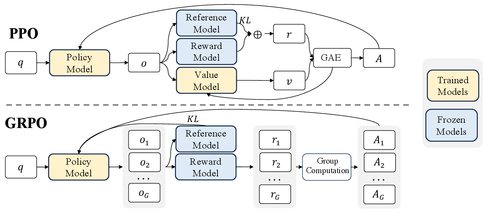{ width="920" }

<small>图源：DeepSeek-R1 v2，Figure 3。上半部分 PPO 的 Value Model 参与优势估计；下半部分 GRPO 将同题多个结果送入 Group Computation。</small>

图中 Reward Model 是评分接口的概括画法，R1-Zero 的推理评分实际使用规则。省掉 critic 也没有省掉十六条回答的生成成本。对长 CoT，rollout 仍然可能占据大量时间。

算法对照同样需要看实验条件。下面的 MATH 实验使用 DeepSeek-Coder-V2-Lite，16B MoE、2.4B 激活参数。PPO 的 GAE 参数 $\lambda=0.95$ 时明显落后，将其调到 $1.0$ 后，蓝色方块曲线已接近 GRPO。[↗](https://arxiv.org/pdf/2501.12948v2#page=16)

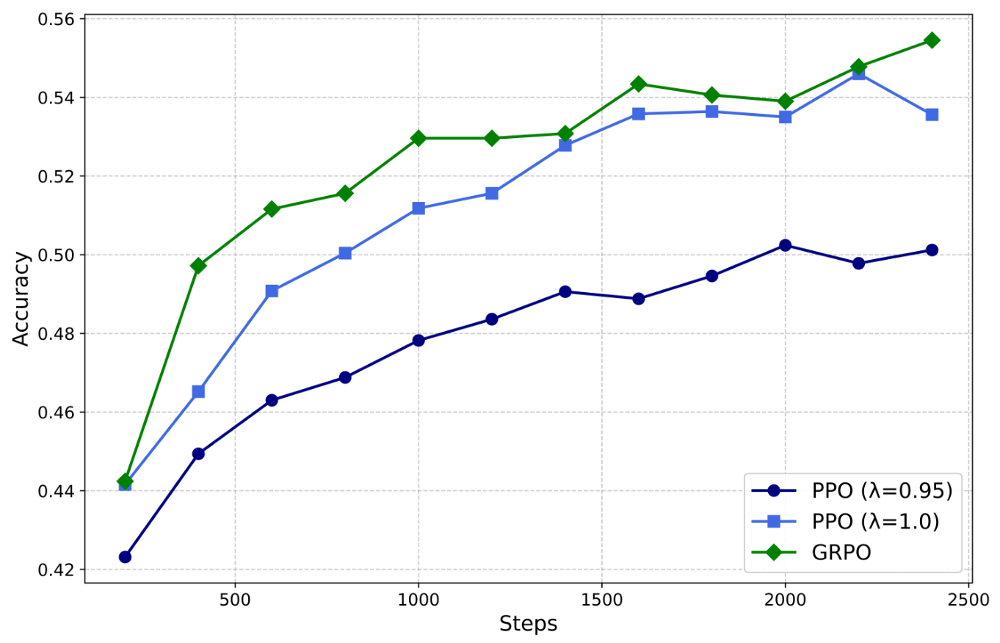{ width="820" }

<small>图源：DeepSeek-R1 v2，Figure 4。比较浅蓝与深蓝两条 PPO 曲线，能看到超参数本身带来的差异。</small>

它支持 GRPO 在这一设置中省资源且较易配置。它没有证明 PPO 无法训练推理，也没有证明所有模型上换用 GRPO 都会获得同样幅度的提高。

## R1-Zero 的学习曲线，哪些变化确实来自实验

### 一次训练 step 包含多少工作

R1-Zero 使用学习率 $3\times10^{-6}$、KL 系数 $0.001$ 和 rollout temperature 1。每个问题生成 16 个回答，每个更新 step 使用 32 道独立问题，得到 512 条回答。一次 rollout 先产生 8,192 条回答，再随机拆成 16 个 minibatch，每条数据只经历一个 inner epoch；总共训练 10,400 个更新 step，约 1.6 个数据 epoch。[↗](https://arxiv.org/pdf/2501.12948v2#page=3)

这里有三个不同的量。rollout 是一次采样批次，step 是一次参数更新，epoch 是数据遍历口径。看到“万步训练”时，不能将其想象成模型只回答了一万道题，也不能把它与生成时的一万个 token 混为一谈。

AIME 2024 的平均 pass@1 从 15.6% 升到 77.9%。下图红线是对 16 个回答做答案投票的 cons@16，最终达到 86.7%，它需要额外采样和聚合，不能当作单次回答准确率。

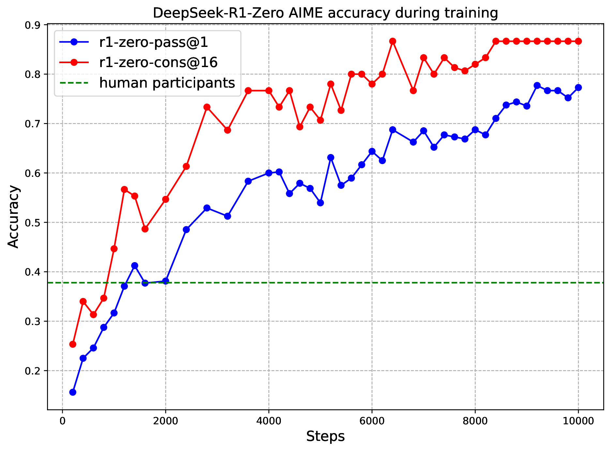

<small>图源：DeepSeek-R1 v2，Figure 1(a)。蓝线是单次正确率估计，红线是多次采样后投票的结果，绿线是该竞赛参赛者平均成绩。</small>

### 变长、变准与“顿悟”不能简单画等号

随着训练，平均回答长度从较短输出增长到上万 token。模型会重新检验条件、回到先前步骤或尝试其他解法，这提供了更多可用于求解的计算。但第 8,200 步有一个明确的外部变化，最大输出长度从 32,768 调到 65,536。原文第 3 页说明，性能和长度在此后都出现跳升。

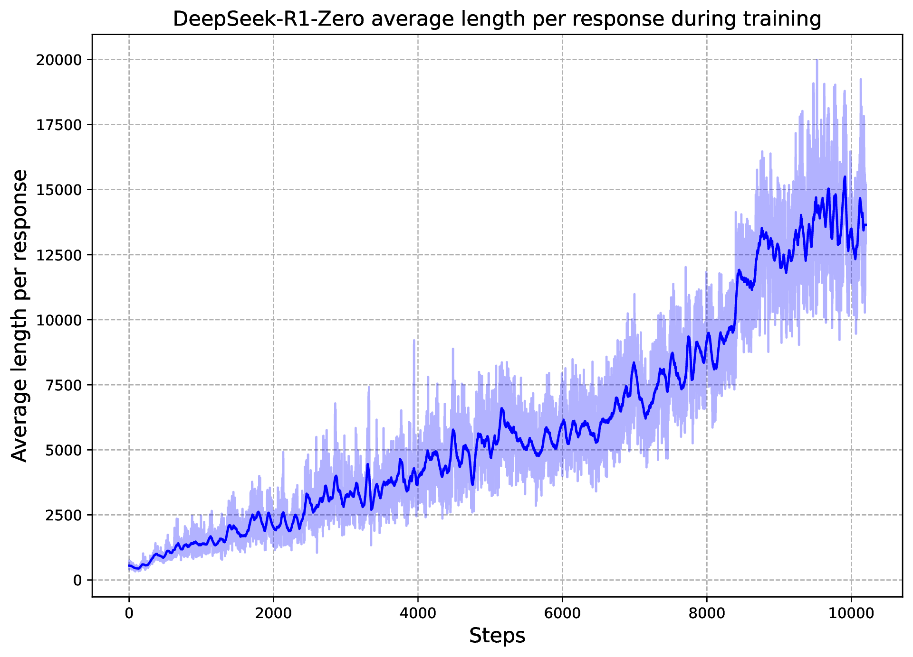

<small>图源：DeepSeek-R1 v2，Figure 1(b)。横轴是策略更新次数；后期变化应结合输出上限调整一起阅读。</small>

因此，整体训练过程支持长推理行为与成绩共同发展；8,200 步附近的跳变混入了预算放宽的影响，不能单凭这段曲线宣称发生了一次完全自发的能力突变。报告第 5 页对自主增长的概括，应与更具体的训练配置放在一起理解。

按题目难度拆开后，可以进一步排除“只是在简单题上做得更稳”的解释。MATH 的 level 4 准确率约从 0.78 升到 0.95，level 5 约从 0.55 升到 0.90，而较容易的问题较早便达到高分。[↗](https://arxiv.org/pdf/2501.12948v2#page=37)

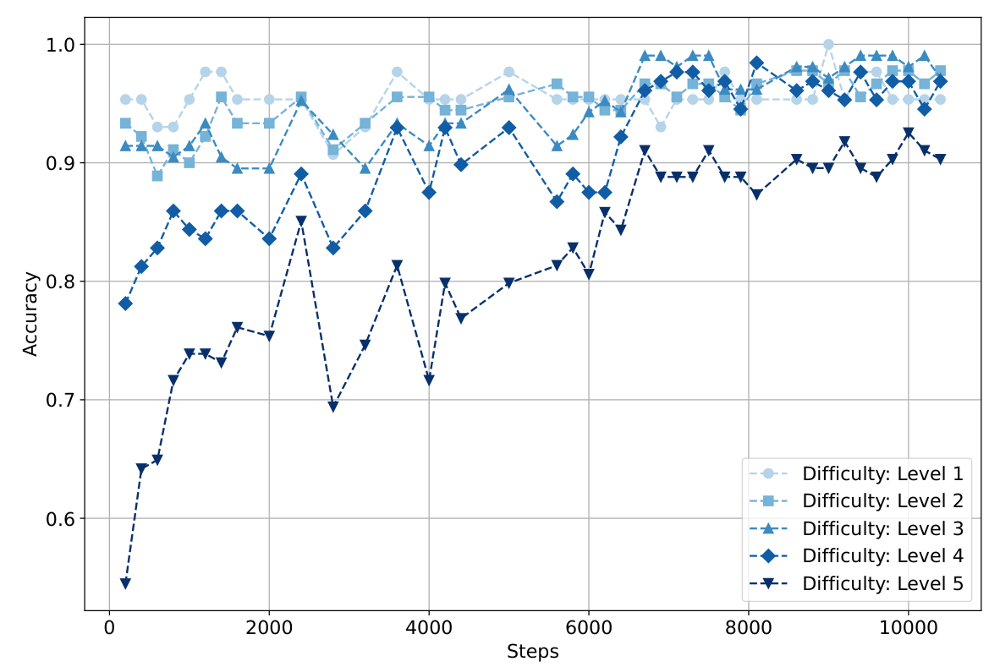{ width="820" }

<small>图源：DeepSeek-R1 v2，Figure 8。深色 level 5 曲线展示较大提升；浅色曲线更早进入高准确率区间。</small>

偶尔出现 level 3、4 高于 level 1，不表示模型越难越会做。level 1 只有 500 题中的 43 题，剩下一两道几何错误就足以明显影响比例，各难度的学科组成也不同。难度标注来自人的判断，不能无条件当作模型的难度排序。

### 反思词是行为线索，仍需要成绩与轨迹来支撑

作者让三位专家选出代表反思的词，包括 `wait`、`mistake`、`verify`、`check`，观察它们随训练的出现次数。总体计数约增长 5 至 7 倍，`wait` 在后期出现尖峰。[↗](https://arxiv.org/pdf/2501.12948v2#page=38)

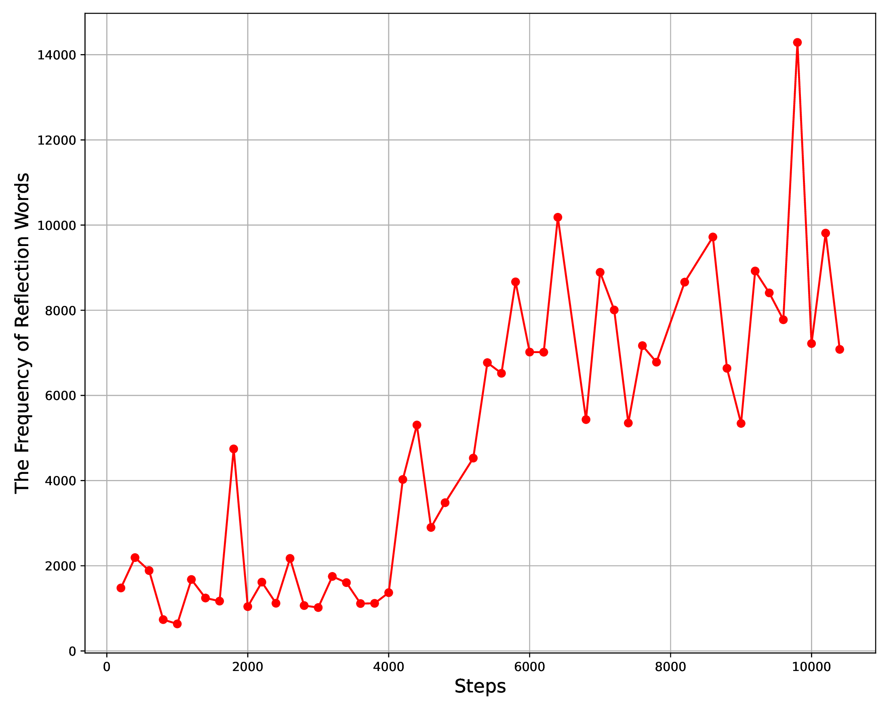

<small>图源：DeepSeek-R1 v2，Figure 9(a)。纵轴记录词语出现次数，不能直接解释成每个 token 的反思概率。</small>

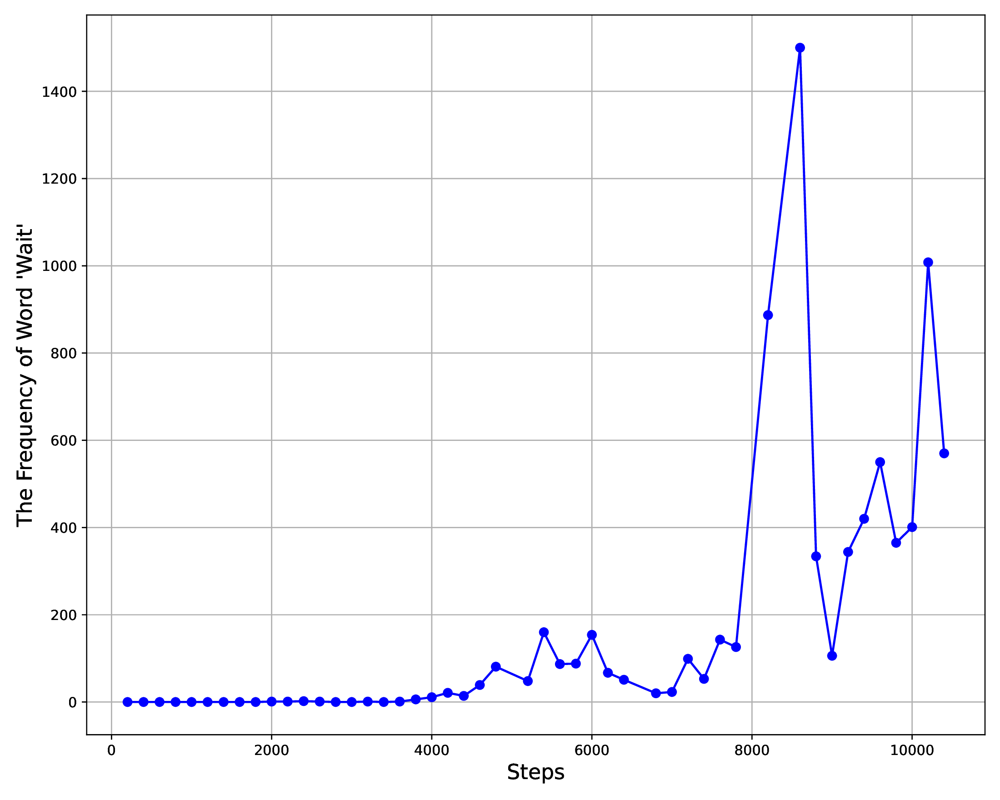

<small>图源：DeepSeek-R1 v2，Figure 9(b)。后期波动很大，单个尖峰不代表所有任务上的能力同时突变。</small>

回答变长本身就会增加这些词的出现机会。词频也无法区分一次真正有帮助的重新检查与机械重复。报告中的 “aha moment” 是一条有启发性的输出案例，能够展示模型回头检查的样子；它无法单独证明推理文本忠实反映所有内部计算，更不能作为人类式意识的测量。

## R1 的四阶段流水线，既传递权重，也传递数据

R1-Zero 的成绩说明了结果奖励的潜力，但它的 IF-Eval 只有 46.6，AlpacaEval 2.0 为 24.7，Aider-Polyglot 为 12.2。能长时间解题，并不自动意味着模型会遵循格式、写出合适的回答或按工程接口修改代码。完整 R1 围绕这些缺口安排了四阶段训练。

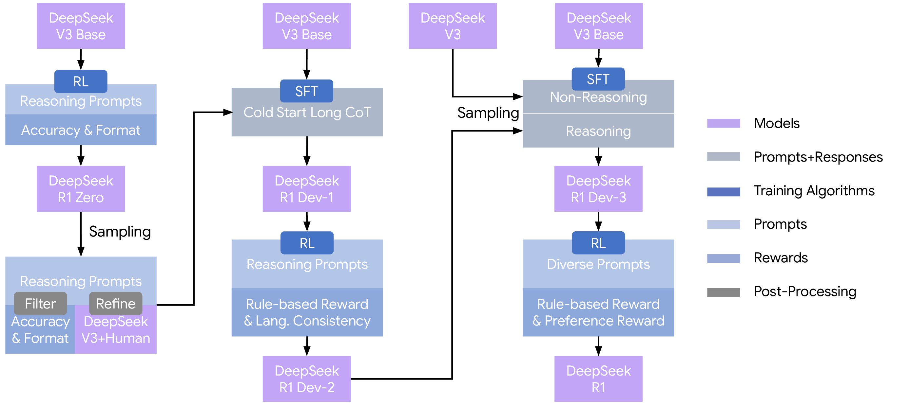{ width="920" }

<small>图源：DeepSeek-R1 v2，Figure 2。紫色是模型，灰蓝色是数据；特别注意 Dev2 通向右侧的是 Sampling 数据路径，Dev3 的 SFT 从上方 V3-Base 开始。</small>

### 冷启动先整理可读的长推理

作者收集数千道高质量推理问题，让 R1-Zero 以 temperature 1 生成多条轨迹。数学答案用 SymPy 解析和比较，输出再经过重复、格式和语言混杂过滤。人工将部分轨迹改写为自然的第一人称思考表达，用这些示范提示 DeepSeek-V3 扩展改写，再由人工复查。[↗](https://arxiv.org/pdf/2501.12948v2#page=20)

这一步同时整理推理和最终解答。R1-Zero 的总结有时只给最终结果，作者要求 V3 基于已有过程写出简洁、排版清晰且包含关键步骤的解答。读者看到的“我先想一想”“重新检查一下”等风格，有相当部分来自人为整理与产品设计，报告也明确提醒不要把这种拟人表达解释为模型天然拥有人的心智。

用这批冷启动数据微调 V3-Base，得到 Dev1。它提供较稳定、可读的初始输出分布，让后续 RL 可以在此基础上探索。

### 第一轮 RL 改善解题，语言奖励维持可读性

Dev1 接受推理任务上的规则奖励训练，得到 Dev2。其主要采样与 batch 设置接近 R1-Zero，但最大输出长度为 32,768，并加入语言一致性奖励。

$$
R_{\mathrm{language}}
=\frac{\operatorname{Num}(\mathrm{Words}_{\mathrm{target}})}
{\operatorname{Num}(\mathrm{Words})}.
$$

分子是 CoT 中目标语言的词数，分母是总词数。这使同样答对的两条轨迹，还能因语言是否一致而获得不同奖励。它直接改变优化目标，自然可能影响原本最容易成功的生成方式。

附录在 DeepSeek-R1-Distill-Qwen-7B 上用相同冷启动数据进行消融。左图中，不加语言奖励的绿色曲线逐渐下降；加奖励的蓝线保持较高一致性。中图代码成绩存在小幅代价，右图数学成绩接近。[↗](https://arxiv.org/pdf/2501.12948v2#page=35)

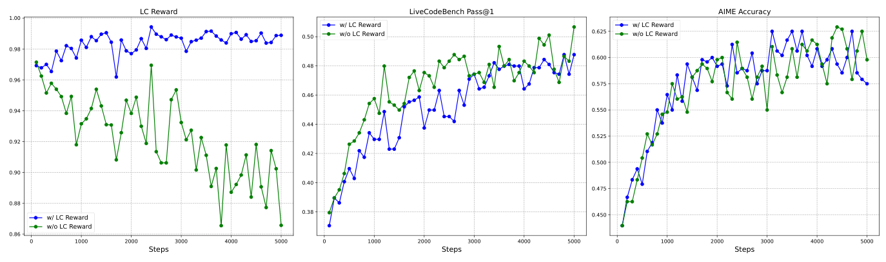{ width="920" }

<small>图源：DeepSeek-R1 v2，Figure 7。左、中、右依次是语言一致性、LiveCodeBench pass@1、AIME accuracy；使用的是 7B 消融设置。</small>

这组结果支持一种具体取舍，语言可读性变好，代码指标可能略降。它没有证明提高语言纯度必然增强推理，也不应将 7B 上的差值直接套到 671B 模型。

### 把探索结果筛成可重复学习的监督数据

Dev2 为大量问题生成多个回答，只保留答对且可读的轨迹。这是 **Rejection Sampling（拒绝采样）**，用筛选后的输出重新构造训练集。部分新增推理任务无法完全用规则判定，作者将参考答案与模型输出交给 DeepSeek-V3 进行生成式判断。这里使用模型评判，与 R1-Zero 在推理 RL 中避免神经奖励模型属于不同阶段，二者可以同时成立。[↗](https://arxiv.org/pdf/2501.12948v2#page=26)

大约 600K 推理样本与 200K 非推理样本混合，组成第二次 SFT 的数据。后者沿用和扩展 V3 的写作、事实问答、翻译数据，还加入程序修复、前端开发等工程内容。部分一般任务由 V3 补充思考过程，简单问候则不提供 CoT，避免将所有交互都训练成长回答。Table 5 的精确领域统计如下，平均长度与对话轮数也说明了训练实际覆盖什么。

| Domain | Num Samples | Avg Rounds | Avg Tokens |
| --- | ---: | ---: | ---: |
| Math | 395285 | 1.0 | 6094.2 |
| Code | 211129 | 1.1 | 7435.7 |
| STEM | 10124 | 1.0 | 4928.8 |
| Logic | 10395 | 1.0 | 2739.0 |
| General | 177812 | 1.1 | 1419.8 |
| Total | 804745 | 1.0 | 5355.3 |

这些领域数与约数 600K / 200K 是不同粒度的归类，不宜反推每个领域都严格属于某一个概括桶。多数样本为单轮交互，也意味着复杂多轮对话没有得到同等充分的直接覆盖。

第二次 SFT 从 V3-Base 开始，得到 Dev3。Dev2 的能力通过它生成并筛选的数据传入 Dev3，不能简单理解成在 Dev2 权重上接着训练。两个 SFT 阶段都报告训练 2 至 3 epochs，batch 128，最大上下文 32,768，学习率按 cosine 从 $5\times10^{-5}$ 降到 $5\times10^{-6}$。[↗](https://arxiv.org/pdf/2501.12948v2#page=35)

### 最后一轮 RL 使用不同任务所需的奖励

对推理问题，继续使用规则奖励。对一般问题，使用帮助性或安全性奖励模型，具体按样本所属数据类别选择；语言一致性奖励同时应用于推理和非推理数据。原文把批次奖励概括成 reasoning、general、language 三项，并不意味着每一条回答都接受三个相同的评判器。

帮助性奖励关注最终回答，以免模型因为写了一大段思考就得到高评价。安全性奖励检查整个响应，包括推理部分，防止最终答案看似安全而前面的长文本已经暴露有害内容。这一区分解释了为什么同一个回答的不同区域需要不同评估范围。[↗](https://arxiv.org/pdf/2501.12948v2#page=6)

帮助性奖励模型使用 66,000 个偏好对。DeepSeek-V3 对每对回答判断四次，随机交换 A/B 位置，取平均结果，只保留分差大于 1 的样本；数据整体的 chosen 与 rejected 长度保持可比，以减轻位置和长度偏差。安全模型则使用 106,000 条带 safe / unsafe 标签的 prompt-response，按 point-wise 方式训练，而非帮助性模型的 pairwise 损失。两者都使用 batch 256、学习率 $6\times10^{-6}$、1 epoch 和 8,192 tokens 训练长度。原文说奖励推理时未再施加明确长度限制，不等于模型架构支持无限上下文。[↗](https://arxiv.org/pdf/2501.12948v2#page=7)

第二轮 RL 将采样 temperature 降到 0.7，因为更高温度在该阶段容易出现不连贯生成。它共训练 1,700 步，一般指令数据与模型偏好奖励仅在最后 400 步加入。限制时长有实验证据支撑，下面蓝色 reward score 总体上升时，红色 Codeforces 测试 pass@1 却在后期下降。

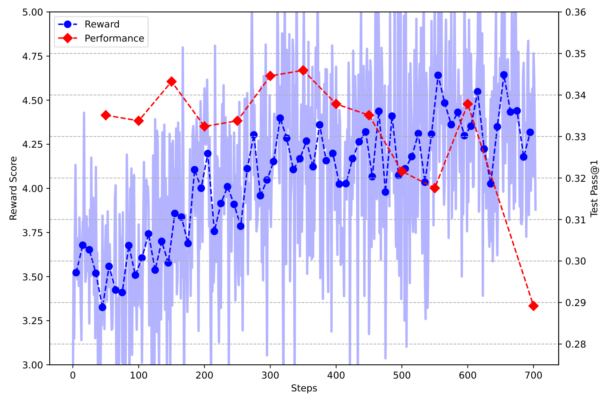{ width="760" }

<small>图源：DeepSeek-R1 v2，Figure 6。蓝线读左轴 Reward Score，红线读右轴 Test Pass@1；两条线的纵轴单位不同。</small>

这展示了 **Reward Hacking（奖励投机）** 的可观察后果，策略越来越适应评分器，独立能力却可能退化。图中没有隔离出唯一的具体作弊模式，因此不必臆测模型究竟学会了哪种措辞。可执行的经验是同时监控 reward 与独立任务成绩，并限制不可靠代理奖励驱动的训练时长。[↗](https://arxiv.org/pdf/2501.12948v2#page=35)

## 阶段结果显示了收益，也保留了代价

下表摘录 Table 3 中能区分各阶段作用的指标。Dev1 是冷启动 SFT，Dev2 是首轮推理 RL，Dev3 是混合数据重新 SFT，R1 是最后混合 RL 的结果。R1-Zero 是另一条训练路径上的对照模型，并非这条权重链的第零步。[↗](https://arxiv.org/pdf/2501.12948v2#page=9)

| Benchmark (Metric) | R1-Zero | R1-Dev1 | R1-Dev2 | R1-Dev3 | R1 |
| --- | ---: | ---: | ---: | ---: | ---: |
| MMLU-Pro (EM) | 68.9 | 74.1 | 83.8 | 83.1 | 84.0 |
| IF-Eval (Prompt Strict) | 46.6 | 71.7 | 72.0 | 78.1 | 83.3 |
| GPQA Diamond (Pass@1) | 75.8 | 66.1 | 70.7 | 71.2 | 71.5 |
| AlpacaEval2.0 (LC-winrate) | 24.7 | 50.1 | 55.8 | 62.1 | 87.6 |
| ArenaHard (GPT-4-1106) | 53.6 | 77.0 | 73.2 | 75.6 | 92.3 |
| LiveCodeBench (Pass@1-COT) | 50.0 | 57.5 | 63.5 | 64.6 | 65.9 |
| Codeforces (Rating) | 1444 | 1534 | 1687 | 1746 | 2029 |
| SWE Verified (Resolved) | 43.2 | 39.6 | 44.6 | 45.6 | 49.2 |
| Aider-Polyglot (Acc.) | 12.2 | 6.7 | 25.6 | 44.8 | 53.3 |
| AIME 2024 (Pass@1) | 77.9 | 59.0 | 74.0 | 78.1 | 79.8 |
| MATH-500 (Pass@1) | 95.9 | 94.2 | 95.9 | 95.4 | 97.3 |
| CNMO 2024 (Pass@1) | 88.1 | 58.0 | 73.9 | 77.3 | 78.8 |

先看 Dev1 与 Dev2。AIME 从 59.0 升到 74.0，LiveCodeBench 从 57.5 升到 63.5，推理 RL 对解题有明显收益。ArenaHard 却从 77.0 降到 73.2，说明更会解题与更受通用偏好评判器欢迎，没有必然的同步关系。

再看 Dev2 与 Dev3。Aider 从 25.6 升到 44.8，AlpacaEval 从 55.8 升到 62.1，与混合 SFT 加入工程代码和通用助手数据的安排一致。最后一轮 RL 将 AlpacaEval 从 62.1 推到 87.6，增加 25.5 个百分点；ArenaHard 增加 16.7 个百分点。同时 AIME 只增加 1.7 个百分点。不同阶段解决的缺口在这些数字里可以辨认出来。

完整 R1 也没有在所有任务上超过 Zero。GPQA 从 Zero 的 75.8 变为 R1 的 71.5，CNMO 从 88.1 变为 78.8。最终模型换来了更广泛的助手能力，也保留了领域取舍。表中各阶段的数据、训练算法和起始模型同时发生变化，它属于流水线诊断，不能当作只改一个变量的严格消融。

LiveCodeBench 的难度分组进一步说明了进步落在哪里。Easy 从 Zero 的 98.07 很快达到 100，剩余空间有限；Medium 从 58.78 升到 83.45，Hard 从 17.09 升到 34.44。后者虽然提高明显，仍意味着相当多难题无法解决。Table 14 所揭示的能力缺口，比单独报一个总平均数更有实用价值。[↗](https://arxiv.org/pdf/2501.12948v2#page=60)

## 横向比较必须连同采样和评测流程阅读

### pass@1 不等于只运行了一次

报告默认使用 temperature 0.6、top-p 0.95、最大生成长度 32,768。作者指出，贪心解码在长回答模型上容易重复，且不同 checkpoint 的表现波动较大，因此用多次采样估计单次成功概率。AIME 与 GPQA 每题采样 64 次，MATH 与 Codeforces 16 次，LiveCodeBench 8 次。[↗](https://arxiv.org/pdf/2501.12948v2#page=40)

若第 $j$ 个问题的第 $s$ 次回答是否正确记为 $c_{j,s}\in\{0,1\}$，用 $N$ 道题、每题 $K$ 次采样说明这一统计过程，可以写成

$$
\widehat{\mathrm{pass@1}}
=\frac1N\sum_{j=1}^{N}\frac1K\sum_{s=1}^{K}c_{j,s}.
$$

这里多次运行用于降低估计噪声，最后报的仍是一次随机回答的平均正确率。它没有挑出最好的那条回答。AIME 的 cons@64 才是聚合 64 个回答后进行投票的成绩。

### 推理、知识、工程任务的收益不同

以下是 Table 8 的部分对照，分数均沿用报告当时的评测。o1-1217 数字来自官方报告，并非全部由作者在同一套 API 环境重新测量。[↗](https://arxiv.org/pdf/2501.12948v2#page=41)

| Benchmark (Metric) | DeepSeek-V3 | OpenAI-o1-1217 | DeepSeek-R1 |
| --- | ---: | ---: | ---: |
| MMLU (EM) | 88.5 | 91.8 | 90.8 |
| MMLU-Pro (EM) | 75.9 | — | 84.0 |
| IF-Eval (Prompt Strict) | 86.1 | — | 83.3 |
| GPQA Diamond (Pass@1) | 59.1 | 75.7 | 71.5 |
| SimpleQA (Correct) | 24.9 | 47.0 | 30.1 |
| FRAMES (Acc.) | 73.3 | — | 82.5 |
| LiveCodeBench (Pass@1-COT) | 36.2 | 63.4 | 65.9 |
| Codeforces (Rating) | 1134 | 2061 | 2029 |
| SWE Verified (Resolved) | 42.0 | 48.9 | 49.2 |
| Aider-Polyglot (Acc.) | 49.6 | 61.7 | 53.3 |
| AIME 2024 (Pass@1) | 39.2 | 79.2 | 79.8 |
| MATH-500 (Pass@1) | 90.2 | 96.4 | 97.3 |
| CNMO 2024 (Pass@1) | 43.2 | — | 78.8 |
| C-SimpleQA (Correct) | 68.0 | — | 63.7 |

R1 在竞赛数学、竞赛代码上相对 V3 提升较大，在 AIME 等项目接近 o1-1217。GPQA、SimpleQA 和 Aider 则仍有清楚差距。IF-Eval 83.3 低于 V3 的 86.1，中文事实问答 C-SimpleQA 也低于 V3。长推理能改善求解过程，却不能凭空补齐缺少的知识，也可能与严格格式遵循发生冲突。

SWE-bench Verified 使用 agentless 框架，测到的是模型与该工程流程的组合能力。报告认为软件工程 RL 的反馈耗时较长，尚未像竞赛代码一样充分扩展，这与工程任务提升较有限相吻合。外部框架调用模型完成补丁工作，也不能据此推断原始 R1 已具备原生搜索或计算器工具调用能力。

同名 benchmark 还可能有不同的时间窗口。这里 LiveCodeBench 覆盖 2024 年 8 月至 2025 年 1 月，与 V3 原报告的较短窗口不同。只有本报告同表的对照可以直接这样读，跨报告拼接数字时需要重新对齐题目范围。

人类比较同样要辨认参照对象。下图 AIME 是参赛者平均得分，Codeforces 是预计竞赛分位，GPQA 是有网络访问条件的博士级专家结果。

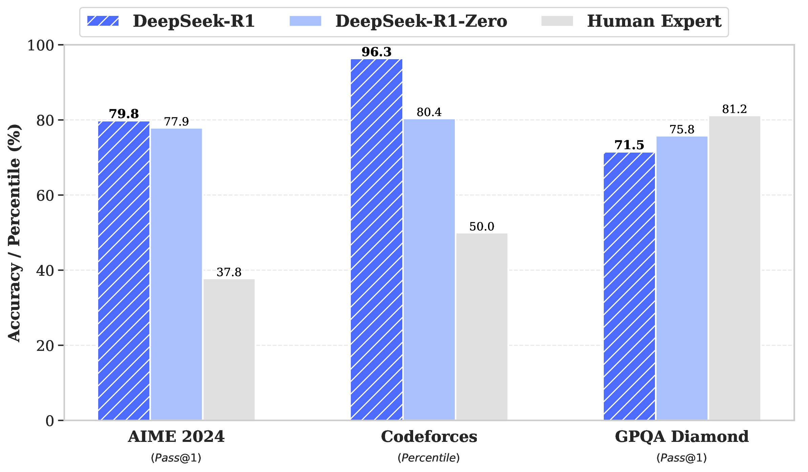{ width="850" }

<small>图源：DeepSeek-R1 v2，Figure 10。三个任务的人类基线具有不同含义，不能互换成统一的“超越人类”比例。</small>

Codeforces 96.3 百分位描述的是该评测协议下的竞赛位置，无法推广为超过 96.3% 的程序员完成所有软件工程工作。GPQA 中 R1 为 71.5，图示人类专家为 81.2，也提醒我们不要只保留对模型有利的比较。

### 新题和细分学科揭示哪些泛化边界

作者对预训练和后训练数据做了 10-gram 匹配过滤，数学领域移除了约六百万条潜在预训练文本，并使用 2023 年以前的数学竞赛题构建相关后训练数据。原文也承认，n-gram 不能消除改写题或相似问题造成的污染，因此过滤措施不能自动证明所有旧 benchmark 都完全干净。[↗](https://arxiv.org/pdf/2501.12948v2#page=40)

在模型发布后的 AIME 2025 上，Table 13 报告 R1 平均 11.3 / 15，约 75%，o1 为 12.0 / 15，即 80%；AMC 12 2024 分别为 143.7 / 150 和 141.0 / 150。新发布题目为泛化提供了额外支持，但依然属于有限题量的竞赛数学评测，不能覆盖开放任务。

作者还汇集 93 场 2024 年数学竞赛中的 366 道题，拆分学科成绩。R1 在 Functional Equation、Number Theory、Algebra 上分别为 73.4、72.6、70.9，而 Combinatorics 为 48.4，Combinatorial Geometry 只有 14.5。[↗](https://arxiv.org/pdf/2501.12948v2#page=57)

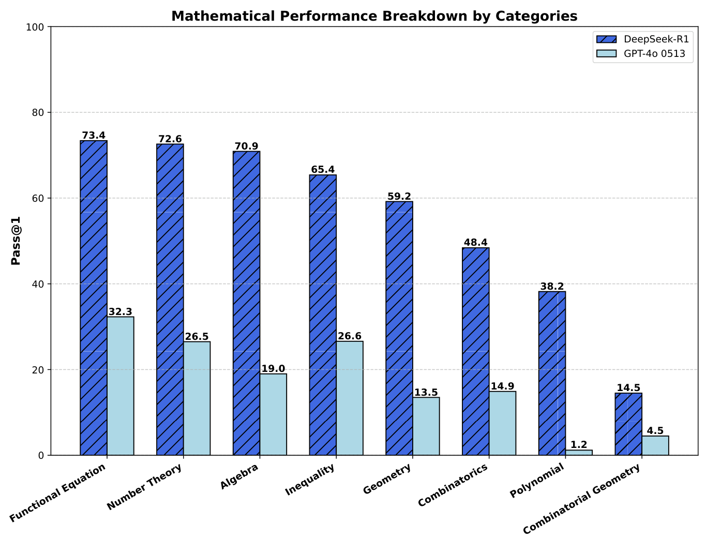{ width="920" }

<small>图源：DeepSeek-R1 v2，Figure 17。右侧几类题仍有明显困难；柱形高度也受到各类别题目组成影响。</small>

这张图对实际使用的提醒比“数学能力强”更具体。若任务主要涉及组合几何，就不能用整体 AIME 或 MATH 高分作为可靠性保证；应在自己的问题分布上验证。

## 多想一些与多试几次，分别增加什么能力

在上述 366 道竞赛题上，报告给出 R1 平均 8,793 thinking tokens、61.8% pass@1。对照 GPT-4o-0513 平均生成 711 个输出 tokens，pass@1 为 24.7%。两者连 token 的统计对象都略有不同，前者是 thinking tokens，后者是 output tokens；这些数据适合说明不同模型的计算行为，不能直接推成同硬件下的延迟比。[↗](https://arxiv.org/pdf/2501.12948v2#page=59)

下面的横轴用 pass@1 反向表示难度，越靠右越难。纵轴依图注统计到达正确答案时的 thinking tokens，曲线还经过样条平滑。难题通常使用更多计算，但这是成功轨迹的相关性分析，不能证明给一个当前失败的回答强行追加同样多 token 就会成功。

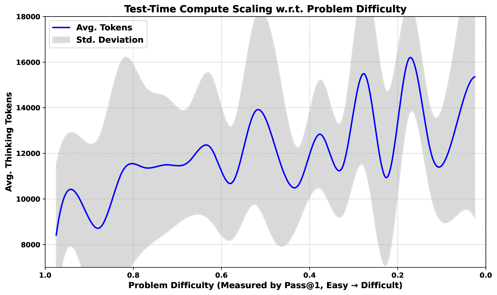{ width="850" }

<small>图源：DeepSeek-R1 v2，Figure 18。阴影表示标准差；平滑趋势和成功回答条件都应保留在解释中。</small>

长 CoT 让一个回答中的后续步骤能够利用、检查或推翻前面的步骤。独立多采样则让模型从不同随机路径寻找答案。两者并不互相替代，因为一条很长的轨迹仍可能困在错误假设中。

AIME 2024 给出了三种口径之间的差别。

| Metric | DeepSeek-R1 | What is required |
| --- | ---: | --- |
| pass@1 | 79.8% | 一次随机回答的成功概率估计 |
| pass@64 | 90.0% | 64 次尝试中至少有一次正确，由评测器判断 |
| cons@64 | 86.7% | 64 次尝试按最终答案投票，实际选出一个答案 |

pass@64 使用“是否存在正确样本”的判据。部署时通常不知道哪一条正确，因此不能直接把 90.0% 当作用户拿到答案的正确率。cons@64 提供了一个可执行的选择规则，但错误答案也可能反复出现，结果仍低于存在性指标。[↗](https://arxiv.org/pdf/2501.12948v2#page=60)

在每次尝试独立、某题成功概率固定为 $p$ 的说明性模型下，至少一次成功的概率为 $1-(1-p)^K$。这解释了增加尝试次数为什么可能提高覆盖率，却不能把全数据集平均 pass@1 代入就准确预测整体 pass@K。不同题的 $p$ 差异很大，难题可能几乎从不成功；更重要的是，覆盖率仍没有解决如何选出正确解的问题。

因此，预算分配至少包含三个决策，单条轨迹允许多长、生成几条轨迹、用什么规则选择结果。长推理模型只改变了其中部分环节。若任务无法验证，也无法可靠投票，增加采样可能只增加成本和一组互相矛盾的答案。

## 蒸馏将教师探索出的轨迹交给小模型

R1 蒸馏学生是基于 Qwen 或 Llama 的独立模型，用约 800K 轨迹做 SFT；它们没有在这轮报告实验中继续 RL，也不是把 671B R1 简单量化或删掉若干层。训练监督的是教师输出文本，使较小模型学会教师成功解题时的生成模式。[↗](https://arxiv.org/pdf/2501.12948v2#page=60)

训练统一使用 2 至 3 epochs、batch 64、最大上下文 32,768，cosine 学习率最终降到初始值的十分之一。不同学生的基座和初始学习率如下。

| Distilled Model | Base Model | Initial Learning Rate |
| --- | --- | ---: |
| DeepSeek-R1-Distill-Qwen-1.5B | Qwen2.5-Math-1.5B | $1\times10^{-4}$ |
| DeepSeek-R1-Distill-Qwen-7B | Qwen2.5-Math-7B | $8\times10^{-5}$ |
| DeepSeek-R1-Distill-Qwen-14B | Qwen2.5-14B | $7\times10^{-5}$ |
| DeepSeek-R1-Distill-Qwen-32B | Qwen2.5-32B | $6\times10^{-5}$ |
| DeepSeek-R1-Distill-Llama-8B | Llama-3.1-8B | $5\times10^{-5}$ |
| DeepSeek-R1-Distill-Llama-70B | Llama-3.3-70B-Instruct | $2\times10^{-5}$ |

Table 15 的结果保留全部六个学生，避免只展示表现最好的尺寸。AIME、MATH、GPQA 和 LiveCodeBench 下列分数均为百分比。[↗](https://arxiv.org/pdf/2501.12948v2#page=61)

| Model | AIME pass@1 | AIME cons@64 | MATH-500 pass@1 | GPQA Diamond pass@1 | LiveCodeBench pass@1 | Codeforces rating |
| --- | ---: | ---: | ---: | ---: | ---: | ---: |
| R1-Distill-Qwen-1.5B | 28.9 | 52.7 | 83.9 | 33.8 | 16.9 | 954 |
| R1-Distill-Qwen-7B | 55.5 | 83.3 | 92.8 | 49.1 | 37.6 | 1189 |
| R1-Distill-Qwen-14B | 69.7 | 80.0 | 93.9 | 59.1 | 53.1 | 1481 |
| R1-Distill-Qwen-32B | 72.6 | 83.3 | 94.3 | 62.1 | 57.2 | 1691 |
| R1-Distill-Llama-8B | 50.4 | 80.0 | 89.1 | 49.0 | 39.6 | 1205 |
| R1-Distill-Llama-70B | 70.0 | 86.7 | 94.5 | 65.2 | 57.5 | 1633 |

1.5B 学生的数学收益很明显，但 LiveCodeBench 只有 16.9、GPQA 33.8。小模型在某个数学 benchmark 超过较大通用模型，不代表它在所有任务上具有同等能力。参数规模、基座训练分布与任务领域都需要一起看。

直接让小模型做 RL 能否得到相同结果？作者在 Qwen2.5-32B-Base 上使用数学、代码和 STEM 数据做超过 10K 次策略更新，得到 Qwen2.5-32B-Zero。其 AIME pass@1 为 47.0、LiveCodeBench 为 40.2；同为 32B 的蒸馏学生达到 72.6 和 57.2。这个实验支持在当前基座、算法和预算下，强教师产生的轨迹比小模型独立探索更有效。[↗](https://arxiv.org/pdf/2501.12948v2#page=62)

比较仍没有对齐整条路线的前期成本，蒸馏轨迹背后有大模型预训练和 RL 的投入。它也不能推出“小模型 RL 无效”。同一附录的另一组 Qwen2-Math-7B 实验中，Zero 的 AIME 2024 / 2025 为 22.3% / 18.1%，高于相应 Instruct 的 7.9% / 4.6%。作者早期在部分 7B dense、16B MoE 配置上失败，与这一后续正结果应同时保留。可学习性取决于具体基础模型、数据、奖励和设置，不能只画一条参数量门槛。

## 长轨迹训练的成本，来自整条系统流水线

对 671B MoE 做 RL，计算并不全在反向传播。每轮还要生成大量长回答、计算参考策略概率、运行代码和答案检查，再把不同长度的轨迹装入训练 batch。任一阶段的尾部延迟都可能让其他设备等待。

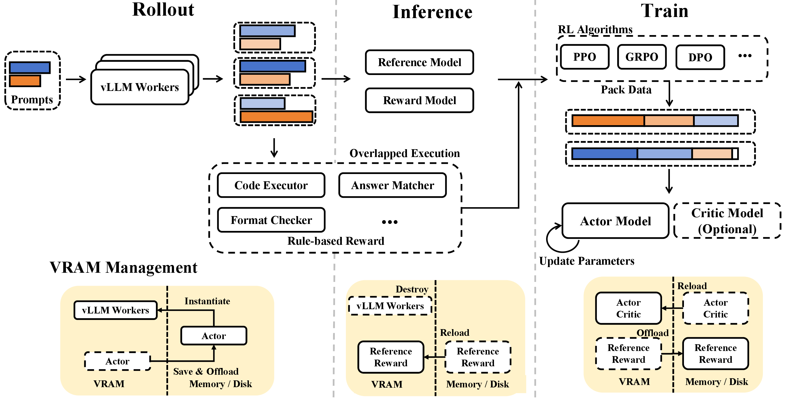{ width="920" }

<small>图源：DeepSeek-R1 v2，Figure 5。上半部分是 Rollout、Inference、Train 与规则奖励的交互，下半部分显示阶段切换时模型的 offload / reload。</small>

Rollout 用 vLLM workers 采样，跨节点专家并行降低 MoE 推理的内存访问压力，并为热点专家设置冗余副本，减少负载偏斜。MTP 用于自推测解码，帮助缩短生成，尤其关注最长样本的完成时间。随后参考模型和奖励模型分别执行前向，补齐训练需要的概率与评分。[↗](https://arxiv.org/pdf/2501.12948v2#page=17)

规则奖励虽然通常不占 GPU 大模型显存，执行代码等工作仍可能很慢。系统将其异步调度，与 rollout 和 inference 重叠。这种异步发生在评分与执行层，不能直接等同于策略持续异步更新；报告仍给出了 rollout 后拆 minibatch 的训练组织。

训练模块首先按长度对全局 batch 排序并分配到数据并行进程，再用 Best-Fit 将样本放入定长块，最后调整各进程块数使其相等。前两步减少 padding 和负载差，最后一步避免某些进程提前结束、其他进程仍有大量工作。DualPipe 则用于流水线并行。阶段结束后将模型从显存卸载到系统内存或磁盘，为下一阶段腾出空间。[↗](https://arxiv.org/pdf/2501.12948v2#page=18)

图中 Critic Model 标为 optional，因为它展示可支持多种算法的框架；它不意味着 R1 的 GRPO 又额外训练了一个 critic。系统图的可选能力与本次实验的实际配置需要分开。

Table 7 的成本口径如下。

| Training Costs | DeepSeek-R1-Zero | SFT data creation | DeepSeek-R1 | Total |
| --- | ---: | ---: | ---: | ---: |
| H800 GPU Hours | 101K | 5K | 41K | 147K |
| USD at $2 / GPU-hour | $202K | $10K | $82K | $294K |

报告使用 512 张 H800，Zero 约 198 小时，R1 约 80 小时。147K GPU-hours 与 294K 美元是这些报告运行按指定单价换算的成本，未包含 V3-Base 预训练，也不能代表所有探索和失败实验的完整研发支出。附录文字将“四天”与“约 80 小时”并列，两者并不严格一致，因此更适合以表内 GPU-hours 理解成本。[↗](https://arxiv.org/pdf/2501.12948v2#page=35)

## 开放权重与上线服务，安全表现为何不同

扩展报告的安全分析区分了原始模型与附加风险控制的服务。服务先用关键词识别潜在风险对话，再将问题、回答和审查规范交给 DeepSeek-V3 判断，必要时撤回内容。这是模型之外的额外系统，下载 R1 权重不会自动得到同样的服务行为。[↗](https://arxiv.org/pdf/2501.12948v2#page=44)

作者自建测试集包含 28 个类别，每类 20 个中文问题，再翻译成英文，共 1,120 个问题。使用 GPT-4o-2024-11-20 进行判断，将结果分为 safe、unsafe 和 rejection。下面摘录 Table 10、11 的 R1 整体结果，Unsafe 与 Rejected 都是占回答的比例。

| Configuration | Original Unsafe | Original Rejected | Jailbreak Unsafe | Jailbreak Rejected |
| --- | ---: | ---: | ---: | ---: |
| DeepSeek-R1 | 25.2% | 5.6% | 85.9% | 1.9% |
| DeepSeek-R1 + risk control system | 8.5% | 27.3% | 4.3% | 87.3% |

越狱测试将原测试问题与来自 2,232 条模板集合的攻击指令组合。附加审查显著压低 unsafe 比例，同时将拒绝比例大幅提高。安全能力因此不能只用一个低 unsafe 数字描述，还要看系统是否仍能提供安全且有用的回答。[↗](https://arxiv.org/pdf/2501.12948v2#page=54)

评测是否包含 CoT 也会改变结论。Table 9 中，HarmBench 的原始 R1 全响应安全分数为 35.0，只评最终可见摘要时为 58.0；加入风险控制后分别为 89.3 和 96.3。结果表明，安全检查不能只盯着最后一句答案。该表的部分 benchmark 来自 HELM，DNA 与 HarmBench 由作者重测，HarmBench 还调整了 judge，不能将整张表误读为完全统一的独立复测。[↗](https://arxiv.org/pdf/2501.12948v2#page=48)

多语言测试由同一测试集扩展为 50 种语言、9,330 个问题，给 safe 5 分、rejection 4 分、unsafe 0 分。R1 的总分从原始模型 74.2% 升到加审查后的 85.9%。这里的百分比是加权安全得分，不能再当作“85.9% 的问题安全回答”。此外，不同厂商的服务附加措施并不透明，这些数字支持具体评测条件下的系统比较，难以单独归因于模型权重。[↗](https://arxiv.org/pdf/2501.12948v2#page=53)

## 没有成功的路线，同样解释了 R1 的选择

作者尝试过 **Process Reward Model（过程奖励模型，PRM）**，希望在中间步骤提供更密集反馈。困难首先是怎样定义一步。数学证明的一次变形、代码里的一个算法选择、长推理中的一段反思，很难用统一切分规则处理。即使切好了，也要可靠判断中间步骤是否正确；自动标注容易出错，人工标注难以扩展。[↗](https://arxiv.org/pdf/2501.12948v2#page=63)

进一步把 PRM 放进大规模 RL，策略可能学会利用评分器漏洞，需要不断重训奖励模型，增加成本和系统复杂度。报告认可 PRM 在候选重排或引导搜索中可能有用，失败经验针对的是其当前大规模训练设置，不能推广为过程监督没有价值。

**Monte Carlo Tree Search（蒙特卡洛树搜索，MCTS）** 的尝试则用标签将推理切成小段，用价值模型引导搜索，收集结果后反过来训练 actor 和 value model。与棋类有限且明确的合法动作不同，文本的候选延伸空间很大；限制每个节点的扩展数可以控制成本，却容易漏掉有用路径。若价值模型无法可靠识别有前景的部分解，搜索会围绕它的误判反复投入计算，自我改进也就难以持续。[↗](https://arxiv.org/pdf/2501.12948v2#page=64)

这些失败将 R1 的适用条件说得更清楚。基础模型需要能够产生有价值的候选解，验证器需要能区分成功与失败，训练与推理预算需要支撑足够探索。开放式写作、严格结构化输出、工具使用、多轮协作，以及软件工程的长周期反馈，并没有因为竞赛数学取得高分就一并解决。

如果要借用 R1 的方法，最先该落实的是自己的问题与验证接口。确认随机采样已有一定成功机会，再检查验证器能否淘汰表面正确的答案，随后决定哪些任务适合 RL、哪些需要 SFT，以及部署时怎样选择结果。报告提供了这些环节的机制和实验证据；它没有给出可直接重跑全部实验的完整训练系统，v2 的数据发布说明甚至仍有 `xxx` 占位，因此不能将开放权重等同于训练全流程已经完整公开。[↗](https://arxiv.org/pdf/2501.12948v2#page=66)

## 读完这篇论文后，下一步查哪条接口

先看[LLM 的 RLHF、RLVR 与 GRPO](../../reinforcement-learning/llm-rlhf-rlvr-and-grpo.md)，把组内优势、旧策略比率和 verifier 奖励放回最小目标函数；再看[后训练数据与 judge](../../training/post-training-data-engines-and-judge-models.md)，区分可执行检查、偏好模型和开放式评分。若要把结果接到自己的实验，沿[评测与消融方法](../../training/evaluation-and-ablation-methodology.md)记录 pass@k、cons@k、长度、预算和失败样本。这里的链接用于继续拆接口，不代表这些页面复现了 R1 的训练规模。

DeepSeek-R1 的后训练链可以先接[LLM RLHF、RLVR 与 GRPO](../../reinforcement-learning/llm-rlhf-rlvr-and-grpo.md)，把 verifier、reward 和 policy update 分开；数据侧再看[后训练数据引擎与 judge](../../training/post-training-data-engines-and-judge-models.md)，核对 rejection sampling、judge 校准和独立回归集。论文 benchmark 应与本站本地实验分栏记录。
