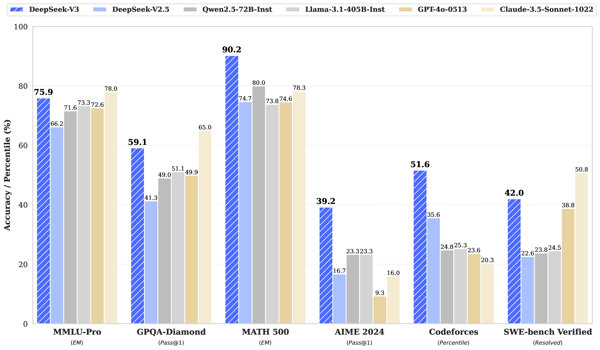
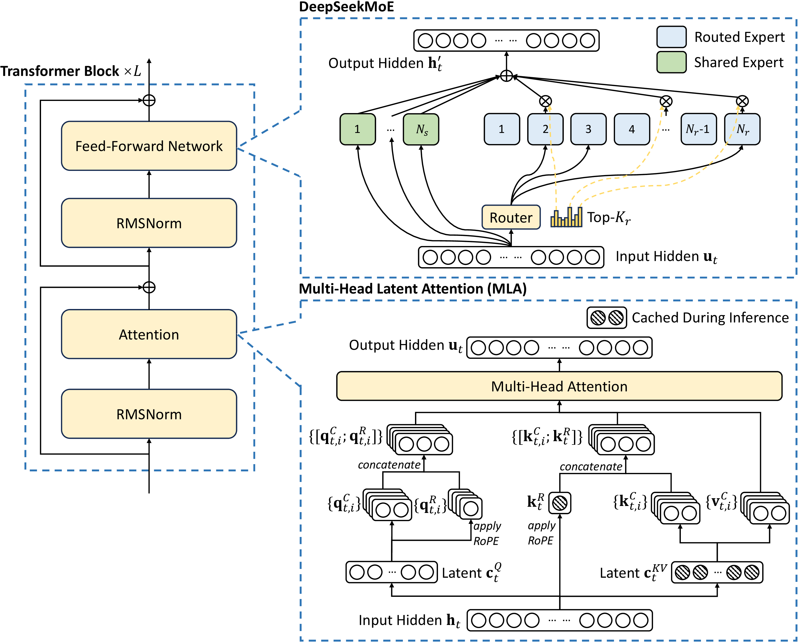
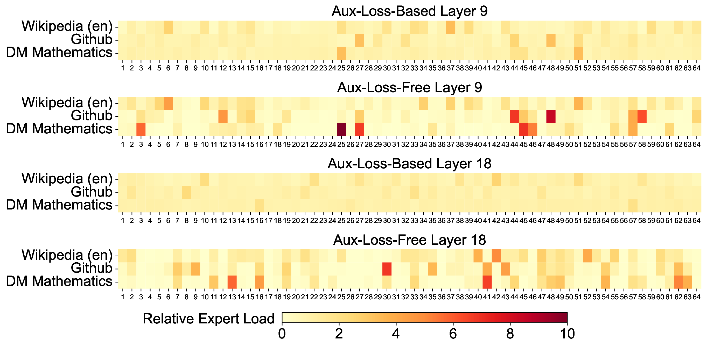
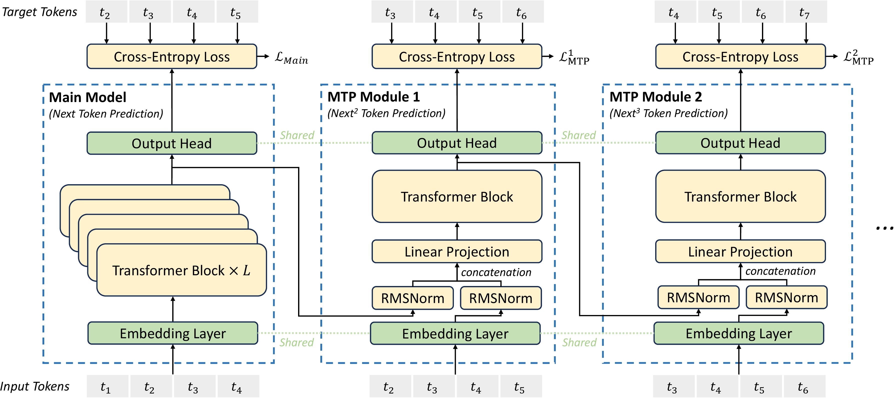
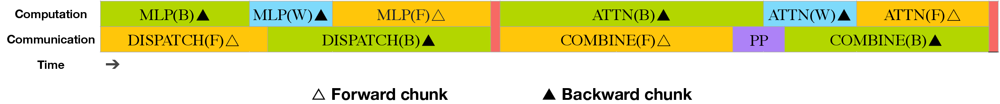
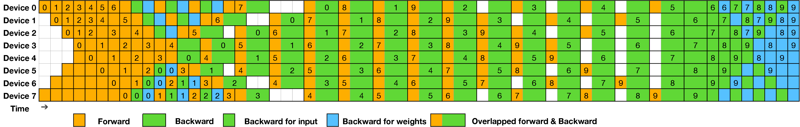
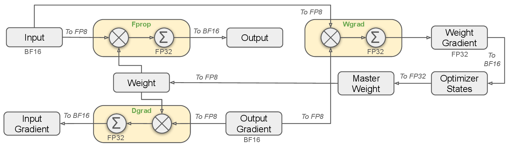
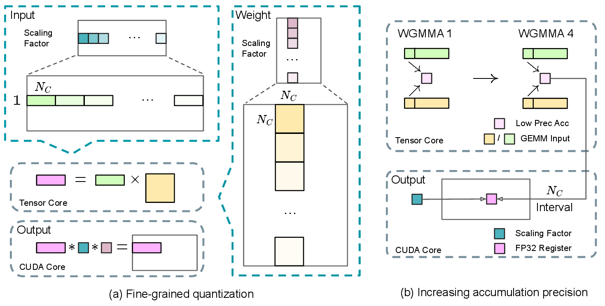
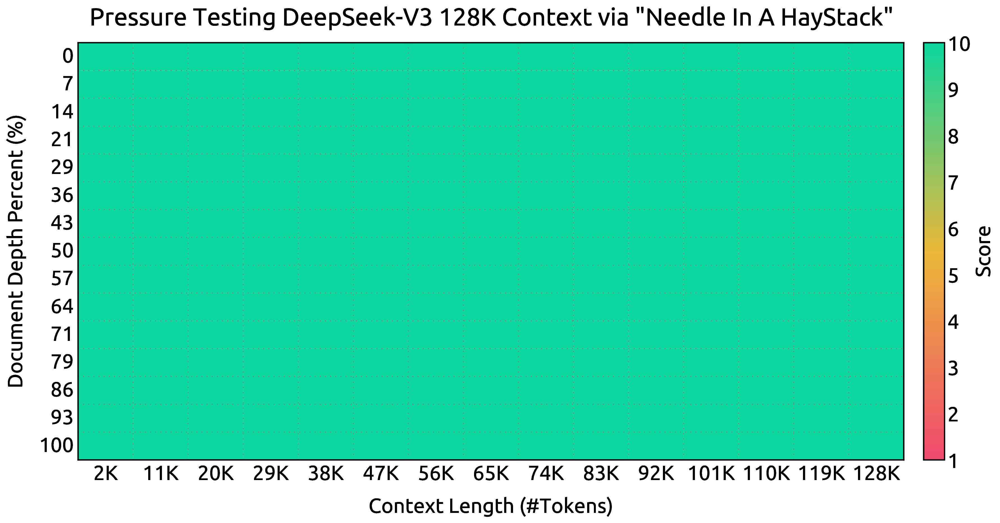

# DeepSeek-V3：671B MoE、MLA 与 FP8 训练

DeepSeek-V3 最值得拆开的地方不是单个 benchmark 分数，而是它把四件事做成了一个闭环：**用 MoE 扩大总参数，用 MLA 和路由设计压低每 token 成本，用 FP8 与 DualPipe 把训练系统跑稳，再用 SFT、RL 和 R1 蒸馏把 base model 转成可用的 chat model。**

| Dimension | DeepSeek-V3 |
| --- | --- |
| Model Type | Mixture-of-Experts language model |
| Total Params | 671B |
| Activated Params | 37B per token |
| Pre-training Tokens | 14.8T |
| Context Length | 4K pre-training, extended to 128K |
| Full Training Cost | 2.788M H800 GPU hours |
| Main Architecture | Multi-head Latent Attention, DeepSeekMoE |
| Main Training Tricks | auxiliary-loss-free load balancing, MTP, FP8 mixed precision, DualPipe |

**阅读边界。**
这是一份模型技术报告，里面的训练成本、稳定性、benchmark、数据处理和系统效率都应按作者自述来理解。它很适合学习大模型工程设计，但不能等同于第三方复现实验。

## 论文位置

DeepSeek-V3 接在 DeepSeek-V2 之后。V2 已经验证了两条关键路线：一是 `MLA` 用低秩 latent 压缩 KV cache，二是 `DeepSeekMoE` 用细粒度专家和 shared expert 降低激活计算。V3 没有把重点放在重新发明 Transformer，而是把路线推到更大规模：

```text
DeepSeek-V2 的 MLA + DeepSeekMoE
  -> 671B total params / 37B activated params
  -> auxiliary-loss-free routing 保住 MoE 专家负载
  -> MTP 增强 next-token 训练信号
  -> FP8 + DualPipe + all-to-all overlap 降低训练成本
  -> SFT + RL + R1 reasoning distillation 得到 chat model
```

这条路线的关键不是“671B 参数都参与每个 token 计算”。MoE 的核心是稀疏激活：每个 token 只路由到少数 expert，因此总容量很大，但单 token 计算接近一个更小的 dense model。V3 报告里的 `37B activated` 才是推理和训练时最直接影响每 token 成本的数字。

{ width="920" }

<small>图源：`DeepSeek-V3 Technical Report`，Figure 1。原论文图意：比较 DeepSeek-V3 与开源、闭源模型在知识、代码、数学、中文和长上下文等 benchmark 上的表现。</small>

**Figure 1 怎么读。**
这张图是能力展示，不是机制解释。更重要的问题是：为什么一个 37B activated MoE 能在很多任务上接近更大 dense model？后面的架构、路由、训练系统和后训练才是答案。

初学者不要只记“V3 分数高”，而要记住这个系统目标：在不让每 token 计算爆炸的前提下，把总参数、训练 token、数据质量和后训练闭环一起放大。

## 总体架构

DeepSeek-V3 仍是 Transformer block 堆叠，但 attention 和 FFN 都做了工程化改造：

| Component | Design | Why It Matters |
| --- | --- | --- |
| Attention | Multi-head Latent Attention (MLA) | 压缩 KV cache，降低长上下文和推理部署成本 |
| FFN | DeepSeekMoE | 用大量 routed experts 扩大模型容量，但每 token 只激活少量 expert |
| Routing | auxiliary-loss-free load balancing | 尽量不让负载均衡目标干扰语言建模目标 |
| Training Objective | Multi-Token Prediction (MTP) | 在 next-token 之外加入未来 token 监督，增强训练信号 |
| Precision | FP8 mixed precision | 降低 GEMM、激活缓存和通信成本 |
| Pipeline | DualPipe | 把 MoE all-to-all 通信藏到计算里，减少 pipeline bubble |

{ width="920" }

<small>图源：`DeepSeek-V3 Technical Report`，Figure 2。原论文图意：DeepSeek-V3 的基本架构由 Transformer blocks 组成，attention 采用 MLA，FFN 采用 DeepSeekMoE；MLA 只缓存压缩 latent 与 RoPE key，MoE 由 shared experts 和 routed experts 组成。</small>

**这张架构图怎么读。**
左边是普通 Transformer block 的大形状：attention、RMSNorm、FFN、residual。真正的变化在右边两个放大框。

下方 MLA 的重点是“推理时不缓存完整 K/V”。它把 key/value 先压到 latent，再在计算 attention 时展开。这样 KV cache 存储从每层每 token 的完整多头 K/V，变成压缩 latent 加少量 RoPE key。上方 DeepSeekMoE 的重点是“容量和计算分离”。shared experts 每个 token 都可用，routed experts 由 router 选 Top-K，模型总参数很大，但每 token 只走少数专家。

## MLA：为什么 KV cache 能降下来

标准 MHA 推理时，每生成一个新 token，都要把每层的 key 和 value 缓存下来。序列越长、层数越多、head 越多，KV cache 越大。MLA 的做法是把 K/V 共同压缩成一个 latent：

$$
\mathbf{c}_{t}^{KV}=W^{DKV}\mathbf{h}_t
$$

生成时主要缓存 \(\mathbf{c}_{t}^{KV}\) 和带 RoPE 位置信息的 \(\mathbf{k}_{t}^{R}\)，真正参与 attention 的 \(\mathbf{k}^{C}\)、\(\mathbf{v}^{C}\) 可以从 latent 上投影出来。直观上，它不是把历史 token 删掉，而是把每个 token 的 K/V 表示换成更紧凑的存储格式。

MLA 对 V3 有两个作用：

1. **服务成本**：长上下文下 KV cache 是主要显存压力之一，MLA 直接减少缓存体积；
2. **训练内存**：query 也做低秩压缩，训练时 activation memory 更可控。

这也是 DeepSeek 系列后续技术报告继续围绕 attention 和 cache 做文章的原因。MoE 解决“模型容量和激活计算”的矛盾，MLA 解决“长上下文和 KV cache”的矛盾。

## DeepSeekMoE：容量、路由与负载均衡

DeepSeekMoE 的 FFN 输出由 shared experts 与 routed experts 共同构成。shared experts 处理通用模式，routed experts 处理被 router 分配到的 token。V3 的具体规模是：

| Hyper-Parameter | Value |
| --- | --- |
| Transformer Layers | 61 |
| Hidden Dimension | 7168 |
| Attention Heads | 128 |
| Head Dimension | 128 |
| KV Compression Dimension | 512 |
| Query Compression Dimension | 1536 |
| Shared Experts per MoE Layer | 1 |
| Routed Experts per MoE Layer | 256 |
| Activated Routed Experts per Token | 8 |
| Expert Intermediate Dimension | 2048 |
| MTP Depth | 1 |
| Total Params | 671B |
| Activated Params | 37B |

这里有一个容易误解的点：MoE 不只是“多个 FFN 并排”。一旦专家分布在不同 GPU 或不同节点，router 的选择会直接变成通信模式。某些 expert 过热，就会让对应 GPU 成为瓶颈；某些 expert 长期闲置，又会浪费模型容量。所以 MoE 的训练质量和系统效率都依赖负载均衡。

### auxiliary-loss-free load balancing

传统 MoE 常用辅助 loss 鼓励专家负载均衡。但辅助 loss 太强会伤害主语言建模目标，太弱又会导致路由塌缩或专家负载不均。DeepSeek-V3 的关键改动是：**用动态 bias 调 top-k 路由选择，但不把这个 bias 直接放进 expert 输出权重。**

具体可以分成三步：

1. 每个 expert 有一个 bias \(b_i\)，路由选择时用 \(s_{i,t}+b_i\) 排 Top-K；
2. 真正乘到 expert 输出上的 gating value 仍来自原始 affinity score \(s_{i,t}\)；
3. 每个训练 step 统计专家负载，过载 expert 的 bias 减小，欠载 expert 的 bias 增大。

这个设计的细节很重要。bias 只影响“哪些 expert 被选中”，不改变“被选中 expert 的输出强度”。这样负载均衡信号不会像常规 auxiliary loss 那样持续拉扯模型的表征学习。

V3 仍然保留了一个极小的 sequence-wise balance loss，目的是防止单条序列内部出现极端不均衡，而不是主要靠它做全局负载均衡。

| Mechanism | Role | DeepSeek-V3 Setting |
| --- | --- | --- |
| Routing Bias \(b_i\) | Adjust top-k selection only | updated by expert load |
| Bias Update Speed \(\gamma\) | Increase underloaded expert bias, decrease overloaded expert bias | 0.001 for first 14.3T tokens, 0.0 for final 500B tokens |
| Sequence-Wise Balance Loss | Avoid extreme imbalance inside one sequence | \(\alpha=0.0001\) |
| Token Dropping | Drop tokens when expert capacity is exceeded | no token dropping in training or inference |
| Node-Limited Routing | Limit cross-node communication | each token sent to at most 4 nodes |

{ width="850" }

<small>图源：`DeepSeek-V3 Technical Report`，Figure 7。原论文图意：比较 auxiliary-loss-free 与 auxiliary-loss-based 模型在 Pile test set 不同 domain 上的 expert load，前者表现出更强专家专门化。</small>

**为什么 expert specialization 重要。**
如果所有 expert 被辅助 loss 拉得过于平均，路由可能更像机械分摊计算，而不是让不同 expert 学到不同数据模式。V3 的目标是同时保住 batch 级负载均衡和专家分工。

这里的 trade-off 很典型：系统希望每张卡负载平衡，模型希望 expert 可以自由专门化。auxiliary-loss-free bias 是把系统约束从 loss 里移出来，用路由层面的动态调节解决。

## MTP：让模型多看一步未来

标准自回归语言模型在位置 \(i\) 预测下一个 token \(t_{i+1}\)。MTP, Multi-Token Prediction, 把监督范围扩展到更远的未来 token。DeepSeek-V3 使用 depth \(D=1\)，也就是除了 next token，还额外预测一个未来 token。

{ width="920" }

<small>图源：`DeepSeek-V3 Technical Report`，Figure 3。原论文图意：DeepSeek-V3 使用顺序式 MTP module，对每个位置保留完整 causal chain，并共享 embedding 与 output head。</small>

**Figure 3 怎么读。**
图里不是简单地给主干接多个平行分类头。V3 的 MTP module 是顺序式的：第 \(k\) 个深度会把上一深度的 hidden state 和未来 token embedding 拼接，再经过一个 Transformer block 得到当前深度的表示。

这个设计有两个目的。第一，训练时给每个位置更密集的未来监督，让表示不仅服务于下一个 token，也提前组织对后续 token 有用的信息。第二，推理时主模型可以直接丢弃 MTP module，不增加常规推理成本；也可以把 MTP module 当成 draft 结构，用于 speculative decoding。

MTP 的训练目标是：

$$
\mathcal{L}_{\text{MTP}}=\frac{\lambda}{D}\sum_{k=1}^{D}\mathcal{L}_{\text{MTP}}^k
$$

V3 报告还做了消融，说明 MTP 在小 MoE 和大 MoE 上多数 benchmark 有提升。注意这类消融的关键是：推理时 MTP module 被丢弃，所以对比模型的 inference activated params 一样。

| Benchmark (Metric) | # Shots | Small MoE Baseline | Small MoE w/ MTP | Large MoE Baseline | Large MoE w/ MTP |
| --- | ---: | ---: | ---: | ---: | ---: |
| # Activated Params (Inference) | - | 2.4B | 2.4B | 20.9B | 20.9B |
| # Total Params (Inference) | - | 15.7B | 15.7B | 228.7B | 228.7B |
| # Training Tokens | - | 1.33T | 1.33T | 540B | 540B |
| BBH (EM) | 3-shot | 39.0 | 41.4 | 70.0 | 70.7 |
| HumanEval (Pass@1) | 0-shot | 20.7 | 26.8 | 44.5 | 53.7 |
| GSM8K (EM) | 8-shot | 25.4 | 31.4 | 72.3 | 74.0 |
| MATH (EM) | 4-shot | 10.7 | 12.6 | 38.6 | 39.8 |

<small>表源：`DeepSeek-V3 Technical Report`，Table 3。原论文表意：MTP 在相同 inference activated params 下提升多数评测，尤其对代码和数学任务较明显。</small>

## 训练系统：2048 H800、PP/EP/DP 与 DualPipe

DeepSeek-V3 的训练集群包含 2048 张 NVIDIA H800 GPU。每个节点 8 张 GPU，节点内通过 NVLink/NVSwitch 连接，节点间通过 InfiniBand 连接。

| System Component | DeepSeek-V3 Setting |
| --- | --- |
| Training Cluster | 2048 NVIDIA H800 GPUs |
| GPUs per Node | 8 |
| Intra-node Interconnect | NVLink and NVSwitch |
| Cross-node Interconnect | InfiniBand |
| Pipeline Parallelism | 16-way PP |
| Expert Parallelism | 64-way EP spanning 8 nodes |
| Data Parallelism | ZeRO-1 DP |
| Tensor Parallelism | not used for official training |

MoE 训练的系统瓶颈通常不在单个矩阵乘本身，而在 token 被路由到跨节点 expert 后产生的 all-to-all 通信。V3 报告提到，cross-node expert parallelism 会带来接近 1:1 的 computation-to-communication ratio。也就是说，如果不做重叠，GPU 会频繁等通信。

{ width="920" }

<small>图源：`DeepSeek-V3 Technical Report`，Figure 4。原论文图意：把 forward chunk 和 backward chunk 内部的 attention、all-to-all dispatch、MLP、all-to-all combine、PP communication 重排，使 all-to-all 和 PP 通信尽量被计算隐藏。</small>

**通信为什么能被隐藏。**
MoE 的一个 token 要先 dispatch 到 expert，再 combine 回来。V3 把 forward 和 backward 的计算块拆得更细，并让某些通信和相邻计算同时发生。这样通信仍然存在，但 wall-clock 上不再完全串行暴露。

这不是纯算法技巧，而是算法、kernel 和并行策略一起做的结果。报告还提到自定义 cross-node all-to-all kernels，按 IB 和 NVLink 的带宽差异组织数据流，并控制用于通信的 SM 数量。

DualPipe 是这套系统里的 pipeline scheduling 算法。它从 pipeline 两端同时喂 micro-batches，用双向 pipeline 减少 bubble，并把 forward/backward 中的通信与计算互相重叠。

{ width="920" }

<small>图源：`DeepSeek-V3 Technical Report`，Figure 5。原论文图意：8 个 PP ranks、20 个 micro-batches 的 DualPipe scheduling 示例，两个方向的 micro-batches 对称推进，黑框表示互相 overlap 的计算和通信。</small>

| Method | Bubble | Parameter | Activation |
| --- | --- | --- | --- |
| 1F1B | \((PP - 1)(F + B)\) | \(1\times\) | \(PP\) |
| ZB1P | \((PP - 1)(F + B - 2W)\) | \(1\times\) | \(PP\) |
| DualPipe (Ours) | \((\frac{PP}{2} - 1)(F\&B + B - 3W)\) | \(2\times\) | \(PP + 1\) |

<small>表源：`DeepSeek-V3 Technical Report`，Table 2。原论文表意：DualPipe 相比 1F1B 和 ZB1P 减少 pipeline bubble，但需要双份参数和略高 activation 内存。</small>

## FP8 训练：不是把所有东西都粗暴降精度

DeepSeek-V3 的 FP8 训练部分很关键，因为它直接解释训练成本为什么能压下来。报告的思路不是“所有 tensor 都用 FP8”，而是：**高密度 GEMM 用 FP8，敏感模块和状态保留更高精度，并通过细粒度缩放和更高精度累加补救 FP8 的动态范围问题。**

{ width="860" }

<small>图源：`DeepSeek-V3 Technical Report`，Figure 6。原论文图意：以 Linear operator 为例展示 FP8 mixed precision framework，Fprop、Dgrad 和 Wgrad GEMM 使用 FP8，部分状态与敏感算子保留高精度。</small>

| Part | Precision Choice | Reason |
| --- | --- | --- |
| Fprop GEMM | FP8 | high compute density |
| Dgrad GEMM | FP8 | speed up activation backward |
| Wgrad GEMM | FP8 | speed up weight backward and enable FP8 activation cache |
| Embedding | BF16/FP32 style high precision | sensitive to low precision |
| Output Head | BF16/FP32 style high precision | sensitive to low precision |
| MoE Gates | high precision | routing stability |
| Normalization | high precision | training stability |
| Attention Operators | high precision | numerical sensitivity |
| Master Weights | FP32 | optimizer stability |
| Gradients | FP32 | accumulation stability |
| AdamW Moments | BF16 | reduce optimizer memory |

FP8 的主要风险来自 outlier。一个 tensor 里只要有少数极大值，tensor-wise scale 就会被极大值支配，其他大多数值被量化得很粗。V3 采用细粒度量化：

| Tensor Type | Quantization Granularity |
| --- | --- |
| Activations | \(1 \times 128\) tile basis |
| Weights | \(128 \times 128\) block basis |
| FP8 Format | E4M3 on all tensors |
| Quantization | online quantization |
| Accumulation Promotion | every \(N_C=128\) elements to CUDA Cores for FP32 accumulation |

{ width="860" }

<small>图源：`DeepSeek-V3 Technical Report`，Figure 7。原论文图意：左侧展示 activation tile-wise 与 weight block-wise 细粒度量化；右侧展示每隔 \(N_C=128\) 个元素把 FP8 Tensor Core 中间结果提升到 CUDA Cores 做高精度累加。</small>

**为什么 \(N_C=128\) 很关键。**
H800 上 FP8 Tensor Core 累加精度有限。报告指出，如果只靠默认 FP8 GEMM 累加，大 K 维矩阵乘会出现明显误差。V3 的补丁是每隔 128 个乘加把部分结果提升到 CUDA Cores，用 FP32 寄存器继续累加。

这相当于承认 FP8 的吞吐很有吸引力，但硬件默认累加还不够稳。V3 用更细粒度 scale 加更高精度累加，让低精度训练在 671B MoE 上可用。

FP8 还被用于降低 MoE 通信成本。V3 会在 MoE up-projection 前把 activation 量化成 FP8 后再 dispatch，并对 MoE down-projection 前的 activation gradient 做类似处理；但 forward/backward combine 仍保留 BF16，以保护关键路径精度。

## 预训练数据、超参和上下文扩展

V3 的预训练语料为 14.8T tokens。相比 V2，报告强调增强数学与编程数据比例，扩大中英之外的多语覆盖，减少冗余并保持数据多样性。代码数据还继续使用 FIM, Fill-in-Middle, 训练策略，FIM rate 为 0.1。

| Pre-training Setting | Value |
| --- | --- |
| Tokenizer | Byte-level BPE |
| Vocabulary Size | 128K |
| Pre-training Tokens | 14.8T |
| Max Sequence Length | 4K |
| Optimizer | AdamW |
| AdamW \(\beta_1\) | 0.9 |
| AdamW \(\beta_2\) | 0.95 |
| Weight Decay | 0.1 |
| Max Learning Rate | \(2.2 \times 10^{-4}\) |
| Warmup | first 2K steps |
| Constant LR Phase | until 10T tokens |
| Cosine Decay Phase | next 4.3T tokens |
| Min Learning Rate | \(2.2 \times 10^{-5}\), then \(7.3 \times 10^{-6}\) for final 167B tokens |
| Gradient Clipping | 1.0 |
| Batch Size Schedule | 3072 to 15360 sequences in first 469B tokens, then 15360 |
| MTP Loss Weight \(\lambda\) | 0.3 for first 10T tokens, 0.1 for remaining 4.8T tokens |

长上下文不是从一开始就用 128K 训练。V3 先在 4K 上做预训练，再用 YaRN 做两阶段 context extension：

| Stage | Context Length | Steps | Batch Size | Learning Rate |
| --- | ---: | ---: | ---: | ---: |
| Pre-training | 4K | - | up to 15360 sequences | scheduled |
| Context Extension 1 | 32K | 1000 | 1920 | \(7.3 \times 10^{-6}\) |
| Context Extension 2 | 128K | 1000 | 480 | \(7.3 \times 10^{-6}\) |

{ width="920" }

<small>图源：`DeepSeek-V3 Technical Report`，Figure 8。原论文图意：DeepSeek-V3 在 Needle In A Haystack 测试中，在最高 128K 的上下文窗口内保持较好检索表现。</small>

**长上下文扩展为什么要分阶段。**
直接用 128K 从头训练成本很高，而且并不是所有语言能力都需要超长上下文来学习。V3 的做法是先用 4K 高效学习主体语言能力，再用少量 steps 做位置编码和长上下文适配。

YaRN 只应用在 MLA 中 decoupled shared key \(\mathbf{k}_t^R\) 上，这和 MLA 架构有关：位置信息主要由这部分 key 承载，因此长上下文扩展可以更集中地处理位置外推问题。

## 后训练：SFT、RL 与 R1 reasoning distillation

DeepSeek-V3 的后训练由 SFT 和 RL 组成。报告里最值得注意的是，它不是单纯把 R1 的长推理全部塞进 V3，而是想把 R1 的 reasoning capability 蒸馏进常规 chat model，同时控制输出长度、格式和清晰度。

### SFT 数据

V3 的 SFT 数据规模为 1.5M instruction-tuning instances，覆盖多个 domain。报告把数据分为 reasoning 与 non-reasoning：

| Data Type | Source / Method | Goal |
| --- | --- | --- |
| Reasoning Data | internal DeepSeek-R1 model, domain expert models, SFT + RL, rejection sampling | keep correctness, reflection and verification while reducing overthinking and excessive length |
| Non-Reasoning Data | DeepSeek-V2.5 generation plus human verification | creative writing, role-play, simple QA and general instruction following |
| SFT Training | two epochs, cosine decay from \(5 \times 10^{-6}\) to \(1 \times 10^{-6}\) | align base model to instruction format |
| Packing | multiple samples packed into one sequence with sample masking | improve efficiency while keeping examples invisible to each other |

reasoning 数据生成流程可以理解为：

```text
R1 生成高正确率但偏长的 reasoning responses
  -> 为数学、代码、通用推理等 domain 训练 expert model
  -> 用 SFT + RL 让 expert 学会反思、验证和更清晰的格式
  -> rejection sampling 过滤高质量样本
  -> 混入最终 V3 SFT 数据
```

这里的训练重点不是“让 V3 总是输出 R1 那种很长的 CoT”，而是让它在需要推理时具备更强的反思和验证习惯，同时在普通对话中保持简洁。

### RL：reward 与 GRPO

V3 的 RL 使用两类 reward model：

| Reward Model | Used For | Why |
| --- | --- | --- |
| Rule-Based RM | math with deterministic answers, code with compiler/test cases | reliable, hard to exploit when verifier is correct |
| Model-Based RM | free-form answers, creative writing, tasks without deterministic ground truth | covers open-ended alignment and preference tasks |

rule-based reward 适合数学和代码，因为答案能自动验证。例如数学题要求 final answer 用指定格式给出，代码题可以编译并跑测试。它的优点是 reward 更客观，缺点是只适用于有 verifier 的任务。

model-based reward 负责开放式任务。V3 报告提到 reward model 从 V3 SFT checkpoints 训练，并构造包含 chain-of-thought 的 preference data 来提高可靠性、缓解 reward hacking。这里要特别谨慎：model-based reward 本身也是模型，可能被策略钻空子，所以它更适合补足开放式偏好，而不应替代可验证任务的 rule-based verifier。

优化算法使用 GRPO, Group Relative Policy Optimization。它不训练一个和 policy 同规模的 critic，而是对同一个问题采样一组回答，用组内奖励均值和标准差构造 advantage：

$$
A_i=\frac{r_i-\operatorname{mean}(\{r_1,\ldots,r_G\})}{\operatorname{std}(\{r_1,\ldots,r_G\})}
$$

直观上，GRPO 问的是：“同一道题的一组回答里，哪一个相对更好？”这比训练一个全局 value model 更省系统成本，尤其适合超大 MoE policy。V3 的 RL prompts 覆盖 coding、math、writing、role-playing 和 QA，所以它不是只做推理 RL，也包含通用偏好对齐。

和 DeepSeek-R1 相比，V3 后训练的目标更接近通用 chat model：

| Dimension | DeepSeek-R1 | DeepSeek-V3 Post-Training |
| --- | --- | --- |
| Main Goal | maximize reasoning capability on verifiable tasks | align a general chat model and improve reasoning without excessive length |
| Reasoning Source | large-scale RLVR on DeepSeek-V3-Base | distill reasoning capability from internal R1 models and expert models |
| Reward | mainly rule-based for verifiable reasoning plus alignment rewards | rule-based RM plus model-based RM |
| Output Style | long thinking, stronger test-time reasoning | controlled length, clearer format, broader instruction following |

## 训练成本

V3 报告最受关注的一张表是训练成本。按作者假设的 H800 租赁价格每 GPU hour 2 美元，完整训练成本如下：

| Training Costs | Pre-Training | Context Extension | Post-Training | Total |
| --- | ---: | ---: | ---: | ---: |
| in H800 GPU Hours | 2664K | 119K | 5K | 2788K |
| in USD | \$5.328M | \$0.238M | \$0.01M | \$5.576M |

<small>表源：`DeepSeek-V3 Technical Report`，Table 1。原论文表意：V3 官方训练包括预训练、上下文扩展和后训练，总计 2.788M H800 GPU hours，按 H800 每 GPU hour 2 美元估算约 5.576M 美元；不包含前期研究和消融实验成本。</small>

这张表不能孤立理解。V3 成本低的原因不是单一技巧，而是多层叠加：

| Layer | Cost Lever |
| --- | --- |
| Architecture | MoE makes total capacity large while per-token activated params remain 37B |
| Attention | MLA reduces KV cache and inference memory pressure |
| Routing | node-limited routing and load balance reduce MoE communication waste |
| Precision | FP8 GEMM, FP8 activation cache and FP8 communication reduce compute/memory/bandwidth pressure |
| Pipeline | DualPipe hides all-to-all and PP communication |
| Memory | recomputation, ZeRO-1 DP and no costly tensor parallelism simplify training |

报告还给出一个工程尺度感：预训练阶段每 1T tokens 约需 180K H800 GPU hours，在 2048 H800 集群上约 3.7 天。

## Evaluation：看能力，也看短板

V3-Base 的主要优势在代码、数学、多语和若干英文知识任务。下面只摘几个能体现报告结论的行，表头和指标保持英文：

| Benchmark (Metric) | # Shots | DeepSeek-V2 Base | Qwen2.5 72B Base | LLaMA-3.1 405B Base | DeepSeek-V3 Base |
| --- | ---: | ---: | ---: | ---: | ---: |
| BBH (EM) | 3-shot | 78.8 | 79.8 | 82.9 | 87.5 |
| MMLU (EM) | 5-shot | 78.4 | 85.0 | 84.4 | 87.1 |
| HumanEval (Pass@1) | 0-shot | 43.3 | 53.0 | 54.9 | 65.2 |
| LiveCodeBench-Base (Pass@1) | 3-shot | 11.6 | 12.9 | 15.5 | 19.4 |
| GSM8K (EM) | 8-shot | 81.6 | 88.3 | 83.5 | 89.3 |
| MATH (EM) | 4-shot | 43.4 | 54.4 | 49.0 | 61.6 |
| C-Eval (EM) | 5-shot | 81.4 | 89.2 | 72.5 | 90.1 |
| MMMLU-non-English (EM) | 5-shot | 64.0 | 74.8 | 73.8 | 79.4 |

<small>表源：`DeepSeek-V3 Technical Report`，Table 7。原论文表意：V3-Base 在多个 open-source base model 对比中表现突出，尤其是 math、code 和 multilingual benchmarks。</small>

Chat model 对比里，V3 在代码和数学上尤其明显，但也不是所有项都第一。例如 SimpleQA 仍落后 GPT-4o，SWE Verified 仍落后 Claude-3.5-Sonnet。

| Benchmark (Metric) | DeepSeek V2.5-0905 | Qwen2.5 72B-Inst. | Claude-3.5-Sonnet-1022 | GPT-4o 0513 | DeepSeek V3 |
| --- | ---: | ---: | ---: | ---: | ---: |
| MMLU (EM) | 80.6 | 85.3 | 88.3 | 87.2 | 88.5 |
| GPQA-Diamond (Pass@1) | 41.3 | 49.0 | 65.0 | 49.9 | 59.1 |
| SimpleQA (Correct) | 10.2 | 9.1 | 28.4 | 38.2 | 24.9 |
| HumanEval-Mul (Pass@1) | 77.4 | 77.3 | 81.7 | 80.5 | 82.6 |
| LiveCodeBench (Pass@1-COT) | 29.2 | 31.1 | 36.3 | 33.4 | 40.5 |
| Codeforces (Percentile) | 35.6 | 24.8 | 20.3 | 23.6 | 51.6 |
| SWE Verified (Resolved) | 22.6 | 23.8 | 50.8 | 38.8 | 42.0 |
| AIME 2024 (Pass@1) | 16.7 | 23.3 | 16.0 | 9.3 | 39.2 |
| MATH-500 (EM) | 74.7 | 80.0 | 78.3 | 74.6 | 90.2 |

<small>表源：`DeepSeek-V3 Technical Report`，Table 8。原论文表意：V3 chat model 在代码、数学和中文等任务上表现强，但在部分 factual QA 和软件工程任务上仍有闭源模型优势。</small>

## 工程启发

DeepSeek-V3 给训练项目的启发可以压成几条：

1. **MoE 放大容量之前，先设计负载均衡与通信路径。** 否则 expert parallelism 会把模型能力问题变成集群通信瓶颈。
2. **低精度训练不是格式替换，而是数值系统工程。** FP8 成功依赖细粒度 scale、关键算子高精度、optimizer state 选择和累加策略。
3. **训练目标可以服务推理能力，但不一定增加推理成本。** MTP 训练时加入未来 token 监督，推理时可丢弃或转为 speculative decoding。
4. **后训练要区分 reasoning capability 和输出风格。** 从 R1 蒸馏推理能力时，必须控制 overthinking、格式和长度，否则通用 chat 体验会变差。
5. **成本优势来自共设计。** 架构、精度、并行、通信 kernel、数据和后训练环节都要配合，单独复制某个 trick 很难复现同样成本。

更准确地说，DeepSeek-V3 的价值在于展示了一个大模型系统的完整工程形态：**模型结构决定可扩展性，训练系统决定能不能按成本跑完，后训练决定 base model 能不能变成可靠产品模型。**

DeepSeek-V3 的系统接口要按共设计读：MLA 降 KV，DeepSeekMoE 降 active params，MTP 改训练信号，DualPipe/FP8 降训练成本。benchmark、needle、expert load 和 overlap 图分别对应能力、长上下文、路由均衡和系统吞吐；最重要的不是单点分数，而是 MoE 路由、FP8 稳定和通信重叠能否同时成立。
