# DeepSeek-V3：671B MoE、MLA 与 FP8 训练

!!! info "论文信息"
    **论文题名：** DeepSeek-V3 Technical Report。 
    **作者：** DeepSeek-AI、Aixin Liu、Bei Feng、Bing Xue、Bingxuan Wang、Bochao Wu、Chengda Lu、Chenggang Zhao、Chengqi Deng、Chenyu Zhang 等（共 200 人）。 
    **机构：** 未在公开元数据中稳定解析；以 arXiv/PDF 或官方页 affiliation block 为准。 
    **时间 / 主题：** 2024-12；技术报告。 
    **arXiv / 官方报告：** arXiv：[2412.19437](https://arxiv.org/abs/2412.19437)。 
    **GitHub / 项目：** GitHub：[github.com/deepseek-ai/DeepSeek-V3](https://github.com/deepseek-ai/DeepSeek-V3)。 
    **元数据来源与核验口径：** 来源：[arXiv](https://arxiv.org/abs/2412.19437)；[GitHub API / repo](https://github.com/deepseek-ai/DeepSeek-V3)；Checked Date：2026-06-15；Repro Status：Paper / official materials reviewed, independent reproduction not claimed。

## 671B 参数，为什么一次只用到 37B

给语言模型增加参数，最直接的代价是每生成一个 token 都要做更多计算。MoE 把这件事拆开了。模型保存很多专家，每个 token 只调用其中一小部分，于是可以增加总容量，同时限制单次计算路径。DeepSeek-V3 的 671B 是全部模型参数，37B 是每个 token 的激活参数。前者影响权重存储与部署，后者影响计算量；购买多少显存时，不能只看 37B。

不过，把 dense FFN 换成 MoE 还远远不够。专家分散在不同 GPU 上，token 必须送过去再收回来；热门专家会排队，冷门专家会空闲。模型越大，保存训练激活和历史注意力状态也越贵。如果这些开销吃掉了稀疏计算的收益，MoE 只是账面 FLOPs 更低。

V3 的回答贯穿算法和系统。它沿用 V2 的 Multi-Head Latent Attention（MLA，多头潜在注意力）压缩历史 KV，用细粒度专家扩充容量，再用新的负载均衡方法和 Multi-Token Prediction（MTP，多 token 预测）改善训练。FP8、DualPipe 和通信内核负责把这些计算放到 2048 张 H800 上高效执行。最后，14.8T token 预训练产生基座，长上下文扩展和后训练把它变成可用的助手。[↗](https://arxiv.org/pdf/2412.19437v2#page=4)

下面的总结果图可以先看数学和仓库修复两组任务。MATH-500、AIME 的优势较大，SWE-bench Verified 则落后于图中的 Claude。数学推理、竞赛代码和真实仓库修复对模型提出不同要求，后面的机制与实验也需要分别判断。

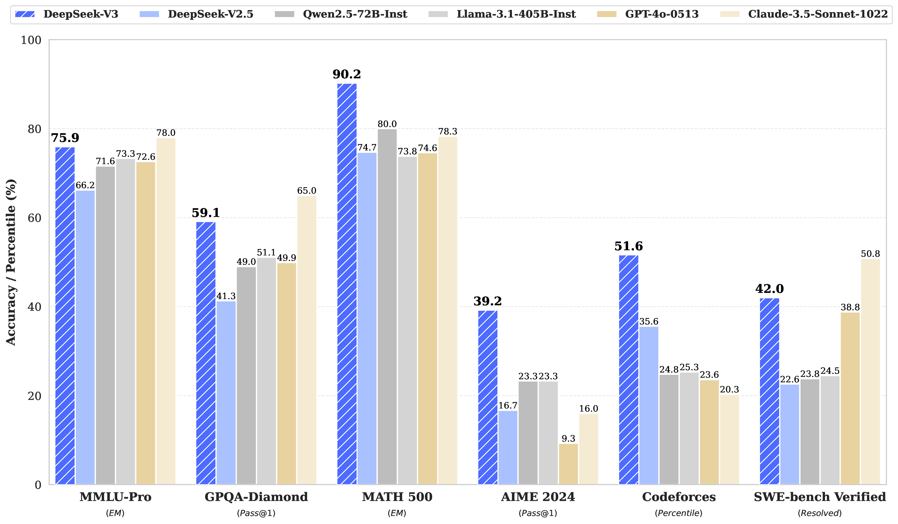{ width="920" }

<small>图源：DeepSeek-V3 Technical Report，Figure 1。图中各组使用自己的指标，Codeforces 是参赛者百分位，SWE-bench 是问题解决率，不能跨组直接比较柱高。</small>

## 一个 token 怎样经过 MLA 和专家网络

V3 主干有 61 层，隐藏维度为 7168。每层先通过注意力读取已有上下文，再通过 FFN 做当前位置的非线性变换；前 3 层用 dense FFN，其余 58 层用 MoE。理解两部分的分工，可以避免把“激活专家少”和“KV cache 小”混成同一种优化。

原图左侧是 Transformer 残差结构，右下展开注意力，右上展开专家。沿右下的输入向上看，只有标为缓存的低维 KV latent 和位置 key 会长期留在解码状态里；到右上之后，router 再决定这个 token 的隐藏表示由哪些专家处理。

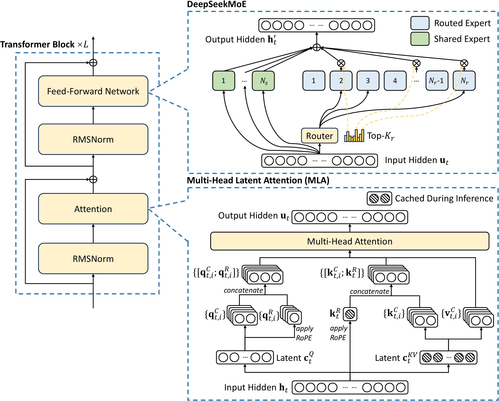{ width="920" }

<small>图源：DeepSeek-V3 Technical Report，Figure 2。共享专家每次都会运行，路由专家由 Top-K 选择；注意力缓存和专家路由分别作用于网络的不同部分。</small>

### MLA 留下压缩状态，怎样还能计算完整注意力

普通多头注意力需要缓存历史 token 的 key 和 value。到第 $t$ 个 token 时，当前 query 要与前 $t$ 个 key 比较，再按注意力权重混合对应 value。缓存随层数、上下文长度、head 数和 head 维度增长。

MLA 在某层把输入 $h_t$ 压缩成一个同时服务于 K 和 V 的 latent，然后分别投影为内容 key 和 value

$$
c_t^{KV}=W^{DKV}h_t,\qquad
k_t^C=W^{UK}c_t^{KV},\qquad
v_t^C=W^{UV}c_t^{KV}.
$$

这里 $h_t\in\mathbb R^{7168}$，$c_t^{KV}\in\mathbb R^{512}$。后两个投影生成 128 个 head 的内容向量，每个 head 的维度为 128。上标 $C$ 表示内容分量；它们都由同一个 512 维状态生成，所以保存所有展开结果会重复储存可恢复的信息。

query 也经过低秩路径

$$
c_t^Q=W^{DQ}h_t,\qquad q_t^C=W^{UQ}c_t^Q,
$$

其中 query latent 为 1536 维。query 压缩主要减少训练激活开销；解码时需要长期保存的是历史 KV，二者的收益位置不同。这里沿用方法部分的简化投影公式，实际模型还在压缩 latent 后使用 RMSNorm，并在宽度瓶颈处加入缩放因子，复现时不能把这些细节一并省掉。[↗](https://arxiv.org/pdf/2412.19437v2#page=8) [↗](https://arxiv.org/pdf/2412.19437v2#page=22)

只说“能够恢复”还没有说明计算为何划算。假如每生成一个 token，都把全部历史 latent 展开成所有 head 的 KV，显存节省了，访存和计算却可能变得很重。下面从论文公式做一次等价变形，就能看出更有效的实现空间。

取第 $i$ 个 head 的 key 上投影矩阵 $W_i^{UK}$，当前 query 与历史位置 $j$ 的内容内积为

$$
(q_{t,i}^C)^\top k_{j,i}^C
=(q_{t,i}^C)^\top W_i^{UK}c_j^{KV}
=\left((W_i^{UK})^\top q_{t,i}^C\right)^\top c_j^{KV}.
$$

可以先把当前 query 变换到 latent 空间，再与缓存中的 $c_j^{KV}$ 做内积。这样，历史位置不必先全部生成展开 key。同理，设这个 head 的注意力权重为 $a_{t,i,j}$，value 加权和满足

$$
\sum_j a_{t,i,j}v_{j,i}^C
=W_i^{UV}\left(\sum_j a_{t,i,j}c_j^{KV}\right).
$$

先混合低维 latent，再做 value 上投影，结果在实数代数下相同。这两步解释了压缩状态如何参与实际注意力运算；具体内核仍需在计算量、并行度和访存之间选择布局。

### 为什么位置编码要单独留一条分支

RoPE 会按位置旋转 query 和 key。如果把位置相关的旋转直接插进整条内容投影，当前位置与历史位置的旋转矩阵会出现在内积中，上面的矩阵吸收就不再是对所有历史位置通用的一次变换。

MLA 因此保留一个独立的位置分量

$$
k_t^R=\operatorname{RoPE}(W^{KR}h_t),\qquad
q_t^R=\operatorname{RoPE}(W^{QR}c_t^Q),
$$

$$
k_{j,i}=[k_{j,i}^C;k_j^R],\qquad
q_{t,i}=[q_{t,i}^C;q_{t,i}^R].
$$

位置 key $k_j^R$ 为 64 维，在所有 head 之间共享；位置 query 按 head 生成。完整注意力权重由内容与位置两部分共同决定

$$
a_{t,i,j}=\operatorname{Softmax}_j\left(
\frac{(q_{t,i}^C)^\top k_{j,i}^C+(q_{t,i}^R)^\top k_j^R}
{\sqrt{d_h+d_h^R}}\right),\qquad j\le t.
$$

分母使用内容维度加位置维度，此处是 $\sqrt{128+64}$。输出仍是 value 的加权和，再经输出投影回到主干宽度。[↗](https://arxiv.org/pdf/2412.19437v2#page=8)

因此，每层每个历史 token 需要缓存 $512+64=576$ 个元素。若仅作存储量说明，假定全部以 BF16 保存，61 层、一个长度为 4096 的序列对应 $576\times61\times4096\times2$ 字节，约 274.5 MiB。这个推算只含这两类逻辑缓存，不含权重、临时张量、分配器与并行布局开销。上下文长度翻倍时它仍近似翻倍，MLA 没有删除任何历史位置。

## 专家怎样分工，又怎样避免少数 GPU 忙不过来

每个 MoE 层有 1 个共享专家和 256 个路由专家，每个专家的中间维度是 2048。每个 token 调用共享专家，再选 8 个路由专家。共享路径能承载普遍使用的变换，路由路径则允许不同 token 组合不同的细粒度变换。

设输入为 $u_t$，第 $i$ 个路由专家的可学习向量为 $e_i$。router 先计算 affinity，也就是这个 token 与专家的匹配分数

$$
s_{i,t}=\operatorname{Sigmoid}(u_t^\top e_i).
$$

设选中集合为 $S_t$，专家输出的门控权重为

$$
g_{i,t}=\begin{cases}
\displaystyle\frac{s_{i,t}}{\sum_{j\in S_t}s_{j,t}},&i\in S_t,\\
0,&i\notin S_t.
\end{cases}
$$

把共享专家、路由专家和残差合起来，原文的 FFN 输出写成

$$
h'_t=u_t+\operatorname{FFN}^{(s)}(u_t)
+\sum_{i=1}^{256}g_{i,t}\operatorname{FFN}^{(r)}_i(u_t).
$$

sigmoid 先独立计算每个专家的匹配度，再在选中的专家之间归一化。共享专家不进入这 8 路门控权重的归一化分母。[↗](https://arxiv.org/pdf/2412.19437v2#page=8)

### 调整“选谁”，与调整“选中后占多大权重”

专家并行把不同专家放到不同设备。假如一半 token 都集中到少数专家，那些设备的处理时间会决定整个 batch 的完成时间，其他 GPU 即使空闲也无法结束本步。传统均衡辅助 loss 通过梯度改变路由倾向，但约束太强时，也会干扰语言建模本来想形成的专家分工。

V3 为每个专家维护负载偏置 $b_i$。选择集合由 $s_{i,t}+b_i$ 的 Top-K 决定，真正混合输出时仍用未经偏置的 $s_{i,t}$。每步结束后统计整个 batch 的专家负载，过载专家的 $b_i$ 减去 $\gamma$，欠载专家的 $b_i$ 加上 $\gamma$。这样，下一步欠载专家更容易获得 token，但其输出不会直接被一个为了均衡而增加的 bias 放大。

用一个缩小的解释性例子可以看清两者的区别。三个专家的 affinity 为 $[0.8,0.7,0.6]$，只选两个。无偏置时选择前两个，权重是 $[0.8/1.5,0.7/1.5]$。如果第三个专家偏置为 0.2，选择分数变为 $[0.8,0.7,0.8]$，于是选第一、第三个，但混合权重是 $[0.8/1.4,0.6/1.4]$，并非各占一半。bias 改变了计算路径，原始 affinity 保留了路径内的相对贡献。[↗](https://arxiv.org/pdf/2412.19437v2#page=9)

前 14.3T 训练 token 的 $\gamma=0.001$，最后 500B 设为 0。停止 bias 更新并不等于删除已经学到的路由偏置，也不等于专家停止接受语言建模梯度。

### “Auxiliary-loss-free”为何还会出现辅助 loss

正式 V3 主要靠 batch 负载反馈控制均衡，但保留一个系数仅为 $10^{-4}$ 的逐序列辅助项，防止单条序列出现极端倾斜。按原文式 17–20

$$
\mathcal L_{\mathrm{Bal}}=\alpha\sum_{i=1}^{N_r}f_iP_i,
$$

$$
f_i=\frac{N_r}{K_rT}\sum_{t=1}^{T}
\mathbf1\left[s_{i,t}\in\operatorname{TopK}(s_{\cdot,t},K_r)\right],
\qquad
P_i=\frac1T\sum_{t=1}^{T}\frac{s_{i,t}}{\sum_{j=1}^{N_r}s_{j,t}}.
$$

$N_r$ 是路由专家数，$K_r$ 是每 token 选中的专家数，$T$ 是序列长度。$f_i$ 描述按原始 affinity 选择专家时的相对频率，$P_i$ 描述该专家平均获得的归一化分数。一个专家若既频繁入选、又获得较高分数，两项的乘积就会增加均衡损失。

这里有一个实现时容易忽略的区别。论文的 $f_i$ 指示函数使用未经 bias 修正的 Top-K，而实际主路由使用 $s+b$。照报告复现公式时，应保留这两个定义；直接把实际路由计数替换进去，已经改变了式 18。[↗](https://arxiv.org/pdf/2412.19437v2#page=9)

### 均衡到哪个范围，决定专家能否专门化

一篇数学题和一段百科知识，不一定需要相同比例的专家。逐序列均衡会要求每条序列都接近平均分配；batch 级均衡则允许数学样本偏向一组专家、百科样本偏向另一组，只要合并之后设备负载仍可接受。

原图把 Wikipedia、GitHub、DM Mathematics 三个域分别作为一行，横轴是专家编号。先看 Layer 9 的两幅图，aux-loss-free 在不同语料行形成了更明显、位置不同的热点；Layer 18 也有类似分化。色标表示实际负载除以理论均衡负载，数值 8 表示该域下负载约为均衡值的 8 倍。

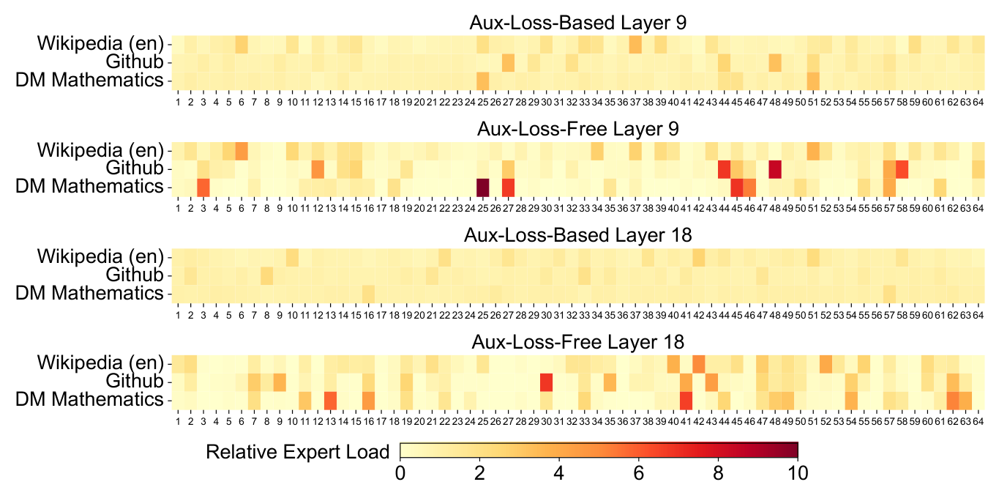{ width="850" }

<small>图源：DeepSeek-V3 Technical Report，Figure 9，第 28 页。两个约 16B 模型在 Pile 测试域上的专家负载，展示第 9、18 层；附录 C 给出其余层。</small>

图支持的是“不同域出现更强的专家分工”，仅靠热图还不能证明每个域的任务能力都更高。作者用两个规模做了质量消融，小模型 15.7B 总参数、2.4B 激活参数，训练 1.33T tokens；大模型 228.7B 总参数、20.9B 激活参数，训练 578B tokens。两边使用同样数据和其余架构，比较纯辅助 loss 与移除全部辅助 loss 后的 bias 均衡。

| Benchmark (Metric) | Small Aux-Loss-Based | Small Aux-Loss-Free | Large Aux-Loss-Based | Large Aux-Loss-Free |
| --- | ---: | ---: | ---: | ---: |
| Pile-test (BPB) ↓ | 0.727 | 0.724 | 0.656 | 0.652 |
| BBH (EM) | 37.3 | 39.3 | 66.7 | 67.9 |
| MMLU (EM) | 51.0 | 51.8 | 68.3 | 67.2 |
| DROP (F1) | 38.1 | 39.0 | 67.1 | 67.1 |
| TriviaQA (EM) | 58.3 | 58.5 | 66.7 | 67.7 |
| NaturalQuestions (EM) | 23.2 | 23.4 | 27.1 | 28.1 |
| HumanEval (Pass@1) | 22.0 | 22.6 | 40.2 | 46.3 |
| MBPP (Pass@1) | 36.6 | 35.8 | 59.2 | 61.2 |
| GSM8K (EM) | 27.1 | 29.6 | 70.7 | 74.5 |
| MATH (EM) | 10.9 | 11.1 | 37.2 | 39.6 |

<small>依据原文 Table 5 重排。BBH 为 3-shot，MMLU、TriviaQA、NaturalQuestions 为 5-shot，DROP 为 1-shot，HumanEval 为 0-shot，MBPP 为 3-shot，GSM8K 为 8-shot，MATH 为 4-shot。多数分数越高越好，BPB 越低越好。</small>

大模型 HumanEval 提高 6.1 个百分点，GSM8K 和 MATH 也提高，但 MMLU 下降 1.1；小模型 MBPP 从 36.6 降到 35.8。方法总体有效，同时存在任务差异。这个“删除所有辅助项”的消融设置，也要与正式 V3 保留微弱序列辅助项的配方区分。[↗](https://arxiv.org/pdf/2412.19437v2#page=27)

更有辨别力的实验，把辅助 loss 的统计范围也改成 batch。1B 模型中，逐序列辅助 loss 的验证 loss 为 2.258，bias 均衡为 2.253，batch 辅助 loss 同样为 2.253；3B 模型分别是 2.085、2.080、2.080。至少在这两个控制实验里，放松到 batch 级约束已经能得到相近收益。因此，不能把改进全归因于“辅助梯度被删除”，均衡范围本身就是关键变量。

代价也由此出现。训练时足够大的 batch 能混合不同样本，线上某个小 batch 却可能全是代码，热点专家会重新拥堵。报告后面的冗余专家部署，正是在处理这个训练与服务分布之间的接口。[↗](https://arxiv.org/pdf/2412.19437v2#page=28)

## MTP 怎样把更远的预测变成当前表示的训练信号

普通 next-token loss 要求位置 $i$ 的主干表示 $h_i^0$ 能预测 $t_{i+1}$。即使这个表示勉强够用，也未必保留了继续预测后续 token 最有帮助的信息。MTP 给它增加一个训练责任，让它与后续 token 的 embedding 结合之后，还能支持更远一步的预测。

V3 采用顺序连接的模块。第 $k$ 个模块收到上一深度的表示 $h_i^{k-1}$，以及真实 token $t_{i+k}$ 的 embedding，分别归一化、拼接，再投影回宽度 $d$

$$
h_i^{\prime k}=M_k\left[
\operatorname{RMSNorm}(h_i^{k-1});
\operatorname{RMSNorm}(\operatorname{Emb}(t_{i+k}))
\right],\qquad M_k\in\mathbb R^{d\times2d}.
$$

随后，一个额外的因果 Transformer block 在有效序列位置上计算

$$
h^k_{1:T-k}=\operatorname{TRM}_k(h^{\prime k}_{1:T-k}),\qquad
P^k_{i+k+1}=\operatorname{OutHead}(h_i^k).
$$

embedding 和 output head 与主模型共享，投影和额外 Transformer 属于各自的 MTP 模块。图中绿色虚线标出共享关系，底部 token 序列每向右一个模块就错开一位，上方监督目标也随之右移。[↗](https://arxiv.org/pdf/2412.19437v2#page=10)

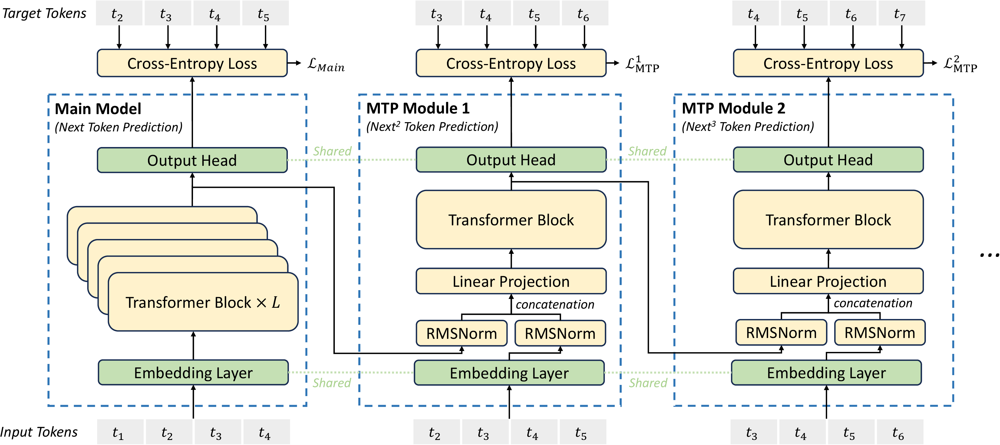{ width="920" }

<small>图源：DeepSeek-V3 Technical Report，Figure 3。示意图画了两个额外深度，正式 V3 的配置只使用一个 MTP 模块，即 $D=1$。</small>

例如主模型读到 $t_i$ 后预测 $t_{i+1}$；第一层 MTP 再接收真实的 $t_{i+1}$，目标是 $t_{i+2}$。它看到了第二步预测所需的新增条件，没有提前看到自己要预测的 $t_{i+2}$。因此，这是沿因果链增加监督，不能理解为让几个独立 head 从同一状态无条件猜出一串未来 token。

原文每个深度的 loss 为

$$
\mathcal L^k_{\mathrm{MTP}}
=-\frac1T\sum_{j=2+k}^{T+1}\log P^k_j[t_j],\qquad
\mathcal L_{\mathrm{MTP}}=\frac\lambda D\sum_{k=1}^D\mathcal L^k_{\mathrm{MTP}}.
$$

$P^k_j[t_j]$ 是对真实 token 的预测概率。这里保留原式的 $1/T$ 归一化，求和从 $2+k$ 开始，因为靠近序列尾部没有足够的未来监督位置。总训练目标在主 next-token loss 之外加入这一项；梯度通过 MTP 回传到主干，促使当前表示保留可供后续预测使用的信息。V3 前 10T tokens 取 $\lambda=0.3$，之后取 0.1。[↗](https://arxiv.org/pdf/2412.19437v2#page=11)

### 推理丢掉 MTP，还能留下什么收益

如果改善的是主干训练，测试时移除额外模块后仍应有收益。Table 4 正好检验了这一点。两种规模与前面的均衡消融相似，但大模型训练量是 **540B** tokens；不要把两个表的数据预算混用。基线与 MTP 版本保持训练数据和其余架构一致，MTP 版本训练时多一个模块，测试时直接删除。

| Benchmark (Metric) | Small Baseline | Small w/ MTP | Large Baseline | Large w/ MTP |
| --- | ---: | ---: | ---: | ---: |
| Pile-test (BPB) ↓ | 0.729 | 0.729 | 0.658 | 0.657 |
| BBH (EM) | 39.0 | 41.4 | 70.0 | 70.7 |
| MMLU (EM) | 50.0 | 53.3 | 67.5 | 66.6 |
| DROP (F1) | 39.2 | 41.3 | 68.5 | 70.6 |
| TriviaQA (EM) | 56.9 | 57.7 | 67.0 | 67.3 |
| NaturalQuestions (EM) | 22.7 | 22.3 | 27.2 | 28.5 |
| HumanEval (Pass@1) | 20.7 | 26.8 | 44.5 | 53.7 |
| MBPP (Pass@1) | 35.8 | 36.8 | 61.6 | 62.2 |
| GSM8K (EM) | 25.4 | 31.4 | 72.3 | 74.0 |
| MATH (EM) | 10.7 | 12.6 | 38.6 | 39.8 |

<small>原文 Table 4。Small 为 15.7B 总参数、2.4B 激活参数、1.33T 训练 tokens；Large 为 228.7B 总参数、20.9B 激活参数、540B 训练 tokens。各任务 shot 设置与上面的 Table 5 相同。</small>

HumanEval 的收益尤其明显，小模型提高 6.1 个百分点，大模型提高 9.2。由于推理时已删除 MTP，这些收益来自训练后的主干能力。另一方面，小模型 NaturalQuestions、大模型 MMLU 下降，Pile-test 也没有同等幅度的变化，MTP 对不同任务的作用并不一致。实验控制了推理参数量，没有控制相等的训练 FLOPs，额外模块的计算仍需要付费。[↗](https://arxiv.org/pdf/2412.19437v2#page=26)

### 留下 MTP 做 draft，是另一个用途

部署时也可以保留 MTP，为主模型提供第二个 token 的草稿，再由主模型验证。这属于 speculative decoding（推测解码），加速来自一次主模型验证可能接受多个位置。草稿被拒绝时还需要按验证结果继续，接受率不足会抵消额外工作。

报告给出的第二 token 接受率为 85%–90%，对应约 1.8 倍 TPS。仅作直觉解释，若每轮至少确认一个 token，第二个以概率 $p$ 被接受，平均确认量约为 $1+p$；但每轮耗时还包含草稿、验证和调度，所以 $1+p$ 不能直接当成实测加速倍数。论文没有在这一小节给出按 batch、长度、题材划分的完整延迟表，1.8 倍应理解为其报告配置中的结果。[↗](https://arxiv.org/pdf/2412.19437v2#page=35)

## FP8 训练要控制三种误差

把数值从 BF16 变成 FP8，首先改变可表示的动态范围和精度，然后改变矩阵乘法的累加误差，最后还会影响反向传播与参数更新。训练会反复经过这些环节，一次很小的局部误差也可能逐层传播。V3 的 FP8 方案因此同时规定哪些算子用低精度、量化尺度如何计算、部分和怎样累加，以及哪些状态继续保留高精度。

### 降低的是乘法输入精度，更新状态仍需更准确

对一个 Linear 层，若写成 $Y=XW$，前向计算是 $XW$，反向有输入梯度 $dX=dYW^\top$ 和权重梯度 $dW=X^\top dY$。它们分别对应图中的 Fprop、Dgrad 和 Wgrad。V3 在这三类 GEMM 的乘法输入上使用 FP8，输出按用途保留 BF16 或 FP32。

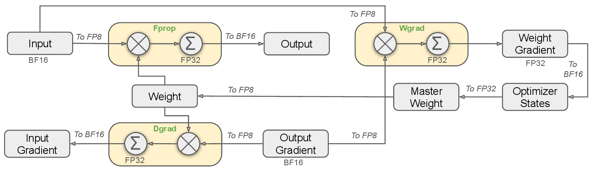{ width="860" }

<small>图源：DeepSeek-V3 Technical Report，Figure 6，仅展示 Linear。沿箭头看格式转换，尤其区分参与乘法的低精度副本、累加结果和用于优化的 master weight。</small>

embedding、输出 head、MoE router、normalization、attention 运算保留原有较高精度。master weights 和跨 micro-batch 累积的梯度保留 FP32，AdamW 的一阶、二阶状态使用 BF16。FP32 主权重可以接住比一次低精度舍入更小的更新，再生成计算所需的低精度副本；如果每次都直接更新粗粒度权重，小更新可能在写回时消失。[↗](https://arxiv.org/pdf/2412.19437v2#page=15)

因此，“FP8 训练”不能用一个统一 dtype 描述。乘法、归约、状态存储和通信可以采用不同精度。论文所说的理论 GEMM 速度翻倍，也只对应适合 FP8 的计算部分，不能直接推出端到端训练时间减半。

### 一个离群值，为什么可能伤害许多正常数值

量化通常先用一个 scale 把原始值映射到 FP8 范围。若整个张量共享一个 scale，少数大值会迫使尺度变大，许多普通值只能落到较粗的表示格点，甚至下溢。V3 把激活按每 token、每 128 个通道分组，即 $1\times128$；权重按 $128\times128$ 分块。离群值的影响被限制在较小组内。

下面是帮助理解 scale 的一般写法，$s_g$ 表示第 $g$ 组的反量化尺度

$$
\widehat x_g=\operatorname{FP8}(x_g/s_g),\qquad
x_g\approx s_g\widehat x_g.
$$

V3 在线计算当前组的最大绝对值，再求 scale；没有用过去若干步的最大值历史去猜测当前尺度。相关 FP8 GEMM 张量统一采用 E4M3，即 4 位指数、3 位尾数。较细分组承担一部分动态范围适配工作，让有限的位数更多用于组内精度。[↗](https://arxiv.org/pdf/2412.19437v2#page=16)

这会带来一个内核问题。不同内积片段有不同 scale，不能做完一个完整矩阵乘法后只乘一次总 scale。把内积按组展开，近似关系是

$$
x^\top w\approx
\sum_g s_g^x s_g^w
\left(\sum_{k\in g}\widehat x_k\widehat w_k\right).
$$

每个组的部分和需要先恢复相应尺度，再累加到最终结果。原图左侧的多个 Scaling Factor 和输出端乘法，正是在处理这件事。

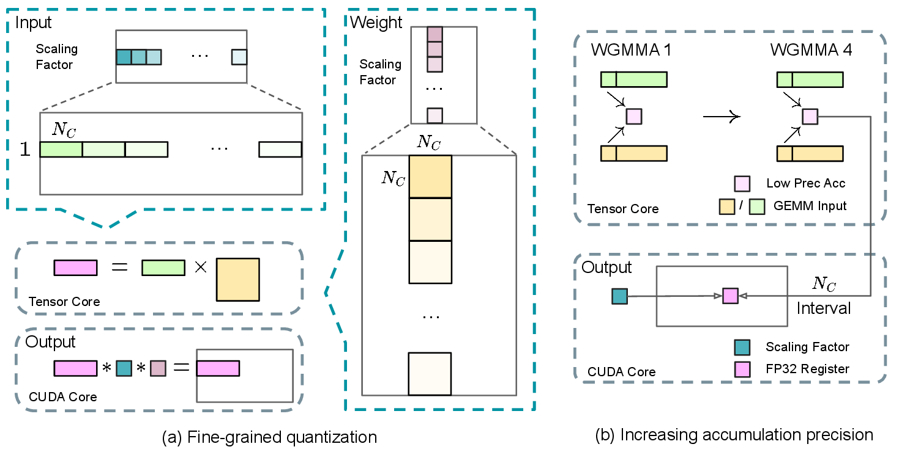{ width="860" }

<small>图源：DeepSeek-V3 Technical Report，Figure 7。左侧展示分组 scale，右侧展示每隔 $N_C$ 个内积元素把部分和送到 CUDA Core 的 FP32 寄存器。</small>

### 每 128 个元素提升一次部分和

即使输出声明为 FP32，Tensor Core 内部的累加路径也可能提前损失精度。作者在 H800 上观察到 FP8 GEMM 的累加有效精度约为 14 位；两个随机矩阵、内积维度 $K=4096$ 的测试中，最大相对误差接近 2%。这是特定矩阵测试的结果，不能当成所有 GEMM 的平均误差。

V3 每累计 128 个元素，也就是 4 次 WGMMA，就把部分和从 Tensor Core 取出，提升到 CUDA Core 的 FP32 寄存器，在那里应用分组 scale 并继续高精度累加。分组反量化与高精度累加共用这次搬运，避免把两种开销分开支付。

搬运仍会打断单个 warpgroup 发射 MMA 的节奏。作者让两个 warpgroup 交叠，一个提升部分和时，另一个继续执行 MMA。报告中 128 是既改善精度、又未引入明显额外开销的最小累加间隔。它依赖 H800 的执行特征，换一种硬件后需要重新测量这个间隔。[↗](https://arxiv.org/pdf/2412.19437v2#page=17)

### 哪些缓存与通信不能跟着一律压到 FP8

前向激活随后会被 Wgrad 使用，把缓存压到 FP8 可以节约显存。不过某个张量可能同时服务于其他反向算子，必须按全部用途决定精度。报告特别保留了几处例外。

| Tensor / operation | Reported format or handling | 原因与作用 |
| --- | --- | --- |
| Post-attention Linear input | 自定义 E5M6 | 同时进入 attention 反向，精度更敏感 |
| SwiGLU input | 细粒度 FP8 缓存 | 反向时重算 SwiGLU 输出，减少持续保存的激活 |
| Master weights / accumulated gradients | FP32 | 保留优化更新与梯度累积精度 |
| AdamW first / second moments | BF16 | 降低优化器状态存储 |
| MoE dispatch | 量化后的 FP8 激活或梯度 | 减少发往专家的数据量 |
| Forward / backward combine | BF16 | 多路结果合并时保留精度 |

E5M6 是单独为这类激活采用的格式，不属于 E4M3 FP8。反向还会把部分激活的量化分组从 $1\times128$ 改为 $128\times1$，因为矩阵乘法的归约方向改变了。相关尺度取 2 的整数次幂，以减少格式变换引入的额外误差。[↗](https://arxiv.org/pdf/2412.19437v2#page=18)

这里有一项很容易被“统一量化更简单”掩盖的失败实验。作者尝试把 Dgrad 相关张量也像权重一样按 $128\times128$ 分块，方便反向只做转置。结果在约 16B 的 MoE、约 300B tokens 的训练实验中出现发散。作者推测，激活梯度在 token 之间很不均匀，token 相关的离群值无法被跨 token 的大块量化妥善处理。观察到的是发散，离群值机制是作者对它的解释，两者的证据强度不同。[↗](https://arxiv.org/pdf/2412.19437v2#page=47) [↗](https://arxiv.org/pdf/2412.19437v2#page=48)

### 训练曲线接近，能证明到哪一步

FP8 与 BF16 的直接对照包括约 16B 模型、1.33T 训练 tokens，以及约 230B 模型、约 0.9T 训练 tokens。下图先比较红蓝 loss 曲线，再看内嵌误差曲线。两条主曲线大体重合，作者报告相对 loss 误差低于 0.25%；曲线用了系数 0.9 的 EMA 平滑。

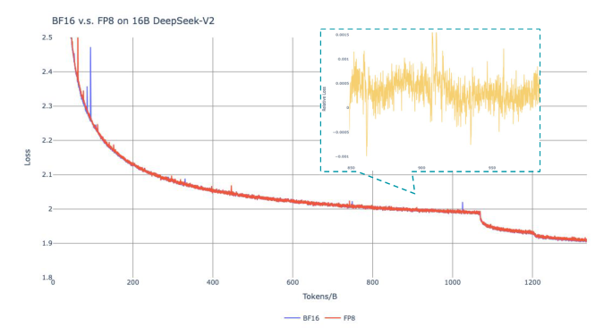{ width="920" }

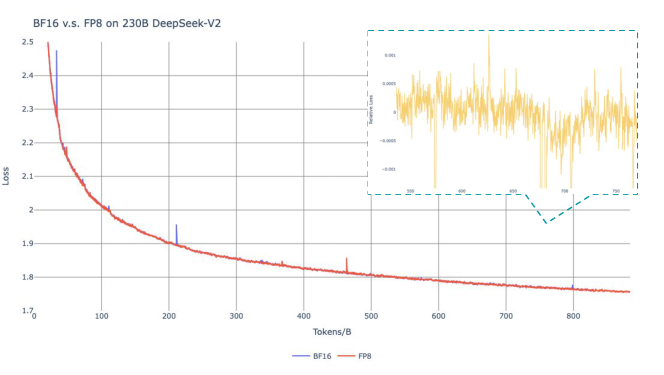{ width="920" }

<small>图源：DeepSeek-V3 Technical Report，附录 B.1 的 Figure 10，第 47 页。分别展示原图的两个面板，方便查看坐标。横轴为训练 tokens，单位 B；上方为 16B、下方为 230B 模型，分别在各自配置内比较 BF16 与 FP8。</small>

这支持整套精度安排能够保持接近 BF16 的训练 loss。它没有提供完整 671B 模型用 BF16 重训一遍的对照，也没有说明所有下游 benchmark 分数严格相等。更可复用的结论是，低精度是否可用取决于量化组、累加路径和高精度例外共同配合；前述发散实验表明，省掉其中一项可能使训练失败。

数值问题处理好后，格式转换本身还可能拖慢训练。报告中的在线量化需要从 HBM 读出 BF16 激活，写回 FP8，再为 GEMM 重新读取；反向改变分组方向还会经过读出、反量化、转置、重新量化。作者据此建议硬件直接支持分组 scale、融合 FP8 转换与内存传输、转置读取。这些是从现有实现开销导出的硬件建议，不能算作 V3 已经享有的速度收益。[↗](https://arxiv.org/pdf/2412.19437v2#page=21)

## DualPipe 怎样隐藏通信，代价又落在哪里

FP8 降低计算和搬运成本之后，MoE 仍需要一次 dispatch 把 token 送到专家，一次 combine 把输出收回来。单个 micro-batch 必须遵守“送到后才能算，算完后才能合并”的依赖；要隐藏等待，就需要在这段时间执行另一个 micro-batch 的独立工作。

V3 训练使用 16 路 pipeline parallelism（PP，流水线并行）、跨 8 个节点的 64 路 expert parallelism（EP，专家并行），以及 ZeRO-1 数据并行。2048 张 H800 每节点 8 张，节点内 NVLink/NVSwitch，节点间 InfiniBand。训练没有使用常规 tensor parallelism（TP，张量并行），但后面的推理部署会使用 TP，不能把训练配置推广到全生命周期。[↗](https://arxiv.org/pdf/2412.19437v2#page=12)

### 先拆开 backward，才有可安排的空隙

DualPipe 将一个 chunk 的执行拆成 attention、dispatch、MLP、combine，并把 attention 和 MLP 的 backward 再区分为输入梯度与权重梯度。输入梯度关系到前一层能否继续反向传播，权重梯度则可以在满足依赖之后安排到其他空隙中计算。

原图中上下两条分别是计算和通信。跟着横轴看，前向 dispatch 期间可以做另一个 chunk 的 MLP backward；后续 attention 计算又能覆盖 combine 等通信。黑三角和空心三角区分 backward 与 forward chunk，因此同一时刻重叠的工作并非来自一条可以随意打乱的依赖链。

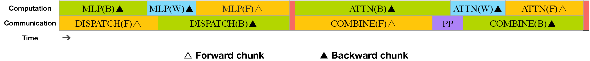{ width="920" }

<small>图源：DeepSeek-V3 Technical Report，Figure 4。图中的 W 表示权重梯度部分；PP 通信也被排入计算重叠区间。</small>

完整流水线从两个方向送入 micro-batches。下图展示 8 个 PP rank、两个方向共 20 个 micro-batches，空白处是流水线未填满或排空时的等待。黑边框圈住的两个单元具有相互重叠的计算与通信，不能把它们当成两段串行耗时相加。

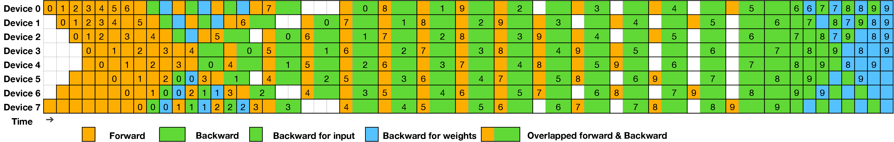{ width="920" }

<small>图源：DeepSeek-V3 Technical Report，Figure 5。反方向的 micro-batch 编号因对称而省略，颜色分别表示前向、反向、输入梯度与权重梯度。</small>

原文用下表对比流水线气泡与存储。$F$ 是一个 forward chunk 的时间，$B$ 是完整 backward 时间，$W$ 是权重梯度部分的时间，$F\&B$ 专指两个 chunk 相互重叠后的联合耗时。

| Method | Bubble | Parameter | Activation |
| --- | --- | ---: | ---: |
| 1F1B | $(PP-1)(F+B)$ | $1\times$ | $PP$ |
| ZB1P | $(PP-1)(F+B-2W)$ | $1\times$ | $PP$ |
| DualPipe | $(PP/2-1)(F\&B+B-3W)$ | $2\times$ | $PP+1$ |

<small>原文 Table 2。Activation 为表中统一口径下的相对存储单位，不能直接当作 GB。</small>

DualPipe 缩短气泡，但需要两份参数存储，峰值激活从 $PP$ 增至 $PP+1$。例如在 $PP=16$ 时，按这个比较口径，激活峰值多 $1/16$，约 6.25%；参数副本开销仍要另算。作者借助较大的 EP 切分让参数开销可承受。流水级数和 micro-batch 数需为偶数，但 micro-batch 数无须是流水级数的整数倍。[↗](https://arxiv.org/pdf/2412.19437v2#page=13)

### 路由先限制节点，通信再利用两级网络

无限制地选择全局最合适的专家，可能把一个 token 发到许多节点。V3 的 node-limited routing 最多选择 4 个节点。先按每个节点得分最高的 $K_r/M=8/4=2$ 个专家 affinity 之和给节点排序，再在选中的节点范围内完成专家选择。它保留 8 个路由专家的计算，但对专家组合施加了网络拓扑约束。报告称训练与推理都未使用 token dropping，即没有靠跳过超出专家容量的 token 来维持吞吐。[↗](https://arxiv.org/pdf/2412.19437v2#page=10)

集群中的节点内 NVLink 带宽约为 160 GB/s，节点间 IB 约为 50 GB/s。token 先通过 IB 到目标节点中相同本地 GPU 索引的设备，再立即用 NVLink 转发到实际专家所在 GPU。这样同一节点内的多个专家可以复用跨节点传输，较快的节点内网络承担后续分发。

实现使用 20 个 SM 形成 10 个通信通道。dispatch 时，IB 发送、IB 到 NVLink 转发、NVLink 接收由不同 warp 负责；combine 时再反向转发并累加。通信 chunk 大小和 L2 使用也经过调整，减少与计算内核的干扰。[↗](https://arxiv.org/pdf/2412.19437v2#page=14)

“通信被隐藏”指墙钟时间上的重叠，通信仍占用了 H800 的 132 个 SM 中的 20 个，还会使用缓存和内存带宽。这也解释了报告为何建议未来硬件提供更直接的网络转发、multicast 和 reduce 支持，让通信工作不再大量占用计算 SM。[↗](https://arxiv.org/pdf/2412.19437v2#page=20)

### 共享参数，也需要共享所在的位置

MTP 在数学上共享 embedding 和输出 head，物理实现却可能因为流水切分而出现跨设备同步。DualPipe 把最浅层和最深层放到同一 PP rank，使主干与 MTP 能实际共享这两组参数和梯度。其余显存节约还包括反向重算 RMSNorm、MLA 上投影，以及把用于评估趋势的 EMA 参数放在 CPU 上异步更新。

这些安排使“无需训练 TP”的配置可行。若只复制 16PP、64EP 两个数字，却仍保存全部展开激活或重复放置共享 head，显存预算就已经与论文不同。[↗](https://arxiv.org/pdf/2412.19437v2#page=14)

## 14.8T 预训练怎样变成 128K 上下文模型

V3 预训练提高了数学和代码样本比例，扩大中英文之外的多语言覆盖，并改进去重。tokenizer 是 128K 词表的 byte-level BPE。完整语料来源、混合比例与筛选规则没有在报告中逐项披露，因此公开架构和日程还不足以重建同一训练数据分布。

数据处理有两个容易影响实现的细节。其一，10% 数据在 packing 前采用文档级 Prefix-Suffix-Middle 格式，把中间片段放到预测位置，以训练填空能力。其二，tokenizer 会把一些标点与换行编码成联合 token，这可能造成特定 token 边界偏好；训练中随机拆开一部分这样的联合 token 来缓解它。预训练 packing 不使用跨样本 attention mask，后续 SFT 则会屏蔽不同样本之间的注意力。[↗](https://arxiv.org/pdf/2412.19437v2#page=22)

预训练序列长度是 4K。AdamW 使用 $\beta_1=0.9$、$\beta_2=0.95$，weight decay 为 0.1，梯度裁剪范数为 1.0。训练日程按消耗的 token 组织，只有初始 warmup 以 step 计数。

| Interval | Learning rate / batch / auxiliary settings |
| --- | --- |
| First 2K steps | 学习率 warmup 至 $2.2\times10^{-4}$ |
| Until 10T tokens | 保持 $2.2\times10^{-4}$，MTP 权重 0.3 |
| Next 4.3T tokens | cosine 衰减至 $2.2\times10^{-5}$，MTP 权重降至 0.1 |
| Next 333B tokens | 保持 $2.2\times10^{-5}$ |
| Final 167B tokens | 保持 $7.3\times10^{-6}$ |
| First 469B tokens | batch size 从 3072 逐渐增至 15360，之后维持 |
| First 14.3T / final 500B tokens | 路由 bias 更新速度 0.001 / 0 |

<small>依据第 22–23 页训练配置整理。MTP 权重 0.1 持续覆盖最后 4.8T tokens；序列级均衡系数始终为 $10^{-4}$。</small>

把 warmup、batch 增长、MTP 降权与 bias 冻结放在同一时间轴上，才能看出训练后段如何变化。最后 500B tokens 中，路由偏置停止更新，同时学习率经历两段固定低值；这与“全程用一个固定学习率和相同路由控制”是不同的优化过程。

### 扩展上下文还要继续训练

4K 预训练完成后，作者用 YaRN 将窗口先扩至 32K，再扩至 128K，每个阶段 1000 steps。两阶段学习率均为 $7.3\times10^{-6}$，batch size 分别为 1920 和 480，序列长度变成 4 倍时 batch 恰好降为四分之一。

报告将 YaRN 描述为作用于解耦的共享位置 key 分支，给出 $s=40$、$\alpha=1$、$\beta=32$ 与 $\sqrt{t}=0.1\ln s+1$ 的设置。这里 $t$ 是论文采用的缩放参数记号，不是前面表示 token 位置的下标。MLA 的内容 latent 与位置分支分开，使上下文扩展可以针对位置表示处理；具体 query/key 配对的旋转和 scale 仍应保持实现中的一致性。[↗](https://arxiv.org/pdf/2412.19437v2#page=23)

NIAH 图是在后续 SFT 之后测得的。横轴改变上下文长度，纵轴改变关键信息插入深度。如果模型只能找到开头或结尾的信息，中间区域就会出现明显低分。图中到 128K 的不同深度仍保持高分，支持较稳定的单针检索能力。

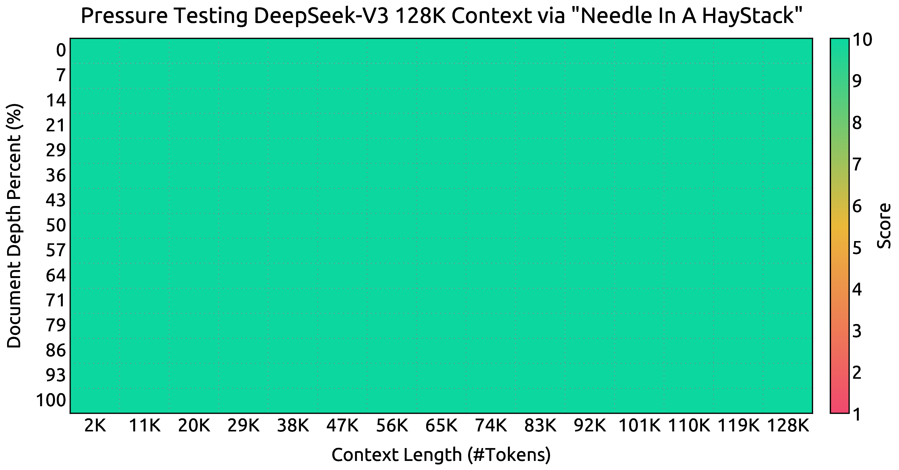{ width="920" }

<small>图源：DeepSeek-V3 Technical Report，Figure 8。色标是该测试的 Score，不能把一个格子的高分直接解释为长文推理任务的总体正确率。</small>

记住一条被插入的信息，和跨多篇文档推理是不同难度。报告中的 FRAMES、LongBench v2 给出后者更接近实际任务的补充证据，但 128K 窗口本身只说明可接收的长度，不能代替内容利用质量。

## 后训练如何保留推理能力，又控制回答长度

V3 的 SFT 数据约 1.5M 条，包含数学、代码、逻辑、写作、角色扮演等领域。推理数据由内部 R1 系列模型帮助构建。直接拿长推理轨迹训练助手，会带来过度思考、格式不佳与回答过长，因此作者多加了一层领域数据生成过程。

首先训练领域专家。对同一道题，准备“问题加原始回答”和“系统提示加问题加 R1 回答”两类样本，让专家学习普通表达与验证、反思式推理。接着用较高温度采样的 RL，促使专家在没有那段系统提示时，也能组合简洁回答与有效的推理行为。最后通过 rejection sampling（拒绝采样）筛选回答，形成用于 V3 的 SFT 数据。通用领域则主要使用 V2.5 生成并由人工检查的数据。[↗](https://arxiv.org/pdf/2412.19437v2#page=28)

这里的领域专家是训练数据生成器，与前面 MoE 层里的 FFN 专家是两种不同对象。前者生成整段回答，后者处理某层的隐藏向量。V3-Base 后来又成为 R1 的基础，也不意味着两个最终发布模型互相从零训练；报告描述的是不同训练阶段之间的数据与权重传递。

SFT 训练两 epochs，学习率从 $5\times10^{-6}$ 逐渐降至 $10^{-6}$，packing 后屏蔽不同样本间注意力。这样节约序列空间时，后一条问答不会读取前一条独立样本。[↗](https://arxiv.org/pdf/2412.19437v2#page=29)

### 蒸馏所得的准确率，有一部分要用更多输出 token 支付

作者在 V2.5 上做了专门的蒸馏消融。基线使用短 CoT 数据，另一个版本使用上述领域专家生成的数据，比较条件沿用聊天评测中的 LiveCodeBench 和 MATH-500 设置。

| Model | LiveCodeBench-CoT Pass@1 | Length | MATH-500 Pass@1 | Length |
| --- | ---: | ---: | ---: | ---: |
| DeepSeek-V2.5 Baseline | 31.1 | 718 | 74.6 | 769 |
| DeepSeek-V2.5 + R1 Distill | 37.4 | 783 | 83.2 | 1510 |

<small>原文 Table 9。Length 为平均回答长度，准确率和长度应放在一起读。</small>

代码正确率提高 6.3 个百分点，长度增加约 9%；数学提高 8.6 个百分点，平均长度约为原来的 1.96 倍。后两个比例由表中数值计算。蒸馏确实改善了结果，但数学收益伴随明显的推理 token 增加；如果服务同时限制延迟和输出预算，需要重新选择数据与推理设置。这是 V2.5 上的控制实验，不能把差值直接写成 V3 最终能力中可独立扣除的一块贡献。[↗](https://arxiv.org/pdf/2412.19437v2#page=34)

### GRPO 在可验证任务和开放任务中使用不同奖励

数学答案与可执行代码有外部校验工具，报告使用规则奖励。开放问答难以写出一个精确判分程序，则使用模型奖励，奖励模型由 V3 SFT checkpoint 初始化，并使用包含判断前推理过程的偏好数据训练。

对一个问题 $q$，GRPO 从旧策略采样 $G$ 个回答，根据同组奖励计算优势

$$
A_i=\frac{r_i-\operatorname{mean}(r_1,\ldots,r_G)}
{\operatorname{std}(r_1,\ldots,r_G)}.
$$

它比较同一道题中哪些回答相对更好，免去了另训练一个同规模 critic 来预测 baseline。设旧策略为 $\pi_{\mathrm{old}}$，当前策略为 $\pi_\theta$，则概率比为

$$
\rho_i=\frac{\pi_\theta(o_i\mid q)}{\pi_{\mathrm{old}}(o_i\mid q)}.
$$

报告的目标写成对下式的期望最大化

$$
\frac1G\sum_{i=1}^G\left[
\min\left(\rho_iA_i,
\operatorname{clip}(\rho_i,1-\varepsilon,1+\varepsilon)A_i\right)
-\beta\mathcal D_{\mathrm{KL},i}
\right],
$$

$$
\mathcal D_{\mathrm{KL},i}=u_i-\log u_i-1,\qquad
u_i=\frac{\pi_{\mathrm{ref}}(o_i\mid q)}{\pi_\theta(o_i\mid q)}.
$$

clip 限制相对旧采样策略的更新幅度，KL 项约束当前策略偏离参考模型的程度。旧策略服务于数据采样和重要性比，参考模型服务于正则化，两者角色不同。式中 $\pi(o_i\mid q)$ 是整段回答的概率，实际自回归计算会将它分解为逐 token 条件概率。

报告没有在这里给出完整的 $G$、$\varepsilon$、$\beta$ 与 rollout 日程，也没有说明组内奖励方差为零时的实现处理。理解目标函数可以解释训练信号从哪里来，精确重现后训练仍需要这些实现细节。这里也不能直接搬用 R1 报告中的超参数作为 V3 的设置。[↗](https://arxiv.org/pdf/2412.19437v2#page=30)

### 模型给自己反馈，靠什么判断反馈是否可靠

V3 在开放任务中还利用 constitutional inputs，即明确的评价原则，以及模型自身多次判断的投票结果提供奖励。其可行性的一项证据来自 RewardBench，检查模型能否选出较好的回答。

| Model | Chat | Chat-Hard | Safety | Reasoning | Average |
| --- | ---: | ---: | ---: | ---: | ---: |
| GPT-4o-0806 | 96.1 | 76.1 | 88.1 | 86.6 | 86.7 |
| Claude-3.5-sonnet-1022 | 96.4 | 79.7 | 91.1 | 87.6 | 88.7 |
| DeepSeek-V3 | 96.9 | 79.8 | 87.0 | 84.3 | 87.0 |
| DeepSeek-V3 (maj@6) | 96.9 | 82.6 | 89.5 | 89.2 | 89.6 |

<small>原文 Table 8 节选。maj@6 使用六次判断的投票，增加了评估计算量；Average 沿用论文的汇总值，不重新对显示列做算术平均。</small>

投票后 Chat-Hard、Safety、Reasoning 都提高，简单 Chat 则不变。它支持多次判断可以改善这个测试上的奖励质量，但模型们也可能重复同一种错误。投票降低随机波动的能力，不等于对错误事实和共同偏好提供独立真值。代码执行和数学规则在可用时仍具有不同性质的外部约束。[↗](https://arxiv.org/pdf/2412.19437v2#page=34)

## 主结果要连同评测协议一起读

基座与聊天模型回答不同问题。基座评测更接近预训练所得的知识、补全与推理能力，聊天评测还包含 SFT、RL、提示格式和输出预算的作用。

V3-Base 在报告内部统一框架下得到 MMLU 87.1、HumanEval 65.2、MATH 61.6，领先表中的 Qwen2.5-72B Base 与 Llama-3.1-405B Base 的对应结果。但 RACE-middle 是 67.1，低于 Llama 的 74.2；PIQA 为 84.7，对方 85.9；Pile-test BPB 为 0.548，对方更低的 0.542。不同 tokenizer 下使用 bits per byte，有助于减少直接比较 token 困惑度带来的偏差。旧版 V2 数字也因评测框架调整而与先前报告存在差异。[↗](https://arxiv.org/pdf/2412.19437v2#page=25)

这些跨模型结果同时改变了数据、总参数、激活参数与架构，不能把全部提升归因于某一个 MoE 设计。前面的 MTP 与负载均衡消融，才更适合回答具体机制有没有帮助。

聊天主表统一允许最多 8192 个输出 tokens，但其他协议随任务变化。AIME 2024、CNMO 2024 用 temperature 0.7，并平均 16 次测试；MATH-500 使用贪心解码。LiveCodeBench 使用 2024 年 8–11 月题目，分别测试有无 CoT；SWE-bench Verified 使用 agentless 框架；Aider 使用 diff 输出格式。这里的 benchmark 数字描述这些版本和配置，不能作为今日产品实时排名。[↗](https://arxiv.org/pdf/2412.19437v2#page=31)

| Benchmark (Metric) | Qwen2.5-72B-Instruct | Claude-3.5-Sonnet-1022 | GPT-4o-0513 | DeepSeek-V3 |
| --- | ---: | ---: | ---: | ---: |
| MMLU-Pro (EM) | 71.6 | 78.0 | 72.6 | 75.9 |
| GPQA-Diamond (Pass@1) | 49.0 | 65.0 | 49.9 | 59.1 |
| DROP (3-shot F1) | 76.7 | 88.3 | 83.7 | 91.6 |
| SimpleQA (Correct) | 9.1 | 28.4 | 38.2 | 24.9 |
| FRAMES (Acc.) | 69.8 | 72.5 | 80.5 | 73.3 |
| LongBench v2 (Acc.) | 39.4 | 41.0 | 48.1 | 48.7 |
| HumanEval-Mul (Pass@1) | 77.3 | 81.7 | 80.5 | 82.6 |
| LiveCodeBench (Pass@1-CoT) | 31.1 | 36.3 | 33.4 | 40.5 |
| LiveCodeBench (Pass@1) | 28.7 | 32.8 | 34.2 | 37.6 |
| Codeforces (Percentile) | 24.8 | 20.3 | 23.6 | 51.6 |
| SWE Verified (Resolved) | 23.8 | 50.8 | 38.8 | 42.0 |
| Aider-Edit (Acc.) | 65.4 | 84.2 | 72.9 | 79.7 |
| Aider-Polyglot (Acc.) | 7.6 | 45.3 | 16.0 | 49.6 |
| AIME 2024 (Pass@1) | 23.3 | 16.0 | 9.3 | 39.2 |
| MATH-500 (EM) | 80.0 | 78.3 | 74.6 | 90.2 |
| CNMO 2024 (Pass@1) | 15.9 | 13.1 | 10.8 | 43.2 |
| C-Eval (EM) | 86.1 | 76.7 | 76.0 | 86.5 |
| C-SimpleQA (Correct) | 48.4 | 51.3 | 59.3 | 64.8 |

<small>原文 Table 6 节选四个模型。HumanEval-Mul 包含八种编程语言；Codeforces 的 51.6 表示百分位，不表示题目正确率为 51.6%。</small>

数学与算法代码的优势一致，工程任务则更复杂。V3 在 Aider-Polyglot 领先，却在 SWE Verified 和 Aider-Edit 落后 Claude，说明不同代码任务仍有明显能力差异。长文任务中 LongBench v2 较强，但 FRAMES 低于 GPT-4o；英文事实问答 SimpleQA 也明显落后，而中文 C-SimpleQA 更好。选择模型时应看目标任务、语言与工具流程，不能只看一个总排名。

开放回答由模型裁判进行成对比较。Table 7 给出 Arena-Hard 85.5、AlpacaEval 2.0 的长度控制胜率 70.0。原文邻近段落对 Arena-Hard 写有“超过 86%”，与表值不一致，这里采用表中的 85.5。长度控制减少了回答更长所带来的偏好干扰，但没有消除模型裁判自身偏差；这些百分比也不是人类用户总体满意度。[↗](https://arxiv.org/pdf/2412.19437v2#page=33)

## 为什么预填充和逐 token 解码使用不同部署

训练时每个专家可以积累大量 token，矩阵乘法较大。线上请求分成两段。prefill 一次处理整段输入，计算量大；decode 每个请求每次只增加一个 token，还要读取历史 KV，延迟与内存访问更突出。用同一套设备切分应付两者，往往无法同时达到吞吐和服务延迟目标。

| Stage | Reported minimum unit | Attention | MoE / communication |
| --- | --- | --- | --- |
| Prefill | 4 nodes / 32 GPUs | TP4 + SP + DP8 | EP32，先 IB 跨节点，再 NVLink 节点内转发 |
| Decode | 40 nodes / 320 GPUs | TP4 + SP + DP80 | EP320，直接通过 IB 点对点传输并使用 IBGDA |

<small>第 19 页的部署配置。SP 为 sequence parallelism；这里的最小单元针对作者同时满足 SLO 与吞吐的方案，不是模型能运行的绝对硬件下限。</small>

prefill 中每张 GPU 原有 8 个路由专家，再增加 1 个热点专家副本，共 32 个冗余专家。系统依据线上负载统计识别热点，周期性调整，例如每 10 分钟一次，并在节点内重新摆放专家，让各 GPU 处理的 token 数更接近，同时控制额外跨节点流量。浅层 dense MLP 使用 TP1，避免这部分没有必要的 TP 通信。

冗余专家复制的是同一专家的权重，目的在于把热门计算分摊给多个副本，没有新增一个需要重新训练的能力模块。它处理了前面 batch 均衡留下的问题，即某个线上 batch 的领域比例可以与训练平均分布不同。

decode 时，把总会使用的共享专家也作为一条需要部署的路径，所以每 token 实际经过 8 个路由专家加 1 个共享专家。320 张 GPU 中，每张承载一个专家，256 个位置用于原始路由专家，其余 64 个位置承载共享专家和冗余副本。较大的 EP 分布减少每张卡需要读取的专家权重，但也增大了部署规模。[↗](https://arxiv.org/pdf/2412.19437v2#page=19)

报告说 decode 每专家 batch 通常不超过 256 tokens，此时 MoE 更偏内存访问瓶颈。只给 dispatch、MoE、combine 分配少量 SM，可能已经足以服务它们，剩余计算资源留给占比更高的 attention。这个选择与 prefill 中依赖大 GEMM 提高计算效率的策略不同。

实施状态也要分清。prefill 同时处理两个负载相近的 micro-batches、让 attention 与另一批通信重叠，是已描述的方案。每张 GPU 常驻更多专家再动态选择活动副本，以及 decode 的双 micro-batch 重叠，在报告中仍写作探索方向，不能当作已经量化验证的部署成果。[↗](https://arxiv.org/pdf/2412.19437v2#page=20)

## 训练账单说明了什么，复用时应该先量什么

| Stage | H800 GPU-hours | Cost at USD 2/GPU-hour |
| --- | ---: | ---: |
| Pre-training | 2,664,000 | USD 5.328M |
| Context extension | 119,000 | USD 0.238M |
| Post-training | 5,000 | USD 0.010M |
| Total | 2,788,000 | USD 5.576M |

<small>原文 Table 1，按假设每 H800 GPU-hour 为 2 美元折算。</small>

预训练平均每 1T tokens 消耗 180K H800 GPU-hours，在 2048 卡上约为 3.7 天。5.576M 美元对应正式训练阶段的 GPU 小时换算，明确排除先前架构、算法、数据研究与消融试验。它不能代表完整研发成本，也没有包含线上服务的长期设备与运营账单。[↗](https://arxiv.org/pdf/2412.19437v2#page=5)

V3 给小规模研究者留下的可验证问题，是在同一数据预算下加入 MTP，或把逐序列均衡放宽到 batch，能否改善自己的任务。先记录训练 FLOPs、推理参数、不同任务的正负变化，就能避免把额外训练计算带来的收益说成零成本。

对训练系统而言，最值得复用的是精度边界。先测激活和梯度的离群值分布，再比较量化分组与部分和提升间隔，同时观察长程 loss；仅通过几个短 GEMM 的误差测试，不足以排除长程训练中的发散。对服务系统，先记录每专家负载、每专家 batch、KV 读取量和通信耗时，再决定专家副本、TP/EP 与 prefill/decode 切分。

这几组测量对应着报告真正连起来的接口。容量由专家提供，表示和训练目标决定容量怎样被使用，数值与调度设计决定它能否在预算内运行；任何一个环节改变了数据分布、硬件或延迟约束，其他环节的最优配置也可能随之改变。

工程上可以按三条线继续阅读：先看[MoE 路由与稀疏 kernel](../../operators/moe-routing-and-sparse-kernels.md)理解 token 如何落到专家，再看[FP8 训练与优化器 kernel](../../operators/fp8-training-and-optimizer-kernels.md)核对 scale、累加和溢出，最后回到[分布式训练与 checkpoint](../../training/distributed-training-and-checkpointing.md)检查通信、分片和恢复。三条线都涉及 V3，但任何一条局部结果都不能单独代表整套训练收益。
