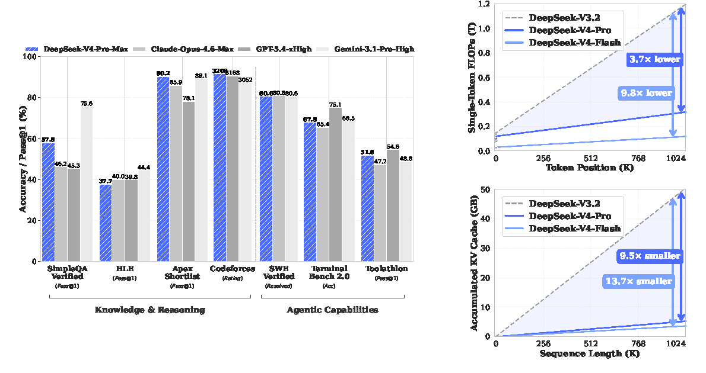
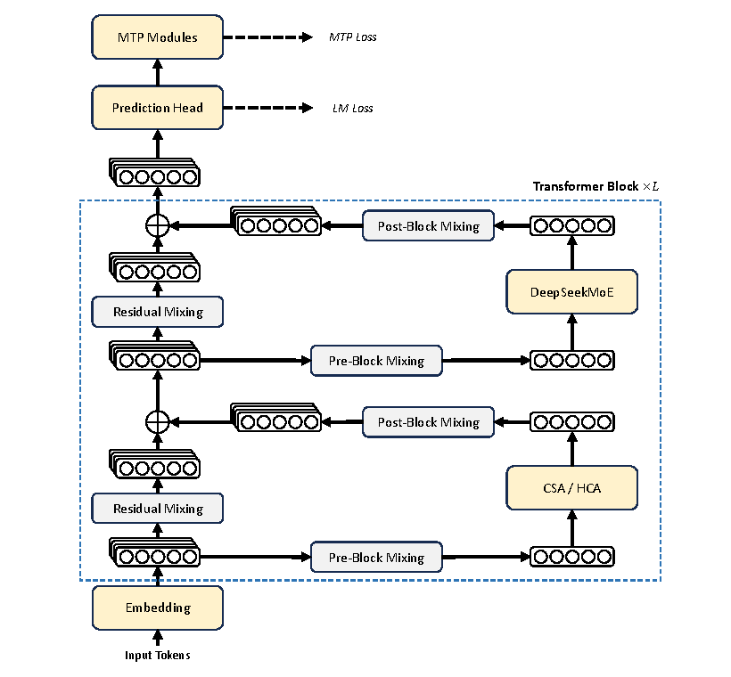
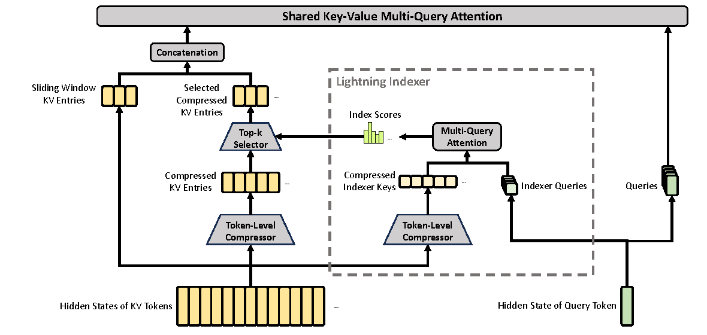
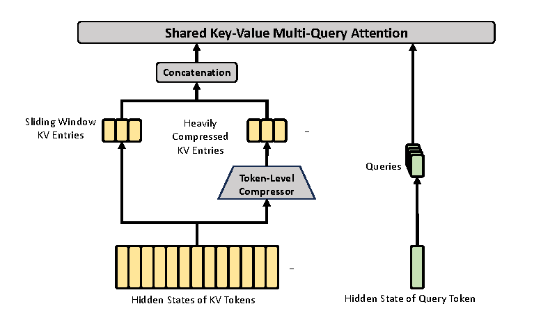
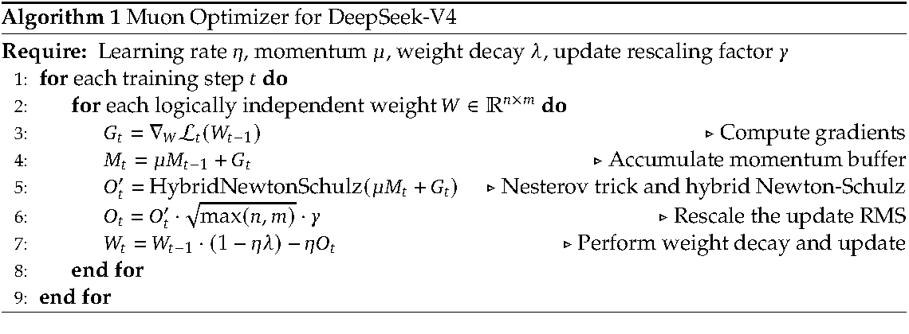
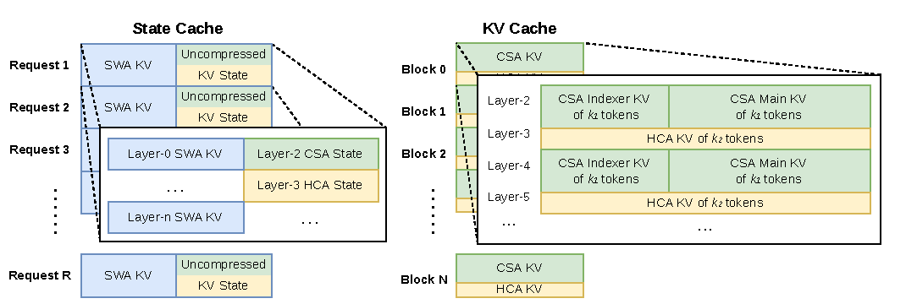
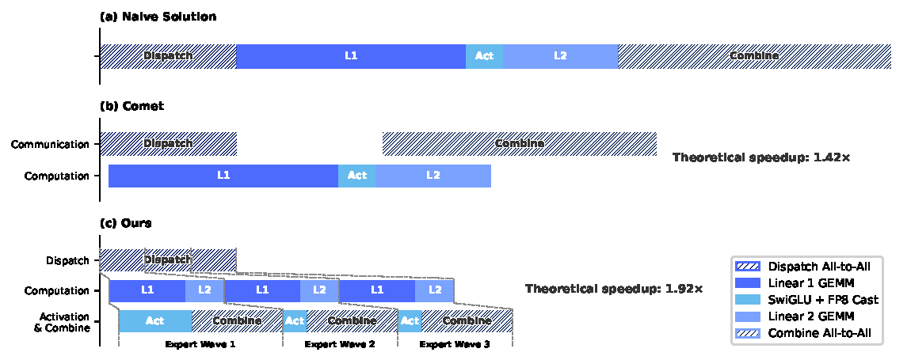
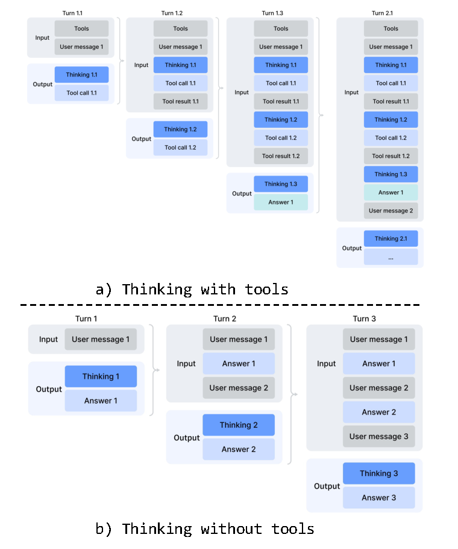
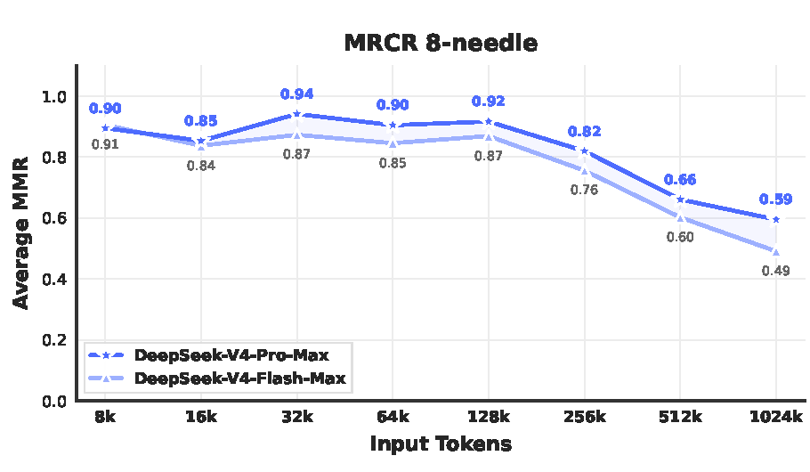
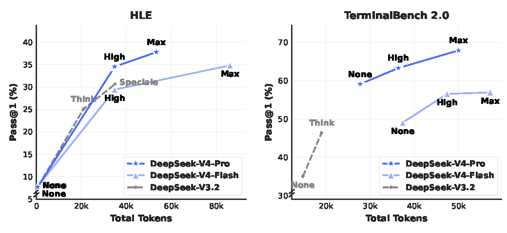

# DeepSeek-V4：百万上下文与 FP4 后训练

!!! info "报告信息"
    - 技术报告：`DeepSeek-V4: Towards Highly Efficient Million-Token Context Intelligence`
    - 模型：`DeepSeek-V4-Pro`、`DeepSeek-V4-Flash`
    - 报告 PDF：[DeepSeek_V4.pdf](https://huggingface.co/deepseek-ai/DeepSeek-V4-Pro/blob/main/DeepSeek_V4.pdf)
    - 模型集合：[DeepSeek-V4 collection](https://huggingface.co/collections/deepseek-ai/deepseek-v4)
    - 关键词：MoE、1M context、Compressed Sparse Attention、Heavily Compressed Attention、mHC、Muon、FP4 QAT、On-Policy Distillation、GRPO、agentic long-horizon tasks

这篇技术报告的核心不是“又把模型做大了”，而是围绕一个更具体的问题展开：**当 reasoning、agent 和长文档任务都想吃更多上下文时，普通 attention 的 FLOPs 和 KV cache 会先把系统拖垮，模型必须在架构、训练和推理栈上同时改。**

报告给出的答案可以压缩成四条线：

| 线索 | DeepSeek-V4 的做法 | 初学者应该抓住的点 |
| --- | --- | --- |
| 模型结构 | 继续使用 DeepSeekMoE 和 MTP，引入 mHC、CSA/HCA 混合注意力 | 能力来自 MoE 和训练规模，1M context 效率主要来自注意力和 KV 设计 |
| 训练优化 | Muon optimizer、长上下文 curriculum、dense-to-sparse attention、稳定性补丁 | 训练 1.6T MoE 不是只堆数据，还要控制 outlier、routing 和数值稳定 |
| 后训练 | specialist SFT/RL，再用 multi-teacher OPD 合成统一模型 | 不是把所有能力直接混在一个 RL 任务里，而是先分专家再蒸馏合并 |
| 系统部署 | FP4 QAT、异构 KV cache、on-disk KV、MoE 通信计算重叠 | 长上下文模型是否可用，取决于推理时每个 token 的边际成本 |

!!! warning "阅读边界"
    这是一份模型技术报告，不是经过同行评审的论文。里面的闭源/开源模型对比、内部 benchmark、Codeforces 评分、agent harness 和生产系统细节都应按“报告自述结果”理解。它很适合学习大模型系统设计，但不应把每个数值当成独立复现实验结论。

## Evidence Snapshot

| Claim | Direct Source | Figure/Table/Setting | Evidence Type | Repro Status | Can Support | Cannot Prove |
| --- | --- | --- | --- | --- | --- | --- |
| mHC/CSA/HCA 与异构 KV cache 是百万上下文效率路线 | [DeepSeek_V4.pdf](https://huggingface.co/deepseek-ai/DeepSeek-V4-Pro/blob/main/DeepSeek_V4.pdf) | architecture, long-context, KV cache sections | Paper Result | Paper Only | 长上下文效率需要架构、训练和服务栈一起改 | 不证明所有 1M context 任务都可靠 |
| FP4 QAT 和 on-policy distillation 服务低成本长上下文模型 | 同上 | FP4 QAT, OPD, agentic eval settings | System Throughput | Paper Only | 低比特后训练和推理路径可作为部署成本路线 | 不证明 FP4 对所有能力无损 |
| 本站将其接到 KV、量化和 rollout 服务成本账 | 本页与 [Rollout 服务案例](../../world-models/rollout-serving-quantization-kernel-case.md) | 工程归纳 | Site Inference | Site Inference | 可启发 world model 长上下文状态压缩 | 不等于动作分叉和风险判断已保真 |

## 论文位置

DeepSeek-V3/V3.2 已经把 DeepSeekMoE、Multi-Token Prediction、FP8 训练和 sparse attention 等设计推到很强的开源基线。DeepSeek-V4 的问题意识更靠近下一阶段：

```text
更多 reasoning tokens
  -> 更长上下文和更长 tool trajectory
  -> attention FLOPs 与 KV cache 急剧上升
  -> 需要压低每个新 token 的边际计算和存储成本
```

这里的“百万 token”不只是营销参数。对 agent 来说，长上下文意味着保留更多工具调用、文件内容、搜索记录和中间工作状态；对代码和企业任务来说，长上下文意味着把更多仓库、文档和历史决策放进同一个工作窗口。但如果每生成一个新 token 都要对 100 万历史 token 做高成本 dense attention，这个能力在生产环境里就会变成非常昂贵的展示功能。

{ width="920" }

<small>图源：`DeepSeek-V4 Technical Report`，Figure 1。原报告图意：左侧比较 DeepSeek-V4-Pro-Max 与若干模型在知识、推理和 agentic benchmarks 上的表现；右侧比较 DeepSeek-V4 系列与 DeepSeek-V3.2 在不同 token position 下的 single-token FLOPs，以及不同 sequence length 下的 accumulated KV cache。</small>

!!! note "Figure 1 怎么读"
    左图强调 capability，右图强调 serving cost。初学者容易只看左边的分数，但这篇报告真正想推的是右边：在 1M-token context 下，DeepSeek-V4-Pro 的 single-token inference FLOPs 约为 DeepSeek-V3.2 的 27%，KV cache 约为 10%；DeepSeek-V4-Flash 进一步降到约 10% FLOPs 和 7% KV cache。

    这说明 DeepSeek-V4 的长上下文不是靠“忍受更贵的 attention”硬撑出来，而是通过压缩 KV、稀疏选择、混合精度和异构 cache 管理，把长 context 的边际成本压下来。换个直观例子：如果 1M context 像一本很厚的书，普通 attention 每次回答都要把整本书逐页翻一遍；DeepSeek-V4 试图先把书分段压缩成索引，再只精读当前问题最可能需要的片段，同时保留最近几页的原文细节。

## 总体架构

DeepSeek-V4 系列仍然是 Transformer + MoE 的大框架。报告中两个模型的关键规模是：

| Model | # Total Params | # Activated Params | Context Length | Main Role |
| --- | ---: | ---: | ---: | --- |
| DeepSeek-V4-Flash | 284B | 13B | 1M | 更小激活参数、更低成本的高效模型 |
| DeepSeek-V4-Pro | 1.6T | 49B | 1M | 更强知识、推理和 agentic 能力的主力模型 |

架构上有三类新变化：

1. **mHC**：把普通 residual connection 升级为 Manifold-Constrained Hyper-Connections，让跨层信号传播更稳定；
2. **CSA/HCA**：把注意力换成压缩稀疏与重压缩 dense 的混合注意力，降低长序列 FLOPs 和 KV cache；
3. **Muon**：大部分参数用 Muon optimizer，而不是全部沿用 AdamW。

{ width="760" }

<small>图源：`DeepSeek-V4 Technical Report`，Figure 2。原报告图意：DeepSeek-V4 在 attention layer 使用 CSA/HCA，在 FFN layer 使用 DeepSeekMoE，并用 mHC 强化相邻 Transformer block 之间的 residual connection；顶部继续保留 LM loss 和 MTP loss。</small>

!!! note "Figure 2 怎么读"
    图里右侧的 `CSA / HCA` 和 `DeepSeekMoE` 是每个 Transformer block 的两大主干：attention 负责“从历史 token 中取信息”，MoE FFN 负责“对当前 token 做非线性计算”。左侧那些像多条残差流的结构对应 mHC，它不是把 layer 本身做宽，而是把 residual stream 扩成多个通道，再通过受约束的 mixing 把信息传给下一层。

    可以把普通 residual 想成一条单车道公路：每层都在同一条路上加一点变化。mHC 更像多车道加匝道，但匝道矩阵被约束在稳定范围里，避免车辆突然全部冲到某一车道造成数值爆炸。对深层 MoE 来说，这种稳定传播很重要，因为 routing 和 expert outlier 会放大训练不稳定。

## CSA：先压缩，再稀疏选择

Compressed Sparse Attention, 简称 CSA，可以分成两步：

| 步骤 | 做什么 | 目的 |
| --- | --- | --- |
| token-level compression | 把连续 KV tokens 压成更少的 compressed KV entries | 缩短注意力要看的历史长度 |
| lightning indexer + top-k selector | 用轻量 indexer 选出最相关的 compressed KV entries | 避免每个 query 都看所有压缩块 |

DeepSeek-V4-Pro 中 CSA 的 compression rate \(m=4\)，attention top-k 为 1024；DeepSeek-V4-Flash 中 CSA 的 compression rate 同样为 4，top-k 为 512。两者还都保留 sliding window KV entries，用来处理最近 token 的局部依赖。

{ width="920" }

<small>图源：`DeepSeek-V4 Technical Report`，Figure 3。原报告图意：CSA 先压缩 KV entries，再用 lightning indexer 计算 index scores，通过 top-k selector 选择压缩后的 KV entries；同时拼接 sliding window KV entries，并用 shared key-value multi-query attention 输出结果。</small>

!!! note "CSA 的关键不是“稀疏”两个字"
    稀疏 attention 有一个常见风险：如果选择器没选中真正相关的历史块，模型就会丢信息。CSA 的设计把选择拆成一个更便宜的 indexer 分支：indexer 不直接负责生成最终 attention 输出，而是先判断哪些压缩 KV entry 值得看；真正的 core attention 再在这些 selected entries 上计算。

    这和检索系统很像。你不会先通读所有文档，而是先用索引找候选段落，再仔细读候选段落。区别在于这里的“索引”和“段落”都在 Transformer 内部以 KV entries 的形式存在，而且每一层都要和 kernel、cache layout、batching 约束配合。

## HCA：压得更狠，但不做稀疏选择

Heavily Compressed Attention, 简称 HCA，使用更大的 compression rate \(m'=128\)。它会把更长的一段 KV tokens 合并成一个 heavily compressed KV entry，然后仍然做 dense attention。直觉上：

| Attention Type | Compression | Sparse Selection | 更适合什么 |
| --- | --- | --- | --- |
| CSA | 较轻，报告设置中 \(m=4\) | 有 top-k selector | 保留更多中远程细节，靠稀疏选择省计算 |
| HCA | 更重，报告设置中 \(m'=128\) | 无 top-k selector | 用极小 KV footprint 覆盖超长历史的粗粒度信息 |
| SWA branch | 不压缩最近窗口 | 只看局部窗口 | 保住最近 token 的精细依赖 |

{ width="720" }

<small>图源：`DeepSeek-V4 Technical Report`，Figure 4。原报告图意：HCA 对 KV entries 做更重压缩，把 \(m'\) 个 tokens 合并为一个 compressed entry；同时保留 sliding window KV entries 来增强局部细粒度依赖。</small>

!!! note "为什么 HCA 不也做 top-k"
    HCA 已经把历史压得很短。如果再做 sparse top-k，可能进一步降低成本，但信息风险也会更大。报告的折中是：CSA 负责“压缩后仍较细的可选择历史”，HCA 负责“非常长历史的粗粒度全局记忆”，SWA 负责“最近窗口的原始细节”。这三者组合后，模型不需要在每层都用同一种 attention 处理所有距离。

    对初学者可以这样记：CSA 像从很多章节摘要里挑最相关的几节精读；HCA 像把整本书压成很粗的时间线，虽然细节少，但能覆盖很长范围；SWA 像随手翻看你刚刚读过的几页。

## mHC：残差连接也会影响大模型稳定性

普通 Transformer residual 大致是：

$$
x_{l+1}=x_l+F_l(x_l).
$$

它的好处是让深层网络更容易训练，但在超深 MoE 中，单一路径的 residual 也可能让 outlier 或 routing 抖动沿层传播。Hyper-Connections 的思路是扩展 residual stream 的宽度，把状态从一个向量扩成多个 residual channels。DeepSeek-V4 使用的是 mHC，即把 residual mapping 约束到 doubly stochastic matrices 所在的 manifold。

报告里的关键约束可以理解为：

| 设计 | 作用 |
| --- | --- |
| residual mapping 约束为 doubly stochastic matrix | 让 mapping 的谱范数不超过 1，降低信号放大风险 |
| Sinkhorn-Knopp projection | 把动态生成的 raw matrix 投影到稳定的矩阵集合 |
| input/output mappings 用 Sigmoid 约束 | 避免负值抵消和无界放大 |
| expansion factor \(n_{hc}=4\)，Sinkhorn iterations 为 20 | 在表达力、稳定性和额外成本之间折中 |

!!! note "mHC 和 MoE 的关系"
    MoE 的 routing 会让不同 token 进入不同 expert。某些 expert 或 token 组合可能产生异常大激活，进一步造成 loss spike。mHC 不能替代 routing 稳定策略，但它能让层间残差传递更受控，减少“某一层的异常被后面层继续放大”的风险。报告中还专门为 mHC 做了 fused kernels、选择性 recomputation 和 pipeline overlap 调整，把 mHC 的 wall-time overhead 控制在 overlapped 1F1B pipeline stage 的 6.7% 左右。

## Muon：把矩阵更新先“正交化”再走一步

报告中大部分模块使用 Muon optimizer，但 embedding、prediction head、mHC 的静态 bias/gating factors、RMSNorm 权重仍用 AdamW。这个分工很实用：不是所有参数都适合矩阵正交化式更新，尤其是 embedding 和 norm 这类参数形态。

{ width="900" }

<small>图源：`DeepSeek-V4 Technical Report`，Algorithm 1。原报告图意：Muon 在每个 training step 中计算梯度、累积 momentum buffer，用 Nesterov trick 和 hybrid Newton-Schulz 近似正交化更新矩阵，再进行 RMS rescale、weight decay 和参数更新。</small>

!!! note "Muon 为什么值得单独讲"
    AdamW 基本是对每个参数元素做自适应缩放；Muon 更关注一个 weight matrix 作为整体的更新方向。它先把带 momentum 的梯度矩阵通过 Newton-Schulz 近似变成更“正交”的更新，再按 RMS 做缩放。直觉上，这能减少某些方向被过度放大，让大矩阵更新更均衡。

    DeepSeek-V4 采用 10 次 hybrid Newton-Schulz iterations：前 8 次用更激进的系数快速把 singular values 推向 1，最后 2 次用较稳定的系数精修。报告还说明，因为 CSA/HCA 对 queries 和 KV entries 做 RMSNorm，能直接缓解 attention logits 爆炸，所以 DeepSeek-V4 的 Muon 设置没有继续使用 QK-Clip。

## 长上下文推理：异构 KV cache 才是落地点

如果只在论文图里说“KV 被压缩”，还不够。真正 serving 时，每个 request、每一层、每类 attention 的 KV entry 形态都不一样：

| Cache Type | 存什么 | 为什么需要单独管理 |
| --- | --- | --- |
| SWA state cache | 最近窗口的未压缩 KV | 局部窗口随位置更新，体积大但范围有限 |
| CSA/HCA state cache | 尚未凑够压缩块的 tail tokens | 不够一个 compression block 时不能直接写入压缩 KV |
| classical KV cache | 已压缩的 CSA/HCA KV blocks | 可跨长 prefix 复用，但不同层大小和策略不同 |

{ width="920" }

<small>图源：`DeepSeek-V4 Technical Report`，Figure 6。原报告图意：KV cache 被组织成 state cache 和 classical KV cache 两类。state cache 管理 SWA 与尚未压缩的 CSA/HCA tail states；classical KV cache 按 block 存储 CSA indexer KV、CSA main KV 和 HCA KV。</small>

!!! note "Figure 6 里的 state cache 是什么"
    初学者可能会把 KV cache 想成一个简单数组：每来一个 token，就把该 token 的 key/value 追加进去。DeepSeek-V4 不是这样，因为 CSA/HCA 要等到凑够一段 token 才能压缩。没凑够的尾部 token 不能丢，也不能提前压成错误 block，所以需要 state cache 暂存。

    这也是为什么 PagedAttention 的标准假设不够用了。PagedAttention 很适合管理形态较统一的 KV blocks，而 DeepSeek-V4 的 KV 同时包含 SWA、CSA indexer、CSA main、HCA，以及未压缩 tail states。推理服务系统必须知道每类 cache 的 block alignment、命中策略和 eviction 策略。

报告还提到 on-disk KV cache。对共享长前缀的请求，系统可以把压缩后的 CSA/HCA KV entries 存到磁盘；命中前缀时直接读出，避免重复 prefill。SWA 由于体积约为压缩 KV 的 8 倍，报告给了三种策略：Full SWA Caching、Periodic Checkpointing 和 Zero SWA Caching，分别在存储量和 recomputation 之间取不同平衡。

## MoE 系统：把通信藏到计算下面

MoE 的 expert parallelism 会带来 Dispatch 和 Combine 两段通信。DeepSeek-V4 的思路不是单纯追求更高网络带宽，而是把通信和 Linear-1、activation、Linear-2 分成更细的 expert waves，让下一波通信、当前波计算和上一波 combine 重叠起来。

{ width="920" }

<small>图源：`DeepSeek-V4 Technical Report`，Figure 5。原报告图意：对比 naive EP、Comet 和 DeepSeek-V4 的 fine-grained EP scheme。DeepSeek-V4 把 experts 拆成 waves，让 Dispatch、Linear GEMM、SwiGLU + FP8 cast、Linear-2 GEMM 和 Combine 形成更细粒度 pipeline。</small>

!!! note "这张图为什么和训练也有关"
    MoE 层的慢点经常不在单个 GEMM，而在 token 需要跨设备送到目标 expert，再把结果收回来。图里的 `Dispatch` 和 `Combine` 是通信，`L1/Act/L2` 是计算。如果通信时间小于计算时间，理论上就可以把通信藏在计算下面。

    DeepSeek-V4 把 experts 分成 waves 后，不必等全部 expert 的 token 都 dispatch 完再开始算。某一波 expert 数据到了就先算；同时下一波继续通信，上一波开始 combine。报告称这种 CUDA mega-kernel 在一般推理 workload 上相对强非融合基线有 1.50 到 1.73 倍 speedup，在 RL rollout 和高并发 agent serving 这类 latency-sensitive 场景最高接近 1.96 倍。

## 预训练细节

DeepSeek-V4 的预训练语料超过 32T tokens。报告特别强调了几类数据和处理：

| Data / Processing | 报告中的作用 |
| --- | --- |
| mathematical contents 和 codes | 继续强化推理、数学和代码能力 |
| agentic data during mid-training | 为工具使用、长流程任务和 coding agent 做铺垫 |
| multilingual corpus | 覆盖更多 long-tail knowledge 和跨文化知识 |
| long-document data | 支持 scientific papers、technical reports 等长上下文任务 |
| token splitting、FIM、document packing | 继承 DeepSeek-V3 的预处理经验，减少截断浪费 |
| sample-level attention masking | 让 packed samples 内部的注意力边界更可控 |

两个 base model 的关键训练设置如下，保留原报告的英文配置名：

| Setup | DeepSeek-V4-Flash | DeepSeek-V4-Pro |
| --- | --- | --- |
| Training tokens | 32T | 33T |
| Max batch size | 75.5M tokens | 94.4M tokens |
| Peak learning rate | \(2.7 \times 10^{-4}\) | \(2.0 \times 10^{-4}\) |
| End learning rate | \(2.7 \times 10^{-5}\) | \(2.0 \times 10^{-5}\) |
| Sequence length curriculum | 4K -> 16K -> 64K -> 1M | 4K -> 16K -> 64K -> 1M |
| Dense-to-sparse attention | dense warmup, sparse attention introduced at 64K | longer dense stage, then same two-stage sparse strategy |
| MTP loss weight | 0.3 for most training, 0.1 at LR decay | same |
| Auxiliary-loss-free bias update speed | 0.001 | 0.001 |
| Sequence-wise balance loss weight | 0.0001 | 0.0001 |

!!! note "为什么要先 dense，再 sparse"
    Sparse attention 的选择器本身也要学。如果一开始就让模型在还没学好表示的时候依赖 sparse top-k，选择错误会直接变成训练噪声。DeepSeek-V4 先用 dense attention warmup，让模型有稳定基础；到 64K 长度时再引入 sparse attention，并先 warm up CSA 的 lightning indexer。这个流程和训练一个检索系统很像：先让底座能读懂文本，再训练它学会从长历史里挑重点。

### 稳定性补丁：Anticipatory Routing 与 SwiGLU Clamping

报告说训练 trillion-parameter MoE 时遇到了 loss spike，并把问题经验性地关联到 MoE outliers 和 routing。两个实用补丁很值得记：

| Technique | 做法 | 解决什么 |
| --- | --- | --- |
| Anticipatory Routing | 用历史网络参数提前计算 routing indices，在后续 step 使用 | decouple backbone update 和 routing update，打断 routing-outlier 的恶性循环 |
| SwiGLU Clamping | linear component clamp 到 \([-10,10]\)，gate component 上界为 10 | 直接压制异常大激活，减少 loss spike |

!!! note "Anticipatory Routing 的直觉"
    普通 MoE routing 是“当前参数产生当前路由，当前路由又决定当前 expert 更新”。如果某次路由把大量异常 token 推到某些 expert，这些 expert 的更新可能让下一步路由更偏，形成正反馈。Anticipatory Routing 把 routing indices 的计算滞后一段，用历史参数给当前样本分配 expert，等于给 routing 加了一个缓冲器。

    报告中这个机制不是一直开，而是在检测到 loss spike 后触发短 rollback 并启用一段时间；活动期间额外 wall-clock overhead 约 20%，但因为只在异常时动态使用，整体额外成本较小。这类设计很有工程味：不是追求“永远最优雅”，而是让大规模训练在真的出问题时能稳定跑下去。

## 后训练：先培养专家，再用 OPD 合并

DeepSeek-V4 的 post-training 可以分成两层：

```text
Base model
  -> domain specialists: SFT + GRPO-style RL
  -> unified model: multi-teacher On-Policy Distillation
```

第一层为 mathematics、coding、agent、instruction following 等目标分别训练 domain-specific experts。每个 expert 先做高质量 SFT，再用 GRPO 和面向领域的 reward signals 进一步优化。

第二层不是简单把多个 expert 的权重平均，也不是直接把所有任务混在一个 RL 里继续训，而是使用 multi-teacher On-Policy Distillation, 简称 OPD。学生模型在自己采样出来的 trajectories 上，向多个 teacher 的输出分布做 reverse KL 学习。

!!! note "OPD 和普通蒸馏有什么不同"
    普通离线蒸馏经常是在固定数据上让 student 模仿 teacher。OPD 的重点是 on-policy：训练样本来自 student 自己当前会走到的状态。这样 student 不只学习 teacher 在标准数据上的答案，也学习“当 student 自己生成到某个中间状态时，哪个 teacher 的分布更该被模仿”。

    这对多专家合并尤其重要。数学 teacher、代码 teacher、agent teacher 的强项不同。如果直接混权重或混 RL signal，能力可能互相干扰；OPD 用 logits-level alignment 把多个 physically distinct expert weights 的能力压到一个统一参数空间里。

### Reasoning modes

报告把 reasoning effort 分成三档，原报告 Table 2 的核心格式如下：

| Reasoning Mode | Characteristics | Typical Use Cases | Response Format |
| --- | --- | --- | --- |
| Non-think | Fast, intuitive responses based on habits or simple rules. | Routine daily tasks, emergency reactions, low-risk decisions. | `</think>summary` |
| Think High | Conscious logical analysis, slower but more accurate. | Complex problem-solving, planning, medium-risk decisions. | `<think>thinking tokens</think>summary` |
| Think Max | Push reasoning to its fullest extent. Slow but powerful. | Exploring the boundary of model reasoning capability. | special system prompt + `<think>thinking tokens</think>summary` |

!!! note "reasoning effort 不只是输出更长"
    表面上看，High/Max 只是“多想一会儿”。但训练和评测里它还对应不同 length penalties、context windows 和 response formats。报告在知识与推理评测中使用 8K、128K、384K 分别作为 Non-think、High、Max 的 context window；在代码 agent 和搜索 agent 评测里最大 context length 设置到 512K。也就是说，reasoning effort 是训练策略、上下文预算和推理协议一起定义的。

### Generative Reward Model 与工具协议

对于容易验证的任务，rule-based verifier 或 test cases 就能给 reward。困难在于 hard-to-verify tasks：比如开放式写作、复杂分析、长流程 agent 任务，很难用单个标量 reward model 稳定覆盖。报告提出使用 rubric-guided RL data 和 Generative Reward Model, 简称 GRM，并把模型的 judging 能力和生成能力一起优化。

同时，DeepSeek-V4 引入新的 tool-call schema，使用 `|DSML|` special token 和 XML-like invocation format，目的是减少 escaping failures 和 tool-call errors。更重要的是，报告把 thinking trace 的保留策略分成两类：

{ width="620" .atlas-figure-tall }

<small>图源：`DeepSeek-V4 Technical Report`，Figure 7。原报告图意：tool-calling scenarios 中保留跨轮 reasoning content；general conversational scenarios 中沿用新用户消息到来后丢弃旧 thinking content 的策略。</small>

!!! note "Figure 7 的重点是 context policy"
    工具调用场景里，模型可能先思考、调用工具、读结果、继续思考，再跨多个 user/tool turns 完成任务。如果每次新 user message 都清空 thinking trace，长流程 agent 会丢掉自己的工作记忆。DeepSeek-V4 借助 1M context，在 tool-calling path 里保留完整 reasoning history，让模型维持连续的问题求解状态。

    但普通对话不一定需要这样做。一直保留 thinking trace 会浪费上下文，也可能让新问题被旧思路干扰。因此报告对 general conversation 仍采用更紧凑的策略。这说明 1M context 不是“什么都塞进去”，而是要按 workflow 设计 context retention policy。

## FP4 QAT：让训练行为贴近部署行为

DeepSeek-V4 的 FP4 Quantization-Aware Training 主要作用在两处：

| Component | Precision choice | Why it matters |
| --- | --- | --- |
| MoE expert weights | FP4 (MXFP4) for routed expert parameters | expert weights 是显存和带宽大户，低比特能直接降低 deployment memory traffic |
| CSA indexer QK path | QK activations cached、loaded、multiplied in FP4 | 长上下文里 indexer score computation 很频繁，FP4 可加速 attention selection |
| index scores | FP32 -> BF16 during QAT | 报告称 top-k selector 有 2x speedup，同时保持 99.7% KV entry recall |

报告的一个细节很关键：MoE expert weights 的 FP32 master weights 会先量化到 FP4，再无损 dequantize 回 FP8 用于计算。因为 FP8 E4M3 比 FP4 E2M1 有更多 exponent bits，在 scale factor 范围满足条件时，FP4 子块的细粒度 scale 可被 FP8 动态范围吸收。这样 QAT pipeline 可以复用既有 FP8 training framework。

!!! note "为什么 rollout 阶段要用 native FP4"
    如果训练时只是模拟量化，推理或 RL rollout 时却使用另一套真实量化 kernel，模型采样分布可能不一致。报告在 RL training 的 inference/rollout 阶段直接使用 native FP4 quantized weights，而不是只做 simulated quantization。这样采样行为更接近线上部署，也能真实降低显存和内存加载。

## OPD 基础设施：full-vocabulary KL 怎么做得动

OPD 想精确对齐 teacher 和 student 的完整输出分布，但大词表 logits 很大，teacher 又可能有十多个、每个都很大。报告的工程做法包括：

| Problem | DeepSeek-V4 的处理 |
| --- | --- |
| teacher 模型太多太大 | teacher weights 放在 centralized distributed storage，按需加载，并做 ZeRO-like parameter sharding |
| full logits 物化太占内存 | teacher forward 时只缓存 last-layer hidden states，训练时再通过对应 prediction head 重建 logits |
| teacher head 占 GPU 内存 | 按 teacher index 排列样本，保证每个 mini-batch 尽量只加载一个 teacher head |
| exact KL 计算成本高 | 用 specialized TileLang kernel 计算 teacher-student KL |

!!! note "为什么不只用 token-level KL estimate"
    报告提到，过去有些 OPD/RL 复用做法会把 full-vocabulary KL 简化成 token-level KL estimate，再把它当作 per-token advantage。这种做法省资源，但梯度方差大，容易不稳。DeepSeek-V4 选择 full-vocabulary logit distillation，是用更多系统工程换更稳定的 teacher signal。

## Rollout 与 Sandbox：agent 训练不是只跑模型

DeepSeek-V4 的 agent/RL/OPD 基础设施还包括两个容易被忽略的部分。

第一是 preemptible and fault-tolerant rollout service。大规模 GPU 集群会被抢占，也会有硬件错误。报告用 token-granular Write-Ahead Log, 简称 WAL，记录每个生成请求已经产出的 token；抢占时保存未完成请求的 KV cache；恢复时用 WAL 和 KV cache 继续解码。报告特别指出，简单从头重新生成未完成请求会引入 length bias，因为短 response 更容易在中断前完成。

第二是 DSec sandbox。agentic AI 训练和评测需要跑函数调用、容器、microVM、fullVM 等不同执行环境，还要记录命令、文件变更和结果。报告用 trajectory log 支持 fast-forward、provenance 和 deterministic replay，这和代码 agent / web agent 的训练闭环直接相关。

!!! note "和 verl/RL 框架的呼应"
    在 [verl 代码流程](../../reinforcement-learning/verl-code-flow.md) 里，rollout、reward、advantage、policy update 是 RLHF/RLVR 的核心数据流。DeepSeek-V4 报告展示的是同一类系统问题在百万上下文和多 teacher OPD 下的放大版本：rollout 不能只管“生成文本”，还要能容错、恢复、保留 KV、管理超长 token 字段，并让 teacher/student forward 的调度不把 GPU 内存打爆。

### 实验结果怎么读

### Base model 对比

下面摘录原报告 Table 1 的关键行，保留原英文表头和指标格式：

| Benchmark(Metric) | # Shots | DeepSeek-V3.2 Base | DeepSeek-V4-Flash Base | DeepSeek-V4-Pro Base |
| --- | ---: | ---: | ---: | ---: |
| Architecture | - | MoE | MoE | MoE |
| # Activated Params | - | 37B | 13B | 49B |
| # Total Params | - | 671B | 284B | 1.6T |
| MMLU-Pro(EM) | 5-shot | 65.5 | 68.3 | 73.5 |
| Simple-QA verified(EM) | 25-shot | 28.3 | 30.1 | 55.2 |
| FACTS Parametric(EM) | 25-shot | 27.1 | 33.9 | 62.6 |
| HumanEval(Pass@1) | 0-shot | 62.8 | 69.5 | 76.8 |
| MATH(EM) | 4-shot | 60.5 | 57.4 | 64.5 |
| LongBench-V2(EM) | 1-shot | 40.2 | 44.7 | 51.5 |

<small>表源：`DeepSeek-V4 Technical Report`，Table 1 摘录。原报告表格要点：DeepSeek-V4-Flash-Base 在更小 activated/total params 下超过 DeepSeek-V3.2-Base 的多项指标；DeepSeek-V4-Pro-Base 在知识、代码和长上下文上进一步提升。</small>

!!! note "Base table 的主要结论"
    V4-Flash 的 activated params 只有 13B，小于 V3.2 的 37B，却在 MMLU-Pro、HumanEval 和 LongBench-V2 等指标上更强。这说明报告想证明的不是“参数越多越强”，而是架构和数据质量让更小激活规模也能更有效。V4-Pro 则通过更大总参数和激活参数把知识密集任务拉高，特别是 Simple-QA verified 和 FACTS Parametric 这类更依赖 parametric knowledge 的任务。

### Reasoning effort 与长上下文

报告中 Table 7 显示 High/Max mode 对困难任务提升很明显。下面保留几个能体现趋势的行：

| Benchmark(Metric) | Flash Non-Think | Flash High | Flash Max | Pro Non-Think | Pro High | Pro Max |
| --- | ---: | ---: | ---: | ---: | ---: | ---: |
| HLE(Pass@1) | 8.1 | 29.4 | 34.8 | 7.7 | 34.5 | 37.7 |
| LiveCodeBench(Pass@1-COT) | 55.2 | 88.4 | 91.6 | 56.8 | 89.8 | 93.5 |
| Codeforces (Rating) | - | 2816 | 3052 | - | 2919 | 3206 |
| MRCR1M(MMR) | 37.5 | 76.9 | 78.7 | 44.7 | 83.3 | 83.5 |
| BrowseComp(Pass@1) | - | 53.5 | 73.2 | - | 80.4 | 83.4 |
| Toolathlon (Pass@1) | 40.7 | 43.5 | 47.8 | 46.3 | 49.0 | 51.8 |

<small>表源：`DeepSeek-V4 Technical Report`，Table 7 摘录。原报告表格要点：Non-Think、High、Max 表示不同 reasoning effort；多数困难推理、代码、长上下文和 agentic tasks 随 reasoning effort 增大而提升。</small>

{ width="760" }

<small>图源：`DeepSeek-V4 Technical Report`，Figure 9。原报告图意：DeepSeek-V4-Pro-Max 和 DeepSeek-V4-Flash-Max 在 MRCR 8-needle 任务上的 Average MMR 随 input tokens 从 8K 增加到 1024K 的变化。</small>

!!! note "Figure 9 的含义"
    MRCR 是长上下文 retrieval 类测试。图里 8K 到 128K 区间表现很稳定，超过 128K 后开始下降，但到 1024K 仍保留一定检索能力。这里不要只看“1M 还能跑”，更要看曲线形状：长上下文能力不是二值开关，而是随着长度增加逐步退化。工程上要为 256K、512K、1M 设计不同的 prompt packing、cache reuse 和检索辅助策略。

{ width="860" }

<small>图源：`DeepSeek-V4 Technical Report`，Figure 10。原报告图意：在 HLE 和 TerminalBench 2.0 上比较 DeepSeek-V4-Pro、DeepSeek-V4-Flash 和 DeepSeek-V3.2 的 performance by reasoning effort；横轴是 total tokens，纵轴是 Pass@1。</small>

!!! note "Figure 10 要看斜率"
    这张图不是只说“Max 最强”，而是看额外 tokens 换来了多少分数。HLE 上，V4-Pro 从 None 到 High 的提升很大，从 High 到 Max 仍有提升但斜率变小；TerminalBench 2.0 上 V4-Pro 的 High/Max 也继续涨。V4-Flash 更便宜，但在 agentic coding 这类任务上和 Pro 有明显差距。选择模型时要问的是：你的任务是缺 reasoning tokens，还是缺模型容量和领域知识？

### 最值得复用的工程经验

这份报告有几条经验适合迁移到自己的系统设计里：

| 经验 | 可迁移启发 |
| --- | --- |
| attention 不能只在算法层讨论 | CSA/HCA 必须和 KV cache layout、kernel、on-disk cache、prefix reuse 一起设计 |
| MoE 性能瓶颈经常在通信 | expert waves 和 mega-kernel fusion 比单纯堆 bandwidth 更接近工程最优点 |
| 大模型训练稳定性需要动态补丁 | Anticipatory Routing 这种按异常触发的机制，比一刀切改训练目标更现实 |
| 后训练合并能力要看数据流 | specialist SFT/RL 和 OPD 的分层，减少多领域能力互相干扰 |
| QAT 要贴近真实 rollout | RL/OPD 采样阶段用 native FP4，可减少训练采样与线上部署的分布差 |
| 长上下文 agent 是系统问题 | context retention、tool schema、sandbox、WAL、KV persistence 都会影响模型是否可用 |

### 局限与风险

第一，DeepSeek-V4 的架构很复杂。CSA、HCA、SWA、mHC、MoE、MTP、Muon、FP4 QAT、异构 KV cache、on-disk cache 和 OPD infrastructure 都有耦合。报告自己也承认未来要进一步提炼架构，把真正必要的设计筛出来。

第二，训练稳定性的解释还不完整。Anticipatory Routing 和 SwiGLU Clamping 是有效工程经验，但报告也说其底层机制仍需进一步研究。对于复现者来说，这意味着不能只照抄超参，还要建立 outlier、routing、loss spike 和 expert load 的监控体系。

第三，很多 benchmark 是内部 harness 或内部评测口径。尤其是 agent、search、white-collar task、R&D coding benchmark，不能和公开 leaderboard 直接混在一起比较。它们更适合说明 DeepSeek 的产品化方向，而不是作为独立可复现结论。

第四，FP4 的硬件收益有一部分是面向未来硬件的。报告中提到 FP4 x FP8 在现有硬件上的 peak FLOPs 和 FP8 x FP8 相同，但未来硬件理论上可更高效。因此当前收益更多来自内存占用和 memory traffic，不能简单等同为所有场景 1/3 compute speedup。

### 和站内章节连接

如果你想把这篇报告放进现有知识地图，可以按这个顺序读：

1. [训练：Megatron、DeepSpeed 与训练栈](../../training/megatron-lm-deepspeed-and-open-training-stacks.md)：理解 ZeRO、pipeline、expert parallel 和大规模训练栈；
2. [训练：MTP 与投机解码](../../training/mtp-and-speculative-decoding.md)：理解 DeepSeek 系列为什么保留 MTP；
3. [量化：FP8 与混合精度推理](../../quantization/fp8-and-mixed-precision-serving.md)：对照 DeepSeek-V4 的 FP8/FP4 训练和服务选择；
4. [量化：QAT、Kernel 与 KV Cache](../../quantization/qat-kernels-and-kv-cache.md)：连接 FP4 QAT、KV cache 和实际 serving；
5. [算子与编译器：FlashAttention 与长上下文](../../operators/long-context-and-flashattention-evolution.md)：理解为什么百万上下文必须改 attention kernel；
6. [推理：上下文压缩与 KV 内存管理](../../inference/context-compression-kv-eviction-and-memory-hierarchies.md)：把 DeepSeek-V4 的异构 KV cache 和 on-disk KV 放到推理系统里看；
7. [强化学习：verl 代码流程](../../reinforcement-learning/verl-code-flow.md)：对照 rollout、reward、advantage、policy update 和 OPD/RL 基础设施。

### 一句话总结

DeepSeek-V4 的重点不是某个单点指标，而是展示了一条百万上下文大模型的完整路线：**用 CSA/HCA 和异构 KV cache 压低长上下文边际成本，用 mHC/Muon/稳定性补丁把 trillion-scale MoE 训练跑稳，用 specialist + OPD 把多领域后训练能力合并到一个统一模型里，再用 FP4 QAT、rollout service 和 sandbox 把模型放进真实 agent 系统。**
