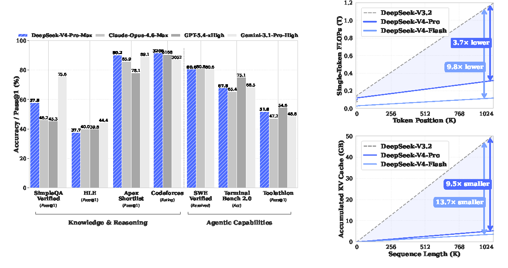
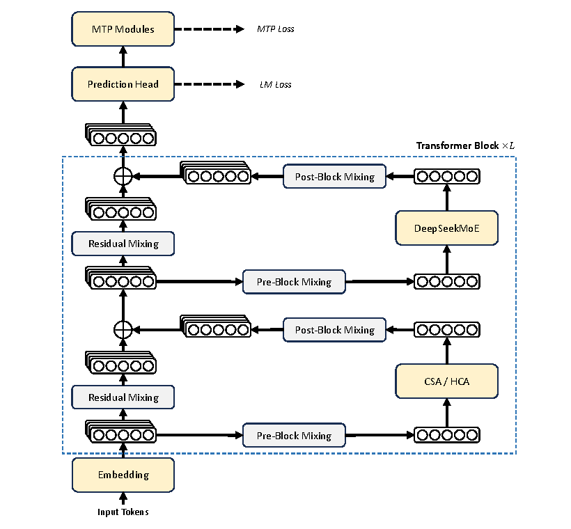
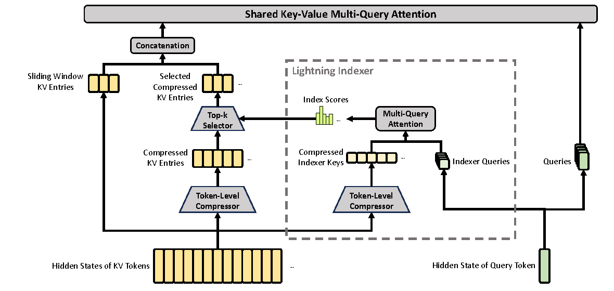
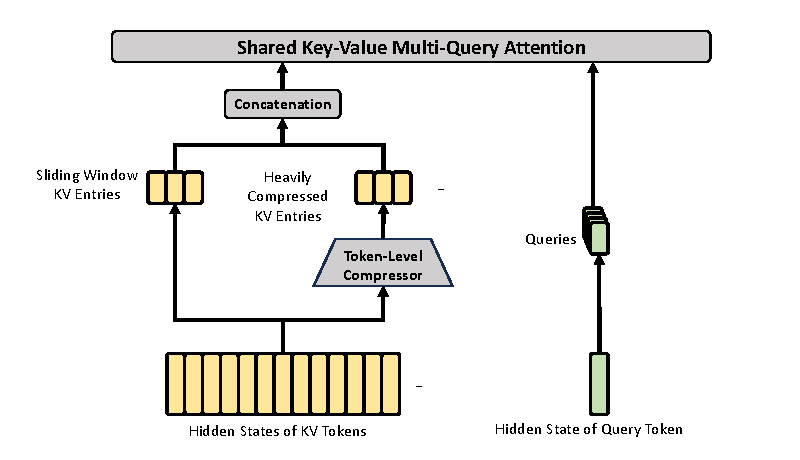
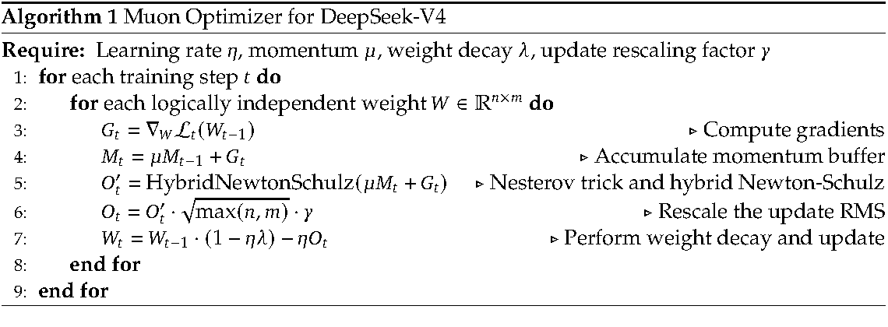
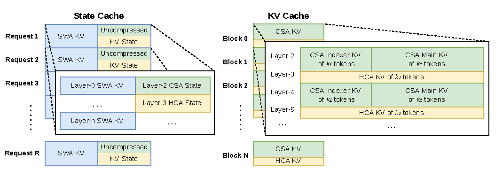
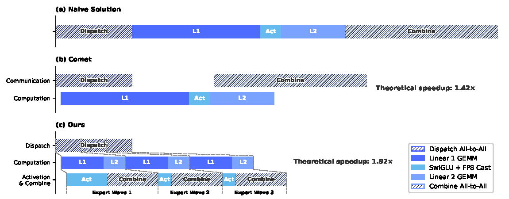
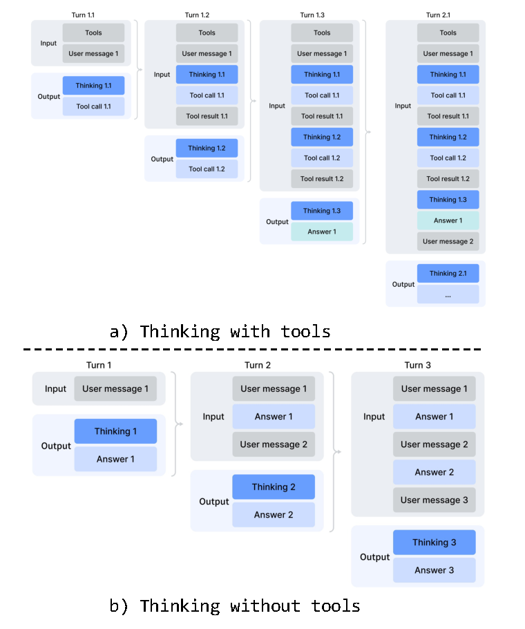
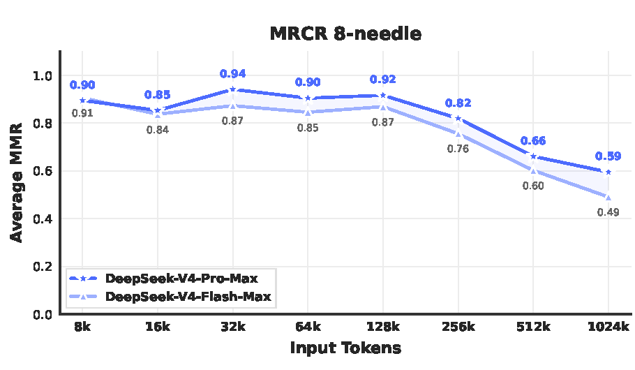
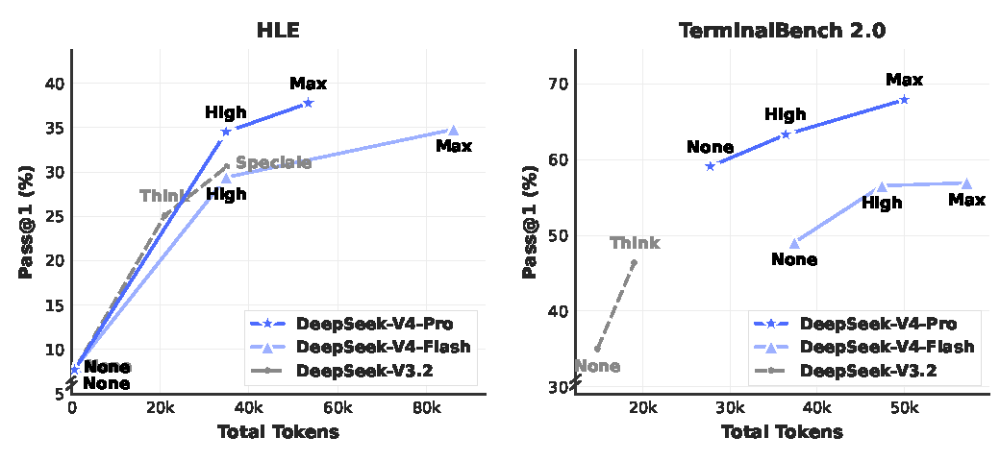

# DeepSeek-V4：百万上下文与 FP4 后训练

!!! info "论文信息"
    **论文题名：** DeepSeek-V4: Towards Highly Efficient Million-Token Context Intelligence。 
    **作者：** DeepSeek-AI。 
    **机构：** DeepSeek-AI。 
    **时间 / 主题：** 2026-05；技术报告。 
    **arXiv / 官方报告：** arXiv：[2606.19348](https://arxiv.org/abs/2606.19348)。 
    **GitHub / 项目：** GitHub：未找到官方链接。 
    **元数据来源与核验口径：** 来源：[arXiv](https://arxiv.org/abs/2606.19348)；Checked Date：2026-07-07；Repro Status：Paper / official materials reviewed, independent reproduction not claimed。

## 百万上下文的真正瓶颈是持续保存和读取历史

DeepSeek-V4报告的是一个preview模型系列：Pro为1.6T总参数、49B激活，Flash为284B总参数、13B激活，两者支持百万token上下文。长上下文不只用于把更多文档一次放进prompt，也服务于长推理、工具调用和多轮任务。随着历史不断增长，每生成一个新token都要处理更多缓存；即便MLA已压缩每个token的KV宽度，token数量本身仍然是成本来源。

V4的核心改变是沿序列维度压缩历史。CSA把较小窗口压成一个条目，再稀疏选择；HCA用更大压缩比保留一条较短的全局记忆；局部滑动窗口补回最近token的细节。模型还引入mHC残差连接、Muon优化，以及多教师on-policy蒸馏和FP4后训练，形成从训练到部署的一套配方。[↗](https://arxiv.org/pdf/2606.19348v1#page=4)

总图右侧应看同一上下文位置的单token FLOPs和累计KV，左侧才是能力比较。在1M位置，Pro相对V3.2需要约27%的单token推理FLOPs、约10%的KV缓存。这不是训练总费用降低73%，也不是任何请求的端到端时延都降低到27%。

{ width="920" }

<small>图源：`DeepSeek-V4 Technical Report`，Figure 1。</small>

## CSA与HCA分工，决定远处信息保留到什么粒度

两种attention交错使用，都以共享key-value的Multi-Query Attention为核心，并附加128-token局部窗口。Pro的CSA压缩率为4、top-k为1024；Flash同样压缩4倍，但top-k为512。HCA两者均每128个token压为一个条目。它们没有把所有历史压成一个固定向量，而是保留随上下文增长的压缩序列。[↗](https://arxiv.org/pdf/2606.19348v1#page=24)

整体架构图先看不同层的attention类型，再看mHC扩宽的残差路径与MoE。它同时改变信息传播、历史粒度和专家计算，所以不能用一个“稀疏attention”概念概括全部机制。

{ width="760" }

<small>图源：`DeepSeek-V4 Technical Report`，Figure 2。</small>

CSA的压缩器由输入隐藏状态 $H$ 生成KV候选与逐通道权重 $C_a,C_b,Z_a,Z_b$。每个输出条目结合当前 $m$ 个token的a分支与前一个 $m$ token块的b分支，经过位置bias和softmax得到权重后求和

$$
C_i^{\mathrm{Comp}}=\sum_{j=mi}^{m(i+1)-1}S_j^a\odot C_j^a+
\sum_{j=m(i-1)}^{mi-1}S_j^b\odot C_j^b.
$$

$S$ 在这 $2m$ 个候选位置上按通道归一化，$\odot$ 是逐元素乘法。相邻压缩块的来源相互重叠，但每 $m$ 个原token仍只增加一个压缩条目，因此总长度为原来的 $1/m$，不是 $1/(2m)$。这种可学习压缩允许不同通道关注不同位置，信息损失也必须由训练去适应。[↗](https://arxiv.org/pdf/2606.19348v1#page=10)

接着lightning indexer计算query与压缩key之间的低成本相关性

$$
I_{t,s}=\sum_{h=1}^{n_h^I}w_{t,h}^I\operatorname{ReLU}(q_{t,h}^I\cdot K_s^{I\mathrm{Comp}}),
$$

选择得分最高的 $k$ 个已完成压缩块，送进主attention。图中应沿“压缩→索引→top-k→主attention”读，索引并未替代主attention的语义聚合，只负责决定访问哪些远程记忆。

{ width="920" }

<small>图源：`DeepSeek-V4 Technical Report`，Figure 3。</small>

HCA采用更激进、无重叠的压缩

$$
C_i^{\mathrm{Comp}}=\sum_{r=0}^{m'-1}S_{i,r}\odot C_{im'+r},\qquad
Z_{i,r,c}=Z_{im'+r,c},\qquad
S_{i,r,c}=\frac{\exp\left(Z_{i,r,c}+B_{r,c}\right)}
{\sum_{u=0}^{m'-1}\exp\left(Z_{i,u,c}+B_{u,c}\right)},
$$

其中 $m'=128$，$i$ 表示当前的非重叠块，$r$ 是块内位置，$c$ 是通道。原文的 $Z$ 沿全序列产生，显式展开为 $Z_{i,r,c}=Z_{im'+r,c}$；$B$ 只为一个 $m'$ 行的块提供位置偏置；归一化是在每个块、每个通道内完成，而不是把不同块混在一起做一行 softmax。压缩后对全部已完成条目做attention，不再top-k。下图重点看它省去了indexer与选择器，代价是单个记忆条目概括更长文本。CSA提供较细的可选记忆，HCA提供低成本全局覆盖。

{ width="720" }

<small>图源：`DeepSeek-V4 Technical Report`，Figure 4。</small>

两者都只允许query读取此前已经完成的压缩块，避免当前块后续token泄漏。这样当前块内部的信息会缺席，所以局部窗口既用于细节建模，也填补压缩边界留下的因果访问空隙。它不是可以随意删除的附属加速技巧。[↗](https://arxiv.org/pdf/2606.19348v1#page=13)

## 共享KV之后，位置与数值稳定还要重新处理

V4对query和共享KV做RMSNorm，抑制attention logits爆炸；向量末64维使用RoPE。由于同一条目既当key又当value，位置编码也会进入attention输出，作者再对输出相应维度施加反向位置旋转，使相对位置关系更合理。直接把普通attention的位置处理照搬到shared-KV，不能自动得到相同语义。

输出投影也做了分组低秩处理，避免大量query heads的宽输出直接映射回hidden带来过高计算。attention sink则在softmax分母加入可学习项，让某个head总attention质量可以低于1、甚至接近0，不必被迫从不相关历史中取信息。

部署精度进一步分工：RoPE维度KV保留BF16，其余KV用FP8，indexer QK路径用FP4。由此得到的缓存收益同时来自序列压缩、表示共享、局部窗口和精度降低，不能全部归为稀疏top-k。相对BF16、head128的GQA8基准，论文估计1M场景的KV约为2%；这个基准与前述V3.2的10%不是同一个分母。[↗](https://arxiv.org/pdf/2606.19348v1#page=13)

## mHC约束残差混合，不是把主干宽度直接扩大四倍

普通残差只有一条宽度 $d$ 的状态。Hyper-Connections将其扩为 $n_{hc}\times d$，V4取 $n_{hc}=4$，再用三种映射组织每层

$$
X_{l+1}=B_lX_l+C_lF_l(A_lX_l).
$$

$A_l$将多条残差状态合成为主层输入，$F_l$仍处理 $d$ 维向量，$C_l$把输出分配回多条流，$B_l$负责旧状态之间的混合。因此增加的是残差表达路径，不是把每个attention和MoE的hidden width乘四。

不受约束的多层 $B_l$相乘可能放大信号。mHC将 $B_l$约束为非负、行和列均为1的双随机矩阵

$$
B_l\mathbf1=\mathbf1,\qquad \mathbf1^\top B_l=\mathbf1^\top,\qquad B_l\ge0.
$$

该集合在矩阵乘法下封闭，单个残差混合映射的谱范数不超过1，因而不会单凭残差混合持续扩张。实现中对原始参数取exp，再以20轮Sinkhorn-Knopp交替行列归一化近似投影；$A_l$用sigmoid，$C_l$用两倍sigmoid保持有界非负。[↗](https://arxiv.org/pdf/2606.19348v1#page=7)

这个保证针对被约束的残差映射，不包含主层 $F_l$、动态参数化和有限精度训练的全部行为。V4实际仍出现训练不稳定，后文的路由与SwiGLU措施正说明mHC不是全网络稳定性的充分条件。

## Muon更新矩阵方向，异常值仍需单独控制

Muon先积累动量，对Nesterov组合后的更新矩阵做近似正交化，再按矩阵形状与目标RMS缩放。V4使用10轮hybrid Newton-Schulz，前8轮快速靠近目标奇异值，后2轮采用更稳定系数细化。图中应区分正交化后的更新 $O_t$ 与参数 $W_t$；被正交化的是优化器更新，不是要求模型权重本身成为正交矩阵。

{ width="900" }

<small>图源：`DeepSeek-V4 Technical Report`，Algorithm 1。</small>

embedding、prediction head、RMSNorm以及mHC部分标量或bias仍用AdamW，其余主要矩阵用Muon。由于query与KV已直接归一化，V4没有采用Kimi K2式QK-Clip。不同attention参数化改变了适合的稳定手段，优化器名称相同并不表示整个训练recipe相同。[↗](https://arxiv.org/pdf/2606.19348v1#page=14)

Muon与ZeRO的组合也需要额外的分桶规则。稠密参数先限制ZeRO并行规模，再用knapsack把完整矩阵分到各rank；每个桶补齐到最大桶尺寸，便于reduce-scatter，本文设置下每rank至多管理5个矩阵，padding通常低于10%。当数据并行规模超过上限时，额外数据并行组会重复计算Muon更新，以换取更小的桶。MoE参数则把所有专家的down、up、gate矩阵分别展平，在不拆开逻辑矩阵的边界下补齐并均匀分发，同形状的连续参数再合并批量执行Newton–Schulz。

MoE梯度先以随机舍入同步到BF16以减半通信量，但每个rank收到梯度后用FP32本地求和；这里用all-to-all替代树或环形reduce-scatter，目的是避免低精度加法累积误差。因而“BF16梯度”描述的是通信格式，不是把更新全程降到BF16。[↗](https://arxiv.org/pdf/2606.19348v1#page=20)

报告对训练失败也给出实际处理。MoE离群值和路由反馈相关，简单rollback无法防止重复尖峰。Anticipatory Routing在历史参数 $\theta_{t-\Delta t}$ 下预先计算未来批量的路由索引，当前步骤用 $\theta_t$计算特征，从而暂时解耦路由与主干同步反馈。启用阶段约增加20% wall-clock，但只在尖峰触发后短期使用，再回到正常训练。SwiGLU另将线性分支限制在 $[-10,10]$，gate上界设为10。[↗](https://arxiv.org/pdf/2606.19348v1#page=26)

这些是经过运行验证的稳定策略，机制的完整理论解释仍未建立。它们也提醒读者，万亿规模训练的稳定不能只靠一项漂亮的谱范数性质。

## 预训练扩大语料与上下文，同时调整路由结构

Flash在32T tokens训练，Pro为33T，最大token batch分别75.5M与94.4M。数据继续保留数学代码与多语言知识，特别增加长文档，并在mid-training加入agentic数据。与V3不同，V4预训练采用样本级attention mask，避免packed文档互相可见。[↗](https://arxiv.org/pdf/2606.19348v1#page=24)

序列长度从4K逐步到16K、64K和1M。Flash先用1T tokens做dense attention warmup，在64K阶段引入稀疏注意力，并先短期预热indexer；Pro使用更长dense阶段。这个顺序让表示与索引逐渐适应稀疏访问，模型并非一开始就在百万上下文上全程训练。

| Configuration | Flash | Pro |
| --- | ---: | ---: |
| Layers / hidden width | 43 / 4096 | 61 / 7168 |
| First two layers | pure SWA | HCA |
| Total / activated parameters | 284B / 13B | 1.6T / 49B |
| Routed experts / selected | 256 / 6 | 384 / 6 |
| Shared experts | 1 | 1 |
| Query heads / head dim / query compression dim | 64 / 512 / 1024 | 128 / 512 / 1536 |
| Indexer query heads / dim | 64 / 128 | 64 / 128 |
| Output groups / intermediate output dim | 8 / 1024 | 16 / 1024 |
| CSA compression / top-k | 4 / 512 | 4 / 1024 |
| HCA compression / local window | 128 / 128 | 128 / 128 |
| Training tokens | 32T | 33T |

前3层MoE按token ID的预定义hash路由，其余学习路由，affinity由sigmoid改为 $\sqrt{\operatorname{Softplus}(\cdot)}$。V4去掉V3的目标节点数限制，以新的专家并行系统承接通信。仍保留微小序列均衡项及1层MTP，说明它是对既有架构有选择的替换。[↗](https://arxiv.org/pdf/2606.19348v1#page=7)

训练配置的可复用部分也在报告中给出。Flash的峰值/末端学习率为 $2.7\times10^{-4}/2.7\times10^{-5}$，Pro为 $2.0\times10^{-4}/2.0\times10^{-5}$，两者前2000步线性warmup；Muon动量为0.95、weight decay为0.1、每个更新矩阵RMS重缩放到0.18，AdamW为 $\beta_1=0.9,\beta_2=0.95,\epsilon=10^{-20}$、weight decay为0.1。无辅助损失的负载均衡bias更新速率为0.001，单序列balance loss权重为0.0001，MTP loss大部分训练为0.3，进入学习率衰减后为0.1。Flash前1T token使用dense attention；Pro只说明dense阶段更长，没有给出同样的token数。[↗](https://arxiv.org/pdf/2606.19348v1#page=25) [↗](https://arxiv.org/pdf/2606.19348v1#page=26)

## 异构KV缓存与专家流水，决定理论节省能否兑现

CSA、HCA与局部窗口的缓存增长规则不同。V4将缓存分为固定大小的state cache和随历史增长的compressed KV cache。state保存最近窗口和未凑齐压缩块的尾部状态；分页缓存以两个压缩率的最小公倍数对应的原token数组织，让不同层块边界一致。

下图左侧是每请求的局部状态，右侧是压缩历史。不能因为长程缓存已经压缩，就丢掉尚未完成压缩的尾部，否则后续token不能恢复正确块表示。

{ width="920" }

<small>图源：`DeepSeek-V4 Technical Report`，Figure 6。</small>

磁盘prefix复用还涉及重算。压缩条目可以完整保存，命中前缀最后不足一块的token需重新计算。局部窗口可选择全量保存、周期checkpoint或完全不保存；后者利用已有压缩缓存，重算最后 $n_{win}L$ 个token恢复 $L$ 层的局部状态。这是存储写放大与prefill重算之间的选择。[↗](https://arxiv.org/pdf/2606.19348v1#page=22)

专家并行则将专家切成waves。一个wave数据到齐即可计算，不必等待整个layer所有专家dispatch完成；当前计算、下一wave传输和已完成结果combine同时进行。图中1.92倍是Flash配置下的理论重叠加速，不能直接当作整模型实测吞吐倍数。

与未融合基线相比，实测一般推理的细粒度EP加速为 $1.50\sim1.73\times$，RL rollout与高速agent serving等对时延敏感场景最高为 $1.96\times$。因此图中的1.92倍理论重叠与这些kernel级实测区间必须分开报告，不能拿理论值当成端到端吞吐。[↗](https://arxiv.org/pdf/2606.19348v1#page=16)

{ width="920" }

<small>图源：`DeepSeek-V4 Technical Report`，Figure 5。</small>

TileLang及确定性、batch-invariant内核支持快速实现与训练／采样一致性。batch-invariant要求同一token无论处于哪个batch位置都得到bitwise相同的结果，注意力与矩阵乘法会放弃大部分split-K路径，并固定累加顺序；稀疏attention backward为每个SM分开累加后做确定性求和，MoE backward先预处理token顺序并隔离跨rank buffer，mHC的小矩阵split-K则在后续kernel做确定性归约。这样才能把训练异常定位到数值原因，而不是累加顺序噪声。[↗](https://arxiv.org/pdf/2606.19348v1#page=18)

在上下文并行中，每个rank把最后 $m$ 个未压缩KV条目传给下一个rank，由后者与本地 $s$ 个条目一起局部压缩，形成带padding的 $s/m+1$ 条；随后all-gather，再由fused select-and-pad重排成全量压缩KV。这样既处理跨rank压缩块边界，也保留每个query可见的top-k范围。[↗](https://arxiv.org/pdf/2606.19348v1#page=20)

mHC本身的工程开销主要来自变宽残差带来的额外中间状态内存与通信。报告降低这部分开销的措施分成三类：训练/推理融合kernel、只重算大多数层间hidden state和全部归一化输入、以及调整DualPipe 1F1B以重叠流水通信。报告所说的6.7%是相对于overlapped 1F1B pipeline stage的wall-time overhead，不是相对于整次训练或每个token的统一开销。[↗](https://arxiv.org/pdf/2606.19348v1#page=20)

后训练服务的WAL和环境轨迹各有分工。LLM rollout的WAL按请求逐token追加“新生成的token”；如果从头重启未完成轨迹，随机重生成会偏向较短的幸存输出，token WAL保留原前缀，恢复或重做时可沿原轨迹继续，避免这种偏差。抢占时另外保存未完成请求的KV cache，恢复时用WAL和KV继续decode，硬件故障则可用WAL重做prefill。DSec沙箱则按全局顺序记录每次命令调用及其结果，用于回放、非幂等命令的快速恢复和状态溯源；它不是把每个token的KV写进环境日志。[↗](https://arxiv.org/pdf/2606.19348v1#page=35) [↗](https://arxiv.org/pdf/2606.19348v1#page=36)

## 多教师OPD整合能力，轨迹来自学生自己

V4先在各领域训练specialists，包含SFT与GRPO，再用十余个教师整合成最终学生。与先前混合RL不同，最后融合阶段主要优化

$$
\mathcal L_{\mathrm{OPD}}(\theta)=\sum_{i=1}^{N}w_iD_{\mathrm{KL}}(\pi_\theta\|\pi_{E_i}).
$$

关键是前缀由当前学生采样，教师在学生实际访问的状态上给分布监督。数学任务选择对应专家，代码任务选择代码专家，不是把所有教师权重直接平均。reverse KL方向是student对teacher，训练目标与只拟合离线教师标准答案不同。[↗](https://arxiv.org/pdf/2606.19348v1#page=32)

作者采用完整词表logits KL，而非每位置只用采样token的对数比估计，以降低梯度方差。为避免同时保存十余个万亿教师和超过100k词表的全部logits，系统按需加载教师，只缓存最终hidden states；训练时加载对应prediction head即时恢复logits，样本按教师分组，设备上最多保留一个教师head。由此将昂贵的数据体积换成少量重算和调度。

领域教师仍由RL和奖励训练，所以OPD并未消除奖励设计。难验证任务使用rubric引导的Generative Reward Model，并同时训练模型的生成与评价能力；它是对标量奖励模型接口的改变，不能直接等同于不再需要人类标注或可靠评价标准。

## FP4后训练对齐实际部署的数值行为

QAT主要量化两类组件：MoE专家权重，以及CSA indexer的QK路径。专家FP32 master weights先量化为MXFP4，再反量化到FP8执行训练计算，反向用STE将梯度传回master weights。论文称FP4→FP8映射可无损，是在所测权重分块scale比例满足条件下成立；它不代表FP32→FP4没有量化误差。[↗](https://arxiv.org/pdf/2606.19348v1#page=33)

rollout和部署直接使用原生FP4权重，使采样行为与线上数值一致。index scores另外从FP32降到BF16，top-k selector提速2倍，保留99.7%的KV条目召回。这个召回率测的是选择结果，不是最终任务准确率，更不是整个模型2倍加速。

这些设计说明后训练不能只优化理想高精度模型，再假设低精度部署自然相同。尤其是稀疏indexer，微小分数变化可能改变访问的历史条目，QAT要覆盖实际决策路径。

## Thinking与工具调用是有状态的接口

系列提供Non-think、High与Max三种reasoning effort。训练中通过不同长度惩罚与上下文设置塑造不同思考量，再用对应格式与Max专用提示区分。标准推理评估对三模式分别使用8K、128K和384K上下文，temperature为1；因此Max的结果同时对应更大的测试时预算。[↗](https://arxiv.org/pdf/2606.19348v1#page=29)

工具场景会保留跨tool result和新user turn的推理历史，普通聊天则在新user turn后丢弃旧推理。下图两条路径应按消息类型读，差别来自框架如何组织上下文，而非模型仅凭“这是agent任务”自行推断。

{ width="620" .atlas-figure-tall }

<small>图源：`DeepSeek-V4 Technical Report`，Figure 7。</small>

若框架把工具结果伪装成普通user消息，可能不能触发预期的工具上下文路径。官方因此建议这类框架考虑Non-think。DSML/XML工具格式还试图降低字符串转义错误；Quick Instruction则复用已有KV，通过专用token执行搜索意图、query生成等辅助任务，避免为这些任务重复prefill。[↗](https://arxiv.org/pdf/2606.19348v1#page=31)

## 能力收益与长上下文退化需要一起看

基座表显示Pro在MMLU-Pro73.5、SimpleQA-Verified55.2、LongBench-v2 51.5上高于V3.2-Base，但BigCodeBench59.2低于V3.2的63.9，CMath90.9也低于92.6。扩大模型、语料与上下文并没有使所有任务单调提高。[↗](https://arxiv.org/pdf/2606.19348v1#page=28)

以下为Table6指定版本与reasoning effort的结果，代码agent使用内部bash＋file-edit工具，最多500交互步、512K上下文；对照不都是同一基础模型或同一服务预算。[↗](https://arxiv.org/pdf/2606.19348v1#page=37)

| Benchmark | Opus4.6 Max | GPT5.4 xHigh | Gemini3.1 Pro High | K2.6 Thinking | GLM-5.1 Thinking | V4-Pro Max |
| --- | ---: | ---: | ---: | ---: | ---: | ---: |
| SimpleQA-Verified | 46.2 | 45.3 | 75.6 | 36.9 | 38.1 | 57.9 |
| GPQA Diamond | 91.3 | 93.0 | 94.3 | 90.5 | 86.2 | 90.1 |
| HLE | 40.0 | 39.8 | 44.4 | 36.4 | 34.7 | 37.7 |
| LiveCodeBench | 88.8 | — | 91.7 | 89.6 | — | 93.5 |
| Apex Shortlist | 85.9 | 78.1 | 89.1 | 75.5 | 72.4 | 90.2 |
| Terminal Bench2.0 | 65.4 | 75.1 | 68.5 | 66.7 | 63.5 | 67.9 |
| SWE Verified | 80.8 | — | 80.6 | 80.2 | — | 80.6 |
| SWE Pro | 57.3 | 57.7 | 54.2 | 58.6 | 58.4 | 55.4 |
| HLE w/ tools | 53.1 | 52.0 | 51.6 | 54.0 | 50.4 | 48.2 |
| Toolathlon | 47.2 | 54.6 | 48.8 | 50.0 | 40.7 | 51.8 |

这是Table 6的节选，加入K2.6与GLM-5.1后可以看到开放模型内部也有明显短板：V4在SWE-Pro为55.4，低于K2.6的58.6和GLM-5.1的58.4；HLE with tools为48.2，也低于两者的54.0和50.4。竞赛代码和Apex Shortlist很强，但知识、HLE和部分agent任务仍有闭源或开放模型对照领先。Codeforces3206来自14场Div.1、114题、每题先生成32候选再抽10次提交的预计评级，不是单次无重试解题成绩。[↗](https://arxiv.org/pdf/2606.19348v1#page=38)

百万上下文也应直接看长度曲线。MRCR8-needle在128K附近较稳，Pro-Max从128K的约0.92降到512K的0.66、1024K的0.59；Flash-Max在128K约0.87，1024K约0.49。主表的MRCR汇总分83.5不能读成1024K这个单点的83.5%。

{ width="760" }

<small>图源：`DeepSeek-V4 Technical Report`，Figure 9。</small>

长上下文的实际成果是成本可承受且仍保有相当检索能力，不是长度增加完全不损伤信息访问。CorpusQA的跨文档任务补充检索以外的证据，但长文档中需要精确定位的任务仍应关注长度分桶，而非只看“支持1M”的接口上限。[↗](https://arxiv.org/pdf/2606.19348v1#page=40)

## 更长思考不总是最划算的配置

Pro从High到Max，HLE34.5→37.7、LiveCodeBench89.8→93.5、TerminalBench63.3→67.9；但MCPAtlas74.2→73.6略降。Flash在TerminalBench56.6→56.9的增幅很小。图中横轴总tokens将这些质量变化放回成本坐标，适合判断某种任务是否值得启用Max。

{ width="860" }

<small>图源：`DeepSeek-V4 Technical Report`，Figure 10。</small>

真实使用评估同样有范围。内部30项中文专业任务中，Pro-Max相对Opus4.6-Max胜53%、平10%、负37%，所以63%是“不败率”，不是胜率。内部研发评测从约200候选任务筛到30项，Pro-Max通过率67%，Opus4.6 Thinking为80%；它支持V4可承担很多工程工作，同时保留高难内部任务差距。[↗](https://arxiv.org/pdf/2606.19348v1#page=43)

中文写作的内部对照更具体：功能写作中Pro相对Gemini 3.1 Pro的总胜率为62.7%，对方为34.1%；创意写作的指令遵循胜率为60.0%，写作质量胜率为77.5%。但只取高复杂约束或多轮场景时，Claude Opus 4.5在指令遵循与多轮写作合计胜率为52.0%，Pro为45.9%。综合平均收益和困难子集负结果应同时保留，不能把“中文写作提升”写成所有场景都领先。[↗](https://arxiv.org/pdf/2606.19348v1#page=41)

正式数学也有两个不能合并的计算协议。实践 regime 的 Putnam-200 Pass@8 在固定随机子集、少量工具和有界采样下，Flash-Max为81.00%，Seed-2.0-Prover为35.50%；frontier regime 的 Putnam-2025 使用混合形式/非形式推理与大规模计算，V4为120/120，Axiom同为120/120，Seed-1.5-Prover为110/120。前者是受限采样的通过率，后者是另一套题目及大规模预算下的120/120得分/满分结果，不能并称一个“数学胜率”。[↗](https://arxiv.org/pdf/2606.19348v1#page=40)

搜索则显示工具预算的收益。869条内部问答比较中，agentic search胜RAG为61.7%，RAG胜18.3%，平20%；平均prefill tokens13649对10453，输出1526对1308，agentic search还平均调用16.2次工具，多数并行。这里增加的成本包含工具与环境，不应只比较输出token。[↗](https://arxiv.org/pdf/2606.19348v1#page=55)

V4提供的采用路线是明确的：长历史由压缩与局部状态共同管理，领域能力通过学生自身轨迹上的蒸馏融合，实际部署数值进入后训练，工具接口保留正确的会话状态。对长任务系统而言，最值得复用的是这些信息与执行接口；对低时延应用，Flash、Non-think或High可能比一律Max更合适，选择应依据任务曲线和实际工具预算。

## 继续阅读

百万上下文和 FP4 后训练要分别放到[量化验收](../../quantization/evaluation-and-deployment-checklist.md)与[上下文压缩和 KV](../../inference/context-compression-kv-eviction-and-memory-hierarchies.md)检查；训练系统的并行边界见[训练栈对照](../../training/megatron-lm-deepspeed-and-open-training-stacks.md)。
