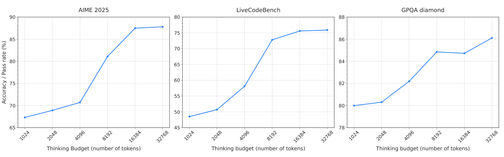
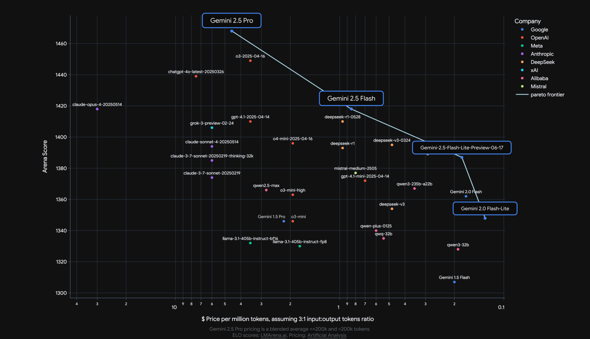
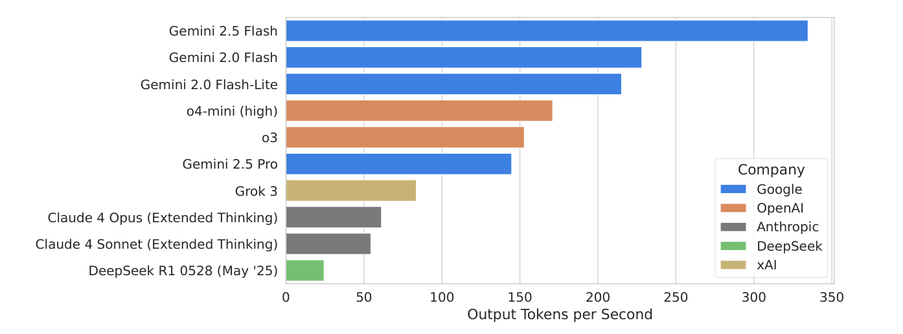
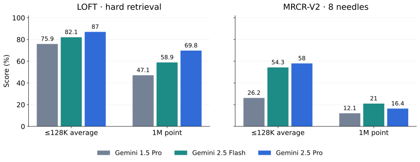
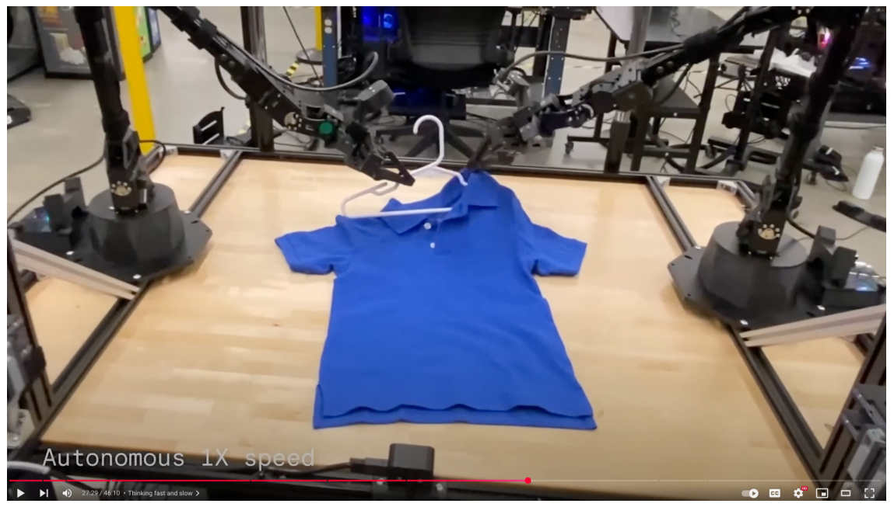
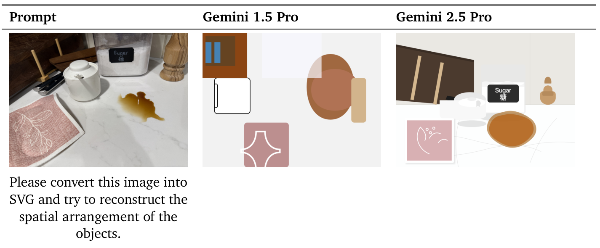
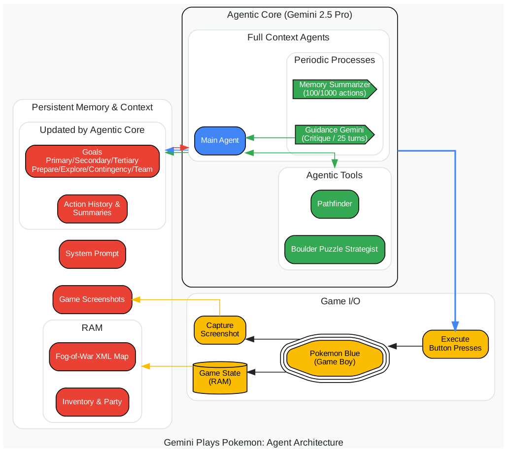
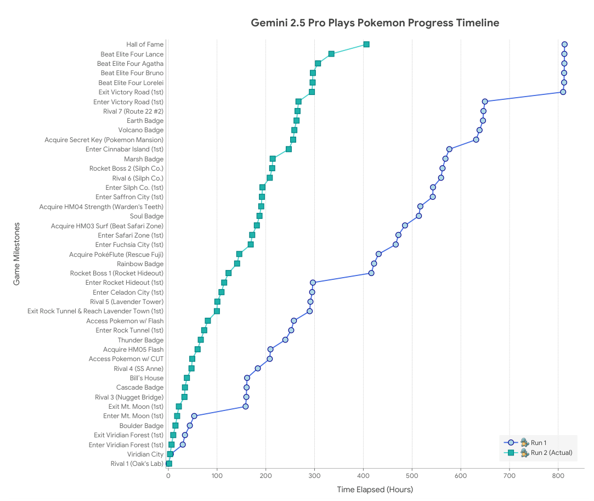
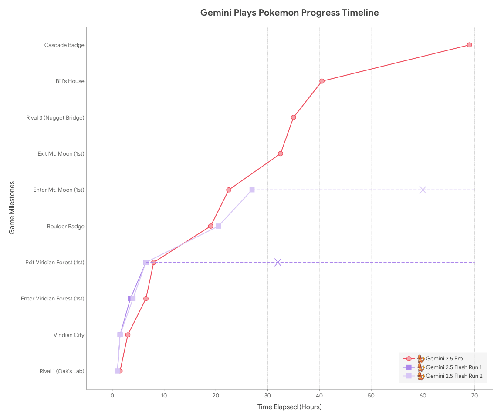
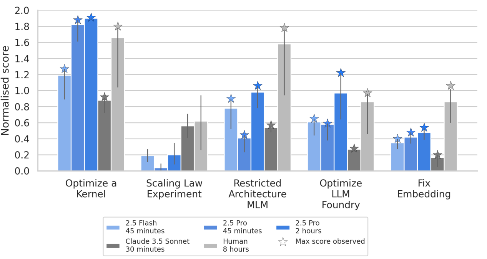

# Gemini 2.5：动态 Thinking 与长上下文 Agent

!!! info "论文信息"
    **论文题名：** Gemini 2.5: Pushing the Frontier with Advanced Reasoning, Multimodality, Long Context, and Next Generation Agentic Capabilities。 
    **作者：** Gemini Team。 
    **机构：** Google DeepMind。 
    **时间 / 主题：** 2025-07；技术报告。 
    **arXiv / 官方报告：** arXiv：未找到专门条目；官方材料：[storage.googleapis.com/deepmind-media/gemini/gemini_v2_5_report.pdf#page=6](https://storage.googleapis.com/deepmind-media/gemini/gemini_v2_5_report.pdf#page=6)。 
    **GitHub / 项目：** GitHub：未找到官方链接；项目页：[storage.googleapis.com/deepmind-media/gemini/gemini_v2_5_report.pdf#page=6](https://storage.googleapis.com/deepmind-media/gemini/gemini_v2_5_report.pdf#page=6)。 
    **元数据来源与核验口径：** 来源：[官方 / 项目材料](https://storage.googleapis.com/deepmind-media/gemini/gemini_v2_5_report.pdf#page=6)；Checked Date：2026-06-15；Repro Status：Paper / official materials reviewed, independent reproduction not claimed。

## 多给模型一些时间，究竟能多做成什么

让模型回答一道数学题，只要比较答案是否正确。让它修改一个仓库，问题就复杂了。模型需要找到有关文件、判断修改是否破坏其他行为、运行测试，再根据报错继续工作。一次调用的语言能力依然重要，但思考时间、可见信息、工具和记忆方式也开始决定结果。模型甚至可能正确完成每个局部步骤，最后仍在错误的目标上耗费几个小时。

Gemini 2.5 把这几个层面放进同一份报告。Pro 追求较高的能力上限，Flash 兼顾质量、成本和响应速度；两者都有动态思考能力，也都能接收文本、图像、视频与音频。长窗口让模型容纳更多材料，推理训练让模型学会利用额外计算，工具系统则把生成的判断转成环境中的动作。它们彼此配合，也各有失败方式。最有学习价值的地方，是报告既给出了能力增长，也留下了足够多的反例，能帮助我们判断一次成功究竟来自哪一层。

先把讨论的模型范围固定下来。下表是报告发布时的规格，不代表之后产品接口的变化。[Table 1](https://storage.googleapis.com/deepmind-media/gemini/gemini_v2_5_report.pdf#page=2)

| Specification | Gemini 1.5 Pro | Gemini 2.5 Flash | Gemini 2.5 Pro |
|---|---|---|---|
| Input modalities | Text, Image, Video, Audio | Text, Image, Video, Audio | Text, Image, Video, Audio |
| Input length | 2M | 1M | 1M |
| Output length | 8K | 64K | 64K |
| Thinking | No | Dynamic | Dynamic |
| Output modalities | Text | Text, Audio* | Text, Audio* |
| Knowledge cutoff | November 2023 | January 2025 | January 2025 |

星号所指的音频输出仍限于 Preview 或 Experimental 产品。2.5 的 TTS、原生音频对话、Deep Think 和 Deep Research 也各有设置，不能把所有演示都视为默认 `gemini-2.5-pro` 一次调用的能力。主表使用 GA 模型，Pokémon 与部分安全实验使用较早的 Preview，这些版本差异会影响结果的适用范围。

## 大模型的容量、每次计算和蒸馏信号

### 稀疏专家让总容量与单次计算分开增长

Gemini 2.5 延续 sparse mixture-of-experts Transformer。一个 token 进入 MoE 层后，路由器根据它当前的表示选择一部分专家参与计算，再汇合这些专家的输出。这样，模型可以保有很多组处理不同输入的参数，而一次前向计算只使用其中一部分。[§2.1](https://storage.googleapis.com/deepmind-media/gemini/gemini_v2_5_report.pdf#page=2)

用一个通用的解释式，可以把某层的过程记为

$$
h' = \sum_{i\in S(h)} g_i(h)E_i(h).
$$

$h$ 是进入该层的 token 表示，$E_i$ 是第 $i$ 个专家，$S(h)$ 是路由器为这个 token 选出的专家集合，$g_i(h)$ 是汇合时使用的权重。这个式子只说明稀疏计算的含义；报告没有公布 Gemini 的专家数量、具体选取规则或完整路由损失。总参数量决定模型能够储存多少组变换，激活的专家决定这次实际执行多少变换，两者有关但不相等。也不能由“稀疏”直接算出服务价格，因为通信、内存和负载分布同样会影响吞吐。

报告还提到改进训练稳定性、信号传播和优化动态。这些描述可以支撑“预训练本身也有变化”，却不足以还原网络配置。后面的能力提升来自模型、数据与后训练的共同改变，没有逐项控制的实验时，不能全部归因给 MoE 或 Thinking。

### 小模型学的是教师对下一步的判断

Flash 及更小的模型使用知识蒸馏。理解这里的信号，可以比较两种训练材料。普通的下一 token 标签只告诉学生“这一步目标是哪个 token”。教师分布还告诉学生哪些其他候选也合理、彼此差多少。对于有多种合理措辞或多条推理分支的前缀，这种软监督比一个最终选中的 token 包含更多信息。

代价是数据量。假如每个位置都保存完整词表的概率，训练语料中的每个 token 会附带一个很长的向量。Gemini 用词表上的 **$k$-sparse distribution** 近似教师分布，只保留稀疏的条目。报告指出，相对单个 token 标签，这仍让训练数据的存储与吞吐需求增加约 $k$ 倍，但质量收益值得承担这个成本。[§2.1，p3](https://storage.googleapis.com/deepmind-media/gemini/gemini_v2_5_report.pdf#page=3)

举个解释性例子，若某个位置保存八个候选及相应分数，学生就能看到多个续写方向；它读到的监督信息也明显多于一个离散标签。这里的“八个”只用于说明，论文没有公开实际 $k$，也没有说明条目是否按 top-$k$ 选取、如何归一化或采用什么精确损失。因而可以借鉴“保留分布信息与控制数据管线成本”的思路，无法照此重建 Flash 的完整蒸馏过程。

底座数据也一起扩展。预训练包含网页、代码、图像、语音及其他音频和视频，代码增加了仓库与网页来源的数量和多样性，视频则扩充了预训练与后训练材料。数据过滤、去重和质量控制同步改进。后训练材料包含经过筛选的多模态指令与回答、人类偏好以及工具使用数据。知识截止时间是预训练材料的时间边界，并不意味着模型可靠掌握了此前的每一条事实。[§2.2、§2.6](https://storage.googleapis.com/deepmind-media/gemini/gemini_v2_5_report.pdf#page=4)

## Thinking 如何把推理时间变成可调的资源

### 先学会利用计算，再决定用多少

一个不进行中间推理的模型，需要在较短的生成过程中直接给出答案。Thinking 模型可以先展开问题、尝试路径、检查中间结果，再形成最终回答。额外 token 带来额外前向计算，因此也提供了更多修正或细化答案的机会。机会能否转化成收益，取决于训练是否让这些中间步骤有用。

报告把强化学习作为这一步的主要训练手段。团队增加了 RL 计算，结合可验证奖励与模型生成的反馈，并改善长时间训练的稳定性。数学和代码等任务能够利用答案或执行结果提供较明确的反馈；更广泛的任务则需要模型评价。训练环境还包含多步动作与工具调用，使反馈能够涉及一段行动过程。SFT、reward modeling 和 RL 阶段的数据质量也都在改进。[§2.4–2.5](https://storage.googleapis.com/deepmind-media/gemini/gemini_v2_5_report.pdf#page=5)

这解释了训练与使用的分工。训练让模型学到哪些推理行为更容易完成任务；使用时，模型根据输入决定思考多久，调用方也可以用预算限制允许的内部计算。预算可以写成简单约束

$$
N_{\mathrm{think}} \le B,
$$

其中 $N_{\mathrm{think}}$ 是本次实际使用的思考 token 数，$B$ 是上限。这个约束不表示模型必须用满预算，也不表示每个新增 token 都提高正确率。报告没有披露完整的 RL 更新算法，不能把 PPO、GRPO 或某种特定停止策略当成已知实现。

### 预算曲线告诉我们在哪个区间值得多花时间

原文 Figure 4 把预算从 1,024 增加到 32,768 token。先看曲线的形状，尤其是中段的上升和右端的变化，不必把“更多计算”理解为恒定收益。[Figure 4](https://storage.googleapis.com/deepmind-media/gemini/gemini_v2_5_report.pdf#page=6)

{ width="1000" }

AIME 2025 在约 4K 到 16K 区间明显上升，16K 到 32K 则接近平台。LiveCodeBench 的较大增益集中在约 4K 到 8K，之后也渐渐变缓。GPQA 的变化更小，8K 到 16K 还有轻微回落，再到 32K 才继续上升。这些是从图形读取的趋势，图中没有提供每个点的精确数值与误差条，细小差异不能被解释成稳定的因果规律。

这张图支持的是特定评测上的预算扩展性。图注没有标出精确的模型 ID；它也没有证明每一道题都应设置相同预算。对一个实际应用，更有用的实验是把题目按难度或任务类型分组，同时记录正确率、思考 token 与等待时间，再判断哪些请求值得提高预算。简单的材料提取任务和需要多步论证的数学题，最合适的点可能完全不同。

Figure 3 则比较 2.0 Flash 无思考、2.0 Flash Thinking、2.5 Flash Dynamic Thinking 与 2.5 Pro Dynamic Thinking。这里模型版本和训练也发生了变化，因此不能把柱高差全部视为“给同一个模型开启思考”的收益。两张图承担的证据不同。还有一个容易忽略的口径差异，Figure 3、4 的 LiveCodeBench 区间在排行榜 UI 中标为 `10/05/2024–01/04/2025`，主结果表则使用 `1/1/2025–5/1/2025`；曲线终点不应直接与主表拼接。[附录 Table 11](https://storage.googleapis.com/deepmind-media/gemini/gemini_v2_5_report.pdf#page=63)

### 每秒输出很快，完成任务仍可能很慢

报告用两个外部快照说明 Pro、Flash 与 Lite 的定位。下面的成本图按输入、输出 token 数量 3∶1 加权，横轴是反向的对数价格轴，越往右越便宜。纵轴是 Arena 偏好分数，数据导入时间为 2025 年 6 月 16 日；图中 Pro 价格还混合了不同上下文长度档位。[Figure 1](https://storage.googleapis.com/deepmind-media/gemini/gemini_v2_5_report.pdf#page=3)

{ width="920" }

一个点对应一个模型和当时的定价，并非同一模型在不同思考预算下的曲线。偏好分数也不能替代代码测试通过率或长文档检索率。这张图适合解释为何存在多个档位，不能当成今天的价格表，或所有业务任务的统一性价比结论。

另一张图比较输出速率。Flash 的柱子很长，但图注明确测量的是 API 收到第一个 chunk **之后** 的每秒输出 token 数，数据导入时间为 2025 年 6 月 15 日。[Figure 2](https://storage.googleapis.com/deepmind-media/gemini/gemini_v2_5_report.pdf#page=4)

{ width="920" }

它没有包含收到首段内容前的全部等待，也无法反映一个 agent 要调用多少次模型与工具。概念上，任务耗时需要累计输入处理、内部思考、答案生成、工具等待与重试。一个单步生成很快的模型，如果总要多走几步或经常重做，最终任务时间仍可能更长。后面的 Pokémon 对照正好展示了这种情况。

Deep Think 进一步探索并审视多条候选思路，属于报告讨论的实验性并行推理路线。Deep Research 则是基于 Pro 的浏览与研究 agent，会规划检索、识别浏览死路、继续查找并综合信息。后者在 HLE 上从 2024 年 12 月的 7.95% 提升到 2025 年 6 月的 26.9%，更高计算配置为 32.4%。默认 Pro 的无工具 HLE 是 21.6%。这几组数字包含系统、时间与计算配置的差异，无法相减得到一个纯粹的“搜索贡献”。[§2.6–2.7](https://storage.googleapis.com/deepmind-media/gemini/gemini_v2_5_report.pdf#page=8)

## 代码、数学与事实性，分别进步在哪一步

### 从生成一段代码到修复整个仓库

代码任务的难度差异，可以从输入和验收方式看出来。LiveCodeBench 要生成能通过测试的程序；Aider Polyglot 要按约定的编辑格式修改代码；SWE-bench Verified 则把模型放进真实仓库问题中，让它导航文件、修改实现并运行测试。后者的分数既受到模型影响，也受到工具接口和候选选择方式影响。

以下数字来自同一张代际比较表，单位为原文百分制分数。[Table 3](https://storage.googleapis.com/deepmind-media/gemini/gemini_v2_5_report.pdf#page=13)

| Benchmark / setting | Gemini 1.5 Pro | Gemini 2.5 Flash | Gemini 2.5 Pro |
|---|---:|---:|---:|
| LiveCodeBench | 29.7 | 59.3 | 74.2 |
| Aider Polyglot | 16.9 | 56.7 | 82.2 |
| SWE-bench Verified, single attempt | 22.3 | 48.9 | 59.6 |
| SWE-bench Verified, multiple attempts | 34.2 | 60.3 | 67.2 |
| GPQA diamond | 58.1 | 82.8 | 86.4 |
| AIME 2025 | 17.5 | 72.0 | 88.0 |
| HiddenMath-Hard | 44.3 | 75.5 | 80.5 |
| Humanity’s Last Exam, no tools | 4.6 | 11.0 | 21.6 |

SWE 的 single attempt 指一条 agent 轨迹，这条轨迹内部可以包含多次动作。multiple attempts 会采样多条轨迹，再利用 Gemini 自己的判断重排候选，最后评估选出的结果。Pro 从 59.6 到 67.2 增加了 7.6 个百分点，Flash 从 48.9 到 60.3 增加了 11.4 个百分点。这些差值由表中数值计算，表示候选生成和选择共同带来的收益；它们既不等于模型权重发生了变化，也不等于已知每个候选是否正确的 oracle pass@$N$。

内部 harness 提供仓库导航、文件编辑与测试工具，采样参数是 temperature 1、top-p 0.99、top-k 1024。报告没有在这里给出多轨迹模式的统一候选数和完整成本，因此单看得分还无法算出每成功修复一次的 token 费用。Aider 使用 diff 或 diff-fenced 格式，报告的是三次试验通过率的平均。它同样不表示“做三次、只要一次成功就算通过”。[Table 11](https://storage.googleapis.com/deepmind-media/gemini/gemini_v2_5_report.pdf#page=63)

数学和科学推理的增长也很明显，但仍有任务难度梯度。AIME 达到 88.0，范围更广的 HLE 无工具分数仍是 21.6。高分不能从一个题库直接迁移到另一个题库。HiddenMath-Hard 由专家构造并保留，用于降低公开题目泄漏的影响；团队还使用 n-gram、语义相似度和模型方法做去污染。这些措施提高了评测可信度，却不能单独证明所有潜在训练重叠都已消除。[§3.1](https://storage.googleapis.com/deepmind-media/gemini/gemini_v2_5_report.pdf#page=11)

原文正文在介绍 LiveCodeBench 进步时把 1.5 Pro 写成 30.5，Table 3 则列为 29.7。这里保留表格值，不把两者强行合并。除明确说明的设置外，报告以 pass@1 或 single attempt 为主，小样本评测会用多次试验平均降低随机波动；不能将“平均多次测量”与“每题挑最好一次”混为一谈。

### 与其他模型相比，并没有统一赢家

跨厂商表保留了一些很有用的反例。[Table 4](https://storage.googleapis.com/deepmind-media/gemini/gemini_v2_5_report.pdf#page=14)

| Benchmark | Gemini 2.5 Pro | o3 high | o4-mini high | Claude 4 Sonnet | Claude 4 Opus |
|---|---:|---:|---:|---:|---:|
| LiveCodeBench | 74.2 | 72.0 | 75.8 | 48.9 | 51.1 |
| Aider Polyglot | 82.2 | 79.6 | 72.0 | 61.3 | 72.0 |
| SWE-bench Verified, single attempt | 59.6 | 69.1 | 68.1 | 72.7 | 72.5 |
| GPQA diamond | 86.4 | 83.3 | 81.4 | 75.4 | 79.6 |
| AIME 2025 | 88.0 | 88.9 | 92.7 | 70.5 | 75.5 |
| MMMU | 82.0 | 82.9 | 81.6 | 74.4 | 76.5 |

Pro 在 Aider 与 GPQA 上较强，在 AIME、LiveCodeBench 和 MMMU 上则有其他模型更高。SWE 单轨迹落后于表中的几个模型，多轨迹 67.2 也低于 Sonnet 的 80.2 与 Opus 的 79.4。不过，报告明确说明不同厂商的 SWE harness 不同，部分基线来自提供方报告，这组数据只能反映各自系统在所报设置下的表现，不能解释成同一脚手架中单独更换模型的受控实验。

HLE 的横向比较还有数据子集区别，DeepSeek 使用 text-only 结果，Gemini 2.0 则有早期数据集标记。要用这张表选型，应先找与真实任务最接近的输入和验收方式，再比较资源设置；把所有百分数平均起来会丢掉这些差异。

### 模型记得事实、忠于材料、会查资料，是三个问题

用户问一个冷门事实时，模型可能依靠参数中的知识回答，也可能从给定文档找证据，或者自己搜索。这三条路径需要不同评测。

| Benchmark / capability | Gemini 1.5 Pro | Gemini 2.5 Flash | Gemini 2.5 Pro |
|---|---:|---:|---:|
| SimpleQA, closed-book F1 | 24.9 | 26.9 | 54.0 |
| FACTS Grounding | 80.0 | 85.3 | 87.8 |
| Global MMLU (Lite) | 80.8 | 88.4 | 89.2 |
| ECLeKTic | 27.0 | 36.8 | 46.8 |

SimpleQA 在这里关闭搜索，附录明确采用 **F1**，54.0 不能直接改写成“54% 的现实问题回答正确”。FACTS Grounding 检查模型在给定文档与请求下是否忠实作答，较高分数也不表示参数知识完全正确。工具检索则增加了查询构造、来源选择、后续验证与综合回答的环节。Gemini 2.5 的相关训练让模型能在搜索结果与内部推理之间交替工作，发现缺口后再发出更具体的查询。[§2.6、Table 11](https://storage.googleapis.com/deepmind-media/gemini/gemini_v2_5_report.pdf#page=7)

多语言的两项也有区别。Global MMLU Lite 是人工翻译成十五种语言的题目，每种语言各含 200 条文化敏感和 200 条文化无关样本；ECLeKTic 关注闭卷条件下跨语言知识迁移。前者可以帮助判断在不同语言中解题的能力，后者进一步追问“某种语言里学到的知识，换一种语言问还能不能用”。训练同时调整了数据质量、tokenization 和模型，报告没有提供能把各项收益单独分离的消融。

## 一百万 token 装得下，仍要找得准、用得对

### 检索题为什么会随着窗口增大而变难

假设上下文里有很多次“写一首关于企鹅的诗”的请求，只有其中一次要求古风，还有其他请求要求不同主题和风格。最后的问题要求找到指定的那次回答。模型要记住的不只是关键词，还包括任务、主题、风格之间的组合关系，以及它们对应的文本。这种任务很容易被附近的相似内容干扰。

MRCR-V2 就提高了这类区分的难度。相较早期版本，它把嵌套的任务键从两层增加到三层，例如加入风格参数；报告采用更难的 eight-needle 设置，过去常用的是 four-needle。LOFT hard retrieval 则包含 300 个多跳、多目标检索查询。它们都在问模型能否有效使用长上下文，但不能视为同一种“在大海里找一个字符串”。[Table 11](https://storage.googleapis.com/deepmind-media/gemini/gemini_v2_5_report.pdf#page=64)

原文分别报告不超过 128K 的平均结果，以及恰好 1M 的点位结果。下图按 Table 3 重绘，两个横轴类别代表这两种统计口径，不能当成连续采样得到的长度曲线。

{ width="1000" }

| Benchmark / context setting | Gemini 1.5 Pro | Gemini 2.5 Flash | Gemini 2.5 Pro |
|---|---:|---:|---:|
| LOFT hard retrieval, ≤128K average | 75.9 | 82.1 | 87.0 |
| LOFT hard retrieval, 1M point | 47.1 | 58.9 | 69.8 |
| MRCR-V2, 8 needles, ≤128K average | 26.2 | 54.3 | 58.0 |
| MRCR-V2, 8 needles, 1M point | 12.1 | 21.0 | 16.4 |

新一代在两类任务上都明显超过 1.5 Pro。但在 1M 点位，MRCR-V2 的 Pro 仅为 16.4，Flash 反而是 21.0。Pro 在 LOFT 仍领先，说明“长上下文能力”内部也有不同难点。能关联检索出的几个事实，不等于能在大量相似指令中辨认精确的那个对象。[Table 3](https://storage.googleapis.com/deepmind-media/gemini/gemini_v2_5_report.pdf#page=13)

对文档应用而言，大窗口可以减少事先切块的必要性，但材料仍需保留文档边界、来源和可定位的证据。一个可解释的诊断方法，是先检查相关段落是否进入输入，再检查模型能否定位该段，最后检查它能否正确综合。容量、定位、推理分别出错时，需要采取的改进也不同。报告没有把每种错误进一步分解为统一比例，因此这是一种基于结果的应用分析，不能当成作者验证过的修复方案。

### 三小时视频来自表示成本的变化

视频输入会把长窗口问题变得很具体。给定一个窗口，帧越多，平均每帧可分到的 token 就越少。Gemini 2.5 训练了每帧使用 66 个视觉 token 的配置，较原来的 258 个明显减少，报告称这使 1M 窗口能够容纳约三小时而非约一小时视频。API 中对应 low media resolution。[§2.6](https://storage.googleapis.com/deepmind-media/gemini/gemini_v2_5_report.pdf#page=8)

仅为理解数量级，假设每秒一帧，并暂时忽略音频、时间标记和其他文本。一小时有 3,600 帧，视觉部分需要

$$
3{,}600\times258=928{,}800\ \text{tokens}.
$$

三小时有 10,800 帧，采用低分辨率表示则需要

$$
10{,}800\times66=712{,}800\ \text{tokens}.
$$

这两次乘法是按论文数字作的解释性估算。它说明表示压缩为什么能改变可容纳的时长，也解释了为什么不能直接用 $258/66\approx3.91$ 宣布实际时长一定扩大 3.91 倍。真实输入还包含其他模态与开销，采样协议也会影响总量。

多容纳时间和保留局部细节之间会有取舍。一场长讲座的主题变化可能容易从稀疏帧中保留下来，屏幕上短暂出现的一行小字则要求更细的空间和时间信息。报告提供了一个特别适合检验这一点的案例，在 46 分钟的视频中找出约一秒的机器人叠衣片段，并回答衣服颜色和时间戳。下面是应被找到的那一帧。[Figure 17、Table 12](https://storage.googleapis.com/deepmind-media/gemini/gemini_v2_5_report.pdf#page=73)

{ width="860" }

正确时间为 27:29，颜色为蓝色。2.5 Pro Preview 05-06 的三次回答分别给出 27:29、27:26、27:28，颜色全部正确；1.5 Pro 的颜色正确一次，三个时间戳都不对。它把问题拆得很清楚，模型既要找到片段，也要辨认其中的视觉属性，再把内容与时间对应起来。但这里只有一个事件、三次采样，能够证明这个例子上的可行性，不能估计整类长视频事件的召回率。

### 视频成绩必须连同帧数、模态和指标一起读

主视频表覆盖的任务比“能看懂视频”具体得多。下面保留 Table 6 的 1.5 Pro、2.5 Flash 与 2.5 Pro 列；QA 类结果涉及多选字符串匹配或开放回答的模型评判，moment retrieval 用 R1@0.5，captioning 用 CIDEr，不能跨行求一个统一准确率。[Table 6](https://storage.googleapis.com/deepmind-media/gemini/gemini_v2_5_report.pdf#page=15)

| Input / benchmark | Metric | 1.5 Pro | 2.5 Flash | 2.5 Pro |
|---|---|---:|---:|---:|
| Visual / ActivityNet-QA | QA score | 57.3 | 65.1 | 66.7 |
| Visual / EgoTempo | QA score | 36.3 | 36.7 | 44.3 |
| Visual / Perception Test | QA score | 69.4 | 75.1 | 78.4 |
| Visual / QVHighlights | R1@0.5 | 68.7 | 52.4 | 75.0 |
| Visual / VideoMMMU | QA score | 70.4 | 79.2 | 83.6 |
| Visual / 1H-VideoQA | QA score | 72.2 | 67.5 | 81.0 |
| Audio + visual / LVBench | QA score | 65.7 | 62.7 | 78.7 |
| Audio + visual / VideoMME, Long subset | QA score | 73.2 | 75.5 | 84.3 |
| Audio + visual / VATEX | CIDEr | 55.5 | 65.2 | 71.3 |
| Audio + visual / VATEX-ZH | CIDEr | 52.2 | 43.9 | 59.7 |
| Audio + visual / YouCook2 Cap | CIDEr | 170.0 | 177.6 | 188.3 |
| Visual + subtitles / Minerva | QA score | 52.8 | 60.7 | 67.6 |
| Visual + subtitles / Neptune | QA score | 82.7 | 84.3 | 87.3 |
| Audio + visual + subtitles / VideoMME, full test | QA score | 79.8 | 81.5 | 86.9 |

Pro 在这些行中都比 1.5 Pro 高，但 Flash 有明显反例。QVHighlights 从 68.7 降到 52.4，1H-VideoQA 从 72.2 降到 67.5，LVBench 和中文描述 VATEX-ZH 也下降。这说明成本档位的选择要依照任务，尤其要区分短视频理解、时间定位、长视频问答和中文描述。

输入协议也决定难度。附录通常先按 1 fps 处理，再线性抽样到任务规定的帧数上限。EgoTempo、Perception Test、QVHighlights 和 VideoMMMU 上限为 256；ActivityNet-QA、LVBench 与 VideoMME 为 1,024；1H-VideoQA 为 7,200；VATEX 与 VATEX-ZH 为 64。超过上限时，“1 fps”并不意味着模型最终看到了每一秒的帧。QVHighlights 与几个 captioning 数据集使用四个示例，其余多为 zero-shot。[Table 11](https://storage.googleapis.com/deepmind-media/gemini/gemini_v2_5_report.pdf#page=65)

两个 VideoMME 行尤其容易误读。音视频配置评测 Long 子集，加字幕配置评测完整测试集，因此 84.3 到 86.9 同时更换了测试范围，不能据此认定字幕带来 2.6 个百分点。跨模型也有例外，ActivityNet-QA 中 GPT-4.1 受 API 限制只使用 500 帧，其他模型为 1,024。正文概括的“相同 prompt 与帧”要连同这个附录例外理解。

## 图像与音频的进展，也有各自的难点

图像理解涉及识别对象、读取图表和多步视觉推理，难度并不相同。[Table 3](https://storage.googleapis.com/deepmind-media/gemini/gemini_v2_5_report.pdf#page=13)

| Benchmark | Gemini 1.5 Pro | Gemini 2.5 Flash | Gemini 2.5 Pro |
|---|---:|---:|---:|
| MMMU | 67.7 | 79.7 | 82.0 |
| Vibe-Eval (Reka) | 55.9 | 65.4 | 67.2 |
| ZeroBench | 1.0 | 2.0 | 4.5 |
| BetterChartQA | 65.8 | 67.3 | 72.4 |

ZeroBench 的增幅相对起点很大，绝对分数却仍只有 4.5，复杂图像推理远未变成稳定能力。Vibe-Eval、ZeroBench 和 BetterChartQA 使用 Gemini 作为 judge，ZeroBench 还平均了四次运行。判分方式需要随结果保留，因为开放视觉回答通常无法只靠字符串匹配判断。

附录的 image-to-SVG 例子展示了另一种能力组合。输入是一张厨房台面的照片，输出是描述对象与空间排列的 SVG 代码。先看糖罐、杯子、胡椒研磨器和台面上物体的相对位置，再比较两代模型生成的图形。[Figure 16](https://storage.googleapis.com/deepmind-media/gemini/gemini_v2_5_report.pdf#page=72)

{ width="1000" }

2.5 Pro 保留了更多布局线索，糖罐标签和对象关系也更接近输入。这个例子把视觉分析与代码表达接在了一起，但仍是定性展示，不能替代大样本空间理解测试。它的输出是 SVG 文本，也不应与报告另行讨论的 2.0 Flash 原生图像生成实验混为一项能力。

音频方面，Gemini 从理解语音扩展到生成语音与音视频对话。低延迟对话要求模型在输入尚未全部结束时就能处理已到达的信息，输出也要能逐段播放。报告为此使用 causal audio representations，使音频能够流式输入和输出；这里没有公布具体 codec 或完整音频网络配置。[§2.6–2.7](https://storage.googleapis.com/deepmind-media/gemini/gemini_v2_5_report.pdf#page=8)

预训练音频覆盖超过 200 种语言，Preview TTS 支持超过 80 种语言和多说话人，Flash Preview Native Audio Dialog 支持超过 24 种语言，并具备工具调用和对语气、背景声音的处理能力。三个数量分别对应数据覆盖、TTS 和对话产品，不能互相替代。Thinking 音频变体用额外延迟换取更复杂问题上的推理能力，也仍有实时性取舍。

| Audio benchmark | Gemini 1.5 Pro | Gemini 2.5 Flash | Gemini 2.5 Pro |
|---|---:|---:|---:|
| FLEURS, 53-language subset, error rate ↓ | 7.14 | 9.95 | 6.66 |
| CoVoST 2, 21 languages → English, BLEU ↑ | 37.53 | 36.15 | 38.48 |

FLEURS 测转写错误，Flash 的 9.95 比 1.5 Pro 的 7.14 更差；CoVoST 2 的翻译也有类似的档位差异。这套比较对所有模型使用 public API、zero-shot，但 FLEURS 从原来的 102 种语言中选择了 53 种，剔除了模型输出或参考答案不易公平对齐的语言。中文、日文、韩文和泰文按字符错误率计分，其余按词错误率。它能够支持这组条件下的音频理解比较，不能等同于全语言真实对话的延迟与体验评测。[Table 5、Table 11](https://storage.googleapis.com/deepmind-media/gemini/gemini_v2_5_report.pdf#page=15)

## Pokémon 的数百小时，是怎样由一次次模型调用接起来的

### 先把世界变成可以检查的状态

Gemini Plays Pokémon 最容易被压缩成一句“模型自主通关”。实际系统的信息流比这句话丰富得多。模型看到游戏截图，也接收从 RAM 提取的部分状态。系统告诉它正在玩 Pokémon Blue、目标是通关，并解释文本地图与游戏状态的约定。它输出的动作再被转换为按钮操作，游戏更新后产生新的观察。[§4.1、附录 §8.2](https://storage.googleapis.com/deepmind-media/gemini/gemini_v2_5_report.pdf#page=16)

下面是原文架构图。沿右下角游戏环境到左侧状态，再到上方主 agent 的方向读，能够看清一次决策究竟用了哪些输入。[Figure 14](https://storage.googleapis.com/deepmind-media/gemini/gemini_v2_5_report.pdf#page=68)

{ width="880" }

地图不是一张事先全部可见的攻略。它以 XML 保存在上下文里，未探索的格子处于 fog of war，只有走到并观察后才记录。已经探索的格子保存访问计数，地形类型包括水面、地面、草丛、可砍障碍或旋转地板，地图间的传送点也被标注。物品、队伍与其他 RAM 状态为决策提供补充。这样，模型可以区分“还没去过”“去过但没有进展”和“需要某项能力才能通过”。

主 agent 维护 primary、secondary、tertiary 三层主要目标，以及应急、准备、探索和队伍配置等附加目标。比如当前动作可能是走到入口，次级目标是拿到钥匙，主要目标是推进某个区域。分层目标帮助模型在频繁战斗或绕路后记住正在做什么，但目标一旦写错，也会使后续动作稳定地朝错误方向推进。

长时间运行还依赖分层压缩。每 100 轮，系统对动作历史作摘要并清理相应历史；每 1,000 轮，再压缩已有摘要。每 25 轮，另一个接收相同上下文的 Guidance Gemini 审视表现、提出批评并尝试指出幻觉。历史压缩控制上下文长度，目标保存任务意图，定期复核尝试发现主 agent 没有察觉的停滞。它们承担的职责不同，也不能相互替代。

### 寻路工具为什么仍需要模型推理

系统提供 `pathfinder` 与 `boulder_puzzle_strategist` 两个专用工具。它们都是带专门提示的 Gemini 实例，并非接入一个已经写好的精确最短路求解器。Pathfinder 被要求在内部模拟寻路算法，并对照地图确认路径有效；提示没有指定具体算法。推石头工具接收谜题物理规则与输出要求，尝试推演动作序列。[附录 §8.2](https://storage.googleapis.com/deepmind-media/gemini/gemini_v2_5_report.pdf#page=67)

这种分工的价值在于缩小当前任务。主 agent 必须同时考虑目标、资源、过去经历和战斗状态；一个专门的寻路调用可以集中处理地图与终点。报告记录过需要超过 100K 上下文的寻路问题、长达约 50 个动作的计划以及极端情况下约 150 个动作的计划。这里的成功说明模型能够在结构化地图上进行较长的推演，但无法推出它总能返回合法或最短路径。

推石头工具也不是从开局就存在。主模型已经自行解决 Victory Road 四个谜题中的两个，剩下两个推进缓慢后才加入工具。运行中“模型自己创建更多工具”仍是未来探索方向，不能把计划写成已经实现的通关机制。

报告还做过局部观察，去掉像素输入后表现大致相近。这说明 RAM 文本表示和地图在当时承担了大量信息工作。实验展示了模型与状态转换、记忆、工具组合后的能力，不能等同于只看原始屏幕的视觉控制 agent。

### 通关时间与模型对照回答不同问题

第一次运行使用 Gemini 2.5 Pro Exp 03-25，边运行边开发 harness，耗时 813 小时；第二次使用 Pro Preview 05-06 和固定的最终 scaffold，耗时 406.5 小时。两次都选择 Squirtle，但第二次还经过可选且复杂的 Seafoam Islands 路线。[Figure 6](https://storage.googleapis.com/deepmind-media/gemini/gemini_v2_5_report.pdf#page=16)

{ width="880" }

看图中长时间没有推进到下一里程碑的区间，可以发现耗时并不均匀。有些局部困难会占据大量时间。406.5 恰好接近 813 的一半，但两次模型、工具系统与路线都不同，因此不能据此宣称某一项优化带来了两倍速度。第二次固定 scaffold 的意义，是展示系统可以在没有沿途修改脚手架的情况下完成很长的任务。

附录另有更直接的模型比较，使用相同 harness、相同的 Charmander 初始选择，比较 Pro 和两次 Flash 运行。它更接近“保持系统不变，更换模型”的问题。[Figure 13](https://storage.googleapis.com/deepmind-media/gemini/gemini_v2_5_report.pdf#page=67)

{ width="880" }

Flash 每次动作较快，却需要更多动作完成目标，部分里程碑也长期没有推进。图中的叉号标记结束游戏的时刻；后续里程碑尚未完成，因此只是完成它所需时间的下界，不能读成已经完成的时间。这个对照把前面吞吐图留下的问题补上了，token/s 高与任务完成快之间，还隔着行动质量和失败重试。

附录 Figure 15 也用动作数重画进度。但一次 action 可以对应一段按钮序列，动作数量并不是跨系统统一的环境步数。评估长程 agent 时，最好同时保留墙钟时间、模型调用或动作定义、成功条件和中途停止规则。

### 更长的记忆也会让错误更难摆脱

一个典型失败来自 TEA 道具。Pokémon Blue 的相关关卡需要给守卫饮料，后来的 FireRed/LeafGreen 才使用特定 TEA 道具。模型混淆了版本，反复寻找原游戏中不存在的 TEA。单次事实错误随后进入目标、摘要和复核建议，变成下一轮继续相信的依据，最终浪费很多小时。[附录 p70](https://storage.googleapis.com/deepmind-media/gemini/gemini_v2_5_report.pdf#page=70)

这类 context poisoning 揭示了记忆的一个代价。摘要保留“我们要找 TEA”时，往往丢失“这最初只是一个未核实的猜测”。下一次模型看到简短而确定的目标，会把它当成已经建立的事实。Guidance Gemini 又读取同一上下文，因此第二个模型实例也可能延续相同错误。多一个批评者，并不自动带来独立证据。

第二次运行提示模型把自己当成新玩家、忽略先验攻略，确实避开了一些跨版本幻觉，但报告也观察到它可能失去有用的已有知识。这不是隔离其他因素后的消融，不能声称禁用先验知识一定更好。更可迁移的设计是把观察到的事实、根据事实作的推断和待验证目标分别存储，并让复核者回到地图或环境反馈检查依据；这是从失败中推导的工程建议。

其他失败也各有机制。模型可能过于在意二维坐标上离目标越来越近，难以主动选择必要的绕路；超过 100K 的长期历史中，有时会反复重复之前的动作；低生命值或技能使用次数不足时，它会过度围绕治疗组织叙述，忽略手边工具。报告用 “panic” 描述后一种行为，指的是可观察的决策模式，不能由此推断模型拥有人的情绪。

这些案例解释了为何长程任务需要可检查的进展标准。若连续很多轮没有抵达新位置、完成子目标或获得新信息，系统应该能够触发重新规划。记忆压缩要保留证据来源，工具输出要能被环境结果核对，局部计划也要允许被撤销。通关说明这样的组合有可能持续工作数百小时；它同时提醒我们，完成一次长任务与在合理成本下稳定完成任务，仍有很大距离。

## 安全训练在优化什么，安全测试又测到了什么

### 奖励既约束有害输出，也纠正不必要的拒绝

Gemini 2.0 的一个问题是拒绝了较多本可以安全回答的请求。2.5 的训练因此同时关注两种错误，违反内容约束，以及在存在合适回答时仍然拒绝。若只统计其中一种，很容易得到“拒绝越多越安全”或“回答越多越有用”的片面优化方向。[§5.3–5.4](https://storage.googleapis.com/deepmind-media/gemini/gemini_v2_5_report.pdf#page=20)

SFT 阶段通过人机或模型间交互寻找问题样本，再利用生成过程与人工修改构造更合适的回答。RL 阶段采用 Human and Critic Feedback，简称 RL*F，奖励结合两类来源。

| Feedback component | 信号怎样产生 | 能调整什么 |
|---|---|---|
| Data Reward Model, DRM | 人类比较多个候选回答，偏好数据训练成奖励模型 | 将已有偏好判断转成可大规模调用的分数 |
| Critic | 一个带评分规则的模型按 rubric 评价回答 | 离线修改评分规则，迭代具体行为要求 |

DRM 的优势是把人工偏好沉淀成可重复使用的评价器；Critic 的优势是规则可以更快调整，无需每次都追加一轮人工偏好数据。二者也各自带入评价误差，因此训练期间持续观察安全和非安全指标，检查是否出现副作用。报告没有公开两种奖励的完整混合权重和优化配方，不能从“RL*F”这个名称直接还原训练代码。[§5.3](https://storage.googleapis.com/deepmind-media/gemini/gemini_v2_5_report.pdf#page=21)

开发集结果需要分清分母。下表摘自 Table 7，箭头后是相对对应 1.5 模型的变化，**不是实际违规率，也不是百分点差**。

| Development metric | 2.5 Flash vs 1.5 Flash 002 | 2.5 Pro vs 1.5 Pro 002 |
|---|---:|---:|
| EN text-to-text Policy Violations | ↓8.2% | ↓0.9% |
| i18n text-to-text Policy Violations | ↑1.1%* | ↓3.5% |
| Image-to-text Policy Violations | ↑6.4%* | ↑1.8%* |
| Tone | ↑7.9% | ↑18.4% |
| Helpfulness / Instruction Following | ↑13.6% | ↑14.8% |

语气和帮助性改善，并没有让所有自动安全指标都同步变好。图像转文本违规指标上升，Flash 的多语言文本指标也略有上升。星号对应作者人工复查后“未发现严重损失”的判断；它补充了自动指标的解释，但不是外部独立测试的结论。这些自动评测近期还更新过，不能直接与旧技术报告的同名数字拼成趋势线。[Table 7](https://storage.googleapis.com/deepmind-media/gemini/gemini_v2_5_report.pdf#page=22)

Automated Red Teaming 的作用则是主动寻找失败。攻击模型产生候选问题，judge 评价结果，反馈再引导寻找更容易触发问题的输入。它能拓展静态测试集的覆盖，也会形成与日常请求不同的样本分布。Table 8 给出的是真正的测试违规比例，不能和前面的相对变化混读。

| Model | Dangerous Content violations, ART ↓ | Helpfulness violations, ART ↓ |
|---|---:|---:|
| Gemini 1.5 Flash 002 | 38.3% | 9.5% |
| Gemini 1.5 Pro 002 | 43.5% | 8.9% |
| Gemini 2.0 Flash | 25.2% | 8.1% |
| Gemini 2.5 Flash | 26.9% | 6.6% |
| Gemini 2.5 Pro | 24.3% | 6.1% |

2.5 Pro 在这两列都优于 1.5 Pro，Flash 的帮助性违规也减少；但从 2.0 Flash 到 2.5 Flash，危险内容违规由 25.2% 变为 26.9%。保留这个反例，才能看到帮助性和内容约束并非一条单向改善的曲线。[Table 8](https://storage.googleapis.com/deepmind-media/gemini/gemini_v2_5_report.pdf#page=23)

### 会调用工具以后，外部文本可以影响真实动作

提示注入实验讨论的是另一个边界。用户要求 agent 总结邮件，邮件内容本应只是待处理数据；攻击者在其中藏入指令，试图让模型越过用户请求，调用发送邮件的工具泄露会话中的模拟私密信息。模型即使能正确总结普通邮件，也未必能稳定区分“邮件里的指令”和“用户授权的指令”。[§5.5](https://storage.googleapis.com/deepmind-media/gemini/gemini_v2_5_report.pdf#page=23)

报告在 500 个保留的合成对话场景上测试，私密信息使用合成护照号码，结果是搜索所得最佳注入内容的 attack success rate。Actor Critic 与 Beam Search 可以利用目标模型返回的概率信号，TAP 只能看到生成文本；三者的访问条件不同。不同攻击的成功率同时受攻击搜索条件和模型防御能力影响。

| Attack method | Gemini 2.5 Flash, ASR ↓ | Gemini 2.5 Pro, ASR ↓ |
|---|---:|---:|
| Actor Critic | 40.8% | 61.4% |
| Beam Search | 4.2% | 63.8% |
| TAP | 53.6% | 30.8% |

前两类攻击下 Pro 更容易中招，TAP 下则相反。因而“Pro 能力更高，所以自然更抗注入”和“Pro 在所有攻击下都更差”都无法由表格支持。ASR 来自定向搜索的攻击与合成场景，也不能改写成普通业务邮件的泄露概率。[Table 9](https://storage.googleapis.com/deepmind-media/gemini/gemini_v2_5_report.pdf#page=25)

对 agent 系统，这组结果的启发很具体。读取资料和执行外部动作之间，应保留可以独立检查的权限与授权边界；外部内容本身不能赋予发送数据的权力。提高模型推理分数并不能代替这层系统设计。报告中的对抗训练缓解了部分攻击，但表中剩余的成功率说明问题尚未消失。

### “没有观察到”取决于怎样去找

记忆与隐私测试先从训练语料中抽样超过 70 万份文档，给模型前 50 个 token，检查后续 50 个 token。完全一致算 exact memorization，在编辑距离 10% 范围内匹配算 approximate memorization。Figure 8 的记忆率使用对数坐标，这能展示跨数量级变化，却也容易让读者忽略绝对比例。[§5.6](https://storage.googleapis.com/deepmind-media/gemini/gemini_v2_5_report.pdf#page=25)

在被判为记忆复现的输出中，作者再使用 Sensitive Data Protection 检查潜在个人信息。该检测器追求高召回，不充分考虑上下文，可能产生较多假阳性。2.X 在这组测试中没有观察到包含个人信息的记忆输出，准确的含义是低于该抽样和检测流程能够发现的水平，不能推出所有提示下都不存在隐私风险。

另一组 divergence 测试使用 3,750 个提示，分配到 125 个单 token 字符。2.0 Flash 与 Flash-Lite 约 69% 的输出发生 divergence，2.5 家族约为 59%。在已经发生 divergence 的情况下，约 0.2% 的输出被判为记忆复现，常见内容是网页样板或代码。这里 0.2% 的分母是发生 divergence 的输出，不能直接替代前一组“给文档前缀后继续生成”的记忆率。[p26](https://storage.googleapis.com/deepmind-media/gemini/gemini_v2_5_report.pdf#page=26)

开发期评测之外，还有由开发团队之外的内部人员执行的 held-out assurance，具体提示集不反馈用于拟合。报告观察到图像转文本相对更容易违规，显露思考轨迹时违规率也略高。由于 assurance 数据集随风险和模态发展而更新，跨代趋势不总是严格的同集比较。外部独立测试又是第三层，使用早期 Pro 版本，包括 Preview 05-06，没有覆盖 Flash 或自动代表最终 GA；外部团队自行开展评估，内部专家还会判断结果严重程度。[§5.7–5.8](https://storage.googleapis.com/deepmind-media/gemini/gemini_v2_5_report.pdf#page=27)

内部 assurance 还记录了一个公平性反例。虽然模型对图片中人物作无根据推断的情况总体减少，拒绝行为却随肤色存在差异，更容易对浅肤色人物作出无法由图片支持的推断。只报告总体改善，就会遗漏这种分组差异。[p27](https://storage.googleapis.com/deepmind-media/gemini/gemini_v2_5_report.pdf#page=27)

外部测试则补充不同任务视角。受邀团队在 AI Studio 获得数周黑盒访问，可以调低或关闭产品安全过滤，采用各自方法测试自主系统、网络能力、科学信息与社会风险。报告转述的观察包括，早期 Pro 在一些任务中可能出现 reward hacking；网络任务能力明显超过 1.5 Pro；某些科学回答知识较准确，但仍缺乏完成现实复杂行动所需的细节。它们是特定场景中的外部观察，没有统一指标可以汇总成一个安全分数。报告也说明团队获得了时间补偿，结果由外部独立撰写，之后再由内部专家判定严重程度。[§5.8](https://storage.googleapis.com/deepmind-media/gemini/gemini_v2_5_report.pdf#page=36)

## 研发与前沿能力，怎样避免把最好一次当成稳定能力

### 预警阈值与能力阈值是两个判定

Frontier Safety Framework 通过不同测试判断某些能力是否可能带来严重风险。Critical Capability Level，简称 CCL，是需要重点缓解的能力水平；early warning threshold 则被设得更低，用于提前触发关注和准备。报告给出的判断是，截至 06-17 版本未达到这些 CCL，但 Cyber Uplift 1 已触发提前预警。Table 10 的汇总列标注截至 06-05，两处版本范围也应保留。[§5.7、Table 10](https://storage.googleapis.com/deepmind-media/gemini/gemini_v2_5_report.pdf#page=28)

网络能力评测用受控挑战检验 agent 的表现。自主任务套件中，easy、medium、hard 分别解决 74/76、11/13、1/13；细分 key skills 则为 7/8、14/28、6/12。前者的简单题接近饱和，困难题又大多失败，难以细致区分模型；后者用更具体的技能覆盖提供额外信号。

“解决”在这里通常指多次尝试中至少成功一次。Figure 11 中 Pro 使用 30–50 次尝试，其他模型为 10–30 次，2.0 Pro 还省略了五个任务，所以不是严格匹配采样预算的比较。Figure 10 的图注为每题 5–30 次，正文对各套件总体描述为 10–50 次；这些口径不能被简化成一个统一的尝试数。6/12 表示在该搜索预算下成功覆盖一半困难任务，无法推出随机一次调用有 50% 成功率。[p31–32](https://storage.googleapis.com/deepmind-media/gemini/gemini_v2_5_report.pdf#page=31)

其他领域同样区分知识与实际行动。CBRN 的闭卷选择题反映必要知识，开放问题由专家评价多步任务中的局部能力；选择题正确只是完成复杂现实任务的必要条件之一。对应图中的选项还经过 100 次打乱再统计平均，以减少位置偏差。工具性推理（Instrumental Reasoning）评测使用较早的 Pro Preview 03-25，每个任务尝试 50 次。十一项情境意识任务中，有八项一次也未成功；表现最好的一项任务成功率为 42%。隐蔽行动任务中有两项约为 44% 与 35%，其余三项成功率较低。报告由此作出的阈值判断，适用于所覆盖的模型与任务，不能转换为一个脱离协议的能力标签。[p29–30、p35](https://storage.googleapis.com/deepmind-media/gemini/gemini_v2_5_report.pdf#page=35)

### RE-Bench 给“研究工程能力”一个具体接口

RE-Bench 比抽象地讨论“模型能不能做研究”更容易分析，因为它提供明确起点、代码环境、时间预算和可评分目标。七个原始挑战中，有两个需要联网，报告将它们排除，实际评测五个。模型使用 METR 的模块化 scaffold，改动较少。[§5.7，p33](https://storage.googleapis.com/deepmind-media/gemini/gemini_v2_5_report.pdf#page=33)

例如 Optimize LLM Foundry 要加速微调脚本，同时保持所得模型不变。Restricted Architecture MLM 则要求在禁止某些基本运算的条件下实现语言模型；常见 Transformer 依赖的除法、指数等操作受限，模型需要寻找另一种可行结构。任务考验的不只是写出能运行的代码，还包括理解限制、测量结果和在有限时间内改进。

原文用下面的归一化分数比较不同挑战。

$$
s=\frac{y-y_s}{y_r-y_s}.
$$

$y$ 是当前方案的原始得分，$y_s$ 是提供给模型的一个有效但较差起始方案得分，$y_r$ 是挑战作者参考方案的得分。这样 $s=0$ 对应起点，$s=1$ 对应参考方案，超过 1 表示优于这一参考。它并不意味着“达到 100% 人类研究能力”，参考方案也不必与评测中最好的专家方案相同。[Figure 12](https://storage.googleapis.com/deepmind-media/gemini/gemini_v2_5_report.pdf#page=34)

{ width="1000" }

先比较同一任务内的 45 分钟与两小时 Pro 柱子，再看灰色的人类结果。Kernel 优化中 Pro 很强，Scaling Law Experiment 中则明显落后；Restricted Architecture MLM 延长单次时间后改善，也仍与人类最佳表现存在差距。增加时间对不同任务的收益并不相同。

这些柱子还包含候选选择。作者模拟总计约 32 小时的预算，在“较多短尝试”和“较少长尝试”之间作比较。

| Setting | 实际执行数 | 每次 bootstrap 抽取数 | 每次尝试上限 |
|---|---:|---:|---:|
| Short runs | 64 | 43 | 45 minutes |
| Long runs | 24 | 16 | 2 hours |

通常在每个 bootstrap 样本中取最好得分，再由这些结果构造 95% 置信区间。图中的星号另标出实际观察到的最大分数。因而柱高不是随机一次运行的平均成绩，星号也不是稳定可复现的水平。

**Scaling Law Experiment 是一个重要例外。** 它的分数不对 agent 可见，agent 无法按最终分数选择最好候选，所以作者对这一任务 bootstrap 的是均值。将所有柱子统一描述成 best-of-$N$ 会误读该实验。

作者概括 Pro 最佳运行达到最优人工方案得分的约 50%–125%，但这是有限、低上下文、较短时间跨度的研究工程任务。它没有覆盖从问题选择、数据收集到科学结论验证的完整研究流程。报告对 ML Uplift 还没有专门评测，相关判断明确带有 “likely” 限定。附录对最佳、中间和较差轨迹以及部分成功任务进行人工或 AI 辅助检查，没有发现明显作弊；这种检查增加了可信度，也不能代替所有结果的完整独立复现。[p33、附录 §8.3](https://storage.googleapis.com/deepmind-media/gemini/gemini_v2_5_report.pdf#page=71)

## 大规模训练如何避免把时间消耗在故障里

推理预算只解释使用时的计算。训练端要面对另一种浪费，大量设备协作时，一个局部故障可能迫使整个同步训练停下来。Gemini 2.5 使用 TPU v5p，在多个数据中心的多个 **8,960-chip pods** 上做同步数据并行；8,960 是单个 pod 的芯片数，报告没有把它写成总芯片数。[§2.3](https://storage.googleapis.com/deepmind-media/gemini/gemini_v2_5_report.pdf#page=4)

Slice-Granularity Elasticity 把局部失效的 slice 暂时移出训练，让其余 slice 继续工作。无弹性时，等待健康机器重新调度可能要十分钟以上；这里的重配置压缩到数十秒，故障 slice 恢复期间仍保持约 97% 吞吐。作者观察到硬件故障造成的中断每小时就可能发生多次，因此这个优化作用于日常运行，而非极少见的事故。

另一类问题更难发现。Silent Data Corruption，简称 SDC，会让计算产生错误，却未必立即表现为设备离线。等到很久以后才发现，可能需要回滚大量已算步骤，还要查出哪台设备出了问题。

Split-Phase SDC Detection 的处理顺序是，监测到可疑指标后，立即用轻量、确定性的方式重放相应步骤；再比较各设备中间结果的 checksum，定位损坏来源；开始间歇性出错的加速器通常能在数分钟内被识别并移出任务。确定性重放的价值在于让比较有明确参照，避免把正常随机性当成硬件错误。报告中约 0.25% 的步骤因怀疑 SDC 被重放，其中约 6% 确认是真实硬件损坏。

这两个比例有不同分母。0.25% 描述全部步骤中触发检查的比例，6% 描述被检查步骤中确认故障的比例。大量怀疑最后未被确认，并不让检查失去意义，因为及时排查可以避免错误继续传播。

Pathways 的 single-controller 设计为这些操作提供全局状态视图，单个 Python 控制程序协调加速器，并用并行的 remote Python 操作观察工作节点、慢节点和训练指标。它让“当前有哪些 slice 可用”“哪个设备的中间值不一致”成为可被全局决策利用的信息。[p4–5](https://storage.googleapis.com/deepmind-media/gemini/gemini_v2_5_report.pdf#page=5)

整次运行中，93.4% 的墙钟时间用于 TPU 计算，剩余时间大约一半用于弹性重配置，另一半用于弹性机制未能处理的少量长尾情况。另外约 4.5% 的已计算步骤属于模型调试中的重放或回滚。93.4% 不等于有效模型更新率，因为“设备正在计算”仍可能是在重做工作；4.5% 也不能与前面的 0.25% SDC 检查比例混用。把这几种开销分开，才看得到算力利用的真实含义。

## 把报告中的能力转换成可检验的系统选择

Gemini 2.5 给出的实际选择空间有四个维度，模型档位、思考预算、输入表示和工具系统。它们改变的环节不同。Flash 的单步吞吐高，某些长视频任务却弱于上一代 Pro；Pro 有更高的整体推理能力，1M MRCR 与部分提示注入结果仍有反例；额外思考在数学和代码曲线中有明显收益，也有趋于平缓的区间。

若要把这些结论用于一个具体应用，可以保留三个层次的验收。先让模型在明确输入下完成一项可验证任务，再测增加上下文、预算或工具以后解决了哪类失败，最后把重试与人工介入计入端到端成本。对于长程 agent，还要让目标和摘要带着可追溯的依据，并能在没有进展时撤销旧判断。

Pokémon 的 TEA 错误提供了一个很具体的提醒。一条没有根据的判断，经过摘要、目标管理和多次调用，也可以变成一套看上去非常连贯的行动。系统真正需要保存的，除了历史文本，还有事实从哪里来、哪些假设尚未验证，以及什么观察足以推翻当前计划。

## 继续阅读

动态 thinking 的服务成本可以接[推理成本模型与 SLO](../../inference/cost-modeling-and-slo-design.md)；长上下文的 KV 和请求生命周期见[上下文压缩](../../inference/context-compression-kv-eviction-and-memory-hierarchies.md)。
