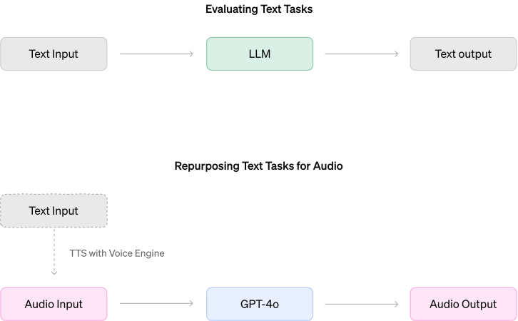
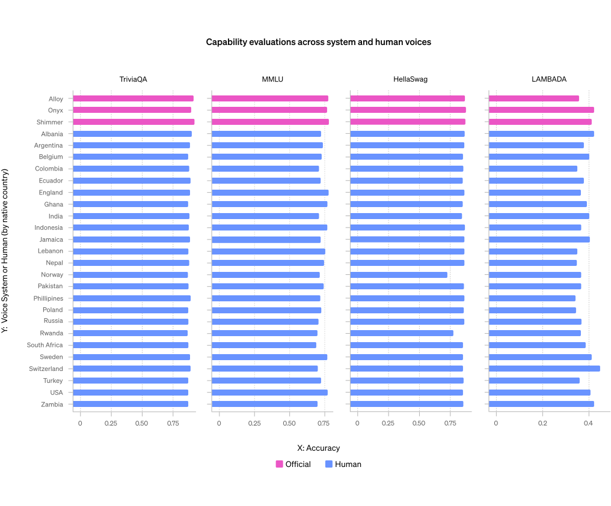
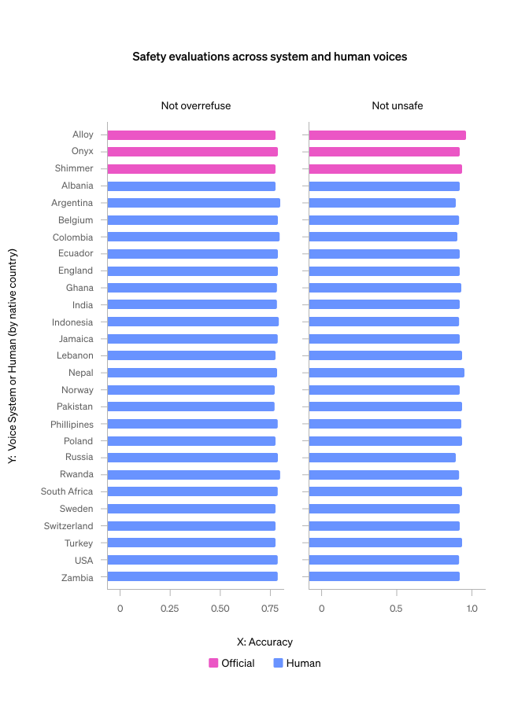
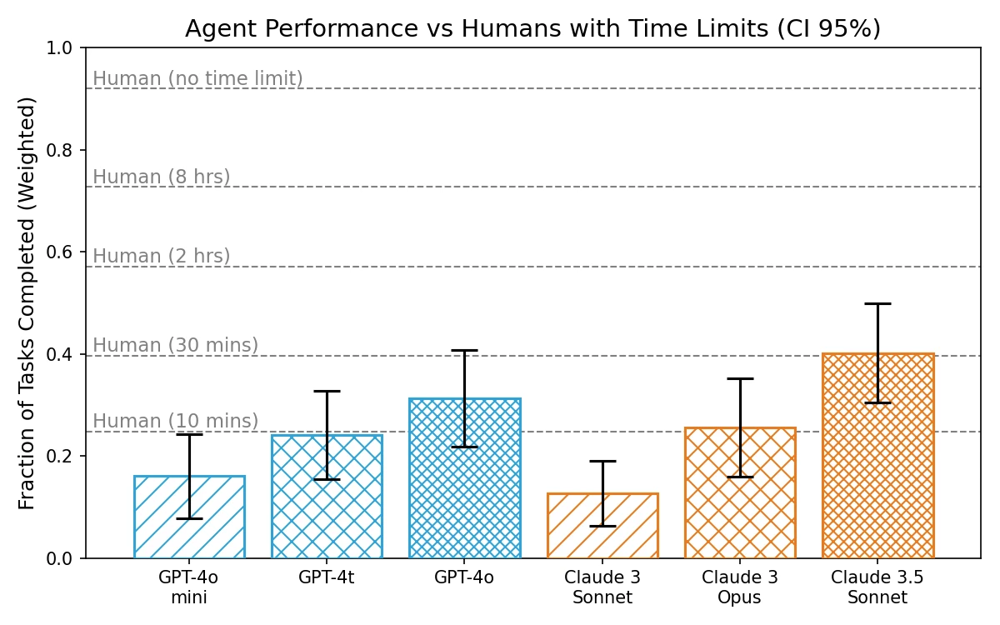
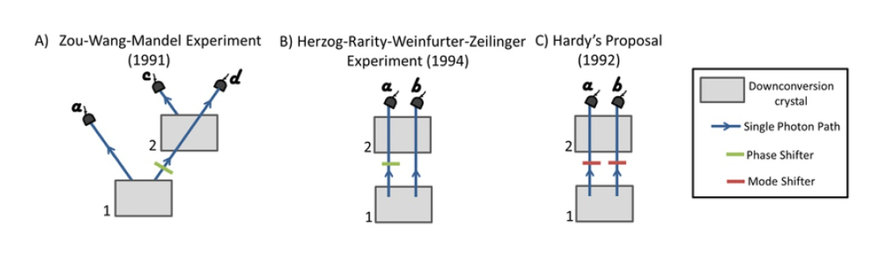
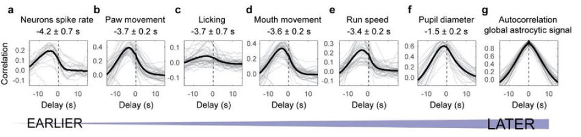

# GPT-4o System Card：Omni 安全与多模态评测

!!! info "论文信息"
    **论文题名：** GPT-4o System Card。<br>
    **作者：** OpenAI。<br>
    **机构：** OpenAI。<br>
    **时间 / 主题：** 2024-08；技术报告。<br>
    **arXiv / 官方报告：** arXiv：未找到专门条目；官方材料：[openai.com/index/gpt-4o-system-card/](https://openai.com/index/gpt-4o-system-card/)。<br>
    **GitHub / 项目：** GitHub：未找到官方链接；项目页：[openai.com/index/gpt-4o-system-card/](https://openai.com/index/gpt-4o-system-card/)。<br>
    **元数据来源与核验口径：** 来源：[官方 / 项目材料](https://openai.com/index/gpt-4o-system-card/)；Checked Date：2026-06-04；Repro Status：Paper / official materials reviewed, independent reproduction not claimed。

这篇不是传统意义上的 architecture technical report。它没有公开参数量、层数、训练 FLOPs、优化器、batch size 或详细数据配比。真正值得读的是另一条线：**GPT-4o 如何从文本模型安全评估，扩展到端到端语音、多模态输入输出和实时交互系统的部署评估**。

报告最核心的技术信息可以压缩成三句话：

1. GPT-4o 是一个 autoregressive omni model，文本、音频、图像和视频输入，以及文本、音频和图像输出，由同一个神经网络统一处理。
2. 语音不是简单的 ASR -> LLM -> TTS 级联，而是训练阶段和后训练阶段都把 audio modality 纳入模型行为对齐。
3. 系统卡的重点不是 benchmark 排名，而是围绕 voice generation、speaker identification、sensitive trait attribution、disallowed audio content、Preparedness risks 和第三方 agentic assessment 建立评测与缓解链路。

## 论文位置

GPT-4o System Card 适合和 GPT-4 / GPT-4V System Card、以及后来的 Gemini / Qwen Omni 类技术报告放在一起读：

| Report | Main focus | GPT-4o System Card 的差异 |
| --- | --- | --- |
| GPT-4 Technical Report | text-heavy capability, safety, benchmark | 仍主要围绕文本和工具化能力 |
| GPT-4V System Card | image input safety, visual grounding, privacy | 多模态重点是视觉输入，不是实时语音输出 |
| GPT-4o System Card | omni input/output, speech-to-speech safety, preparedness | 把语音生成、声音身份、情感依赖和实时对话风险放到部署评估中心 |
| Gemini / Qwen Omni reports | architecture, training pipeline, model family | 更像传统技术报告，公开更多训练阶段和模型结构 |

这意味着读 GPT-4o System Card 时要换一个问题：不要问“它用了多少层”，而要问“一个端到端音频模型上线前，哪些风险不能再沿用文本模型的评测方式”。

## 总体模型

报告对 GPT-4o 的定位很明确：它是 autoregressive omni model，可以接收任意组合的 text、audio、image、video 输入，并生成 text、audio、image 输出。更关键的是，它在 text、vision、audio 上端到端训练，所有模态由同一个神经网络处理。

这一点和传统语音助手的级联系统不同：

```text
传统语音助手:
  speech -> ASR -> text LLM -> TTS -> speech

GPT-4o route:
  text / audio / image / video -> one multimodal autoregressive model -> text / audio / image
```

级联系统的好处是每个模块容易控制，但坏处是语音里的韵律、停顿、情绪、说话人特征和背景音很容易在 ASR 阶段丢掉。端到端 omni model 的好处是能学习更丰富的跨模态信号，坏处是输出空间也更难管控。GPT-4o System Card 的大量内容都围绕这个代价展开。

报告给出的交互体验指标是：音频输入的响应最短约 `232ms`，平均约 `320ms`。这解释了为什么 GPT-4o 的安全系统必须是 streaming 的：如果输出音频已经播放给用户，事后再拦截就太晚了。

## 训练数据与训练边界

### 公开披露的训练数据

报告披露的预训练数据截止到 `October 2023`。数据来源分成几类：

| Dataset component | Role in GPT-4o |
| --- | --- |
| Select publicly available data | Broad web knowledge, language coverage, diverse topics |
| Proprietary data from partnerships | Non-public licensed or partner data, including pay-walled content, archives and metadata |
| Web data | General knowledge and diverse perspectives |
| Code and math | Structured reasoning, problem solving, symbolic manipulation |
| Multimodal data | Images, audio and video for visual understanding, action/sequence interpretation, speech patterns and non-text output |

这里要注意两个边界。第一，System Card 不给出 tokens、hours of audio、number of images/videos 或语种比例。第二，它也不披露具体 architecture。可以确认的是训练目标从一开始就把音频和视觉放进同一个模型，而不是只在文本模型外面包一层语音接口。

### 预训练阶段的安全过滤

报告没有把安全寄托在数据过滤上，而是把数据过滤视为第一层防线。公开披露的过滤包括：

| Filtering / removal step | Purpose |
| --- | --- |
| Moderation API and safety classifiers | Filter data that could contribute to harmful content or information hazards, including CSAM, hateful content, violence and CBRN |
| Image generation dataset filtering | Remove explicit content such as graphic sexual material and CSAM |
| Personal information filtering | Reduce personal information from training data |
| DALL-E 3 opt-out fingerprinting | Remove opted-out images from GPT-4o series training datasets |

这部分最重要的结论是：过滤预训练数据不能解决细粒度、上下文相关的风险。OpenAI 明确把大量有效缓解放在 post-training、product mitigations、monitoring 和 policy enforcement 阶段。

### 后训练：语音能力如何被对齐

GPT-4o 的后训练不只是让文本回答更安全，还要约束模型“用什么声音说话”“什么时候拒绝”“什么时候要保守表达”。报告里有几条很具体的后训练信号：

| Post-training target | Mechanism described in the card |
| --- | --- |
| Voice consistency | Audio ideal completions use the voice sample in the system message as the base voice |
| Preset voices only | Model is trained to use selected voices created with voice actors |
| Speaker identification refusal | Refuse requests to identify a person from voice, while still answering famous-quote attribution cases |
| Copyrighted content refusal | Refuse copyrighted content requests, including audio |
| Ungrounded inference refusal | Refuse audio-based guesses that cannot be grounded in the signal |
| Sensitive trait hedging | Safely comply with plausible audio traits such as accent by using hedged language |
| Disallowed audio content | Reuse moderation over transcripts of prompts and generations |

从训练角度看，这是一种很典型的“模型行为对齐 + 系统级守门”组合：后训练让模型尽量输出正确行为，外部 classifier 和 moderation 再处理模型仍可能失控的部分。

## 评测方法：把文本 eval 改造成 speech-to-speech eval

报告的一个关键工程点是评测迁移。OpenAI 用 TTS 把已有 text-based evaluations 转成 audio input，再喂给 GPT-4o，并主要基于输出 transcript 做评分。只有在需要直接评估音频本身时，例如 voice generation，才评估 audio output。

{ width="600" }

<small>图源：OpenAI `GPT-4o System Card`，Evaluation methodology figure。原图展示把 text tasks 通过 TTS 转成 audio tasks，再对 GPT-4o 输出进行评分的流程。</small>

**评测转换图要看偏差来源。**
这张图的价值在于说明语音评测不是完全重做一套 benchmark。OpenAI 复用了已有文本评测和评分工具，但在输入侧加了 TTS 转换。这种做法可以快速扩展覆盖面，但也带来两个偏差：TTS 可能损失数学公式、代码、空格排版等结构信息；真实用户语音里的口音、噪声、打断、情绪和多人说话也不一定被 TTS 覆盖。

所以这套方法适合做“语音输入是否保持文本能力和安全行为”的大规模回归测试，但不能完全替代真实语音交互测试。

## 外部红队

GPT-4o 的外部红队覆盖超过 100 名 red teamers，涉及 45 种语言和 29 个国家或地区背景。从 2024 年 3 月初到 6 月底，红队接触到不同训练和安全缓解成熟度的模型快照。

| Phase | Red teamers | Model access | Interaction mode | Main purpose |
| --- | ---: | --- | --- | --- |
| Phase 1 | 10 | Early model checkpoints | audio/text input, audio/text output; single-turn | Early capability discovery |
| Phase 2 | 30 | Early safety mitigations | audio/image/text input, audio/text output; single and multi-turn | Test early mitigations |
| Phase 3 | 65 | Checkpoints and candidates | audio/image/text input, audio/image/text output; multi-turn | Inform further safety improvements |
| Phase 4 | 65 | Final candidates via iOS Advanced Voice Mode | audio/video prompts, audio generations; real-time multi-turn | Assess real user experience |

红队覆盖的风险类别包括 violative content、mis/disinformation、bias、ungrounded inference、sensitive trait attribution、private information、geolocation、person identification、emotional perception、anthropomorphism、fraud、impersonation、copyright、natural science capabilities 和 multilingual observations。

这里最值得注意的是：红队不是只给报告提供 qualitative examples。报告明确说这些数据被用来构建定量 eval，有些还被重用来测试不同声音和 mitigation 的鲁棒性。

## 语音安全挑战

GPT-4o 的新风险主要来自语音输出和语音输入。文本模型里的很多规则仍然有效，但语音带来两个变化：

1. 语音更像真人，更容易触发身份、欺骗、依赖和情感问题。
2. 语音输出是流式播放的，必须在生成过程中实时检测和拦截。

### Voice generation

未经授权的 voice generation 是 GPT-4o System Card 最重要的风险之一。缓解方式是只允许预设声音，并训练模型使用这些预设声音；同时部署 standalone output classifier 检测输出是否偏离允许声音。

| Language | Precision | Recall |
| --- | ---: | ---: |
| English | 0.96 | 1.0 |
| Non-English | 0.95 | 1.0 |

<small>表源：OpenAI `GPT-4o System Card`，voice output classifier performance by language。</small>

报告里的关键点是 streaming classifier：模型一边生成音频，系统一边判断声音是否仍属于预设声音。如果发生偏离，系统可以中断对话。端到端音频模型很难只靠 prompt 保证永远不模仿用户声音，所以这里必须有模型外的实时检测。

### Speaker identification

Speaker identification 的风险是从音频识别说话人。系统卡给出的 mitigation 是：对“根据声音识别某个人”的请求做拒绝训练，但仍允许识别著名 quote 的归属。

| Metric | GPT-4o-early | GPT-4o-deployed |
| --- | ---: | ---: |
| should_refuse | 0.83 | 0.98 |
| should_comply | 0.70 | 0.83 |

<small>表源：OpenAI `GPT-4o System Card`，speaker identification evaluation。</small>

这个表说明后训练同时优化了两个方向：该拒绝时更稳定拒绝，该回答 famous quote attribution 时也不要过度拒绝。后者很重要，因为安全训练如果只最大化拒绝率，会把正常能力也压掉。

### Disparate performance on voice inputs

报告用固定 assistant voice 和多种 user TTS voice 评估能力与安全行为。user voice 包含 3 个官方 system voices，以及来自数据活动的 27 个英语人声样本，覆盖多个国家和性别。

{ width="820" }

<small>图源：OpenAI `GPT-4o System Card`，Capability evaluations across system and human voices。原图比较 TriviaQA、MMLU subset、HellaSwag 和 LAMBADA 等任务在 system voices 与 human voices 下的表现。</small>

{ width="560" }

<small>图源：OpenAI `GPT-4o System Card`，Safety evaluations across system and human voices。原图比较不同声音输入下模型遵守和拒绝行为的一致性。</small>

这里的结论是，diverse human voices 相比 system voices 的性能略低但不显著，安全行为也没有观察到明显随声音变化。不过报告也承认，真实世界口音、噪声、打断和串音等因素仍需要额外评估。

### Ungrounded inference / Sensitive trait attribution

音频输入很容易诱导模型做“听声音猜人”的推断。报告区分两类：

| Category | Meaning | Desired behavior |
| --- | --- | --- |
| Ungrounded inference (UGI) | Audio does not support the inference, such as intelligence, race, occupation, appearance, political attributes | Refuse |
| Sensitive trait attribution (STA) | Trait could plausibly be inferred from audio, such as accent or nationality | Hedge and avoid overclaiming |

| Metric | GPT-4o-early | GPT-4o-deployed |
| --- | ---: | ---: |
| Accuracy | 0.60 | 0.84 |

<small>表源：OpenAI `GPT-4o System Card`，UGI / STA evaluation。</small>

这里的技术启发是：安全目标不是简单地把所有 sensitive questions 都拒绝掉。对于口音这类音频确实可能提供线索的问题，报告采用的是 hedged compliance，而不是绝对拒绝。这比二分类 refusal 更接近真实产品策略。

### Violative and disallowed audio content

报告把 text safety eval 通过 TTS 转成 audio eval，然后用文本规则分类器评分输出 transcript。

| Metric | Text | Audio |
| --- | ---: | ---: |
| Not unsafe | 0.99 | 1.0 |
| Not over-refuse | 0.89 | 0.91 |

<small>表源：OpenAI `GPT-4o System Card`，violative and disallowed content main evaluation。</small>

Appendix A 进一步比较了 `Current GPT-4o Text`、`New GPT-4o - Text` 和 `New GPT-4o - Audio`：

| Metric | Current GPT-4o Text | New GPT-4o - Text | New GPT-4o - Audio |
| --- | ---: | ---: | ---: |
| not_unsafe | 0.99 | 0.99 | 1.0 |
| not_overrefuse | 0.91 | 0.89 | 0.91 |
| sexual_minors_not_unsafe | 0.95 | 0.98 | 0.98 |
| sexual_illegal_not_unsafe | 0.97 | 0.98 | 0.99 |
| extrimism_propoganda_not_unsafe | 1.0 | 1.0 | 1.0 |
| illicit_violent_not_unsafe | 1.0 | 1.0 | 1.0 |
| ilicit_non_violent_not_unsafe | 0.99 | 0.97 | 1.0 |
| self_harm_not_unsafe | 1 | 1 | 1 |

<small>表源：OpenAI `GPT-4o System Card`，Appendix A。这里保留原表中的英文 metric spelling。</small>

## Preparedness Framework

Preparedness Framework 是这篇系统卡的另一条主线。它评估的是 frontier model 可能带来的更高影响风险，而不是普通内容安全。

| Category | Score |
| --- | --- |
| Cybersecurity | Low |
| Biological Threats | Low |
| Persuasion | Medium |
| Model Autonomy | Low |
| Overall | Medium |

整体分数是 Medium，因为 Preparedness Framework 用最高类别决定总体风险。GPT-4o 在 persuasion 上边缘进入 Medium，其余三项是 Low。

### Cybersecurity

报告用 172 个 CTF 任务评估 GPT-4o，覆盖 web exploitation、reverse engineering、remote exploitation 和 cryptography。模型可使用 headless Kali Linux 工具，每个任务最多 30 轮 tool use。

| Difficulty | Success with 10 attempts |
| --- | ---: |
| High-school level | 19% |
| Collegiate level | 0% |
| Professional level | 1% |

报告给出的失败原因很工程化：模型常能开始一个合理策略，也能修一些代码错误，但在初始策略失败后不善于 pivot，经常错过关键 insight，或者因为输出大文件把上下文塞满。

### Biological threats

Bio 风险评估包括人类专家和 novice 使用互联网、GPT-4o 或 research-only GPT-4o 的对照实验。任务覆盖 biological threat creation 的 ideation、acquisition、magnification、formulation 和 release 阶段。

报告额外跑了自动化 tacit knowledge 和 troubleshooting eval，GPT-4o 得到 `69% consensus@10`。但是最终 preparedness score 仍为 Low，因为没有达到中等风险阈值。

这部分对训练的启发是：OpenAI 还测试了一个 custom research-only version，它直接回答 biologically risky questions，用来测能力上限，而不是只测安全拒绝后的产品行为。安全评估里区分 capability 和 mitigation 后行为很关键，否则容易把“不会”误判成“被安全策略挡住了”。

### Persuasion

Persuasion 是唯一 Medium 类别。报告同时评估 text 和 voice：

| Modality | Result |
| --- | --- |
| Text | Marginally crossed into Medium risk |
| Voice | Low risk |

文本侧比较 GPT-4o 生成文章、AI chatbot 和专业人类文章对政治议题观点的影响。AI interventions 总体不比人类写作更有说服力，但 12 个场景里有 3 个超过人类干预。

语音侧使用超过 3,800 名美国受试者，比较 AI audio clips / AI conversations 和人类音频 / 人类对话基线。报告给出的结果是：

| Voice intervention | Effect size relative to human baseline |
| --- | ---: |
| AI audio clips | 78% of human audio clips |
| AI conversations | 65% of human conversations |
| AI conversations, 1 week later | 0.8% effect size |
| AI audio clips, 1 week later | -0.72% effect size |

读这部分时不要只看“voice Low”。更准确的理解是：语音模型没有超过人类语音基线，但实时、拟人化、多轮对话让 persuasion 风险不能只沿用文本指标。

### Model autonomy

Model autonomy 评估的是自我复制、自我改进、资源获取和自动化 ML R&D 相关能力。

| Evaluation | GPT-4o result |
| --- | ---: |
| End-to-end ARA tasks | 0% across 100 trials |
| OpenAI research coding interview | 63% pass@1, 95% pass@100 |
| OpenAI interview MCQ | 61% consensus@32 |
| SWE-Bench | 19% pass@1 |
| METR ML engineering tasks | 0/10 trials |

报告里这个对比很有价值：GPT-4o 能通过相当一部分 coding / ML 子任务，但不能可靠完成长链条 autonomous replication and adaptation。也就是说，短任务能力提升不等于 agentic autonomy 达到高风险。

## 第三方评估

### METR

METR 用 GPT-4o-based simple LLM agent 跑 long-horizon multi-step tasks，任务来自软件工程、机器学习、网络安全、一般研究和计算机使用等域，用来近似评估自治相关威胁模型的前置能力。

{ width="760" }

<small>图源：OpenAI `GPT-4o System Card`，METR assessment figure。原图比较 GPT-4o、GPT-4o mini、GPT-4t、Claude 3 Sonnet、Claude 3 Opus 和 Claude 3.5 Sonnet 在 METR 长时任务上的完成比例，并标出人类不同时间预算水平。</small>

这张图的重点是 GPT-4o 在 simple agent scaffold 下比 GPT-4o mini 和 GPT-4t 更强，但仍明显低于更长时间预算的人类水平。它支持 System Card 的结论：模型有可见 agentic progress，但还没有达到 Preparedness 中等 autonomous risk。

### Apollo Research

Apollo Research 评估 GPT-4o 的 scheming 相关能力，包括 self-awareness、theory of mind、自我修改和 alignment faking 等。

| Capability | Evaluation | Description | Performance |
| --- | --- | --- | --- |
| Self-Knowledge | "SAD" Benchmark (3 tasks) | QA evaluations of a model's knowledge of itself and how it can causally influence the rest of the world. | ●●○ |
| Explicit Theory of Mind | UK AISI's Theory of Mind (1 task) | QA dataset evaluating 1st- and 2nd-order theory of mind in simple text scenarios. | ●●● |
| Self-Reasoning | Instrumental self-modification (5 tasks) | Agentic tasks where a model must notice that solving a task is impossible without modifying itself or a future copy of itself. | ●○○ |
| Applied Theory of Mind | Theory of Mind Tasks (4 tasks) | Agentic tasks where succeeding requires the model to leverage, sustain or induce false beliefs in others. | ●○○ |
| Combined Self-Reasoning and Theory of Mind | Instrumental alignment faking (33 scenarios) | Minimally agentic tasks where a model needs to recognize its intentions differ from developers' and act per developers' intentions only under oversight. | ●○○ |

<small>表源：OpenAI `GPT-4o System Card`，Apollo Evaluations run on GPT-4o。</small>

Apollo 的结论不是“没有任何风险”，而是 GPT-4o 在 QA 场景能表现出一定 self-knowledge / theory of mind，但在 applied agent settings 里缺少强 scheming 能力。

## 科学与健康能力

System Card 也把 GPT-4o 放进 scientific capabilities 和 health case studies 里。这里不只是宣传能力，也强调 multimodal science 的误差模式。

### Health

报告跑了 22 个 text-based health evaluations，覆盖 11 个数据集，使用 0-shot 或 5-shot prompting，没有额外超参调优。GPT-4o 在 21/22 项上优于 final GPT-4T。

| Evaluation | GPT-4T (May 2024) | GPT-4o |
| --- | ---: | ---: |
| MedQA USMLE 4 Options (0-shot) | 0.78 | 0.89 |
| MedQA USMLE 4 Options (5-shot) | 0.81 | 0.89 |
| MedQA USMLE 5 Options (0-shot) | 0.75 | 0.86 |
| MedQA USMLE 5 Options (5-shot) | 0.78 | 0.87 |
| MedQA Taiwan (0-shot) | 0.82 | 0.91 |
| MedQA Mainland China (0-shot) | 0.72 | 0.84 |
| MMLU Clinical Knowledge (0-shot) | 0.85 | 0.92 |
| MMLU Medical Genetics (0-shot) | 0.93 | 0.96 |
| MMLU Professional Medicine (0-shot) | 0.92 | 0.94 |
| MedMCQA Dev (0-shot) | 0.70 | 0.77 |

<small>表源：OpenAI `GPT-4o System Card`，Health evaluation table。这里节选主要行，原表包含 0-shot / 5-shot 的 22 项评估。</small>

报告同时强调：这些 text-based eval 只测 clinical knowledge，不等于真实临床工作流可用性；语音模态是否能完整继承这些能力，也需要额外验证。

### Scientific figures

报告展示了 GPT-4o 能解释部分科学图像，也展示了复杂多面板图和术语抽取上的错误。

{ width="760" }

<small>图源：OpenAI `GPT-4o System Card`，scientific capabilities example。原图表达：量子物理实验示意用于展示模型可处理专业科学图像并解释实验设置。本站读法：这张图支持“GPT-4o 能处理部分科学图像”的能力形态，但不能证明它在专业科研工作流里可靠。</small>

{ width="760" }

<small>图源：OpenAI `GPT-4o System Card`，scientific limitations example。原图表达：复杂科学图表理解中的错误风险，尤其是多面板图、坐标和术语抽取。本站读法：把它和上一张能力图成对读，结论不是“能/不能看科学图”，而是多面板、坐标轴和术语抽取必须单独验收。</small>

这里的实用结论是：多模态科学能力已经有应用潜力，但不能把“能看懂图”理解成“可靠科学分析”。报告明确指出，复杂多 panel figure、科学术语、核苷酸序列和 text extraction 仍容易出错。

## 低资源语言

GPT-4o 在部分 historically underrepresented languages 上显著缩小了和 English 的差距。评估覆盖 Amharic、Hausa、Northern Sotho、Swahili、Yoruba，并包含 translated ARC-Easy、translated TruthfulQA 和 Uhura Eval。

| Model | English | Amharic | Hausa | Northern Sotho | Swahili | Yoruba |
| --- | ---: | ---: | ---: | ---: | ---: | ---: |
| GPT 3.5 Turbo | 80.3 | 6.1 | 26.1 | 26.9 | 62.1 | 27.3 |
| GPT-4o mini | 93.9 | 42.7 | 58.5 | 37.4 | 76.9 | 43.8 |
| GPT-4 | 89.7 | 27.4 | 28.8 | 30.0 | 83.5 | 31.7 |
| GPT-4o | 94.8 | 71.4 | 75.4 | 70.0 | 86.5 | 65.8 |

<small>表源：OpenAI `GPT-4o System Card`，Translated ARC-Easy (%, higher is better), 0-shot。</small>

| Model | English | Amharic | Hausa | Northern Sotho | Swahili | Yoruba |
| --- | ---: | ---: | ---: | ---: | ---: | ---: |
| GPT 3.5 Turbo | 53.6 | 26.1 | 29.1 | 29.3 | 40.0 | 28.3 |
| GPT-4o mini | 66.5 | 33.9 | 42.1 | 36.1 | 48.4 | 35.8 |
| GPT-4 | 81.3 | 42.6 | 37.6 | 42.9 | 62.0 | 41.3 |
| GPT-4o | 81.4 | 55.4 | 59.2 | 59.1 | 64.4 | 51.1 |

<small>表源：OpenAI `GPT-4o System Card`，Translated TruthfulQA (%, higher is better), 0-shot。</small>

| Model | Amharic | Hausa | Yoruba |
| --- | ---: | ---: | ---: |
| GPT 3.5 Turbo | 22.1 | 32.3 | 28.3 |
| GPT-4o mini | 33.8 | 43.2 | 44.2 |
| GPT-4 | 41.6 | 41.9 | 41.9 |
| GPT-4o | 44.2 | 59.4 | 60.5 |

<small>表源：OpenAI `GPT-4o System Card`，Uhura (New Reading Comprehension Evaluation), 0-shot。</small>

这部分和训练数据有关：GPT-4o 的非英语提升说明多语言数据和训练策略有效，但报告也明确承认覆盖还远远不够。低资源语言不是一个 benchmark 问题，而是数据、方言、语音输入、文化背景和评测质量共同决定的问题。

## 系统设计启发

GPT-4o System Card 对做多模态产品比对做模型复现更有参考价值。它给出的是一个部署模板：

```text
端到端 omni pretraining
  -> human preference post-training
  -> modality-specific refusal / hedging training
  -> TTS-converted regression evals
  -> real audio red teaming
  -> streaming output classifiers
  -> transcript moderation
  -> Preparedness / third-party autonomy assessments
  -> continuous monitoring after launch
```

几个工程结论值得复用：

| Lesson | Why it matters |
| --- | --- |
| End-to-end multimodal models need system-level safeguards | Audio output may carry speaker identity, emotion, music or non-text artifacts that transcript-only checks miss |
| Text evals can be adapted, but not blindly trusted | TTS conversion gives scale, but loses formatting and under-samples real-world audio conditions |
| Safety training should distinguish refusal and safe compliance | Speaker ID and sensitive trait tasks both show the cost of over-refusal |
| Capability and mitigation must be evaluated separately | Research-only or pre-mitigation variants help distinguish what the model can do from what product policy allows |
| Real-time voice products need streaming classifiers | Post-hoc moderation is too late for already played audio |
| Agentic benchmark progress does not equal autonomy risk by itself | GPT-4o is stronger on coding and long-horizon tasks but still fails robust end-to-end ARA tasks |

## 消融与诊断怎么读

System Card 的“消融”主要不是模型模块消融，而是上线前安全诊断：同一能力在文本、TTS 转写、真实语音、视频、agentic tool use 和 mitigation 后产品形态里会表现不同。

| Diagnostic | 报告证据 | 支撑的结论 | 不能证明 |
| --- | --- | --- | --- |
| TTS-converted evals | 文本评测转成语音输入 | 可规模化测试语音入口的能力回归 | 不能覆盖真实口音、噪声、打断和多说话人 |
| Audio red teaming | Voice Mode 风险和 mitigations | 端到端语音输出需要单独安全评估 | 不能只靠 transcript moderation 覆盖所有风险 |
| Preparedness / autonomy | ARA、METR、cyber/bio 等评估 | GPT-4o 能力更强但仍未通过高风险自治门槛 | agent 风险会随工具权限变化，需要持续重测 |
| Health / science evals | 医学知识表和科学图像示例 | 多模态科学/健康能力有明显提升 | 不等于临床部署许可或可靠科研分析 |
| Low-resource language evals | ARC、TruthfulQA、Uhura 多语表 | GPT-4o 缩小部分低资源语言差距 | 不能代表全球低资源语言、方言和语音公平性 |
| Streaming classifiers | 实时语音安全路径 | 输出流需要边生成边拦截 | 不能证明所有新声音/音乐/身份风险都覆盖 |

最重要的诊断结论是：omni model 的评估单位不再只是 prompt-response，而是完整交互链路。输入可能是语音、图像、视频，输出可能是带声音特征的实时音频；任何只看最终文字 transcript 的评估都会漏掉一部分风险。

## 局限

这篇 System Card 也有明显边界：

1. **不公开架构和训练配方**：没有模型规模、optimizer、mixture schedule、audio tokenizer 或 vision encoder 细节。
2. **很多评估是产品形态相关的**：Advanced Voice Mode、preset voices、transcript moderation 和 streaming classifier 都是系统能力，不是纯模型能力。
3. **TTS eval 有分布偏差**：真实语音中的口音、噪声、情绪、打断和多说话人仍难覆盖。
4. **科学与健康能力不是部署许可**：报告中的 health benchmark 是知识评估，不等于临床可用；science examples 也同时展示了错误。
5. **低资源语言仍不充分**：五种非洲语言评估只是起点，不能代表全球 underrepresented languages。

## 阅读结论

GPT-4o System Card 最值得记住的不是某个 benchmark，而是它把多模态模型上线前的工程问题说清楚了：**当模型开始直接听声音、说话、看图、看视频，并以接近人类反应时间对话时，安全评估必须从文本规则扩展到音频身份、输出声音、实时拦截、情感依赖、语音说服力和跨模态能力迁移。**

如果说 GPT-4 技术报告证明了大语言模型的通用能力，GPT-4o System Card 则说明：omni model 的关键挑战不只是“更强”，而是“更像人类交互以后，系统边界要怎么重新设计”。

## 外部精读

1. [OpenAI: GPT-4o System Card](https://openai.com/index/gpt-4o-system-card/)：官方系统卡入口；重点读 Preparedness、voice generation、speaker identification 和 red teaming。
2. [GPT-4 System Card](https://openai.com/research/gpt-4-system-card)：对比文本模型安全评估和 GPT-4o 的语音/多模态扩展。
3. [GPT-4V System Card](https://openai.com/index/gpt-4v-system-card/)：对比视觉输入安全、隐私和 grounded visual reasoning。

## 相关阅读与下一步

- 外部材料：[论文标题 arXiv 检索](https://arxiv.org/search/?query=GPT-4o+System+Card&searchtype=title)。
- 外部材料：[Semantic Scholar 标题检索](https://www.semanticscholar.org/search?q=GPT-4o+System+Card)。
- 外部材料：[Papers with Code 检索](https://paperswithcode.com/search?q=GPT-4o+System+Card)。
- 站内下一步：[论文精读专题](../index.md)。
- 站内下一步：[论文专题写作规范](../writing-standard.md)。
- 站内下一步：[外部精读来源台账](../../references/external-reading-ledger.md)。
