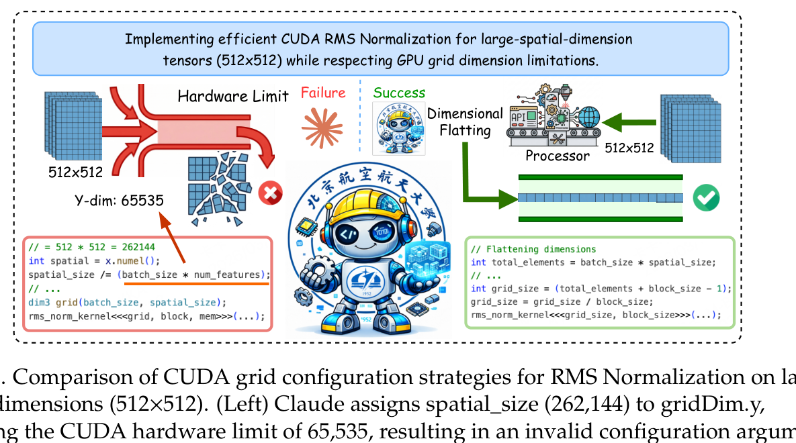
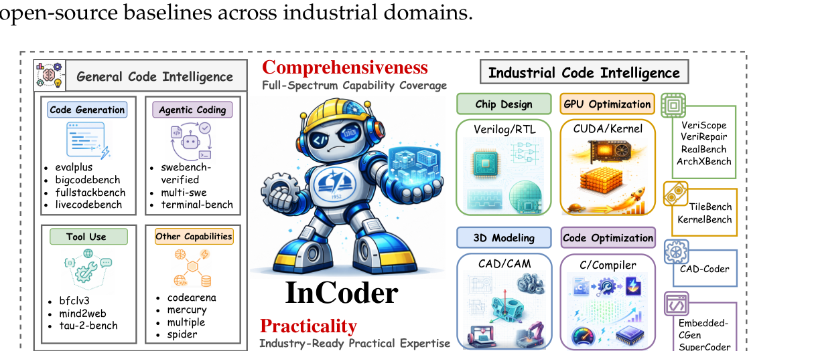
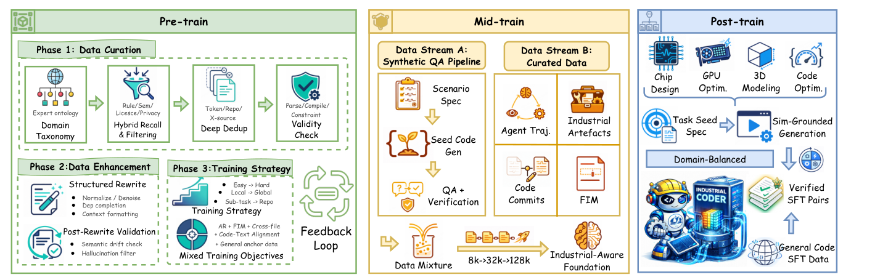
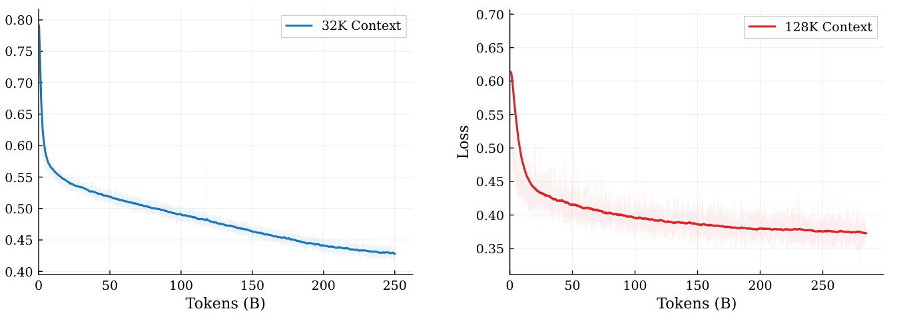
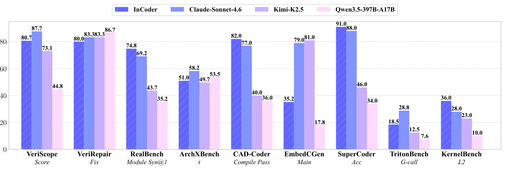
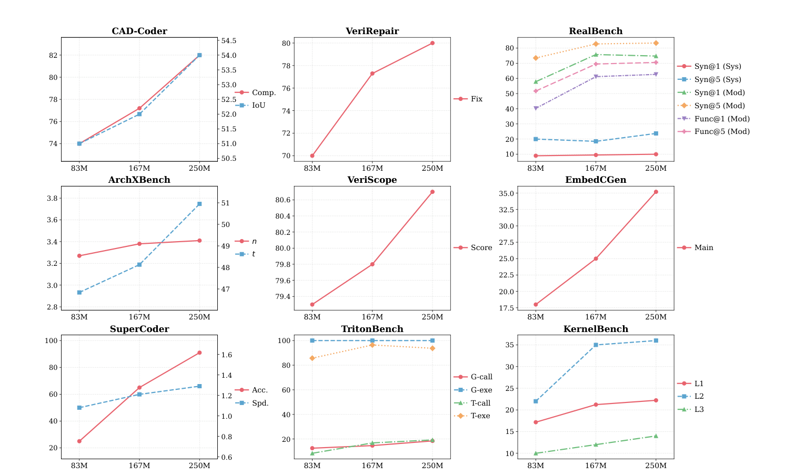
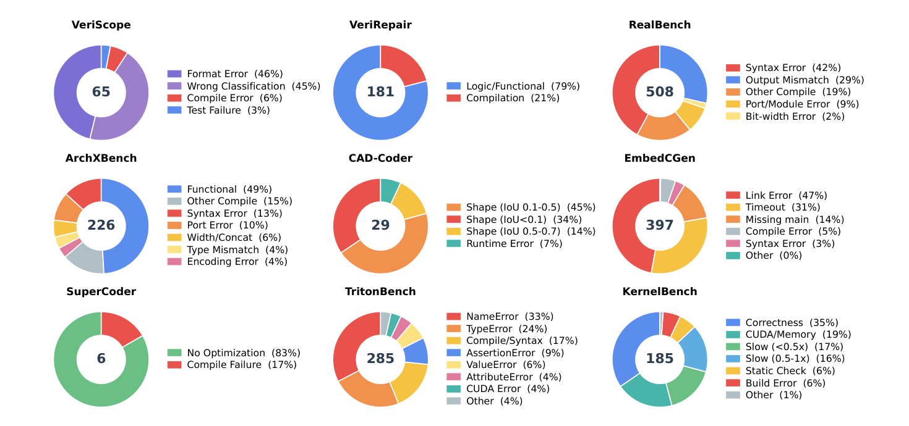
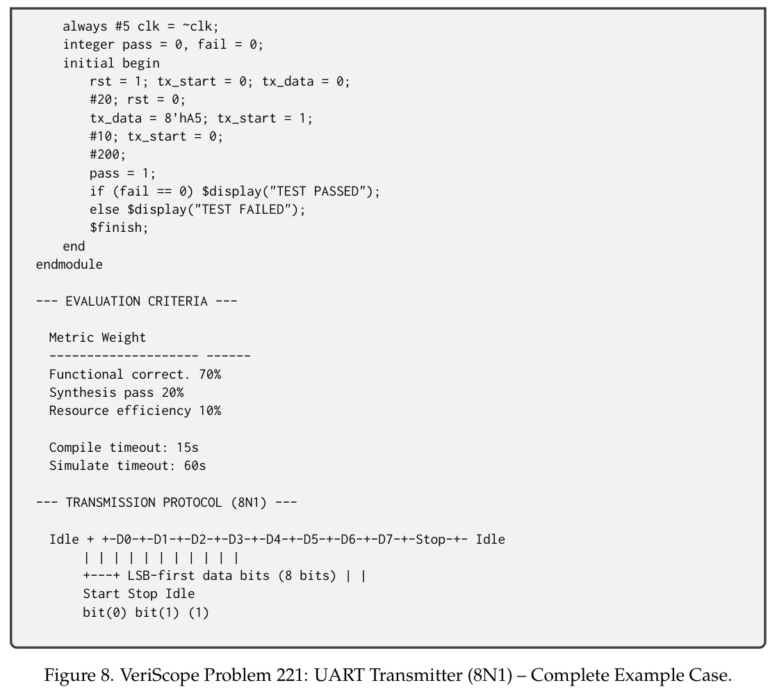
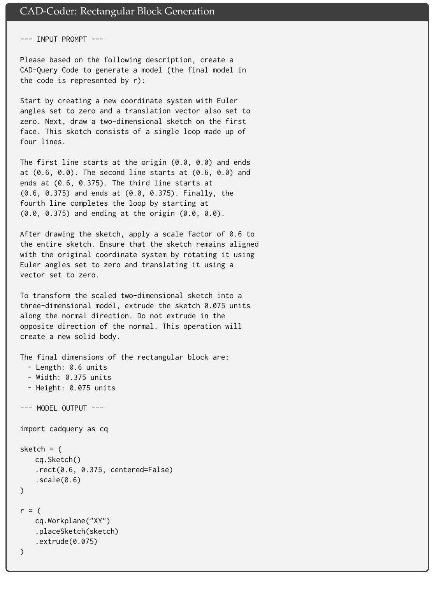
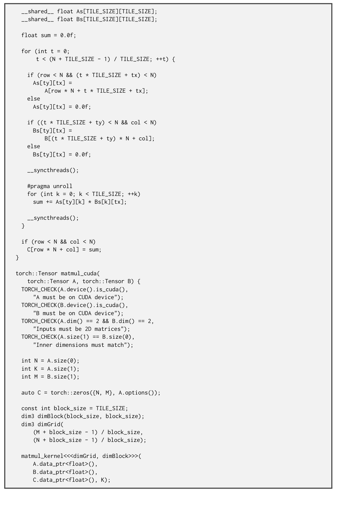

# InCoder-32B：工业代码基础模型与执行验证训练

!!! info "论文信息"
    **论文题名：** InCoder-32B: Code Foundation Model for Industrial Scenarios。 
    **作者：** Jian Yang、Wei Zhang、Jiajun Wu、Junhang Cheng、Shawn Guo、Haowen Wang、Weicheng Gu、Yaxin Du、Joseph Li、Fanglin Xu 等（共 28 人）。 
    **机构：** Beihang University、IQuest Research、Shanghai Jiao Tong University、University of Manchester。 
    **时间 / 主题：** 2026-03；技术报告。 
    **arXiv / 官方报告：** arXiv：[2603.16790](https://arxiv.org/abs/2603.16790)。 
    **GitHub / 项目：** GitHub：[github.com/CSJianYang/Industrial-Coder](https://github.com/CSJianYang/Industrial-Coder)。 
    **元数据来源与核验口径：** 来源：[arXiv](https://arxiv.org/abs/2603.16790)；[GitHub API / repo](https://github.com/CSJianYang/Industrial-Coder)；Checked Date：2026-06-15；Repro Status：Paper / official materials reviewed, independent reproduction not claimed。

## 写出看起来正确的代码，离工业任务成功还有多远

一个代码模型能够解释 RMS Normalization，也能写出对应 CUDA kernel，却仍可能在第一次启动 kernel 时失败。InCoder-32B 用这个落差说明自己的训练目标。输入的空间尺寸为 $512\times512$，共有 262,144 个位置；Figure 2 左侧实现把这个数直接放进 `gridDim.y`，超过图中给出的 65,535 限制。右侧将工作展开到一维 grid，避免了这次非法配置。[↗](https://arxiv.org/pdf/2603.16790v3#page=2)

{ width="920" }

读这张图时，可以把算法与运行契约分开。归一化公式决定要计算什么，grid、block 和索引规则决定这批计算怎样落到设备上。前者正确，后者仍可能越界；启动成功以后，还要检查数值误差和运行时间。一维展开解决的是图中这一次启动限制，不自动证明数值正确，也没有给出相对库实现的加速倍数。

RTL、嵌入式和 CAD 存在类似的多层要求。Verilog 端口能接上，不代表状态机在正确周期输出结果；固件能够链接，不代表中断和外设按要求协同；CadQuery 脚本产生了实体，也可能把孔开在错误的面上。因此，这篇报告最值得研究的是如何把这些约束放进训练数据，以及评测究竟检查到了哪一层。

{ width="920" }

Figure 1 左侧保留函数生成、仓库开发与工具使用，右侧扩展到芯片设计、GPU 优化、代码优化与三维建模。统一模型需要共享通用的代码理解能力，但每个领域的判定工具仍然不同。InCoder 的办法是训练同一个 32B 模型，同时为数据构造准备多种执行环境。主表最有力的收益集中在模块级 RTL、CAD 和 KernelBench；完整硬件系统、嵌入式任务与性能优化仍有明显短板。这个能力轮廓比“工业代码模型”这个名称更适合指导使用。

## Code-Flow 让模型依次接触源码、工程过程与执行反馈

Figure 3 将训练分为三个阶段。左侧解决“工业代码能否被收集和读懂”，中间解决“能否理解跨文件依赖与多步修改”，右侧解决“能否根据需求和工具反馈给出可用回答”。相同领域会贯穿三阶段，但样本承担的教学任务不同。[↗](https://arxiv.org/pdf/2603.16790v3#page=3)

{ width="920" }

例如，一份 RTL 文件让模型接触 `always` 块、端口和寄存器更新；关联的提交记录告诉它为什么要修改状态转换；testbench 与仿真日志又说明修改有没有破坏周期行为。只保留修改后的源码，会丢掉意图、失败和验证依据。Code-Flow 尝试保留这些信息，再将它们转换成语言模型能学习的序列。

后训练中的“执行反馈”首先用于生成、筛选和修复 SFT 样本。报告没有提供用执行奖励更新策略的强化学习目标，也没有描述 GRPO 或 PPO 一类训练过程。因此，这里的闭环应理解为数据构造中的“生成—验证—修复—再验证”。部署时若需要同样的保证，仍要连接编译器、模拟器和测试环境；参数本身不能代替这些外部检查。

### 模型结构提供承载能力，报告的重点在训练数据

Appendix A 将模型明确描述为 standard decoder-only Transformer，Table 6 给出下面的配置。引言另有 “efficient recurrent architecture” 的表述，但没有配套的循环展开方式、共享层配置或计算流程；不能据此为它补出一个循环推理架构。下面采用正文训练描述和配置表能够落实的结构。[↗](https://arxiv.org/pdf/2603.16790v3#page=37)

| Hyperparameter | Value |
| --- | --- |
| Parameters | ~32B |
| Layers | 64 |
| Hidden Size | 5120 |
| Intermediate Size | 27648 |
| Attention Heads | 40 |
| KV Heads (GQA) | 8 |
| Head Dimension | 128 |
| Vocabulary Size | 76800 |
| Max Context Length | 131072 |
| Activation | SiLU |
| Positional Encoding | RoPE, $\theta=500000$ |
| Precision | BFloat16 |
| Tie Embeddings | No |

40 个 query heads 对应 8 个 KV heads，说明它使用分组查询注意力；每组的 query 共享相应的 key/value 表示。131,072 是最终上下文上限，后文还需要解释模型如何逐步接触这么长的序列。它是 dense 32B，不能把其总参数直接与 MoE 的总参数相除，当成训练或推理成本比。实际成本还取决于激活参数、序列长度、硬件和系统实现。

## 预训练先解决工业知识在数据中“不容易被找到”的问题

### 三级召回各自补什么缺口

用文件后缀收集工业代码会遇到两个相反的问题。Verilog、VHDL 特征明显，但数量容易被通用语言淹没；驱动、固件和普通业务逻辑都可能写成 C/C++，仅凭语言分类又分不清它们。作者采用逐步扩展的召回路线。[↗](https://arxiv.org/pdf/2603.16790v3#page=29)

第一步用规则抓住确定性较高的样本，例如 Verilog 的 `endmodule`、`posedge`，CUDA 的 `__global__` 和启动语法，以及 HLS 的 pragma。规则提供清晰起点，却容易漏掉不含这些标记的相关文件。

第二步在人工标注的种子集上训练 FastText 分类器，用统计特征召回规则未命中的文件。它可以识别与工业样本相似的词汇和局部模式，但仍受到种子分布限制。第三步再使用领域适配的语义编码器，寻找词面上像普通 C/C++、实际参与硬件或底层系统工作的样本。

仓库之外，OCR 用于提取技术书籍和硬件手册中的代码、表述与结构化内容；厂商文档、技术论坛和工程报告补充接口用法。它们的重要性可以从前面的 grid 示例理解：平台约束经常写在手册里，单个函数的源码未必完整说明它。报告没有披露三级召回各自的精确率、召回率或新增 token 比例，因此它给出了一条可参考的数据组织方法，尚不足以判断哪一级最划算。

### 清洗要保留工程语义，不能只把代码排整齐

收集后先处理许可证、隐私与凭据，去掉空壳文件、自动生成噪声和二进制内容。去重依次覆盖精确 hash、MinHash LSH token 近重复、仓库 fork 和跨来源重复。四者针对不同重复来源，例如同一驱动出现在多个 fork 中，只做文件级去重未必能处理改名、注释变化和局部修改。

领域检查还包括 Verilog/SystemVerilog 解析、C/C++ 头文件一致性和 kernel 配置格式。通过初筛后，数据再做格式整理、模块边界统一和过时兼容片段清理，并补充跨文件依赖、平台约束与函数／模块／项目说明。这样一份文件才不只是孤立 token 串，还能说明“它依赖谁、服务哪个设备、接口承诺是什么”。[↗](https://arxiv.org/pdf/2603.16790v3#page=30)

作者用 AST 比较和重新编译约束整理后的样本。AST 能发现结构是否改变，编译能发现类型、符号和语法问题，但二者并不覆盖全部行为等价性。例如时序约束或运行性能通常仍需要对应测试。这也解释了为什么后续阶段还要保留仿真、profiling 与执行反馈，不能把预训练清洗等同于每段代码已经完成工业验收。

### 自回归与 FIM 分别教会哪种补全

预训练使用自回归语言建模与 Fill-in-the-Middle（FIM，中间补全）。前者根据已有前缀预测后续内容；后者要求模型利用缺口两侧的代码补出中间部分。以 RTL 为例，既有端口声明、又有后续信号使用时，补出的 `always` 块需要同时符合前面的接口和后面的依赖，不能只续写一个局部看起来合理的片段。

为说明两类条件的区别，可以把目标写成下面的形式。这是对标准训练任务的解释性记法，报告没有给出该式或两项的精确混合系数。

$$
\mathcal L_{\mathrm{AR}}
=-\sum_i\log p_\theta(x_i\mid x_{<i}),
\qquad
\mathcal L_{\mathrm{FIM}}
=-\sum_i\log p_\theta(m_i\mid P,S,m_{<i}).
$$

$P,S$ 是保留下来的前缀和后缀，$m$ 是被移除的中间代码。实际送入模型时如何序列化这些片段、使用哪些特殊 token，会影响实现；这份报告没有展开这些细节，不能仅凭这条概念公式复刻全部训练格式。

Appendix A.3 报告 4,096 张 GPU、15T tokens、恒定学习率 $3\times10^{-4}$ 和 global batch size 2,048。数据由函数与单文件逐步扩展到多文件和项目级，每个 batch 保留一定通用代码与文本，并根据留出的工业评测调整采样权重。这里的 15T 是 token 量，4,096 是设备数；没有训练时长和完整硬件配置，就不能据此得出 GPU 小时或成本。工业代码的全部混合比例和独立 annealing 预算也未给出。[↗](https://arxiv.org/pdf/2603.16790v3#page=30)

## Mid-training 同时增加上下文与工程信息密度

### 扩窗要让长序列中的内容值得依赖

8K 到 32K 阶段主要容纳完整文件，例如 RTL 模块补全、kernel infill 和 testbench 生成。作者直接训练最长 32K 的序列，不做位置编码插值，并使用 cosine 学习率衰减。32K 到 128K 则针对大型硬件工程、多文件修改和较长调试过程。[↗](https://arxiv.org/pdf/2603.16790v3#page=31)

第二阶段没有立即让所有样本都变长。超过 32K 的样本从 10% 起步，在前四分之一训练步内线性增加到 50%；同时回放 5%–10% 的前阶段数据，学习率重置后再次 cosine decay。逐渐增加长样本可以让模型适应新的依赖跨度，回放则试图保留短文件任务的表现。这里“超过 32K 的比例”与“数据类别的比例”是两套统计轴，不应相加成同一张配方。

| Data category | 8K → 32K | 32K → 128K | 样本保留的信息 |
| --- | ---: | ---: | --- |
| Synthetic reasoning QA | 40% | 25% | 条件、分析过程与问题答案 |
| Agent trajectories | 20% | 30% | 工具调用、观察与后续修改 |
| Code commits | 15% | 10% | 修改意图和 before/after 状态 |
| Industrial artifacts | 15% | 10% | 测试、约束、配置与日志 |
| File-level FIM | 10% | 25% | 结构边界内的双向代码约束 |

轨迹和 FIM 在第二阶段的权重提高，分别让模型处理更长操作历史和更大范围的代码依赖。Commit 数据提供的是变化关系，例如为了保留 ABI 而调整结构；静态快照只有变化后的结果。它们在训练中的角色不同，不过“为什么可能有用”仍不等于已经测出各自的独立贡献。[↗](https://arxiv.org/pdf/2603.16790v3#page=33)

{ width="920" }

Figure 7 左右分别是 32K 和 128K 阶段的 loss，横轴为训练 token 量。两段曲线都向下，支持扩窗过程中训练能够收敛；左右的绝对 loss 来自不同的数据混合，不能直接把数值差当成长上下文能力提升。图中没有“依赖距离—任务正确率”曲线，因此 128K 配置加上下降的 loss，还不能回答模型在 120K 位置找到关键约束的可靠性。

### 合成 QA 要从场景与可检验命题开始

合成流程先确定工程场景，再生成或抽取种子代码，最后围绕代码构造问题。场景包含设计规模、目标语言、时序或资源限制、验证要求和常见失败，例如分析 setup/hold 问题、判断 GPU 访存方式、定位内存安全错误，或解释 HLS 综合失败。[↗](https://arxiv.org/pdf/2603.16790v3#page=32)

种子代码负责让问题有所依附。讨论 memory coalescing 就需要具体访问模式，讨论中断驱动固件就需要外设和处理函数的关系。问题再覆盖根因分析、性能诊断、正确性检查和修改影响。这样，答案中的理由能对应到代码、约束和工具输出，减少只背领域术语的空间。

作者列出代码执行、静态分析与逻辑一致性三类验证。可以执行的数值步骤由运行结果检查，类型和数据流依赖由静态工具检查，推理链另做一致性检查。报告没有给出完整的逻辑检查器或错误接受率，因此不能把“经过验证”理解为每句解释都得到形式证明。可复用的部分是将回答拆成可检查的命题，再为不同命题选择证据，而非让另一个模型一句“正确”包办所有判定。

### 工程轨迹的价值在于保留导致修改的观察

Thought–Action–Observation 轨迹记录一次分析、一次操作以及外部环境的返回。只有失败代码和正确代码，模型可能学到表面的替换模式；加入 compiler error、波形差异或 profiling，才能学习为什么应改这一处。

工业 artifacts 又补入源码之外的约束。SDC 描述时序条件，testbench 和 assertion 描述期待的行为，profiling trace 描述时间花在哪里，sanitizer 日志指出内存问题。它们既可能出现在长上下文中，也可能作为下一轮调试的输入。FIM 则使用 AST 引导的掩码，尊重 Verilog 的 `always` 块和端口边界，或 C/C++/Triton 中完整的循环、SIMD 片段，避免把随机截断造成的语法残片当成主要学习任务。[↗](https://arxiv.org/pdf/2603.16790v3#page=33)

## 执行环境怎样给出有意义的训练信号

### RTL 需要区分编译、仿真和综合

芯片设计支路把源码与 testbench 放入容器化工具链。Icarus Verilog 承担 Verilog 行为仿真，Verilator 用于 SystemVerilog，并转换为可运行的 C++ 模型；Yosys 检查可综合性并生成面积、时序相关报告。返回结果包括编译状态、仿真结果和综合信息。[↗](https://arxiv.org/pdf/2603.16790v3#page=4)

三类结果回答不同问题。编译失败可能是端口、位宽或语法；仿真不符可能是复位、状态转换或数据路径；综合问题可能来自不受支持的构造或资源结构。这样的反馈比一个统一失败标签更适合训练修复。论文重建了 RTL 编写、行为仿真、逻辑综合这几步，没有把布局布线、真实工艺角和芯片签核纳入同一保证。

### GPU 同时检查算对与算快

GPU 环境使用 A100，CUDA 候选通过 `nvcc` 与 PyTorch runtime compilation 编译加载，Triton 候选走其编译与启动路径，时间用 CUDA events 测量。数据构造因而能接触真实的编译错误、设备执行和耗时，而不仅是解释代码的自然语言评分。

这仍要求明确验证条件。一次 kernel 测试的输入尺寸、dtype、容许误差与 baseline 会决定“正确且更快”的含义。仅把多次运算合成一个 kernel 可能减少启动或中间张量开销，也可能增加寄存器压力、降低并行度。是否收益需要测量，不能从“fusion”这个标签直接推导。

### CAD 与嵌入式把外部系统也放进判定

CAD 支路让 CadQuery 脚本驱动 OpenCascade，生成实体并导出 STEP/STL，再将结果离散化后与参考几何作体积比较。脚本执行成功检查建模过程能否完成，几何重合检查结果是否符合目标，两者不能互相替代。

嵌入式支路针对 STM32F407，ARM GCC 使用 CMSIS 头文件和链接脚本构建固件，再交给 Renode 检查外设与中断行为。链接脚本决定内存布局，外设模型决定寄存器操作产生什么效果。这比只编译一个 C 函数更接近固件任务，但模拟器内通过并不覆盖目标板全部电气条件与真实时序。x86-64 汇编优化则在原生环境下固定频率、绑定核心、重复计时，尽量让性能差异来自程序本身。[↗](https://arxiv.org/pdf/2603.16790v3#page=5)

## 后训练怎样把失败转成模型能够学习的样本

Appendix D 给出的规模为 2.5M 条 SFT 样本，约 4.9K steps、global batch size 512。样本数、训练步数与后文 83M–250M 的 SFT token 曲线属于不同量，不应混用。[↗](https://arxiv.org/pdf/2603.16790v3#page=33)

### 先固定任务契约，再增加解法多样性

每个任务先整理为需求、接口、目标平台与工具链、依赖配置和验证脚本。接口可能是 RTL port list、函数签名或 API contract。这样做使模型知道哪些地方可以优化、哪些承诺不能改变。例如替换 PyTorch 运算时，输出形状、数值语义与 wrapper 名称可能都是外部 harness 的一部分。

候选来自五条渠道：受控改写参考实现、模板扰动、跨语言迁移、检索增强和强模型直接生成。不同渠道提供不同实现方式与错误类型，降低样本只围绕一种答案风格的风险。检索或强模型只是候选来源，能否进入高置信样本池还取决于执行验证。[↗](https://arxiv.org/pdf/2603.16790v3#page=34)

### 保存完整的失败上下文，比只保存修好后的答案多教一步

候选先接受编译、仿真、测试、profiling 或相应形式检查。失败时保存原始代码，以及 compiler message、运行日志、反例、波形差异或性能瓶颈，再生成修复版本并重新验证。训练样本包含失败尝试、反馈和成功修复，使后续回答能够依赖观察到的证据。

可以用一个解释性例子理解这种差异。若某次 RTL 修改让输出晚一个周期，只提供修复后的寄存器赋值，读者不容易知道改动动机；若同时保留期待周期、实际周期与对应 assertion，修复就有了可追踪的因果依据。这个例子说明样本应保留什么，不是报告给出的实测个案。

最后的筛选包含可执行性、重复运行稳定性和信息密度。存活样本分成直接解答、缺陷修复、性能／结构优化三类。优化类从已满足功能要求的实现继续改进，因此训练目标不止于“第一次写对”。不过修复轮数、不同类别比例、候选接受率和整个验证系统的成本没有完整披露；它是一套有明确接口的数据流程，还不是可以凭报告参数完全重建的数据配方。

## 工业主表必须按各自的成功条件阅读

Figure 4 适合先看模型在哪些任务更强，但横轴跨越不同指标。VeriScope 是分档分数，RealBench 这里选模块编译，CAD 是执行率，Triton 是 call，KernelBench 是正确且超过速度门槛的比例，不能平均柱高形成一个工业能力分数。[↗](https://arxiv.org/pdf/2603.16790v3#page=5)

{ width="920" }

### VeriScope 的 80.7 分，不等于 80.7% 的任务通过

VeriScope 有 568 个问题、五个难度等级。Section 4.3 的计分是编译失败 0 分、编译成功但测试失败 50 分、全部测试通过 100 分。因此它同时奖励能编译和能通过测试。下面是根据这一定义推导的解释式，$c$ 为能编译的比例，$p$ 为全部测试通过的比例，且 $p\le c$：

$$
\frac{\mathrm{Score}}{100}
=0.5(c-p)+p
=0.5(c+p).
$$

只知道 Score 为 80.7，在这个三档计分前提下，只能把通过比例约束在约 61.4%–80.7%，不能确定一个精确 pass rate。这是用已四舍五入分数得到的范围，不能替代原始逐题结果。[↗](https://arxiv.org/pdf/2603.16790v3#page=9)

VeriRepair 则是注入缺陷后的修复任务，报告约 22K 训练样本、300 测试样本，覆盖四大类、20 种错误，`Fix` 衡量修复后通过 testbench 的比例。ArchXBench 包含 51 个数字系统设计，每题生成五个候选，$n$ 为其中可编译的数量，$t$ 为最佳候选通过 assertion 的百分比。$t$ 既不是一次生成的 pass rate，也不是全部候选的平均正确率。

| Model | VeriScope Score | VeriRepair Fix (%) | ArchXBench $n$ | ArchXBench $t$ |
| --- | ---: | ---: | ---: | ---: |
| Qwen3.5-9B | 32.0 | 0.0 | 1.9 | 44.3 |
| GPT-OSS-20B | 73.9 | 86.7 | 3.1 | 53.5 |
| Qwen3.5-27B | 55.7 | 60.0 | 2.6 | 48.3 |
| Qwen3-Coder-30B-A3B-Instruct | 66.2 | 76.7 | 2.4 | 37.3 |
| Seed-OSS-36B-Instruct | 67.2 | 66.7 | 2.5 | 43.7 |
| GPT-OSS-120B | 82.2 | 76.7 | 3.4 | 54.8 |
| MiniMax-M2.5 | 75.1 | 66.7 | 2.9 | 46.0 |
| GLM-4.7 | 81.2 | 63.3 | 3.2 | 51.4 |
| GLM-5 | 83.2 | 90.0 | 3.1 | 53.2 |
| Kimi-K2.5 | 73.1 | 83.3 | 3.8 | 49.7 |
| Kimi-K2-Instruct | 82.4 | 76.7 | 2.9 | 44.9 |
| Kimi-K2-Thinking | 73.1 | 80.0 | 1.5 | 30.1 |
| DeepSeek-V3.2 | 76.1 | 77.0 | 3.6 | 53.9 |
| Qwen3.5-397B-A17B | 44.8 | 86.7 | 3.1 | 53.5 |
| Qwen3-Coder-480B-A35B-Instruct | 80.8 | 76.7 | 3.0 | 43.9 |
| InCoder-32B | 80.7 | 80.0 | 3.4 | 51.0 |
| Claude-Sonnet-4.6 | 87.7 | 83.3 | 4.4 | 58.2 |

上表保留 Table 4 的全部模型。InCoder 的 VeriScope、VeriRepair 和 ArchXBench 均有竞争力，但都没有领跑全部对照。特别是 GLM-5 的修复率为 90.0%，Claude 的 ArchXBench 为 4.4/58.2，对照 InCoder 的 3.4/51.0，说明工业适配尚未消除复杂设计和修复能力的差距。[↗](https://arxiv.org/pdf/2603.16790v3#page=11)

### RealBench 把局部模块与整套层级设计分开

RealBench 的模块级任务允许子模块回退到 golden implementation，因此模型主要负责目标模块与既定依赖之间的正确连接。系统级任务只给顶层规范，要求实现整个层级。报告描述了 60 个模块任务与四个系统任务；两种设置相差的正是“能否依赖已正确的下层组件”。[↗](https://arxiv.org/pdf/2603.16790v3#page=10)

`Syn@k` 检查 $k$ 个独立候选中是否至少一个能编译，`Func@k` 再检查功能测试。Table 4 的系统列只列 Syn，不能从中读出系统功能正确率。

| Model | System Syn@1 | System Syn@5 | Module Syn@1 | Module Syn@5 | Module Func@1 | Module Func@5 |
| --- | ---: | ---: | ---: | ---: | ---: | ---: |
| Qwen3.5-9B | 0.0 | 0.0 | 6.3 | 15.8 | 4.3 | 8.5 |
| GPT-OSS-20B | 3.8 | 17.4 | 22.9 | 47.9 | 9.8 | 21.0 |
| Qwen3.5-27B | 6.2 | 20.1 | 17.1 | 33.8 | 10.6 | 17.8 |
| Qwen3-Coder-30B-A3B-Instruct | 0.0 | 0.0 | 23.0 | 35.2 | 5.2 | 8.2 |
| Seed-OSS-36B-Instruct | 5.0 | 21.3 | 14.3 | 23.0 | 11.5 | 20.3 |
| GPT-OSS-120B | 5.0 | 21.3 | 37.8 | 64.3 | 17.5 | 30.8 |
| MiniMax-M2.5 | 23.8 | 48.5 | 17.2 | 38.4 | 6.9 | 15.9 |
| GLM-4.7 | 12.5 | 24.6 | 25.4 | 46.9 | 11.6 | 21.2 |
| GLM-5 | 2.5 | 11.2 | 22.2 | 43.4 | 12.2 | 22.6 |
| Kimi-K2.5 | 5.0 | 17.9 | 43.7 | 52.2 | 23.1 | 25.7 |
| Kimi-K2-Instruct | 6.2 | 26.2 | 50.1 | 70.1 | 22.2 | 28.3 |
| Kimi-K2-Thinking | 0.0 | 0.0 | 27.8 | 59.4 | 14.1 | 28.9 |
| DeepSeek-V3.2 | 18.8 | 55.1 | 39.3 | 52.7 | 17.2 | 21.4 |
| Qwen3.5-397B-A17B | 11.2 | 38.1 | 35.2 | 59.5 | 16.4 | 28.3 |
| Qwen3-Coder-480B-A35B-Instruct | 0.0 | 0.0 | 28.9 | 39.5 | 14.8 | 20.6 |
| InCoder-32B | 10.0 | 23.7 | 74.8 | 83.3 | 62.7 | 70.5 |
| Claude-Sonnet-4.6 | 41.2 | 50.0 | 69.2 | 77.7 | 33.5 | 37.2 |

InCoder 在模块级的优势同时出现在编译和功能列。相比 Claude，Syn@1 高 5.6 个百分点，Func@1 高 29.2 个百分点，说明收益没有停留在让文本更像合法 Verilog。增加到五个候选后，Func 从 62.7 到 70.5，扩大采样仍能找到额外可用实现。

但系统 Syn@1 只有 10.0，明显低于 Claude 的 41.2；系统 Syn@5 为 23.7，也低于 DeepSeek-V3.2 的 55.1。模块级结果不能直接外推为自动生成完整 IP。移除 golden 子模块以后，跨模块接口、依赖和控制协调会共同影响结果，单点错误就可能阻断整个工程。[↗](https://arxiv.org/pdf/2603.16790v3#page=11)

## GPU 结果要同时读正确性门槛与速度门槛

KernelBench 给出 PyTorch reference，要求生成替代实现，250 个 workload 分为单算子、适合融合的算子序列和端到端架构三个层级。它报告的 $\mathrm{fast}_1$ 是“正确且比 baseline 快”的任务比例，不是平均加速比。按该定义，可以用下面的解释式表示一般门槛 $p$：

$$
\mathrm{fast}_p
=\frac{1}{N}\sum_{j=1}^{N}
\mathbf 1\!\left[\mathrm{correct}_j\right]
\mathbf 1\!\left[\frac{t_{\mathrm{ref},j}}{t_{\mathrm{gen},j}}>p\right].
$$

$t_{\mathrm{ref}}$ 和 $t_{\mathrm{gen}}$ 分别是参考与生成实现的耗时。两个条件缺一不可；算错但很快不会得到成功计数，正确却较慢也不会。L2 的 36.0 表示这一层 36% 的任务跨过联合门槛，不能改写成“平均快 36%”。[↗](https://arxiv.org/pdf/2603.16790v3#page=10)

| Model | KernelBench L1 | L2 | L3 | Triton G-call (%) | G-exe (%) | T-call (%) | T-exe (%) |
| --- | ---: | ---: | ---: | ---: | ---: | ---: | ---: |
| Qwen3.5-9B | 0.0 | 0.0 | 2.0 | 2.7 | 100.0 | 3.6 | 100.0 |
| GPT-OSS-20B | 5.1 | 10.0 | 2.0 | 2.2 | 100.0 | 1.2 | 100.0 |
| Qwen3.5-27B | 5.1 | 6.0 | 4.0 | 5.4 | 100.0 | 25.9 | 97.7 |
| Qwen3-Coder-30B-A3B-Instruct | 2.0 | 0.0 | 0.0 | 8.7 | 100.0 | 24.1 | 67.5 |
| Seed-OSS-36B-Instruct | 1.0 | 2.0 | 2.0 | 1.6 | 100.0 | 1.8 | 100.0 |
| GPT-OSS-120B | 6.1 | 15.0 | 2.0 | 3.8 | 85.7 | 12.7 | 95.2 |
| MiniMax-M2.5 | 7.1 | 14.0 | 8.0 | 5.4 | 100.0 | 15.1 | 100.0 |
| GLM-4.7 | 8.1 | 19.0 | 0.0 | 3.3 | 100.0 | 6.0 | 100.0 |
| GLM-5 | 16.2 | 23.0 | 4.0 | 1.6 | 100.0 | 1.2 | 100.0 |
| Kimi-K2.5 | 13.1 | 23.0 | 6.0 | 12.5 | 100.0 | 7.8 | 100.0 |
| Kimi-K2-Instruct | 6.1 | 0.0 | 0.0 | 15.8 | 96.5 | 13.9 | 91.3 |
| Kimi-K2-Thinking | 9.1 | 16.0 | 4.0 | 17.4 | 100.0 | 19.9 | 84.8 |
| DeepSeek-V3.2 | 3.0 | 0.0 | 0.0 | 19.6 | 100.0 | 18.1 | 13.3 |
| Qwen3.5-397B-A17B | 4.0 | 10.0 | 0.0 | 7.6 | 100.0 | 16.3 | 92.6 |
| Qwen3-Coder-480B-A35B-Instruct | 3.0 | 6.0 | 0.0 | 20.1 | 100.0 | 31.9 | 56.6 |
| InCoder-32B | 22.2 | 36.0 | 14.0 | 18.5 | 100.0 | 19.3 | 93.8 |
| Claude-Sonnet-4.6 | 11.1 | 28.0 | 2.0 | 28.8 | 98.1 | 41.6 | 1.4 |

InCoder 的 KernelBench 三列均高于表中对照，包括 Claude 的 11.1/28.0/2.0。这里的优势有明确意义：更多 workload 获得了同时满足测试与提速条件的候选。但最高的 L2 也只有 36.0，其余大量任务没有跨过门槛；应用范围还要落到具体 shape、算子和设备上。[↗](https://arxiv.org/pdf/2603.16790v3#page=12)

TritonBench 采用另一套指标。G 包含 184 个来自实际代码的算子，T 对齐 PyTorch 接口；正文将 call 描述为无错误执行，将 exe 描述为进一步与 reference 匹配。可是主表中多组 exe 高于 call，例如 InCoder G 为 18.5/100.0。如果二者都按同一全部任务集合计比例，后者不可能高于前者，说明分母或统计过程需要进一步区分。

因此，G-exe 100.0 不能解读成全部生成任务端到端正确，也不能在没有确认统计协议时直接将 call 与 exe 相乘，算出一个未经协议支持的总体成功率。可靠的读法是保留原列：InCoder 的 G-call 18.5、T-call 19.3，低于 Claude 的 28.8、41.6；InCoder T-exe 为 93.8，Claude 为 1.4。高 call 与高 exe 没有同步出现，两个阶段的失败需要分别检查。

## CAD、嵌入式与汇编优化展示了不同的能力边界

CAD-Coder 把文字需求转换为 CadQuery 脚本，报告所介绍的数据构造包含 110K 个 text–script–model 三元组，按质量分为 8K、70K、32K，并有额外 1.5K 条思维链标注。这里是 benchmark 数据资源的描述，不应将 110K 自动当成本次全部评测样本数。[↗](https://arxiv.org/pdf/2603.16790v3#page=11)

`Comp.` 检查能否执行并生成有效几何，IoU 检查生成体素与目标体素的重叠。作为指标解释，可写为 $\mathrm{IoU}=|V_{\mathrm{gen}}\cap V_{\mathrm{ref}}|/|V_{\mathrm{gen}}\cup V_{\mathrm{ref}}|$。两个长方体都能成功生成，却可能因尺寸、位置或旋转不同而有较低重合，这正是要同时报告两列的原因。

| Model | CAD Comp. | CAD IoU | EmbedCGen Main (%) | SuperCoder Acc. (%) | SuperCoder Spd. |
| --- | ---: | ---: | ---: | ---: | ---: |
| Qwen3.5-9B | 2.0 | 0.0 | 10.0 | 36.0 | 1.0× |
| GPT-OSS-20B | 2.0 | 2.0 | 30.6 | 16.0 | 1.0× |
| Qwen3.5-27B | 4.0 | 0.3 | 9.6 | 6.0 | 1.9× |
| Qwen3-Coder-30B-A3B-Instruct | 0.0 | 0.0 | 15.4 | 50.0 | 1.0× |
| Seed-OSS-36B-Instruct | 2.0 | 2.0 | 10.2 | 8.0 | 1.1× |
| GPT-OSS-120B | 4.0 | 1.9 | 17.8 | 8.0 | 1.2× |
| MiniMax-M2.5 | 4.0 | 0.4 | 22.2 | 20.0 | 3.5× |
| GLM-4.7 | 12.0 | 6.0 | 89.6 | 20.0 | 8.6× |
| GLM-5 | 38.0 | 18.8 | 90.2 | 54.0 | 1.87× |
| Kimi-K2.5 | 40.0 | 12.1 | 81.0 | 46.0 | 1.9× |
| Kimi-K2-Instruct | 2.0 | 1.1 | 69.6 | 12.0 | 1.1× |
| Kimi-K2-Thinking | 48.0 | 20.0 | — | 24.0 | 1.2× |
| DeepSeek-V3.2 | 14.0 | 4.6 | 84.4 | 30.0 | 1.8× |
| Qwen3.5-397B-A17B | 36.0 | 14.2 | 17.8 | 34.0 | 1.2× |
| Qwen3-Coder-480B-A35B-Instruct | 10.0 | 4.7 | 9.0 | 64.0 | 2.0× |
| InCoder-32B | 82.0 | 53.5 | 35.2 | 91.0 | 1.3× |
| Claude-Sonnet-4.6 | 77.0 | 32.4 | 79.0 | 88.0 | 4.6× |

CAD 是相对清晰的优势区，InCoder 两列都高于表中其他模型，IoU 比 Claude 高 21.1 个点。但 82.0 的执行率和 53.5 的几何分数也表明，可执行并不等于充分匹配目标形状。[↗](https://arxiv.org/pdf/2603.16790v3#page=12)

EmbedCGen 有 500 个问题，跨五个难度等级，按生成、交叉编译、Renode 功能检查顺序评估。InCoder 的 35.2 明显落后于 GLM-5 的 90.2、DeepSeek-V3.2 的 84.4 和 Kimi-K2.5 的 81.0。这是“统一覆盖领域”和“各领域均领先”之间最直接的反例。

SuperCoder 则给出 C 程序及其 `gcc -O3` 汇编，要求生成语义等价且更快的汇编。报告介绍的资源包含 8,072 个程序，平均约 130 行，测试覆盖率为 96.2% line 和 87.3% branch；测试覆盖率很高仍不等于任意输入上的形式等价。InCoder 的正确率 91.0 较高，平均加速却只有 1.3×，Claude 为 88.0/4.6×，GLM-4.7 为 20.0/8.6×。保守输出和激进优化的收益、失败代价不同。没有逐任务结果与平均方式，不能将正确率乘以平均加速比，构造一个看似统一的收益分数。

## 通用代码能力保留了哪些，又没有跟上哪些

工业适配如果破坏通用代码能力，跨领域统一模型就会失去实际价值。Tables 1–3 从生成、推理、效率、SQL、agent 和工具使用检验这个问题。下面保留 InCoder 的全部任务列，并选择同表中有代表性的模型作对照。模型名称后缀按原表区分，数值只代表该报告中的评测设置。

### 函数生成和库调用较强，全栈任务没有同步领先

| Model | HumanEval | HumanEval+ | MBPP | MBPP+ | BigCodeBench Full | Hard | FullStackBench |
| --- | ---: | ---: | ---: | ---: | ---: | ---: | ---: |
| Qwen2.5-Coder-32B-Instruct | 93.3 | 86.6 | 90.2 | 77.8 | 48.0 | 24.3 | 57.4 |
| Qwen3-235B-A22B-Thinking-2507 | 98.8 | 93.3 | 95.5 | 81.5 | 44.1 | 23.0 | — |
| Qwen3-Coder-480B-A35B-Instruct | 97.6 | 92.7 | 94.2 | 80.2 | 49.4 | 27.7 | 66.4 |
| Kimi-K2-Instruct-0905 | 94.5 | 89.6 | 91.8 | 74.1 | 49.8 | 30.4 | 63.5 |
| GLM-4.7 | 87.2 | 79.9 | 90.5 | 75.7 | 45.7 | 26.4 | 70.2 |
| InCoder-32B | 94.5 | 89.6 | 91.8 | 78.3 | 49.8 | 31.1 | 57.1 |

InCoder 在基础函数与更强测试的 HumanEval+、MBPP+ 上都保持较高成绩，BigCodeBench Full 与表中最佳值持平。Hard 的 31.1 高于上表所选模型，但完整原表中的 Kimi-Dev-72B 为 31.8，不能称为绝对第一。FullStackBench 57.1 低于 GLM 的 70.2，也低于 Qwen3-Coder-480B 的 66.4，说明局部代码生成与完整应用工作流没有同步提升。[↗](https://arxiv.org/pdf/2603.16790v3#page=8)

### 推理、效率与 SQL 仍有差距

| Model | CruxEval Input-COT | Output-COT | LiveCodeBench V5 | V6 | Mercury Beyond@1 | Pass@1 | BIRD | Spider |
| --- | ---: | ---: | ---: | ---: | ---: | ---: | ---: | ---: |
| Qwen2.5-Coder-32B-Instruct | 78.8 | 84.0 | 30.5 | 27.4 | 79.1 | 96.1 | 62.1 | 83.9 |
| DeepSeek-V3.2 | 82.1 | 94.2 | — | 83.3 | 81.6 | 96.9 | 52.6 | 77.9 |
| Qwen3-235B-A22B-Thinking-2507 | 15.2 | 46.9 | 80.2 | 74.1 | 61.2 | 70.3 | 35.2 | 42.6 |
| Qwen3-Coder-480B-A35B-Instruct | 87.1 | 90.4 | 48.6 | 53.9 | 80.2 | 96.1 | 61.3 | 81.2 |
| Kimi-K2-Instruct-0905 | 86.8 | 89.5 | 52.1 | 53.7 | 76.1 | 90.6 | 60.4 | 81.1 |
| InCoder-32B | 62.4 | 73.9 | 53.3 | 49.1 | 71.4 | 85.6 | 55.4 | 79.7 |

LiveCodeBench V5 的 53.3 与 V6 的 49.1 必须带版本引用。V5 高于 Qwen3-Coder-480B，V6 却低于它，更不能用前者证明整体竞赛推理更强。CruxEval 与 Mercury 也显示，能生成工业代码没有自动带来更准确的执行推理或更高的通用程序效率。SQL 的 55.4/79.7 表明能力仍被保留，但并非所有通用任务都得益。[↗](https://arxiv.org/pdf/2603.16790v3#page=8)

### SWE-bench 高分不能代替终端与工具协议测试

| Model | Terminal v1.0 | v2.0 | SWE-bench Verified | Mind2Web | BFCL V3 | $\tau^2$ Airline | Retail | Telecom |
| --- | ---: | ---: | ---: | ---: | ---: | ---: | ---: | ---: |
| Qwen3-Coder-30B-A3B-Instruct | 23.8 | 23.8 | 51.9 | 36.1 | 63.4 | 42.0 | 25.4 | 25.4 |
| DeepSeek-V3.2 | 23.8 | 46.4 | 73.1 | 47.2 | 68.8 | 63.8 | 81.1 | 96.2 |
| Qwen3-Coder-480B-A35B-Instruct | 37.5 | 23.6 | 67.0 | 54.0 | 68.7 | 60.0 | 77.5 | 65.8 |
| Kimi-K2-Instruct-0905 | 44.5 | 27.8 | 69.2 | 53.4 | 70.3 | 56.5 | 70.6 | 65.8 |
| GLM-4.7 | 36.3 | 41.0 | 73.8 | 53.7 | 64.8 | 60.0 | 70.2 | 75.4 |
| InCoder-32B | 35.0 | 22.5 | 74.8 | 55.8 | 61.0 | 70.0 | 85.1 | 86.8 |

SWE-bench Verified 的 74.8 高于原表各对照，Mind2Web 55.8 也较强，但 Terminal v2.0 的 22.5 明显低于 DeepSeek 的 46.4 和 GLM 的 41.0。BFCL V3 为 61.0，也没有同步领先。$\tau^2$ 的 Airline、Retail 表现突出，Telecom 86.8 则低于 DeepSeek 的 96.2，不能将整个 benchmark 家族描述为每个子任务第一。[↗](https://arxiv.org/pdf/2603.16790v3#page=9)

这些任务依赖不同的工具、环境与操作预算。报告没有展开各模型统一的 agent scaffold、完整提示和 token／轮次预算，所以它们适合描述这张表中的能力差异，不能用不到一个百分点的差距证明不同部署方案下也会稳定领先。

## 更多经验证 SFT 有帮助，但没有分离每个训练组件的贡献

Figure 6 比较 83M、167M、250M tokens 的三个 SFT checkpoint。先在同一个面板内沿横轴读，再留意双纵轴。CAD 的执行率与 IoU、ArchXBench 的 $n,t$、SuperCoder 的正确率与速度使用不同刻度，不能拿同一高度比较两条曲线。[↗](https://arxiv.org/pdf/2603.16790v3#page=15)

{ width="920" }

主要趋势支持增加工业 SFT 数据。VeriRepair 随规模上升，EmbedCGen 虽然最终仍落后于强基线，也从更低起点逐步改善；KernelBench 的三层成功比例总体提高。RealBench 与 TritonBench 的部分子指标在最后一个点回落，因此更大数据量并不保证每列单调变好。曲线没有展示重复训练误差带，也不能据三个 checkpoint 对微小波动下统计显著性结论。

Section 6.2 标题是 Effects of different Stages，但这里的实际自变量是 SFT token 规模。引言和结论还提到 commit transition 比静态快照更好、trajectory 帮助分布外稳健性等判断，报告没有给出对应的独立开关对照和数字。阅读时应把两件事分开：训练设计解释这些信息为什么可能有用；Figure 6 直接支持的是扩大这套 SFT 数据后的表现变化。它没有将三级召回、commits、轨迹、执行验证各自的贡献量化出来。

## 失败分析告诉我们下一批数据应该补在哪里

Figure 5 汇总 1,882 个失败案例，圆环中心的数字是各组失败样本数，扇区则在这组失败内部计算占比。它们不是整个 benchmark 的错误率。先看分母再看颜色，才不会把“失败中 47% 是链接错误”误读为“47% 的所有任务链接失败”。[↗](https://arxiv.org/pdf/2603.16790v3#page=14)

{ width="920" }

| Benchmark | Failures | 主要失败类型 | 对数据与验证的具体要求 |
| --- | ---: | --- | --- |
| VeriScope | 65 | Format 46%，Wrong Classification 45% | 输出格式与任务约定需要单独检查 |
| VeriRepair | 181 | Logic/Functional 79%，Compilation 21% | 修到能编译以后仍需反例和行为测试 |
| RealBench | 508 | Syntax 42%，Output Mismatch 29%，Other Compile 19%，Port/Module 9%，Bit-width 2% | 保留接口、位宽、依赖与测试结果 |
| ArchXBench | 226 | Functional 49%，其余主要为各类编译错误 | 复杂系统需要区分局部语法与跨模块功能 |
| CAD-Coder | 29 | 几何不匹配合计 93%，Runtime 7% | 坐标、旋转与尺寸必须进入几何验证 |
| EmbedCGen | 397 | Link 47%，Timeout 31%，Missing main 14% | 工具链符号、执行入口与运行状态均重要 |
| SuperCoder | 6 | No Optimization 83%，Compile Failure 17% | 通过测试后还要确认确实改变并优化了程序 |
| TritonBench | 285 | NameError 33%，TypeError 24%，Compile/Syntax 17% | 精确 API、参数与类型契约仍是瓶颈 |
| KernelBench | 185 | Correctness 35%，Slow 合计 33%，CUDA/Memory 19% | 数值、访存安全和设备计时分别给反馈 |

圆环百分比经过取整，不要求每组加总精确等于 100。九个中心计数确实合计 1,882，但报告没有把它们与主表的候选次数、过滤和聚合方式逐一对应。例如 VeriRepair 图中 181 个失败不能直接与 300 测试样本和 80.0% Fix 拼成同一分母；VeriScope 的 Wrong Classification 标签也不能直接映射到主文的三档生成分数。它们适合支持错误类型判断，不宜拿来重建主表通过率。

这些错误至少分成三层。第一层是接口和语言约束，像未定义的 HAL/CMSIS 符号、Triton API 名称和参数类型，补更多泛化解释未必有效，需要精确文档和工具反馈。第二层是可执行但语义错误，包括状态机、波形和几何坐标；作者把许多 CAD 失败归因于 Euler angle 约定理解错误，说明几何测试能发现文本表面不明显的问题。第三层才是性能，正确却不够快的 kernel 和直接复制原汇编都需要计时或差异检查。

因此，验证驱动的数据构造也必须验证自己的反馈是否有效。如果 testbench 没有真正观察目标行为，更多“通过”样本可能只是重复同一个盲区。附录的实例让这个问题变得可以逐行检查。

## 三个原始案例说明怎样检查“已验证”的含义

### UART 测试写了成功提示，却没有检查串行输出

Appendix G.1 给出 UART 8N1 任务、参考实现和 testbench。任务要求起始位为 0、八个数据位按 LSB-first 发送、停止位和空闲为 1，并在传输时置 busy。参考实现逐时钟移出数据，但关键问题在附带测试的判定条件。

下图是 Figure 8 在 PDF 第 39 页的原始片段，承接前页的实例化部分。先看 `fail` 在哪里赋值，再找是否有任何语句比较 `tx` 或 `tx_busy`。[↗](https://arxiv.org/pdf/2603.16790v3#page=39)

{ width="760" }

展示的代码将 `fail` 初始化为 0，发送一次 `8'hA5`，等待后直接令 `pass=1`。整个展示的 testbench 没有根据输出更新 `fail`，最后只用 `fail==0` 决定打印 `TEST PASSED`。所以这段测试正常运行到结束时，成功提示无法区分“正确发送”和“输出一直不对”。这一点可以直接从公开片段的控制流判断。

一个真正用于该需求的 checker 应观察起始位、八个数据位、停止位和 busy 时序，并在失配时记录失败；还应覆盖复位、连续请求等任务允许的情况。这是对验证器应补充内容的分析，不是声称论文实际完整评测系统只有这段示例。附录另外写了功能 70%、综合 20%、资源 10% 的权重，与主文 0/50/100 的计分说明不同，也不能把两者直接视为同一评分实现。

### CAD 示例本身包含两套不一致的尺寸要求

Figure 10 的文字先要求画 $0.6\times0.375$ 的草图，再整体缩放 0.6 倍，最后沿法向拉伸 0.075。但段落末尾又把最终长宽写成 0.6 和 0.375。模型输出忠实写出了 `.rect(0.6, 0.375).scale(0.6)`，这没有同时满足两种描述。[↗](https://arxiv.org/pdf/2603.16790v3#page=42)

{ width="760" }

按题目所述缩放，长宽应变成 $0.36$ 和 $0.225$，高度仍是后续拉伸指定的 $0.075$。这是直接从给定尺寸计算的结果，说明任务规范内部存在矛盾。即使脚本能够执行，仍需要决定以缩放步骤还是末尾最终尺寸为准，再选择对应参考几何。这个例子提醒我们，执行验证依赖的不只有程序，也有题目和 reference 的一致性。

### 方阵示例掩盖了矩阵乘 wrapper 与 kernel 的契约差异

Appendix G.6 的目标是 $4096\times4096$ 的 FP32 方阵乘法。生成代码采用 $32\times32$ shared-memory tile，将子块加载后同步，再沿块内维度累加；这展示了常见分块思想。它并未在示例旁提供与 PyTorch 的数值误差或计时结果，不能仅凭有 tiling 就判定超过了优化后的库实现。[↗](https://arxiv.org/pdf/2603.16790v3#page=54)

下面的 Figure 17 片段把 host wrapper 与 device kernel 放在同一页。wrapper 取出 `N = A.size(0)`、`K = A.size(1)`、`M = B.size(1)`，按 $N\times M$ 分配输出、按 $M,N$ 设置 grid；但调用 kernel 时只把 $K$ 作为唯一尺寸参数传入。[↗](https://arxiv.org/pdf/2603.16790v3#page=55)

{ width="760" }

kernel 内部把这一个参数命名为 `N`，同时用它限制行、列和归约范围，并作为 A、B、C 的行跨度。方阵时 $N=K=M$，这些值恰好相同；一般矩阵乘法 $A\in\mathbb R^{N\times K}$、$B\in\mathbb R^{K\times M}$ 则需要三种不同索引：

$$
A_{i,k}\leftrightarrow A[iK+k],\qquad
B_{k,j}\leftrightarrow B[kM+j],\qquad
C_{i,j}\leftrightarrow C[iM+j].
$$

这组式子是对行主序连续矩阵的解释。原示例的 kernel 没有保留这些独立尺寸，因此不能将它当成 wrapper 表面允许的一般矩阵乘实现。原任务本来就是方阵，指出这一点并不等于断言它在原任务上失败；它说明测试分布会隐藏哪些接口假设，以及为什么迁移到其他输入前必须补测。

这三个案例分别暴露 checker、需求与形状契约的问题。它们不推翻主表的全部结果，却足以限制“经过工具验证就保证正确”的说法，也为构建自己的执行反馈数据提供了具体检查入口。

## 采用这条路线时，先建立可区分错误的验证流程

InCoder 最直接可迁移的设计，是让平台、接口、依赖与测试一起成为任务内容，再保存候选、失败观察与修复结果。对于已有模型的工业适配，先建立一组可重复判定的任务，通常比直接照搬 15T-token 预训练更便于定位收益来源。

一条可落实的实验路径可以从单个领域开始。先固定工具链与输入分布，分别记录编译、功能和性能；用同一验证器比较原模型和适配模型，再将直接解答、修复轨迹与优化样本逐项加入。checker 要能拒绝刻意破坏的输出，reference 要与需求一致，性能测量要有稳定 baseline。这样才能知道数据增加后究竟减少了哪一种失败，而非只看到一个混合总分上升。

当前结果支持把模块级 RTL、CAD 和部分 GPU workload 作为较有依据的试验入口。完整硬件系统、嵌入式外设和激进汇编优化仍需要专项评测；128K 配置也需要自己的长依赖任务检验。模型负责提出候选、解释反馈并修改实现，工具链和测试负责将这些判断落到可观察结果上。训练越依赖验证，这些验证条件本身就越值得审查。
