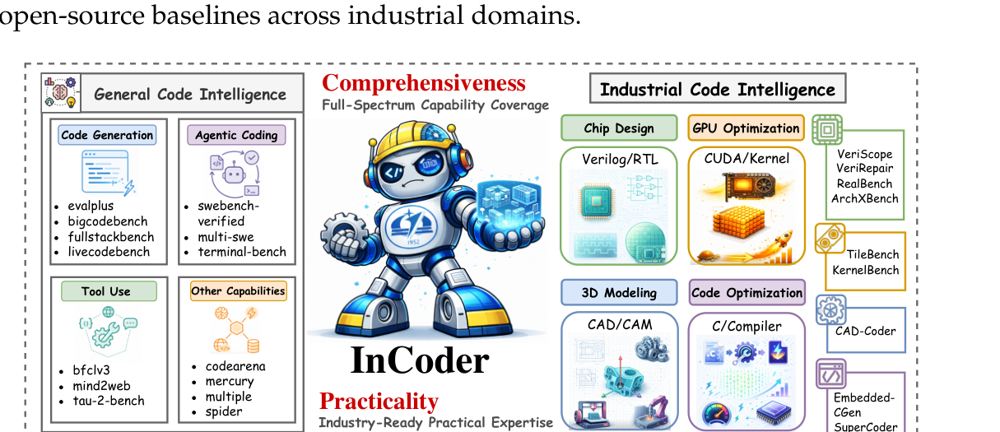
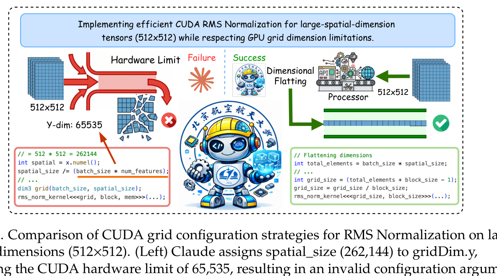
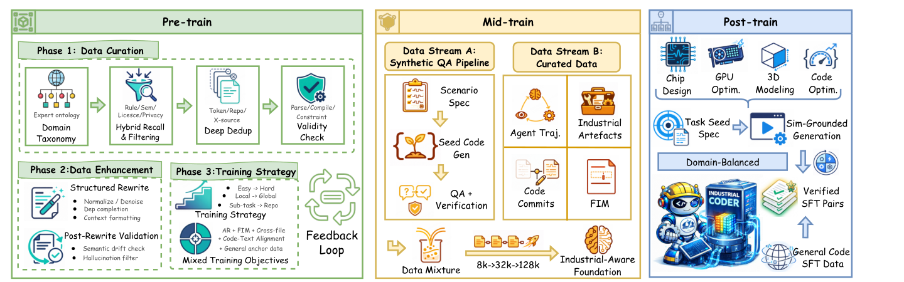
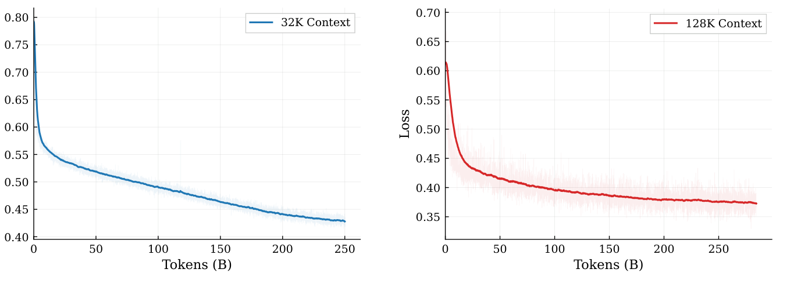
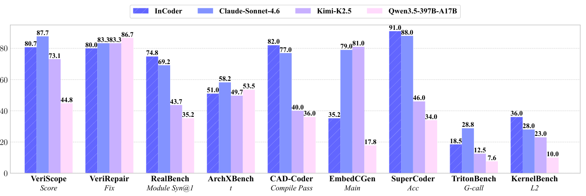
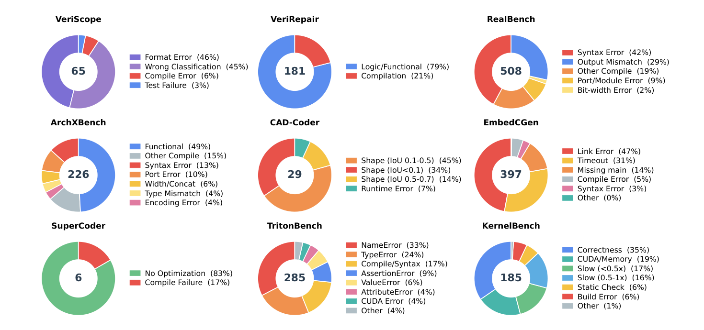
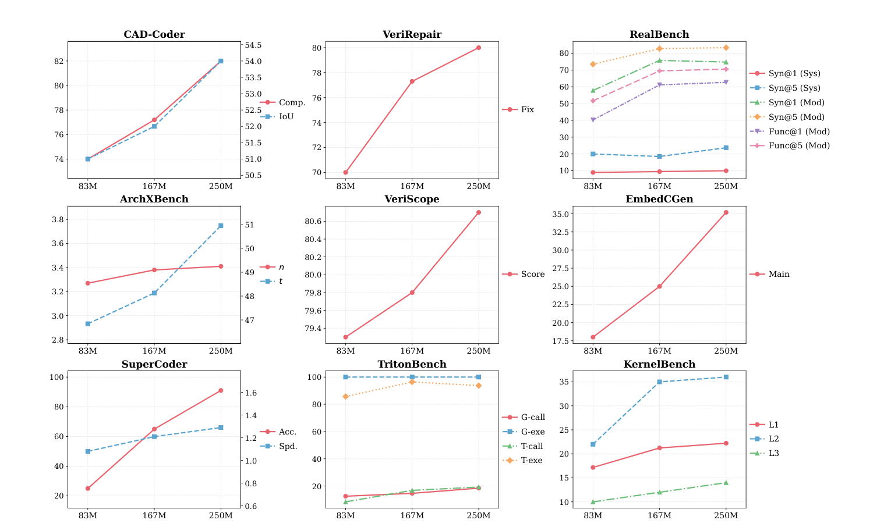

# InCoder-32B：工业代码基础模型与执行验证训练

!!! info "本站判断"
    这页把《InCoder-32B：工业代码基础模型与执行验证训练》当作机制和证据案例来读：先看它真正改变了哪个接口，再看实验、消融、scaling 或失败边界是否支撑这个 claim。

    Checked Date: 2026-06-04；Repro Status: Paper / official materials reviewed, independent reproduction not claimed.

InCoder-32B 这篇报告的核心不是“又一个 32B code model”，而是把 code LLM 的战场从常规 Python/JavaScript 题目，推到更贴近工程现场的工业代码：芯片设计、GPU kernel 优化、嵌入式系统、编译器/低层代码优化和 3D/CAD 建模。

这类任务和普通代码补全的差异很硬：答案不只要语法正确，还要满足时序、资源、接口、硬件限制、编译链、仿真和性能约束。报告给出的路线可以概括成：

```text
工业代码召回、清洗、增强和去重
  + 15T token 从零预训练和工业代码退火
  + 8K -> 32K -> 128K 长上下文 mid-training
  + 仿真/编译/测试/性能验证驱动的 2.5M SFT
  -> 一个面向工业场景的 32B dense code foundation model
```

| Dimension | InCoder-32B |
| --- | --- |
| Model Type | dense decoder-only Transformer |
| Parameters | about 32B |
| Context Length | 128K |
| Main Training Pipeline | pre-train, mid-train, post-train |
| Pre-training Tokens | 15T |
| Pre-training Hardware | 4,096 GPUs |
| Post-training Data | 2.5M execution-grounded SFT samples |
| Target Domains | chip design, GPU optimization, embedded systems, compiler/code optimization, 3D modeling |
| Evaluation | 14 general code benchmarks + 9 industrial benchmarks |
| License | Apache-2.0 |

**阅读边界。**
这是一份模型技术报告，工业 benchmark、对比模型、执行环境和训练细节都应按作者报告理解。它很适合学习“代码模型如何接入真实工具链验证”的工程路线，但不应把所有数值当成第三方独立复现实验结论。

## 论文位置

普通 code LLM 往往擅长 LeetCode、HumanEval、MBPP 或一般仓库级补全，但工业代码有几类额外困难：

| Industrial Constraint | Why General Code LLMs Struggle |
| --- | --- |
| domain-specific languages | Verilog、SystemVerilog、Tcl、HLS pragma、CAD DSL 在公开代码语料里占比低 |
| hardware semantics | 位宽、时序、寄存器传输级语义和综合约束不能只靠语法判断 |
| execution toolchains | 需要 Icarus Verilog、Verilator、Yosys、nvcc、Triton、OpenCascade、Renode 等外部工具 |
| resource constraints | GPU occupancy、shared memory、寄存器压力、嵌入式内存和实时性都会影响答案是否可用 |
| multi-file context | RTL project、kernel library、firmware、CAD 工程常常跨多个文件和配置 |

论文 Figure 1 把这个定位画得很清楚：InCoder 既不只是 general code intelligence，也不只是某个单点工业工具，而是试图用统一基础模型覆盖几类高门槛工业场景。

{ width="920" }

<small>图源：`InCoder-32B: Code Foundation Model for Industrial Scenarios`，Figure 1。原论文图意：InCoder 把 general code intelligence 和 industrial code intelligence 放进同一张图，强调芯片设计、GPU 优化、3D modeling 和 code optimization 等工业任务需要专门训练和验证。</small>

**Figure 1 怎么读。**
图里的重点不是“模型会写很多语言”，而是“模型要懂工具链和约束”。比如 Verilog 生成需要能被综合/仿真，CUDA/Triton 生成需要能跑过 correctness 和 speedup，CAD 代码要产出合法几何体，嵌入式代码要能在目标 MCU 或模拟环境中运行。InCoder 的训练路线正是围绕这些可执行约束组织的。

## 一个小例子：CUDA grid 不是语法问题

论文 Figure 2 用 RMSNorm kernel 展示了一个很典型的工业代码错误。Claude 生成的 CUDA grid 配置把 `spatial_size = 262,144` 直接放到 `gridDim.y`，超过 CUDA 对 y 维度通常 `65,535` 的限制，因此触发 invalid configuration。InCoder 的答案把维度展平为一维 grid，避开了这个硬件边界。

{ width="920" }

<small>图源：`InCoder-32B`，Figure 2。原论文图意：在一个 RMSNorm CUDA kernel 例子中，对比模型生成了超过 CUDA grid dimension 限制的 launch 配置，而 InCoder 通过 flatten dimensions 生成可运行配置。</small>

这个例子说明工业代码能力不能只看“代码看起来像不像”。真正关键的是模型是否学到了：

| Detail | Industrial Meaning |
| --- | --- |
| launch configuration limits | CUDA grid/block 维度有硬上限 |
| tensor shape mapping | 高维张量不能机械映射到 gridDim |
| runtime validation | 代码要能实际编译和运行 |
| performance awareness | 可运行之后还要考虑 occupancy、memory access 和 speedup |

## Code-Flow：三阶段训练路线

InCoder 的训练主线叫 Code-Flow。它把训练拆成三个层次：先从零训练一个强 code base model，再用工业推理和长上下文数据做 mid-training，最后用执行验证过的工业任务做 post-training。

{ width="920" }

<small>图源：`InCoder-32B`，Figure 3。原论文图意：Code-Flow 包含 pre-train、mid-train 和 post-train 三段：pre-train 负责工业代码数据召回、增强、去重和训练策略；mid-train 通过 synthetic QA 与 curated data 把 context 从 8K 扩到 128K；post-train 用仿真驱动生成和 domain-balanced verified SFT pairs 对齐工业任务。</small>

**Figure 3 怎么读。**
左侧 pre-train 是“让模型见过工业代码并学会基本形式”；中间 mid-train 是“让模型能在长上下文里做工业推理和跨文件依赖处理”；右侧 post-train 是“让模型输出能被真实工具链检验的答案”。这三段缺一不可：只做预训练会缺少任务对齐，只做 SFT 会没有足够底座能力，只做长上下文扩展又不能保证答案能编译、仿真或跑得快。

## Stage 1：从零预训练与工业代码退火

报告说 InCoder-32B 是从零开始训练的 decoder-only Transformer，而不是在已有 chat model 上做轻量微调。预训练的关键不是“抓更多 GitHub”，而是提高工业代码密度和可用性。

| Pre-training Detail | Reported Setting |
| --- | --- |
| Objective | autoregressive LM + FIM |
| Total Tokens | 15T |
| Hardware | 4,096 GPUs |
| Global Batch Size | 2,048 |
| Learning Rate | constant `3e-4` |
| Curriculum | function-level single-file -> multi-file project-level |
| Data Balance | retain general code and text in every batch |
| Feedback Loop | periodically evaluate held-out industrial benchmarks and adjust data weights |

工业代码数据的召回和清洗大致分四层：

| Layer | What It Does |
| --- | --- |
| hybrid recall | 用文件扩展名、目录名、关键词、FastText classifier 和 domain semantic encoder 找 Verilog、CUDA、Triton、HLS、Tcl、embedded code |
| domain OCR / web data | 从技术书籍、硬件手册、reference manual 和专业网页补工业语料 |
| deep dedup | hash 去重、token-level MinHash LSH、repo-level fork consolidation、cross-source dedup |
| validity checks | syntax parsing、C/C++ header consistency、GPU kernel config validation、AST comparison、recompilation |

这里最值得学的是“召回”和“有效性”并重。工业代码在通用语料里非常稀疏，如果只靠后缀名会漏掉大量混合工程；但如果召回太宽，又会把模板、过时代码、自动生成文件、无效 demo 和许可证风险带进训练。InCoder 的做法是先尽量召回，再用去重、解析、编译和结构化增强把数据压回可训练分布。

## Stage 2：8K -> 32K -> 128K mid-training

Mid-training 解决的是另一个问题：工业任务常常需要跨文件、跨模块、跨工具日志和规格说明推理。一个 8K context 的代码模型即使单文件能力不错，也很难处理大型 RTL project、Triton kernel library 或固件工程。

论文把 mid-training 拆成两段：

| Stage | Context | Main Data | Training Strategy |
| --- | ---: | --- | --- |
| Stage 2.1 | 8K -> 32K | file-level tasks, RTL modules, kernel functions, testbench generation | direct training on sequences up to 32K without positional interpolation; cosine LR decay |
| Stage 2.2 | 32K -> 128K | large hardware projects, extended debugging, multi-file refactoring | introduce samples longer than 32K from 10% to 50%; reset LR and use another cosine decay |

两段的数据混合也不同：

| Data Type | Stage 2.1 Proportion | Stage 2.2 Proportion |
| --- | ---: | ---: |
| reasoning QA | 40% | 25% |
| agent trajectories | 20% | 30% |
| code commits | 15% | 10% |
| industrial artefacts | 15% | 10% |
| FIM | 10% | 25% |

{ width="920" }

<small>图源：`InCoder-32B`，Figure 7。原论文图意：mid-training 在 32K 和 128K context 两段上 loss 持续下降，128K 阶段通过长序列 warm-up 进入稳定收敛。</small>

**为什么 128K 不是只改 RoPE 参数。**
长上下文能力不只是把 positional encoding 拉长。模型还要见过足够多真正需要长上下文的信息结构：跨文件调用、模块接口、错误日志、工具反馈、长 testbench、kernel tuning 记录和历史 commit。InCoder 的 Stage 2.2 特意把 >32K 的样本比例从 10% 逐步升到 50%，并 replay 5-10% Stage 2.1 数据，目的就是避免模型一上来被超长样本打乱，同时保留较短上下文里的基础能力。

Synthetic industrial code QA 是 mid-training 的核心数据源之一。论文描述的生成链条是：

```text
scenario spec
  -> seed code generation
  -> QA pair synthesis
  -> code execution validation / static analysis / logical consistency checks
```

它覆盖的场景包括 RTL / Verilog / SystemVerilog、Triton / CUDA、C / C++ / Rust kernels、HLS / Vivado、Tcl / Python CAD 和 embedded firmware；推理类型包括 timing、area/power/latency、memory safety、concurrency correctness、numerical precision；任务上下文包括 waveform debugging、assertions、kernel tuning、synthesis error、HW/SW co-design 和 DFT。

## Stage 3：execution-grounded post-training

Post-training 是 InCoder 最贴近工业现场的一段。报告说最终 SFT 数据有 2.5M samples，来自真实工业任务和执行验证链路，训练约 4.9K steps，global batch size 为 512。

| Post-training Detail | Reported Setting |
| --- | --- |
| SFT Samples | 2.5M |
| Steps | about 4.9K |
| Global Batch Size | 512 |
| Sample Types | direct solution, defect repair, performance / structural optimization |
| Domains | hardware design, GPU kernel development, systems programming, embedded firmware |
| Verification | compilation, simulation, tests, unit tests, profiling, formal checking |

这段数据不是普通“题目-答案”格式，而是带执行反馈的闭环：

```text
task seed spec
  -> candidate solution
  -> compiler / simulator / test / profiler / formal checker
  -> error logs, counterexamples, waveform diffs, bottleneck reports
  -> repaired solution
  -> verified SFT pair or trajectory
```

这正是 InCoder 和普通 instruction tuning 的差别。工业代码的正确答案经常要经过多轮修复：第一次可能编译失败，第二次语义不对，第三次过 correctness 但性能慢，第四次才达到任务要求。把这些失败、反馈和修复轨迹放进 SFT，模型才可能学到“看日志 -> 定位问题 -> 改代码 -> 再验证”的工程行为。

## 执行环境：评价也是训练信号的一部分

报告花了不少篇幅说明工业 benchmark 的执行环境，因为这些环境决定了“正确”怎么被定义。

| Domain | Execution / Validation Environment | What It Measures |
| --- | --- | --- |
| chip design | Icarus Verilog, Verilator, Yosys | syntax, simulation, synthesis, functional behavior |
| GPU optimization | A100 GPU, PyTorch runtime compilation, nvcc, Triton compiler | correctness, speedup, valid launch, kernel performance |
| 3D modeling | CadQuery, OpenCascade, STEP / STL comparison, volumetric metrics | geometric validity, shape similarity, CAD code execution |
| embedded firmware | STM32F407, `arm-none-eabi-gcc`, CMSIS, linker scripts, Renode | compileability, runtime behavior, peripheral logic |
| code optimization | fixed CPU frequency, pinned cores, repeated measurements | functional equivalence and stable speedup |

这类 setup 的意义很大：它把模型输出从“文本答案”变成“能被工具链判定的工程对象”。也因此，InCoder 的训练和评测强依赖 execution harness。换句话说，模型能力的一部分其实来自“数据生成和验证系统”。

## 模型配置

论文 Appendix A 给出 InCoder-32B 的模型配置。表头和字段保留英文，方便和原表对应。

| Model Configuration | InCoder-32B |
| --- | --- |
| Parameters | ~32B |
| Layers | 64 |
| Hidden Size | 5120 |
| Intermediate Size | 27648 |
| Attention Heads | 40 |
| KV Heads (GQA) | 8 |
| Head Dimension | 128 |
| Vocabulary Size | 76800 |
| Max Context Length | 131072 |
| Activation | SiLU |
| Positional Encoding | RoPE (theta = 500000) |
| Precision | BFloat16 |
| Tie Embeddings | No |

<small>表源：`InCoder-32B`，Table 6。原论文表意：InCoder-32B 是 64 层、hidden size 5120、GQA 40/8 heads、最大上下文 131072 的 dense decoder-only Transformer。</small>

从配置看，InCoder-32B 的架构并不靠非常奇特的新模块取胜。它的主要新意在训练数据、长上下文课程、工业任务验证和后训练闭环。对学习者来说，这一点很重要：工业代码模型的差异可能更多来自数据和工具链，而不是一个醒目的 attention 公式。

## 通用代码评测：先不能掉队

InCoder 的目标是工业代码，但它不能为了工业能力牺牲通用代码能力太多。报告在 14 个通用代码 benchmark 上评估，下面只摘 InCoder-32B 的关键行，保留原论文表头。

| Model | Size | EvalPlus HumanEval | HumanEval+ | MBPP | MBPP+ | BigCodeBench Full | Hard | FullStackBench |
| --- | ---: | ---: | ---: | ---: | ---: | ---: | ---: | ---: |
| InCoder | 32B | 94.5 | 89.6 | 91.8 | 78.3 | 49.8 | 31.1 | 57.1 |

<small>表源：`InCoder-32B`，Table 1 摘录。原论文表意：InCoder-32B 在常规代码生成 benchmark 上保持强竞争力。</small>

| Model | Size | CruxEval Input-COT | Output-COT | LiveCodeBench V5 | V6 | Mercury Beyond@1 | Pass@1 | Bird | Spider |
| --- | ---: | ---: | ---: | ---: | ---: | ---: | ---: | ---: | ---: |
| InCoder | 32B | 62.4 | 73.9 | 53.3 | 49.1 | 71.4 | 85.6 | 55.4 | 79.7 |

<small>表源：`InCoder-32B`，Table 2 摘录。原论文表意：InCoder-32B 在代码推理、竞赛式代码和 Text2SQL 类任务上也维持较好水平。</small>

| Model | Size | Terminal-Bench v1.0 | v2.0 | SWE-bench Verified | Mind2Web | BFCL V3 | tau2-bench Airline | Retail | Telecom |
| --- | ---: | ---: | ---: | ---: | ---: | ---: | ---: | ---: | ---: |
| InCoder | 32B | 35.0 | 22.5 | 74.8 | 55.8 | 61.0 | 70.0 | 85.1 | 86.8 |

<small>表源：`InCoder-32B`，Table 3 摘录。原论文表意：InCoder-32B 在 terminal、SWE-bench、web、function calling 和 tau2-bench 等 agentic coding / tool-use benchmark 上有较强表现。</small>

这里的读法是：通用 benchmark 不是论文的终点，而是护栏。如果工业训练把一般代码能力损坏得太厉害，那模型就会变成窄域工具，不是 code foundation model。InCoder 报告希望证明的是：工业增强可以在不明显牺牲通用能力的情况下进行。

## 工业评测：真正的主战场

Figure 4 是论文最重要的结果图之一，横跨 9 个工业 benchmark：VeriScope、VeriRepair、RealBench、ArchXBench、CAD-Coder、EmbedCGen、SuperCoder、TritonBench 和 KernelBench。

{ width="920" }

<small>图源：`InCoder-32B`，Figure 4。原论文图意：InCoder 在 9 个工业 benchmark 上和 Claude-Sonnet-4.6、Kimi-K2.5、Qwen3.5-397B-A17B 等模型对比，突出其在工业代码任务上的整体优势。</small>

论文的工业结果可以拆成两张表来读。第一张偏芯片设计：

| Model | Size | VeriScope Score | VeriRepair Fix (%) | RealBench System Syn@1 | Syn@5 | Module Syn@1 | Syn@5 | Func@1 | Func@5 | ArchXBench n | t |
| --- | ---: | ---: | ---: | ---: | ---: | ---: | ---: | ---: | ---: | ---: | ---: |
| InCoder | 32B | 80.7 | 80.0 | 10.0 | 23.7 | 74.8 | 83.3 | 62.7 | 70.5 | 3.4 | 51.0 |

<small>表源：`InCoder-32B`，Table 4 摘录。原论文表意：InCoder-32B 在 Verilog/RTL 相关的分类、修复、综合和功能通过率上显著强于多数开放模型。</small>

第二张偏 GPU、嵌入式、代码优化和 CAD：

| Model | Size | CAD-Coder Comp. | IoU | EmbedCGen Main (%) | SuperCoder Acc. (%) | Spd. | TritonBench G-call | G-exe | T-call | T-exe | KernelBench L1 | L2 | L3 |
| --- | ---: | ---: | ---: | ---: | ---: | ---: | ---: | ---: | ---: | ---: | ---: | ---: | ---: |
| InCoder | 32B | 82.0 | 53.5 | 35.2 | 91.0 | 1.3x | 18.5 | 100.0 | 19.3 | 93.8 | 22.2 | 36.0 | 14.0 |

<small>表源：`InCoder-32B`，Table 5 摘录。原论文表意：InCoder-32B 在 CAD、embedded C、assembly / code optimization、Triton 和 KernelBench 等任务上表现出更强工业适配性。</small>

**工业 benchmark 不能只看平均分。**
不同 benchmark 的得分含义差别很大。VeriRepair 是修复率，RealBench 同时看 synthesis 和 function pass，SuperCoder 同时看 accuracy 和 speedup，TritonBench 区分 generation call 和 execution，KernelBench 还按任务层级拆分。把这些数值简单平均会掩盖重要信息：有些任务是“能不能编译”，有些是“功能是否正确”，有些是“正确之后是否足够快”。

## 错误分析：模型还卡在哪里

论文不只报成功率，也人工检查了 1,882 个失败案例，并给出各工业 benchmark 的错误分布。

{ width="920" }

<small>图源：`InCoder-32B`，Figure 5。原论文图意：作者手动检查 1,882 个失败样本，按 benchmark 统计错误类别，包括格式错误、分类错误、功能逻辑错误、编译/链接错误、timeout、CUDA/memory error 和性能不足等。</small>

几个结论很值得记：

| Benchmark | Main Failure Modes |
| --- | --- |
| VeriScope | Format Error 46%, Wrong Classification 45% |
| VeriRepair | Logic / Functional 79%, Compilation 21% |
| RealBench | Syntax Error 42%, Output Mismatch 29%, Other Compile 19% |
| EmbedCGen | Link Error 47%, Timeout 31%, Missing main 14% |
| TritonBench | NameError 33%, TypeError 24%, Compile / Syntax 17% |
| KernelBench | Correctness 35%, CUDA / Memory 19%, Slow 33% combined |

这张图的价值在于提醒我们：工业代码模型的失败不是单一形态。Verilog 可能错在格式或模块接口，嵌入式 C 可能卡在链接和主函数，Triton 可能是 Python 名称和类型问题，KernelBench 可能功能正确但性能不够。后续改进也就不能只靠“更多 SFT”，而要按错误类型改数据、工具反馈、reward 或 decoding 策略。

## SFT scaling：更多工业 SFT 是否有用

Figure 6 做了 SFT data scaling，从 83M tokens 扩到 250M tokens，观察工业 benchmark 的变化。

{ width="920" }

<small>图源：`InCoder-32B`，Figure 6。原论文图意：随着工业 SFT token 从 83M 增加到 250M，大多数 benchmark 指标提升；少数 RealBench/TritonBench 子指标在最大数据量处有轻微回落，但整体仍显示工业 SFT 数据扩展有效。</small>

**Figure 6 怎么读。**
这张图不是在说“盲目堆 SFT 一定更好”。更稳的读法是：在执行验证和数据过滤足够强的前提下，工业 SFT 数据规模仍然能推动能力上升。少数指标回落则说明混合比例、任务难度、格式分布和验证信号仍需要精调。工业 post-training 更像数据引擎问题，而不是一次性标注问题。

## 这篇报告真正教会我们的东西

如果只看模型大小，InCoder-32B 并不夸张；如果只看 benchmark，它也容易被读成“又一个榜单”。更有价值的是它把工业代码模型拆成了一套可复用工程模板：

| Lesson | InCoder Example |
| --- | --- |
| domain recall matters | 先把稀有工业语料从通用代码海洋里找出来 |
| validation must enter data pipeline | 编译、解析、仿真、性能测试不只用于最终评测，也用于清洗和后训练 |
| long context needs domain-shaped data | 128K 要训练在跨文件工程、日志、规格和工具反馈上 |
| post-training should include failures | 失败日志、counterexample、waveform diff 和 profiler bottleneck 是高价值训练信号 |
| benchmarks should be executable | 工业能力的证据来自可运行工具链，而不只是人工偏好评分 |

这也解释了为什么论文中的 Code-Flow 比单个模型 checkpoint 更重要。InCoder 的能力来自模型、数据、执行环境和评测 harness 的耦合；如果只拿 checkpoint 去一个没有工具链的普通 chat UI 里问答，很难体现它的主要价值。

## 局限与不能外推

这篇报告也有明显边界：

1. 工业 benchmark 多数由作者构建或整合，仍需要第三方复现和更广泛的真实企业任务验证。
2. 执行环境虽然比普通代码评测真实，但仍是抽象后的 harness，不等于完整生产环境。
3. 错误分析显示模型仍会犯格式、接口、编译、链接、逻辑和性能错误，不能当作无需审核的自动工程师。
4. 32B dense model 的训练成本很高，报告中的 4,096 GPUs、15T tokens 和多阶段数据引擎不是轻量 recipe。
5. 工业代码强依赖工具链版本、硬件平台和项目约束，离线 benchmark 分数不能直接保证迁移到所有公司内部代码库。

更稳的结论是：InCoder-32B 说明工业代码模型的关键路线已经从“写代码文本”转向“在执行环境中学习和验证工程约束”。它没有终结工业软件工程，但给出了一套很清晰的训练系统蓝图。

## 站内延伸

- [数据质量、去重与治理](../../training/data-quality-dedup-and-governance.md)：对应 InCoder 的工业代码召回、license/PII 过滤、MinHash 去重和 repo-level consolidation。
- [训练输入管线、packing 与吞吐治理](../../training/input-pipelines-packing-and-throughput-governance.md)：对应 15T token 预训练、长上下文样本和多任务混合。
- [后训练数据引擎与 Judge 模型](../../training/post-training-data-engines-and-judge-models.md)：对应 execution-grounded SFT、失败反馈修复和验证过滤。
- [Triton 编程模型与自动调优](../../operators/triton-programming-model-and-autotuning.md)：对应 TritonBench、KernelBench 和 GPU kernel optimization。
- [自定义算子开发与框架集成](../../operators/custom-op-development-and-framework-integration.md)：对应 CUDA/Triton kernel、PyTorch runtime compilation 和性能验证。
- [RAG、Agent 与长上下文系统](../../inference/rag-agents-and-long-context-systems.md)：对应 agent trajectories、long-context 工程任务和工具调用记录。

**阅读结论。**
InCoder-32B 要按代码模型训练与工业评测读：方法重点是代码流数据、CUDA/grid 范围、SFT scaling 和 midtrain loss；实验看工业 benchmark、错误分布和能力分层。错误分布图比总分更有用，它告诉项目该补语法、API、库知识还是执行反馈；落地时还要补仓库级上下文、工具执行和安全审计。

## 相关阅读与下一步

- 外部材料：[论文标题 arXiv 检索](https://arxiv.org/search/?query=InCoder-32B%3A+Code+Foundation+Model+for+Industrial+Scenarios&searchtype=title)。
- 外部材料：[Semantic Scholar 标题检索](https://www.semanticscholar.org/search?q=InCoder-32B%3A+Code+Foundation+Model+for+Industrial+Scenarios)。
- 外部材料：[Papers with Code 检索](https://paperswithcode.com/search?q=InCoder-32B%3A+Code+Foundation+Model+for+Industrial+Scenarios)。
- 站内下一步：[论文精读专题](../index.md)。
- 站内下一步：[论文专题写作规范](../writing-standard.md)。
- 站内下一步：[外部精读来源台账](../../references/external-reading-ledger.md)。
