# Kimi K2：MuonClip、万亿 MoE 与 Agent 数据

!!! info "论文信息"
    **论文题名：** Kimi K2: Open Agentic Intelligence。<br>
    **作者：** Kimi Team、Yifan Bai、Yiping Bao、Y. Charles、Cheng Chen、Guanduo Chen、Haiting Chen、Huarong Chen、Jiahao Chen、Ningxin Chen 等（共 200 人）。<br>
    **机构：** 未在公开元数据中稳定解析；以 arXiv/PDF 或官方页 affiliation block 为准。<br>
    **时间 / 主题：** 2025-07；技术报告。<br>
    **arXiv / 官方报告：** arXiv：[2507.20534](https://arxiv.org/abs/2507.20534)；官方材料：[huggingface.co/moonshotai/Kimi-K2-Instruct](https://huggingface.co/moonshotai/Kimi-K2-Instruct)。<br>
    **GitHub / 项目：** GitHub：[github.com/MoonshotAI/checkpoint-engine](https://github.com/MoonshotAI/checkpoint-engine)；项目页：[huggingface.co/moonshotai/Kimi-K2-Instruct](https://huggingface.co/moonshotai/Kimi-K2-Instruct)。<br>
    **元数据来源与核验口径：** 来源：[arXiv](https://arxiv.org/abs/2507.20534)；[GitHub API / repo](https://github.com/MoonshotAI/checkpoint-engine)；[官方 / 项目材料](https://huggingface.co/moonshotai/Kimi-K2-Instruct)；Checked Date：2026-06-15；Repro Status：Paper / official materials reviewed, independent reproduction not claimed。

## 原论文故事线

### 研究背景

Kimi K2 报告讨论的是 open agentic intelligence。文本 LLM 评测已经从静态问答转向工具使用、代码执行、多步任务、浏览和环境交互；同时，高质量预训练 token 越来越稀缺，单纯堆更多数据的边际收益下降。Kimi K2 试图把大规模 MoE base model、Muon 系优化器和 agentic post-training 放到同一个系统里。

### 问题（Challenge）

论文要解决的问题是：如何把开源模型训练成强 agent，而不仅是聊天模型。挑战分两层：预训练阶段要用可控激活成本训练 1T 级总参数 MoE，并避免 attention logits、optimizer update 和 routing 不稳定；后训练阶段要构造能覆盖工具、代码、多轮任务和环境反馈的数据与 RL 流程。这个问题有价值，因为 agent 能力依赖长期任务执行和反馈闭环，不能只靠静态指令微调。

### Finding

Kimi K2 的 finding 是：agentic model 的能力来自预训练 token efficiency 和后训练交互数据的共同设计。报告把 MuonClip 用作稳定高效预训练的核心，把 agent 数据和 RL 用作把 base model 转成行动模型的核心。这个 insight 把“模型更大”翻转为“每个 token 更有效、每个后训练样本更接近真实 agent 行为”：大 MoE 提供容量，MuonClip 让容量训练稳定，工具/代码/环境数据让模型学会多步行动。

### 方法

模型是 1.04T total parameters、约 32B activated parameters 的 MoE，包含 MLA、384 experts 等设计。预训练使用约 15.5T tokens，并用 MuonClip 稳定优化：在 Muon 基础上加入 weight decay、RMS matching、QK-Clip 等机制控制更新和 attention logits。后训练包含指令数据、代码和工具使用数据、agentic task 数据，以及 RL / 环境反馈训练，让模型在工具调用、代码执行和多步任务中学习。输出是 Kimi K2 base / instruct / agentic model。

### 结论

报告在通用知识、数学、代码、工具使用、agent benchmark 和开放模型对比上展示 Kimi K2 的能力，并强调其在 agentic coding / tool use 上的表现。消融和系统讨论指向 MuonClip 对稳定预训练的重要性，以及 agent 数据对多步任务的贡献。边界是官方报告未完全公开所有数据和训练细节；agent benchmark 和真实产品任务之间仍有差距，环境反馈质量会显著影响泛化。

### 关键术语

- **Agentic Intelligence（智能体能力）**：使用工具、执行代码、规划多步任务并根据反馈调整的能力
- **MuonClip（MuonClip 优化器）**：在 Muon 基础上加入 clipping / matching 机制以稳定大模型预训练
- **QK-Clip（QK 裁剪）**：控制 attention query-key logits 爆炸的稳定化手段
- **Activated Parameters（激活参数）**：MoE 每个 token 实际参与计算的参数量
- **Environment Feedback（环境反馈）**：来自执行器、工具、仿真环境或真实任务结果的训练信号

从技术路线看，Kimi K2 有三条主线：

| 线索 | Kimi K2 的做法 | 为什么重要 |
| --- | --- | --- |
| 大规模 MoE base model | 1.04T total params、32B activated params、384 experts、MLA、15.5T pre-training tokens | 用更高 sparsity 扩大模型容量，同时控制每 token 激活计算 |
| 稳定高效预训练 | MuonClip = Muon + weight decay + RMS matching + QK-Clip | 继承 Muon 的 token efficiency，同时压制 attention logits explosion |
| Agent 后训练 | 大规模 tool-use synthetic data、verifiable rewards、self-critique rubric reward、agentic rollout infra | 把静态 SFT 扩展到工具调用、代码环境、主观偏好和多轮交互 |

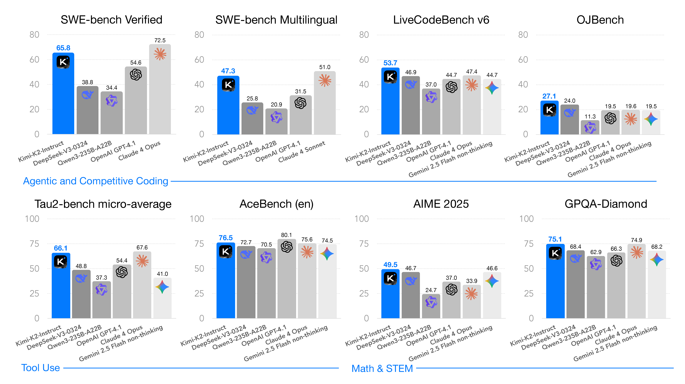{ width="920" }

<small>图源：`Kimi K2: Open Agentic Intelligence`，Figure 1，来自 arXiv source 包 `figures/k2-bench-bar-chart.pdf` 转 PNG。原图展示 Kimi K2 在非 thinking 设置下的主要 benchmark 结果，突出 coding、tool use、math/STEM 与 general tasks。</small>

**这张主结果图怎么读。**
报告强调所有模型都在 non-thinking setting 下评测。也就是说，Kimi K2 的定位不是像 DeepSeek-R1 / Qwen3 thinking mode 那样主要靠长 CoT test-time scaling，而是希望在普通非长思考模式下具备很强的 agent、代码、工具和通用能力。

这会影响我们解读分数：SWE-bench、Tau2-Bench、ACEBench 这些任务更接近“模型是否能执行任务流程”，不是单纯知识问答。因此 Kimi K2 的亮点更偏 agentic capability，而不是只在数学榜单上卷。

## 论文位置

Kimi K2 可以放在 DeepSeek-V3、DeepSeek-R1、Qwen3 之后一起看：

| Report | Core emphasis | Training / post-training signal |
| --- | --- | --- |
| DeepSeek-V3 | MoE、MLA、FP8、DualPipe、低成本大规模预训练 | 预训练和系统工程共设计 |
| DeepSeek-R1 | 可验证任务上的大规模 RLVR，推理行为自然涌现 | GRPO、rule-based reward、long CoT |
| Qwen3 | thinking / non-thinking 双模式、thinking budget、强到弱蒸馏 | 四阶段后训练、GRPO、distillation |
| Kimi K2 | open agentic intelligence，工具使用和软件工程能力 | MuonClip 预训练、大规模 agentic data synthesis、general RL |

它和 DeepSeek-R1 的区别很明显：Kimi K2 不是把主线放在长推理模型，而是放在 **non-thinking agentic model**。它关注的任务更多是软件工程、工具调用、多轮环境交互、复杂指令和开放偏好。换句话说，K2 的问题不是“模型能不能想很久”，而是“模型能不能在真实任务流程中行动得更稳”。

它和 DeepSeek-V3 的关系则更像工程路线的继续：架构上同样借鉴 MLA + ultra-sparse MoE，但 K2 把优化器从 AdamW / FP8 训练叙事转向 MuonClip，把后训练重点转向工具、沙箱、agentic rollout 和 self-critique reward。

## 模型规模与架构

Kimi K2 是一个 trillion-parameter MoE Transformer，报告中的关键规模如下：

| Item | Kimi K2 |
| --- | --- |
| Total Parameters | 1.04T |
| Activated Parameters | 32.6B |
| Pre-training Tokens | 15.5T |
| Context Window in Main Pre-training | 4,096 tokens |
| Long-context Activation | 400B tokens at 4K, then 60B tokens at 32K |
| Extended Context Method | YaRN to 128K |
| Attention | Multi-head Latent Attention (MLA) |
| Experts | 384 total experts, 8 active per token, 1 shared expert |
| Optimizer | MuonClip |

论文 Table 1 对 Kimi K2 和 DeepSeek-V3 做了结构对比，保留原英文列名如下：

|  | DeepSeek-V3 | Kimi K2 | Δ |
| --- | ---: | ---: | --- |
| #Layers | 61 | 61 | = |
| Total Parameters | 671B | 1.04T | ↑ 54% |
| Activated Parameters | 37B | 32.6B | ↓ 13% |
| Experts (total) | 256 | 384 | ↑ 50% |
| Experts Active per Token | 8 | 8 | = |
| Shared Experts | 1 | 1 | = |
| Attention Heads | 128 | 64 | ↓ 50% |
| Number of Dense Layers | 3 | 1 | ↓ 67% |
| Expert Grouping | Yes | No | - |

<small>表源：`Kimi K2: Open Agentic Intelligence`，Table 1。原论文表意：Kimi K2 相比 DeepSeek-V3 扩大 total parameters 和 expert 数，但降低 activated parameters、attention heads 和 dense layers。</small>

这张表里最值得注意的是两个相反方向：K2 的 total parameters 从 671B 增到 1.04T，但 activated params 从 37B 降到 32.6B。也就是说，它不是把每个 token 的计算都做得更重，而是通过更高 sparsity 扩大可用专家容量。

**Ultra-sparse MoE 怎么理解。**
MoE 的直觉是“每个 token 不必经过所有 FFN 专家”。Kimi K2 有 384 个 experts，每个 token 只激活 8 个，再加 1 个 shared expert。这样 total capacity 很大，但单 token 计算接近 32B activated params。

这种设计的代价是系统复杂度：routing、expert load balance、EP 通信、显存布局和训练稳定性都会更难。K2 报告选择更高 sparsity，本质是在“模型容量”和“系统复杂度”之间押注：如果基础设施能撑住，高 sparsity 能给同等 FLOPs 更低 loss。

## Sparsity Scaling Law

Kimi K2 的模型选择来自一组 sparsity scaling law 实验。报告把 sparsity 定义为 total experts / activated experts。在固定 activated experts 为 8、shared experts 为 1 的情况下，提高 total experts 可以在固定 activated parameters / FLOPs 时降低训练和验证 loss。

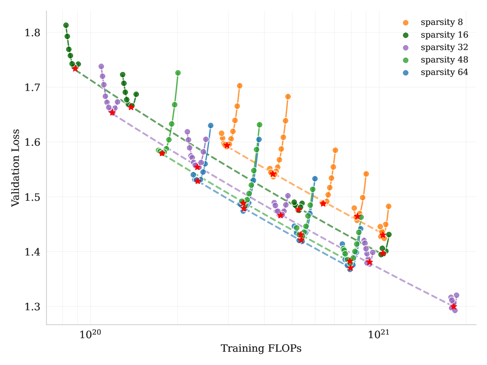{ width="760" }

<small>图源：`Kimi K2: Open Agentic Intelligence`，Figure 5，来自 arXiv source 包 `figures/scaling_law_validation_loss.pdf` 转 PNG。原图展示在固定 activated experts 和 shared experts 时，提高 sparsity 会降低 validation loss。</small>

报告中一个具体结论是：在 compute-optimal sparsity scaling law 下，为达到相同 validation loss 1.5，sparsity 48 相比 sparsity 8、16、32 分别减少 1.69×、1.39×、1.15× FLOPs。Kimi K2 最终选择 sparsity 48，也就是 384 total experts / 8 active experts。

但 K2 没有盲目增加 attention heads。报告还做了 attention heads 的 scaling 对比：把 attention heads 翻倍只带来约 0.5% 到 1.2% validation loss 降低，但在 128K 序列长度下会显著增加推理 FLOPs。

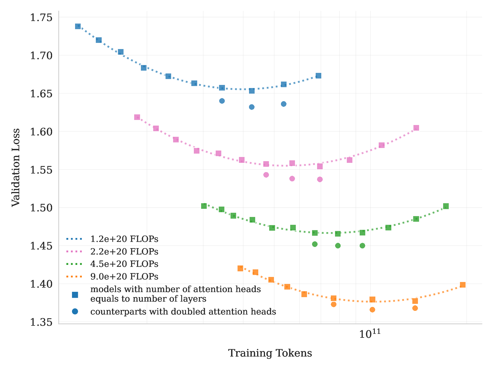{ width="760" }

<small>图源：`Kimi K2: Open Agentic Intelligence`，Figure 6，来自 arXiv source 包 `figures/doubleQheads.pdf` 转 PNG。原图比较 attention heads 等于 layers 与 doubled attention heads 的 scaling curves。</small>

**两张 scaling 图要一起读。**
Figure 5 说明在固定 active experts 时提高 sparsity 能降低 validation loss；Figure 6 则说明翻倍 attention heads 的收益很小但长上下文成本会上升。两张图合在一起支撑 K2 的架构选择：容量优先放到 MoE experts，而不是把 attention 头数继续做大。

这里的工程判断很清楚：agentic 应用常常需要长上下文，如果 attention head 数太多，推理成本会在长序列下放大。K2 宁愿把容量放到 MoE experts 上，而不是把 attention heads 翻倍。

## MuonClip：为什么 K2 不只用 AdamW

Kimi K2 的预训练优化器是 MuonClip。它的背景是：Moonshot 团队认为 Muon 在相同 compute budget、model size 和 training data 下比 AdamW 更 token-efficient，但直接把 Muon 扩到大规模 MoE 会遇到 attention logits explosion。

普通 attention logits 是：

$$
\operatorname{softmax}\left(\frac{1}{\sqrt d}QK^\top\right).
$$

如果 \(W_q\) 或 \(W_k\) 的谱范数持续长大，\(QK^\top\) 的最大值会爆，softmax 进入极端饱和区，训练可能出现 loss spike 甚至 divergence。报告指出，logit soft-cap 是在 logits 已经算出来后截断；QK-Norm 又不适合 MLA，因为 MLA 的 Key matrices 在推理时不是完全 materialized。因此 K2 采用 QK-Clip：**在参数更新后，根据每个 attention head 的最大 logit 反向缩放 query/key projection weights。**

论文中的 max logit 定义为：

$$
S_{\max}^{h}=
\frac{1}{\sqrt d}
\max_{\mathbf X\in B}\max_{i,j}
\mathbf Q_i^{h}\mathbf K_j^{h\top}.
$$

当某个 head 的 \(S_{\max}^{h}>\tau\) 时，用 \(\gamma_h=\min(1,\tau/S_{\max}^{h})\) 做 per-head 缩放。对 MLA，报告只裁剪 unshared head components：\(\mathbf q^C\)、\(\mathbf k^C\)、\(\mathbf q^R\)，不动 shared rotary \(\mathbf k^R\)，避免一个 head 的裁剪影响其他 heads。

**MuonClip 的关键不是“把 logit 截断”。**
QK-Clip 不改变当前 step 的 forward / backward 计算，也不是直接把 softmax 输入硬截断。它是在 optimizer step 之后，借助当前 batch 观测到的 max logit，缩放 \(W_q/W_k\) 的部分参数，阻止下一步继续放大。

这类设计很适合大规模训练：它不是频繁改 loss，也不是给每层都加额外 normalization，而是只在某些 head 超阈值时介入。报告附录还说 K2 中 QK-Clip 在前 70000 steps 有 12.7% heads 至少触发一次，之后所有 heads 都降到阈值以下，机制自然失活。

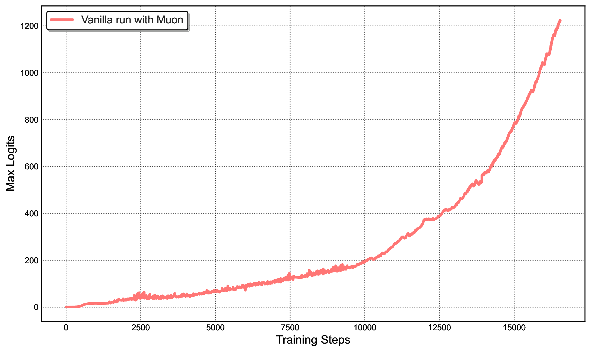{ width="460" .atlas-figure-compact }

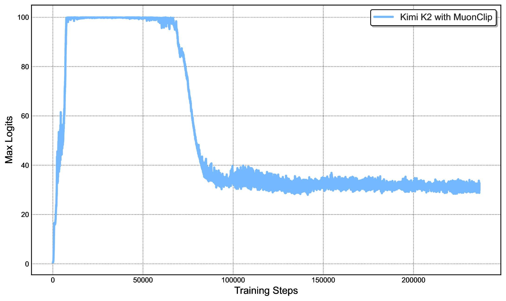{ width="460" .atlas-figure-compact }

<small>图源：`Kimi K2: Open Agentic Intelligence`，Figure 2 左右子图，来自 arXiv source 包 `figures/muon-MN-max-logits.pdf` 与 `figures/muon-K2-max-logits.pdf` 转 PNG。原图左侧展示 mid-scale Muon 训练中 attention logits 快速超过 1000；右侧展示 Kimi K2 使用 MuonClip 且 \(\tau=100\) 时 max logits 被稳定控制。</small>

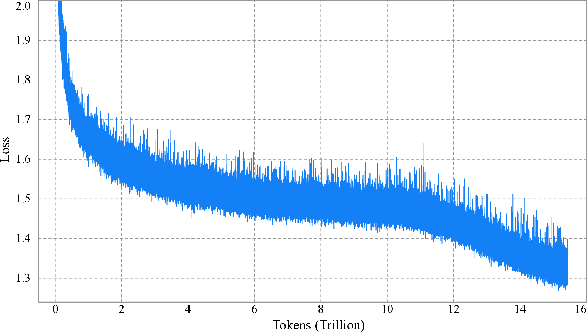{ width="760" }

<small>图源：`Kimi K2: Open Agentic Intelligence`，Figure 3，来自 arXiv source 包 `figures/loss_vs_tokens_white.pdf` 转 PNG。原图展示 Kimi K2 per-step training loss curve，强调未 smoothing / 未 sub-sampling，整个训练过程无 spike。</small>

**logit 曲线和 loss 曲线要连起来读。**
Figure 2 看的是 Muon 不受控时 attention logits 会爆、MuonClip 如何把 max logits 压回阈值；Figure 3 看的是这种控制有没有反映到长程训练稳定性上。它们共同支撑“MuonClip 是大规模训练稳定性补丁”，但不能单独证明 Muon 一定比 AdamW 在所有数据和模型规模上更好。

训练稳定性是这篇报告最值得认真看的部分之一。很多模型报告只给最终 benchmark，K2 把“为什么能用 Muon 训练 1T MoE 不炸”写得比较具体。它说明大模型训练的优化器选择不是简单换名字：Muon 的 token efficiency 需要 QK-Clip 这类稳定性补丁才能安全扩展到 trillion-scale MoE。

## 预训练数据：用 rephrasing 提高 token utility

Kimi K2 的 pre-training corpus 是 15.5T tokens，覆盖 Web Text、Code、Mathematics、Knowledge 四类主要域。报告特别强调 token utility：当高质量人类数据越来越有限时，单纯堆重复 epoch 容易过拟合，关键是让每个 token 带来更多有效学习信号。

K2 的做法是对高质量知识与数学数据进行受控 rephrasing，而不是简单重复原文。

| Data / Processing | Kimi K2 Detail |
| --- | --- |
| Knowledge data rephrasing | style- and perspective-diverse prompting、chunk-wise autoregressive generation、fidelity verification |
| Mathematics data rephrasing | rewrite high-quality mathematical documents into learning-note style; translate high-quality math materials into English |
| Data domains | Web Text、Code、Mathematics、Knowledge |
| Quality control | correctness / quality validation, targeted data experiments |

论文 Table 2 展示了 SimpleQA 上的对比，保留原英文列名：

| # Rephrasings | # Epochs | SimpleQA Accuracy |
| ---: | ---: | ---: |
| 0 (raw wiki-text) | 10 | 23.76 |
| 1 | 10 | 27.39 |
| 10 | 1 | 28.94 |

<small>表源：`Kimi K2: Open Agentic Intelligence`，Table 2。原论文表意：比起直接重复原始 wiki-text，多次 rephrasing 且单 pass 训练在 SimpleQA 上更好。</small>

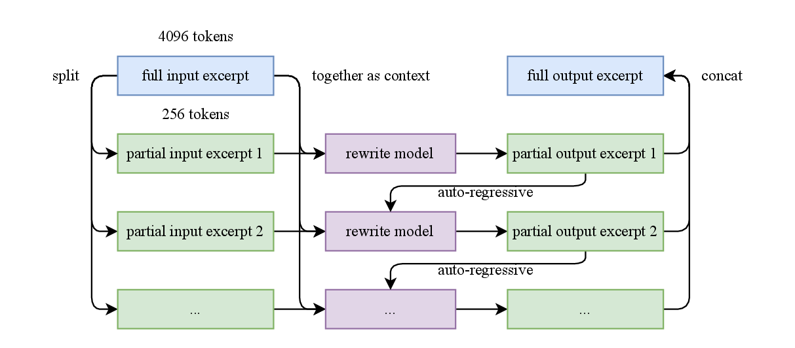{ width="820" }

<small>图源：`Kimi K2: Open Agentic Intelligence`，Figure 4，来自 arXiv source 包 `figures/synthetic_data_rephrase.pdf` 转 PNG。原图展示 long input excerpts 的 auto-regressive chunk-wise rephrasing pipeline。</small>

**rephrasing 和普通数据增强的差别。**
K2 这里不是为了把文本改得“花哨”，而是为了在保持事实一致的前提下，让模型用不同表述、不同结构和不同视角重新吸收同一份高价值知识。它比重复 epoch 更不容易让模型只记住表面 token sequence。

风险也在报告里写得很清楚：synthetic rephrasing 可能带来事实漂移、幻觉、毒性和 domain generalization 问题，所以需要 fidelity verification 和按语料源控制 rephrasing 次数。K2 报告说每个 corpus 最多 rephrase 两次。

## 训练基础设施

Kimi K2 使用 NVIDIA H800 集群训练。每个节点有 8 张 GPU，通过 NVLink / NVSwitch 连接，跨节点使用 \(8\times400\) Gbps RoCE。

训练并行策略如下：

| Parallelism / Memory Strategy | Kimi K2 Setup | Why it matters |
| --- | --- | --- |
| Pipeline Parallelism | 16-way PP with virtual stages | 支撑 1T MoE 参数分布 |
| Expert Parallelism | 16-way EP | 降低 EP group 开销，并适配 64 attention heads 后的较短 attention compute time |
| Data Parallelism | ZeRO-1 DP | 分摊 optimizer / gradient 状态 |
| Model-parallel group | 256 GPUs | BF16 parameters + FP32 gradient accumulation buffer 约 6TB |
| Selective recomputation | LayerNorm、SwiGLU、MLA up-projections、MoE down-projections | 降 activation memory |
| FP8 activation storage | MoE up-projection inputs and SwiGLU compressed to FP8-E4M3 in 1x128 tiles with FP32 scales | 只压存储，不做 FP8 compute |
| Activation CPU offload | remaining activations offloaded to CPU RAM | 用 copy engine 和计算 / 通信重叠 |

{ width="920" }

<small>图源：`Kimi K2: Open Agentic Intelligence`，Figure 7，来自 arXiv source 包 `figures/3x_stream.pdf` 转 PNG。原图展示不同 PP phases 中 computation、communication 和 offloading 的 overlap。</small>

K2 没有使用 DeepSeek-V3 的 DualPipe。报告给出的理由是 DualPipe 会让参数和梯度内存翻倍，为了补偿还要增加并行度；对超过 1T 参数的模型来说，额外成本过高。K2 选择在 interleaved 1F1B 里增加 warm-up micro-batches，用标准 pipeline schedule 尽量重叠 EP all-to-all 和计算，并把 weight-gradient computation 与 PP communication 解耦。

**为什么训练基础设施值得放进论文讲解。**
对 1T MoE，训练 recipe 不是“batch size + learning rate”就能复现。参数、梯度、optimizer、activation、专家通信、pipeline bubble、CPU offload 都会决定训练能不能跑。

K2 的系统选择有一个很务实的目标：使用一套一致的 parallelism configuration，让小规模和大规模实验都能复用，从而提升 research efficiency。对大模型团队来说，实验迭代速度本身就是能力的一部分。

## 训练 recipe

Kimi K2 的预训练 recipe 可以压缩成下面这张表：

| Setup | Value |
| --- | --- |
| Optimizer | MuonClip |
| Context window | 4,096 tokens |
| Total pre-training tokens | 15.5T |
| Learning rate schedule | WSD learning rate schedule |
| Warm-up | 500 steps |
| First phase | 10T tokens at constant learning rate \(2\times10^{-4}\) |
| Second phase | 5.5T tokens cosine decay from \(2\times10^{-4}\) to \(2\times10^{-5}\) |
| Weight decay | 0.1 |
| Global batch size | 67M tokens |
| Annealing / long-context activation | 400B tokens at 4K, then 60B tokens at 32K |
| Annealing LR | \(2\times10^{-5}\) to \(7\times10^{-6}\) |
| 128K extension | YaRN |

这里有几个细节值得看。第一，K2 主预训练 context 是 4K，不是一开始就训 128K；长上下文是在预训练后段通过 32K activation 和 YaRN 扩展。第二，global batch size 达到 67M tokens，说明它的训练不是“很大 batch + 很短 schedule”随便组合，而是围绕 15.5T tokens 的长跑。第三，报告强调 loss curve 未 smoothing / 未 sub-sampling 且无 spike，是为了支撑 MuonClip 的稳定性主张。

## 后大模型训练路线图

Kimi K2 的后训练可以分成三层：

```text
Base model
  -> large-scale SFT: diverse instruction data + high-quality responses + agentic demonstrations
  -> RL: verifiable rewards + self-critique rubric reward
  -> RL infrastructure: colocated rollout/train engines + checkpoint engine + agentic environments
```

SFT 阶段，K2 使用 K1.5 和内部 domain-specialized expert models 生成候选回答，再用 LLM 或 human judges 做自动质量评估与过滤。对 agentic data，则专门构建 tool-use synthesis pipeline，让模型学习多步工具调用。

RL 阶段，K2 沿用 K1.5 的 policy optimization 目标，但扩大任务多样性与训练 FLOPs，并补充 budget control、PTX loss 和 temperature decay。更重要的是，它把 RL 从可验证任务扩展到主观偏好任务：对没有明确 verifier 的 creative writing、open-ended QA 等任务，引入 self-critique rubric reward。

## Agentic Data Synthesis

Kimi K2 把工具使用数据合成写得比较完整，因为 agentic 能力很难只靠自然语料得到。报告认为真实环境信号丰富，但难以大规模构建；纯 synthetic data 可扩展但 fidelity 有风险。因此它采用 hybrid pipeline：大规模模拟 + 关键场景真实执行沙箱。

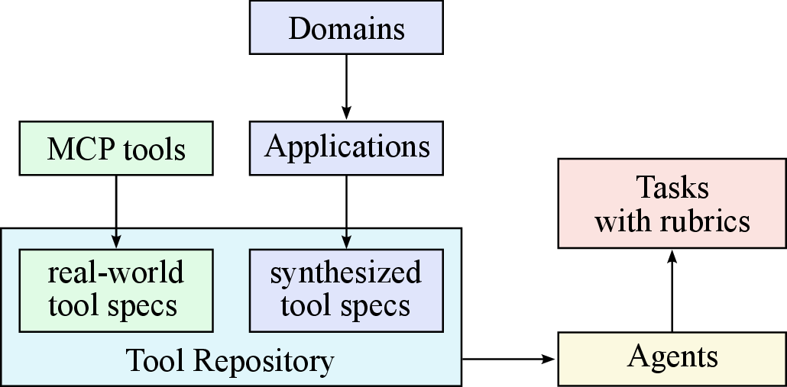{ width="460" .atlas-figure-compact }

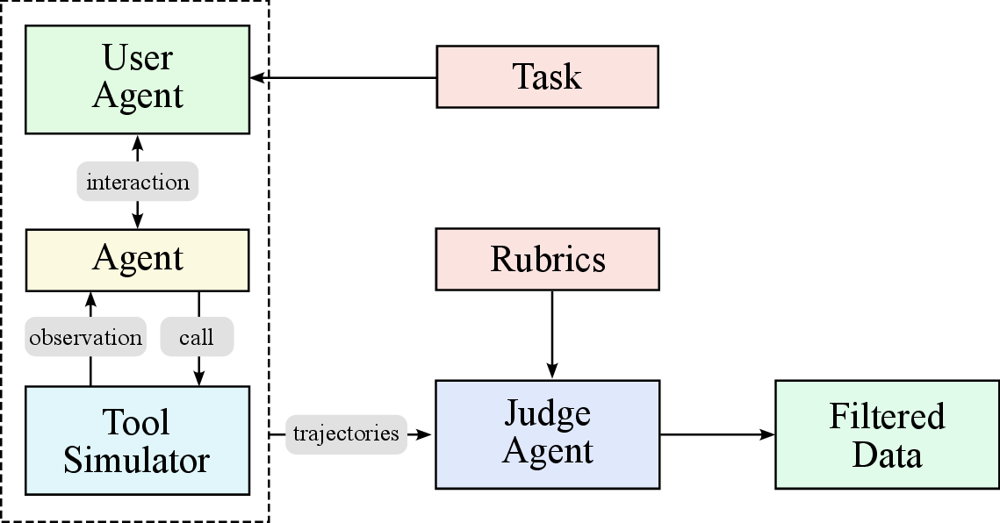{ width="460" .atlas-figure-compact }

<small>图源：`Kimi K2: Open Agentic Intelligence`，Figure 8 左右子图，来自 arXiv source 包 `figures/tool_repo_synthesis.pdf` 与 `figures/tool_traj_synthesis.pdf` 转 PNG。原图展示 tool specs / agents / tasks 的合成，以及 multi-agent trajectory generation 与 filtering 流程。</small>

工具使用数据合成分三步：

| Stage | What Kimi K2 does | Output |
| --- | --- | --- |
| Tool spec generation | construct tool specs from real-world tools and LLM-synthetic tools | tool repository |
| Agent and task generation | sample tool sets, generate agents and corresponding tasks | agent configurations + task rubrics |
| Trajectory generation | generate trajectories where agents finish tasks by invoking tools | filtered multi-turn tool-use demonstrations |

工具来源也分两类。第一类是 3000+ real MCP tools，从 GitHub repositories 抓取。第二类是 20,000+ synthetic tools，通过 hierarchical domain generation 从 financial trading、software applications、robot control 等大类扩展出具体应用域和工具接口。

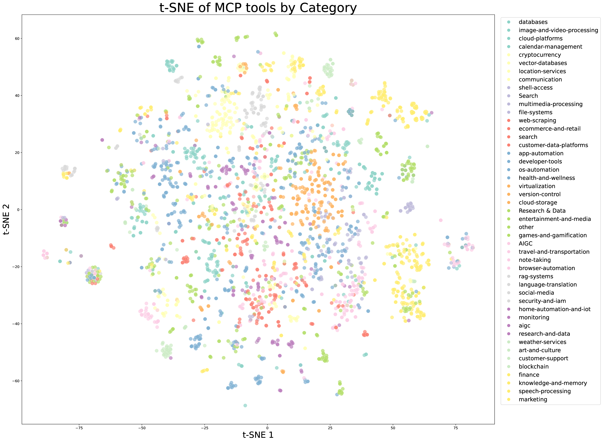{ width="460" .atlas-figure-compact }

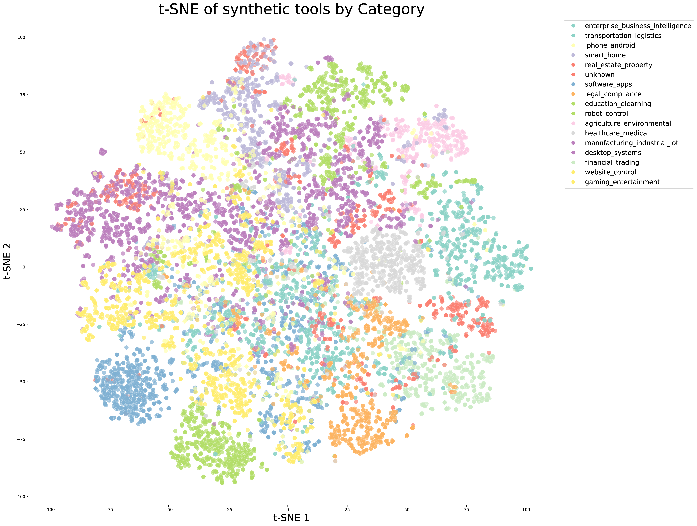{ width="460" .atlas-figure-compact }

<small>图源：`Kimi K2: Open Agentic Intelligence`，Figure 9 左右子图，来自 arXiv source 包 `figures/tsne_tool_mcp.pdf` 与 `figures/tsne_tool_synthetic.pdf` 转 PNG。原图表达：用 t-SNE 可视化 real-world MCP tools 与 synthetic tools 的 embedding 分布。本站读法：这两张图只说明合成工具覆盖了多样语义簇，不说明每个工具调用环境都有真实执行 fidelity；后者还要看 sandbox、rubric 和 trajectory filtering。</small>

**为什么 tool simulator 被称为 world model。**
报告说 tool execution environment functionally equivalent to a world model。意思是：工具调用不是无状态 API 文本补全。环境要执行 tool call，返回反馈，并在下一轮保留和更新状态。

例如一个文件系统工具调用后，文件内容真的变了；一个交易系统模拟器执行订单后，账户状态要更新；代码沙箱运行测试后，错误日志会影响下一步。这和 RL 环境很像：agent action 改变 state，environment 返回 observation / reward / feedback。

这套数据合成 pipeline 的关键是 rubric-based filtering。每个 task 都带有成功标准、预期工具使用模式和 evaluation checkpoints；LLM judge 按 rubric 过滤 trajectory。对 coding / software engineering 这类 fidelity 要求高的任务，K2 还使用真实执行 sandboxes，让代码真的跑测试，而不是只靠模拟反馈。

## Reinforcement Learning

K2 的 RL 目标来自 K1.5。对每个问题 \(x\)，从旧策略 \(\pi_{\mathrm{old}}\) 采样 \(K\) 个回答 \(y_i\)，并优化：

$$
L_{\mathrm{RL}}(\theta)=
\mathbb E_{x\sim\mathcal D}
\left[
\frac{1}{K}
\sum_{i=1}^{K}
\left(
r(x,y_i)-\bar r(x)
-\tau\log\frac{\pi_\theta(y_i\mid x)}{\pi_{\mathrm{old}}(y_i\mid x)}
\right)^2
\right],
$$

其中 \(\bar r(x)\) 是同一问题采样回答的平均奖励，\(\tau\) 是稳定学习的正则项。直觉上，它仍然利用“同题多样本的相对奖励”来训练 policy，但形式不是 PPO clipping，而是把奖励优势和 policy log-ratio 正则放进平方目标里。

RL 数据覆盖几类任务：

| RL Area | Reward / verification signal |
| --- | --- |
| Math, STEM and Logical Tasks | verifiable answers, tagged coverage, moderate difficulty selection |
| Complex Instruction Following | hybrid rule verification, code interpreters, LLM-as-judge, hack-check layer |
| Faithfulness | sentence-level faithfulness judge as reward model |
| Coding & Software Engineering | unit tests, pull requests / issues, executable sandboxes |
| Safety | attack model, target model, judge model, binary success/failure labels |
| General open-ended tasks | self-critique rubric reward |

K2 对 RL 做了三个实用补丁：

| Technique | Purpose |
| --- | --- |
| Budget Control | 给不同任务设置 maximum token budget，超长回答截断并惩罚，避免非 reasoning 域无意义变长 |
| PTX Loss | 在 RL 目标中加入高质量样本的辅助 PTX loss，缓解遗忘和任务过拟合 |
| Temperature Decay | 早期高温鼓励探索，后期降低温度提高稳定性和可靠性 |

**Self-Critique Rubric Reward 是什么。**
可验证任务可以用答案正确性、单元测试或规则检查做 reward；但开放问答、写作、帮助性、风格和安全很多时候没有硬 verifier。K2 的做法是让 K2 critic 按 rubrics 对 K2 actor 的多个输出做 pairwise comparison。

这个 critic 不是完全凭空来。报告说它先在 SFT 阶段用开源和内部 preference datasets 初始化，再在 RL 过程中用可验证任务的 on-policy rollouts 继续校准。这样做的目标是把 RLVR 中学到的客观信号迁移到更主观的评价任务上。

这里和 DeepSeek-R1 的差异值得强调。DeepSeek-R1 更强调 rule-based reward 在数学/代码这类可验证任务上激发 reasoning；K2 则把 RL 做成一个更宽的 agent alignment 框架：有 verifiable rewards，也有 self-critic rewards；有数学和代码，也有 tool use、faithfulness、instruction following、安全和开放偏好。

## RL 基础设施

大模型 RL 的难点不只是算法，还有系统。K2 使用 hybrid colocated architecture：training engine 和 inference engine 在同一批 workers 上，当前活跃的 engine 使用 GPU，另一个释放或 offload GPU 资源。每轮 RL 先由 inference engine rollout 新数据，再让 training engine 用新数据训练，然后把更新后的参数送回 inference engine。

对 1T MoE，参数更新本身就是系统问题。报告说用 network file system 重新切分和广播参数不现实，聚合带宽需求会达到每秒数 PB。因此他们开发了 co-located distributed checkpoint engine。

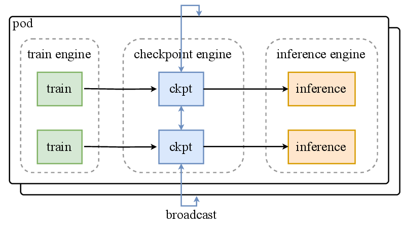{ width="760" }

<small>图源：`Kimi K2: Open Agentic Intelligence`，Figure 10，来自 arXiv source 包 `figures/rl-ipc.drawio.pdf` 转 PNG。原图展示 RL 参数更新中 checkpoint engine 如何在 training engine 与 inference engine 之间管理参数状态。</small>

流程可以简化成：

```text
training engine has updated parameters
  -> checkpoint engine workers get local copies
  -> broadcast full parameter set across checkpoint engine workers
  -> inference engine fetches only the parameter shard it needs
```

报告中特别提到，K2 的 full parameter update 可以在 30 秒内完成，这对典型 RL iteration 来说可以忽略。这个数字很关键：如果每轮 rollout 和训练之间同步权重要等很久，RL 训练吞吐会被系统切换拖垮。

Agentic rollout 还有两个额外问题。第一，环境反馈可能很慢，例如 VM、code interpreter、外部服务调用会让 GPU 空等；K2 用 heavy environments dedicated services 和大量 concurrent rollouts 摊平等待时间。第二，trajectory 可能极长，某些任务会拖住整个 rollout；K2 使用 partial rollout，让长尾未完成任务暂停并在下一轮 RL iteration 恢复。

**为什么 agentic RL 比普通 RLHF 更像系统工程。**
普通 RLHF 的 rollout 往往只是“模型生成一段文本，reward model 打分”。Agentic RL 的 rollout 可能包含几十轮工具调用、代码执行、文件修改、环境状态更新和失败重试。

这意味着训练系统要同时管理 GPU 推理、环境服务、沙箱隔离、长 trajectory、失败恢复、权重更新和数据回流。K2 报告里的 checkpoint engine、partial rollout、Gym-like interface 都是在解决这个系统层问题。

## 评测结果

Kimi K2 的评测分为 Kimi-K2-Instruct 和 Kimi-K2-Base。Instruct 评测强调 non-thinking setting，并覆盖 coding、tool use、math/STEM、general、long-context、factuality 等任务。

论文 Table 4 很大，下面摘取与 agentic 能力关系最强的一部分，保留原英文列名：

| Benchmark | Kimi-K2-Instruct | DeepSeek-V3-0324 | Qwen3-235B-A22B | Claude Sonnet 4 | Claude Opus 4 | GPT-4.1 | Gemini 2.5 Flash |
| --- | ---: | ---: | ---: | ---: | ---: | ---: | ---: |
| LiveCodeBench v6 (Pass@1) | 53.7 | 46.9 | 37.0 | 48.5 | 47.4 | 44.7 | 44.7 |
| OJBench (Pass@1) | 27.1 | 24.0 | 11.3 | 15.3 | 19.6 | 19.5 | 19.5 |
| SWE-bench Verified Agentic-Single-Attempt (Pass@1) | 65.8 | 38.8 | 34.4 | 72.7* | 72.5* | 54.6 | --- |
| SWE-bench Verified Agentic-Multi-Attempt (Pass@1) | 71.6 | --- | --- | 80.2* | 79.4* | --- | --- |
| SWE-bench Multilingual (Pass@1) | 47.3 | 25.8 | 20.9 | 51.0 | --- | 31.5 | --- |
| Tau2 retail (Avg@4) | 70.6 | 69.1 | 57.0 | 75.0 | 81.8 | 74.8 | 64.3 |
| Tau2 airline (Avg@4) | 56.5 | 39.0 | 26.5 | 55.5 | 60.0 | 54.5 | 42.5 |
| Tau2 telecom (Avg@4) | 65.8 | 32.5 | 22.1 | 45.2 | 57.0 | 38.6 | 16.9 |
| AceBench (Acc.) | 76.5 | 72.7 | 70.5 | 76.2 | 75.6 | 80.1 | 74.5 |

<small>表源：`Kimi K2: Open Agentic Intelligence`，Table 4 摘录。原表说明：Bold 表示 global SOTA，underlined bold 表示 best open-source；带 * 的数据来自对应模型技术报告或博客。</small>

Kimi-K2-Base 的结果则说明 base model 本身已经很强，而不是后训练独自撑起全部分数。论文 Table 5 摘录如下：

| Benchmark (Metric) | #Shots | Kimi-K2-Base | DeepSeek-V3-Base | Llama4-Maverick-Base | Qwen2.5-72B-Base |
| --- | ---: | ---: | ---: | ---: | ---: |
| # Activated Params | - | 32B | 37B | 17B | 72B |
| # Total Params | - | 1043B | 671B | 400B | 72B |
| MMLU | 5-shots | 87.79 | 87.10 | 84.87 | 86.08 |
| MMLU-pro | 5-shots | 69.17 | 60.59 | 63.47 | 62.80 |
| SimpleQA | 5-shots | 35.25 | 26.49 | 23.74 | 10.31 |
| CRUXEval-I-cot | 0-shots | 74.00 | 62.75 | 67.13 | 61.12 |
| CRUXEval-O-cot | 0-shots | 83.50 | 75.25 | 75.88 | 66.13 |
| LiveCodeBench(v6) | 1-shots | 26.29 | 24.57 | 25.14 | 22.29 |
| EvalPlus | - | 80.33 | 65.61 | 65.48 | 66.04 |
| MATH | 4-shots | 70.22 | 61.70 | 63.02 | 62.68 |
| GSM8k-platinum | 8-shots | 94.21 | 93.38 | 88.83 | 92.47 |
| C-Eval | 5-shots | 92.50 | 90.04 | 80.91 | 90.86 |
| CSimpleQA | 5-shots | 77.57 | 72.13 | 53.47 | 50.53 |

<small>表源：`Kimi K2: Open Agentic Intelligence`，Table 5 摘录。原表比较 Kimi-K2-Base 与 DeepSeek-V3-Base、Llama4-Maverick-Base、Qwen2.5-72B-Base。</small>

## 局限和阅读边界

第一，这是一份技术报告，很多评测依赖内部 harness、内部模型、内部 judge 或成本受限的 API 评测。特别是 SWE-bench 的多尝试 agentic setting、TerminalBench in-house、PaperBench Code-Dev、long-context 和 factuality 评测，都需要按报告自述口径理解。

第二，K2 的很多能力来自数据与系统闭环，而不只是模型结构。tool-use synthetic data、真实沙箱、rubric filtering、self-critic reward、checkpoint engine、partial rollout 都是重要组成部分。只复现架构或只下载 checkpoint，不能等价复现报告中的训练过程。

第三，self-critique reward 有潜在偏差。附录也提醒，当前 rubric 可能偏好 confident and assertive responses，在需要不确定性校准和多视角表达的场景中可能过度惩罚 hedging。也就是说，自我批评式 reward 可以扩展主观任务 RL，但它不是天然可靠的人类偏好替代品。

第四，non-thinking setting 是 K2 的优势叙事，也是比较边界。把 K2 和 thinking model 对比时，要区分“模型本身回答能力”“长 CoT test-time scaling”“agentic tool execution”三个维度，否则容易把不同推理协议混在一起。

## 项目启发

Kimi K2 给工程项目的启发主要有五条：

1. **优化器是 scaling recipe 的一部分。** MuonClip 展示了一个很现实的组合：用更 token-efficient 的优化器提高预训练效率，再用 QK-Clip 处理大规模训练中的 attention logits instability。
2. **MoE sparsity 要和推理场景一起选。** K2 扩大 experts、降低 attention heads，是围绕长上下文 agent 推理成本做的结构取舍。
3. **synthetic data 的关键是 fidelity control。** rephrasing、tool synthesis、trajectory generation 都不是“模型自己造数据就完了”，必须有 fidelity verification、rubrics、judges 或真实沙箱。
4. **agentic RL 首先是环境工程。** 没有稳定的 sandbox、tool simulator、concurrent rollout、partial rollout 和权重同步系统，RL 算法本身很难规模化。
5. **self-critique reward 可以扩展 RL，但要保留偏差意识。** 它适合补足无 verifier 的开放任务，但 critic 的 rubrics 会塑造模型风格和价值取向，不能当作无偏人类偏好。

## 阅读结论

Kimi K2 的价值不是某个单点 benchmark，而是给出了一条 open agentic model 的完整工程路线：用 MuonClip 跑稳 1T MoE 预训练，用高 sparsity 提升 token efficiency，用合成工具数据和真实环境补齐 agent 行为，再用 verifiable rewards + self-critique reward + RL 系统基础设施把模型推向多步任务执行。

它的可复用机制在 agent 数据和 RL 基础设施：tool-use synthesis、trajectory generation、sandbox rollout、partial rollout、checkpoint engine 和 self-critique reward。不可外推项是内部 harness、agentic setting 和 self-critique rubric 可能影响风格与评测；落地时要把 verifier、真实环境成本、失败回放和人工审计补上。

## 延伸阅读

1. [DeepSeek-V3：671B MoE、MLA 与 FP8 训练](deepseek-v3.md)：对照 K2 的 MoE / MLA / 系统训练取舍；
2. [DeepSeek-R1：RL 激发推理能力](deepseek-r1.md)：理解 RLVR 和可验证奖励；
3. [Qwen3：Thinking 模式、36T 预训练与蒸馏](qwen3.md)：对照 thinking / non-thinking 和双模式后训练；
4. [强化学习：Policy Gradient、PPO 与 GRPO](../../reinforcement-learning/policy-gradient-actor-critic-ppo-grpo.md)：补 RL 目标和 advantage 的基础；
5. [训练：训练数据系统与吞吐优化](../../training/data-systems-and-optimization.md)：理解 synthetic data、数据质量和训练吞吐；
## 外部精读

1. [Kimi K2: Open Agentic Intelligence](https://arxiv.org/abs/2507.20534)
2. [Kimi-K2-Instruct model checkpoint](https://huggingface.co/moonshotai/Kimi-K2-Instruct)
3. [MoonshotAI checkpoint-engine](https://github.com/MoonshotAI/checkpoint-engine)
