# Kimi K2：MuonClip、万亿 MoE 与 Agent 数据

!!! info "论文信息"
    **论文题名：** Kimi K2: Open Agentic Intelligence。<br>
    **作者：** Kimi Team、Yifan Bai、Yiping Bao、Y. Charles、Cheng Chen、Guanduo Chen、Haiting Chen、Huarong Chen、Jiahao Chen、Ningxin Chen 等（共 200 人）。<br>
    **机构：** 未在公开元数据中稳定解析；以 arXiv/PDF 或官方页 affiliation block 为准。<br>
    **时间 / 主题：** 2025-07；技术报告。<br>
    **arXiv / 官方报告：** arXiv：[2507.20534](https://arxiv.org/abs/2507.20534)；官方材料：[huggingface.co/moonshotai/Kimi-K2-Instruct](https://huggingface.co/moonshotai/Kimi-K2-Instruct)。<br>
    **GitHub / 项目：** GitHub：[github.com/MoonshotAI/checkpoint-engine](https://github.com/MoonshotAI/checkpoint-engine)；项目页：[huggingface.co/moonshotai/Kimi-K2-Instruct](https://huggingface.co/moonshotai/Kimi-K2-Instruct)。<br>
    **元数据来源与核验口径：** 来源：[arXiv](https://arxiv.org/abs/2507.20534)；[GitHub API / repo](https://github.com/MoonshotAI/checkpoint-engine)；[官方 / 项目材料](https://huggingface.co/moonshotai/Kimi-K2-Instruct)；Checked Date：2026-06-15；Repro Status：Paper / official materials reviewed, independent reproduction not claimed。

## 一个能写代码的模型，怎样学会持续完成任务

修复代码仓库里的一个问题，通常要经历读文件、提出修改、运行测试、观察失败、再修改。模型即使能一次写对独立算法题，也可能在这个过程中忘记约束、误解工具输出，或者在测试失败后反复尝试同一种错误。Kimi K2 将这些持续交互的行为纳入训练对象。它要解决的困难，是怎样把基础模型中的知识变成在环境里有效的行动。

这条路线连接着三类投入。预训练先用稀疏 MoE、MuonClip 和语料重写提高模型从数据中学习的效率；监督微调再提供完整的工具交互轨迹；联合强化学习让模型根据执行结果和回答评价调整行为。万亿参数的存储、长轨迹的采样和频繁切换训练／推理权重，又要求相应的系统设计。[↗](https://arxiv.org/pdf/2507.20534v2#page=2)

报告中的主要评测对象是 Kimi-K2-Instruct，下面采用 2026 年 2 月 v2 报告的结果口径。它在 SWE-bench Verified 的单次 agentic 尝试中达到 65.8%，LiveCodeBench v6 为 53.7%，Tau2-Bench 的 micro-average 为 66.1%。这些数字分别涉及仓库修复、独立编程题和多轮工具协作，不能互相替代。

先看原图上排的代码任务，再看下排的工具与推理任务。每组柱子比较的是同一基准；横跨不同组比较柱子高度，没有统一的“能力分数”含义。

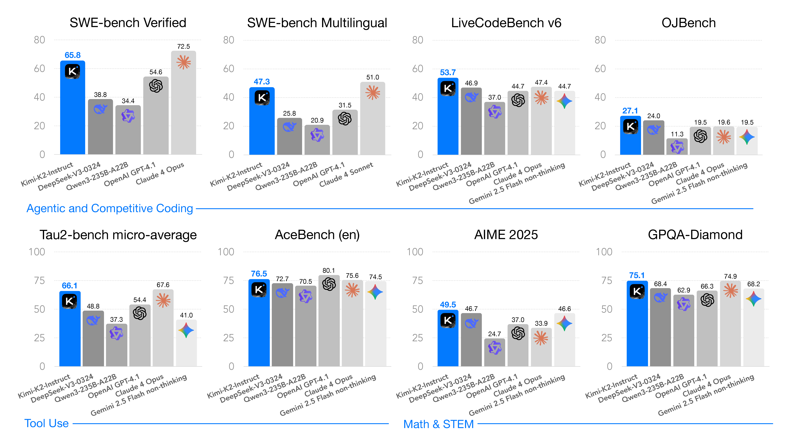{ width="920" }

<small>原论文 Figure 1。图中模型均采用 non-thinking 设置；不同任务有不同的执行框架和采样口径。[↗](https://arxiv.org/pdf/2507.20534v2#page=1)</small>

K2 的价值需要沿着“训练了什么行为、怎样得到反馈、测到了什么收益”来理解。尤其要留意，non-thinking 表示没有启用扩展思考模式，仍然允许一般任务最多输出 8192 tokens，也允许代理多轮使用工具。它并不等于没有推理过程或每个任务只调用一次模型。

## 总容量增加，每个 token 仍只走少量专家

K2 的总参数约 1.04T，每 token 激活约 32.6B。总容量决定可以存放多少参数，激活量则描述一次前向实际参与计算的部分。两者的差距来自稀疏专家路由。对进入一个 MoE 层的 token，路由器从 384 个 routed experts 中选出 8 个，另外还有 1 个 shared expert；其余 routed experts 不参与该 token 的这次前向。

| Configuration | Kimi K2 | DeepSeek-V3 |
| --- | ---: | ---: |
| Layers | 61 | 61 |
| Total Parameters | 1.04T | 671B |
| Activated Parameters | 32.6B | 37B |
| Routed Experts | 384 | 256 |
| Activated Routed Experts | 8 | 8 |
| Shared Experts | 1 | 1 |
| Attention Heads | 64 | 128 |
| Dense Layers | 1 | 3 |
| Expert Grouping | No | Yes |

<small>原文 Table 2。K2 的模型 hidden dimension 为 7168，expert hidden dimension 为 2048，attention 沿用 Multi-head Latent Attention（MLA）。[↗](https://arxiv.org/pdf/2507.20534v2#page=6)</small>

表中的改变不是简单放大所有部件。K2 增加了可选择的专家数量，减少了 dense 层和 attention heads。相对 V3，总参数增加约 54%，激活参数却减少约 13%。这是一种将预算更多分配给稀疏容量的选择。

### 稀疏度 48 是怎样选出来的

报告用 routed experts 总数除以每 token 激活数定义 sparsity，K2 为 $384/8=48$。这个数不包含共享专家，也不等于整个模型的总参数／激活参数之比，因为 attention、embedding 等参数不遵循同一稀疏比例。

作者在小规模实验中固定激活专家数为 8、共享专家数为 1，再改变专家总数，比较不同规模与训练预算下的 validation loss。下图先沿固定的 loss 横向看，再比较达到它需要多少 FLOPs。不能只沿某条曲线向右看，因为那同时包含训练计算量的变化。

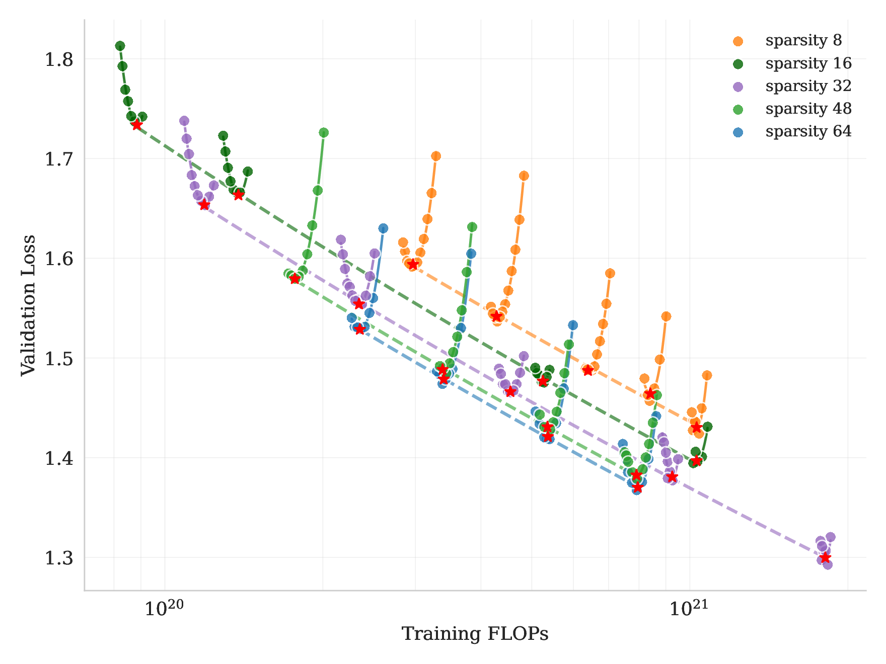{ width="760" }

<small>原论文 Figure 5，横轴 Training FLOPs，纵轴 Validation Loss。不同颜色对应不同稀疏度。[↗](https://arxiv.org/pdf/2507.20534v2#page=7)</small>

在 compute-optimal 比较中，达到 validation loss 1.5，sparsity 48 所需 FLOPs 分别约为 sparsity 8、16、32 的 $1/1.69$、$1/1.39$、$1/1.15$。这支持增加稀疏容量可以改善计算效率，但收益随着已有稀疏度提高而缩小。作者最终还要考虑更多专家带来的驻留内存、分布式路由和通信复杂度，因此没有把图中更大的稀疏度直接当成无条件最优。

这些倍数来自缩放实验的等 loss 比较。它们没有测量 K2 与 V3 的完整训练账单，也不能转换成部署价格下降的倍数。

### 为什么减少 attention heads

长上下文工具任务常常保留用户要求、工具定义、历史调用和结果。上下文越长，attention 在推理总计算中的占比越值得关注。报告估算，在 384 个专家和 128K 序列条件下，将 heads 从 64 加到 128，会使推理 FLOPs 增加 83%。

作者另做受控实验，在不同计算预算下比较“head 数约等于层数”与“head 数翻倍”的模型。下图应比较相同训练 token 位置上两种点型的 loss 差异。翻倍 heads 带来约 0.5%–1.2% 的 validation loss 改善，幅度小于其长上下文推理代价。

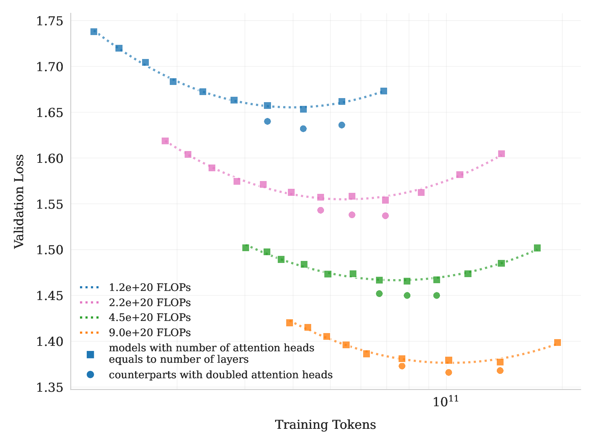{ width="760" }

<small>原论文 Figure 6。颜色表示不同训练 FLOPs 预算，方点与圆点区分 head 配置；纵轴为 loss，数值越低越好。[↗](https://arxiv.org/pdf/2507.20534v2#page=7)</small>

因此，64 heads 与 sparsity 48 是一组共同选择。减少 attention 计算有利于长上下文推理，却也缩短了训练时可以用来掩盖专家通信的计算窗口，后面的 EP 配置还要随之调整。

激活 32.6B 也不意味着只需要存储 32.6B 参数。完整专家仍要驻留、分片或换入；模型容量与每步运算量的分离，并没有消除存储和数据搬运成本。

## MuonClip 先改变矩阵更新，再限制异常 attention head

大模型训练中的不稳定，可能先出现在 attention logits，而不是马上表现为 loss 尖峰。对一个 query，Softmax 要比较它与各个 Key 的点积。当极少数点积变得很大时，权重会高度集中，训练也更容易出现数值问题。报告在一个 53B 总参数、9B 激活参数的 MoE 上观察到，普通 Muon 训练的最大 logit 很快超过 1000。

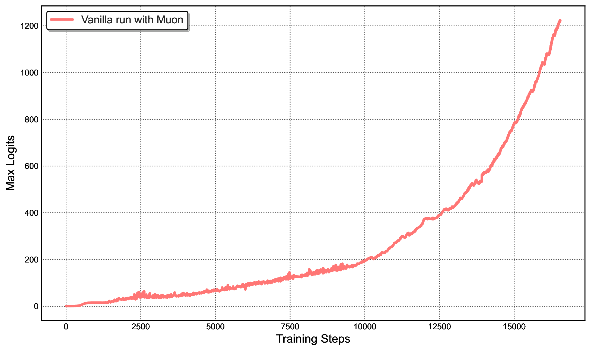{ width="460" .atlas-figure-compact }

<small>原论文 Figure 2(a)，中等规模 Muon 运行的 Max Logits 随训练步数增长。这张图说明问题如何出现，不是 K2 全量训练的 loss 曲线。[↗](https://arxiv.org/pdf/2507.20534v2#page=4)</small>

### Muon 的矩阵更新在做什么

Algorithm 1 对矩阵权重 $W\in\mathbb R^{n\times m}$ 给出三个步骤

$$
M_t=\mu M_{t-1}+G_t,
$$

$$
O_t=0.2\sqrt{\max(n,m)}\,\operatorname{NewtonSchulz}(M_t),
$$

$$
W_t=W_{t-1}-\eta\big(O_t+\lambda W_{t-1}\big).
$$

$G_t$ 是当前梯度，$M_t$ 是动量，$\mu$ 控制历史梯度的保留，$\eta$ 是学习率，$\lambda$ 是 weight decay。Newton–Schulz 在这里用于矩阵正交化近似；后面的形状相关系数用于匹配更新 RMS。更新作用于整个矩阵的方向结构，而不只是逐元素缩放梯度。[↗](https://arxiv.org/pdf/2507.20534v2#page=4)

从理想化 SVD 角度解释，如果 $M=U\Sigma V^\top$，极因子 $UV^\top$ 会压平非零奇异方向之间的幅值差异，让更新不再主要由少数最大的奇异值决定。这个表达帮助理解 Muon；实际 Algorithm 1 使用有限步 Newton–Schulz，并没有要求每步显式计算 SVD。

附录 E 用一个范数上界分析 attention 点积的风险

$$
|q_i\cdot k_j|
\leq\|x_i\|_2\|x_j\|_2
\|W_q\|_2\|W_k\|_2.
$$

这里矩阵的 $\|\cdot\|_2$ 是谱范数。即使输入经过 RMSNorm，投影权重的谱范数增长仍可能放大点积。作者提出的假设是，Muon 的更新和训练所得权重具有较高有效秩，部分更新方向可能与已有权重方向对齐，使相应奇异值累积增大。

这是对实验现象的解释假设。高有效秩本身并不能证明一定发生方向对齐，$W_qW_k^\top$ 的范数也一般只满足乘积上界，不会自动精确等于某个谱范数的平方。报告真正验证的是不稳定现象和所提控制手段的效果。[↗](https://arxiv.org/pdf/2507.20534v2#page=30) [↗](https://arxiv.org/pdf/2507.20534v2#page=31)

### QK-Clip 读取当前批次，调整更新后的权重

直接对 logits 做 soft-cap 可以限制送进 Softmax 的数值，却没有直接约束裁剪之前的点积继续增长。QK-Norm 则要规范化 Query 和 Key；MLA 推理不显式展开完整 Key 的路径，使直接照搬普通 QK-Norm 与原有实现冲突。K2 选择在权重更新之后缩放 Q/K 投影。

对 head $h$，先在当前 forward 中记录

$$
S_{\max}^{h}
=\frac{1}{\sqrt d}\max_{X\in B}\max_{i,j}
Q_i^h(K_j^h)^\top.
$$

$B$ 是当前 batch，$i,j$ 遍历序列位置，$d$ 是 head 维度。若 $S_{\max}^h>\tau$，使用 $\gamma_h=\tau/S_{\max}^h$；否则不做裁剪，即 $\gamma_h=1$。这段分段描述也避免了对非正最大值套用除法。K2 的阈值为 $\tau=100$。

普通 MHA 中，将 Q、K 投影各乘 $\sqrt{\gamma_h}$，两者的点积就会共同乘上 $\gamma_h$。MLA 需要进一步区分内容分量与旋转位置分量。其缩放关系可以直接沿点积看

$$
\ell_{ij}^{h}\propto
q_i^{C,h}\cdot k_j^{C,h}
+q_i^{R,h}\cdot k_j^R.
$$

| MLA component | Scaling | 原因 |
| --- | --- | --- |
| Head-specific content query $q^{C,h}$ | $\sqrt{\gamma_h}$ | 与内容 Key 合起来使点积缩放 $\gamma_h$ |
| Head-specific content key $k^{C,h}$ | $\sqrt{\gamma_h}$ | 同上 |
| Head-specific rotary query $q^{R,h}$ | $\gamma_h$ | 独自承担位置点积的缩放 |
| Shared rotary key $k^R$ | 保持原值 | 避免一个异常 head 牵动全部 heads |

<small>依据第 3 页的 MLA QK-Clip 规则整理。实际操作施加在生成这些分量的投影权重上。</small>

例如仅为说明缩放机制，若某个 head 记录到 400，而阈值为 100，则 $\gamma_h=1/4$。内容 Q/K 各缩小为一半，位置 Q 缩小为四分之一；在固定输入、固定待缩放权重的比较下，两部分点积都缩小为四分之一。这个数例不是论文测量。

实现顺序同样重要。当前 step 已经完成前向与反向，记录的最大值只用于指导随后权重更新后的裁剪。它没有回头修改当前 step 的 attention，也没有证明所有未来 batch 的 logit 都小于 100。下一批输入和下一次优化器更新仍可能触发新的裁剪。[↗](https://arxiv.org/pdf/2507.20534v2#page=3)

### 稳定性证据要同时看干预与质量

下面的 K2 全程曲线中，最大 logit 在早期达到阈值附近，随后回落。附录统计，前 70,000 步共有 12.7% 的 attention heads 至少触发过一次裁剪，此后裁剪不再触发。12.7% 描述的是一段训练区间内“曾经被裁过”的 head 比例，不是每一步都裁同样比例。

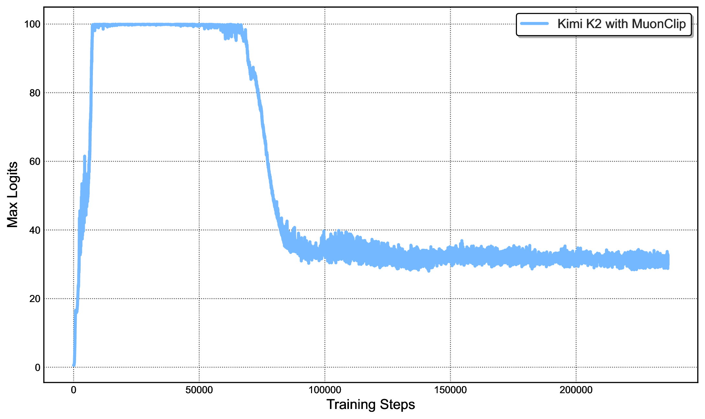{ width="460" .atlas-figure-compact }

<small>原论文 Figure 2(b)，K2 使用 $\tau=100$。先观察阈值附近的平台，再看后半程的回落。[↗](https://arxiv.org/pdf/2507.20534v2#page=4)</small>

只把 logits 压低还不够，裁剪也可能损害模型学习。为检查这一点，作者训练两个 3B 总参数、0.5B 激活参数模型，一个用普通 Muon，另一个用更激进的 $\tau=30$ 的 MuonClip。下图比较同一训练步数上的 validation loss，两条曲线基本重合。

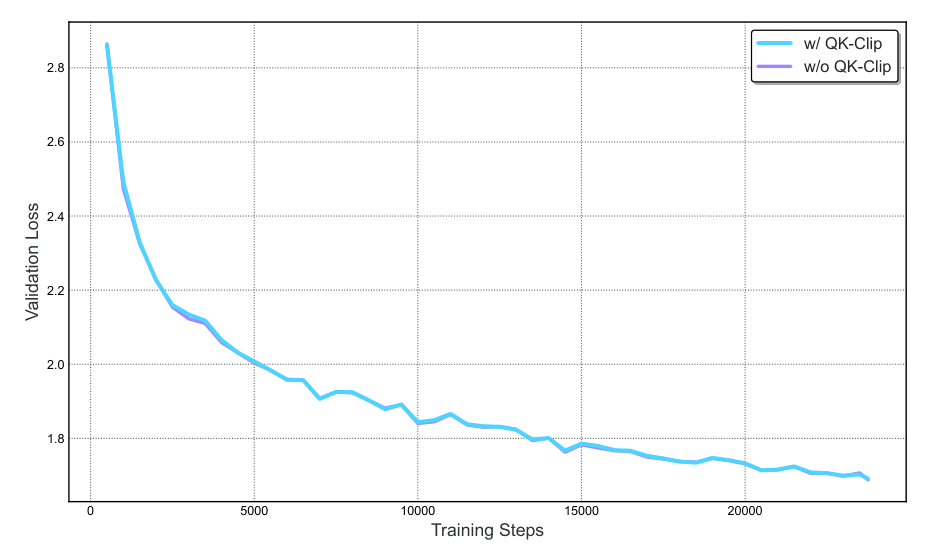{ width="760" }

<small>原论文 Figure 12，青色为 w/ QK-Clip，紫色为 w/o QK-Clip。小模型消融检验裁剪是否明显损害收敛。[↗](https://arxiv.org/pdf/2507.20534v2#page=30)</small>

作者还报告下游任务没有统计显著退化，但该处没有列出逐任务数值。小模型消融与 K2 全程稳定性共同支持“异常时有限干预”的设计，仍不能把它扩展成任何模型、任何阈值下都无质量损失的结论。

最后看实际训练 loss。报告给出未平滑、未下采样的逐步曲线，省略了最开头一小段以便显示；这次 15.5T-token 训练中没有观察到 loss spikes。

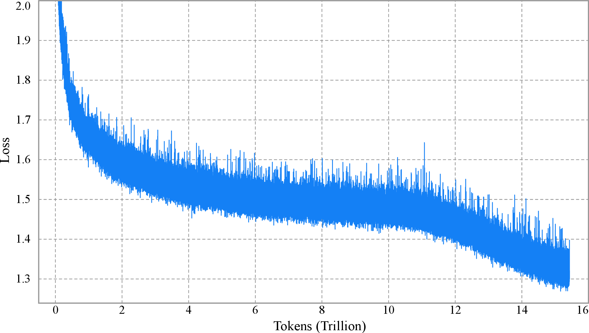{ width="760" }

<small>原论文 Figure 3。横轴为累计训练 tokens，纵轴为 training loss；“zero loss spike”对应这次运行的观察。[↗](https://arxiv.org/pdf/2507.20534v2#page=5)</small>

## 同一份知识，怎样提供更多有效学习信号

预训练还面对高质量文本不足的问题。把原文重复十遍，可以增加曝光次数，却也可能鼓励记住固定措辞。K2 的数据重写试图保留知识内容，同时改变语言形式、叙述视角和组织方式，让模型在多种表达中学习同一信息。

知识类重写有三个相连环节。先用不同风格与视角的提示生成候选表达，再用分块自回归生成保留长文连贯性，最后比较改写与原文的语义是否一致。数学材料则改写成 learning-note 风格，并把其他语言的高质量数学材料译为英语。这些流程扩大表达覆盖，不能凭空补充原材料中没有的事实。[↗](https://arxiv.org/pdf/2507.20534v2#page=5) [↗](https://arxiv.org/pdf/2507.20534v2#page=6)

下图沿左到右读。原始长片段被切成小块，完整输入仍参与上下文；已经生成的改写又进入下一块的生成过程，最后拼回完整文本。图中 4096-token 片段与 256-token chunk 展示的是这种数据流，不能由图推定所有生产语料都固定使用相同长度。

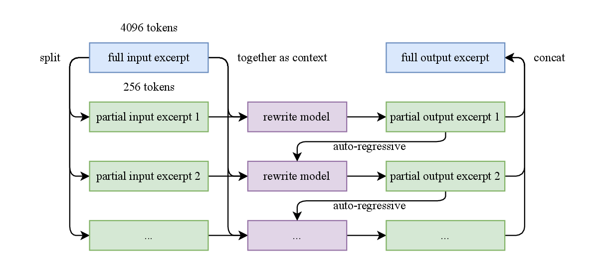{ width="820" }

<small>原论文 Figure 4。autoregressive 箭头解释相邻改写块如何保持衔接；独立改写后直接拼接会丢失这条依赖。[↗](https://arxiv.org/pdf/2507.20534v2#page=6)</small>

作者用一个早期 K2 checkpoint 比较重复与重写，观察 SimpleQA accuracy。

| # Rephrasings | # Epochs | SimpleQA Accuracy |
| --- | ---: | ---: |
| 0 (raw wiki-text) | 10 | 23.76 |
| 1 | 10 | 27.39 |
| 10 | 1 | 28.94 |

<small>原文 Table 1。[↗](https://arxiv.org/pdf/2507.20534v2#page=5)</small>

一次重写再重复十轮，相对原文重复十轮高 3.63 个百分点；十种重写各训练一轮又高 1.55 个百分点。它支持“不同表达有额外学习价值”，但三个设置没有单独拆分风格、视角、保真筛选各自的贡献。真正扩展到大语料时，每个 corpus 最多重写两次；十次重写是这项实验的配置。

重写也会放大源材料或生成过程的错误。长文中的条件、限定词和数值关系若在改写中丢失，模型学到的会是一致但错误的多种表达，因此 fidelity verification 是数据生产的一部分，不能只用生成文本数量评价这条路线。

### 训练长度与最终窗口分开看

主要语料共 15.5T tokens，覆盖 Web Text、Code、Mathematics 和 Knowledge。主预训练使用 4096-token 序列、67M tokens 的 global batch，500 steps warm-up 后，前 10T tokens 保持学习率 $2\times10^{-4}$，随后 5.5T tokens 用 cosine 降到 $2\times10^{-5}$；weight decay 为 0.1。

报告另描述末期 annealing 和长上下文激活阶段，保持 67M-token batch，先用 400B tokens 的 4K 序列，再用 60B tokens 的 32K 序列，学习率从 $2\times10^{-5}$ 降至 $7\times10^{-6}$，最后使用 YaRN 扩展到 128K。报告没有在这一段给出清晰的总量对账，因此不宜自行把所有阶段相加后宣称一个新的精确总训练量。可以确定的是，最终支持 128K 不代表全部预训练都在 128K 上进行。[↗](https://arxiv.org/pdf/2507.20534v2#page=9)

## 稀疏计算仍需要处理完整模型的内存与通信

K2 的训练节点包含 8 张 H800、2 TB CPU RAM，节点内使用 NVLink/NVSwitch，跨节点使用 8 路 400 Gbps RoCE。并行配置由 16-way pipeline parallel、16-way expert parallel、虚拟流水线 stages 和 ZeRO-1 data parallel 组成；256 张 GPU 构成一个模型并行组。

仅 BF16 参数与 FP32 梯度累积缓冲就约占 6 TB。优化器状态根据规模分布或部分 offload 后，报告中的配置让每张 GPU 为这些状态占用约 30 GB，其余空间用于 activations。256 张是模型并行组大小，不能据此推定整个训练集群始终只有 256 张 GPU。[↗](https://arxiv.org/pdf/2507.20534v2#page=8)

### 把传输放进计算时间里，前提是有足够窗口

K2 没有直接采用 DualPipe。作者解释，双向流水线会加倍参数与梯度的内存需求；继续扩大 PP 会增加流水线空泡，扩大 EP 又会增加通信成本。对万亿参数模型，这些代价过高。

它采用 interleaved 1F1B，并增加 warm-up micro-batches，让专家 dispatch／combine 的 all-to-all 与计算重叠。进一步将 weight-gradient 计算从 backward 中拆出来，放到相应的 PP 通信旁边执行；报告称除 warm-up 外，PP 通信可以被有效掩盖。

下图上排把 Computation、Communication、Offload 分开，下排标出各 micro-batch 的时序。应先追踪同一个编号经历 forward、backward、通信的顺序，再看不同编号怎样交叠，不能把颜色块重叠直接当成所有阶段都没有等待。

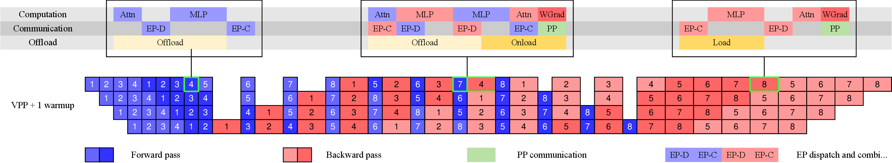{ width="920" }

<small>原论文 Figure 7。EP-D／EP-C 分别为专家 dispatch／combine，PP 为流水线通信，WGrad 为权重梯度计算。[↗](https://arxiv.org/pdf/2507.20534v2#page=8)</small>

前面将 attention heads 减半，意味着 attention 计算更快，也让可用于覆盖 EP 通信的时间更短。K2 因而选择可行的较小 EP 组 16，以缩短专家通信。这说明网络结构与训练系统需要一起设计；单独减少 FLOPs，可能把瓶颈转移到通信。

### 重计算、低精度存储与 CPU offload 各负责一部分

| Technique | 处理对象 | 换来的资源与代价 |
| --- | --- | --- |
| Selective recomputation | LayerNorm、SwiGLU、MLA up-projection；另重算 MoE down-projection | 少保存 activation，增加部分计算 |
| FP8 activation storage | MoE up-projection 与 SwiGLU 的输入 | 用 E4M3、$1\times128$ tiles 与 FP32 scales 降低存储量 |
| CPU offload | 其余 activations | 使用 CPU RAM，增加 H2D／D2H 搬运并依赖传输重叠 |

<small>原文 §2.4.3。FP8 仅用于部分 activation 的存储；作者因初步质量风险没有采用 FP8 计算。[↗](https://arxiv.org/pdf/2507.20534v2#page=8)</small>

1F1B 阶段，一边卸载上一个 micro-batch 的 forward activations，一边预取下一个 backward 所需的 activations。MoE down-projection 的额外重算还给早期专家负载不均留下显存余量。这里节省的是高峰时需要同时驻留的状态，而不只是把一个 tensor 换成更小 dtype。[↗](https://arxiv.org/pdf/2507.20534v2#page=9)

## 工具数据需要包含行动造成的后果

监督微调首先提供较广的指令数据。K2 使用 K1.5 和内部领域模型生成候选回答，再由模型或人工判断质量。工具任务需要更长的数据单位，因为单条“输入／正确答案”很难展示前一个操作怎样改变后续状态。

例如一个解释性的预约任务，可能需要先查可用时间，再创建预约，最后核对是否成功。如果创建工具返回失败，下一步应该根据失败原因调整；如果已经创建成功，再调用一次可能产生重复预约。完整轨迹能直接展示这些依赖如何影响下一步动作。这个例子用于说明状态依赖，不是报告披露的具体训练样本。

### 先建立工具与任务，再生成交互

K2 从 GitHub 收集 3000 多个真实 MCP 工具的规格，又通过“领域→具体应用→工具接口”的层级扩展生成 20,000 多个合成工具规格。随后组合工具、生成不同的系统提示，构造数千种 agent 配置。每个任务附有 rubric，明确成功条件、预期工具使用方式与检查点。

下图的关键连线是 Tool Repository 进入 Agents，再由 agent 的工具能力生成 Tasks with rubrics。任务与工具一起设计，才能避免只生成语言上合理、实际无从完成的要求。

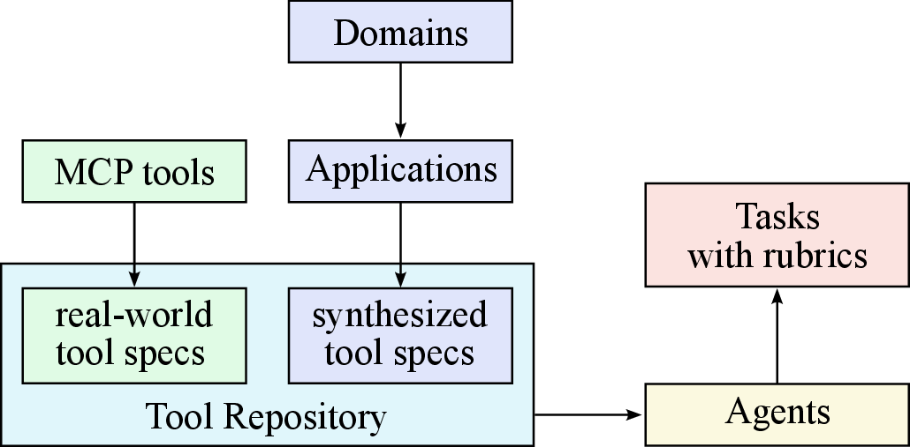{ width="460" .atlas-figure-compact }

<small>原论文 Figure 8(a)。real-world tool specs 与 synthesized tool specs 都首先描述可用接口；合成工具规格不等于已经有真实后端。[↗](https://arxiv.org/pdf/2507.20534v2#page=10)</small>

轨迹生成时，用户模拟器提供不同沟通风格与偏好；执行 agent 选择行动；工具模拟器保持状态、执行调用并返回观测。模拟器还引入受控随机性，产生成功、部分失败和边界情况。最后，judge 按任务 rubric 判断整个轨迹，只有满足成功条件的轨迹才进入 SFT。

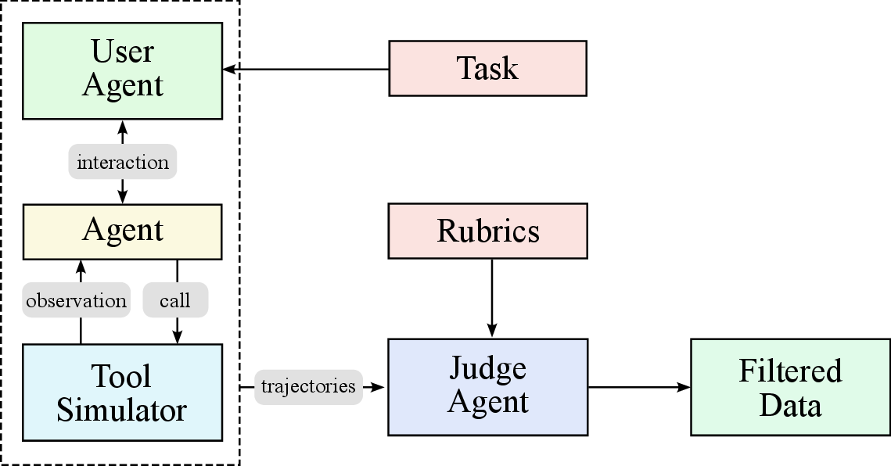{ width="460" .atlas-figure-compact }

<small>原论文 Figure 8(b)。先沿 Agent→Tool Simulator→Agent 读反馈环，再看右侧 Judge 如何依据 Rubrics 筛选轨迹。[↗](https://arxiv.org/pdf/2507.20534v2#page=10)</small>

筛掉不成功轨迹，属于 rejection sampling。保留下来的成功轨迹仍可以含有中途失败和恢复步骤，所以“只训练成功样本”不必等于“只展示一路顺利的操作”。但它也可能低估难以恢复的错误，最终模型的恢复能力仍需要在独立环境中测试。

真实与合成工具的分布可由下面两张图辅助理解。真实工具按原始来源类别着色，合成工具按预设领域着色，展示出各自的覆盖结构。

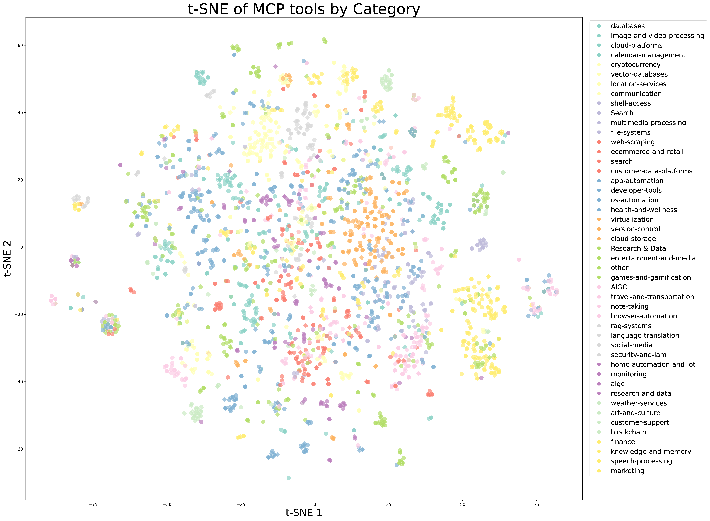{ width="460" .atlas-figure-compact }

<small>原论文 Figure 9(a)，真实 MCP 工具的嵌入可视化。</small>

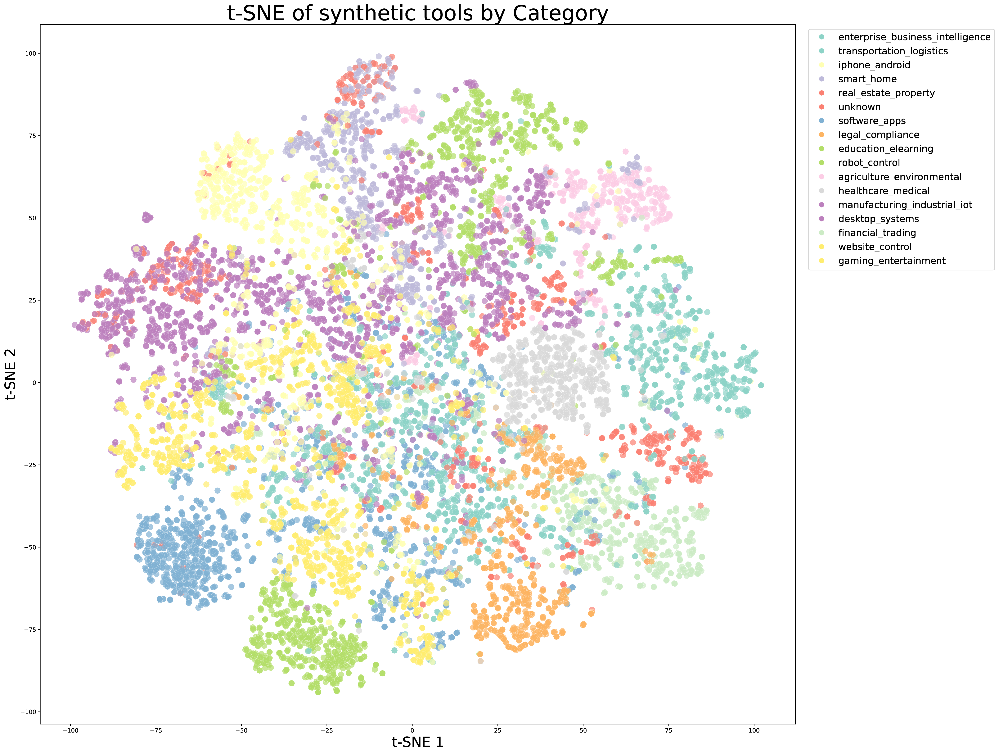{ width="460" .atlas-figure-compact }

<small>原论文 Figure 9(b)，合成工具的嵌入可视化。两张 t-SNE 图应各自阅读，不把跨图坐标距离当成统一语义距离。[↗](https://arxiv.org/pdf/2507.20534v2#page=10)</small>

点云能说明工具描述的分布，无法证明模拟器准确执行了每个工具，也不能测出真实任务成功率。报告因此对代码和软件工程使用真实 sandbox，运行代码、测试与开发环境，以测试通过率等客观结果补充模拟反馈。模拟环境提供覆盖，真实执行提供更强的结果约束，两者承担的作用不同。[↗](https://arxiv.org/pdf/2507.20534v2#page=11)

## 从工具 schema 到返回消息，协议也是能力的一部分

一次工具调用需要三个接口。模型先读取可用工具的声明，再产生调用请求，执行框架运行工具后将结果放回对话。任何一环丢失调用身份或参数约束，模型即使知道正确操作，也可能无法完成任务。

附录 B 的声明使用 `tool_declare` 消息，工具定义主要以 TypeScript 表达。比如 `location: string` 与 `date?: string` 分别表示必填位置和可选日期。报告也在部分训练数据中使用 JSON 声明，以兼容已有框架。这个兼容设计发生在数据和序列协议中，不能简单理解成模型会执行 TypeScript。[↗](https://arxiv.org/pdf/2507.20534v2#page=26)

以下是依据附录模板填入参数的解释性调用。特殊 token 来自原文，城市与日期只是示例值。

```text
<|tool_call_section_begin|>
<|tool_call_begin|>
functions.get_weather:0
<|tool_arguments_begin|>
{"location":"Beijing, China","date":"2025-07-17"}
<|tool_call_end|>
<|tool_call_section_end|>
```

`functions.get_weather:0` 是 call ID，计数器在整个对话中从 0 递增。一个调用 section 可以包含多个调用块，支持同一 assistant turn 中提出多个工具请求。结果以 `tool` 消息返回，并带上对应 call ID；框架由此知道哪条结果属于哪次请求。语法支持多调用，不意味着有数据依赖的操作可以任意并行。

模型偶尔仍会生成无法解析的 token。报告引入 enforcer，在进入工具调用 section 后约束模板和 JSON arguments，使它符合已声明 schema。约束解码减少的是结构错误。合法 JSON 仍可能填错城市、选择不合适的工具，或者在外部状态已变化时重复执行操作；这些问题需要任务训练、结果反馈和执行层检查继续处理。[↗](https://arxiv.org/pdf/2507.20534v2#page=27)

这也解释了为什么论文将工具规格、轨迹和真实 sandbox 都放进系统。仅把输出格式训练得很规范，不足以学会根据执行后果调整下一步。

## 可验证奖励先告诉模型，哪里真的做对了

联合 RL 面对的任务差异很大。数学题可以核对答案，代码可以运行测试，开放写作却没有唯一正确结果。K2 的框架先扩展可验证任务，再把这些客观反馈用于改进开放任务的评价能力。

| Task family | 奖励从哪里来 | 反馈能够检查什么 |
| --- | --- | --- |
| Math / STEM / Logic | 答案与任务验证器 | 指定问题的解是否满足判定条件 |
| Complex instruction following | 确定性规则、LLM judge、hack-check | 可检查约束、语义要求，以及“声称满足但实际未满足” |
| Faithfulness | 句子级 judge | 事实性陈述是否得到给定上下文支持 |
| Competitive coding | 代码执行与单元测试 | 候选程序在测试输入上的行为 |
| Software engineering | issues／PRs 构建的环境与可执行测试 | 修改能否在对应仓库环境中通过验证 |
| Safety | Attack／Target／Judge 交互与任务 rubric | 特定对抗提示是否使目标模型产生违规响应 |

<small>原文 §3.2.1。[↗](https://arxiv.org/pdf/2507.20534v2#page=11) [↗](https://arxiv.org/pdf/2507.20534v2#page=12)</small>

对数学、STEM 和逻辑，作者用 SFT 模型的 pass@k 选择中等难度问题。原因可以从组内奖励差异理解。全部候选都正确，模型很难分清哪种行为更好；全部都失败，也缺少可供强化的成功路径。中等难度更容易同时出现成功与失败，但报告没有公开统一的 pass@k 阈值。

复杂指令使用两类验证器，是因为字符数等条件适合代码检查，而隐含要求与上下文一致性常需要语义判断。另加 hack-check，是为了防止模型用“我已遵守全部要求”这类表述替代真正完成要求。验证器因此也需要检查回答内容，而不只读取回答对自身的评价。

Faithfulness 的范围尤其容易被扩大。一个句子得到上下文支持，并不保证上下文本身真实；反过来，一个外部事实上正确但上下文未提供依据的句子，也可能违反当前任务的 grounding 要求。K2 的句子级奖励针对的是后者所需的证据约束。

软件工程训练从 GitHub issues 和 PRs 构建环境。基础设施以 Kubernetes 支持超过 10,000 个并发 sandbox 实例，这说明它能够扩展执行反馈的生产规模，不代表每个训练 batch 都实际使用相同并发量。单元测试也只能覆盖已有判定条件；训练数据中加入高质量人工测试，可以改善信号，却不能自动排除所有测试外错误。

## 开放任务的 critic 怎样获得校准

对于创作、解释或建议，K2 actor 为同一个要求生成多个候选，K2 critic 按 rubric 做两两比较并排序。critic 的初始能力来自 SFT 阶段的公开与内部偏好数据；它并非一开始就凭空知道什么回答更好。

训练随后形成两个相连的反馈过程。开放任务的候选比较为 actor 提供偏好信号；可验证任务的 on-policy rollouts 则带有客观结果，用于持续更新 critic。这样，评价器可以学习当前策略在哪些情况下容易“看起来正确却实际失败”，再影响后续对候选的评价。[↗](https://arxiv.org/pdf/2507.20534v2#page=12)

这里 actor 与 critic 描述两种角色。报告没有据此公开一套可直接照搬的权重共享、更新频率和所有采样配置，也没有将这个 critic 定义为 PPO 中逐状态估计回报的 value function。它的主要工作是按规则评价回答，而不是仅凭名称就能与另一种 actor–critic 实现互换。

### rubric 对语言行为有直接影响

附录 F 的核心标准包括清晰相关、自然对话、客观且有依据的互动。prescriptive rubrics 进一步限制开头奉承，以及用句子解释“为什么我的回答很好／已经满足要求”。针对具体任务，还加入人工标注的专门标准。

这些规则可能减少空话，却也会造成偏差。附录明确承认，当评价规则惩罚自我限定、偏好单一而果断的答案时，模型可能把“表达自信”当成高分特征，在证据不充分或问题本来具有主观性时仍说得过满。[↗](https://arxiv.org/pdf/2507.20534v2#page=31) [↗](https://arxiv.org/pdf/2507.20534v2#page=32)

这个限制与整套训练机制直接相关。critic 通过可验证任务得到校准，并不能保证它会在所有开放任务上正确处理不确定性。偏好规则既决定什么回答更受欢迎，也决定哪些有价值的保留条件可能被压掉。复用这种方法时，需要把证据不足时的恰当表达也纳入评价，避免只奖励干脆的语气；这是从报告限制推导出的设计建议。

## 联合 RL 的目标函数怎样改变回答概率

K2 沿用 K1.5 的 policy optimization。对问题 $x$，从旧策略 $\pi_{\rm old}$ 采样 $K$ 个回答 $y_i$，计算每个回答的奖励与组均值

$$
\bar r(x)=\frac1K\sum_{i=1}^K r(x,y_i),
\qquad A_i=r(x,y_i)-\bar r(x).
$$

然后最小化

$$
\mathcal L_{\mathrm{RL}}(\theta)
=\mathbb E_{x\sim\mathcal D}\left[
\frac1K\sum_{i=1}^{K}
\left(A_i
-\tau\log\frac{\pi_\theta(y_i\mid x)}{\pi_{\mathrm{old}}(y_i\mid x)}\right)^2
\right].
$$

$\tau>0$ 是控制更新幅度的正则参数。目标把“回答比同组平均好多少”与“新策略相对旧策略应提高多少 log-probability”联系起来。这里使用的是整个回答的概率比，不能把它直接替换成逐 token 的普通比例。[↗](https://arxiv.org/pdf/2507.20534v2#page=13)

可以对单个样本解释更新方向。固定旧策略采样和奖励，令

$$
z_i=\log\frac{\pi_\theta(y_i\mid x)}{\pi_{\rm old}(y_i\mid x)},
\qquad
\frac{\partial(A_i-\tau z_i)^2}{\partial z_i}
=-2\tau(A_i-\tau z_i).
$$

当新旧策略刚开始相同时，$z_i=0$。若 $A_i>0$，梯度下降会提高这个回答的 log-probability；若 $A_i<0$，则降低它。随着 $z_i$ 接近 $A_i/\tau$，该样本的残差减小。这个逐样本解释不意味着所有候选概率可以独立随意设置，因为它们仍受同一个归一化策略和共享参数约束。

仅作数例，若两个回答奖励分别为 1 和 0，组均值为 0.5，则中心化奖励为 $+0.5$ 和 $-0.5$。在相同 $\tau$ 下，训练鼓励前者相对旧策略变得更可能、后者变得更不可能；它没有要求把每个成功样本的概率无限提高。

虽然这里也有组内采样和相对奖励，原式没有 GRPO 的 clipped surrogate，也没有除以组内奖励标准差。把它泛称为“组相对方法”之后直接套另一篇论文的公式，会改变实际训练目标。

### 任务间共同训练，还要处理长度与遗忘

K2 对每条样本设置与任务类型有关的最大 token budget，超出后截断并惩罚。这样，模型必须把成功放进给定预算，而不只是通过不断延长答案提高得分。一个预算过紧的工具任务也可能在有效调用完成前被截断，因此预算选择本身会改变可学习行为。

联合 RL 还混入精选高质量样本的 PTX loss，减少对原有能力的遗忘；采样 temperature 从高逐渐降低，使早期探索更多候选路径，后期提高输出稳定性。三项设计分别处理成本、能力保持与探索，它们并不因同时出现就构成一套已完全公开的训练配方。报告没有给出全部任务预算、混合比例和各项独立消融，最终主榜收益应归于整套系统。

## 长轨迹训练的效率，取决于等待和权重切换

联合 RL 一轮包含生成候选、等待环境、计算奖励、更新模型和刷新推理权重。只优化模型的矩阵乘法，无法消除这些环节的等待。

K2 采用 colocated 架构，让训练引擎与推理引擎位于同一组 worker，轮流占用 GPU。rollout 时训练状态释放或 offload 到 DRAM；更新时再加载训练状态。训练结束后，推理引擎必须取得新权重，但两套引擎采用不同分片方式，不能直接把训练 rank 的内存原样交给对应推理 rank。

checkpoint engine 负责这次重分片。它先从训练 worker 取得本地参数，再广播参数片段，推理引擎读取自己所需的部分。下图应追踪训练引擎→checkpoint engine→推理引擎，而不是把中间组件理解成普通磁盘 checkpoint 保存。

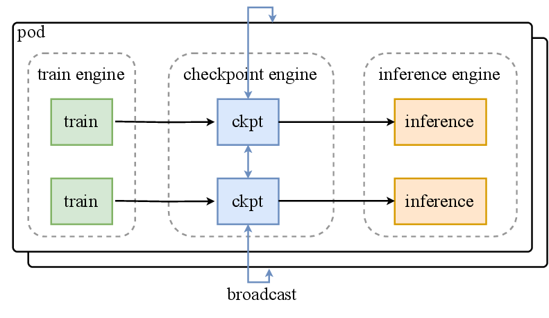{ width="760" }

<small>原论文 Figure 10。参数按片段流水传输，避免为万亿参数更新临时保留过大的完整副本。[↗](https://arxiv.org/pdf/2507.20534v2#page=14)</small>

作者选择广播全量参数，而不是针对每个推理 worker 精确计算最小传输集合。这样会多传数据，但减少同步、提高带宽利用率，并使训练与推理实现解耦。报告称一次 K2 全参数更新可在 30 秒以内完成；这个时间不包含整轮 rollout、环境运行和训练更新。

### 三阶段流水线为什么反而被改成两阶段

附录 G 把实现代价讲得更具体。每张 GPU 有三个等大的缓冲区，一个 H2D buffer 用于从主存加载权重，两个 IPC buffers 交替承担广播与推理引擎读取。理想情况下可以同时进行“加载下一片、广播当前片、装载上一片”。

但 H800 上 H2D 与 broadcast 争用共享 PCIe 资源，原本预计重叠的操作相互阻塞。下面先看 (a) 理想时序，再对比 (b) 中被拉开的色块，最后看 (c) 的改法。

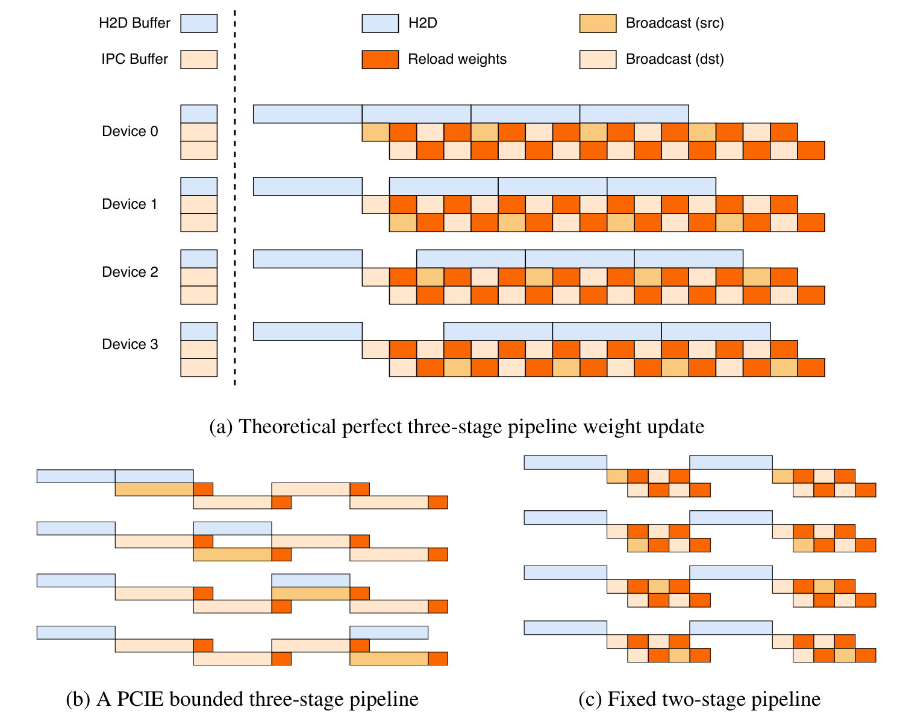{ width="920" }

<small>原论文 Figure 13。(a) 为理想三阶段，(b) 为 PCIe 受限的三阶段，(c) 为实际采用的两阶段方案。[↗](https://arxiv.org/pdf/2507.20534v2#page=32)</small>

实际方案先做一次同步 H2D，再将 broadcast 与 reload 并行。设备足够多、每个设备的本地分片足够小、能一次装入 H2D buffer 时，反复同步 H2D 的额外代价也会减轻。可复用的认识是，逻辑上能分开的操作仍可能竞争同一条物理链路；是否重叠必须由资源争用决定。

启动与故障恢复也沿用 checkpoint engine。训练 worker 协同读取 checkpoint，尽量让集群合计只从磁盘读一遍；推理副本通过中间引擎取得参数，可以独立重启，减少与其他推理副本之间的同步依赖。

### partial rollout 处理最慢的那一批任务

工具环境可能要等虚拟机或代码解释器，长任务又可能远慢于同批其他任务。K2 将较重环境独立部署成服务，并增加并发 rollouts，让 GPU 可以服务其他仍有计算需求的轨迹。对于尚未结束的长尾任务，partial rollout 允许暂停并在下一轮 RL 继续。

这改变的是训练调度，不是把未完成任务当成成功，也不是直接丢弃剩余交互。它让整个 batch 不必总等最慢的一条轨迹。报告没有在此公开所有跨轮状态与策略版本处理细节，因而最直接可复用的是环境服务化、并发摊薄等待和长尾续跑这三种设计。[↗](https://arxiv.org/pdf/2507.20534v2#page=15)

## 主结果先对齐模型模式、预算与执行框架

Table 3 比较的是 non-thinking 配置。除 Agentless SWE-bench 输出上限为 16,384 外，一般上限为 8192 tokens；长上下文测试使用 128K 窗口，超长输入会截断。LiveCodeBench v6 覆盖 2024 年 8 月至 2025 年 5 月的问题，Gemini 对照为 2.5 Flash Preview（2025-05-20）。这些是报告的评测快照，不能替代后来版本的表现。下列结果沿用原表的 0–100 刻度，差值以百分点表述。

表中的 `Avg@k` 是对重复采样结果取平均，用于减小单次输出方差；它不表示将 $k$ 个答案投票后得到的多数一致准确率。带 `*` 的数值直接引自对应模型报告或博客，并非全部在 K2 团队的同一环境中重新运行。[↗](https://arxiv.org/pdf/2507.20534v2#page=15)

### 仓库修复收益来自怎样的交互条件

| Benchmark / Setting | Kimi K2 | DeepSeek V3-0324 | Qwen3-235B-A22B | Claude Sonnet 4 | GPT-4.1 |
| --- | ---: | ---: | ---: | ---: | ---: |
| SWE-bench Verified · Agentless-Single-Patch | 51.8 | 36.6 | 39.4 | 50.2 | 40.8 |
| SWE-bench Verified · Agentic-Single-Attempt | 65.8 | 38.8 | 34.4 | 72.7* | 54.6 |
| SWE-bench Verified · Agentic-Multi-Attempt | 71.6 | — | — | 80.2* | — |
| SWE-bench Multilingual | 47.3 | 25.8 | 20.9 | 51.0 | 31.5 |
| Multi-SWE-bench | 18.3 | 8.0 | 9.0 | 29.2 | 11.7 |
| SWE-Lancer | 39.1 | 30.5 | 24.1 | 40.8 | 23.0 |
| Paper Bench Code-Dev | 27.8 | 12.2 | 13.2 | 43.3 | 29.9 |

<small>原文 Table 3 节选，前三行与各 SWE 任务为 Pass@1，Paper Bench Code-Dev 为 Acc.。破折号为未报告。[↗](https://arxiv.org/pdf/2507.20534v2#page=16)</small>

同一个 K2 从 51.8 到 65.8，相差 14.0 个百分点。前者是 Agentless 的 single patch without test，后者允许 bash／editor 工具下的持续交互。多次尝试再提高到 71.6，使用内部 verifier 做 best-of-N 选择。这组三个分数展示框架和额外尝试的价值，不能只按模型名称视作同预算比较；报告没有在此明确给出统一的 $N$。

即使允许多次尝试，K2 仍比 Sonnet 4 的 80.2 低 8.6 个百分点。Multilingual 上差距为 3.7，Multi-SWE-bench 上则为 10.9。不同仓库与语言任务中的差距明显不同，因此 SWE-bench Verified 的接近程度不能直接推广到所有软件工程任务。

Paper Bench 这一行限定为 Code-Dev，不能解释成完整科研复现成功率。K2 的 27.8 高于两个开源对照，仍低于 GPT-4.1 的 29.9 和 Sonnet 4 的 43.3。附录 C 将 Qwen3 写为 8.2，主表为 13.2；这里保留可直接对照的 Table 3 数值，并明确两处来源不一致。[↗](https://arxiv.org/pdf/2507.20534v2#page=28)

### 独立编程、终端与编辑任务没有同一个排序

| Benchmark (Metric) | Kimi K2 | V3-0324 | Qwen3-235B | Sonnet 4 | Opus 4 | GPT-4.1 |
| --- | ---: | ---: | ---: | ---: | ---: | ---: |
| LiveCodeBench v6 (Pass@1) | 53.7 | 46.9 | 37.0 | 48.5 | 47.4 | 44.7 |
| OJBench (Pass@1) | 27.1 | 24.0 | 11.3 | 15.3 | 19.6 | 19.5 |
| MultiPL-E (Pass@1) | 85.7 | 83.1 | 78.2 | 88.6 | 89.6 | 86.7 |
| Terminal Bench In-House (Acc.) | 30.0 | — | — | 35.5 | 43.2 | 8.3 |
| Terminal Bench Terminus (Acc.) | 25.0 | 16.3 | 6.6 | — | — | 30.3 |
| Aider-Polyglot (Acc.) | 60.0 | 55.1 | 61.8 | 56.4 | 70.7 | 52.4 |

<small>原文 Table 3 编程相关结果节选。Qwen3 列为 235B-A22B，Kimi K2 列为 Instruct。[↗](https://arxiv.org/pdf/2507.20534v2#page=16)</small>

K2 在 LiveCodeBench 和 OJBench 的所列对照中领先，说明它在受限输入与可执行判定下有较强代码求解能力。MultiPL-E 上却仍落后于三种闭源对照，Aider 上也低于 Qwen3 的 61.8 和 Opus 4 的 70.7。前面的单题优势没有自动变成所有编辑流程中的优势。

Terminal Bench 的 30.0 与 25.0 又对应 In-House 和 Terminus 两种框架。K2 在内部框架上提高 5.0 个百分点，但其他模型在两种框架中的数据并不齐全，因此不能据此给所有模型统一加一个“框架收益”。实际选择时，需要把模型与准备使用的工具框架作为一组来测。

## 工具任务的优势主要落在什么地方

Tau2 同时包含 agent 与模拟用户围绕共享状态的协作，Telecom 进一步检验排障过程中的配合；ACEBench English 则检查 API 调用和任务执行。附录说明工具评测使用 temperature 0.0、确定性的工具适配器，Tau2 以四次评测种子取平均。温度为零并不使整个多参与者环境的评测必然没有变化。

| Benchmark | Kimi K2 | V3-0324 | Qwen3-235B | Sonnet 4 | Opus 4 | GPT-4.1 | Gemini 2.5 Flash |
| --- | ---: | ---: | ---: | ---: | ---: | ---: | ---: |
| Tau2 retail (Avg@4) | 70.6 | 69.1 | 57.0 | 75.0 | 81.8 | 74.8 | 64.3 |
| Tau2 airline (Avg@4) | 56.5 | 39.0 | 26.5 | 55.5 | 60.0 | 54.5 | 42.5 |
| Tau2 telecom (Avg@4) | 65.8 | 32.5 | 22.1 | 45.2 | 57.0 | 38.6 | 16.9 |
| AceBench (Acc.) | 76.5 | 72.7 | 70.5 | 76.2 | 75.6 | 80.1 | 74.5 |

<small>原文 Table 3 的完整 Tool Use 部分。Tau2 的整体 66.1 为 micro-average，不能用三个分项简单等权平均重建。[↗](https://arxiv.org/pdf/2507.20534v2#page=16) [↗](https://arxiv.org/pdf/2507.20534v2#page=28)</small>

最明显的相对优势出现在 telecom。K2 比 V3 高 33.3 个百分点，比 Opus 4 高 8.8；retail 只比 V3 高 1.5，却比 Opus 4 低 11.2。airline 上 K2 高于 Sonnet 4，仍低于 Opus 4。ACEBench 的最高值则来自 GPT-4.1 的 80.1。

因此，报告正文中“工具任务显著超过所有基线”的笼统表述，不能覆盖表中每个分项。数据更支持 K2 在部分复杂工具协作上有突出进步，同时保留任务依赖。工具库广度、状态轨迹和联合 RL 为这一结果提供了合理机制解释，但报告没有单独关闭这些部件的对照实验，无法把 telecom 的全部提升分给某一个组件。

## 推理成绩很强，也仍有明显边界

| Benchmark (Metric) | Kimi K2 | V3-0324 | Qwen3-235B | Sonnet 4 | Opus 4 | GPT-4.1 | Gemini Flash |
| --- | ---: | ---: | ---: | ---: | ---: | ---: | ---: |
| AIME 2024 (Avg@64) | 69.6 | 59.4* | 40.1* | 43.4 | 48.2 | 46.5 | 61.3 |
| AIME 2025 (Avg@64) | 49.5 | 46.7 | 24.7* | 33.1* | 33.9* | 37.0 | 46.6 |
| MATH-500 (Acc.) | 97.4 | 94.0* | 91.2* | 94.0 | 94.4 | 92.4 | 95.4 |
| HMMT 2025 (Avg@32) | 38.8 | 27.5 | 11.9 | 15.9 | 15.9 | 19.4 | 34.7 |
| CNMO 2024 (Avg@16) | 74.3 | 74.7 | 48.6 | 60.4 | 57.6 | 56.6 | 75.0 |
| PolyMath-en (Avg@4) | 65.1 | 59.5 | 51.9 | 52.8 | 49.8 | 54.0 | 49.9 |
| ZebraLogic (Acc.) | 89.0 | 84.0 | 37.7* | 79.7 | 59.3 | 58.5 | 57.9 |
| AutoLogi (Acc.) | 89.5 | 88.9 | 83.3* | 89.8 | 86.1 | 88.2 | 84.1 |
| GPQA-Diamond (Avg@8) | 75.1 | 68.4* | 62.9* | 70.0* | 74.9* | 66.3 | 68.2 |
| SuperGPQA (Acc.) | 57.2 | 53.7 | 50.2 | 55.7 | 56.5 | 50.8 | 49.6 |
| Humanity’s Last Exam (Acc.) | 4.7 | 5.2 | 5.7 | 5.8 | 7.1 | 3.7 | 5.6 |

<small>原文 Table 3 的完整 Math & STEM 部分。Humanity’s Last Exam 使用 text-only；`*` 保留原表的外部报告来源标记。[↗](https://arxiv.org/pdf/2507.20534v2#page=16)</small>

MATH-500 已达到 97.4，但 AIME 2025 只有 49.5，HMMT 为 38.8，HLE 为 4.7。不同难度和题型的差异很大，接近饱和的单项并不能证明模型已经普遍解决困难推理。

GPQA 的 75.1 比 V3 的 68.4 高 6.7，却只比 Opus 4 的 74.9 高 0.2。附录“至少领先所有非思考基线 5 个百分点”的描述与主表不符，应以各列具体数字判断。没有误差区间时，也不宜将 0.2 解释成稳健的实际优势。

反例还包括 CNMO 上低于 V3 和 Gemini、AutoLogi 上略低于 Sonnet，以及 HLE 上低于多数对照。这里更清楚的结论是，在所用 non-thinking 预算下，K2 的多项数学与逻辑能力较强，但优势仍依赖任务和比较对象。

## 知识、遵循指令与依据上下文回答，要分别评价

下面先看一般知识和指令约束。两类任务都涉及语言，但失败原因不同。SimpleQA 需要给出正确的事实，IFEval 则要求回答满足指定约束；正确事实并不保证格式合规，格式合规也不保证事实正确。

| Benchmark (Metric) | Kimi K2 | V3-0324 | Qwen3-235B | Sonnet 4 | Opus 4 | GPT-4.1 | Gemini Flash |
| --- | ---: | ---: | ---: | ---: | ---: | ---: | ---: |
| MMLU (EM) | 89.5 | 89.4 | 87.0 | 91.5 | 92.9 | 90.4 | 90.1 |
| MMLU-Redux (EM) | 92.7 | 90.5 | 89.2* | 93.6 | 94.2 | 92.4 | 90.6 |
| MMLU-Pro (EM) | 81.1 | 81.2* | 77.3 | 83.7 | 86.6 | 81.8 | 79.4 |
| IFEval (Prompt Strict) | 89.8 | 81.1 | 83.2* | 87.6 | 87.4 | 88.0 | 84.3 |
| Multi-Challenge (Acc.) | 54.1 | 31.4 | 34.0 | 46.8 | 49.0 | 36.4 | 39.5 |
| SimpleQA (Correct) | 31.0 | 27.7 | 13.2 | 15.9 | 22.8 | 42.3 | 23.3 |
| Livebench (Pass@1) | 76.4 | 72.4 | 67.6 | 74.8 | 74.6 | 69.8 | 67.8 |

<small>原文 Table 3 节选。LiveBench 对应 2024-11-25 快照。[↗](https://arxiv.org/pdf/2507.20534v2#page=15) [↗](https://arxiv.org/pdf/2507.20534v2#page=16)</small>

Multi-Challenge 上相对 V3 高 22.7 个百分点，比 MMLU 的 0.1 差距大得多。这与 K2 对复杂指令和多轮交互的训练重点一致，但仍属于系统结果的对应关系，没有单独证明某条训练配方带来了全部提升。

SimpleQA 的 31.0 也仍低于 GPT-4.1 的 42.3。因此，知识重写实验显示可提高特定训练设置下的知识获取，并不意味着最终模型的开放问答事实性已全面领先。

### 低幻觉分数不等于所有知识都答得对

| Benchmark (Metric) | Kimi K2 | V3-0324 | Qwen3-235B | Sonnet 4 | GPT-4.1 | Gemini Flash |
| --- | ---: | ---: | ---: | ---: | ---: | ---: |
| FACTS Grounding (Adjusted) | 88.5 | 68.3 | 68.5 | 83.6 | 79.2 | 86.6 |
| HHEM v2.1 (1-Hallu.) | 98.9 | 88.9 | 94.5 | 94.5 | 96.7 | 97.8 |
| FaithJudge (1-Hallu.) | 92.6 | 83.4 | 75.7 | 83.0 | 91.0 | 93.2 |
| LongBench v2 (Acc.) | 49.1 | 51.1 | — | 52.5 | 54.3 | 55.5 |
| FRAMES (Acc.) | 77.1 | 79.2 | — | 76.3 | 87.4 | 72.9 |
| MRCR (Acc.) | 55.0 | 50.8 | — | 74.4 | 66.9 | 81.7 |
| DROP (Acc.) | 93.5 | 91.2 | 84.3 | 92.0 | 79.1 | 81.7 |

<small>原文 Table 3 的 grounding、长上下文与阅读理解条目。Opus 4 在这些行均未报告，因此省略该列。[↗](https://arxiv.org/pdf/2507.20534v2#page=16)</small>

FACTS Grounding 检查回答是否遵循所提供文档，报告使用 GPT-4o、Gemini 1.5 Pro 和 Claude 3.5 Sonnet 评审。HHEM 检查摘要的忠实性，使用 HHEM-2.1-Open；FaithJudge 检查 RAG 场景，由 o3-mini 判断。三者都有模型评分与任务定义的影响。

HHEM 的 98.9 表示该评测口径下 $1-\text{hallucination rate}$，对应 1.1% 的幻觉率；FaithJudge 的 92.6 对应 7.4%。两个分母和任务不同，不能平均成 K2 的“总幻觉率”，更不能据此宣称任意开放问题只有 1.1% 出错概率。[↗](https://arxiv.org/pdf/2507.20534v2#page=28) [↗](https://arxiv.org/pdf/2507.20534v2#page=29)

长上下文结果也有分化。MRCR 相对 V3 提高 4.2，仍比 Gemini Flash 低 26.7；LongBench v2 和 FRAMES 分别比 V3 低 2.0、2.1。最终窗口长度说明可接收多少上下文，检索和推理分数说明能否有效使用它们，两者不能合并成一个“支持长上下文”的判断。

## 开放回答更受偏爱，不代表每种评价都领先

| Arena Hard v2.0 (Win rate) | Kimi K2 | V3-0324 | Qwen3-235B | Sonnet 4 | Opus 4 | GPT-4.1 | Gemini Flash |
| --- | ---: | ---: | ---: | ---: | ---: | ---: | ---: |
| Hard Prompt | 54.5 | 39.9 | 39.9 | 51.6 | 59.7 | 51.7 | 48.7 |
| Creative Writing | 85.0 | 59.3 | 59.8 | 54.6 | 68.5 | 61.5 | 72.8 |

<small>原文 Table 3 的开放生成部分。Arena-Hard-Auto v2.0 使用 LLM-as-a-judge，胜率受该基准的提示与评审协议约束。[↗](https://arxiv.org/pdf/2507.20534v2#page=16)</small>

K2 在 Creative Writing 上优势明显，Hard Prompt 的 54.5 却低于 Opus 4 的 59.7。偏好训练可能改善表达质量和任务适配，仍需要区分创作、困难解释与事实正确性，不能将所有开放任务归为同一种收益。

作者还使用基于真实用户问题的内部中文留出集。下图中蓝、灰、红分别表示胜、平、负。先看蓝色，再看灰色保留了多少平局，才能理解报告的 win rate。

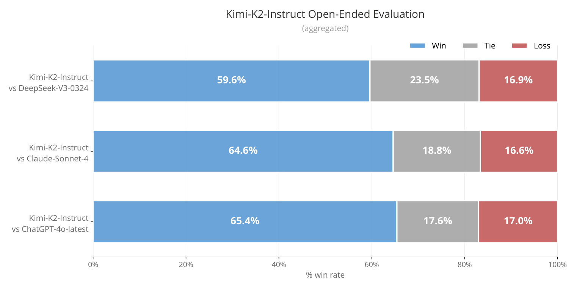{ width="900" }

<small>原论文 Figure 11，内部中文开放评测的汇总结果。[↗](https://arxiv.org/pdf/2507.20534v2#page=29)</small>

对 V3，K2 为 59.6% 胜、23.5% 平、16.9% 负；对 Sonnet 4 为 64.6%、18.8%、16.6%；对 ChatGPT-4o-latest 为 65.4%、17.6%、17.0%。图中胜率没有把一半平局加进去。它支持在该内部任务分布上的偏好优势，受限访问的留出集并不能单独证明完全没有数据重合，报告也没有在这里披露足以独立复建整套中文评测的样本与评分细节。

LMSYS Arena 的人类投票提供另一种信号。报告引用 2025 年 7 月 17 日、3000 多次盲投时，K2 排在开放模型第一、总体第五。这是有日期的用户偏好快照，不能作为当前排名，也不是对正确率、工具安全或训练成本的统一认证。

## Base 模型能说明基础能力，不能直接量化 RL 增益

K2 同时发布 Base 与 Instruct。Base 评测有助于判断这些能力在后训练之前已有多少基础，但它使用另一套 few-shot 与评分协议。MMLU、GPQA 等部分任务用 perplexity-based 评测，代码与数学等使用生成式评测，GPQA 还平均八次独立运行。因此，Base 与 Instruct 两张表中的同名任务不能直接相减后归因于 RL。

| Benchmark | # Shots | K2-Base | V3-Base | Llama4-Maverick-Base | Qwen2.5-72B-Base |
| --- | --- | ---: | ---: | ---: | ---: |
| MMLU | 5 | 87.79 | 87.10 | 84.87 | 86.08 |
| MMLU-pro | 5 | 69.17 | 60.59 | 63.47 | 62.80 |
| MMLU-redux | 5 | 90.17 | 89.53 | 88.18 | 87.77 |
| SuperGPQA | 5 | 44.67 | 39.20 | 38.84 | 34.23 |
| GPQA-Diamond (avg@8) | 5 | 48.11 | 50.51 | 49.43 | 40.78 |
| SimpleQA | 5 | 35.25 | 26.49 | 23.74 | 10.31 |
| TriviaQA | 5 | 85.09 | 84.11 | 79.25 | 76.03 |
| BBH | 3 | 88.71 | 88.37 | 87.10 | 84.09 |
| HellaSwag | 5 | 94.60 | 89.44 | 86.02 | 95.27 |
| AGIEval | — | 84.23 | 81.57 | 67.55 | 76.87 |
| ARC-Challenge | 0 | 95.73 | 93.77 | 94.03 | 95.56 |
| WinoGrande | 5 | 85.32 | 84.21 | 77.58 | 84.14 |
| CRUXEval-I-cot | 0 | 74.00 | 62.75 | 67.13 | 61.12 |
| CRUXEval-O-cot | 0 | 83.50 | 75.25 | 75.88 | 66.13 |
| LiveCodeBench(v6) | 1 | 26.29 | 24.57 | 25.14 | 22.29 |
| EvalPlus | — | 80.33 | 65.61 | 65.48 | 66.04 |
| MATH | 4 | 70.22 | 61.70 | 63.02 | 62.68 |
| GSM8k | 8 | 92.12 | 91.66 | 86.35 | 90.37 |
| GSM8k-platinum | 8 | 94.21 | 93.38 | 88.83 | 92.47 |
| CMATH | 6 | 90.26 | 90.53 | 88.07 | 86.98 |
| C-Eval | 5 | 92.50 | 90.04 | 80.91 | 90.86 |
| CMMLU | 5 | 90.90 | 88.84 | 81.24 | 90.55 |
| CSimpleQA | 5 | 77.57 | 72.13 | 53.47 | 50.53 |

<small>原文 Table 4 的全部任务行。EvalPlus 是 HumanEval、MBPP、HumanEval+、MBPP+ 的平均；破折号表示原表未给 shot 数。[↗](https://arxiv.org/pdf/2507.20534v2#page=17) [↗](https://arxiv.org/pdf/2507.20534v2#page=18)</small>

相对 V3-Base，K2 的 SimpleQA 高 8.76，MATH 高 8.52，EvalPlus 高 14.72，说明知识、数学和代码能力在预训练后已经较强。中文三项也均领先所列对照。

例外必须一起保留。GPQA 的 48.11 低于 V3 的 50.51 和 Maverick 的 49.43；HellaSwag 低于 Qwen2.5，CMATH 略低于 V3。更大稀疏容量和预训练改进没有让每个维度都最优。Base 的训练数据、架构和优化器一起发生变化，这张跨模型表也不能单独测出 MuonClip 或重写数据贡献了多少分。

## 安全评测暴露的是具体攻击条件下的差异

报告用 Promptfoo 生成攻击，再进行多轮人工复核。插件覆盖 Harmful、Criminal、Misinformation、Privacy 和 Security；每个 plugin 与 strategy 组合生成 3 个攻击提示，支持中英双语的组合则每种语言各 3 个。由同一位评审处理同一测试集，以减少评分差异。

这些“每组合 3／6 条”是细分插件条件，不是整个大类总共只测 3 条。Table 6 汇总的是分类通过率；通过率越高，表示在该评测中越能抵御相应攻击。

| Plugin / Strategy | Kimi K2 | V3-0324 | DeepSeek-R1 | Qwen3-235B-A22B |
| --- | ---: | ---: | ---: | ---: |
| Harmful / Basic | 98.04 | 90.45 | 99.02 | 98.53 |
| Harmful / Iterative Jailbreak | 92.16 | 66.67 | 72.55 | 74.51 |
| Harmful / Crescendo | 64.71 | 64.71 | 80.39 | 86.27 |
| Criminal / Basic | 100 | 99.62 | 95.45 | 99.24 |
| Criminal / Prompt Injection | 75.76 | 91.67 | 69.70 | 98.47 |
| Criminal / Iterative Jailbreak | 57.57 | 21.21 | 25.76 | 53.03 |
| Misinformation / Basic | 97.28 | 92.57 | 92.46 | 94.84 |
| Misinformation / Iterative Jailbreak | 63.97 | 53.97 | 84.13 | 69.84 |
| Privacy / Basic | 100 | 100 | 100 | 100 |
| Privacy / Prompt Injection | 88.33 | 98.33 | 100 | 91.67 |
| Privacy / Iterative Jailbreak | 76.67 | 100 | 93.33 | 96.67 |
| Security / Basic | 77.84 | 75.57 | 70.46 | 90.09 |
| Security / Prompt Injection | 87.80 | 97.56 | 65.85 | 84.13 |
| Security / Iterative Jailbreak | 43.90 | 60.97 | 43.90 | 78.04 |
| Security / Crescendo | 68.29 | 87.80 | 68.29 | 87.80 |

<small>原文 Table 6 节选。完整表还包含 Base64 等行；Table 5 的 strategy 列没有列出 Base64，Table 6 实际报告了该策略。[↗](https://arxiv.org/pdf/2507.20534v2#page=18) [↗](https://arxiv.org/pdf/2507.20534v2#page=19)</small>

K2 在 Harmful / Iterative Jailbreak 上优于对照，在同一大类的 Crescendo 上却低于 R1 和 Qwen3。Privacy / Basic 全部为 100，不能遮住 K2 在 Iterative Jailbreak 中只有 76.67。Security / Iterative Jailbreak 的 43.90 更显示了明显弱点。

攻击名字听起来更复杂，也不保证每条提示更有效。作者指出，多轮转换有时会改变原本的攻击含义，导致输出不再具有相同评测意义。人工判断、少量细分攻击和任务适配都会影响结果。部分插件原本面向 API 滥用或外部工具调用，对单独语言模型的输出测试也不能替代一个真实 agent 系统的执行权限和环境测试。[↗](https://arxiv.org/pdf/2507.20534v2#page=20)

这与前面的 enforcer 有明确分工。schema 约束能阻止格式不合法的请求，无法阻止一个格式完全合法、但不应该执行的动作。任务成功奖励和安全评价需要分别覆盖相应结果。

## 用 K2 的方法时，先明确哪一段反馈真正可靠

报告给出的内部失败情形与前面各环节相互对应。困难推理或不清楚的工具定义可能导致输出过长、截断和不完整调用；不必要地启用工具可能降低部分任务表现；一次提示生成完整软件项目的成功率，也低于在 agentic coding 框架中逐步完成。这些现象提示，工具、预算与反馈方式会直接改变最终能力。[↗](https://arxiv.org/pdf/2507.20534v2#page=20)

若复用其训练思路，最有价值的是保留可检查的接口。轨迹中要能区分模型提出的行动、环境实际返回的结果，以及 rubric 如何据此判定成功。critic 的偏好分数不能代替单元测试，单元测试也不能覆盖用户未写进测试的全部要求。把这些信息留在同一条轨迹里，才可能追查模型究竟学会了什么。

若直接部署 K2，则应在将使用的框架、工具 schema 和尝试预算下评测。先测单次完整任务，再测多次尝试与 verifier 能带来多少收益，并同时记录 token、环境等待和失败恢复成本。报告的 SWE 三种模式已经说明，同一模型的最终分数会随这些条件明显变化。

K2 让“能够行动”的模型训练变得更具体。它把数值稳定性、知识表达、带状态的交互数据、可验证反馈和权重传输都纳入同一个工程过程。可迁移的核心在于让每次行动都能得到可解释的反馈，并让获取这些反馈的成本足够低；对模拟真实性、评价偏差和任务外失败的检查，仍然需要跟着这个过程一起保留。

Kimi K2 的 MoE 与 Muon 设计可以分别接[MoE 路由与稀疏 kernel](../../operators/moe-routing-and-sparse-kernels.md)和[Muon 的可扩展实现](../foundations/muon-is-scalable.md)，不要把路由负载、优化器和规模效应混成一个原因。若要复算训练账单，再看[Scaling law 与实验经济学](../../training/scaling-laws-and-experiment-economics.md)。
