# LongCat-Video：长视频生成、GRPO 与高效推理

!!! info "论文信息"
    **论文题名：** LongCat-Video Technical Report。 
    **作者：** Meituan LongCat Team、Xunliang Cai、Qilong Huang、Zhuoliang Kang、Hongyu Li、Shijun Liang、Liya Ma、Siyu Ren、Xiaoming Wei、Rixu Xie、Tong Zhang。 
    **机构：** Meituan LongCat Team。 
    **时间 / 主题：** 2025-10；技术报告、视频生成、长视频、世界模型。 
    **arXiv / 官方报告：** arXiv：[2510.22200](https://arxiv.org/abs/2510.22200)。 
    **GitHub / 项目：** GitHub：[github.com/meituan-longcat/LongCat-Video](https://github.com/meituan-longcat/LongCat-Video)。 
    **元数据来源与核验口径：** 来源：[arXiv](https://arxiv.org/abs/2510.22200)；[GitHub](https://github.com/meituan-longcat/LongCat-Video)；Checked Date：2026-07-08；Repro Status：Author Code / Model Weights available, independent reproduction not claimed。

## 六秒视频之后，下一段应该怎样接上

生成一段短视频时，模型可以同时安排这几秒内的人物、背景与运动。把它反复调用来生成几分钟视频，问题就变了。上一段已经确定了人物穿着、物体位置和镜头方向，下一段需要接着这些事实往下走；上一段留下的颜色偏差、形变，也会成为下一段的输入。短片质量高，只解决了其中一部分。

LongCat-Video 把续写放进基础训练。文生视频没有历史画面，图生视频有一帧历史，Video Continuation 有多帧历史，三种任务由同一个 13.6B 参数模型处理。模型学的是在不同长度的视觉条件之后生成新片段。训练时就接触这类条件，比只在推理时拿一个短视频模型反复拼接，更贴近长视频的实际用法。[↗](https://arxiv.org/pdf/2510.22200v2#page=4)

原论文图 1 中，第二行用同一张人物照片分别生成吃汉堡、喝水和挥手；最后一行则在倒茶、放下茶壶、加蜂蜜、搅拌之间更换指令。前者检验一张图能否接上不同动作，后者检验已经生成的画面能否成为下一段的条件。

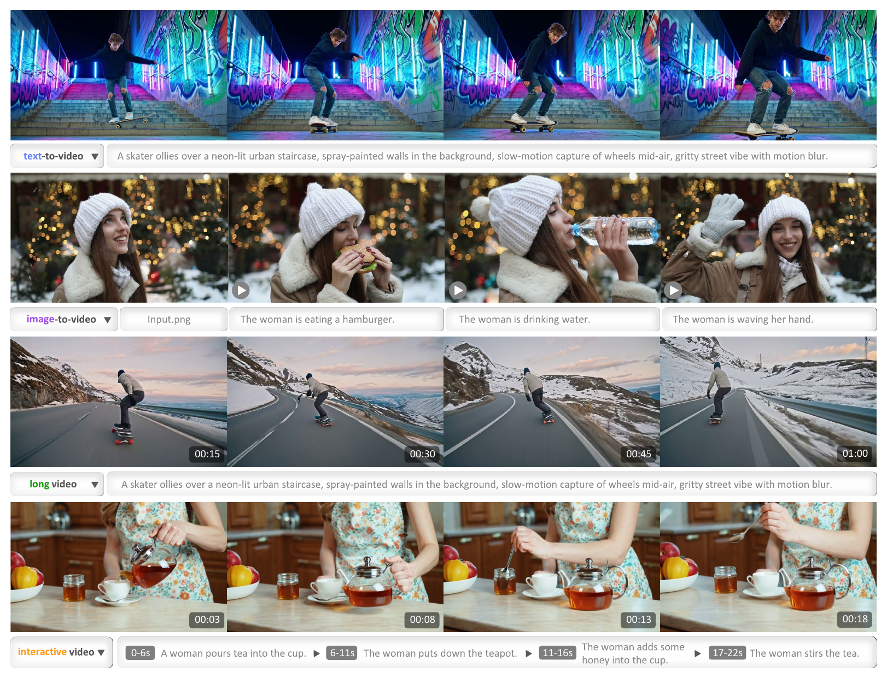{ width="920" }

让长视频可用，还需要处理另外两件事。第一，常规训练得到的模型未必符合人对动作、画质和指令响应的偏好，因此作者做了多奖励 GRPO。第二，高分辨率视频每一轮去噪都很贵，因此作者把低分辨率生成、少步蒸馏、细化专家和稀疏注意力连成一条推理流程。单张 H800 上的代表配置用 142 秒生成约六秒的 720p、30 fps 视频。这里的 30 fps 是播放帧率，142 秒才是生成耗时。

理解这套方法，首先要区分两种“时间”。**视频时间**表示画面中的先后，决定哪些帧是历史、哪些帧要续写；**噪声时间**表示去噪走到哪里，同一段待生成视频会经历多轮更新。LongCat 的条件缓存跨越噪声时间复用，而多分钟视频通过视频时间上的分段续写得到。把这两条轴混在一起，就容易误以为模型像语言模型一样每次只输出一帧。

## 一个 DiT 如何同时处理文本、首帧和历史片段

### 先压缩视频，再让 token 交换信息

RGB 视频先经过 Wan2.1 VAE，时间、高度、宽度分别压缩约 4、8、8 倍；DiT 内部再按 $1\times2\times2$ 划分 latent patch。忽略边界处理，最终 token 网格相对像素网格约缩小 $4\times16\times16$ 倍。压缩解决的是后续 Transformer 要处理多少位置，VAE 的一个 latent 也因此不能直接当作一张原始帧。

文本通过支持中英文的 umT5 编码。主干是 48 层单流 DiT，hidden size 为 4096，FFN hidden size 为 16384，attention heads 为 32。每个 block 中，3D self-attention 交换视频位置之间的信息，cross-attention 读取文本，SwiGLU FFN 处理各位置特征。3D RoPE 表示时空位置，AdaLN-Zero 把时间步信息引入 block，self-attention 和 cross-attention 的 Q、K 都使用 RMSNorm 做归一化。这些沿用组件共同构成底座，论文的统一任务设计主要发生在输入、时间步与注意力可见性上。[↗](https://arxiv.org/pdf/2510.22200v2#page=7)

设 $X_C$ 为条件 latent，$X_N$ 为待生成 latent。二者在视频时间维拼接

$$
X=[X_C,X_N],\qquad t=[0,t_N].
$$

条件部分提供已知画面，标记为噪声时间 0；新片段处于采样得到的噪声时间 $t_N$。训练只计算新片段的预测损失。T2V 对应空的 $X_C$，I2V 对应一张图提供的条件，VC 对应多帧历史。模型参数没有因任务变化而换一套，变化的是条件长度与对应 mask。

原论文图 5 的左侧先看顶端三行时间步。蓝色的 0 与条件帧对齐，橙色的 $t$ 与待生成帧对齐。右上角再看 self-attention 矩阵中被划掉的区域，那一块决定了历史信息能否保持独立。

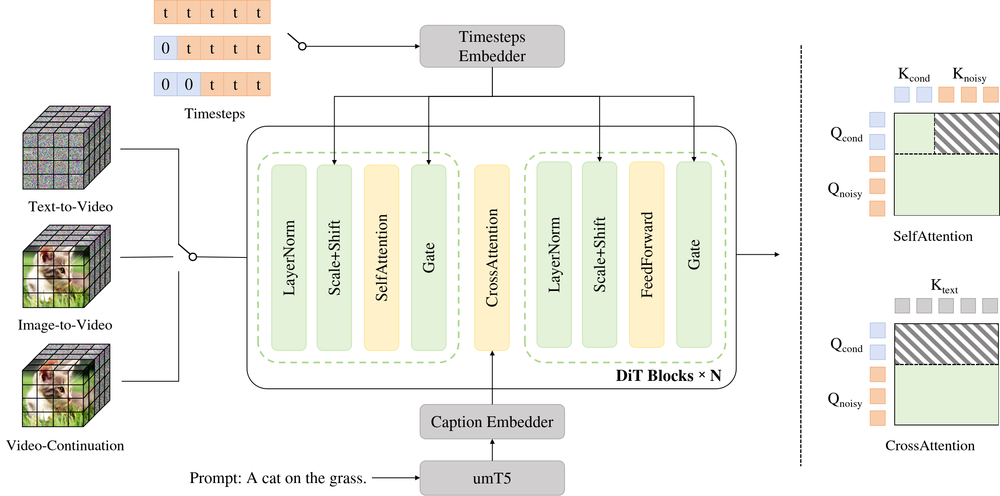{ width="920" }

### 为什么历史的 KV 可以缓存

一般的双向 self-attention 会让历史帧读到当前的噪声帧。下一轮去噪改变了后者，历史帧的特征也会随之改变，缓存便失效。LongCat 将两类查询分开

$$
Y_C=\operatorname{Attention}(Q_C,K_C,V_C),
$$

$$
Y_N=\operatorname{Attention}(Q_N,[K_C,K_N],[V_C,V_N]).
$$

第一式表示条件只能读取条件，第二式表示新片段可以读取历史与自身。还需要一个容易遗漏的条件，**历史 token 不参与文本 cross-attention**。这样，条件分支的每层特征由给定画面确定，不依赖本轮噪声，也不随当前文本交叉注意力变化。对固定的条件片段计算一次各层 KV，就能在这段视频的多轮去噪中复用。[↗](https://arxiv.org/pdf/2510.22200v2#page=8)

例如，第一段已经生成“手拿起茶壶”，现在要接“向杯中倒茶”。条件分支先把已有画面转换成可读取的历史特征；新片段在每一轮去噪中，一边读这些特征维持茶壶与人物的外观，一边通过 cross-attention 接收新动作。历史提供画面状态，文本指定后续事件。新片段内部仍可联合读取各个待生成位置，因而是一段视频共同去噪。

这也限定了缓存的意义。它省去固定条件在去噪步之间的重复计算；续写进入下一段、条件片段发生变化时，不能把旧缓存直接当作无限增长、永远有效的世界记忆。论文展示的长视频来自反复条件续写，没有因此获得显式物体状态表或永久记忆模块。

## 数据怎样把“画面好看”变成“事件说得清楚”

训练视频的问题不只在分辨率。若一个片段跨越剪辑点，模型会把突变当作运动；若标注只说“一个人在球场”，模型很难学到运球、起跳、投篮的先后关系。LongCat 将片段处理、质量属性和时间描述分开准备，再按训练阶段组合数据。

原论文图 2 从左向右读，第一段把原视频变成边界完整的 clips，第二段为每个 clip 写入多个属性。右侧同时保存视频与元数据，所以后续可以重新筛选，而不必为每个阶段重复分析全部视频。

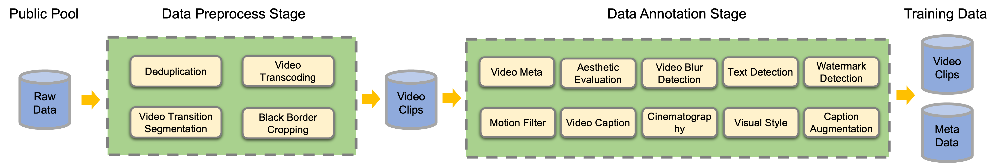{ width="920" }

预处理用视频 ID、MD5 去重，以 PySceneDetect 和内部训练的 TransNetV2 切镜头，配合 FFmpeg 去黑边。标注包含时长、分辨率、码率、美学、模糊、文字覆盖、水印与光流等。光流用于筛掉运动过少的片段，避免只留下清楚、漂亮但缺乏动作变化的数据。

caption 的核心来自微调后的 LLaVA-Video。作者先使用内部合成的视频文本对，再加入更丰富的时间事件数据及 Tarsier2 标注，以改善动作和时间关系描述。摄影信息另行处理，镜头运动由专门分类器识别，景别、镜头类型和视觉风格由 Qwen2.5-VL 分析。最后通过中英翻译、长短摘要及属性随机组合，为同一视频准备不同细度的描述。[↗](https://arxiv.org/pdf/2510.22200v2#page=6)

原论文图 3 中的篮球例子正好说明区别。编号画面依次是球进入、人物运球、靠近篮筐、跳起投篮；下方 caption 把这些事件排成时间链。旁边的镜头运动与风格只是补充属性，不能代替这条动作链。若只保留“篮球、球场、蓝衣男子”几个名词，监督信号便失去了先后顺序。

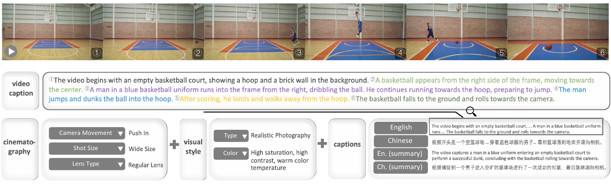{ width="920" }

数据重平衡也有明确对象。作者对 caption embedding 聚类，判断哪些内容过密、哪些不足，再补充或调整采样。SFT 阶段进一步按 caption embedding 空间中的密度反比抽样，让少见内容有更多机会进入训练。这样的“平衡”针对内容分布，和提高所有样本的美学分数解决的是不同问题。

## 基础训练如何学到续写，后训练又改变什么

### 速度预测的目标与条件 mask

令 $x_0$ 为干净的视频 latent，$\epsilon$ 为高斯噪声，$t\in[0,1]$ 为噪声程度。报告的线性路径是

$$
x_t=(1-t)x_0+t\epsilon.
$$

$t=1$ 时接近纯噪声，$t=0$ 时得到视频。报告式 20 将模型学习的去噪方向写为 $v^*=x_0-\epsilon$。为看清方向，可以用生成进度 $s=1-t$ 改写为 $x(s)=sx_0+(1-s)\epsilon$，于是 $dx/ds=x_0-\epsilon$。如果对原来的噪声坐标 $t$ 求导，符号会相反；实现时必须把预测目标与采样器的时间方向一起对齐。

基础训练回归这条路径的速度。把条件位置不计入损失这一规则显式写出来，可表示为

$$
\mathcal L_{\mathrm{FM}}
=\mathbb E_{x_0,\epsilon,t,c}
\left[w(t)\frac{1}{|N|}\sum_{j\in N}
\|v_\theta(x_t,c,t)_j-(x_0-\epsilon)_j\|_2^2\right].
$$

这里 $N$ 是待生成位置的集合，$c$ 包含文本与视觉条件，$w(t)$ 表示报告描述的时间权重；这是将原文式 21 与训练 mask、权重说明合并后的写法。模型从同一真实视频构造带噪输入与目标，在许多噪声程度上学习朝干净视频移动。条件帧的作用是提供已知信息，不要求模型同时把它们重新生成一遍。[↗](https://arxiv.org/pdf/2510.22200v2#page=16)

作者均匀采样 $t$，再用类似 logit-normal 的方式加权损失，而非直接从 logit-normal 分布抽取时间步；还按噪声 token 的体积调整 timestep shift，使更长、更高分辨率视频偏向更高噪声区域。VC 训练另外对历史帧施加逐帧独立的扰动。理想历史与模型自己生成的历史存在质量差距，这种增强让模型见到不完全干净的条件，降低颜色偏差在续写中不断累积的倾向。

### 分阶段增加视频、条件和分辨率

Tables 3–4 的训练顺序可以看成逐步增加任务难度。先在低分辨率图像上学习外观和语义，再引入视频运动；有了基本运动能力后，才把 I2V、VC 加入联合训练。分辨率后移，减少了早期阶段昂贵的长序列计算。

| Stage | Training Tasks | Size Bucket | Learning Rate | Iterations |
| --- | --- | --- | ---: | ---: |
| Pre-training 1 | T2I | 256p | $10^{-4}$ | 285K |
| Pre-training 2 | T2I + T2V | 256p × 93 frames | $10^{-4}$ | 140K |
| Pre-training 3 | T2I + T2V + I2V + VC | 256p × 93 frames | $5\times10^{-5}$ | 164K |
| Pre-training 4 | T2I + T2V + I2V + VC | 480p × 93 frames | $5\times10^{-5}$ | 36K |
| Pre-training 5 | T2I + T2V + I2V + VC | 480p + 720p × 93 frames | $2\times10^{-5}$ | 53K |
| SFT | T2I + T2V + I2V + VC | 480p + 720p × 93 frames | $10^{-5}$ | 7.5K |

这些是迭代数，不能直接当作样本数或 token 数。各阶段使用 AdamW，阶段内学习率固定，阶段之间下降。不同画幅的视频进入最接近的 aspect-ratio bucket，减少不合适的裁剪和无效计算。SFT 除通用高质量数据外，还加入摄影与风格专用数据来强化指令响应。[↗](https://arxiv.org/pdf/2510.22200v2#page=17)

原论文图 13 中，基础模型之后有三个分支。RLHF LoRA 改善偏好，Distillation LoRA 压缩采样过程，Refinement Expert LoRA 学习高分辨率细化。先辨认这三条箭头，就不会把“RL 后质量更好”与“蒸馏后只采样 16 步”当成同一个训练收益。

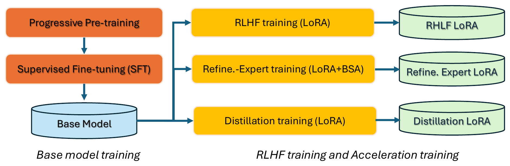{ width="920" }

## 视频 GRPO 怎样知道哪一次扰动值得保留

### 把去噪转移当作随机策略

视频奖励通常要等成片后才能计算。奖励模型可以告诉我们哪个视频更好，却不直接给出“第几步的哪个 latent 应该怎样改”的可靠导数。GRPO 的做法是生成一组候选，再提高组内较好候选对应的策略概率。

在 flow matching 中，一次随机去噪转移可写成高斯分布

$$
p_\theta(x_{\mathrm{next}}\mid x_t,c)
=\mathcal N\!\left(\mu_\theta(x_t,t,c),\sigma_t^2\Delta t I\right).
$$

$\mu_\theta$ 由当前 latent、模型预测的速度与 SDE drift 决定，$\sigma_t\sqrt{\Delta t}$ 控制本步随机扰动幅度，$\Delta t>0$ 表示步长大小。采样得到 $x_{\mathrm{next}}$，再完成剩余去噪，才取得最终视频奖励。优化时使用新旧策略对这次转移给出的概率比

$$
r_i(\theta)=\frac{p_\theta(x^i_{\mathrm{next}}\mid x^i_t,c)}
{p_{\theta_{\mathrm{old}}}(x^i_{\mathrm{next}}\mid x^i_t,c)}.
$$

把相对优势记作 $A_i$，正优势候选推动其概率上升，负优势候选推动其概率下降；KL 项约束当前策略不要偏离参考模型过远。用附录中的最大化约定，目标可概括为

$$
J(\theta)=\mathbb E\left[
\lambda_{\mathrm{policy}}r_i(\theta)A_i
-\beta\lambda_{\mathrm{KL}}D_{\mathrm{KL}}(\pi_\theta\|\pi_{\mathrm{ref}})
\right].
$$

这里优化的是随机策略的奖励代理目标，不需要对奖励模型反向传播。$\pi_{\mathrm{old}}$ 负责产生本批样本并构造概率比，$\pi_{\mathrm{ref}}$ 提供正则化参照，两者职责不同。[↗](https://arxiv.org/pdf/2510.22200v2#page=28)

### 同组固定初始噪声，只让一个去噪步随机

如果四个候选从不同初始噪声开始，每个去噪步又各自注入随机量，它们的构图、人物姿态与动作可能同时变化。奖励有差别，却难以知道是哪一步带来的。LongCat 对同一个 prompt 固定初始噪声，并在 16 个采样步骤的前 6 步中随机选一个关键步，只在这个位置采用 SDE，其他位置采用确定性 ODE。

这样，同组候选到达关键步之前具有共同的生成历史，在关键步注入不同扰动，后续确定性过程把这些差别发展成最终视频。奖励比较因此更集中地反映这次扰动的影响。关键步在不同训练样本间变化，模型仍能学习多个位置，单组比较却不必同时解释整条轨迹的所有随机因素。[↗](https://arxiv.org/pdf/2510.22200v2#page=31)

原论文图 6 展示的是最终效果样例。街舞与芭蕾舞各有 base、GRPO 两行，应沿同一行比较姿态的变化，再看上下行的画面与动作差异。它说明了作者希望改善的现象；下面的奖励与消融曲线才进一步检验训练设计。

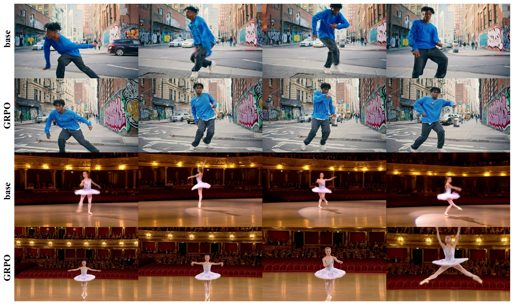{ width="760" }

### 时间重加权解决的究竟是什么

对高斯策略求导，有

$$
\nabla_\theta\log p_\theta
=\frac{x_{\mathrm{next}}-\mu_\theta}{\sigma_t^2\Delta t}
\nabla_\theta\mu_\theta.
$$

分子是本次转移相对于策略均值的残差。采样时，它来自随机扰动 $\sigma_t\sqrt{\Delta t}\epsilon$，因此策略更新会沿“哪些随机方向碰巧得到更高奖励”积累信号。优势决定方向是否值得鼓励，模型 Jacobian 则把这种鼓励传回参数。

附录在未触发裁剪的噪声日程 $\sigma_t=\sqrt{t/(1-t)}$ 下，代入 drift 对速度的导数，得到时间相关系数

$$
\kappa(t,\Delta t)=\sqrt{\frac{\Delta t(1-t)}{t}}.
$$

在新旧策略相同、即概率比为 1 的采样起点，附录的反向时间记号下，策略项梯度简化为

$$
\nabla_\theta L_{\mathrm{policy}}
=-\frac32 A_i\,\kappa(t,\Delta t)\,
\epsilon\cdot\nabla_\theta v_\theta.
$$

当 $t$ 接近 1，或者 timestep shift 导致 $\Delta t$ 很小，同样的优势与扰动会被这个系数压弱。高噪声阶段对大结构有影响，却可能收到很弱的更新。作者因此给策略项乘以 $\kappa^{-1}$；KL 梯度中出现的是对应的平方尺度，所以使用另一权重

$$
\lambda_{\mathrm{policy}}
=\sqrt{\frac{t}{\Delta t(1-t)}},\qquad
\lambda_{\mathrm{KL}}
=\frac{t}{\Delta t(1-t)}.
$$

这个推导解释了权重的来源，也有适用条件。更新后新旧策略不再相同，完整梯度需要保留 $r_i(\theta)$；噪声裁剪改变了 $\sigma_t$ 时，也不能继续把未裁剪公式的精确抵消当作恒等式。附录式 32 保留了这些系数，后面的简式用于分析其主要尺度。[↗](https://arxiv.org/pdf/2510.22200v2#page=29)

原论文图 7(a) 比较完整设置与 `w/o reweight`。先看各子图末段，蓝色设置在 HPSv3-general、MQ、TA 上均高于橙色对照；再看中段，MQ 仍有明显回落。证据支持重加权改善这次训练的优化效果，并不支持每一步奖励都单调增长。

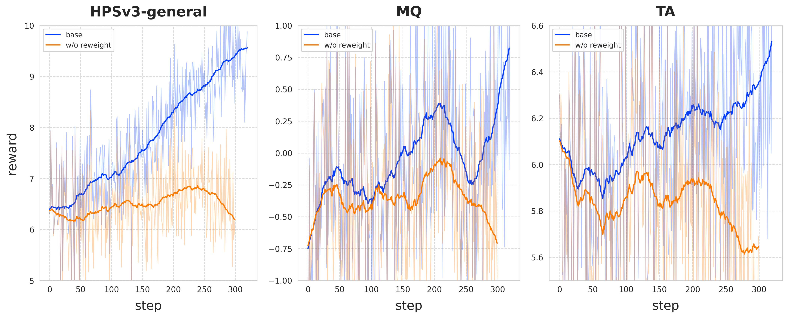{ width="920" }

另一个数值问题来自随机步本身。$t$ 接近 1 时，$\sigma_t\sqrt{\Delta t}$ 可能过大，导致扰动破坏当前视频。作者将这个系数截断到 0.45，并在 drift 中同步使用截断后的 $\sigma_t$，保持转移均值与方差的设置一致。它控制采样扰动，时间重加权控制优化信号，两者不能互相替代。

### 为什么不能给每组奖励都除以自己的标准差

通常的组内优势先减均值，再除标准差。但如果四个视频的奖励几乎相同，微小的评分误差也会被除法放大。LongCat 保留每个 prompt 内的均值，分母改用当前 prompt batch 中最大的组内标准差，并且对每个奖励维度单独计算

$$
A_{j,i,k}=\frac{R_k(x^i_0,c_j)-\bar R_{j,k}}
{\max_{j'}\sigma_{j',k}},\qquad
A_{j,i}=\sum_k w_kA_{j,i,k}.
$$

$j$ 是 prompt，$i$ 是组内视频，$k$ 是奖励维度。分子仍回答“它比同一个 prompt 的其他候选好多少”，所以没有拿容易 prompt 与困难 prompt 的绝对分数直接排序；公共分母则让差别很小的一组少贡献一些梯度。

用一组解释性数字看效果。若某组中心化奖励为 $[-0.01,0.01]$，其标准差为 0.01，自己归一化后优势是 $[-1,1]$；若本批最大标准差为 0.5，改法给出 $[-0.02,0.02]$。候选的好坏顺序没变，更新幅度却更接近它们实际可分辨的程度。这只是公式演示，不是论文的实验数据。

原论文图 7(b) 用 MQ 曲线检验这个调整。`w/o maxstd` 后期落到较低区间，完整设置在波动后恢复；这支持该训练配置下的稳健性收益。最大标准差本身仍受当前批次影响，它不是奖励模型不确定性的完整估计。

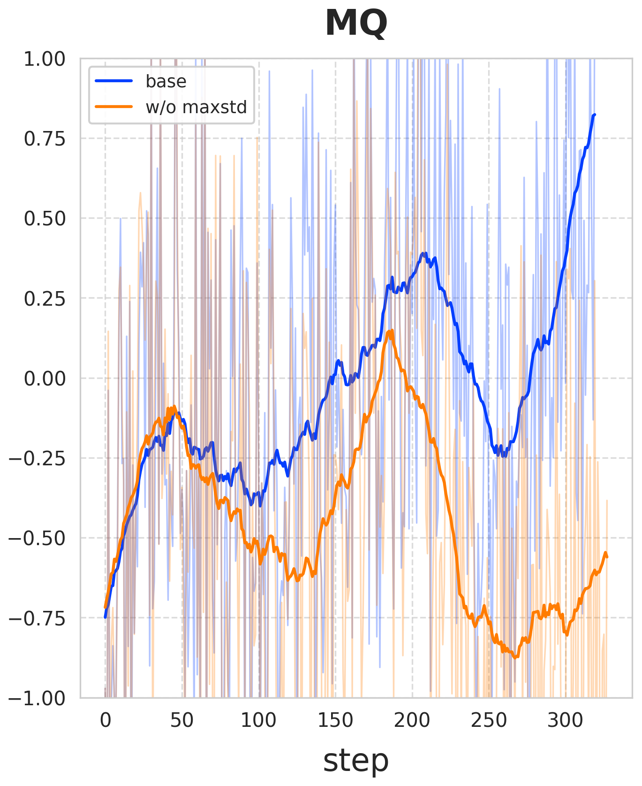{ width="720" }

### 四种奖励分别约束什么

报告使用三个模型产生四项奖励。它们先分别做上面的优势归一化，再相加；Table 9 的四项权重均为 1，不等于把四种原始量纲的分数直接平均。

| Reward | Input and Aggregation | Training Purpose |
| --- | --- | --- |
| HPSv3-general | 各帧使用通用提示 `A high-quality image`，再取平均 | 一般视觉质量 |
| HPSv3-percentile | 使用实际视频 caption，汇总最高 30% 帧的评分 | 让关键画面响应文本，减轻事件尚未发生时的低分干扰 |
| MQ | 内部数据微调的 VideoAlign，训练和打分都使用灰度视频 | 动作与运动质量 |
| TA | 内部数据微调的 VideoAlign，保留彩色视频 | 整段视频与文本的语义对应 |

取最高 30% 帧有具体动机。描述“人先跑向篮筐，然后投篮”的提示，不要求每一帧都包含投篮；如果逐帧都用完整描述惩罚，正常的事件展开反而可能吃亏。但这种帧级高分也不能独立证明全程顺序正确，整段视频的 TA 和 MQ 仍有作用。[↗](https://arxiv.org/pdf/2510.22200v2#page=12)

原论文图 9 上排只优化 HPSv3，人物在各帧中的姿态变化很小；下排加入多种奖励后出现滑行动作。单帧漂亮可以通过少动来实现，多奖励把“发生动作”也纳入优化目标。这是报告展示的一类 reward hacking，不能由一个样例推出所有奖励漏洞都已解决。

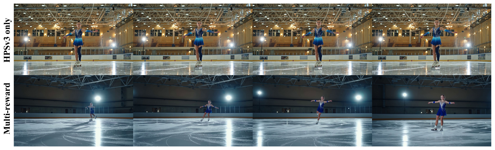{ width="760" }

MQ 奖励模型还需要防止颜色捷径。原论文图 20 比较 RGB 与灰度训练的验证损失，RGB 曲线在早期下降后更快上升，灰度曲线较长时间保持较低水平。将输入转成灰度，迫使模型少依赖色彩与风格；它保留的是运动评价所需的信息取舍，TA 仍使用 RGB 来识别颜色等语义。

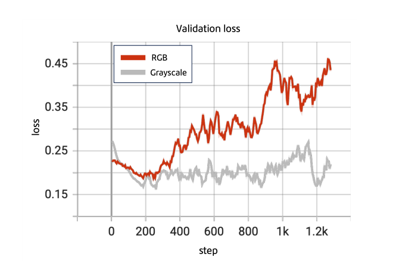{ width="660" }

原论文图 8 展示四项训练奖励的整体变化。HPSv3 两项上升较连续，MQ 起伏更大，TA 也有波动。训练同时推动多个目标，不表示它们对每个视频都同向变化；最终还需要用人工和独立评测口径看实际质量。

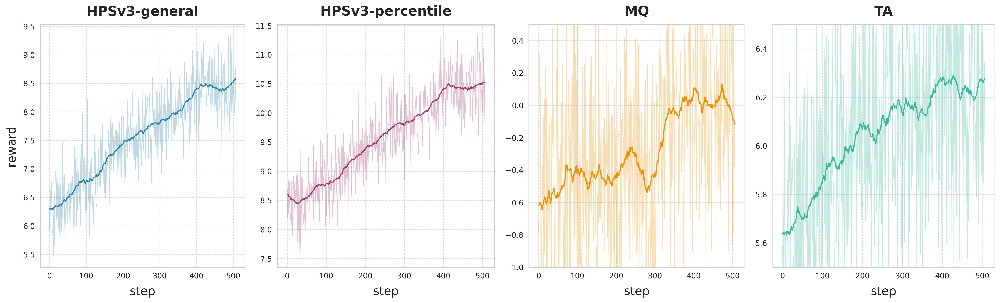{ width="920" }

RL 设置是每次更新 64 个 prompts、每组 4 个候选，进行 500 次更新；每个候选采样 16 步，shift 为 12、CFG 为 4。训练用 rank 128、alpha 64 的 LoRA，覆盖 self-attention、cross-attention、FFN 的线性层，学习率 $10^{-4}$，KL 系数 $3\times10^{-4}$。这阶段只训练 T2V，I2V、VC 的改善来自共享模型的迁移，专门惩罚长视频质量衰减的奖励仍列在未来工作中。训练时用 SDE 探索的协议也不等于最终部署必须采用同一随机采样方式。[↗](https://arxiv.org/pdf/2510.22200v2#page=32)

## 低分辨率视频如何变成细化专家的训练起点

### 蒸馏先减少调用次数

完整模型的高质量采样需要多次调用 DiT。作者先做 CFG distillation，将 guidance strength 4.0、通用负提示下的 CFG-Zero 引导行为蒸馏进去；再做 consistency model distillation，将采样压到 16 步。两阶段分别训练 2K、3K 次，学习率均为 $5\times10^{-5}$，包含 T2I、T2V、I2V、VC，并使用 LoRA。[↗](https://arxiv.org/pdf/2510.22200v2#page=18)

这解释了为何加速不能只按 $50/16$ 算。步数减少之外，CFG 蒸馏还减少显式引导分支的工作。表中的 LCM 配置对应经过加速训练的模型；给原模型直接换一个 16 步采样器，不会自动得到同样的结果。

### 细化学习一条更短的分布路径

只减少步数仍然需要反复处理 720p 的长序列。LongCat 先以 480p、15 fps 生成主要构图和运动，再把结果提升到 720p、30 fps。第二阶段拿到的是已经有内容的视频，只需沿一条更短的路径修复细节与补足时间分辨率。

原论文图 11 上半部分是 T2V，下半部分是带条件的 I2V／VC。先跟随绿色路径得到低分辨率视频，再跟随橙色路径进入 refinement LoRA；下半部分额外保留了一条高分辨率条件输入，后面会用到。

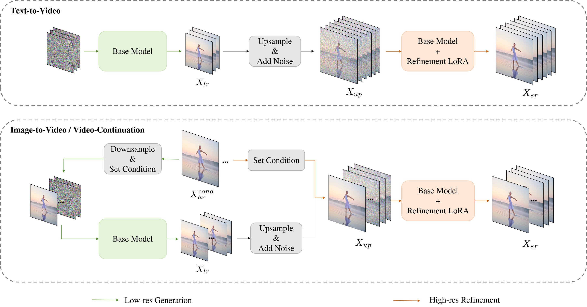{ width="920" }

记低分辨率 latent 为 $x_{\mathrm{lr}}$。作者先解码成 RGB，在像素空间做时空三线性上采样，再编码回高分辨率 latent

$$
x_{\mathrm{up}}=\operatorname{Encode}\!\left(
\operatorname{Upsample}(\operatorname{Decode}(x_{\mathrm{lr}}))\right).
$$

直接插值能对齐尺寸，却不会凭空恢复真实的高频纹理。细化专家的起点因此加入适量噪声

$$
x_{\mathrm{thresh}}=(1-t_{\mathrm{thresh}})x_{\mathrm{up}}
+t_{\mathrm{thresh}}\epsilon.
$$

保留下来的 $x_{\mathrm{up}}$ 提供布局和运动，噪声给模型重新组织细节的空间。训练时，$x_0$ 是目标高分辨率视频，在 $x_0$ 与这个起点之间构造路径

$$
x_{t'}=x_0+(x_{\mathrm{thresh}}-x_0)
\frac{t'}{t_{\mathrm{thresh}}},\qquad
0\leq t'\leq t_{\mathrm{thresh}}.
$$

对应的去噪速度目标为

$$
v^*_{t'}=\frac{x_0-x_{\mathrm{thresh}}}{t_{\mathrm{thresh}}}.
$$

分母值得单独看。整条路径只占 $t_{\mathrm{thresh}}$ 长的时间区间，因此同一总位移需要除以该区间长度，才能得到与底座速度输出相容的尺度。假设某个标量位置需要从 0.2 变到 0.6，$t_{\mathrm{thresh}}=0.5$ 时目标速度是 $0.4/0.5=0.8$；若忽略这个除法，按相同时间区间积分就只走了一半位移。这是对公式的演示，实际模型联合预测高维视频 latent。[↗](https://arxiv.org/pdf/2510.22200v2#page=14)

作者选择 $t_{\mathrm{thresh}}=0.5$，细化采样 5 步。若阈值为 1，$x_{\mathrm{thresh}}$ 成为纯噪声，训练退回通常的噪声到高分辨率视频路径；阈值为 0.5 时，模型能利用粗视频已提供的结构。这五步能够生效，依赖细化专家对该路径的专门训练。

原论文图 10 将 native 480p、native 720p 和 coarse-to-fine 720p 并列。看人物面部、衣服纹理和黄色框出的局部，细化结果能改善清晰度及部分局部形变。图提供的是这些样例的证据，不能保证任意错误动作都能在最后五步被修正。

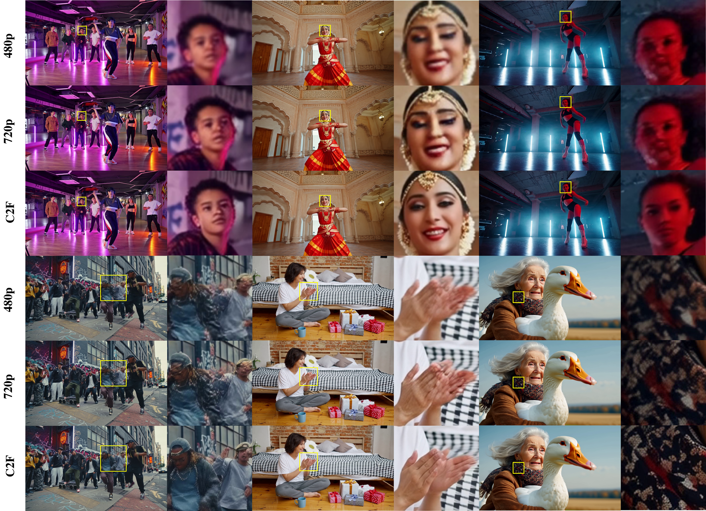{ width="920" }

### 有首帧或历史时，怎样保留原始细节

对 I2V／VC，低分辨率阶段先使用降采样后的条件画面生成新视频。但进入细化阶段时，条件部分取回原始高分辨率版本，再与上采样的新片段结合。若把原图也先降采样、再用粗视频的插值结果代替，就会主动丢掉本来已知的纹理与身份细节。图 11 下方的独立条件路径正是为此保留。[↗](https://arxiv.org/pdf/2510.22200v2#page=15)

细化训练还在数据和注意力上适配部署。作者用 GLCM 过滤出纹理丰富的数据，施加多种退化增强，混合帧率训练，使专家同时支持仅空间细化与时空细化。先用 full attention 训练 500 次，再开启 93.75% 稀疏注意力训练 500 次，两阶段学习率均为 $5\times10^{-5}$。最后的稀疏模型经历过适应训练，不能把“去掉大部分注意力后画质接近”解释成未经训练的密集注意力天然可以无损删除。

## BSA 省的是哪部分注意力计算

### 用小矩阵选块，用原 token 算结果

设视频 token 数为 $L$，完整 self-attention 为每个 query 与每个 key 建立关系，主要交互规模随 $L^2$ 增长。视频局部有大量相关位置，可以先粗筛哪些区域值得细看，再在这些区域内部计算精细注意力。

原论文图 12 从左到右展示了这个过程。左侧绿色 query 所属的三维块先成为查询单位；中间用平均特征给所有蓝色 key 块打分；选出少数块后，最右侧恢复块内的原始 token 做 attention。被平均的是筛选用的 Q、K，最终没有把整个视频压成少数平均 V 向量。

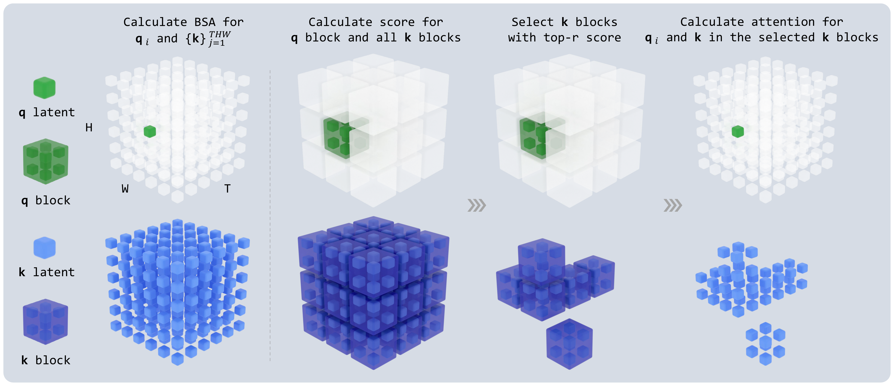{ width="920" }

将 $T\times H\times W$ token 网格按 $t_b\times h_b\times w_b$ 分块，每块包含 $n=t_bh_bw_b$ 个 token。对每个 head 分别池化

$$
\bar q_a=\frac1n\sum_{i\in\mathcal B_a}q_i,\qquad
\bar k_b=\frac1n\sum_{j\in\mathcal B_b}k_j,
$$

$$
S^{\mathrm{block}}_{ab}=\frac{\bar q_a^\top\bar k_b}{\sqrt d}.
$$

$a,b$ 是块编号，$d$ 是单个 head 的维度。对 query 块 $a$ 选分数最高的 $r$ 个 key 块，记其 token 集合为 $\mathcal S(a)$。最终某个 query token $i$ 的输出仍是 token 级加权和

$$
o_i=\sum_{j\in\mathcal S(a)}
\frac{\exp(q_i^\top k_j/\sqrt d)}
{\sum_{u\in\mathcal S(a)}\exp(q_i^\top k_u/\sqrt d)}v_j.
$$

这条展开式把附录的 mask、softmax 与 value 加权连起来。每个 query 保留自己的分数，只在选中集合上归一化。被丢弃的 key 不再贡献概率质量，因此 BSA 与完整 attention 一般不相等；“接近无损”描述训练后的生成质量，而非算子恒等。[↗](https://arxiv.org/pdf/2510.22200v2#page=32)

默认三维块为 $4\times4\times4$，即 64 个 token。细化阶段每个 query 块保留 $N_k/16$ 个 key 块，对应 93.75% 稀疏率；蒸馏阶段保留 $N_k/8$。忽略边界与筛选开销时，主 token 交互约保留相同比例，但 FFN、投影、文本 attention、VAE 和调度仍需执行，所以不会自动获得 16 倍端到端加速。

块大小还有硬件代价。附录报告 query 块包含 128 个 token、key 块包含 1024 个 token 时算子最快，但更大的块对不同分辨率和较大的 context parallel size 不够灵活，因此默认选择 64。图像区域越粗，筛选越省事，也越难精细排除不相关位置；最快的单算子配置不一定最适合混合尺寸训练。

### 多卡不能各自选完块再平均输出

Context parallelism 把长序列分给多张卡，但每张卡上的 query 仍可能需要读取其他卡上的 key。Ring BSA 先让每张卡计算本地 pooled K，交换这些块摘要，使本地 query 可以在全局 key 块中筛选；随后通过 ring 传输实际 K、V，边通信边计算选中部分。

最终 softmax 必须在该 query 的全部选中 key 上归一化。若各卡单独 softmax 后直接平均，每卡都会把自己局部权重归一到 1，已经改变了全局概率比例。报告使用 online softmax 合并跨卡计算，同时重叠通信与算子执行。[↗](https://arxiv.org/pdf/2510.22200v2#page=33)

块筛选也比较过两种方式。Top-$r$ 为每个 query 块保留固定数量，工作量可控；CDF-$p$ 按块分数的 softmax 累计概率决定保留数量。作者观察到，免训练、高加速配置下 CDF-$p$ 质量更好，但可训练场景中，不同 query 的保留数变化会带来额外时间开销，最终采用 top-$r$。这个取舍同时考虑模型近似与硬件执行，不能只按稀疏率选方案。[↗](https://arxiv.org/pdf/2510.22200v2#page=34)

基础训练另用 ZeRO-2、context parallelism、Ring Attention 和 activation checkpointing 分摊显存与计算，按分辨率分桶，并缓存 VAE 相关计算以减少 rank 间气泡。报告的 MFU 为 33%–38%，它反映这套训练系统的有效模型 FLOPs 利用情况，和推理延迟表测量的是不同阶段。

## 142 秒来自一整条流程，不能只归功于稀疏注意力

Table 2 固定单张 H800 与 FlashAttention3，对不同加速设置测量延迟。先在相同输出尺寸内比较，再看改变帧数后的组合效果。

| Variant | LCM | C2F | BSA | Sampling Steps | Latency |
| --- | :---: | :---: | :---: | ---: | ---: |
| 480p × 93 frames | — | — | — | 50 | 341.5 s |
| 480p × 93 frames | ✓ | — | — | 16 | 61.3 s |
| 720p × 93 frames | — | — | — | 50 | 1429.5 s |
| 720p × 93 frames | ✓ | — | — | 16 | 244.6 s |
| 480p × 93 → 720p × 93 frames | ✓ | ✓ | — | 16 / 5 | 135.3 s |
| 480p × 93 → 720p × 189 frames | ✓ | ✓ | — | 16 / 5 | 302.9 s |
| 480p × 93 → 720p × 93 frames | ✓ | ✓ | ✓ | 16 / 5 | 116.5 s |
| 480p × 93 → 720p × 189 frames | ✓ | ✓ | ✓ | 16 / 5 | 142.0 s |

第一组问题是蒸馏能省多少。同为 720p、93 帧，1429.5 秒降到 244.6 秒，约为 5.84 倍；这大于单看步数的 $50/16=3.125$，也符合 CFG 与步数同时蒸馏的流程。第二组问题是高分辨率计算能否后移。同为 93 帧输出，16 步低分辨率生成加 5 步细化只需 135.3 秒，低于全程 720p 的 244.6 秒。

第三组才更接近 BSA 的独立贡献。在同样的 C2F 设置里，93 帧输出从 135.3 秒降至 116.5 秒，约 1.16 倍；189 帧输出从 302.9 秒降至 142.0 秒，约 2.13 倍。这两个比值由表中延迟直接计算。更长序列下稀疏 attention 的收益更突出，但这些是整段流程延迟，不能据此反推出单个 attention kernel 的绝对速度。

报告的 10.1 倍来自 $1429.5/142.0$。分母方案输出 189 帧，分子基线输出 93 帧，两者并非同输出量的单因素替换。它说明组合方案在更高播放帧率下仍显著减少总耗时；若要评估自己的模块收益，应使用上面匹配配置的行。速度表本身也没有给出每种配置的逐项质量得分，不能把这些延迟顺序直接当成质量完全等价的性能排序。[↗](https://arxiv.org/pdf/2510.22200v2#page=13)

## 好看、会动、遵循条件，评测给出不同答案

### 先看评测口径

内部评测共 1628 个样本。T2V 有 1228 个，其中 500 个用于人工评估、728 个用于自动评估；I2V 有 100 张参考图，每张配详细、简短、矛盾与空提示，共 400 个样本。这四种提示分别检查精细遵循、简短指令适应、文本与图像冲突，以及只有图像条件时的行为。

MOS 是五分制评分，最终分数按人工与自动评估 2:1 加权。人工每个视频由三人独立评分，明显分歧时增加两人；GSB 则做同提示下的两两偏好比较。自动 judge 在内部测试中与人工的相关性超过 0.92，这是该评估器的内部校准结果，不等于所有公开视频数据上都具有相同可靠性。[↗](https://arxiv.org/pdf/2510.22200v2#page=19)

### T2V 的综合接近，掩盖了运动维度的差别

原论文图 14 的四个子图要分开读。LongCat 的 Visual Quality 接近 Wan2.2，Overall 略高于 PixVerse 与 Wan；但 Motion Quality 的橙色柱低于三个对照。一个综合分无法解释所有能力。

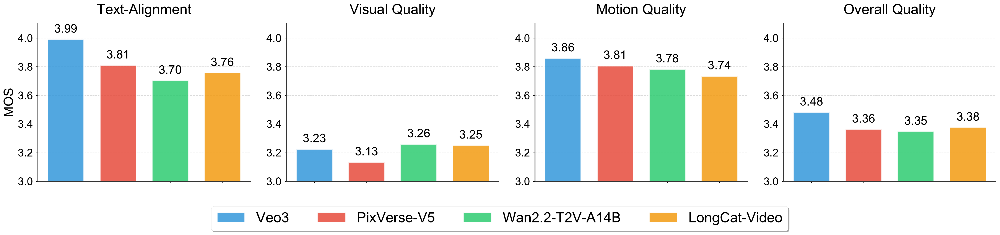{ width="920" }

| Metric | Veo3 | PixVerse-V5 | Wan2.2-T2V-A14B | LongCat-Video |
| --- | ---: | ---: | ---: | ---: |
| Text-Alignment | 3.99 | 3.81 | 3.70 | 3.76 |
| Visual Quality | 3.23 | 3.13 | 3.26 | 3.25 |
| Motion Quality | 3.86 | 3.81 | 3.78 | 3.74 |
| Overall Quality | 3.48 | 3.36 | 3.35 | 3.38 |

原论文图 15 的黄色表示 LongCat 被偏好，灰色表示平局，另一种颜色表示对手被偏好。先看最下面的 Overall，而不是把整条长柱当成某一方的胜率。

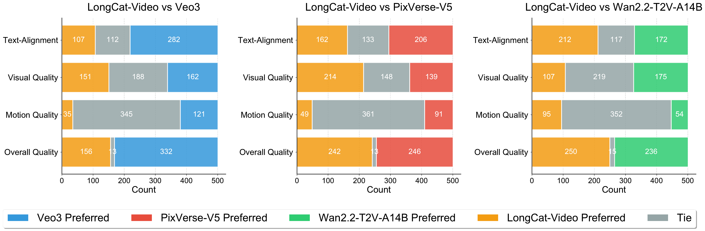{ width="920" }

| Opponent | LongCat-Video Preferred | Tie | Opponent Preferred |
| --- | ---: | ---: | ---: |
| Veo3 | 156 | 13 | 332 |
| PixVerse-V5 | 242 | 13 | 246 |
| Wan2.2-T2V-A14B | 250 | 15 | 236 |

LongCat 与 PixVerse 基本相当，与 Wan 的偏好计数接近，对 Veo 的差距更明显。图中每行计数合计为 501，与正文的 500 个 prompts 存在一项差异；这里保留原图计数，不把它改成凑整后的百分比。报告没有据此提供显著性结论，250 对 236 也不足以单独支撑“大幅领先”。

不同协议还会产生表面反差。LongCat 相对 Wan 的 Motion Quality GSB 为 95 次更好、352 次持平、54 次更差，而 MOS 是 3.74 对 3.78。前者统计配对偏好，后者是分数与不同评估来源的汇总，二者不要求相同排序。大量平局也说明，不能把少量胜负差异描述成每个样本都更会运动。[↗](https://arxiv.org/pdf/2510.22200v2#page=21)

### I2V 更清楚地暴露条件保持与运动的短板

原论文图 16 中，LongCat 的 Visual Quality 为 3.27，是该组最高；Image-Alignment 为 4.04，低于 Hailuo 和 Wan 的 4.18；Motion Quality 为 3.59，是该组最低。最终 Overall 为 3.17，低于 Seedance 的 3.35、Hailuo 的 3.27 与 Wan 的 3.26。

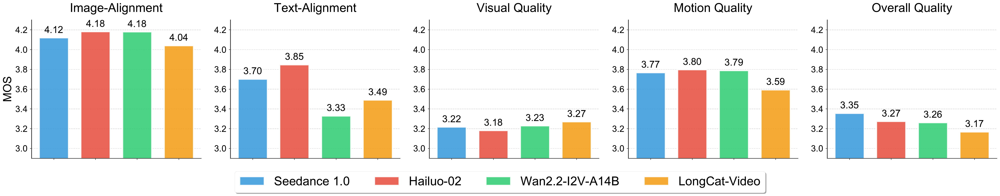{ width="920" }

这组结果对使用方式有直接影响。若主要看选出的静态帧，画面清晰可能很有吸引力；若任务要求参考图中的人物严格保真并完成较大动作，就需要同时检查 Image-Alignment 与 Motion Quality。统一架构和 T2V 的 RL 迁移没有消除这两个困难，不能用画质最高来替代整体效果判断。

### Commonsense 高分不等于物理模拟已经可靠

公开 VBench 2.0 提供另一种评测视角。下表摘出决定这一判断的两项维度与总分，并保留报告给出的评估日期。

| Model Name | Evaluation Date | Commonsense ↑ | Physics ↑ | Total Score ↑ |
| --- | --- | ---: | ---: | ---: |
| Wan2.1 | 2025-03 | 63.98% | 62.84% | 60.20% |
| Vidu Q1 | 2025-04 | 65.98% | 71.63% | 62.70% |
| Veo3 | 2025-09 | 69.48% | 69.35% | 66.72% |
| LongCat-Video | 2025-10 | 70.94% | 59.92% | 62.11% |

LongCat 的 Commonsense 在原表所有模型中最高，但 Physics 低于这里列出的三个对照。其总分在原表中排在 Veo3、Vidu Q1 之后，支持视频生成能力有竞争力；它没有证明碰撞、接触和物体动力学足以用于可靠决策。这些分数对应报告中的模型版本与评估日期，不能充当持续更新的产品排行榜。[↗](https://arxiv.org/pdf/2510.22200v2#page=21)

## 长视频的结果应该怎样理解和复用

原论文图 19 前三行给出 1、2、3、4 分钟的采样画面，后三行给出随片段改变指令的交互过程。前一组检验视觉主体与场景能否持续，后一组检验继续生成时能否接受新事件。两组都与基础训练中的 VC 接口对应。

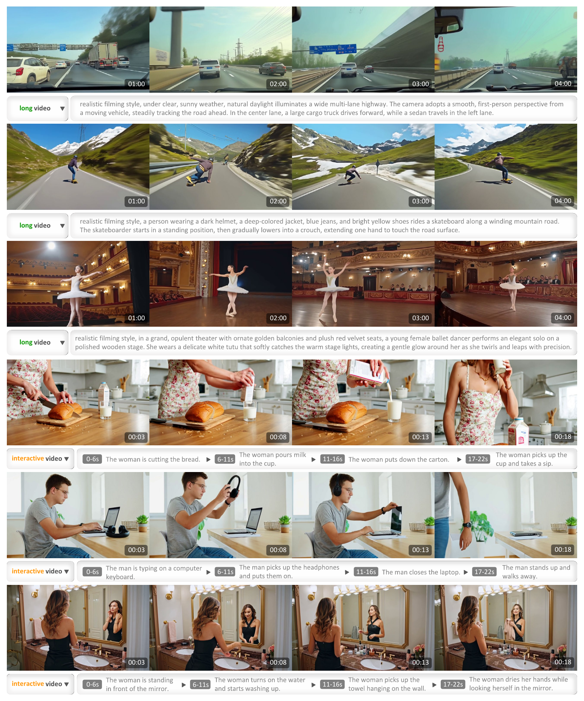{ width="760" }

从这些选取的画面可以观察长期外观延续与指令切换，但不能判断所有中间帧都没有错误，更不能推出所有提示都能稳定生成四分钟。报告没有给出同一批长视频在每个时间位置上的质量衰减曲线，也没有在这里建立动作控制、状态可回读或机器人闭环评测。作者在结尾继续提出物理知识、多模态记忆与 LLM 知识融合，说明这些仍是后续问题。[↗](https://arxiv.org/pdf/2510.22200v2#page=25)

这项工作可以复用的内容已经相当具体。要做可连续扩展的视频模型，可以借鉴按历史长度统一任务，以及让条件特征独立于噪声与文本的缓存设计；要做后训练，可以研究单随机步采样、多奖励分别归一化和时间重加权；要降低生成成本，可以沿着少步粗视频、专门的细化目标、经过适应训练的稀疏算子逐层测量收益。

官方仓库提供模型、推理代码与 BSA 实现，适合检查这些接口如何落到实际执行。训练报告给出了阶段和优化设置，数据管线说明并不等于完整训练数据已经公开。复现实验时最先固定的是模型／LoRA 组合、输出尺寸和帧数、采样步数、硬件与 attention 实现；这些条件固定后，才能分辨质量变化来自模型能力，还是推理配置的取舍。[官方代码](https://github.com/meituan-longcat/LongCat-Video)
