# LongCat-Video：长视频生成、GRPO 与高效推理

!!! info "论文信息"
    **论文题名：** LongCat-Video Technical Report。<br>
    **作者：** Meituan LongCat Team、Xunliang Cai、Qilong Huang、Zhuoliang Kang、Hongyu Li、Shijun Liang、Liya Ma、Siyu Ren、Xiaoming Wei、Rixu Xie、Tong Zhang。<br>
    **机构：** Meituan LongCat Team。<br>
    **时间 / 主题：** 2025-10；技术报告、视频生成、长视频、世界模型。<br>
    **arXiv / 官方报告：** arXiv：[2510.22200](https://arxiv.org/abs/2510.22200)。<br>
    **GitHub / 项目：** GitHub：[github.com/meituan-longcat/LongCat-Video](https://github.com/meituan-longcat/LongCat-Video)。<br>
    **元数据来源与核验口径：** 来源：[arXiv](https://arxiv.org/abs/2510.22200)；[GitHub](https://github.com/meituan-longcat/LongCat-Video)；Checked Date：2026-07-08；Repro Status：Author Code / Model Weights available, independent reproduction not claimed。

## 原论文故事线

### 研究背景

LongCat-Video 处在视频生成模型走向世界模型的过渡位置。过去两年，Sora、Veo、Seedance、Kling、Wan、HunyuanVideo、Step-Video、CogVideoX 等系统把短视频的画质、运动和指令跟随推到很高水平，但真正接近世界模型时，短 clip 还不够。一个可用的世界模拟器至少要长时间保持场景一致、支持连续条件输入，并且能在较低延迟下生成高分辨率视频。

这篇技术报告的背景问题是：视频模型已经能生成好看的几秒钟，下一步怎样让它变成能生成分钟级、可延续、可交互、可高效推理的视频基础模型。作者把 LongCat-Video 定位为“toward world models”的第一步，而不是直接声称它已经解决了动作条件闭环规划。

### 问题（Challenge）

论文要解决的问题是：**如何用一个统一的视频生成模型同时覆盖 Text-to-Video、Image-to-Video 和 Video-Continuation，并让长视频生成和 720p 30fps 推理成本可控。**

挑战来自四个方向。第一，多任务输入形态不同：T2V 没有条件帧，I2V 有一帧，VC 有多帧历史，直接做多个模型会拉高训练和维护成本。第二，长视频容易累积误差，颜色漂移、质量衰减、运动不连续都会破坏“世界还在同一个地方”的感觉。第三，高分辨率高帧率视频 token 数巨大，dense attention 的二次复杂度会让推理成本爆炸。第四，RLHF 用在视频 flow matching 上比语言模型更麻烦，因为最终视频 reward 很难稳定归因到采样过程中的具体 timestep。

这个问题有价值，是因为世界模型、数字人、具身 AI 和内容生产都需要长时间一致性和高效推理。一个只能离线生成短片的模型，即使画质强，也很难变成 agent 可连续调用的模拟接口。

### Finding

作者的 finding 是：**长视频世界模型能力不能只靠更大的 DiT 或更长的训练 clip，而要把所有生成任务统一成 video continuation，再围绕这个统一接口同时设计训练阶段、条件注意力缓存、偏好优化和高分辨率加速。**

这个洞见把问题从“训练一个更强 T2V 模型”翻转成“把不同任务都看成给定条件帧后的未来续写”。T2V 是 0 个条件帧，I2V 是 1 个条件帧，VC 是多个条件帧；统一之后，模型结构、loss、KV cache、长视频预训练和 coarse-to-fine refinement 都可以围绕同一个接口展开。

也正因为这个 finding，LongCat-Video 的技术路线不是单点创新，而是一个组合：数据管线保证视频和 caption 可用；统一 DiT 接口承接 T2V/I2V/VC；Video-Continuation 预训练让模型原生接触长程续写；multi-reward GRPO 把视觉质量、运动质量和文本对齐一起优化；CFG/CM distillation、coarse-to-fine 和 Block Sparse Attention 把 720p 30fps 推理压到分钟级。

### 方法

LongCat-Video 是 13.6B 参数视频生成模型，主干是 single-stream DiT。它使用 WAN2.1 VAE 把视频压到 latent，再用 patchify 进一步压缩；文本侧使用 umT5，支持中英 caption。模型把输入拆成 condition sequence 和 noisy sequence：condition frames 保持无噪声并把 timestep 设为 0，noisy frames 用 flow matching 去噪；loss 不作用在 condition tokens 上。

训练分为 base model training、RLHF training 和 acceleration training。base 阶段先做 progressive pre-training，再用高质量数据 SFT；RLHF 阶段用 GRPO 和多个 reward model 做偏好优化；acceleration 阶段用 CFG distillation、consistency model distillation 和 refinement expert LoRA，把采样步数、分辨率和帧率成本压下来。高分辨率 refinement 还接入 Block Sparse Attention，减少 attention 计算。

### 结论

实验上，作者给出内部 MOS/GSB、人类与自动 judge 混合评测、VBench 2.0、公有/闭源模型对比，以及 T2V/I2V/VC 可视化。核心结论是：LongCat-Video 在 T2V 上与强开源和部分闭源模型竞争，在 VBench 2.0 的 Commonsense 维度领先表中模型，并且通过 distillation + C2F + BSA 把 720p 视频推理显著加速。

证据边界也要看清。内部 benchmark、judge model、训练数据和大部分偏好评测都是作者体系内完成的；长视频和交互式 continuation 主要靠可视化展示，还不是闭环 agent 任务成功率。它更稳的定位是“高效长视频生成基础模型”，不是已经完全具备反事实动作分叉和物理状态估计的世界模型。

### 关键术语

- **Video-Continuation（视频续写）**：给定历史条件帧，预测后续视频；LongCat-Video 把 T2V/I2V/VC 都统一到这个接口下。
- **Flow Matching（流匹配）**：训练模型预测从噪声到数据的 velocity field，而不是直接预测噪声或 score。
- **GRPO（Group Relative Policy Optimization，组相对策略优化）**：用同一 prompt 下多个 sample 的相对 reward 估计优势函数，做偏好优化。
- **Multi-Reward RLHF（多奖励人类反馈强化学习）**：同时使用视觉质量、运动质量、文本对齐等奖励，避免单一 reward 被过度优化。
- **Coarse-to-Fine Generation（由粗到细生成）**：先生成低分辨率低帧率视频，再通过 refinement expert 提升到高分辨率高帧率。
- **Block Sparse Attention（块稀疏注意力）**：把视频 latent 切成 3D block，只对相关 key blocks 计算 attention，降低高分辨率视频计算量。
- **Context Parallelism（上下文并行）**：把长序列 token 按上下文维度切到多个设备上，并配合 ring attention 等通信模式训练。

## 论文位置

LongCat-Video 和 LingBot-World 都站在“视频生成通向世界模型”的路线里，但两者的主问题不同。LingBot-World 更关心交互动作、因果 rollout 和实时世界模拟；LongCat-Video 更关心一个开源视频基础模型如何原生支持长视频、续写、多任务和高效 720p 推理。

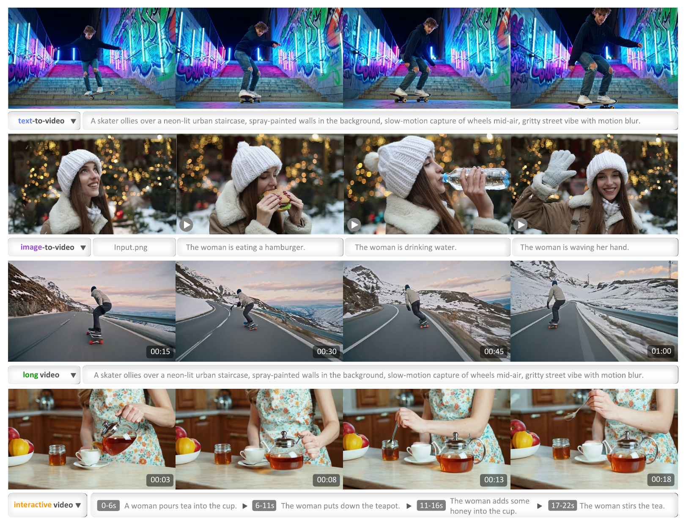{ width="920" }

<small>图源：`LongCat-Video Technical Report`，Figure 1。原论文图意：同一个模型覆盖 Text-to-Video、Image-to-Video、long video 和 interactive video continuation，展示任务统一后的输出形态。</small>

**Figure 1 怎么读。**
这张图不是模型结构图，而是论文主张的“任务边界图”。上面是从文本直接生成视频，中间是给定首帧后按不同指令生成动作，下面是长时间 continuation 和分段交互式指令。它支撑的是统一任务接口和长视频能力，不直接证明物理闭环规划能力。

从世界模型角度看，LongCat-Video 的进展在于把视频基础模型推向“持续生成同一世界”的方向。它还没有像机器人世界模型那样显式建模 action、reward 或可规划 state，但它在数据、训练和推理链路上解决了很现实的前置问题：长时间、不漂移、低成本地生成视频未来。

## 数据管线

论文的数据部分强调“可按训练阶段动态组装数据”。原始视频先经过去重、镜头切分、黑边裁剪和压缩封装，再进入多维 metadata 标注。metadata 包括时长、分辨率、帧率、码率、aesthetic score、blur score、text coverage、watermark detection 和 optical-flow-based motion information 等。这样做的意义不是把数据一次性清洗成一个固定集合，而是为不同训练阶段构造不同的数据子集。

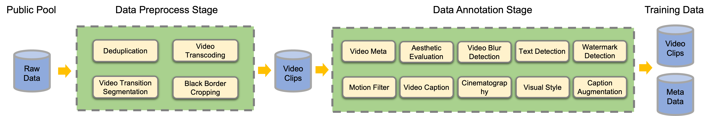{ width="920" }

<small>图源：`LongCat-Video Technical Report`，Figure 2。原论文图意：数据预处理把原始视频切成一致片段，数据标注阶段生成多维 metadata，使不同训练目标可以灵活抽取数据。</small>

**数据图要看 metadata 数据库。**
左侧预处理解决“视频能不能训练”：去重、切镜头、裁黑边、压缩和打包。右侧标注解决“训练时能不能按目标筛”：质量、运动、风格、文本覆盖和水印等属性进入 metadata。对长视频模型来说，这比单纯扩大数据量更关键，因为 progressive pre-training、SFT、RLHF 和 refinement expert 需要的样本分布并不一样。

caption 也被拆成多路模型协作。论文使用经过微调的 LLaVA-Video 生成基础 video caption，并补充包含丰富 temporal events 的数据与 Tarsier2 标注来增强时间动作描述能力；cinematography 和 visual style 由专门分类器与 Qwen2.5VL 辅助标注；caption augmentation 则通过中英翻译、摘要和随机组合视觉风格/镜头信息增加 caption 多样性。

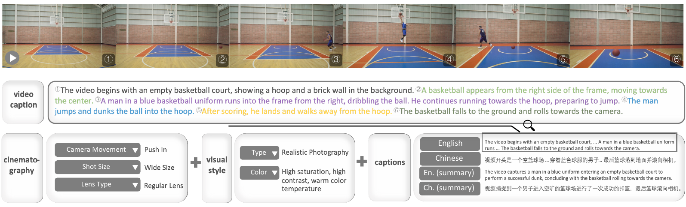{ width="920" }

<small>图源：`LongCat-Video Technical Report`，Figure 3。原论文图意：caption workflow 把基础视频内容、镜头语言、视觉风格和 augmentation 组合成更丰富的视频文本描述。</small>

**caption 图要看 temporal action。**
视频 caption 和图片 caption 的差别在于，视频模型需要知道“发生了什么动作”和“动作如何随时间变化”。论文专门提到 temporal action annotations 对提升时间理解很关键，这也解释了为什么 LongCat-Video 后面能把 VC 当成核心训练任务：如果数据文本只描述静态画面，模型很难学会长时间事件续写。

## 模型结构

LongCat-Video 的主干是标准 DiT，但几个工程选择决定了它适合长视频训练。

| Component | LongCat-Video Design | Why It Matters |
| --- | --- | --- |
| Backbone | single-stream DiT | 用统一 transformer 处理视频 latent 和条件 |
| Self-Attention | 3D self-attention + 3D RoPE | 显式处理时间、高度、宽度位置 |
| Text Conditioning | cross-attention with umT5 embeddings | 支持中英 caption 与文本条件 |
| FFN | SwiGLU | 大模型常用的 FFN 结构 |
| Modulation | AdaLN-Zero + modulation MLP | 稳定 DiT 条件调制 |
| Normalization | RMSNorm as QKNorm | 提升 attention / cross-attention 稳定性 |

模型规格表保留原论文英文格式：

| Num. of Layers | Model Hidden Size | FFN Hidden Size | Num. of Attn. Heads | AdaLN Embedding Size |
| ---: | ---: | ---: | ---: | ---: |
| 48 | 4096 | 16384 | 32 | 512 |

VAE 使用 WAN2.1 VAE，像素到 latent 的时空压缩为 \(4\times8\times8\)，DiT 内 patchify 再做 \(1\times2\times2\) 压缩，所以总体压缩达到 \(4\times16\times16\)。这对视频模型很重要：如果不压低 token 数，后面的长视频训练、720p refinement 和 attention 计算都会变得不可承受。

## 统一 Video-Continuation 接口

论文最值得吸收的结构设计，是把三类任务统一成 video continuation。

| Task | Condition Frames | Model View |
| --- | ---: | --- |
| Text-to-Video | 0 | 只根据文本生成 noisy future frames |
| Image-to-Video | 1 | 首帧作为 condition sequence，后续帧去噪生成 |
| Video-Continuation | multiple | 多帧历史作为 condition sequence，续写未来 |

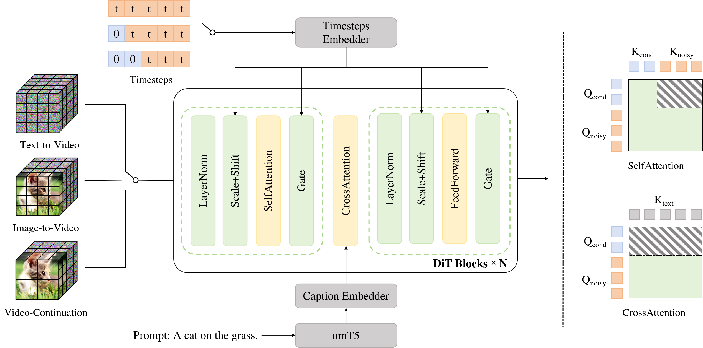{ width="920" }

<small>图源：`LongCat-Video Technical Report`，Figure 5。原论文图意：左侧把 T2V、I2V、VC 表示成不同数量 condition frames；右侧展示 Block Causal Attention，使 condition tokens 不被 noisy tokens 污染。</small>

**Figure 5 怎么读。**
输入被拆成 \(X_\text{cond}\) 和 \(X_\text{noisy}\)。condition frames 是无噪声条件，timestep 固定为 0；noisy frames 才参与 flow matching 去噪，timestep 从 \([0,1]\) 采样。loss 不算 condition tokens，因为它们是已知历史，不是要预测的目标。

Block Attention with KVCache 是效率关键。condition tokens 的 self-attention 只依赖自己的 \(Q_\text{cond},K_\text{cond},V_\text{cond}\)，noisy tokens 则可以 attend 到 condition 和 noisy tokens：

$$
X_\text{cond}=\mathrm{Attention}(Q_\text{cond},K_\text{cond},V_\text{cond})
$$

$$
X_\text{noisy}=\mathrm{Attention}(Q_\text{noisy},[K_\text{cond},K_\text{noisy}],[V_\text{cond},V_\text{noisy}])
$$

这样 condition token 的 KV 只由输入条件帧决定，可以在采样步骤之间缓存复用。直观上，I2V/VC 的历史条件不需要每个 denoising step 都重新算一遍。这对长视频尤其有用，因为条件帧越多，重复计算越浪费。

## 训练路线

LongCat-Video 的训练链路是：

```text
Progressive Pre-training
  -> Supervised Fine-tuning
  -> RLHF training with GRPO LoRA
  -> Acceleration training:
       CFG / CM distillation LoRA
       refinement expert LoRA + BSA
```

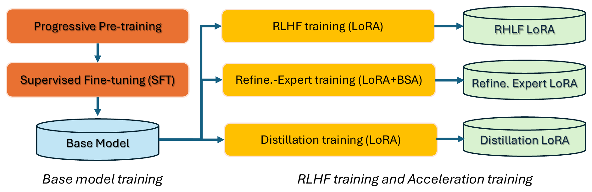{ width="920" }

<small>图源：`LongCat-Video Technical Report`，Figure 6。原论文图意：base model 先通过 progressive pre-training 和 SFT 得到，再叠加 RLHF LoRA、distillation LoRA 和 refinement expert LoRA。</small>

**训练流程图怎么读。**
左侧 base model training 解决“模型会不会生成视频”；右侧 RLHF 和 acceleration training 解决“生成结果是否更符合偏好、推理是否够快”。三个 LoRA 分支的意义在于可叠加和可扩展：偏好优化、少步采样、高分辨率 refinement 不必都改主干权重。

### Base Model Training

Flow matching 训练目标是预测从噪声到干净视频 latent 的 velocity。给定干净 latent \(x_0\)、噪声 \(\epsilon\) 和 timestep \(t\)，论文使用线性插值：

$$
x_t=(1-t)x_0+t\epsilon,\qquad v_t=x_0-\epsilon
$$

模型输出 \(v_{pred}(x_t,c,t;\theta)\)，用 MSE 拟合真实速度：

$$
\mathcal{L}=\mathbb{E}_{\epsilon,x_0,c,t}\|v_{pred}(x_t,c,t;\theta)-v_t\|^2
$$

训练时 timestep 从 uniform distribution 采样，并使用类似 logit-normal 的 loss weighting；对于更高分辨率、更长视频，timestep shift 会随 noise token volume 自适应调整，使高噪声阶段得到更多关注。

| Training tasks | Size bucket | Learning rate | Iterations |
| --- | --- | ---: | ---: |
| T2I | \(256p\) | 1e-4 | 285k |
| T2I + T2V | \(256p \times 93\) frames | 1e-4 | 140k |
| T2I + T2V + I2V + VC | \(256p \times 93\) frames | 5e-5 | 164k |
| T2I + T2V + I2V + VC | \(480p \times 93\) frames | 5e-5 | 36k |
| T2I + T2V + I2V + VC | \(480p + 720p \times 93\) frames | 2e-5 | 53k |

这个表的重点是 curriculum。先用低分辨率图像学语义和视觉表征，再进入视频运动，再把 T2I/T2V/I2V/VC 混合起来，最后提高分辨率。VC 任务中，作者还对条件帧加入 per-frame independent noise levels，目的之一是增强对 color drift 的鲁棒性。

SFT 阶段使用更高质量筛选数据，按 aesthetic、video quality、motion quality 等过滤，并按 caption embedding 空间密度的反比分布选样，缓解类别密度过高导致的偏置。

| Training Tasks | Size Bucket | Learning rate | Iterations |
| --- | --- | ---: | ---: |
| T2I + T2V + I2V + VC | \(480p + 720p \times 93\) frames | 1e-5 | 7.5k |

### RLHF Training

LongCat-Video 的 RLHF 用 GRPO，但它不是直接照搬语言模型的 GRPO。论文的关键观察是，在 flow matching 模型中，GRPO 可以被看作 stochastic noise search，用相对 advantage 和 SDE 采样中的噪声项来近似 reward 对 velocity field 的梯度。

作者做了几项稳定化：

1. 固定同一 prompt group 的 initial noise，并只在一个 critical timestep 注入 SDE 随机性，其他 timestep 使用 ODE sampling；
2. 对高噪声处的 diffusion term 做截断，阈值 \(\tau=0.45\)；
3. 对 policy loss 和 KL loss 做 timestep-dependent reweighting，抵消高噪声和小 step size 造成的梯度缩放；
4. 用跨 group 的最大标准差 \(\sigma_{\max}\) 归一化 advantage，降低小方差 group 的不可靠放大。

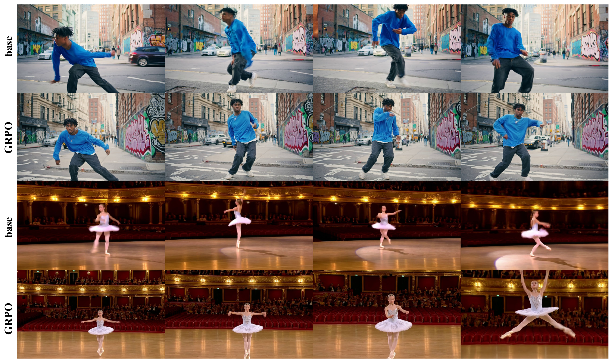{ width="760" }

<small>图源：`LongCat-Video Technical Report`，Figure 6。原论文图意：展示 GRPO 后视频生成质量提升的视觉对比。</small>

**GRPO 图怎么读。**
这张图支撑的是“偏好优化能改善生成质量”的定性 claim，但真正的机制在后面的 loss 和 reward 设计。视频 RLHF 容易出现 reward 归因不稳、reward hacking 和单一指标过拟合；LongCat-Video 的方法重点是让 GRPO 在 flow matching 采样路径上更稳定。

RLHF 训练规格如下：

| Training tasks | Size bucket | Group size | Prompts per step | Sampling steps | SDE steps range | Learning rate | Iterations |
| --- | --- | ---: | ---: | ---: | --- | ---: | ---: |
| T2V | \(480p + 720p \times 93\) frames | 4 | 64 | 16 | [0, 6] | 1e-4 | 0.5k |

Appendix 还给出更具体的 GRPO 设置：

| Parameter | Value | Parameter | Value |
| --- | --- | --- | --- |
| Group size | 4 | # Sampling steps | 16 |
| Prompts per update | 64 | Timeshift | 12 |
| SDE steps range | [0, 6] | CFG | 4 |
| Online training | True | Learning rate | 1e-4 |
| Policy loss weight | 1 | LoRA dim | 128 |
| KL loss weight | 3e-4 | LoRA alpha | 64 |
| HPSv3-general reward weight | 1 | LoRA layers | Linear layers in all Self-Attention, Cross-Attention, FFN layers |
| HPSv3-percentile reward weight | 1 |  |  |
| MQ reward weight | 1 |  |  |
| TA reward weight | 1 |  |  |

multi-reward 由三类 reward 组成：

| Reward | Implementation | Purpose |
| --- | --- | --- |
| Visual Quality (VQ) | HPSv3-general + HPSv3-percentile | 同时约束画质和文本-视频一致性 |
| Motion Quality (MQ) | VideoAlign-based model, grayscale input | 聚焦运动合理性，减少颜色偏好干扰 |
| Text-Video Alignment (TA) | VideoAlign-based model, RGB input | 评估 prompt 与视频内容匹配 |

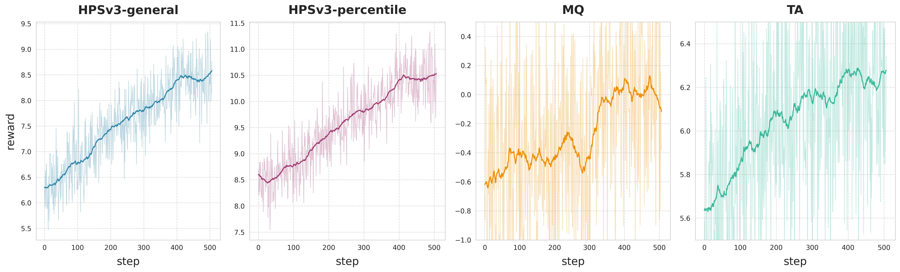{ width="920" }

<small>图源：`LongCat-Video Technical Report`，Figure 9。原论文图意：multi-reward GRPO 训练中的多个 reward 曲线。</small>

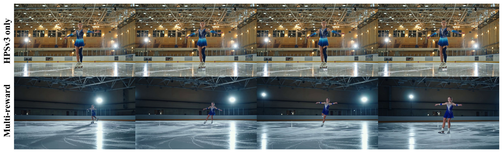{ width="760" }

<small>图源：`LongCat-Video Technical Report`，Figure 10。原论文图意：单一 reward 容易出现 reward hacking，多 reward 通过相互约束缓解单项指标过拟合。</small>

**reward 曲线和 hacking 图怎么读。**
这两张图说明 multi-reward 的价值不只是“指标更多”。单独优化视觉 reward，模型可能倾向静态、高质感但运动不足的视频；引入 motion reward 后，运动质量会反向约束这种静态倾向。它支撑的是多目标偏好优化的必要性，但不能证明 reward model 本身没有偏差，因为 VQ/MQ/TA 仍依赖作者选择和训练的内部评估器。

### Acceleration Training

Acceleration training 包含两层：少步采样和高分辨率 refinement。

| Stage | Training Tasks | Size Bucket | Learning rate | Iterations |
| --- | --- | --- | ---: | ---: |
| CFG distillation | T2I + T2V + I2V + VC | \(480p + 720p \times 93\) frames | 5e-5 | 2k |
| CM distillation | T2I + T2V + I2V + VC | \(480p + 720p \times 93\) frames | 5e-5 | 3k |

CFG distillation 用 CFG-Zero 把默认 guidance strength 4.0 的负向 prompt 行为蒸馏进去；CM distillation 让模型 16 steps 的生成质量接近 50+ steps。这里的重点是推理路径，而不是新建一个小模型：作者用 LoRA 训练，方便和 RLHF LoRA、refinement expert LoRA 叠加。

refinement expert 负责 coarse-to-fine 的第二阶段。训练先用 full attention，loss 稳定后切到 BSA；数据用 GLCM 过滤出纹理丰富样本，并施加 degradation 操作训练细节恢复能力。

| Training Stage | Sparsity | \(t_{thresh}\) | Size bucket | Learning rate | Iterations |
| --- | --- | ---: | --- | ---: | ---: |
| Full Attention | - | 0.5 | \(720p \times 93~or~189\) frames | 5e-5 | 500 |
| Sparse Attention | 93.75% | 0.5 | \(720p \times 93~or~189\) frames | 5e-5 | 500 |

## 高效推理：C2F 与 BSA

长视频高分辨率推理的关键矛盾是 token 数。LongCat-Video 先生成 \(480p,15fps\)，再通过 trilinear interpolation 升到 \(720p,30fps\)，最后用 refinement expert 去噪修细节。

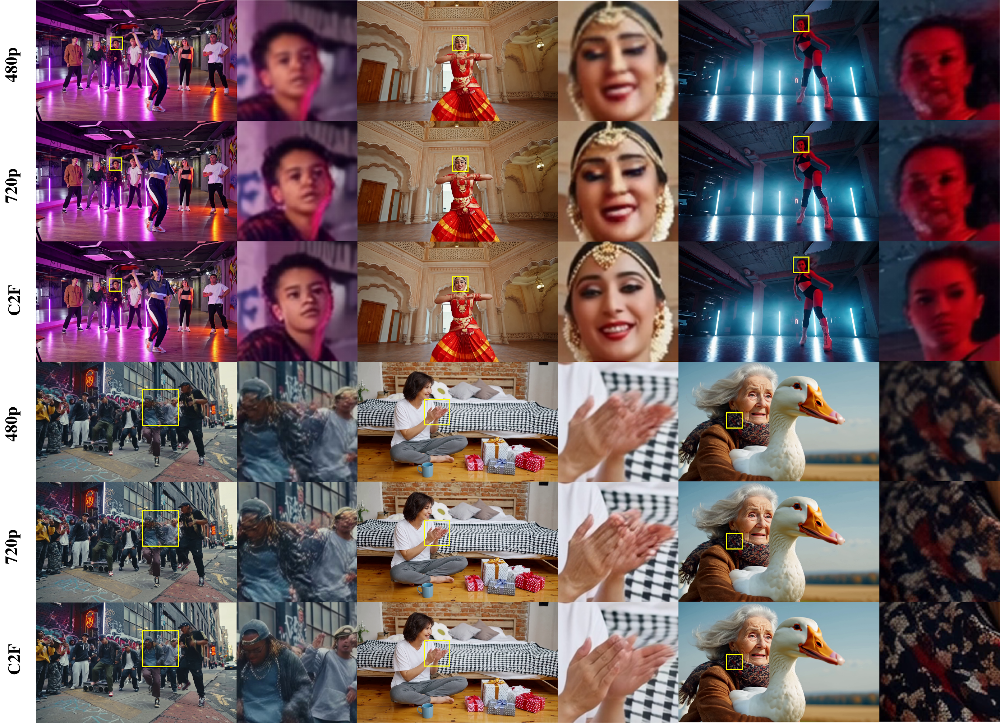{ width="920" }

<small>图源：`LongCat-Video Technical Report`，Figure 11。原论文图意：比较 native 480p、native 720p 与 coarse-to-fine 720p，显示 C2F 能补细节并修正局部失真。</small>

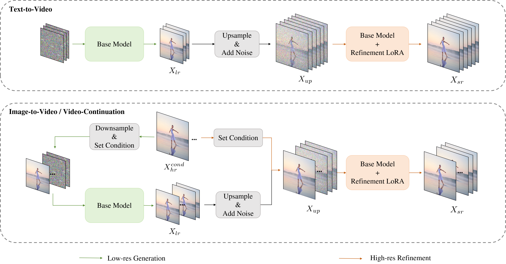{ width="920" }

<small>图源：`LongCat-Video Technical Report`，Figure 12。原论文图意：展示 T2V、I2V 和 VC 的 coarse-to-fine 两阶段流程，条件任务在 refinement 阶段保留高分辨率条件帧。</small>

**C2F 图怎么读。**
第一张图看质量：C2F 不只是加速，也能恢复纹理、纠正局部失真。第二张图看接口：T2V 的 refinement 只处理低清生成结果，I2V/VC 还要把高分辨率 condition frames 拼回 refinement 输入，避免条件信息被低分辨率下采样损伤。

refinement flow matching 学的是从上采样低清视频分布到高清真实视频分布的变换。论文设置 \(t_{thresh}=0.5\)，refinement 阶段只需 5 sampling steps。作者报告，相比 native \(720p,15fps\)，尽管输出帧率翻倍，\(720p,30fps\) 生成仍可获得 10.1x 加速。

速度表保留原论文英文格式：

| Variant | LCM | C2F | BSA | Sampling Steps | Latency | Speedup |
| --- | --- | --- | --- | --- | ---: | ---: |
| \(480p \times 93\) frames | ✗ | ✗ | ✗ | 50 | 341.5s | - |
| \(480p \times 93\) frames | ✓ | ✗ | ✗ | 16 | 61.3s | - |
| \(720p \times 93\) frames | ✗ | ✗ | ✗ | 50 | 1429.5s | 1.0x |
| \(720p \times 93\) frames | ✓ | ✗ | ✗ | 16 | 244.6s | 5.8x |
| \(480p \times 93\) frames \(\rightarrow\) \(720p \times 93\) frames | ✓ | ✓ | ✗ | 16/5 | 135.3s | 10.6x |
| \(480p \times 93\) frames \(\rightarrow\) \(720p \times 189\) frames | ✓ | ✓ | ✗ | 16/5 | 302.9s | 4.7x |
| \(480p \times 93\) frames \(\rightarrow\) \(720p \times 93\) frames | ✓ | ✓ | ✓ | 16/5 | **116.5s** | **12.3x** |
| \(480p \times 93\) frames \(\rightarrow\) \(720p \times 189\) frames | ✓ | ✓ | ✓ | 16/5 | **142.0s** | **10.1x** |

<small>表源：`LongCat-Video Technical Report`，Table 6。原论文表注口径：测试在单张 H800 GPU 上使用 FlashAttention3。</small>

**速度表读数边界。**
这个表能证明 C2F、少步采样和 BSA 的组合显著降低单卡推理时间，但不能直接外推到所有部署环境。真实服务延迟还取决于 batch、显存、编译、I/O、VAE decode、视频编码和多请求调度。它仍然是非常有用的系统证据，因为 baseline、采样步数、分辨率和硬件都写得比较清楚。

Block Sparse Attention 的做法是把 \(T\times H\times W\) 视频 latent 切成 3D blocks，对 query block 和 key block 做平均池化后计算 block-level score，每个 query block 只选 top-\(r\) key blocks，再在这些 key blocks 内做标准 attention。

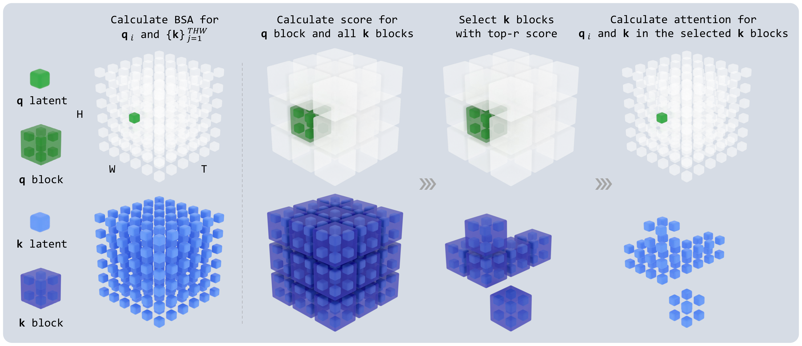{ width="920" }

<small>图源：`LongCat-Video Technical Report`，Figure 13。原论文图意：对 query block 和 key blocks 计算 block-level score，选 top-r key blocks，再只在选中块内计算 attention。</small>

**BSA 图怎么读。**
稀疏性不是固定局部窗口，而是用 pooled attention score 动态选块。这样利用了视频 latent 的冗余：高分辨率视频中不是每个 token 都需要 attend 到所有位置。Appendix 给出的实现细节包括：Triton 实现 forward/backward，支持 single-GPU 和 context-parallel；3D block size 设为 \(t=h=w=4\)；distillation 阶段 \(r=\frac{1}{8}N_k\)，refinement expert 阶段 \(r=\frac{1}{16}N_k\)。作者还实现了 ring block sparse attention，使 context parallelism 下的通信和 attention 计算可以重叠。

## 训练基础设施

报告披露的训练系统包括 DeepSpeed-Zero2、Context Parallelism、Ring Attention 和 Activation Checkpointing。混合分辨率训练使用 bucket-based strategy，把相近分辨率样本分到同一 bucket 以提升 batch 计算效率。作者还用 cache 机制消除不同 rank 上 VAE 操作带来的 computation bubbles。

| Infrastructure Mechanism | Role |
| --- | --- |
| DeepSpeed-Zero2 | 切分优化器状态，支撑 13B 级训练 |
| Context Parallelism | 处理长视频 token 序列 |
| Ring Attention | 在上下文并行中重叠通信和注意力计算 |
| Activation Checkpointing | 降低 activation memory |
| Mixed-resolution buckets | 让相似分辨率样本一起训练，减少 padding / shape 浪费 |
| VAE cache mechanism | 降低跨 rank VAE 计算造成的 bubble |

作者报告训练 MFU 为 33% 到 38%。这个数字说明系统优化已经进入训练效率核心，但它不是单独模块的消融结果，不能把 MFU 提升归因给某一个机制。

## 实验与结论

论文评测分为内部 benchmark、公有 VBench 2.0 和可视化结果。

内部 benchmark 共 1,628 个样本，其中 T2V 1,228 个，包含 500 个人类评测样本和 728 个自动评测样本；I2V 400 个样本。T2V 评估 Text-Alignment、Visual quality、Motion quality 和 Overall quality；I2V 额外加入 Image-Alignment。MOS 使用 5 分制，GSB 做 pairwise preference；人类评测与自动评测按 2:1 加权。每个视频由 3 名标注者独立评分，分歧大时再加入 2 名标注者。自动评测使用内部训练的 vision-language judge，作者报告其与人类评分在各维度相关性超过 0.92。

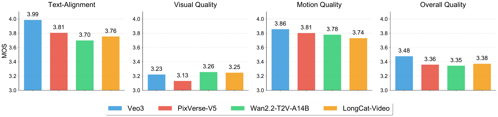{ width="920" }

<small>图源：`LongCat-Video Technical Report`，Figure 14。原论文图意：在内部 T2V MOS benchmark 上比较 Veo3、PixVerse-V5、Wan2.2-T2V-A14B 和 LongCat-Video。</small>

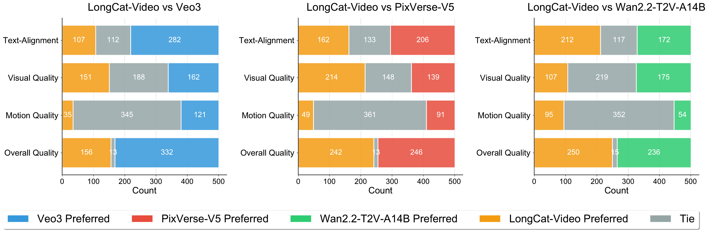{ width="920" }

<small>图源：`LongCat-Video Technical Report`，Figure 15。原论文图意：在内部 T2V GSB preference 评测中做 pairwise 对比。</small>

**T2V 图怎么读。**
MOS 图强调 LongCat-Video 在 visual quality 和 overall quality 上比较强；GSB 图显示它与 PixVerse-V5 在 overall quality 上接近，并相对 Wan2.2-T2V-A14B 有优势。注意这些是内部 benchmark，且部分评分来自内部 judge，因此更适合作为官方报告证据，而不是独立复现结论。

I2V 结果更能体现边界：LongCat-Video 的 Visual Quality 为 3.27，但 Image-Alignment 为 4.04、Motion Quality 为 3.59，低于部分对照模型；Overall Quality 为 3.17，低于 Seedance 1.0 的 3.35。这个结果说明它在视觉细节上强，但从参考图保持、运动质量和整体感知看仍有改进空间。

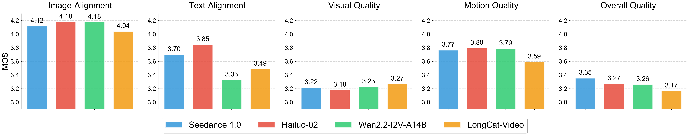{ width="920" }

<small>图源：`LongCat-Video Technical Report`，Figure 16。原论文图意：在内部 I2V MOS benchmark 上比较 Seedance 1.0、Hailuo-2、Wan2.2-I2V-A14B 和 LongCat-Video。</small>

公有 VBench 2.0 表保留原论文英文格式：

| Model name | Accessibility | Evaluation Date | Creativity↑ | Commonsense↑ | Controllability↑ | Human Fidelity↑ | Physics↑ | Total Score↑ |
| --- | --- | --- | ---: | ---: | ---: | ---: | ---: | ---: |
| HunyuanVideo | Open Source | 2025-03 | 41.84% | 63.44% | 28.60% | 82.41% | 60.20% | 55.30% |
| Wan2.1 | Open Source | 2025-03 | 55.25% | 63.98% | 37.32% | 81.60% | 62.84% | 60.20% |
| Sora-480p | Proprietary | 2025-03 | 60.57% | 64.32% | 22.09% | 87.72% | 57.18% | 58.38% |
| Kling1.6 | Proprietary | 2025-03 | 48.58% | 65.45% | 33.05% | 83.56% | 64.35% | 59.00% |
| Vidu Q1 | Proprietary | 2025-04 | 56.54% | 65.98% | 38.13% | 81.24% | 71.63% | 62.70% |
| Seedance 1.0 Pro | Proprietary | 2025-06 | 53.04% | 64.31% | 39.84% | 77.06% | 64.81% | 59.81% |
| Veo3 | Proprietary | 2025-09 | 60.85% | 69.48% | 47.04% | 86.88% | 69.35% | 66.72% |
| LongCat-Video | Open Source | 2025-10 | 54.73% | 70.94% | 44.79% | 80.20% | 59.92% | 62.11% |

<small>表源：`LongCat-Video Technical Report`，Table 7。原论文表意：LongCat-Video 在 VBench 2.0 总分为 62.11%，低于 Veo3 与 Vidu Q1，高于表中其他开源模型；Commonsense 维度为 70.94%，是表内最高。</small>

**VBench 表怎么读。**
最该看的不是“总分第二梯队”，而是维度结构。LongCat-Video 的 Commonsense 很高，Controllability 也接近 Veo3，但 Physics 只有 59.92%，低于 Vidu Q1、Veo3、Seedance 和 Wan2.1。这说明它的世界模型相关能力更像“常识和长视频一致性有进步”，还不能简单等同于物理仿真更强。

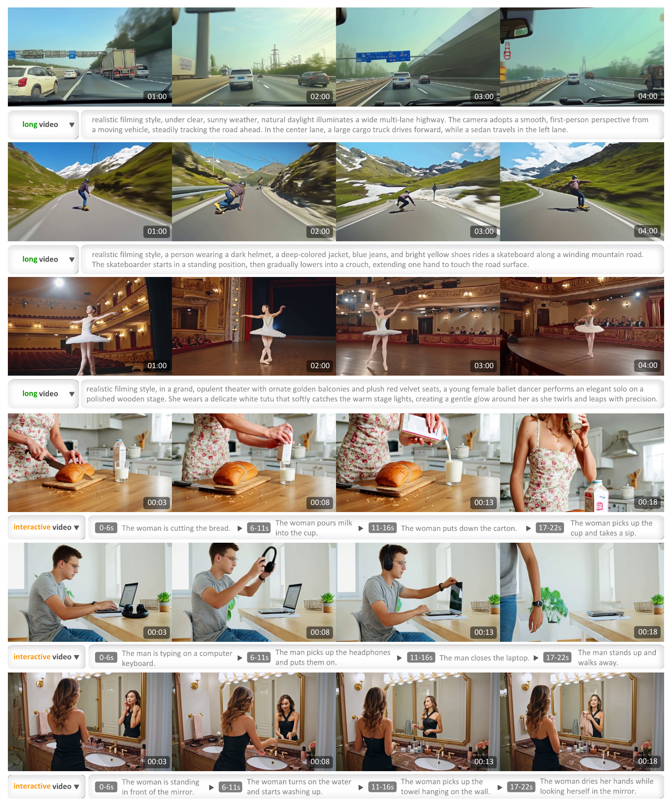{ width="760" }

<small>图源：`LongCat-Video Technical Report`，Figure 19。原论文图意：Video-Continuation 支持分钟级长视频，也支持每段 changing instructions 的交互式续写。</small>

**长视频图怎么读。**
这张图支持的是 qualitative long video / interactive continuation 展示。它能说明系统可以连续生成同一主题下的多个片段，但不等于证明状态变量、物理关系或动作后果在长期闭环中可用于规划。读它时要把“视觉连续性”和“可控世界状态”分开。

## 消融与诊断读法

LongCat-Video 的诊断证据分散在 GRPO、速度表和 I2V 边界里。

| Diagnostic | 对应证据 | 支撑的结论 | 不能证明 |
| --- | --- | --- | --- |
| Policy / KL reweighting ablation | GRPO ablation figure | flow matching GRPO 需要处理 timestep 和 step size 导致的梯度缩放 | 不能证明所有视频 RLHF 都适用同一 reweighting |
| Max group std ablation | GRPO ablation figure | 小方差 group 会放大奖励误差，用全局最大标准差更稳 | 不能消除 reward model 本身偏差 |
| Reward hacking figure | single reward vs multi reward | 多 reward 能抑制单一指标过拟合 | 不能证明 reward 组合权重最优 |
| Speed comparison | Table 6 | LCM/C2F/BSA 组合能显著降低单卡 H800 延迟 | 不能外推到多用户服务延迟 |
| I2V MOS | Figure 16 | LongCat-Video 视觉质量强，但 image alignment / motion quality 仍有短板 | 不能只看 T2V 结论外推到 I2V |
| VBench 2.0 dimensions | Table 7 | Commonsense 维度突出，总分强于多款开源模型 | 不能说明真实物理仿真或闭环控制能力 |

如果要把它作为后续项目 baseline，最值得补的评测是固定历史视频、系统改变后续 instruction 或控制输入，测未来分叉是否符合预期；再把生成视频接入 agent 或规划器，看任务指标是否真实提升。

## 主要贡献

1. 提出 13.6B LongCat-Video，并公开代码和权重入口，覆盖 T2V、I2V 和 VC。
2. 把多任务视频生成统一成 video continuation，用 condition frames 数量区分任务。
3. 在预训练阶段原生加入 Video-Continuation，服务分钟级长视频和交互式续写。
4. 将 GRPO 适配到 flow matching 视频模型，提出固定 stochastic timestep、truncated noise schedule、policy/KL reweighting、max group std 和 multi-reward 训练。
5. 用 CFG/CM distillation、coarse-to-fine refinement 和 Block Sparse Attention 提升 720p 30fps 推理效率。
6. 开源 Block Sparse Attention forward/backward 和 context-parallel 变体，为高分辨率视频训练提供可复用算子路径。

## 局限与风险

1. **世界模型 claim 仍是方向性定位**：论文说它是 toward world models 的第一步，但没有证明闭环规划、动作因果或反事实状态分叉。
2. **内部 benchmark 权重较高**：MOS/GSB、自动 judge、部分数据 taxonomy 和 reward model 都在作者内部体系中完成。
3. **数据规模和数据混合细节不完整**：报告讲了 pipeline 和 training stages，但没有完整披露训练数据总量、来源比例和过滤阈值。
4. **RLHF reward 仍可能有偏差**：multi-reward 能缓解单一 reward hacking，但不能保证 VQ/MQ/TA reward 与真实人类偏好或物理正确性一致。
5. **I2V 并非全面领先**：报告自己的 I2V MOS 显示，LongCat-Video 在 image alignment 和 motion quality 上落后部分对照模型。
6. **速度结果依赖硬件与实现**：Table 6 是单 H800 + FlashAttention3 设置，部署侧还需考虑 VAE、视频编码、batching 和服务调度。
7. **长视频展示主要是 qualitative**：分钟级可视化很有价值，但还需要漂移率、对象一致性、指令分段遵循和失败案例统计。

## 对项目的启发

LongCat-Video 最值得迁移的不是某一个 benchmark 分数，而是它的工程分层。

| 层 | 可复用经验 |
| --- | --- |
| 任务接口 | 把 T2V/I2V/VC 统一成 condition frames + noisy future frames，降低多任务复杂度 |
| 数据 | 用 metadata database 支撑不同训练阶段抽样，而不是只维护一个静态数据集 |
| 训练 | progressive curriculum 从图像、短视频、多任务到高分辨率长视频逐步扩展 |
| 偏好优化 | video RLHF 要处理 reward 归因、timestep reweighting 和 multi-reward hacking |
| 推理 | 高分辨率视频应同时做少步化、C2F 和 sparse attention，不要只靠更快硬件 |
| 系统 | context parallel + ring attention + activation checkpointing 是长视频训练的基础设施，不是后期优化项 |

对本站主线来说，它可以接到 [视频与多模态扩散](../../diffusion/video-and-multimodal-diffusion.md)、[扩散采样与推理加速](../../diffusion/inference.md)、[世界模型高效训练技术路线图](../../world-models/efficient-training-roadmap.md) 和 [VLM/VLA 与世界模型高效训练接口](../../vlm/vlm-vla-for-efficient-world-model-training.md)。

## 阅读结论

LongCat-Video 是一份很适合学习“视频基础模型工程化”的技术报告：它把数据、统一任务接口、flow matching 训练、GRPO 后训练、少步蒸馏、C2F refinement、BSA 和训练基础设施串成了一条完整路线。它的成熟度高于纯概念论文，因为有代码、权重、图表和系统指标；但它的世界模型证据仍应保守解读。最可复用的是 video continuation 统一接口和高效推理组合，最不能外推的是闭环物理世界模型能力。下一步最需要的证据，是反事实续写、长时漂移统计、reward model 独立校验和真实 agent / planner 接入后的任务收益。

## 外部精读

1. [LongCat-Video Technical Report](https://arxiv.org/abs/2510.22200)：原论文；重点读 Data、Unified Model、GRPO、Training 和 Efficient Video Generation。
2. [LongCat-Video GitHub](https://github.com/meituan-longcat/LongCat-Video)：官方代码、推理脚本、模型下载和 Block Sparse Attention 入口。
3. [Wan2.1](https://github.com/Wan-Video/Wan2.1)：LongCat-Video 使用 WAN2.1 VAE，可对照视频 latent 表示和开源视频生成接口。
4. [Diffusion Forcing](https://arxiv.org/abs/2407.01392)：理解为什么 per-frame independent noise levels 和 video continuation 对长视频生成有帮助。
