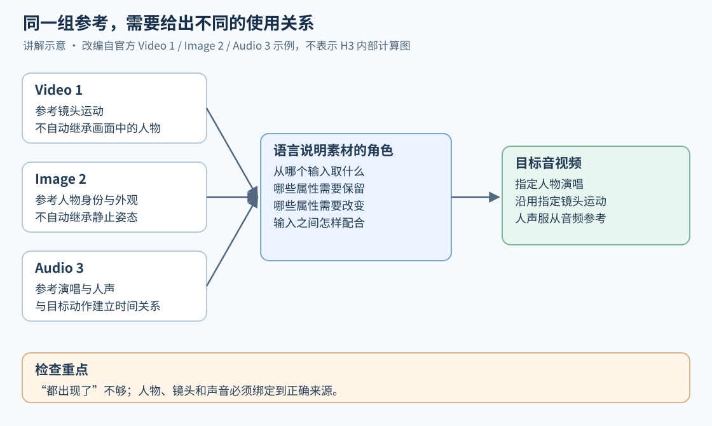
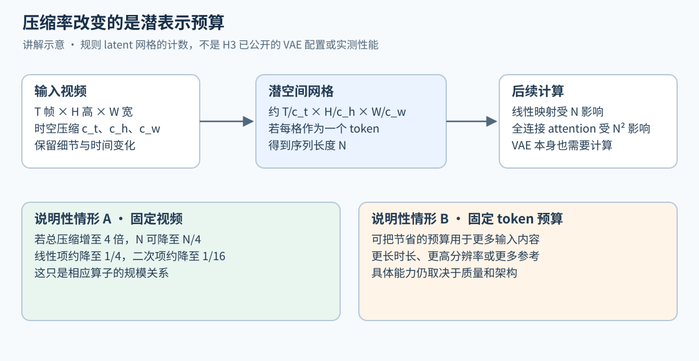
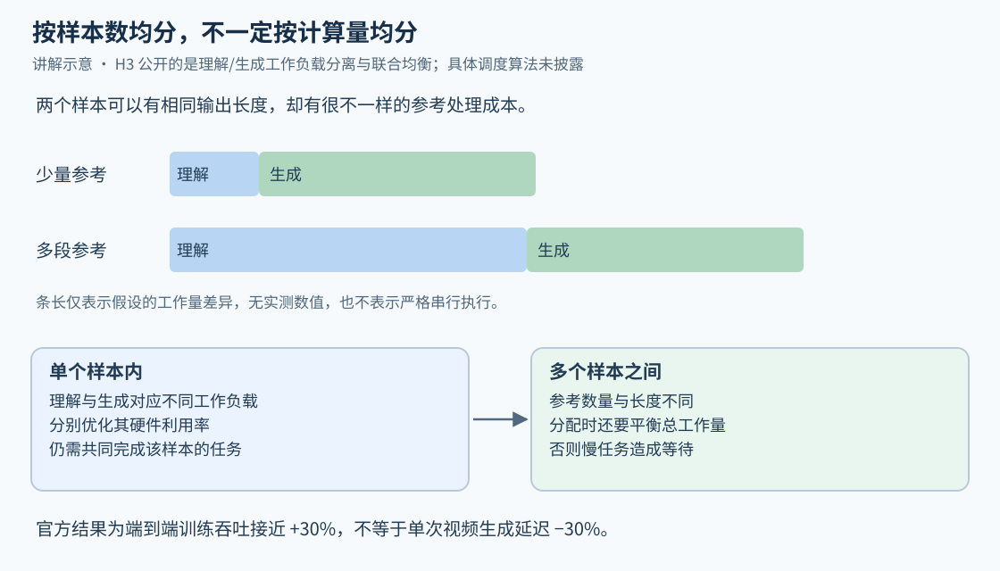
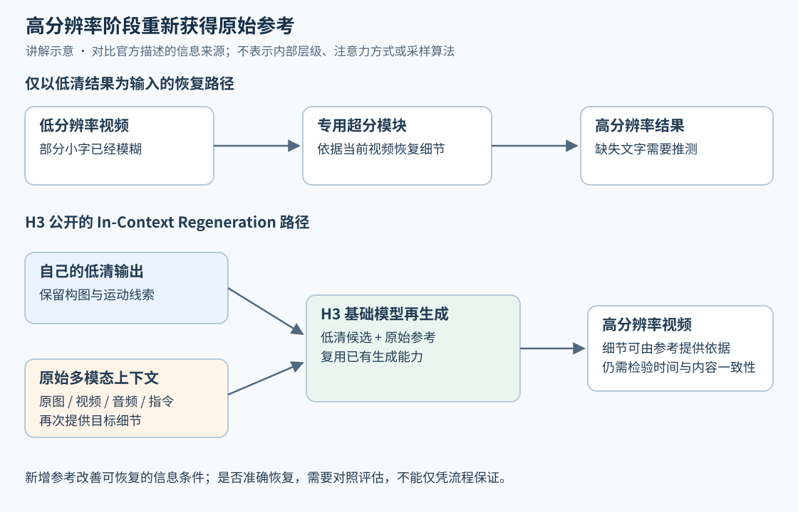

# MiniMax H3：统一任务与模态的视频生成模型

!!! info "资料信息"
    **资料题名**  MiniMax H3: An Open Model Breaking the Boundaries Between Tasks and Modalities。 
    **发布方**  MiniMax Research。 
    **公开时间**  2026-07-31。 
    **资料类型**  官方技术博客与产品级技术概览，完整 H3 Technical Report 在页面发布时仍标注为即将公开。 
    **官方页面**  [MiniMax H3](https://www.minimax.io/blog/minimax-h3)。 
    **核验日期**  2026-10-10。 
    **复现状态**  已核对官方页面；页面没有公开参数规模、训练数据规模、完整损失函数、详细 benchmark 表或可复现实验配置，不能宣称独立复现。

## 同一个人物、同一种运镜、同一段声音，怎样变成一个任务

MiniMax H3 的官方示例给了三份素材。Video 1 提供 Hitchcock camera movement，Image 2 提供人物，Audio 3 提供演唱人声。目标是让图片中的人物唱歌，镜头采用视频中的运动方式，人声服从音频参考。这里最难的地方是**把属性绑定到正确来源**：看到视频里有人，不能就把视频中的人物也搬进结果；看到人物图片是静止的，也不能把目标做成静态画面。[↗](https://www.minimax.io/blog/minimax-h3)

这个例子解释了 H3 为什么要把任务统一放到多模态上下文里。过去一个入口规定“这张图是首帧”，另一个入口规定“这段视频提供动作”；一旦用户希望同一输入只提供部分属性，固定入口就很难表达。H3 让自然语言说明各个参考与目标的关系，再联合生成音视频。官方公开的输出上限为 15 秒、2K，并包含原生立体声音频。

下面的图沿用这个官方例子，把素材与用途分开。箭头表示指令中的依赖关系，是本文绘制的讲解图，不代表 H3 内部的 attention 结构。

顺着三条箭头检查结果，比只问“视频好不好看”更有用。一个结果可能画面漂亮，但把动作参考里的人物外观也复制过来；另一个结果可能人物正确，却让口型与演唱脱节。它们违反的是不同约束，视觉质量分数很难替代这种逐项判断。

H3 的四项技术选择围绕这些约束展开。Contextual Omni Representation 处理“该从哪里取什么”，H3-VAE 把视觉信息压缩到可计算的表示，H3-Omni Transformer 处理多模态任务带来的计算差异，In-Context Regeneration 则让高分辨率阶段再次访问参考。四者分别作用于监督、表示、训练系统和生成流程，不能仅凭四个名称还原一套完整网络。

## 统一任务时，训练样本必须说明什么

### 素材本身不能代替素材的用途

可以用下面的条件分布记号表达任务接口：

$$
(V,A)\sim p_\theta(\,\cdot\mid C,I),
\qquad C=\{c_1,\ldots,c_m\}.
$$

这里 $C$ 是不同模态的上下文素材，$I$ 是说明素材关系和目标要求的指令，$V,A$ 分别代表输出视频与音频。这组说明性记号只表达输入输出关系；训练目标和生成算法需要另行定义。

关键变量是 $I$。同一张人物图可以用来保持身份、参考服装，也可以只参考光照；同一段视频可以用来参考镜头、动作或整体风格。输入文件相同，目标关系不同，正确输出也应不同。因此，训练不能只让模型识别“这里有一个人”，还需要让它学会哪些属性应迁移、哪些应保持、哪些需要重新生成。

官方列出的预训练任务包括以下四组。表中“要学会的关系”是对任务需求的解释，具体的数据构造规则和损失权重没有公开。[↗](https://www.minimax.io/blog/minimax-h3)

| Training family | Published scope | 要学会的关系 |
| --- | --- | --- |
| Text-to-image | 文本到图像 | 语言描述与目标视觉属性的对应 |
| Text-to-video | 音画联合生成、原生立体声、原生多镜头建模 | 时间上的动作、声音与镜头组织 |
| Text-to-audio | 语音、音效、音乐共同建模 | 多种声音成分在同一时间结构中配合 |
| Generalized reference and editing | Image-to-image、Image-to-video、Audio-to-audio、Audio-video-to-audio-video | 根据指令选择保留、改变或迁移的属性 |

Reference 与 editing 也不能只按输入文件类型区分。以产品图为例，参考任务可能要求把产品放到新场景中，编辑任务可能要求沿用已有片段的运动、仅改变背景。后者还增加了一项约束，即未要求修改的内容应尽量保留。把关系写进语言，可以表达这种“改什么、保留什么”的区别；是否真的保留，则要由输出验证。

### “来自真实自然数据”没有自动解决关系标注

官方称 generalized reference and editing 完全从真实自然数据构造，以此获得可扩展性，并用自然语言表达参考和编辑关系。这里公开的是素材来源和监督方向。如何从自然视频构造参考—目标对、怎样区分身份与动作、如何避免错误的关系标签，并没有在发布页中展开。

这项区别会影响如何理解所谓泛化。训练中见过“人物参考”和“镜头参考”，可能帮助模型处理两者的组合，但组合成功需要正确选择每个来源的属性，并同时满足它们。输入模态多，并不能单独证明组合能力强；一个会忽略音频或总是复制第一份视频的模型，也能接受同样的文件列表。

H3 因此强调架构和训练两个层面都尽早融合不同数据与任务，并明确提到混合比例的重要性。早期融合让共同能力有机会在预训练期间形成，却也引入任务之间的资源竞争：长视频占用的 token 很多，音频任务与图像任务的数量、长度和难度又不同。混合比例需要与训练信号共同考虑。发布页没有给出比例，不能据此推导“平均采样每个任务”就是 H3 的配方。

## Contextual Omni Representation 怎样补上关系监督

### Caption 从描述目标扩展到解释上下文

普通 caption 可以写“一个人在移动镜头前唱歌”。它描述了目标内容，却没有解释这个人来自 Image 2、镜头来自 Video 1、人声来自 Audio 3。对多参考生成而言，这些来源关系恰好是监督最需要提供的信息。

H3 的 Contextual Omni Representation 将描述范围扩展为三层：目标本身、上下文与目标的关系，以及上下文内部各项之间的关系。官方为此建立专门模型和全模态理解流水线。语言承担关系表达的作用，让任务可以用开放描述组合，而不必全部压进一个固定任务编号。[↗](https://www.minimax.io/blog/minimax-h3)

可以比较三种说明性标注。它们用来展示监督信息的差异，并非官方公布的真实训练样本。

| 描述方式 | 标注示例 | 缺失或新增的信息 |
| --- | --- | --- |
| 只描述目标 | “一名歌手演唱，镜头发生运动。” | 不知道人物、声音和镜头分别应忠实于哪个参考 |
| 描述关系 | “使用 Image 2 中的人物；镜头运动参考 Video 1；演唱人声与 Audio 3 对应。” | 将输出属性绑定到具体输入，可分别检查是否遵循 |
| 再说明保留与变化 | “保持人物外观，重新生成演唱动作；只参考 Video 1 的镜头运动。” | 避免把不需要的参考属性一起复制进目标 |

这类关系标注的困难会随着镜头切换增加。一段声音可能连续跨越两个镜头，画面中的人物和视角却发生变化；同一人物也可能在不同素材里穿着不同服装。标注若只逐帧列物体，无法充分表达声音的连续性和目标所需的外观约束。H3 对跨镜头音画关系的强调，正对应这个问题。

### 100K 与 4K 描述的是准备训练样本的工作

官方称，大多数原始素材约需要 100K tokens 的推理处理，再整理成平均约 4K tokens 的表示。这个数字放在 captioning 与全模态理解流水线一节，描述的是素材理解和标注成本。[↗](https://www.minimax.io/blog/minimax-h3)

这笔计算发生在训练材料的准备环节。较长的处理过程可以容纳多次观察与分析，最终较短的表示承担的是将有用关系留给后续训练。用户请求的上下文窗口与生成时的计算则是另外两个量，页面中的 100K/4K 没有回答它们。

这也解释了为什么“caption 越长越好”不是足够的结论。关系描述如果错误地把镜头参考中的人物当成身份来源，增加字数只会强化错误监督。真正需要衡量的是关系是否准确、是否覆盖目标约束，以及生成器是否会使用它们。100K/4K 是工作量的量级，单靠这两个数不能推断指令遵循的提升幅度。

## H3-VAE 同时限制内容容量和细节上限

### 更多像素怎样变成更长序列

视频先经过压缩表示，再进入后续生成计算。为了看清序列长度从哪里来，考虑一个规则网格的说明性例子。输入为 $T\times H\times W$，时间、高度、宽度的压缩因子分别为 $c_t,c_h,c_w$。若每个 latent 网格位置对应一个 token，数量约为

$$
N\approx
\left\lceil\frac{T}{c_t}\right\rceil
\left\lceil\frac{H}{c_h}\right\rceil
\left\lceil\frac{W}{c_w}\right\rceil.
$$

这里只统计位置，latent channels、后续 patch 化和参考输入还可能改变实际计算量；这个式子不指定 H3 的压缩倍率。它说明，固定时长时将宽、高分别翻倍，就会使位置数约增至四倍。对长视频和多参考任务，序列预算很容易被耗尽。

图中有两个应分开理解的方向。固定输入内容时，提高总压缩率可以减少 $N$；固定 $N$ 时，可以把预算用于更多帧、更高分辨率或更多参考。官方对 H3-VAE 的表述是“高压缩率带来 4 倍有效序列长度收益”，没有给出逐轴压缩率，不能从这句话反推出具体的 latent 形状。[↗](https://www.minimax.io/blog/minimax-h3)

若在同一视频、其余设置不变的假设下，token 数降到原来的四分之一，线性映射中与 $N$ 成正比的工作可相应减少，全连接 attention 中与 $N^2$ 成正比的工作可降到约十六分之一。这只是计算规模的解释，不是 H3 的性能实测；模型宽度、注意力形式、音频与上下文 token、VAE 编解码、设备利用率都仍会影响总时间。把“有效序列长度 4 倍”直接写成“生成速度 4 倍”会丢掉这些条件。

### 重建好与生成器容易学习，是两个要求

官方称 H3 完全重做了此前 tokenizer，同时改善 reconstruction quality、learnability 和压缩效率。重建质量关心编码再解码后能保留多少原始细节；可学习性关心生成器能否在这种表示中学到所需的变化规律。两者相关，却不能互相替代。

例如，产品包装上的小字若在编码中已经混为一团，解码器可以生成清晰纹理，却未必恢复正确字符。反过来，即使原始视频能很好地被重建，也不自动保证生成器能根据多份参考合成准确的 latent。前者测试表示损失，后者还涉及条件建模。

因此，高压缩的收益需要同时看重建误差与最终任务质量。官方把 H3-VAE 放在原生 2K 能力的核心位置，这给出明确的设计关系；但没有披露小字重建分数、时间压缩引起的运动误差或单独更换 VAE 的消融，无法量化三项目标各自的改善。

## Omni Transformer 为什么要重新组织训练计算

### 统一输出时长，依然会有不均匀的输入成本

两条训练样本都生成同样时长的视频，其中一条只附一张人物图，另一条附多个镜头参考和音频。输出长度相近，输入理解的工作量仍可能差很多。官方报告，多模态上下文使序列长度的**方差**约增至三倍，理解与生成的计算负载也变得更异质。[↗](https://www.minimax.io/blog/minimax-h3)

方差增大说明样本之间更不均匀，不代表平均长度变成三倍，也不代表最长序列或单样本耗时变成三倍。它直接提出的是负载分配问题：若设备只按样本数平均分配，处理复杂参考的设备可能成为等待点，其他设备先完成也不能让这一步训练提前结束。

图中两根条带是解释这种差异的假设例子，没有使用 H3 的实测长度或时间。先比较蓝色部分，再看相同的绿色部分，就能看到只按生成长度分配工作会漏掉什么。

### 工作负载分离，不等于产品里一定存在两个独立模型

H3 没有继续沿用 Hailuo-02 的架构。官方给出的理由是，先前有益的专门设计会给任务统一带来额外复杂性，因此重新以通用性和效率作为目标。

公开的训练方案将理解与生成工作负载分开优化硬件利用率，再联合考虑单个样本中的异质计算和不同样本之间的负载均衡。前一个层面关心各类工作怎样执行得更有效率，后一个层面关心这些工作怎样分布到训练资源上。只改善其中一个，仍可能留下等待和空闲。

这些信息足以解释训练系统为何要区分不同工作。进一步实现时，还需要模块拓扑、attention mask、并行方式和调度算法；发布页没有给出这些细节，工作负载分离也并不要求产品接口暴露两个独立模型。

作者报告这套设计使端到端训练吞吐接近提高 30%。若仅为解释吞吐和时间的关系，假设同样数据量、同样训练质量目标，吞吐从 $q$ 增至 $1.3q$，完成这部分工作的时间约变为

$$
\frac{T_{\mathrm{new}}}{T_{\mathrm{old}}}
=\frac{q}{1.3q}\approx0.769.
$$

所以在这些假设下，时间减少约 23.1%，而非 30%。这仍不是 H3 用户生成延迟的测量，也没有包含训练成本中的所有因素。公开结果支持的是训练系统优化的整体收益，无法把其中多少分别归给架构变化、负载分配或其他实现细节。

## In-Context Regeneration 让细节恢复重新获得证据

### 模糊视频不包含全部答案

设低分辨率视频里产品包装上的几个字已经无法区分。一个只以这段视频为条件的超分模块，可以利用视觉先验补出锐利边缘，却没有足够输入保证补出的就是原字符。高分辨率和准确内容在这里是两件事。

H3 的 2K 流程让基础模型把自己生成的低分辨率结果作为上下文，再生成高分辨率版本；同时重新访问最初的多模态参考。低清候选提供整体内容与运动线索，原始素材则继续提供人物、产品、小字和声音等条件。官方强调的两个好处是复用基础模型已有的生成能力，以及恢复仅看低清结果时难以确定的细节。[↗](https://www.minimax.io/blog/minimax-h3)

下图应先看下半部分的第二个输入。真正增加的信息是原始参考重新进入高分辨率阶段，图中的方框不表示具体的采样步骤。

用信息依赖的说明性记号，流程可以写成

$$
Y_{\mathrm{low}}=G_\theta(C,I;\epsilon_1),
\qquad
Y_{\mathrm{high}}=R_\theta(Y_{\mathrm{low}},C,I;\epsilon_2).
$$

$Y$ 表示这里关注的视频结果，$C,I$ 仍是原始上下文与指令，$\epsilon$ 表示生成过程可能用到的随机性；$G_\theta,R_\theta$ 用不同符号区分两次调用的角色，官方描述它们复用 H3 基础模型。上述记号只表达信息依赖，内部采样器、两次调用的随机性关系以及音频是否重新采样，仍需具体实现说明。

这里增加参考带来的变化可以直接说明。仅有模糊的 $Y_{\mathrm{low}}$ 时，多个字形都可能解释同样的低清像素；再提供包含清晰包装文字的 $C$，候选就受到额外约束。模型仍可能读错、忽略参考或在时间上不一致，但至少不必只依赖缺失细节后的低清结果作判断。

### 再生成也会重新打开部分变化空间

复用生成模型意味着高分辨率阶段有能力重新合成内容。它可能补充纹理，也需要控制人物、构图、运动和音画关系不要出现不希望的变化。小字恢复得更清楚，却在不同帧里变化，同样不能成为可用片段。

这对应一个可验证的问题：在低清候选相同的情况下，重新提供原始参考是否提高字符正确率和身份保持，同时维持运动一致性。官方没有给出这一受控消融，也没有公开约束候选结构的具体强度与机制，因此目前应把上述过程理解为信息来源上的设计优势，而非每个细节都能准确恢复的保证。

“原生 2K”也要放回这个流程中读。官方明确让基础模型参与高分辨率再生成，并说明不采用常规专用超分模块；同一页面仍描述了低清输出和再生成两个环节。这个表述不能被扩展为“一次前向直接得到所有分辨率”。

## 将公开结果放回各自的比较条件

H3 的发布页同时给出能力上限、系统数字、产品演示与价格描述。它们回答的问题不同，放在一列当作模型质量证据会产生误读。

| Published statement | 直接描述的对象 | 合理的理解边界 |
| --- | --- | --- |
| Up to 15 seconds, 2K, native stereo | 公开输出能力 | 不说明所有参考组合的成功率，也未给出具体像素尺寸和帧率 |
| Around 100K → average 4K tokens | 素材理解与关系表示流水线 | 不是用户上下文窗口或每次生成的计费 tokens |
| 4× effective sequence length | H3-VAE 的压缩效率主张 | 缺少逐轴倍率与实测成本，不能直接换算总加速 |
| 3× sequence-length variance | 多模态上下文带来的长度差异 | 不是平均长度、标准差或平均计算时间的三倍 |
| Nearly +30% training throughput | 整体训练实现 | 不能移用为单请求生成延迟或单个组件的独立收益 |
| 2K per-second price < 1/3 mainstream | 发布时的相对价格表述 | 没有列出比较模型、绝对单价和套餐 |
| 768p per-second price < 1/2 mainstream 720p | 不同分辨率档位的相对价格表述 | 还需比较质量、可用率和实际计费条件 |

这些数值均来自官方发布说明，页面没有统一测试集、重复采样数量、竞争模型结果表或置信区间。[↗](https://www.minimax.io/blog/minimax-h3)

多参考演示说明了目标接口怎样使用；2K 与立体声演示展示了作者选择的输出；片头、产品网站、动态海报和电商视频展示了应用形式。它们可以帮助理解模型想解决什么，但没有失败样本的分母，不能给出日常任务的成功概率。

类似地，标题中的 open model 与页面提出的开放权重计划需要分开。页面写的是计划在之后开放权重，并将硬件兼容性作为设计考虑；仅凭这段计划，无法得到可下载 checkpoint、许可条件、显存需求或实际部署性能。页面还把融入 M 系列能力、扩大模型规模和改善部分场景的视觉细节列为后续方向，不能据此写成现有 H3 已采用 M 系列作为理解骨干。

## 学会检查关系，比一次塞进更多参考更有用

以一个说明性的产品片段任务为例，可以准备包装图、镜头运动视频和一段音频。先明确包装图负责什么，再明确视频中哪些属性不能继承。下面是一段任务描述示例，不是 H3 API 的参数格式，也没有把它作为实测结果。

> 使用产品图中的包装外观和文字。镜头运动参考视频中的环绕方式，保持产品本身的形状。声音参考给定音频的节奏。背景改为浅色桌面，画面中不增加参考视频里的人物。

这个任务至少含有四类可单独检验的约束。

| 约束 | 输出检查 | 为什么要单独看 |
| --- | --- | --- |
| Identity / Appearance | 包装形状、配色、关键字样是否来自产品图 | “像某类产品”可能掩盖具体身份错误 |
| Motion / Camera | 镜头变化是否符合参考，产品是否意外变形 | 画面运动不等于正确的运镜迁移 |
| Audio-visual relation | 需要对齐的事件是否与声音一致 | 两种模态都存在，不表示时间关系正确 |
| Edit preservation | 改背景时是否改变产品，是否带入不需要的人物 | 编辑成功还包括未指定内容的保留 |

进一步定位问题时，可以保持其他条件不变，只替换一个参考。替换包装图，检查输出身份是否相应变化；保留素材而改变文字中分配的角色，检查模型是否真正服从关系；比较去掉某份参考前后的输出，检查该输入是否被使用。以上是本文提出的检验思路，尚未执行。由于生成存在随机性，比较也需要重复样本，避免把偶然变化归给某个输入。

对 H3 最有价值的理解，是把“统一”落实到一份训练样本和一次生成的约束里。语言负责表达素材关系，压缩表示决定后续计算能保留什么，训练系统处理不同样本带来的成本差异，高分辨率再生成重新读取参考以补充细节。读懂这条信息流，才能进一步判断一个新实现究竟改善了关系遵循、表示效率、系统吞吐，还是可用视频的最终比例。
