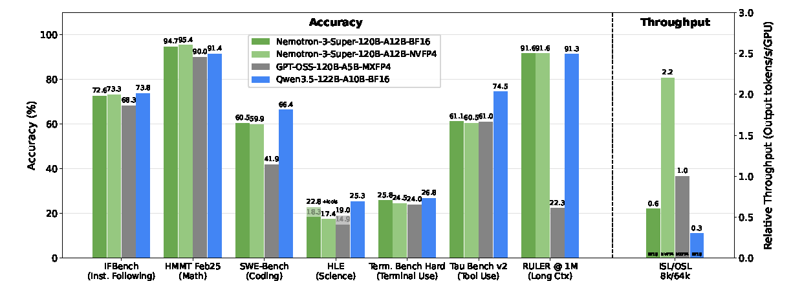
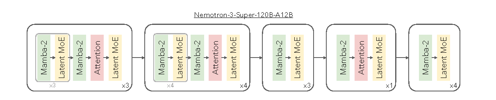
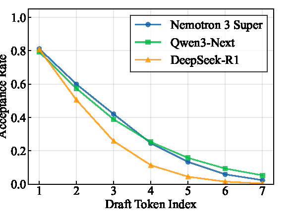
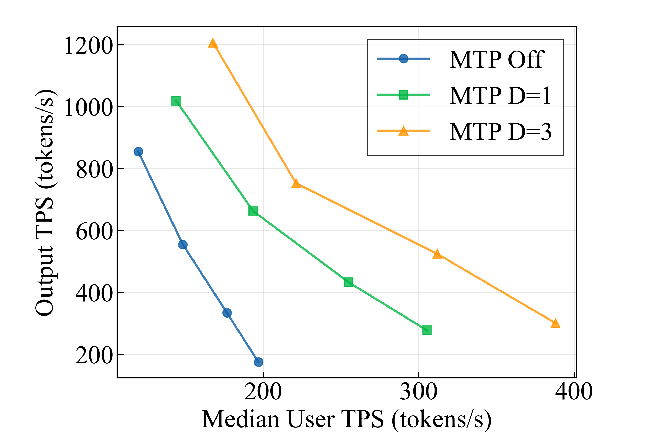
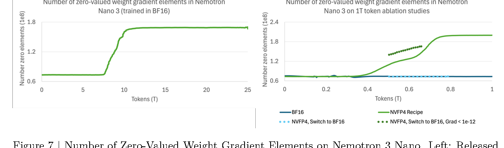
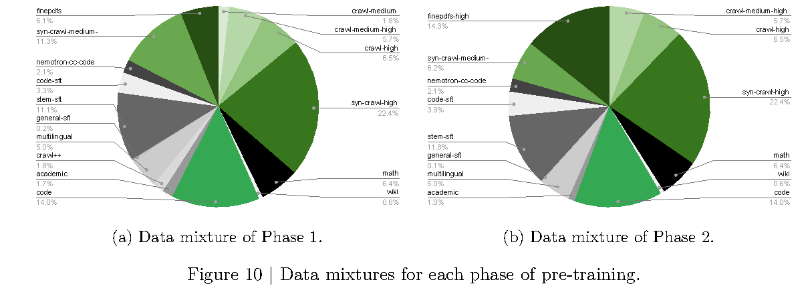
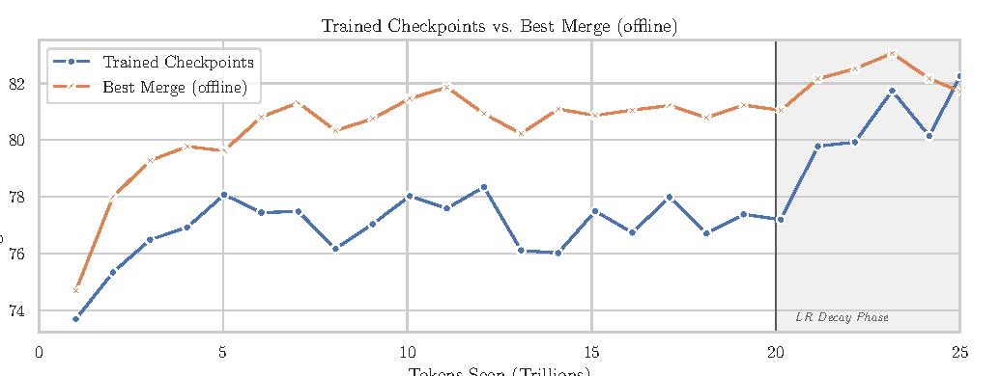
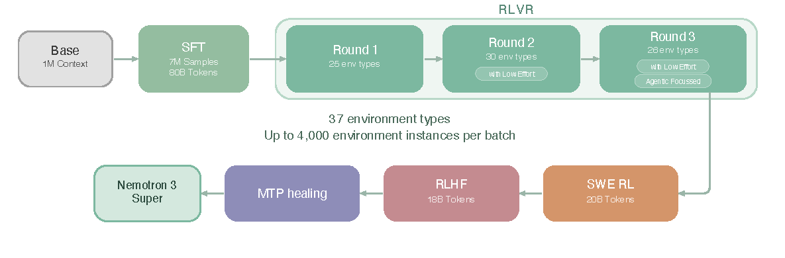
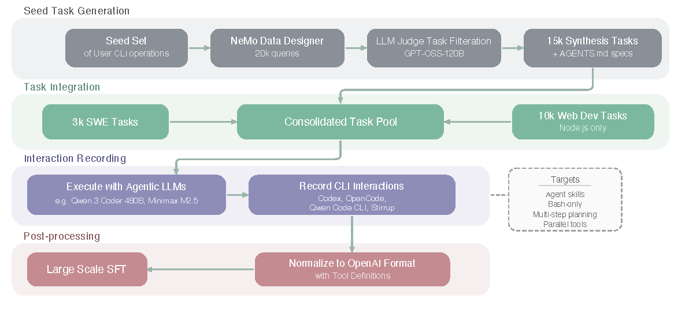
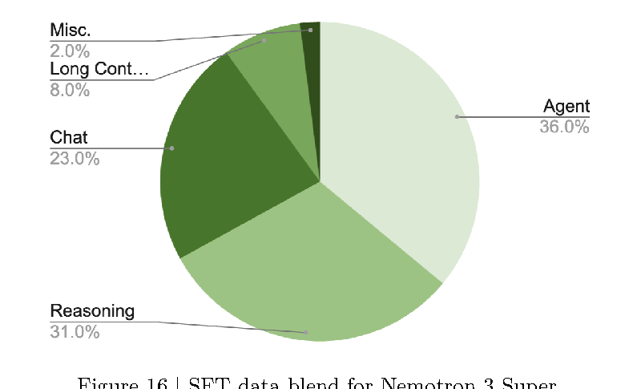

# Nemotron 3 Super：Mamba-MoE 与异步多环境 RL

!!! info "报告信息"
    - 技术报告：`Nemotron 3 Super: Open, Efficient Mixture-of-Experts Hybrid Mamba-Transformer Model for Agentic Reasoning`
    - 模型：`NVIDIA-Nemotron-3-Super-120B-A12B`
    - 链接：[NVIDIA Research PDF](https://research.nvidia.com/labs/nemotron/files/NVIDIA-Nemotron-3-Super-Technical-Report.pdf)
    - 模型与数据集合：[Hugging Face: NVIDIA Nemotron v3](https://huggingface.co/collections/nvidia/nvidia-nemotron-v3)
    - 代码与训练配方：[NVIDIA-NeMo/Nemotron](https://github.com/NVIDIA-NeMo/Nemotron)
    - 关键词：Hybrid Mamba-Transformer、LatentMoE、MTP、NVFP4、1M context、asynchronous GRPO、FP8/NVFP4 PTQ

Nemotron 3 Super 最值得抓住三条主线：**MoE 架构、MTP 方式、强化学习范式**。

| 主线 | 报告里的具体做法 | 解决的问题 |
| --- | --- | --- |
| 创新的 MoE 架构 | Hybrid Mamba-Attention + LatentMoE；120.6B total、12.7B active；512 experts、top-22 routing | 用 MoE 扩容量，用 Mamba 降长上下文生成成本，用 latent space 降 expert 权重读取和 all-to-all 流量 |
| 创新的 MTP 方式 | 两层 shared-weight MTP head；训练时跨 offset 共享参数，推理时递归做 autoregressive drafting | 避免独立 MTP head 在长 draft 下的 train-test mismatch，提高 speculative decoding 接受率 |
| 创新的 RL 范式 | SFT 后做多环境 RLVR、SWE-RL、RLHF、MTP healing；异步 GRPO、masked importance ratio、in-flight weight updates | 避免单任务 RL 互相拉扯，让数学、代码、工具、终端、SWE、长上下文等能力同步提升 |

报告日期是 `2026-04-03`。它主讲 `Nemotron 3 Super 120B-A12B`，即 120B 总参数、约 12B active 的 Super 版本；官方同时放出 BF16、FP8、NVFP4、Base BF16、Nano 和 GenRM。

{ width="920" }

<small>图源：`Nemotron 3 Super Technical Report`，Figure 1。原图比较 Nemotron 3 Super、GPT-OSS-120B 和 Qwen3.5-122B 在 IFBench、HMMT、SWE-Bench、HLE、Terminal Bench、Tau Bench、RULER 1M 与 8k/64k 生成吞吐上的表现。</small>

!!! note "Figure 1 怎么读"
    这张图不是说 Super 每项都最高，而是说它在接近 GPT-OSS-120B / Qwen3.5-122B 的能力区间里，把长上下文和长输出吞吐做得更高。报告口径下，在 `8k` 输入、`64k` 输出设置中，Super 相比 GPT-OSS-120B 和 Qwen3.5-122B 分别达到最高 `2.2x` 和 `7.5x` 吞吐提升。

## Evidence Snapshot

| Claim | Direct Source | Figure/Table/Setting | Evidence Type | Repro Status | Can Support | Cannot Prove |
| --- | --- | --- | --- | --- | --- | --- |
| Nemotron 3 Super 将 Hybrid Mamba-Transformer、LatentMoE 和 shared-weight MTP 组合成高效 agent 模型 | [NVIDIA technical report](https://research.nvidia.com/labs/nemotron/files/NVIDIA-Nemotron-3-Super-Technical-Report.pdf), [Nemotron repo](https://github.com/NVIDIA-NeMo/Nemotron) | Figure 1, architecture and MTP sections | Paper Result | Author Code / Official Repo | 混合架构和 MTP 可作为低成本长上下文/agent 推理设计案例 | 不证明所有 claim 已独立复现 |
| NVFP4、FP8/NVFP4 PTQ 与异步 GRPO 服务训练和推理效率 | 同上 | NVFP4, RL, throughput settings | System Throughput | Author Code / Official Repo | 低比特训练/部署和多环境 RL 需要联合验收 | 不证明 FP4 对所有能力和安全评测无损 |
| 本站将其接到低比特训练、MTP 和 rollout 成本账 | 本页与 [全站效率矩阵](../../references/site-efficiency-coverage-matrix.md) | 工程归纳 | Site Inference | Site Inference | 可启发世界模型 rollout 的低成本执行链 | 不等于 VLA/world model 闭环复现 |

## 论文位置

Nemotron 3 Super 可以放在 DeepSeek-V3、Qwen3、Kimi K2 和 DeepSeek-V4 这几条技术报告线旁边看：

| Report | Core emphasis | Nemotron 3 Super 的差异 |
| --- | --- | --- |
| DeepSeek-V3 | MLA、DeepSeekMoE、FP8、DualPipe、MTP | 仍是 Transformer MoE 主干，重点是低成本训练和 KV cache 压缩 |
| Qwen3 | thinking / non-thinking、GRPO、强到弱蒸馏 | 重点是统一推理模式和模型家族蒸馏 |
| Kimi K2 | 1T sparse MoE、MuonClip、agentic data / RL | 重点是 agentic non-thinking 模型和 Muon 稳定训练 |
| Nemotron 3 Super | Hybrid Mamba-MoE、LatentMoE、NVFP4、MTP、异步多环境 RL | 把长上下文吞吐、MoE 通信/带宽、低精度训练和 agent 后训练放到同一个系统里 |

它不是只做一个更大的 MoE，而是把每 token 计算、长序列状态、expert 通信、speculative decoding、低精度路径和 RL rollout 成本一起优化。

## 模型家族

报告公开了 Super 120B-A12B 的 NVFP4、FP8、BF16、Base BF16 版本，也公开了 GenRM、pretraining specialized data 和 Super post-training data。官方集合还包括 Nano 30B-A3B、Nano Omni / 4B 等变体；本文只按报告主线解析 Super 120B-A12B。

## 总体架构

Nemotron 3 Super 是 88 层 hybrid Mamba-Attention MoE。它沿用 Nemotron 3 Nano 的混合 Mamba-Attention 思路，但把稀疏扩展从 standard MoE 换成 LatentMoE。

{ width="920" }

<small>图源：`Nemotron 3 Super Technical Report`，Figure 2。原图展示 Nemotron 3 Super 的 Mamba-2、Attention 和 Latent MoE 周期性交错层 pattern。</small>

报告 Table 1 的架构配置如下，保留英文原格式：

| Configuration | Nemotron 3 Super 120B-A12B Base |
| --- | ---: |
| Total Layers | 88 |
| Model Dimension | 4096 |
| Q-Heads | 32 |
| KV-Heads | 2 |
| Head Dimension | 128 |
| Mamba State Dimension | 128 |
| Mamba Groups | 8 |
| Mamba Heads | 128 |
| Mamba Head Dimension | 64 |
| Expert Hidden Dimension | 2688 |
| Shared Expert Intermediate Size | 5376 |
| Total Experts per Layer | 512 |
| Top-k (Activated Experts) | 22 |
| MoE Latent Size | 1024 |
| MTP layers (shared weight) | 2 |

几个数字要一起看：

1. `120.6B total parameters`，但每次 forward 约 `12.7B active parameters`，不含 embedding 约 `12.1B`。
2. 注意力层使用 GQA，`32` 个 query heads、`2` 个 KV heads，降低 KV cache 压力。
3. 报告写明模型省略 positional embeddings、dropout 和 linear bias，使用 RMSNorm，embedding 和 output weights 不 tied。
4. 大部分层是 Mamba-2 + LatentMoE，少量 attention 层作为 global anchors，负责全局 token 交互和长程信息路由。

这就是它和纯 Transformer MoE 的核心差别：长上下文生成时，纯 self-attention 的 KV cache 会随序列长度增长；Mamba-2 的 recurrent state 是固定大小。少量 attention anchor 补足 SSM 在全局交互上的短板，但主体计算和状态维护交给更适合长序列的 Mamba。

## LatentMoE

普通 MoE 的 expert 计算在 hidden dimension `d` 上完成。LatentMoE 先把 token 从 `d` 投影到更小的 latent dimension `l`，再在 latent space 里路由和执行 expert 计算，最后投影回 `d`。

{ width="860" }

<small>图源：`Nemotron 3 Super Technical Report`，Figure 3。原图比较 standard MoE 与 LatentMoE；LatentMoE 在 latent dimension 内做 expert routing / computation，以降低 routed parameter loads 和 all-to-all traffic。</small>

可以把它写成：

```text
Standard MoE:
  hidden d -> router -> experts in d -> combine

LatentMoE:
  hidden d -> latent down-proj l -> router / experts in l -> latent up-proj d
```

报告给出的设计逻辑很清楚：

| Bottleneck | Standard MoE 中的问题 | LatentMoE 的处理 |
| --- | --- | --- |
| Low-latency serving | 读取 expert weights 常被 memory bandwidth 支配 | 降低 expert 计算维度，从 `d` 压到 `l` |
| Throughput serving | distributed MoE 受 all-to-all routing volume 支配 | routing payload 也在 latent space 中传输 |
| Quality | 不能简单削减 FFN 的有效非线性预算 | 保持有效预算，并用节省的成本增加 total experts 和 top-k |
| Specialist diversity | expert 组合空间越大，模型可表达的专家组合越多 | 同时增加 experts 总数和每 token 激活 experts 数 |

报告里的关键句可以概括为：把 routed expert computation 和 all-to-all traffic 移到 latent space 后，成本大约降低 `d/l` 倍；这些节省被拿来扩大 total experts 和 top-k active experts，从而在近似固定推理成本下提高质量。

在 Nemotron 3 Super 中，`d=4096`，MoE latent size 是 `1024`，也就是 4:1 压缩。直观上，这让模型可以有 `512` 个 experts、每 token 激活 `22` 个 routed experts，但仍保持约 12B active 的推理预算。

!!! note "LatentMoE 和 MLA 不是一回事"
    DeepSeek 系列的 MLA 压的是 attention KV 表示，主要目标是 KV cache 和 attention memory。LatentMoE 压的是 MoE expert 路由和计算维度，主要目标是 expert weight bandwidth 和 all-to-all communication。

    两者都用了 latent 表示，但它们改的是不同系统瓶颈。Nemotron 3 Super 的 attention 侧靠 Mamba-heavy 混合架构和少量 GQA attention anchor；MoE 侧靠 LatentMoE。

## MTP：共享参数的递归草稿头

Nemotron 3 Super 的 MTP 不只是“多接几个未来 token head”。报告强调它针对 speculative decoding 的 autoregressive drafting 做了共享参数设计。

标准 MTP 常见做法是训练 `D` 个独立 head，每个 head 预测固定 offset，例如第一个 head 预测 `n+2`，第二个 head 预测 `n+3`。这个做法在训练时没问题，因为 head 看到的是 ground-truth hidden states；但推理时如果递归复用某个 head 生成更长 draft，它就会基于自己刚生成的隐藏状态继续预测，出现明显 train-test mismatch。

Nemotron 3 Super 的处理是：**训练时让多个 MTP heads 共享参数，形成一个统一 prediction head**。这个 head 在训练阶段接触多个 offset，相当于被迫学会跨预测 horizon 的鲁棒性。推理时同一个 head 可以递归应用，生成比固定 offset 更长的 draft，并且 acceptance rate 掉得更慢。

{ width="520" }

<small>图源：`Nemotron 3 Super Technical Report`，Figure 4。原图展示 SPEED-Bench 上 draft length = 7 时，不同 draft token index 的 acceptance rate。</small>

报告 Table 2 的 average acceptance length 里，最能代表差异的几行如下：

| Category | DSR1 | Qwen3 Next | Nemotron3 Super |
| --- | ---: | ---: | ---: |
| Coding | 2.99 | **4.32** | 3.78 |
| Math | 2.98 | **3.89** | 3.73 |
| Multilingual | 2.83 | 3.97 | **4.05** |
| RAG | 2.79 | 3.53 | **3.78** |
| Reasoning | 2.80 | 3.47 | **3.59** |
| Average | 2.70 | 3.33 | **3.45** |

{ width="560" }

<small>图源：`Nemotron 3 Super Technical Report`，Figure 5。原图展示 NVFP4 checkpoint 在 TRT-LLM、TP=1、B300 GPU 上，MTP off、MTP D=1、MTP D=3 的 total throughput 与 median user throughput Pareto frontier。</small>

MTP 同时是训练目标和推理接口：训练时给模型更密集的未来 token 信号，推理时变成内置 draft model。Super 的重点是 shared-weight MTP，把递归 drafting 的分布偏移纳入训练设计。

## NVFP4 预训练

Nemotron 3 Super 是报告声称的 Nemotron 3 系列中首个使用 NVFP4 预训练的 Super 模型。它不是所有层都粗暴 FP4，而是混合精度：

| Layer Type | Format | Rationale |
| --- | --- | --- |
| All Linear Layers Unless Otherwise Noted | NVFP4 |  |
| Final 15% of Network | BF16 | Promote training stability at scale |
| Latent Projections | BF16 | Strategically kept in BF16 as step-time impact is negligible |
| MTP Layers | BF16 | Preserves multi-token prediction capabilities |
| QKV & Attention Projections | BF16 | Maintain fidelity of few attention layers |
| Mamba Output Projection | MXFP8 | Mitigates high incidence of underflows observed when quantizing this layer to NVFP4 at smaller scales |
| Embedding Layers | BF16 |  |

低精度细节也很具体：

| Tensor / Operation | NVFP4 Recipe |
| --- | --- |
| Weights | NVFP4 with two-dimensional block scaling |
| Gradients and activations | NVFP4 with one-dimensional blocks along GEMM reduction axis |
| wgrad inputs | Random Hadamard Transforms |
| gradients | stochastic rounding |
| element format | E2M1 |
| micro-block size | 16 elements |
| micro-block scale | E4M3 |
| second-level scale | FP32 global scale |

这部分最有价值的是报告没有只说“NVFP4 很快”，而是分析了 underflow 和 zero-valued gradients：到预训练结束，zero-valued weight gradient elements 约占总参数 `7%`，并且和 routed expert 的 FC1/FC2 低范数通道相关。作者认为 NVFP4 会让 BF16/MXFP8 中仍可表达的小梯度更容易 underflow 成 true zero，但这并不直接等同于训练失败。

{ width="760" }

<small>图源：`Nemotron 3 Super Technical Report`，Figure 7。原图比较 Nemotron 3 Nano 的 BF16 与 NVFP4 recipe 下 zero-valued weight gradient elements 的增长。</small>

工程结论是两层：

1. NVFP4 的确会更早、更明显地产生 zero-valued gradients，尤其在 routed expert 的某些通道上；
2. 但把 19T 后模型切到 MXFP8 虽然改善 loss trajectory，却没有带来持续下游 accuracy 提升，所以最终 Super 仍按 NVFP4 recipe 跑完整 25T token horizon。

低精度训练不能只看 loss 是否更平滑，还要看最终任务指标是否真正变好。报告的结论是：MXFP8 healing 没有兑现成下游收益。

## 预训练数据与超参

Nemotron 3 Super 预训练总量是 `25T` text tokens，分两阶段：

| Phase | Tokens | Main Goal |
| --- | ---: | --- |
| Phase 1 | 20T | diversity and broad coverage |
| Phase 2 | 5T | high-quality data and benchmark accuracy |

{ width="920" }

<small>图源：`Nemotron 3 Super Technical Report`，Figure 10。原图展示 Phase 1 与 Phase 2 的 pre-training data mixture。</small>

报告新增或强调的 specialized synthetic data 可以概括为：

| Dataset | Construction Detail |
| --- | --- |
| Synthetic Code Concepts | 91 个 HumanEval 高层编程概念；约 14M problems；清洗后约 15M problems |
| Synthetic Unconditional Algorithmic | Qwen3-235B-A22B Base + GPT-OSS-120B 生成算法题；约 0.2B tokens；做 benchmark 去污染 |
| Synthetic Economics / Formal Logic | 覆盖经济学 MCQ、自然语言逻辑、谓词/命题逻辑、真值表等任务 |
| Synthetic Multiple Choice | 从 MMLU auxiliary training set 扩展；DeepSeek-V3 解题与 majority voting；约 3.5M samples / 1.6B tokens |

核心预训练超参如下：

| Setup | Value |
| --- | --- |
| LR schedule | Warmup-Stable-Decay；200B warmup；final 5T minus-sqrt decay |
| LR range | peak `4.5e-4` -> minimum `4.5e-6` |
| Optimizer | AdamW；weight decay 0.1；`beta1=0.9`, `beta2=0.95` |
| Sequence length | 8,192 |
| Batch | 3,072 sequences；about 25.17M tokens per batch |
| MoE routing | 512 experts, top-22；sigmoid router score + expert biasing |
| Load balancing | auxiliary-loss-free update rate `1e-3` + load balancing loss coefficient `1e-4` |
| MTP loss scale | 0.3 |
| Precision | BF16 + NVFP4 |

### Checkpoint merging

WSD stable phase 中，单个 checkpoint 的 benchmark 可能噪声较大；报告用滑动窗口对近邻 checkpoint 做 weighted averaging，作为更便宜的质量 readout。

{ width="760" }

<small>图源：`Nemotron 3 Super Technical Report`，Figure 11。原图比较 trained checkpoints 与 best offline checkpoint merge 在 25T pretraining 中的 12 benchmark average accuracy。</small>

经验是：stable LR phase 中，best merge 比对应 trained checkpoint 平均高 `2-4` 分；最后 5T LR decay 后，实际 decay checkpoint 逐渐追平。最终 base model checkpoint 本身是一个 `500B` merge。报告估计该流程可节省约 `4T` tokens 的 compute readout 成本，约占总 pretraining FLOP 预算的 `16%`。

### Long-context extension

长上下文阶段在预训练末尾进行：

| Long-context Detail | Value |
| --- | --- |
| Learning rate | constant `4.5e-6` |
| Global batch size | 16 |
| Hardware | GB200 GPUs |
| Context parallelism | 64-way |
| Tensor parallelism | 2-way |
| Expert parallelism | 64-way |
| Stage 1 | 1,048,576 context length for 34B tokens |
| Stage 2 | alternating 1M and 4K sequences for 17B tokens |
| Data blend | 20% long-context document QA, 80% downscaled Phase 2 data |

这解释了为什么 RULER 1M 能成为主打指标：模型不是只靠位置外推，而是在 1M context 上做 continuous pretraining，并用 1M/4K 交替训练缓解数学 benchmark 的轻微回退。

## Base Model 结果

报告 Table 4 对 Base model 和 Ling-flash-base-2.0、GLM-4.5-Air-Base 做比较。下面摘录关键行，保留英文列名：

| Task | Metric | N-3-Super 120B-A12B-Base | Ling-flash base-2.0 | GLM-4.5 Air-Base |
| --- | --- | ---: | ---: | ---: |
| MMLU | 5-shot, acc | 86.01 | 81.00 | 81.00 |
| MMLU-Pro | 5-shot, CoT EM | 75.65 | 62.10 | 58.20 |
| GPQA-Diamond | 5-shot, CoT EM | 60.00 | 36.00 | 23.20 |
| GSM8K | 8-shot, EM | 90.67 | 90.75 | 82.60 |
| MATH | 4-shot, EM | 84.84 | 63.80 | 50.36 |
| MATH Level 5 | 4-shot, EM | 70.00 | 39.80 | 26.30 |
| AIME2024 | pass@32 | 53.33 | 30.00 | 20.00 |
| HumanEval | 0-shot, pass@1 n=32 | 79.40 | 70.10 | 76.30 |
| MBPP-Sanitized | 3-shot, pass@1 n=32 | 78.38 | 77.30 | 77.50 |
| MMLU Global Lite | 5-shot, avg | 85.72 | 74.94 | 79.25 |
| MGSM | 8-shot, avg | 87.47 | 82.73 | 80.33 |
| RULER64K | 0-shot | 92.26 | 72.12 | 80.26 |
| RULER128K | 0-shot | 88.26 | 52.03 | 61.70 |
| RULER256K | 0-shot | 84.56 | - | - |
| RULER512K | 0-shot | 82.49 | - | - |
| RULER1M | 0-shot | 71.00 | - | - |

Base 阶段最能说明架构和预训练本身的价值：Super 不是只靠后训练刷 agent 分，而是在 MMLU-Pro、GPQA、MATH Level 5、AIME、RULER 等 base evaluations 上已经拉开明显差距。

## 后大模型训练路线图

Nemotron 3 Super 的后训练分四段：SFT、RLVR、SWE-RL、RLHF，最后补一个 MTP healing。

{ width="920" }

<small>图源：`Nemotron 3 Super Technical Report`，Figure 12。原图展示 Nemotron 3 Super 的 post-training pipeline：Base -> SFT -> RLVR round 1/2/3 -> SWE-RL -> RLHF -> MTP healing -> Nemotron 3 Super。</small>

图中几个数字很关键：

| Stage | Report Figure Detail |
| --- | --- |
| Base | 1M Context |
| SFT | 7M samples, 88B tokens |
| RLVR Round 1 | 25 env types |
| RLVR Round 2 | 30 env types, with low effort |
| RLVR Round 3 | 26 env types, with low effort, agentic focused |
| RLVR scale | 37 environment types, up to 4,000 environment instances per batch |
| SWE-RL | 20B tokens |
| RLHF | 18B tokens |
| MTP healing | train MTP heads, freeze rest of weights |

报告正文还写到，RLVR setting 包含 `21 environments` 和 `37 RL datasets`。这里不要把图里的 environment types 和正文里的 environments / datasets 混成同一个数，它们是不同统计口径。

## SFT：两阶段损失和 agentic 数据扩容

SFT 采用两阶段设计，核心是处理长输出 reasoning 与 long-input-short-output 任务之间的 loss 权重冲突。

| SFT Stage | Loss Normalization | Setup |
| --- | --- | --- |
| Stage 1 | token-level global average | 256K sequence length packing, global batch size 64, constant LR `1e-5`, 30K warmup samples |
| Stage 2 | sample-level average | 512K sequence length packing, includes long context data up to 512K, global batch size 32, constant LR `1e-5` |

Stage 1 让长输出样本获得更高权重，适合吸收 reasoning、代码和 agent 轨迹；Stage 2 先按每个 conversation 自身输出 token 数归一化，再对 conversation 平均，避免短输出任务被超长输出淹没。MTP 在 SFT 中继续训练：两层 shared-parameter MTP，per-token auxiliary loss，scale 仍是 `0.3`。

### Agentic 与工具数据

报告把 Agentic Command Line Interface 数据管线单独画出来，说明他们不是只做普通对话 SFT，而是在模拟 Codex/OpenCode/Qwen Code CLI 这类多步工具环境。

{ width="920" }

<small>图源：`Nemotron 3 Super Technical Report`，Figure 13。原图展示 Agentic Command Line Interface Dataset Construction & Training Pipeline。</small>

关键数据构造可以合并成下面几类：

| Data block | Scale / construction | Training intent |
| --- | --- | --- |
| Agentic CLI | 20K seed；15K synthesis；3K SWE；10K Node.js web dev | 训练 CLI 规划、文件操作、工具调用、失败恢复 |
| Long Context | 128K/256K/512K 样本；多条 traces + semantic majority voting | 补 long-input-short-output 和跨文档推理 |
| Financial Reasoning | 从 565 个 SecQue seed 扩展到 S&P500 公司和 2019-2024 年；最终 366,243 Q&A pairs | 强化结构化金融问答与证据定位 |
| CUDA | 100K synthetic CUDA samples，含 kernel generation、repair、optimization、Nsight Compute log | 覆盖工程型代码优化任务 |
| Search / Terminal / Tool Use | conversational tool-use、general-purpose tool-calling、Terminal-Task-Gen | 让模型学习工具 schema、环境反馈和多步轨迹 |

工具调用数据分两条管线：specialized conversational tool-use 产生 `279,116` conversations、覆盖 `838` domains；general-purpose tool-calling 从 ToolEyes、API-Bank、UltraTools、xLAM 和自写工具构造 `144` toolsets，并生成约 `1.5M` diverse trajectories。

SFT blend 的整体比例如下：

{ width="560" }

<small>图源：`Nemotron 3 Super Technical Report`，Figure 16。原图展示 Nemotron 3 Super 的 SFT data blend：Agent、Reasoning、Chat、Long Context、Misc。</small>

| SFT Blend | Share |
| --- | ---: |
| Agent | 36.0% |
| Reasoning | 31.0% |
| Chat | 23.0% |
| Long Context | 8.0% |
| Misc. | 2.0% |

Agent 占比最高，说明工具与 CLI 不是后训练末尾的附加项，而是 Super 的主要能力面之一。

## 强化学习：多环境同步训练

Nemotron 3 Super 的 RL 不是逐个任务串行强化，而是 Stage 1 使用 unified RLVR 同步训练多类环境，避免 single-environment training 造成能力回退。

RLVR 环境覆盖：

| RLVR Domain | Detail |
| --- | --- |
| Math / STEM / Reasoning | competitive math, Python tool use, formal proof, harder STEM and reasoning gym |
| Code / SWE prep | competition-style code and single-step patch generation |
| Instruction / Safety | rubric rewards, over-refusal reduction, jailbreak robustness |
| Long Context / Agentic Tool Use | long-context environment, conversational tool use, terminal use |

低努力推理也在 RL 中优化：一小部分 prompt 被转为 low-effort mode，reward 同时考虑 correctness 和 generated tokens 数。初期 Math、STEM QA、competitive coding 约占所有 RL prompts 的 `2%`，后来缩到 Math 和 STEM QA 的 `1%`。这相当于把长度成本显式放进训练目标。

### 异步 GRPO

报告的 RL 算法部分非常值得单独看。它使用 asynchronous GRPO：

| Algorithm Detail | Nemotron 3 Super Setup |
| --- | --- |
| Training / inference | decoupled across separate GPU devices |
| Rollout | workers continuously fill rollout buffer; updated weights pushed once available |
| In-flight updates | one trajectory may contain tokens from different model versions; KV cache not recomputed |
| Policy lag / off-policy fix | workers at most one step behind; masked importance sampling ratio |
| RLVR batch | 256 prompts x 16 responses = 4096 samples |
| Generation | one gradient update per rollout; max generation length from 49K to 64K |

异步 rollout 会带来 policy lag 和 off-policy 问题；报告用 masked importance sampling ratio 控制训练/rollout 策略不一致，同时限制 worker 至多落后一步，避免 rollout 数据太旧。

### SWE-RL 和 PivotRL

Stage 2 单独做 SWE-RL，因为软件工程 rollout 慢、上下文长，和短 horizon 任务混训会拖慢吞吐。每个 rollout 会启动 Apptainer container，加载目标仓库，运行 OpenHands agent loop 生成 patch，再跑 ground-truth tests 给 binary reward。为了工具多样性，报告还在 OpenHands 中实现 OpenCode 和 Codex agent classes，匹配 Claude Code / Codex CLI 的工具格式。

PivotRL 用于 Agentic Programming、Search、Terminal Use、Conversational Tool Use。它复用 offline SFT expert trajectories，不对整条长轨迹做昂贵在线 RL，而是在策略对下一步 action 有不确定性的 assistant turns 上做 RL，并用 domain-appropriate reward 给相似动作 credit。这是控制 agentic RL 成本的关键设计。

### RLHF

RLHF 使用 GenRM。报告写到 GenRM 以 `Qwen3-235B-A22B-Thinking-2507` 初始化，并使用 Helpsteer 3、商业友好的 lmarena-140k 子集和近期 human preference data。Super 在 multi-environment RL stage 中也使用 GenRM，并在最后额外做 RLHF-only stage，以改善 instruction following、robustness 和交互质量。

## Post-trained 结果

报告 Table 5 覆盖 general knowledge、reasoning、agentic、instruction following、long context 和 multilingual。下面保留最能说明模型取舍的关键行：

| Benchmark | N-3-Super | Qwen3.5-122B-A10B | GPT-OSS-120B |
| --- | ---: | ---: | ---: |
| MMLU-Pro | 83.73 | 86.70 | 81.00 |
| AIME25 (no tools) | 90.21 | 90.36 | 92.50 |
| HMMT Feb25 (no tools) | 93.67 | 91.40 | 90.00 |
| HMMT Feb25 (with tools) | 94.73 | 89.55 | - |
| GPQA (no tools) | 79.23 | 86.60 | 80.10 |
| LiveCodeBench (v5 2024-07 -> 2024-12) | 81.19 | 78.93 | 88.00 |
| HLE (no tools) | 18.26 | 25.30 | 14.90 |
| Terminal Bench (hard subset) | 25.78 | 26.80 | 24.00 |
| SWE-Bench (OpenHands) | 60.47 | 66.40 | 41.9 |
| TauBench V2 Average | 61.15 | 74.53 | 61.0 |
| RULER1M | 91.64 | 91.33 | 22.30 |
| MMLU-ProX (avg over langs) | 79.36 | 85.06 | 76.59 |

这张表说明 Super 的优势不是平均碾压 Qwen3.5-122B，而是几个能力点叠加：

1. **长上下文强**：RULER 256K/512K/1M 基本与 Qwen3.5 持平，远超 GPT-OSS-120B；
2. **工具和终端能力有竞争力**：Terminal Bench hard、TauBench average 与 GPT-OSS 接近或略优，但 Telecom 项明显落后 Qwen3.5；
3. **SWE-Bench 仍落后 Qwen3.5**：OpenHands 60.47 vs 66.40，但远高于 GPT-OSS-120B 的 41.9；
4. **科学/HLE 不是最强项**：HLE no tools 明显低于 Qwen3.5，但 with tools 后超过 GPT-OSS；
5. **吞吐是核心差异**：很多能力项接近时，Super 主要凭架构和量化拿到 serving efficiency。

## 推理量化

报告最后一部分讲 FP8 和 NVFP4 PTQ。要区分三件事：

1. **NVFP4 pretraining**：训练阶段大量 GEMM 用 NVFP4；
2. **FP8 checkpoint**：面向 Hopper 的 W8A8 部署版本；
3. **NVFP4 checkpoint**：面向 Blackwell 的 W4A4 部署版本。

### FP8 与 NVFP4 checkpoint

FP8 PTQ 使用 `256` 个 post-training SFT samples，context length `65536`。核心选择是：Embedding、attention projection、attention BMM2、MoE latent projection、1D conv 和 output 保持 BF16；KV cache + attention BMM1、MoE GEMM、Mamba GEMM 用 FP8；Mamba SSM cache 用 FP16。

NVFP4 PTQ 面向 Blackwell W4A4。naive NVFP4 PTQ 会有 accuracy loss，所以最终 recipe 组合三件事：

| Component | Role |
| --- | --- |
| calibrated per-block weight scaling that minimizes MSE | weight quantization offline search, no runtime cost |
| dynamic per-block max-based activation scaling | activation quantization must be runtime efficient |
| selective promotion through Model-Optimizer AutoQuantize | sensitive layers promoted to FP8 or BF16 |

AutoQuantize 在 `{NVFP4, FP8, BF16}` 中搜索 per-operator assignment，约束 effective precision budget 为 `4.75 bits`。最终保留 BF16 的主要是 embedding、attention QKV、attention BMM2、Mamba 1D conv、output；保留 FP32 的是 router；可搜索 promotion 的主要是 attention output、shared experts、MoE latent projection 和 Mamba projection；routed sparse expert GEMM 主要落在 NVFP4。完整 mixed-precision PTQ 在单个 `8 x B200` node 上少于 2 小时完成，校准使用 `512` 个 SFT samples、sequence length `4096`，最终 NVFP4 模型达到 BF16 baseline 的 `99.8%` median accuracy。

Table 8 关键行如下：

| Benchmark | N-3-Super | N-3-Super FP8 | N-3-Super NVFP4 |
| --- | ---: | ---: | ---: |
| MMLU-Pro | 83.73 | 83.63 | 83.33 |
| HMMT Feb25 (with tools) | 94.73 | 94.38 | 95.36 |
| GPQA (no tools) | 79.23 | 79.36 | 79.42 |
| LiveCodeBench | 81.19 | 80.99 | 80.56 |
| Terminal Bench hard | 25.78 | 26.04 | 24.48 |
| SWE-Bench (OpenCode) | 60.47 | - | 59.90 |
| RULER1M | 91.64 | 91.43 | 91.60 |
| MMLU-ProX avg | 79.35 | 79.21 | 79.37 |

这张表支撑了报告的关键部署主张：NVFP4 不是只压小模型，而是在 120B-A12B Super 上也能基本保持 BF16 精度，同时给 Blackwell 推理吞吐留出空间。

### Mamba state cache

Mamba 的 SSM cache 默认 FP32。报告尝试把 SSM cache 存成 FP16，以减少 memory-bound decoding 的 DRAM read，但发现 naive FP16 cache 会显著增加 verbosity：

| Precision | SSM cache recipe | Key observation |
| --- | --- | --- |
| W16A16 | FP32 | baseline verbosity |
| W16A16 | FP16 | livecodebench verbosity +36.95% |
| W16A16 | FP16+SR (Philox 5) | verbosity drops back near baseline |
| W8A8 | FP16 | livecodebench verbosity +40.27% |
| W8A8 | FP16+SR (Philox 5) | verbosity increase only +1.79% / +1.08% |

原因是 Mamba decoding 是 recurrent：cache quantization error 不会只影响当前 step，而会沿 recurrent transition 传播并累积。普通 FP16 cast 的 RTNE rounding 会产生系统性 bias；stochastic rounding 在期望上无偏，能把系统性漂移变成零均值噪声。最终报告选择 `FP16+SR (Philox 5)`，因为它不需要额外 block scale，Blackwell 有 stochastic rounding 的专用 PTX 指令，也支持 Philox PRNG。

## 工程启发

这篇报告最值得复用的不是某个单点 trick，而是系统协同：

| Theme | Takeaway |
| --- | --- |
| Long context | Mamba-heavy 主干让大多数层在生成阶段只维护固定状态，少量 attention anchor 保留全局交互 |
| MoE serving | LatentMoE 瞄准 expert weight bandwidth 和 all-to-all，而不只看每 token FLOPs |
| MTP | shared-weight MTP 把递归 drafting 的分布偏移提前暴露给训练 |
| Low precision | NVFP4 要看 underflow、zero gradients 和下游指标，不只看 loss |
| Agent RL | 多环境 RLVR 避免能力跷跷板，异步 GRPO 保证 rollout/training 吞吐 |
| Quantization | Mamba SSM cache 量化会改变 verbosity，recurrent state 误差要单独处理 |

## 边界与风险

几个边界要记住：benchmark 绑定 Nemo Evaluator / harness / prompt / judge；吞吐结论绑定 B200/B300、vLLM/TRT-LLM 和具体 TP 设置；SWE-Bench 仍落后 Qwen3.5-122B；LatentMoE 与异步 RL 都依赖并行策略、kernel、runtime 和训练平台配合，复现门槛很高。

## 读法总结

Nemotron 3 Super 的核心不是“120B MoE 又多强”，而是一个完整工程命题：

```text
如何让一个 120B total / 12B active 的开源模型，
在 1M context、长输出、工具调用、终端、SWE 和多环境 RL 上可用，
同时让训练和推理都落到 NVFP4 / FP8 / Blackwell / Hopper 的现实硬件路径上。
```

真正值得学习的是组合拳：Mamba 解决长序列状态，LatentMoE 解决 expert bandwidth / communication，MTP 解决 speculative decoding，NVFP4 解决训练吞吐，异步多环境 RL 解决 agent 能力协同，PTQ 和 SSM cache recipe 解决部署落地。
