# Nemotron 3 Super：Mamba-MoE 与异步多环境 RL

!!! info "论文信息"
    **论文题名：** Nemotron 3 Super: Open, Efficient Mixture-of-Experts Hybrid Mamba-Transformer Model for Agentic Reasoning。 
    **作者：** NVIDIA。 
    **机构：** NVIDIA。 
    **时间 / 主题：** 2026-04；技术报告。 
    **arXiv / 官方报告：** arXiv：[2604.12374](https://arxiv.org/abs/2604.12374)。 
    **GitHub / 项目：** GitHub：未找到官方链接。 
    **元数据来源与核验口径：** 来源：[arXiv](https://arxiv.org/abs/2604.12374) / 官方发布页；Checked Date：2026-07-07；Repro Status：Paper / official materials reviewed, independent reproduction not claimed。

## 长推理模型的成本不只由激活参数决定

Nemotron 3 Super 面向长输出推理与多步工具使用。它有 120.6B 总参数，每次前向激活约 12.7B，扣除 embedding 后为 12.1B。报告将其简称为 120B-A12B，但这个稀疏比例只解释了一部分效率：专家权重读取、跨设备路由、长上下文缓存以及逐 token 解码，同样会影响真实服务成本。

模型同时改变四个环节。Mamba-2 与少量 attention 组合，减少长序列状态开销；LatentMoE 在较低维度运行路由专家，把省下的带宽和计算用于更多专家组合；共享权重 MTP 在模型内部产生草稿，提高每次验证可接受的 token 数；NVFP4 训练和混合精度部署进一步压缩矩阵运算成本。之后再通过长上下文训练、SFT 和多环境 RL 形成 agentic 行为。[↗](https://arxiv.org/pdf/2604.12374v1#page=4)

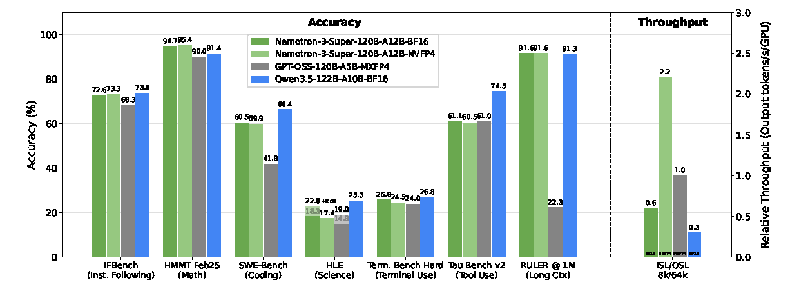{ width="920" }

Figure 1 将能力与吞吐放在同一张图中，但两部分需要分别读。能力比较显示模型在数学、长上下文等方面有竞争力，部分工具和软件工程任务仍落后于 Qwen3.5-122B；右侧吞吐是在 **B200、8K 输入／64K 输出**条件下，对每个模型选取 vLLM 与 TensorRT-LLM 中更好的结果。Nemotron 的 NVFP4 版本相对 GPT-OSS-120B MXFP4 和 Qwen3.5-122B BF16，分别达到最多 2.2×、7.5× 吞吐。它不是相同精度下仅替换架构的消融，也不是所有请求长度都能获得的固定倍数。[↗](https://arxiv.org/pdf/2604.12374v1#page=2)

## 混合层结构怎样分配序列建模

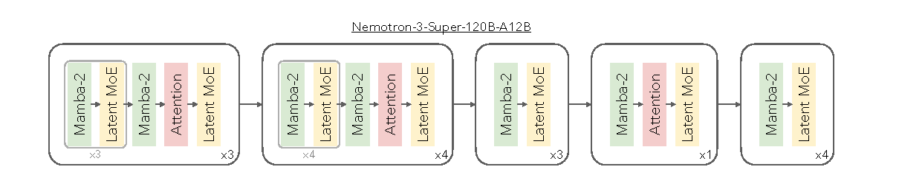{ width="920" }

Figure 2 展示 88 层的周期性交错。Mamba-2 承担大部分序列状态更新，LatentMoE 提供稀疏非线性容量，少量 self-attention 作为全局信息交互位置。这里应沿序列处理层与专家层的交替关系读，而不是把三个模块看作互不相干的并联模型。

Mamba 解码维持固定大小的递归状态，不需要像 attention 一样为每个历史 token 保留一份 KV。Attention 层仍允许当前位置直接访问历史 token，补充仅靠压缩状态难以保持的远距离细节。因而混合设计是在状态压缩与显式检索之间分配容量。严格说，标准 KV cache 的容量随序列长度线性增长，全注意力 prefill 的配对计算才具有二次增长，二者不能混写。

| Configuration | Value | 作用 |
| --- | ---: | --- |
| Model dimension | 4096 | 主干 hidden state 维度 |
| Attention Q / KV heads | 32 / 2 | GQA 减少 KV 存储 |
| Attention head dimension | 128 | 每个 attention head 的通道数 |
| Mamba state dimension | 128 | 递归状态结构参数 |
| Mamba groups / heads / head dimension | 8 / 128 / 64 | Mamba 计算配置 |
| Routed experts per layer | 512 | 专家池规模 |
| Activated experts | 22 | 每 token 的稀疏路由数 |
| Expert hidden dimension | 2688 | 专家内部非线性宽度 |
| Shared expert intermediate size | 5376 | 全维共享专家的内部宽度 |
| MoE latent dimension | 1024 | 路由专家计算与通信的低维空间 |
| Shared-weight MTP layers | 2 | 多步预测与原生 speculative decoding |

模型使用 RMSNorm，不采用位置 embedding、dropout 和线性层 bias，输入 embedding 与输出权重不绑定。最终支持 1M 上下文，依赖后续专门的长上下文训练，不能仅由混合层结构本身推出。[↗](https://arxiv.org/pdf/2604.12374v1#page=8)

## LatentMoE 把省下的维度换成专家组合

普通 MoE 的效率常按 FLOPs 讨论，但低延迟服务可能受读取专家权重限制，大 batch 服务则可能受 all-to-all 通信限制。若 hidden dimension 为 $d$、专家中间维度为 $m$、每 token 激活 $K$ 个专家，单个专家矩阵规模与 $d m$ 相关，路由通信量与 $dK$ 相关。减少 $K$ 或 $m$ 虽能省资源，却也直接削减参与计算的非线性容量。

LatentMoE 选择压缩专家输入输出维度，同时保留主干的信息通道。它先用 $W_\downarrow\in\mathbb{R}^{\ell\times d}$ 将 token 从 $d$ 维投影到 $\ell$ 维，让路由专家在低维空间计算，聚合后再用 $W_\uparrow\in\mathbb{R}^{d\times\ell}$ 返回主干。

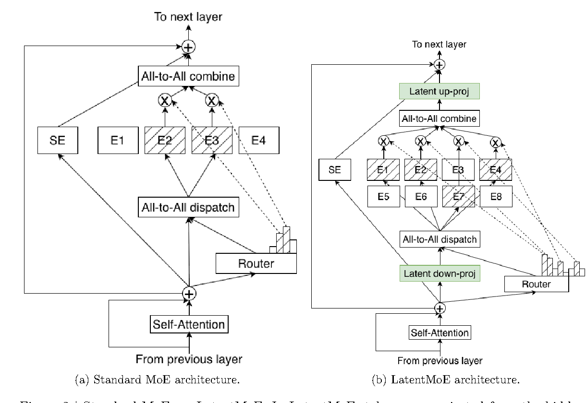{ width="860" }

Figure 3 右侧新增的绿色 down/up projection 包住了 all-to-all 与 routed experts。Router 和共享专家仍在原始 $d$ 维运行；因此不能说所有 MoE 运算都压到 latent space。原图中的共享分支绕过压缩，保留了一条全维处理路径。[↗](https://arxiv.org/pdf/2604.12374v1#page=5)

论文给出的扩展关系为

$$
N'=N\frac{d}{\ell},\qquad K'=K\frac{d}{\ell}.
$$

其中 $N$ 与 $K$ 是标准 MoE 的专家总数与激活数，$N'$、$K'$ 是压缩后增加的数量。单个专家的权重读取和每次路由的通信载荷约按 $\ell/d$ 缩小，便可把预算用于更多专家组合。Super 的主干为 4,096 维、latent 为 1,024 维，维度比为 4；最终实际配置为 512 个专家、top-22，不能机械地反推出一定存在一个 top-5.5 的对照模型。

压缩并非越多越好。任务所需的有效特征秩构成下限，低于这个下限会丢失关键表征。这里的核心是把专家计算中可以压缩的部分，与 gate、shared expert、其他主干层中应保留的全维部分分开，而不是对所有激活统一降维。

报告把 LatentMoE 的完整结构比较指向专门技术报告；本篇最终吞吐同时包含混合层、MTP、精度和实现优化，不能用 2.2× 或 7.5× 单独量化 LatentMoE 的贡献。

## 共享 MTP 头怎样支持更长草稿

普通 next-token 目标只要求预测下一个 token，MTP 再预测多个未来位置，使 hidden state 对后续结构提供更多信息。推理时，辅助头充当内部 draft model，连续提出候选，再由主模型一次验证多个 token。

如果每个 MTP 头只学习固定偏移，把它反复调用来生成更长草稿，会遇到训练与推理差异：训练看到真实条件，推理却不断消费自己生成的状态。Super 让两个 MTP 层共享参数，同一个头在训练中接触多个预测距离，因此递归使用时更能适应不同 horizon。它并不保证所有草稿都通过，接受率仍随 draft depth 下降。[↗](https://arxiv.org/pdf/2604.12374v1#page=6)

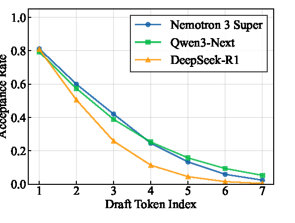{ width="520" }

Figure 4 固定草稿长度为 7，观察第 1 至第 7 个候选的接受率。Super 在每个位置均高于 DeepSeek-R1，并在较深位置保持相对稳定；Qwen3-Next 仍在部分任务上更强。平均接受长度见 Table 2。

| SPEED-Bench category | DeepSeek-R1 | Qwen3-Next | Nemotron 3 Super |
| --- | ---: | ---: | ---: |
| Coding | 2.99 | 4.32 | 3.78 |
| Math | 2.98 | 3.89 | 3.73 |
| Multilingual | 2.83 | 3.97 | 4.05 |
| RAG | 2.79 | 3.53 | 3.78 |
| Overall average | 2.70 | 3.33 | 3.45 |

3.45 表示在该设置下每次验证平均接受的 token 数，不是端到端 3.45 倍加速。实际收益还要扣除草稿计算、验证成本和 batch 调度开销。[↗](https://arxiv.org/pdf/2604.12374v1#page=7)

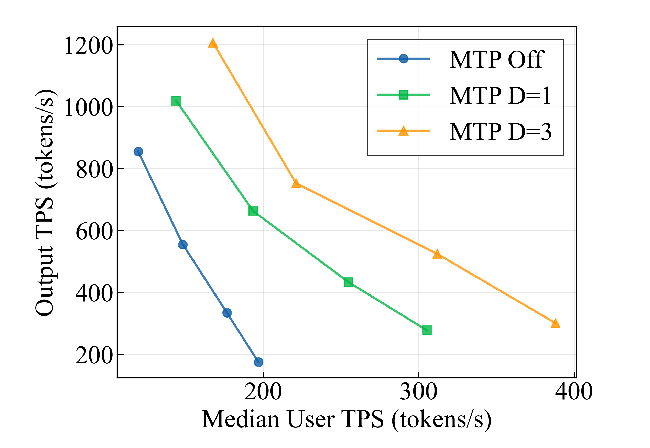{ width="560" }

Figure 5 用 NVFP4 checkpoint、TensorRT-LLM、TP=1 和 B300，在 SPEED-Bench Throughput-1k 子集、1K 输出长度下比较关闭 MTP 与 draft length 1、3。曲线展示整体输出吞吐与用户吞吐之间的取舍；启用 MTP 改善了这组条件下的服务前沿。该图与 Figure 1 的 B200、8K／64K 设置不同，不应混为同一测量。

## NVFP4 预训练保留了哪些高精度部分

Super 在 25T tokens 的预训练中使用 NVFP4 配方。NVFP4 用 E2M1 元素、16 元素微块、E4M3 微块 scale 和 FP32 全局 scale 表示数值。权重采用二维 block scaling，激活与梯度沿 GEMM reduction axis 使用一维 block；weight-gradient 运算输入加入 Random Hadamard Transform，梯度使用 stochastic rounding。[↗](https://arxiv.org/pdf/2604.12374v1#page=8)

“NVFP4 训练”指主要线性算子的混合精度配方，并不是全部张量都只有 4-bit。

| Training component | Precision | 保留精度的原因 |
| --- | --- | --- |
| 大部分线性层 | NVFP4 | 降低主要 GEMM 成本 |
| 网络最后 15% | BF16 | 维护训练稳定性 |
| Latent projections | BF16 | 时间占比较小，优先保留表征精度 |
| MTP layers | BF16 | 保持多步预测能力 |
| QKV 与 attention projections | BF16 | 保护少数全局 attention 层 |
| Mamba output projection | MXFP8 | 缓解 NVFP4 下溢 |
| Embeddings | BF16 | 保留输入输出表示精度 |

作者观察到部分专家通道的权重范数逐渐变小，训练末期约 7% 参数对应的 weight-gradient 元素为零。为判断是否是数值问题，研究团队在 Nano 规模进行 BF16 与 NVFP4 对照，而不是只看最终 Super 的一条 loss 曲线。

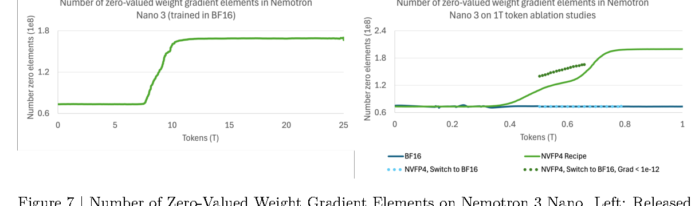{ width="760" }

Figure 7 的受控实验显示，相同 1T-token 训练长度下，NVFP4 的零梯度数量约为 BF16 的三倍；中途切回 BF16 后又回到基线附近。BF16 仍保存许多小于 $10^{-12}$ 的微小梯度，NVFP4 则更容易把它们下溢为零。该实验解释了数值现象，但零梯度增多本身并不等同于下游准确率已经下降。[↗](https://arxiv.org/pdf/2604.12374v1#page=9)

作者还在 Super 的 19T tokens 处将全部张量提升至 MXFP8，继续训练到 20.6T。Loss 轨迹改善，但下游任务没有持续增益，因此最终模型沿用原混合精度配方训练到底。这个结果说明低精度训练需要同时检查张量统计、loss 和任务指标；只依据更好看的 loss 选择精度并不足够。[↗](https://arxiv.org/pdf/2604.12374v1#page=10)

## 25T 预训练如何分配数据与训练预算

训练分为 20T tokens 的广覆盖阶段与 5T 的高质量阶段。数据涉及 16 类来源，包括网页及其合成版本、代码、数学、学术文本、PDF、多语言和 SFT 风格样本。第二阶段提高高质量 PDF 等来源的比例，并调整较低质量来源。

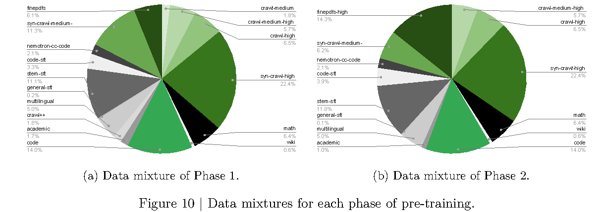{ width="920" }

Figure 10 应按两个阶段的比例变化比较，而不是将所有合成数据理解为同一种内容。代码、STEM 风格监督、网页改写与多项选择题，提供的是不同形式的学习信号。第二阶段并非仅增加更多相同网页，而是在总预算后段改变质量与任务分布。[↗](https://arxiv.org/pdf/2604.12374v1#page=14)

新增代码概念数据从 91 个去重概念组合生成问题，再产生多个答案，经过额外 imports 检查、题面恢复与 AST 验证，最终约 15M 条样本。AST 检查保证语法可解析，不能替代执行正确性。另一个较小的算法数据集约 0.2B tokens，加入边界情况、测试和多种输出格式，并对 HumanEval、MBPP、CRUXEval、LiveCodeBench 做答案精确去重与 embedding 相似度过滤。

经济学、形式逻辑与 MCQ 数据补充结构化推理。MCQ 流水线从 MMLU auxiliary training data 扩展问题，多次求解后使用多数答案筛选，得到约 3.5M 样本、1.6B tokens。在 Nano 24.9T checkpoint 续训 100B tokens、其中加入 1B 该数据的实验中，AIME-2024 从 53.3 到 56.7，MBPP 从 74.8 到 75.2。它支持该合成数据在这次小规模替换中的作用，不是 Super 全部最终增益的单独归因。[↗](https://arxiv.org/pdf/2604.12374v1#page=13)

预训练序列长 8,192，batch 为 3,072 条序列，约每批 25.17M tokens。AdamW 使用 weight decay 0.1、$\beta_1=0.9$、$\beta_2=0.95$；前 200B tokens warmup 到 $4.5\times10^{-4}$，保持稳定后，在最后 5T 采用 minus-sqrt decay 降至 $4.5\times10^{-6}$。MTP 辅助 loss 权重为 0.3。

路由使用 sigmoid score 和 expert bias。负载均衡同时包含更新率 $10^{-3}$ 的 auxiliary-loss-free bias 调整，以及系数 $10^{-4}$ 的标准 load-balancing loss，因此不能把实际配方简化为完全没有辅助损失。

### Checkpoint merging 减少中途读出模型质量的成本

恒定学习率阶段，单个 checkpoint 的 benchmark 表现会波动。若每次评估都额外跑一次学习率退火，会花费大量 tokens。作者对最近 checkpoint 做加权平均，模拟较短的 minus-sqrt decay，并比较 125B、250B、500B 三种窗口。

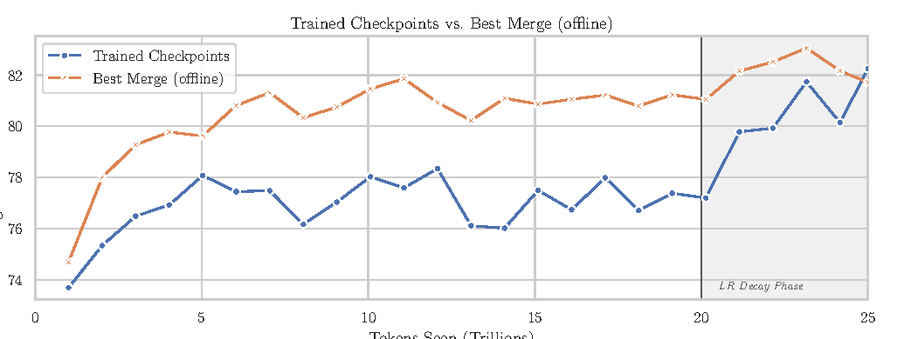{ width="760" }

Figure 11 展示三种窗口中效果最好的一种与当时训练 checkpoint 的对照。在稳定学习率阶段，12 个 benchmark 的不加权平均通常高 2–4 分；进入真实退火阶段后差距缩小，结束时接近。最终用于后训练的 base checkpoint 采用 500B merge。[↗](https://arxiv.org/pdf/2604.12374v1#page=15)

报告估计，对相似训练日程，避免若干额外退火运行可能节省约 4T tokens、约 16% 预训练 FLOPs。这个数字是所述替代流程的预算估计，不能写成最终训练已经减少了 16%。实验也未证明 merging 总能替代长退火；在更长窗口对照中没有观察到同样收益。

### 1M 上下文通过额外训练获得

长上下文阶段使用 GB200，64-way context parallelism、2-way tensor parallelism、64-way expert parallelism，学习率 $4.5\times10^{-6}$，global batch 16。先以 1,048,576 长度训练 34B tokens，再以 1M 与 4K 序列交替训练 17B tokens，以减轻数学指标受到的影响。混合中 20% 是长文档 QA，80% 来自缩放后的第二阶段数据。[↗](https://arxiv.org/pdf/2604.12374v1#page=16)

Base 模型 RULER 从 64K 的 92.26、128K 的 88.26，降到 1M 的 71.00；后训练后 1M 达到 91.64。前后都能接受 1M 输入，但可用能力显著不同，这也说明“支持的长度”需要与具体任务准确率一起报告。

## SFT 的关键改动是怎样给长短答案分配权重

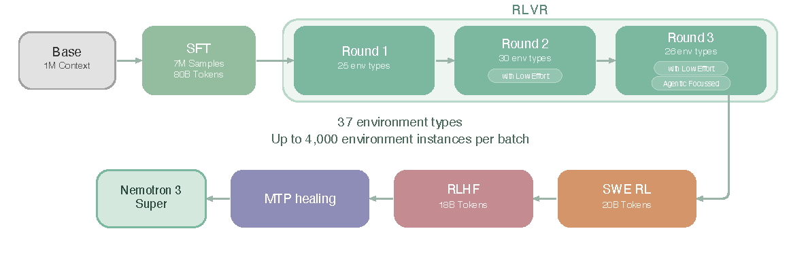{ width="920" }

Figure 12 展示 Base → SFT → 多环境 RLVR → SWE-RL → RLHF → MTP healing。SFT 超过 7M 样本，图中标注约 80B tokens；SWE-RL 与 RLHF 分别标注约 20B、18B tokens。后训练因此包含大规模数据与执行环境投入，不能视为一次轻量指令微调。[↗](https://arxiv.org/pdf/2604.12374v1#page=18)

作者发现只做单阶段 token-level SFT，会损害长输入、短输出任务。原因在 loss 权重：一条长推理答案包含更多输出 token，因而对总体目标贡献更大，即便另一条短答案同样代表一个完整任务。

令 packed batch 为 $\mathcal B$，对话 $c$ 的输出 token 集合为 $\mathcal O_c$，单 token 负对数似然为 $\ell_t=-\log p_\theta(y_t\mid x,y_{<t})$。第一阶段使用原文式（1）的全局 token 平均。

$$
\mathcal L_{\mathrm{tok}}=
\frac{\sum_{c\in\mathcal B}\sum_{t\in\mathcal O_c}\ell_t}
{\sum_{c\in\mathcal B}|\mathcal O_c|}.
$$

第二阶段改成原文式（2），先在每条对话内平均，再对对话等权平均。

$$
\mathcal L_{\mathrm{samp}}=
\frac{1}{|\mathcal B|}\sum_{c\in\mathcal B}
\left(\frac{1}{|\mathcal O_c|}\sum_{t\in\mathcal O_c}\ell_t\right).
$$

一个解释性例子是，一条答案有 100 个输出 token，另一条有 10,000 个。第一式中后者大约拥有前者 100 倍的 token 权重；第二式先将它们各自归一化，再平等对待两个对话。这里改变的是样本对目标函数的贡献，不是截断长推理。

第一阶段 packing 长度 256K、global batch 64；第二阶段 packing 长度 512K、global batch 32，并引入最长 512K 的长上下文样本。两阶段学习率均为 $10^{-5}$，继续训练共享 MTP 头，辅助项仍按 token 计算并乘 0.3。作者报告这种两阶段安排恢复了 long-input-short-output 表现，同时保留推理行为。[↗](https://arxiv.org/pdf/2604.12374v1#page=19)

## Agent 数据学习的是完整操作过程

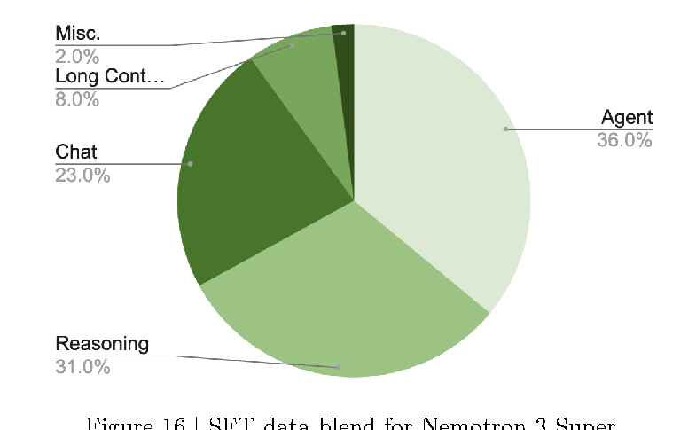{ width="560" .atlas-figure-compact }

Figure 16 中 Agent 占 36%、Reasoning 31%、Chat 23%、Long Context 8%、其余 2%。这个混合没有只扩大竞赛题，而是给工具调用、仓库交互和长任务执行更多份额。第二阶段保留第一阶段混合的 85%，再加入 256K 与 512K 长上下文数据。

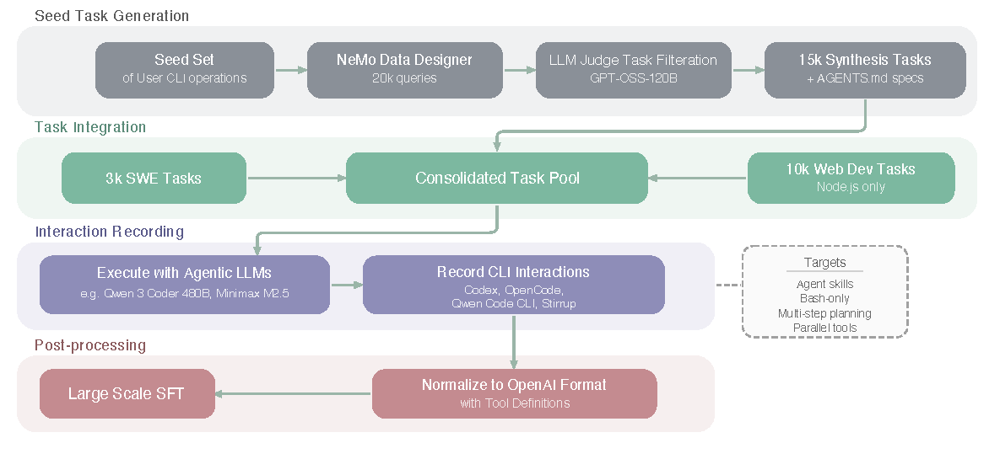{ width="920" }

Figure 13 的 CLI 数据先从 24 类常见动作生成约 20K 查询，筛掉依赖不存在仓库的任务后留下约 15K 合成任务，并附加类似 `AGENTS.md` 的约束；再加入约 3K 带真实仓库与 commit 的 SWE 任务，以及约 10K Node.js 网页开发任务。教师模型在 Codex、OpenCode、Qwen Code CLI、Stirrup 等环境中运行，记录工具交互，再统一成消息与工具定义格式。[↗](https://arxiv.org/pdf/2604.12374v1#page=20)

这部分数据覆盖 planning、并行工具、bash-only 限制、澄清与多轮交互。不过，CLI 数据中的那批约 3K SWE 任务为了降低容器工程成本，提示教师不运行单元测试；不能把它与后续具有真实测试奖励的 SWE-RL 混为全部经过测试验证的修复轨迹。

其他数据来源承担各自的执行能力。

| Data source | Construction | 提供的训练信号 |
| --- | --- | --- |
| Software engineering SFT | SWE-Gym、R2E-Gym、SWE-rebench，OpenHands 教师轨迹 | 代码探索、复现、补丁与任务跟踪 |
| Terminal use | 84,864 条，Terminus 2 与 Docker 执行反馈 | 终端中的多步操作 |
| Search | Wikidata 4–8 跳关系转问题，再隐藏中间实体 | 自主分解检索，平均约 12 次工具调用 |
| CUDA | 约 100K，正确性验证后按性能选择 | kernel 生成、修复、Nsight 日志驱动优化 |
| Financial reasoning | 366,243 对，SEC 文件、候选选择与可回答性过滤 | 有文档依据的数值与财务推理 |
| SQL | 96.5K，三种数据库方言、干扰表列 | 在复杂 schema 中选择相关字段与语法 |
| Specialized conversational tools | 279,116 对话、838 domains | 在服务政策与工具约束下完成多轮任务 |
| General tool use | 约 1.5M 合成轨迹 | 多工具选择与调用格式 |

数据验证强度不同。CUDA 候选有实际执行检查，终端轨迹在隔离环境中运行；通用 tool-use 数据中的工具结果由 Tool-LLM 模拟，再结合规则和模型评判过滤。因此，规模更大不等于所有轨迹都在真实 API 上执行过。[↗](https://arxiv.org/pdf/2604.12374v1#page=24)

长上下文 SFT 不仅做局部问答，还从书籍、论文、财报和代码仓库组合相关文档，要求 4–7 个检索或推理步骤；每题采样八条推理，选多数答案组中最短的一条。另有记录聚合任务通过 SQL 计算标准答案。多语言数据加入格式修复，避免翻译使问题要求与答案格式失配；安全数据则把响应策略、推理与最终回答共同约束，涵盖过度拒绝、越狱与间接提示注入等情形。[↗](https://arxiv.org/pdf/2604.12374v1#page=21)

### 推理长度成为可训练控制项

模型支持 reasoning-off、regular、low-effort 三种模式，后两者还可结合 inference-time budget control。Low-effort 在 SFT 中使用 GPT-OSS-120B 的短推理样本，占约 2% 样本；reasoning-off 随机移除约 3% 样本的推理轨迹。之后额外做 350 步 semi-on-policy SFT，将 12% 的推理轨迹截断到随机预算，以训练预算控制。[↗](https://arxiv.org/pdf/2604.12374v1#page=26)；架构 Table 1 见 [PDF 第 3 页](https://arxiv.org/pdf/2604.12374v1#page=3)

这些模式让用户能选择准确率与长度的折中，但不能将“关闭可见推理”与“任意任务准确率不变”画等号。后续 RL 仍需要通过正确性和输出长度共同优化 low-effort 行为。

## 为什么 RL 要联合训练，又把 SWE 单独拿出来

RLVR 覆盖 21 个环境、37 个 RL 数据集，包括数学、代码、STEM、指令遵循、长上下文、工具、终端和 Reasoning Gym。作者观察到单环境训练会导致其他 benchmark 严重退化，因此主要阶段联合采样多个环境，并先过滤 SFT 模型总能答对的题，再按难度组织剩余样本。[↗](https://arxiv.org/pdf/2604.12374v1#page=27)

每步采样 256 个 prompts，每题生成 16 个 responses，形成 4,096 条训练 batch，每批执行一次梯度更新。最大生成长度从 49K 提高到 64K。Low-effort prompts 初期占约 2%，后来约 1%，奖励同时考虑正确性和生成 token 数，避免仅用“更短”作为目标。

SWE-RL 被单独安排，是因为仓库交互生成更慢、上下文更长。每次 rollout 启动带目标仓库的 Apptainer 容器，由 OpenHands agent loop 生成补丁，再运行真实测试给出二元奖励。训练还在同一运行框架内切换不同工具格式与提示，使模型不只适应一种 harness。单独阶段可以为这类长任务配置合适的 rollout 与 batching，而不让它拖慢所有短任务。

最后使用 principle-following GenRM 做 RLHF，奖励模型基于 Qwen3-235B-A22B-Thinking-2507 初始化，以 HelpSteer 3、许可适用的 lmarena 子集和额外偏好数据训练。GenRM 也参与前面的多环境阶段，末尾另做 RLHF-only 训练。之后冻结主干，仅用生成响应的 NLL 修复 MTP 头，使后训练后的模型仍能有效进行 speculative decoding。[↗](https://arxiv.org/pdf/2604.12374v1#page=28)

### 异步 GRPO 用 policy lag 换设备利用率

训练与生成部署在不同 GPU 上。推理 worker 持续生成轨迹放入 buffer，达到 batch 后交给训练；新权重可以在 rollout 尚未结束时更新，所以同一轨迹可能包含不同版本策略生成的 token。系统限制推理最多落后一个训练更新，并保存实际生成时的 log probability，对训练／推理重要性比率进行 masking，以减少失配影响。

更新权重时并不重新计算 KV cache，这是效率与一致性的实际折中。若要复用这套异步方法，token 对应的策略版本、原始 log probability 和滞后上限都属于算法接口，不能只把同步 GRPO 的生成任务扔进后台就认为等价。

针对更长的 agent 任务，PivotRL 重用已有 SFT 专家轨迹，在模型对下一动作不确定的关键 assistant turns 上训练，并用领域相关奖励比较动作与专家动作的相似性。它减少每次更新都从头跑完整环境的需求。报告将其用于编程、搜索、终端与对话工具任务，但没有在本篇给出统一的独立加速倍数，因此收益应限于作者对训练效率的报告。[↗](https://arxiv.org/pdf/2604.12374v1#page=29)

### 环境运行也是训练的一部分

NeMo Gym 将环境分成 agent server、model server 和 resource server，分别管理 rollout、生成与 log probability、奖励验证；NeMo RL 调度 Megatron-Core 训练，vLLM 负责生成，Ray 在 SLURM 集群中组织资源。这个分工把不同任务的验证逻辑接到共同训练接口。

千卡规模暴露出的故障包括启动慢、端口检查与实际绑定之间的竞态，以及失控进程占满内存。SWE 环境使用无 root 权限下可运行的 Apptainer，辅以进程树内存监控、命令限制、可写临时 overlay 与清理流程；大轨迹 HTTP payload 则改用更快的 JSON 序列化。它们没有改变模型目标函数，却决定 RL 是否能连续获得可信反馈。[↗](https://arxiv.org/pdf/2604.12374v1#page=30)

## 最终能力接近哪些模型，差距在哪里

下面按 Table 5 保留关键任务、版本与工具设置。模型是后训练后的 BF16 版本，Qwen3.5-122B-A10B 与 GPT-OSS-120B 为论文对照；对照数字优先使用官方报告，缺失时使用符合协议的公开结果或作者评测，因此不是所有项目都来自一次统一重跑。

| Benchmark | Nemotron 3 Super | Qwen3.5-122B-A10B | GPT-OSS-120B |
| --- | ---: | ---: | ---: |
| MMLU-Pro | 83.73 | 86.70 | 81.00 |
| AIME25, no tools | 90.21 | 90.36 | 92.50 |
| HMMT Feb25, no tools | 93.67 | 91.40 | 90.00 |
| HMMT Feb25, with tools | 94.73 | 89.55 | — |
| GPQA, no tools | 79.23 | 86.60 | 80.10 |
| LiveCodeBench v5, 2024-07–2024-12 | 81.19 | 78.93 | 88.00 |
| HLE, no tools | 18.26 | 25.30 | 14.90 |
| Terminal Bench hard subset | 25.78 | 26.80 | 24.00 |
| Terminal Bench Core 2.0 | 31.00 | 37.50 | 18.70 |
| SWE-Bench, OpenHands | 60.47 | 66.40 | 41.90 |
| SWE-Bench, OpenCode | 59.20 | 67.40 | — |
| SWE-Bench, Codex | 53.73 | 61.20 | — |
| TauBench V2 Average | 61.15 | 74.53 | 61.00 |
| IFBench, prompt | 72.56 | 73.77 | 68.32 |
| AA-LCR | 58.31 | 66.90 | 51.00 |
| RULER 1M | 91.64 | 91.33 | 22.30 |
| MMLU-ProX, language average | 79.36 | 85.06 | 76.59 |
| WMT24++, en→xx | 86.67 | 87.84 | 88.89 |

数学、代码与 agent 并不共享一个排序。HMMT 上 Super 更高，AIME25 与对照接近；GPQA 和 HLE 则明显低于 Qwen。LiveCodeBench 高于 Qwen，SWE-Bench 和 Terminal Bench Core 2.0 又低于 Qwen，这表明单题代码推理不能代表仓库级执行能力。[↗](https://arxiv.org/pdf/2604.12374v1#page=31)

同一个 Super 在 OpenHands、OpenCode、Codex 的 SWE-Bench 分数分别为 60.47、59.20、53.73，提示工具格式与工作流仍会影响结果。TauBench 的平均值 61.15 也掩盖领域差异：Airline / Retail / Telecom 为 56.25 / 62.83 / 64.36，而 Qwen 的 Telecom 达到 95.00。即使训练覆盖大量工具轨迹，具体政策与环境仍可能决定短板。

长上下文方面，RULER 1M 的 91.64 与 Qwen 91.33 接近，显著高于 GPT-OSS 的 22.30；但 AA-LCR 为 58.31，低于 Qwen 66.90。前者证明长距离检索和相关合成任务的能力，后者提醒复杂长文档推理仍不能仅由窗口大小或 RULER 分数代替。多语言结果同样是有竞争力而非全面第一，尤其 WMT24++ 的 86.67 低于两种对照。

另外，BrowseComp with Search 为 31.28，GPT-OSS 为 33.89；该搜索实现使用 Serp API，没有加入 context management 策略。BIRD 则是在 1,534 条 SQLite dev samples 上测 execution accuracy，Super 为 41.80，GPT-OSS 为 38.25。保留这些工具与数据划分条件，才能判断数字是否适用于自己的工作流。[↗](https://arxiv.org/pdf/2604.12374v1#page=32)

## 部署量化需要重新选择算子精度

预训练使用 NVFP4，并不意味着最终 checkpoint 可以直接把全部运算统一设为 FP4。后训练结束后，作者用 Model Optimizer 做 PTQ，分别提供面向 Hopper 的 FP8 W8A8 与面向 Blackwell 的 NVFP4 W4A4 部署版本。

FP8 校准使用 256 个、长度 65,536 的 SFT 样本。Routed/shared MoE GEMM 与 Mamba linear 转为 FP8，attention projection、latent projection 等保留 BF16，router 为 FP32，KV cache 为 FP8。Mamba 状态缓存另有专门的 FP16 舍入方案，后面再讨论。[↗](https://arxiv.org/pdf/2604.12374v1#page=33)

NVFP4 的主要问题是如何选 scale，以及哪些算子不能压得过低。最终配方在离线阶段搜索使权重 MSE 最小的 per-block scale；激活 scale 在运行时使用动态 max-based 方法，避免每个请求都进行昂贵搜索；敏感算子由 AutoQuantize 提升到 FP8 或 BF16。

附录 B 的 PTQ 对照说明，选择目标也会影响结果。在该组单独实验中，默认 NVFP4 的 LiveCodeBench 为 70.18，最小权重 MSE scale 为 71.37，而 GPTQ 为 69.79；GPTQ 的 GPQA 与 AA-LCR 又较高。所以最终选型是多个任务与运行成本的折中，不是某个算法在所有指标同时最优。[↗](https://arxiv.org/pdf/2604.12374v1#page=50)

### AutoQuantize 如何把精度预算分给不同层

同样大小的量化误差，对任务 loss 的影响可能不同。AutoQuantize 因此不仅比较输出 MSE，还使用局部二阶敏感度。对算子 $i$ 及格式选择 $f$，令 $Y_i^{\mathrm{bf16}}$ 与 $Y_i^{Q_{i,f}}$ 分别为原精度和量化输出，$H_i$ 为局部 Hessian 近似，论文写为

$$
S(\mathrm{Op}_i,Q_{i,f})=
\left(Y_i^{\mathrm{bf16}}-Y_i^{Q_{i,f}}\right)^\top
H_i
\left(Y_i^{\mathrm{bf16}}-Y_i^{Q_{i,f}}\right).
$$

完整 Hessian 很贵，实际以对角 Fisher 近似。令 $\Delta Y_i$ 是输出误差、$g_i=\nabla_{Y_i}\mathcal L$，则

$$
S(\mathrm{Op}_i,Q_{i,f})\approx
\sum_{k=1}^{d}(\Delta Y_{i,k})^2(g_{i,k})^2.
$$

误差较大且 loss 对该方向敏感的算子，会得到更高代价。搜索随后在部署预算内选择各算子的格式。

$$
\min_{\{f_i\}}\sum_i S(\mathrm{Op}_i,Q_{i,f_i})
\quad\mathrm{s.t.}\quad
\sum_i C(\mathrm{Op}_i,Q_{i,f_i})\le B.
$$

其中 $C$ 为操作代价，$B$ 为总体预算。实现还必须满足推理内核的融合约束，例如同层 Q/K/V 要共用格式，同一 MoE 层内稀疏专家的 up/down projections 联合选择；shared expert 和 latent projection 则可以独立选择。这样搜索结果才是运行时真正能执行的混合精度方案。[↗](https://arxiv.org/pdf/2604.12374v1#page=51)

Super 在 NVFP4、FP8、BF16 中搜索，effective-precision budget 为 4.75 bits。最终 routed experts 全部使用 NVFP4，attention 与 Mamba projections 为 FP8 或 BF16，shared experts 混合多种精度。完整 PTQ 在一个八卡 B200 节点上少于两小时完成，使用 512 个长度 4,096 的 SFT 样本；它与前面的 FP8 校准数据规模不同。

### 保留 99.8% 中位相对准确率意味着什么

报告称量化后达到 BF16 基线 99.8% 的中位相对准确率，这不是所有 benchmark 最多损失 0.2 个百分点。Table 8 中既有略升项目，也有更明显下降。

| Benchmark | BF16 | FP8 | NVFP4 |
| --- | ---: | ---: | ---: |
| MMLU-Pro | 83.73 | 83.63 | 83.33 |
| HMMT Feb25, with tools | 94.73 | 94.38 | 95.36 |
| LiveCodeBench v6 | 78.69 | 78.44 | 78.44 |
| SciCode subtask | 42.05 | 41.38 | 40.83 |
| HLE, no tools | 18.26 | 17.42 | 17.42 |
| Terminal Bench hard subset | 25.78 | 26.04 | 24.48 |
| TauBench V2 Average | 61.15 | 61.07 | 60.46 |
| Scale AI Multi-Challenge | 55.23 | 54.35 | 52.80 |
| AA-LCR | 58.31 | 57.69 | 58.06 |
| RULER 1M | 91.64 | 91.43 | 91.60 |

RULER 1M 几乎保持，Multi-Challenge 从 55.23 到 52.80，绝对下降 2.43 个百分点。服务选型因此应检查目标任务，而不只看一个聚合保持率。小幅上升也可能受评测采样影响，不能由表中个别增益推断低精度一定改善推理。[↗](https://arxiv.org/pdf/2604.12374v1#page=35)

## Mamba 缓存量化为什么会让回答变长

Mamba 的状态缓存默认存 FP32。为了降低 DRAM 读取带宽，作者尝试以 FP16 存储、读出后升为 FP32 做递归更新，再转回 FP16。直接这样做，早期 checkpoint 在 LiveCodeBench 上的平均 completion tokens 从 21,769 增到 29,812；配合 W8A8 时达到 30,536。准确率变化不大，但输出长度增加约 37%–40%，足以抵消一部分原本希望获得的速度收益。[↗](https://arxiv.org/pdf/2604.12374v1#page=36)

这类误差会沿时间传播。原文用简化状态更新 $h_t=A_t h_{t-1}+B_t x_t$，令第 $t$ 次缓存量化引入误差 $e_t$，则

$$
h_{q,t}=A_t h_{q,t-1}+B_t x_t+e_t.
$$

展开递推得到原文式（3）。

$$
h_{q,t}=h_t+e_t+A_t e_{t-1}+A_tA_{t-1}e_{t-2}+\cdots
+A_tA_{t-1}\cdots A_1e_0.
$$

当前状态不仅包含当前舍入误差，还包含之前每一步误差经过后续状态转移后的影响。确定性 round-to-nearest 对固定输入产生固定方向误差，递归中可能形成持续漂移。Stochastic rounding 让舍入误差在期望上无偏，把系统性偏移转成零均值噪声，因此适合抑制这种长期累积。

| Early-checkpoint recipe | LiveCodeBench accuracy | Completion tokens | Verbosity vs FP32 baseline |
| --- | ---: | ---: | ---: |
| W16A16 + FP32 state | 72.91 | 21,769 | 0.00% |
| W16A16 + FP16 state | 73.24 | 29,812 | +36.95% |
| W8A8 + FP16 state | 73.13 | 30,536 | +40.27% |
| W8A8 + INT16 state, block 128 | 72.22 | 22,406 | +2.90% |
| W8A8 + FP16 state, SR Philox 5 | 72.63 | 22,159 | +1.79% |

这组是早期 checkpoint、pass@1 avg-of-8 的缓存消融，不能把 72.63 与最终模型的 LiveCodeBench 主结果直接比较。它最有力的证据是相同实验中的长度变化：加入随机舍入后，输出长度回到接近 FP32 的范围，准确率也接近基线。

INT16 加 per-block scale 同样缓解问题，但要额外计算、保存与加载 scale。最终选择 FP16 加 Philox 5 stochastic rounding，利用 Blackwell 的转换和随机数支持。进一步减少 Philox rounds 虽省开销，却会影响随机质量；三轮设置在该表中出现准确率和长度退化。这个实验说明，部署量化必须同时检查任务正确率、输出 token 数与递归状态，而不是只验证权重误差。[↗](https://arxiv.org/pdf/2604.12374v1#page=37)

## 这份报告给出的实际采用方式

Nemotron 3 Super 的位置是一个重视服务吞吐、长上下文与工具任务的开放模型方案。对 Blackwell 上的大量长推理请求，NVFP4、MTP 和混合序列层给出了值得实测的吞吐优势；对 Hopper，可从 FP8 版本开始。若任务主要受外部工具延迟、失败重试或 Qwen 更强的某些能力影响，模型 tokens/s 的优势不会自动变成更低的每任务成本。

研究上可单独复用的环节很具体：用 latent dimension 重新分配 MoE 通信预算；用共享 MTP 头适应递归草稿；对 SFT 做对话级归一化，防止长答案支配学习；用多环境与多 harness 训练减少接口依赖；量化递归状态时同时检查回答长度。报告还开放 base、后训练、FP8/NVFP4 checkpoints、部分训练数据与环境，使这些设计可以被拆开验证。[模型与训练仓库](https://github.com/NVIDIA-NeMo/Nemotron)

最终应把“能力是否够用”和“在目标硬件上怎样高效运行”一起评估。本文最清楚的贡献，正是把专家结构、训练数值、后训练行为与部署内核之间的相互影响具体展示出来。

## 继续阅读

Mamba-MoE 的训练和异步 RL 需要两条背景线，分别是[混合 SSM 与 Transformer](../../foundations/mamba-and-hybrid-ssm-transformers.md)和[世界模型与 RL](../../reinforcement-learning/rl-for-world-models.md)。
