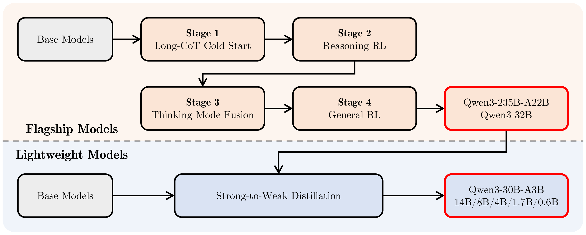
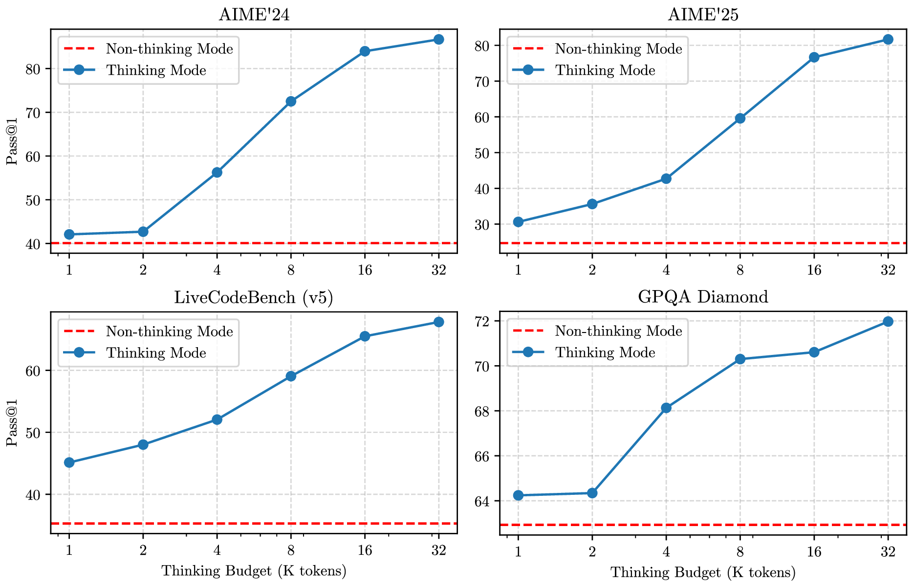

# Qwen3：Thinking 模式、36T 预训练与蒸馏

!!! info "论文信息"
    **论文题名：** Qwen3 Technical Report。<br>
    **作者：** An Yang、Anfeng Li、Baosong Yang、Beichen Zhang、Binyuan Hui、Bo Zheng、Bowen Yu、Chang Gao、Chengen Huang、Chenxu Lv 等（共 60 人）。<br>
    **机构：** 未在公开元数据中稳定解析；以 arXiv/PDF 或官方页 affiliation block 为准。<br>
    **时间 / 主题：** 2025-05；技术报告。<br>
    **arXiv / 官方报告：** arXiv：[2505.09388](https://arxiv.org/abs/2505.09388)。<br>
    **GitHub / 项目：** GitHub：[github.com/QwenLM/Qwen3](https://github.com/QwenLM/Qwen3)。<br>
    **元数据来源与核验口径：** 来源：[arXiv](https://arxiv.org/abs/2505.09388)；[GitHub API / repo](https://github.com/QwenLM/Qwen3)；Checked Date：2026-06-04；Repro Status：Paper / official materials reviewed, independent reproduction not claimed。

> **这篇回答的问题。** 如何理解“Qwen3”背后的核心机制、适用边界和下一步阅读路径。

Qwen3 这份报告的核心不是“又发布了一组模型”，而是把两个过去经常分开的产品形态合并到同一套模型里：**同一个 Qwen3 可以用 thinking mode 做长 CoT 推理，也可以用 non-thinking mode 做低延迟直接回答，并且允许用户用 thinking budget 控制推理 token 成本。**

| Dimension | Qwen3 |
| --- | --- |
| Model Family | 6 dense models + 2 MoE models |
| Parameter Range | 0.6B to 235B |
| Flagship Model | Qwen3-235B-A22B |
| Flagship Params | 235B total, 22B activated |
| Pre-training Tokens | 36T |
| Language Coverage | 119 languages and dialects |
| Base Context Length | 32K / 128K by model |
| Main Post-training Goal | unified thinking and non-thinking behavior |
| License | Apache 2.0 |

**阅读边界。**
这是一份模型技术报告，训练数据、评测、消融和对比结果都应按作者报告理解。它很适合学习开源大模型训练和后训练 recipe，但不应把所有 benchmark 数值当作第三方独立复现结果。

## 论文位置

Qwen3 接在 Qwen2.5 和 QwQ-32B 之后。Qwen2.5 更像通用 chat / base model 系列，QwQ-32B 更像专门的 reasoning model。Qwen3 的问题意识是：能不能不用在“普通对话模型”和“推理模型”之间切换，而是在同一个模型里控制是否思考、思考多久。

这条线可以压成：

```text
Qwen2.5 通用能力
  + QwQ / R1 式长 CoT reasoning 经验
  + 36T token 多语和代码/STEM 数据
  + dense / MoE 多规格模型
  + 四阶段后训练
  + strong-to-weak distillation
  -> 同一模型支持 thinking / non-thinking / thinking budget
```

Qwen3 和 DeepSeek-V3/R1 的定位也不同。DeepSeek-V3 更强调 MoE、MLA、FP8 和训练系统共设计；DeepSeek-R1 更强调可验证任务上的大规模 RLVR。Qwen3 则把重点放在“模型家族 + 双模式后训练 + 小模型蒸馏”上：既要大模型强，也要 0.6B 到 32B 的小模型可用。

## 模型家族与架构

Qwen3 系列有 8 个模型。dense 模型覆盖边缘到 32B，MoE 模型覆盖高性价比推理和旗舰能力。

| Models | Layers | Heads (Q / KV) | Tie Embedding | Context Length |
| --- | ---: | ---: | --- | ---: |
| Qwen3-0.6B | 28 | 16 / 8 | Yes | 32K |
| Qwen3-1.7B | 28 | 16 / 8 | Yes | 32K |
| Qwen3-4B | 36 | 32 / 8 | Yes | 128K |
| Qwen3-8B | 36 | 32 / 8 | No | 128K |
| Qwen3-14B | 40 | 40 / 8 | No | 128K |
| Qwen3-32B | 64 | 64 / 8 | No | 128K |

<small>表源：`Qwen3 Technical Report`，Table 1。原论文表意：Qwen3 dense models 采用不同层数、GQA head 配置和 context length，覆盖 0.6B 到 32B。</small>

| Models | Layers | Heads (Q / KV) | # Experts (Total / Activated) | Context Length |
| --- | ---: | ---: | ---: | ---: |
| Qwen3-30B-A3B | 48 | 32 / 4 | 128 / 8 | 128K |
| Qwen3-235B-A22B | 94 | 64 / 4 | 128 / 8 | 128K |

<small>表源：`Qwen3 Technical Report`，Table 2。原论文表意：Qwen3 MoE models 均有 128 个 experts，每 token 激活 8 个 experts；旗舰模型 235B total、22B activated。</small>

架构上，Qwen3 dense models 延续 Qwen2.5 的主体设计，包括：

| Component | Qwen3 Choice | Why It Matters |
| --- | --- | --- |
| Attention | Grouped Query Attention (GQA) | 降低 KV cache 和推理成本 |
| FFN | SwiGLU | 大模型常用 FFN 结构 |
| Position | RoPE | 支持长上下文外推和扩展 |
| Norm | RMSNorm with pre-normalization | 稳定训练 |
| Attention Stabilization | remove QKV-bias, introduce QK-Norm | 抑制 attention logit 不稳定 |
| Tokenizer | byte-level BBPE, vocab size 151,669 | 增强多语和符号覆盖 |

MoE 模型和 dense 模型共享主体架构，但使用 128 个细粒度 experts，每 token 激活 8 个。和 Qwen2.5-MoE 不同，Qwen3-MoE 不使用 shared experts，并采用 global-batch load balancing loss 鼓励 expert specialization。

**Qwen3-MoE 和 DeepSeekMoE 的差异。**
两者都重视细粒度 experts，但路由和均衡策略不同。DeepSeek-V3 强调 auxiliary-loss-free load balancing，用动态 bias 控制负载；Qwen3 报告写的是 global-batch load balancing loss，并且明确 Qwen3-MoE 不设 shared experts。

这说明 MoE 没有唯一标准答案。一个系统可以把 shared expert 当成通用能力锚点，也可以让所有 expert 都进入路由集合；可以把负载均衡放进 loss，也可以用路由 bias 外部调节。真正要看的是训练稳定性、专家专门化、通信成本和最终能力之间的折中。

## 预训练：36T tokens 和三阶段策略

Qwen3 的预训练数据比 Qwen2.5 明显扩大：token 数约翻倍，语言覆盖从 29 种扩到 119 种。数据来源不只是网页文本，还包括 PDF OCR、合成教材、问答、代码和多语数据。

| Data / Processing | Qwen3 Detail |
| --- | --- |
| Total Tokens | 36T |
| Languages and Dialects | 119 |
| Main Domains | coding, STEM, reasoning tasks, books, multilingual texts, synthetic data |
| PDF-like Documents | Qwen2.5-VL extracts text, Qwen2.5 refines recognized text |
| Synthetic Data | Qwen2.5, Qwen2.5-Math, Qwen2.5-Coder generate textbooks, QA, instructions, code snippets |
| Data Annotation | over 30T tokens annotated by educational value, fields, domains and safety |
| Mixture Optimization | instance-level mixture optimization with fine-grained labels |

这里最值得注意的是数据扩展方式。Qwen3 并不是只扩大爬取规模，而是利用已有模型反哺数据：用 Qwen2.5-VL 处理 PDF，用 Qwen2.5-Math 和 Qwen2.5-Coder 合成数学、代码等高价值数据。这样做的好处是可以提高 STEM、coding、reasoning 数据密度；风险是合成数据会带来 teacher bias、模板化和错误放大，所以报告里强调了 annotation、filtering 和小 proxy model 消融。

预训练分三阶段：

| Stage | Tokens | Sequence Length | Main Goal |
| --- | ---: | ---: | --- |
| General Stage (S1) | over 30T | 4,096 | language proficiency and general world knowledge |
| Reasoning Stage (S2) | about 5T | 4,096 | increase STEM, coding, reasoning and synthetic data; improve reasoning ability |
| Long Context Stage | hundreds of billions | 32,768 | extend context length and train on long-context corpora |

Long Context Stage 的数据长度分布也有明确设计：

| Long Context Corpus | Proportion |
| --- | ---: |
| text between 16,384 and 32,768 tokens | 75% |
| text between 4,096 and 16,384 tokens | 25% |

长上下文扩展使用了三类技巧：

| Technique | Role |
| --- | --- |
| ABF | increase RoPE base frequency from 10,000 to 1,000,000 |
| YaRN | length extrapolation |
| Dual Chunk Attention (DCA) | achieve four-fold increase in sequence length capacity during inference |

**为什么 S2 单独做 reasoning pre-training。**
很多 reasoning 能力不只来自后训练 RL。Qwen3 在预训练阶段就单独设置 S2，把 STEM、代码、推理和合成数据比例拉高，再加速 learning rate decay。这是在 base model 层面提高“可被后训练激发的能力上限”。

如果 base model 没有足够的数学、代码和复杂推理先验，后面的 long-CoT SFT 和 RL 会更像补课；如果 base model 已经有足够好的表示，后训练更容易把能力组织成可控行为。

## Base Model 结果：旗舰 MoE 与小模型路线

Qwen3-235B-A22B-Base 用 235B total、22B activated 对比 Qwen2.5-72B、Qwen2.5-Plus、Llama-4-Maverick 和 DeepSeek-V3。报告主张它在大多数 base benchmarks 上领先，同时 activated params 低于 72B dense 和 DeepSeek-V3。

| Benchmark | Qwen2.5-72B Base | Qwen2.5-Plus Base | Llama-4-Maverick Base | DeepSeek-V3 Base | Qwen3-235B-A22B Base |
| --- | ---: | ---: | ---: | ---: | ---: |
| # Total Params | 72B | 271B | 402B | 671B | 235B |
| # Activated Params | 72B | 37B | 17B | 37B | 22B |
| MMLU | 86.06 | 85.02 | 85.16 | 87.19 | 87.81 |
| MMLU-Pro | 58.07 | 63.52 | 63.91 | 59.84 | 68.18 |
| BBH | 86.30 | 85.60 | 83.62 | 86.22 | 88.87 |
| GPQA | 45.88 | 41.92 | 43.94 | 41.92 | 47.47 |
| MATH | 62.12 | 62.78 | 63.32 | 62.62 | 71.84 |
| EvalPlus | 65.93 | 61.43 | 68.38 | 63.75 | 77.60 |
| MultiPL-E | 58.70 | 62.16 | 57.28 | 62.26 | 65.94 |
| MMMLU | 84.40 | 83.49 | 83.09 | 85.88 | 86.70 |

<small>表源：`Qwen3 Technical Report`，Table 3 摘录。原论文表意：Qwen3-235B-A22B-Base 在大多数 base model 评测中超过对比模型，尤其在 MMLU-Pro、MATH、EvalPlus 等任务上优势明显。</small>

Qwen3 的另一个重点是小模型。报告写到：Qwen3-30B-A3B 只有 3B activated params，但能和更大的 dense base models 接近；Qwen3-8B/4B/1.7B/0.6B 也尽量往上一个代际的更大模型靠近。这和后面的 strong-to-weak distillation 是同一条工程路线：不是只做旗舰模型，而是把旗舰能力压到小规格。

## 后大模型训练路线图：四阶段 pipeline

Qwen3 最重要的图是后训练 pipeline。

{ width="920" }

<small>图源：`Qwen3 Technical Report`，Figure 1。原论文图意：Qwen3 系列的 post-training pipeline，旗舰模型经过 Long-CoT Cold Start、Reasoning RL、Thinking Mode Fusion、General RL；轻量模型通过 strong-to-weak distillation 继承大模型能力。</small>

**这张 pipeline 图怎么读。**
上半部分是旗舰模型训练：先做 long-CoT cold start，让模型学会基本长推理格式；再做 reasoning RL，把数学、代码等可验证推理能力拉起来；然后做 thinking mode fusion，把 non-thinking 能力合进同一模型；最后用 general RL 修指令跟随、格式、工具、RAG、偏好等通用能力。

下半部分是小模型训练：不是给每个小模型完整跑一遍四阶段流程，而是用强模型 teacher 做 off-policy 和 on-policy distillation。报告说这种方式能显著减少 GPU hours，并且比直接对小模型做 RL 更有效。

四阶段可以这样拆：

| Stage | Name | Main Data / Reward | Main Goal |
| --- | --- | --- | --- |
| Stage 1 | Long-CoT Cold Start | math, code, logical reasoning, STEM; verified answers or code tests | instill basic long-CoT reasoning pattern |
| Stage 2 | Reasoning RL | 3,995 query-verifier pairs, GRPO | improve verifiable reasoning in math/code-like tasks |
| Stage 3 | Thinking Mode Fusion | thinking data + non-thinking SFT data, chat template flags | make one model support `/think` and `/no_think` |
| Stage 4 | General RL | over 20 tasks, rule/model rewards | improve instruction following, format, preference, agent and specialized scenarios |

## Stage 1：Long-CoT Cold Start

Cold start 数据覆盖数学、代码、逻辑推理和 STEM。每个问题要有可验证 reference answer 或 code-based test cases。报告里最有价值的是过滤规则：

| Filtering Step | What It Removes / Keeps |
| --- | --- |
| Query Filtering | remove queries not easily verifiable, multiple sub-questions, general text generation queries |
| Easy Query Filtering | remove queries Qwen2.5-72B-Instruct can solve correctly without CoT |
| Domain Annotation | use Qwen2.5-72B-Instruct to maintain domain balance |
| Candidate Generation | generate \(N\) candidate responses with QwQ-32B |
| Human Assessment | manually assess queries where QwQ-32B fails consistently |
| Response Filtering | remove wrong answers, repetition, guesswork, thinking/summary inconsistency, language mixing, validation-like items |

这一步的工程判断很重要：cold start 不是越多越好。报告明确说目标是植入基础 reasoning pattern，而不是在这一步追求最高 reasoning performance，因此更倾向于控制训练样本数和 steps，避免把模型潜力过早限制在 SFT 数据风格里。

## Stage 2：Reasoning RL

Reasoning RL 使用 GRPO，训练数据是 3,995 个 query-verifier pairs。它们需要满足四个条件：

| Criterion | Meaning |
| --- | --- |
| not used during cold-start | 避免训练集复用 |
| learnable for the cold-start model | 模型有可能通过 RL 改进 |
| as challenging as possible | 奖励能推动复杂推理 |
| broad sub-domain coverage | 避免只在单一题型过拟合 |

报告提到几个训练经验：

| RL Detail | Why It Matters |
| --- | --- |
| GRPO | no separate critic; group-relative advantage |
| large batch size | stabilize reward/advantage estimates |
| high number of rollouts per query | improve exploration and verifier signal |
| off-policy training | improve sample efficiency |
| entropy control | balance exploration and exploitation |

一个具体结果是：Qwen3-235B-A22B 的 AIME'24 从 70.1 提升到 85.1，总共 170 个 RL training steps。

**为什么只有 3,995 个 query-verifier pairs 也能有效。**
这里的单位不是普通 SFT 样本，而是 RL 环境里的 query-verifier pair。每个 query 可以采样多条 rollout，verifier 提供自动奖励。只要题目难度合适、可验证且覆盖子领域，单个 query 可以产生很多策略改进信号。

这也解释了为什么报告强调 query 要 learnable 且 challenging。太简单的题奖励饱和，太难的题全错没有梯度；最有效的是模型能偶尔做对、但还不稳定的题。

## Stage 3：Thinking Mode Fusion

Stage 3 的目标是把 non-thinking 能力合入已经具备 thinking 能力的模型。核心不是再训练一个新模型，而是通过 SFT 和 chat template 让同一个模型识别两种行为模式。

| Mode | User / System Flag | Assistant Format |
| --- | --- | --- |
| Thinking Mode | `/think`, can be omitted by default | `<think>{thinking_content}</think>\n\n{response}` |
| Non-Thinking Mode | `/no_think` | `<think>\n</think>\n\n{response}` |

<small>表源：`Qwen3 Technical Report`，Table 10。原论文表意：Thinking Mode 和 Non-Thinking Mode 使用同一套 chat message 格式；non-thinking 仍保留空 thinking block，以保持内部格式一致。</small>

这个空 thinking block 很实用。它让模板可以显式告诉模型“不要思考”，同时保持训练时 assistant 输出格式一致。报告还说默认是 thinking mode，因此部分 thinking 样本不加 `/think`；多轮对话中会随机插入多个 `/think` 和 `/no_think` flags，模型按最后一个 flag 响应。

## Thinking Budget：把推理 token 变成可控资源

Thinking Mode Fusion 之后，模型自然具备一种中间能力：即使 thinking 没有完整生成完，也能基于已有思考给出最终答案。Qwen3 利用这个能力实现 thinking budget。

具体机制是：当 thinking token 长度达到用户设定阈值，就人工停止 thinking，并插入 stop-thinking instruction：

```text
Considering the limited time by the user, I have to give the solution based on the thinking directly now.
</think>
```

随后模型基于已有 reasoning 生成最终回答。报告特别指出，这个 budget 能力不是显式训练出来的，而是 Thinking Mode Fusion 后自然涌现出来的。

{ width="820" }

<small>图源：`Qwen3 Technical Report`，Figure 2。原论文图意：Qwen3-235B-A22B 在数学、代码和 STEM 相关 benchmark 上，随着 thinking budget 增加，性能平滑提升。</small>

**Thinking budget 的工程意义。**
过去 reasoning model 的推理成本常常不可控：模型可能想很久，也可能提前结束。Qwen3 的做法把“思考长度”暴露成一个接口变量，让应用可以按任务难度、延迟预算和成本预算选择推理深度。

但这不是免费午餐。budget 太小会截断推理，budget 太大又会拉高 latency 和 token 成本。更稳妥的产品形态通常是：简单任务默认 non-thinking；中等任务给较小 budget；数学、代码、复杂 agent 任务才给更高 budget。

## Stage 4：General RL

General RL 负责把模型从“会推理”进一步调成“好用、稳、会遵守格式和工具协议”。报告说 reward system 覆盖 20 多个任务，核心能力包括：

| Capability | Training Target |
| --- | --- |
| Instruction Following | content, format, length, structured output |
| Format Following | obey `/think` and `/no_think`, use `<think>` and `</think>` correctly |
| Preference Alignment | helpfulness, engagement, style |
| Agent Ability | tool calling through designated interfaces; multi-turn environment feedback |
| Specialized Scenarios | RAG rewards to reduce hallucination and improve context-grounded answers |

奖励分三类：

| Reward Type | Used For | Risk / Benefit |
| --- | --- | --- |
| Rule-based Reward | reasoning, instruction following, format adherence | precise and less vulnerable when rules are correct |
| Model-based Reward with Reference Answer | diverse tasks with expected answers | more flexible than strict rules |
| Model-based Reward without Reference Answer | open-ended preference data | broad coverage, but reward hacking risk must be managed |

Stage 4 的一个重要取舍是：通用能力上升，部分 hard reasoning 指标可能下降。报告的 Qwen3-32B stage ablation 显示，Stage 3/4 强化了 ThinkFollow、ToolUse、Arena-Hard、IFEval 等能力，但 AIME'24 和 LiveCodeBench 的 thinking-mode 分数略有回落。

| Benchmark | Stage 2 Reasoning RL Thinking | Stage 3 Thinking | Stage 3 Non-Thinking | Stage 4 Thinking | Stage 4 Non-Thinking |
| --- | ---: | ---: | ---: | ---: | ---: |
| LiveBench 2024-11-25 | 68.6 | 70.9 | 57.1 | 74.9 | 59.8 |
| Arena-Hard | 86.8 | 89.4 | 88.5 | 93.8 | 92.8 |
| CounterFactQA* | 50.4 | 61.3 | 64.3 | 68.1 | 66.4 |
| IFEval strict prompt | 73.0 | 78.4 | 78.4 | 85.0 | 83.2 |
| ThinkFollow* | - | 88.7 | 88.7 | 98.9 | 98.9 |
| ToolUse* | 63.3 | 70.4 | 73.2 | 85.5 | 86.5 |
| AIME'24 | 83.8 | 81.9 | 28.5 | 81.4 | 31.0 |
| LiveCodeBench v5 | 68.4 | 67.2 | 31.1 | 65.7 | 31.3 |

<small>表源：`Qwen3 Technical Report`，Table 18 摘录。原论文表意：Thinking Mode Fusion 和 General RL 提升通用、格式和工具能力，但对部分复杂数学/代码 thinking 指标存在小幅权衡。</small>

## Strong-to-Weak Distillation：小模型为什么值得单独讲

Qwen3 的小模型不是简单用小模型自己走完整四阶段。报告专门设计 strong-to-weak distillation，覆盖 5 个 dense 小模型和 Qwen3-30B-A3B。

| Phase | What Happens | Purpose |
| --- | --- | --- |
| Off-policy Distillation | combine teacher outputs from `/think` and `/no_think` modes | teach basic reasoning and mode switching |
| On-policy Distillation | student samples prompts and generates responses; align logits with Qwen3-32B or Qwen3-235B-A22B teacher by KL | improve student with teacher guidance on student’s own distribution |

报告认为，对轻量模型来说，teacher logits distillation 比直接 RL 更高效。Qwen3-8B 的对比很直接：

| Method | AIME'24 | AIME'25 | MATH500 | LiveCodeBench v5 | MMLU-Redux | GPQA-Diamond | GPU Hours |
| --- | ---: | ---: | ---: | ---: | ---: | ---: | ---: |
| Off-policy Distillation | 55.0 (90.0) | 42.8 (83.3) | 92.4 | 42.0 | 86.4 | 55.6 | - |
| + Reinforcement Learning | 67.6 (90.0) | 55.5 (83.3) | 94.8 | 52.9 | 86.9 | 61.3 | 17,920 |
| + On-policy Distillation | 74.4 (93.3) | 65.5 (86.7) | 97.0 | 60.3 | 88.3 | 63.3 | 1,800 |

<small>表源：`Qwen3 Technical Report`，Table 17。原论文表意：从同一 off-policy distilled 8B checkpoint 出发，on-policy distillation 在数学、代码和知识任务上优于直接 RL，并只用约十分之一 GPU hours；括号中为 pass@64。</small>

**为什么 distillation 可能比小模型 RL 更划算。**
小模型直接 RL 容易受探索空间限制：它能采样出的好轨迹少，reward 信号也更稀疏。强 teacher 的 logits 不只告诉 student 最终答案，还提供了每一步分布形状，相当于更密集的训练信号。

on-policy distillation 又比纯 off-policy 更贴近 student 自己会犯的错误。student 先生成自己的输出，再让 teacher 在这些轨迹上提供分布对齐目标，可以更直接修正 student 的真实行为分布。

## Thinking vs Non-Thinking 评测

Qwen3-235B-A22B 在 thinking mode 下对比 OpenAI-o1、DeepSeek-R1、Grok-3-Beta (Think)、Gemini2.5-Pro。摘几个关键指标：

| Benchmark | OpenAI-o1 | DeepSeek-R1 | Grok-3-Beta (Think) | Gemini2.5-Pro | Qwen3-235B-A22B |
| --- | ---: | ---: | ---: | ---: | ---: |
| # Activated Params | - | 37B | - | - | 22B |
| # Total Params | - | 671B | - | - | 235B |
| MMLU-Redux | 92.8 | 92.9 | - | 93.7 | 92.7 |
| AIME'24 | 74.3 | 79.8 | 83.9 | 92.0 | 85.7 |
| AIME'25 | 79.2 | 70.0 | 77.3 | 86.7 | 81.5 |
| BFCL v3 | 67.8 | 56.9 | - | 62.9 | 70.8 |
| LiveCodeBench v5 | 63.9 | 64.3 | 70.6 | 70.4 | 70.7 |
| CodeForces (Rating / Percentile) | 1891 / 96.7% | 2029 / 98.1% | - | 2001 / 97.9% | 2056 / 98.2% |
| MT-AIME2024 | 67.4 | 73.5 | - | 76.9 | 80.8 |
| PolyMath | 38.9 | 47.1 | - | 52.2 | 54.7 |

<small>表源：`Qwen3 Technical Report`，Table 5 摘录。原论文表意：Qwen3-235B-A22B thinking mode 在数学、代码、agent 和多语推理任务上具备较强竞争力。</small>

non-thinking mode 则对比 GPT-4o、DeepSeek-V3、Qwen2.5-72B-Instruct、LLaMA-4-Maverick：

| Benchmark | GPT-4o-2024-11-20 | DeepSeek-V3 | Qwen2.5-72B-Instruct | LLaMA-4-Maverick | Qwen3-235B-A22B |
| --- | ---: | ---: | ---: | ---: | ---: |
| # Activated Params | - | 37B | 72B | 17B | 22B |
| # Total Params | - | 671B | 72B | 402B | 235B |
| GPQA-Diamond | 46.0 | 59.1 | 49.0 | 69.8 | 62.9 |
| LiveBench 2024-11-25 | 52.2 | 60.5 | 51.4 | 59.5 | 62.5 |
| Arena-Hard | 85.3 | 85.5 | 81.2 | 82.7 | 96.1 |
| MATH-500 | 77.2 | 90.2 | 83.6 | 90.6 | 91.2 |
| AIME'24 | 11.1 | 39.2 | 18.9 | 38.5 | 40.1 |
| BFCL v3 | 72.5 | 57.6 | 63.4 | 52.9 | 68.0 |
| CodeForces (Rating / Percentile) | 864 / 35.4% | 1134 / 54.1% | 859 / 35.0% | 712 / 24.3% | 1387 / 75.7% |
| MLogiQA | 57.4 | 58.9 | 59.3 | 59.9 | 67.6 |

<small>表源：`Qwen3 Technical Report`，Table 6 摘录。原论文表意：Qwen3-235B-A22B non-thinking mode 在不启用长思考时仍保持较强通用、对齐、数学和多语能力。</small>

评测配置也值得记录：

| Mode | Sampling Setting |
| --- | --- |
| Thinking Mode | temperature 0.6, top-p 0.95, top-k 20 |
| Non-thinking Mode | temperature 0.7, top-p 0.8, top-k 20, presence penalty 1.5 |
| Creative Writing / WritingBench | presence penalty 1.5 |
| Max Output Length | 32,768 tokens |
| AIME'24 / AIME'25 Max Output Length | 38,912 tokens |

## 长上下文与多语

Qwen3 在报告正文里说 base context 是 32K，并通过 YaRN + DCA 做推理长度外推。附录的 RULER 表说明，Qwen3-235B-A22B 在 non-thinking mode 下 128K 仍有 90.6，thinking mode 下 128K 为 86.0。

| Model / Mode | RULER Avg. | 4K | 32K | 64K | 128K |
| --- | ---: | ---: | ---: | ---: | ---: |
| Qwen2.5-72B-Instruct | 95.1 | 97.7 | 96.5 | 93.0 | 88.4 |
| Qwen3-235B-A22B Non-thinking | 95.0 | 97.7 | 95.1 | 93.3 | 90.6 |
| Qwen3-235B-A22B Thinking | 92.2 | 95.1 | 92.3 | 92.0 | 86.0 |

<small>表源：`Qwen3 Technical Report`，Appendix Table 19 摘录。原论文表意：Qwen3 在 RULER 长上下文任务上表现较稳，但 thinking mode 对检索类任务未必有益，可能干扰 retrieval。</small>

这个结论很实用：不是所有任务都应该 thinking。对长文档检索、passage locating、格式抽取这类任务，额外 CoT 可能增加噪声和成本，non-thinking mode 反而更稳。

多语方面，Qwen3 的主线是从训练数据层面扩到 119 languages and dialects，评测则覆盖 Multi-IF、INCLUDE、MMMLU、MT-AIME2024、PolyMath、MLogiQA 等多语任务。报告特别强调 Qwen3 相比 Qwen2.5 把语言覆盖从 29 扩到 119，这会直接影响全球化部署、低资源语言 instruction following 和多语数学推理。

## 项目启发

Qwen3 的技术报告给工程项目的启发主要有五条：

1. **不要把 reasoning model 和 chat model 视为必须分离的产品。** 通过 template、SFT 和 RL，一个模型可以同时支持 thinking 和 non-thinking。
2. **推理 token 应该变成可控预算。** thinking budget 把 latency、成本和准确率之间的取舍显式暴露给应用层。
3. **小模型不一定要完整复刻大模型训练流程。** strong-to-weak distillation 可以比直接 RL 更便宜、更稳定，尤其适合 0.6B 到 14B 规格。
4. **通用 RL 会带来能力权衡。** 工具、格式、指令跟随和偏好提升时，部分 hard reasoning 指标可能回落，需要按产品目标选择 checkpoint。
5. **预训练数据工程仍是底座能力的核心。** Qwen3 的后训练很重要，但 36T token、119 语言、PDF OCR、合成 STEM/code 数据和三阶段预训练决定了后训练能激发到什么上限。

更准确地说，Qwen3 报告展示的是一个可部署模型家族的后训练范式：**用旗舰模型探索能力边界，用双模式训练统一产品接口，再用强到弱蒸馏把能力扩散到小模型。**

Qwen3 的关键接口是 thinking budget 和模式控制：长推理能力变成可调成本，而不是永远开启。posttrain pipeline、budget 曲线、数学/代码/通用 benchmark 要连读；最重要边界是简单题过度思考和推理 token 成本，分数提升必须和延迟、价格一起验。

## 相关阅读与下一步

- 外部材料：[论文标题 arXiv 检索](https://arxiv.org/search/?query=Qwen3+Technical+Report&searchtype=title)。
- 外部材料：[Semantic Scholar 标题检索](https://www.semanticscholar.org/search?q=Qwen3+Technical+Report)。
- 外部材料：[Papers with Code 检索](https://paperswithcode.com/search?q=Qwen3+Technical+Report)。
- 站内下一步：[论文精读专题](../index.md)。
- 站内下一步：[论文专题写作规范](../writing-standard.md)。
- 站内下一步：[外部精读来源台账](../../references/external-reading-ledger.md)。
