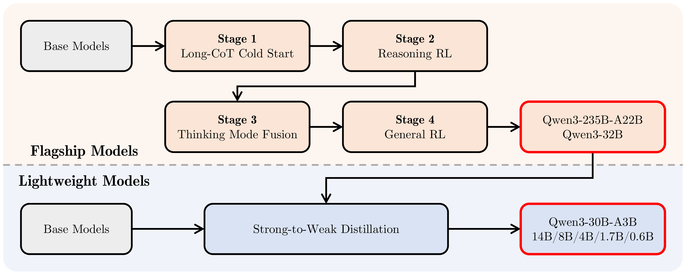
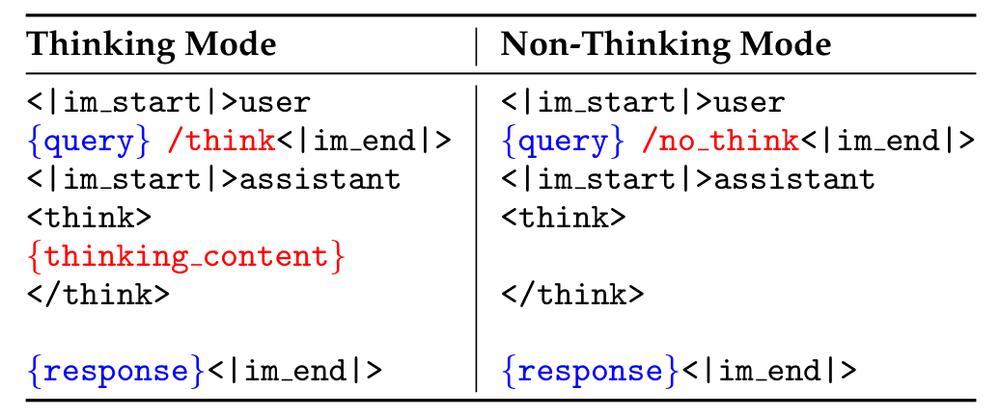
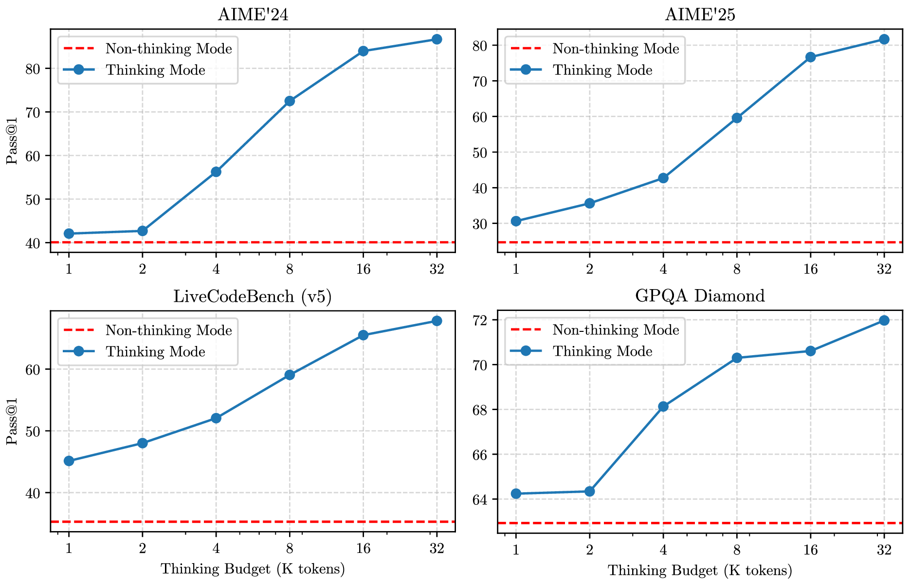
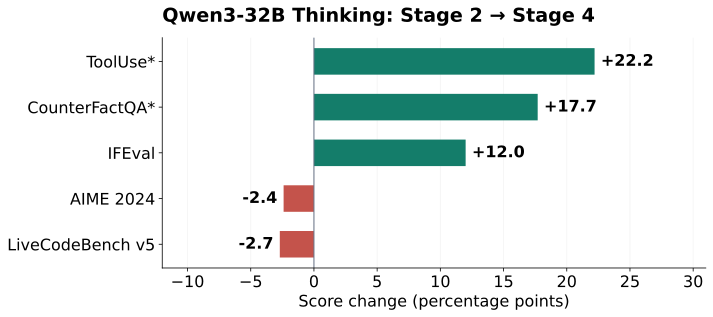
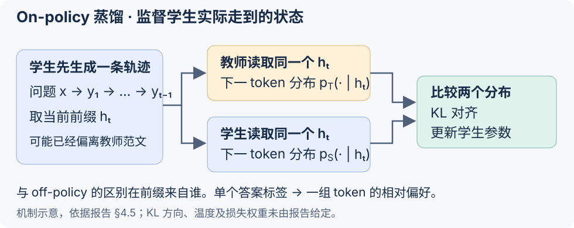
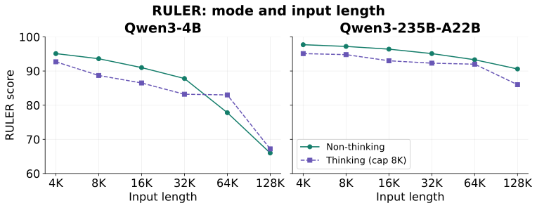

# Qwen3：Thinking 模式、36T 预训练与蒸馏

!!! info "论文信息"
    **论文题名：** Qwen3 Technical Report。<br>
    **作者：** An Yang、Anfeng Li、Baosong Yang、Beichen Zhang、Binyuan Hui、Bo Zheng、Bowen Yu、Chang Gao、Chengen Huang、Chenxu Lv 等（共 60 人）。<br>
    **机构：** 未在公开元数据中稳定解析；以 arXiv/PDF 或官方页 affiliation block 为准。<br>
    **时间 / 主题：** 2025-05；技术报告。<br>
    **arXiv / 官方报告：** arXiv：[2505.09388](https://arxiv.org/abs/2505.09388)。<br>
    **GitHub / 项目：** GitHub：[github.com/QwenLM/Qwen3](https://github.com/QwenLM/Qwen3)。<br>
    **元数据来源与核验口径：** 来源：[arXiv](https://arxiv.org/abs/2505.09388)；[GitHub API / repo](https://github.com/QwenLM/Qwen3)；Checked Date：2026-06-15；Repro Status：Paper / official materials reviewed, independent reproduction not claimed。

## 同一个问题，什么时候值得让模型多想一会儿

让模型解一道竞赛数学题，通常希望它先尝试、检查，再给答案。让它从一份长文档里找出合同日期，可能只需要准确定位那一行。两种任务对生成过程的要求不同。如果始终展开长推理，简单请求也会承担等待时间；如果始终直接作答，复杂任务又失去了一段可用的计算过程。

Qwen3 将这项选择放进同一组权重里。模型可以生成显式的 thinking 内容，也可以直接进入回答；服务端还可以在思考到达指定 token 预算时，让它根据已有内容收束作答。这里的 thinking 指输出序列中可见的推理文本。关闭这部分文本后，Transformer 仍然逐层计算、逐 token 生成，模型的内部计算并没有被关闭。

这项设计需要三层工作配合。36T-token 预训练给模型打下知识、代码和多语言基础；后训练让它先学会长推理，再学会两种回答方式；生成流程负责在运行时执行预算。小模型通过教师蒸馏获得同样的模式接口。把这几层连起来，才能解释为什么一个文本开关能够影响行为，也能解释它在哪些任务上会失灵。[↗](https://arxiv.org/pdf/2505.09388v1#page=2)

## 八种规模，三种需要分开计算的成本

Qwen3 首批模型包括六个 dense 模型和两个 MoE 模型。下面保留报告 Tables 1、2 的架构字段。`B` 表示十亿参数，MoE 名称中的 `A` 表示每个 token 激活的参数规模。

| Models | Layers | Heads (Q / KV) | Tie Embedding | Context Length |
| --- | ---: | --- | --- | --- |
| Qwen3-0.6B | 28 | 16 / 8 | Yes | 32K |
| Qwen3-1.7B | 28 | 16 / 8 | Yes | 32K |
| Qwen3-4B | 36 | 32 / 8 | Yes | 128K |
| Qwen3-8B | 36 | 32 / 8 | No | 128K |
| Qwen3-14B | 40 | 40 / 8 | No | 128K |
| Qwen3-32B | 64 | 64 / 8 | No | 128K |

| Models | Total / Activated Parameters | Layers | Heads (Q / KV) | Experts (Total / Activated) | Context Length |
| --- | --- | ---: | --- | --- | --- |
| Qwen3-30B-A3B | 30B / 3B | 48 | 32 / 4 | 128 / 8 | 128K |
| Qwen3-235B-A22B | 235B / 22B | 94 | 64 / 4 | 128 / 8 | 128K |

这些数字分别影响权重存储、每 token 的计算、随序列增长的缓存。以 30B-A3B 为例，一次 token 计算只选部分专家，但下一次请求可能选到另一些专家。部署仍需容纳或调度整套 30B 权重。仅按 BF16 每参数 2 bytes 估算，权重本身约 60 GB；这只是说明量级的计算，还没有加入 KV cache、运行时缓冲和其他开销，也没有考虑量化。`A3B` 因而不能用来直接估计模型能装进多大的显存。

### GQA 主要节省随上下文增长的缓存

主干沿用 GQA、SwiGLU、RoPE 和 pre-RMSNorm。GQA 让多组 query heads 共用较少的 key/value heads。对 235B-A22B，64 个 query heads 对应 4 个 KV heads，平均每 16 个 query heads 共用一组 K、V。每个 query 仍然计算自己的注意力权重，共享的是被查询的历史表示。

在 K、V 的每头维度相同、使用普通未压缩缓存时，单条序列的逻辑缓存量可写为

$$
M_{\mathrm{KV}}=2\,L\,n_{\mathrm{layer}}\,n_{\mathrm{KV}}\,d_{\mathrm{head}}\,b.
$$

$L$ 是缓存 token 数，$n_{\mathrm{layer}}$ 是层数，$n_{\mathrm{KV}}$ 是 KV heads 数，$d_{\mathrm{head}}$ 是每头维度，$b$ 是每个元素的字节数；最前面的 2 分别对应 K 和 V。这个式子用来解释架构表，并非报告公布的显存测量。固定其余条件，把 KV heads 从 64 减到 4，K/V 元素数可降到十六分之一；模型权重、query 计算和服务框架开销不按这个比例一起下降。

Qwen3 还去掉了 QKV bias，并加入 QK-Norm。注意力分数涉及 $q^\top k$，q、k 的幅值变化会影响 softmax 的尖锐程度。归一化 q、k 有助于控制这种幅值波动。这里的 QK-Norm 与残差分支前的 RMSNorm 处在不同位置，不能把它们当作同一个归一化操作。报告将这些改动用于训练稳定性，没有给出逐项移除它们的独立消融，不能由最终榜单拆出各自贡献。[↗](https://arxiv.org/pdf/2505.09388v1#page=3)

### MoE 让不同 token 使用不同的前馈参数

两个 MoE 都将专家细分为 128 个，每个 token 选 8 个参与计算，并取消共享专家。共享专家通常为所有 token 提供固定的前馈路径；取消之后，专家部分的选择更依赖路由。细粒度划分使路由能组合较小的计算单元，但也要处理专家负载不均的问题。

Qwen3 使用 global-batch load balancing loss。可以用一个直观例子理解它的动机。一个 batch 里同时有代码和自然语言，代码 token 可能更多地选择某些专家，自然语言选择另一些。若强行要求每条序列内部都均匀使用专家，可能压制这种分工；把负载约束放到更大的 batch 范围，允许局部偏好与整体均衡并存。这个例子解释约束范围，并不表示专家已经被人工指定为“代码专家”或“语言专家”。

专家激活比例也无法直接换成端到端加速倍数。注意力、路由、专家间通信、batch 大小以及权重读写都会影响吞吐。报告后面的“约五分之一激活参数”是参数效率比较，采用时仍要测具体硬件上的速度。全系列共享词表大小为 151,669 的 byte-level BPE tokenizer；前三个 dense 尺寸绑定输入 embedding 与输出投影，其余 dense 模型没有绑定，也不能一概用相同的参数构成估算内存。

## 36T tokens 怎样变成训练材料

数据规模从 Qwen2.5 继续扩大，训练覆盖的语言与方言从 29 种增至 119 种。扩充不只依赖收集更多网页。报告描述了两条达到万亿 token 量级的材料生产路径。

一条路径从 PDF 类文档开始。Qwen2.5-VL 识别文档中的文本，再交给 Qwen2.5 清理。这里视觉模型负责把原本难以直接使用的文档内容变成文本，后续清理负责改善识别结果的质量。最终训练的是文本语言模型，使用视觉模型处理数据并不意味着 Qwen3 本身获得了图像输入接口。

另一条路径使用 Qwen2.5、Qwen2.5-Math 和 Qwen2.5-Coder 生成教材、问答、指令与代码片段。合成材料的价值取决于它能否提供清楚的概念解释、可检查的解题过程或有效的程序，单纯增加 token 数不保证提供新知识。报告同时扩充真实多语言材料，用来增加语言覆盖。

这些来源最终还要进入同一套筛选与配比流程。作者为超过 30T tokens 标注教育价值、领域、安全等属性，再用小型代理模型试验数据混合。这样可以在同一来源内部区分材料。例如，同属网页的数据可以同时包含完整推导和重复转载，按来源给一个统一权重会把这种差异掩盖；实例级标签允许分别筛选和采样。这是方法意图，具体标签阈值与全部混合系数并未公开。[↗](https://arxiv.org/pdf/2505.09388v1#page=4)

### 短序列学基础，长序列单独补训练

| Stage | Training Tokens | Sequence Length | Data / Schedule |
| --- | --- | ---: | --- |
| S1 General | Over 30T | 4,096 | 广泛语言与世界知识，覆盖 119 种语言及方言 |
| S2 Reasoning | About 5T | 4,096 | 提高 STEM、代码、推理及合成数据比例，加快学习率衰减 |
| Long Context | Hundreds of billions | 32,768 | 75% 文本长 16K–32K，25% 长 4K–16K |

S2 的名字包含 Reasoning，但它仍属于预训练，不能与后训练的 Reasoning RL 混为一谈。前者通过改变下一 token 预测所见的材料强化能力，后者让模型生成回答后接受 verifier 反馈。两者提供的监督信号和数据规模不同。

长上下文训练将 RoPE base 从 10,000 提高至 1,000,000，采用 ABF；推理时再借助 YaRN 与 Dual Chunk Attention 做四倍长度扩展。RoPE 通过不同频率的旋转编码相对位置，调整 base 会改变这些频率的分布，长序列训练让模型适应新的位置范围，推理外推再覆盖更长输入。三个操作各有作用，架构表中的 128K 不能被读成全程使用 128K 序列训练。

报告明确列出 0.6B、1.7B 的上下文为 32K，其余模型为 128K。预训练章节的长序列长度则统一写作 32,768。使用者需要同时看架构表与外推配置，不能把后者自行推广到所有尺寸。学习率和 batch size 根据各阶段的 scaling laws 选取，报告没有给出一组可用于全系列精确复现的统一数值。

## Base 模型已经进步了多少

先看 Base 结果，可以避免把所有收益都归给长思考。报告使用同一评测流程比较基础模型；MATH 为 4-shot CoT，EvalPlus 为 HumanEval、MBPP 及两者增强测试的平均。下表保留 Table 3 的全部 15 个任务，摘取三组模型。

| Benchmark | Qwen2.5-72B-Base | DeepSeek-V3-Base | Qwen3-235B-A22B-Base |
| --- | ---: | ---: | ---: |
| MMLU | 86.06 | 87.19 | 87.81 |
| MMLU-Redux | 83.91 | 86.14 | 87.40 |
| MMLU-Pro | 58.07 | 59.84 | 68.18 |
| SuperGPQA | 36.20 | 41.53 | 44.06 |
| BBH | 86.30 | 86.22 | 88.87 |
| GPQA | 45.88 | 41.92 | 47.47 |
| GSM8K | 91.50 | 87.57 | 94.39 |
| MATH | 62.12 | 62.62 | 71.84 |
| EvalPlus | 65.93 | 63.75 | 77.60 |
| MultiPL-E | 58.70 | 62.26 | 65.94 |
| MBPP | 76.00 | 74.20 | 81.40 |
| CRUX-O | 66.20 | 76.60 | 79.00 |
| MGSM | 82.40 | 82.68 | 83.53 |
| MMMLU | 84.40 | 85.88 | 86.70 |
| INCLUDE | 69.05 | 75.17 | 73.46 |

Qwen3-235B-A22B-Base 在 15 项中有 14 项高于 V3-Base，区域知识 INCLUDE 是例外。MMLU-Pro、MATH 和 EvalPlus 的差距比 MMLU 大，说明“知识问答差不多”并不能概括数学、代码和复杂问题上的变化。也要保留比较边界。相同评测流程控制了测试方法，双方训练数据、架构和训练过程并未保持相同，表格不能单独证明某项数据处理技术有效。[↗](https://arxiv.org/pdf/2505.09388v1#page=6)

同一代模型内部的 dense/MoE 对照更适合讨论参数效率。Table 5 中，14B dense 和 30B-A3B 使用同一代预训练数据，后者激活参数约为前者五分之一，但两者没有逐项相等。

| Benchmark | Qwen3-14B-Base | Qwen3-30B-A3B-Base |
| --- | ---: | ---: |
| GPQA | 39.90 | 43.94 |
| MATH | 62.02 | 59.04 |
| EvalPlus | 72.23 | 71.45 |
| MMMLU | 79.69 | 81.46 |

MoE 在 GPQA 和 MMMLU 较高，dense 在 MATH 和 EvalPlus 较高。“相近能力”描述多个任务上的总体接近，仍需结合目标任务选型。较小的新模型也没有处处超过较大的上一代。例如，Qwen3-8B-Base 的 MMLU 为 76.89，低于 Qwen2.5-14B-Base 的 79.66；其 GPQA、MATH、EvalPlus 则分别为 44.44、60.80、67.65，高于后者的 32.83、55.64、60.70。模型能力会随数据与训练侧重点重新分布，很难压成一个“等效参数量”。[↗](https://arxiv.org/pdf/2505.09388v1#page=7)

## 两条后训练路径，先把旗舰模型的推理做出来

Figure 1 中，上半部分只有 235B-A22B 和 32B 走完整四阶段。下半部分的 30B-A3B、14B、8B、4B、1.7B、0.6B 从各自 Base 出发，借助旗舰模型进行蒸馏。连向下方的箭头传递教师监督，并不表示小模型共享旗舰的参数。

{ width="920" }

<small>原论文 Figure 1。先沿上方看能力形成与模式融合，再沿向下的箭头看能力如何传给小模型。[原图页](https://arxiv.org/pdf/2505.09388v1#page=9)</small>

### Cold Start 先筛问题，再筛解答

第一阶段 Long-CoT Cold Start 使用数学、代码、逻辑与一般 STEM 问题，每题配有可核验答案或代码测试。问题筛选由 Qwen2.5-72B-Instruct 辅助完成，去掉难以核验、多子问题、泛化文本生成等请求，也去掉它不使用 CoT 就能正确回答的简单题，并标注领域以控制覆盖。

问题可验证，才能让后续过程知道模型有没有做对；问题需要一定推理，又能减少单纯猜答案的样本。两者缺一都会削弱这批数据对长推理的训练作用。这里的“简单”是相对于筛选模型的能力，不能视为固定的人类难度标签。

接下来先划出验证问题集，再用 QwQ-32B 为剩余问题生成 $N$ 个候选解答。若一直无法生成正确解答，人工会进一步评估回答的准确性；若存在正确候选，还要继续过滤错误答案、严重重复、猜测、思考与最终答案矛盾、语言混用或风格跳变，以及与潜在验证题过度相似的内容。最终答案正确只是必要检查之一，偶然猜中但论证混乱的轨迹也不适合教给学生。

训练使用精选子集，并尽量减少这一阶段的样本和步数。作者的目标是让模型获得展开、检查、收束推理的基本行为，同时给后面的 RL 留出改进空间。报告没有公布该子集的完整大小，也没有证明只要减少 SFT 就一定更好；它描述的是这条具体训练路线的选择。[↗](https://arxiv.org/pdf/2505.09388v1#page=10)

### Reasoning RL 让自己的尝试接受反馈

第二阶段使用 3,995 组 query-verifier pairs。这些问题未用于 cold start，要求当前模型能够学习、尽量具有挑战，并覆盖多个子领域。一个 verifier 可以对数学答案或代码测试结果给分。模型对同一题生成多个候选，GRPO 利用组内的相对反馈更新策略。

这改变了训练时“正确方向”的来源。SFT 指定一条示范轨迹，让模型提高它的生成概率；RL 允许当前模型尝试不同路径，再根据结果调整概率。如果同一道题所有候选都失败，组内反馈很难区分哪条更值得鼓励；如果全部轻松成功，继续优化也缺少有用差异。报告同时要求 learnable 与 challenging，正是在选择能产生学习信号的问题。

作者发现大 batch、较多 rollouts 和 off-policy 样本利用有益，并让策略熵保持稳定或逐步增加。熵可以理解为输出分布保留了多少选择空间。过早集中到少数路径后，模型即使反复生成也可能只是重复相同错误。保持探索并不等于无限提高随机性，还要让成功路径逐渐获得更高概率。

报告举出的 235B-A22B 运行经过 170 个 RL steps，AIME 2024 从 70.1 提高到 85.1。这个 85.1 属于阶段内训练结果，最终模型主表为 85.7，两者不能混用。3,995 也只是这一阶段的问题数量，既不等于整个后训练数据量，也不等于生成的轨迹数量。具体 group size、clip 参数及奖励组合没有完整公开，无法据此恢复一份精确训练配置。[↗](https://arxiv.org/pdf/2505.09388v1#page=11)

## 两种模式怎样住进同一个输出序列

第三阶段 Thinking Mode Fusion 在已经完成推理 RL 的模型上继续 SFT。数据的一部分由 Stage 2 模型重新回答 Stage 1 的问题，经过拒绝采样得到 thinking 示例；另一部分提供 non-thinking 示例，覆盖代码、数学、指令、多语言、写作、问答和角色扮演，并用自动 checklist 评估质量。低资源语言增加翻译任务比例。

用 Stage 2 重新生成推理示范，可以把 RL 后更强的行为带进新一轮 SFT；如果只回放早期冷启动答案，模型学到的可能是较早的行为分布。两种数据混合，则让它在保留推理方式的同时获得直接作答的方式。它们究竟是否完全兼容，要由后面的阶段消融回答。

### 开关控制的是生成格式与条件

原论文 Table 9 把两种序列并排展示。左列中思考内容位于 `<think>` 与 `</think>` 之间，右列保留同样的边界，但中间为空。两列最终回答都在关闭标签之后。

{ width="760" }

<small>原论文 Table 9 的模板部分。花括号中的文字是占位内容，special tokens 和换行属于序列格式。[原表页](https://arxiv.org/pdf/2505.09388v1#page=11)</small>

`/think`、`/no_think` 可以写在用户或 system 消息中。多轮训练随机插入多个标记，让模型遵循最后出现的模式要求；默认模式是 thinking，因此一部分 thinking 示例不带显式开关。non-thinking 示例仍保留空的思考块，这给模板提供了一个确定的生成起点。报告所述 chat template 的 `enable_thinking=False` 会预先拼入空块，从回答部分开始生成。

这两种控制并非完全等价。文本开关需要模型读懂并遵循，模板前缀则直接规定当前已经生成到什么位置。如果一个界面只把思考内容折叠起来，后台仍然生成了这些 token，其延迟和计算成本依旧存在。要测 non-thinking 的效率，需要检查实际生成的序列。

可以把生成过程写成下面的概念分解。

$$
p_\theta(z,a\mid x,m)
=p_\theta(z\mid x,m)\,p_\theta(a\mid x,m,z).
$$

$x$ 是已有对话，$m$ 是通过提示与模板体现的模式，$z$ 是显式思考内容，$a$ 是最终回答。这是对自回归生成的解释，不是报告新增的训练损失，也没有一个独立的 $m$ 网络分支。thinking 会先生成 $z$，后续回答以它作为上下文；non-thinking 把显式 $z$ 留空，直接生成 $a$。两者都使用同一组参数 $\theta$。

多生成一段 $z$，相当于为最终答案提供额外的中间文本和逐步计算。它有机会把复杂问题拆开，也可能把错误前提写进后续上下文。是否获益取决于任务和轨迹质量，不能只根据文本长度判断“思考深度”。

## 中途停止思考，系统实际上做了什么

模型学会完整思考和直接回答后，还能处理只思考了一部分就作答的情况。报告明确说，这种中间状态的能力没有被显式单独训练，而是在模式融合后出现。预算由外部生成流程执行。

具体过程可以分成四步。

1. 从 thinking 格式开始采样，记录 `<think>` 内已经生成的 token 数。
2. 如果模型先生成 `</think>`，自然进入回答；如果思考先到达预算阈值，暂停当前生成。
3. 在已有思考后插入 stop-thinking 指令与结束标签。
4. 以更新后的完整前缀继续生成最终回答。

报告打印的插入字符串如下。这里保留原文中的转义换行及关闭标签后的句点，便于核对接口含义。

```text
Considering the limited time by the user, I have to give the solution based on the thinking directly now.\n</think>.\n\n
```

模型收到的有效条件由完整的 $z$ 变成了思考前缀 $z_{\leq B}$ 加上收束指令 $s$，回答相应来自 $p_\theta(a\mid x,m,z_{\leq B},s)$。$B$ 是调用方选定的思考上限。这个条件表达式说明预算控制发生在哪里，并不承诺模型能找回所有尚未完成的推理。

工程上要区分思考预算、整个生成上限与上下文容量。假设某次请求允许 4K 思考 token，总输出上限也恰好设为 4K，思考用满后就可能没有空间写答案。实际应为停止指令与最终回答留出余量，并检查输入与输出合起来是否超出上下文。报告没有给出适用于所有任务的最佳余量，这取决于回答长度和服务实现。

### 预算曲线展示的是任务平均收益

原 Figure 2 的横轴依次为 1K、2K、4K、8K、16K、32K，表示上限按倍数增加；蓝线是 thinking，红虚线是 non-thinking 基线。纵轴为 pass@1，四幅子图的纵轴范围各自不同。

{ width="820" }

<small>原论文 Figure 2，Qwen3-235B-A22B 在不同思考预算下的成绩。先比较同一子图内的红蓝距离，再看增加预算后的边际变化。[原图页](https://arxiv.org/pdf/2505.09388v1#page=20)</small>

按图粗读，AIME 2024 的 1K、2K 约为 42、43，4K 后上升更明显，8K 约到 73，16K 约到 84。给很小的预算，并不一定足以完成关键中间步骤。GPQA 在 1K 到 2K 几乎不变，随后提高；LiveCodeBench 从较小预算起就已明显高于 non-thinking。不同任务对额外计算的收益区间并不相同。

这张图没有给出实际秒数，也没有证明每道题都随预算增加而单调改善。上限为 32K 的请求可以提前结束，实际生成长度还要单独记录。报告将超过 32K 的进一步收益列为未来探索。若要据此部署，适合做的是测出自己的质量、实际 token 数和延迟曲线，再选择满足需求的预算。

## General RL 如何补回一个助手需要的行为

第四阶段面对的任务超过 20 类。数学答案正确只是其中一种目标，用户还需要格式合规、长度合适、模式切换准确、工具调用可靠，以及回答忠于检索材料。

报告使用三类奖励，把能够严格检查的任务与需要判断的任务区分开。

| Reward Type | Feedback Source | 适合判断什么 | 主要边界 |
| --- | --- | --- | --- |
| Rule-based | 规则、答案或可执行检查 | 数学结果、部分格式与指令要求 | 规则覆盖范围有限，可能存在可利用的漏洞 |
| Model-based with Reference | 参考答案与 Qwen2.5-72B-Instruct 评分 | 表达形式灵活但有参考依据的回答 | judge 自身可能判断错误 |
| Model-based without Reference | 人类偏好数据训练的标量 reward model | 开放问答的帮助程度、风格与偏好 | 偏好分数不等于事实正确性 |

三类反馈对训练的作用不同。例如，“必须输出三个字段”可以由结构检查判断；“用不同说法解释同一个事实”用严格字符串匹配会误伤正确回答；开放写作又常常没有唯一参考答案。组合奖励使训练覆盖更广，但每个评分器都需要在自身适用范围内理解，不能因使用规则就认定消除了 reward hacking。[↗](https://arxiv.org/pdf/2505.09388v1#page=12)

工具训练尤其需要关注 rollout 的输入输出。模型发出调用，真实环境执行后返回结果，结果进入下一轮上下文，模型继续决定后续操作。训练因而可以覆盖多轮决策中的参数错误、意图错误或调用后无法继续等问题。只把工具 JSON 写得像示范，尚未说明整个任务能否完成。报告也为 RAG 设置奖励，鼓励回答与给定上下文一致。

### 完整消融同时暴露了收益与代价

下面是 Table 22 的全部任务和模式列，模型均为 Qwen3-32B。Stage 2 只有 thinking；Stage 3、4 都分别测两种模式。ThinkFollow 在原表中跨两种模式合并报告，因此单独列在表后，不人为复制成两个独立成绩。星号表示内部测试集。

| Benchmark | Stage 2 Thinking | Stage 3 Thinking | Stage 3 Non-thinking | Stage 4 Thinking | Stage 4 Non-thinking |
| --- | ---: | ---: | ---: | ---: | ---: |
| LiveBench 2024-11-25 | 68.6 | 70.9 | 57.1 | 74.9 | 59.8 |
| Arena-Hard | 86.8 | 89.4 | 88.5 | 93.8 | 92.8 |
| CounterFactQA* | 50.4 | 61.3 | 64.3 | 68.1 | 66.4 |
| IFEval strict prompt | 73.0 | 78.4 | 78.4 | 85.0 | 83.2 |
| Multi-IF | 61.4 | 64.6 | 65.2 | 73.0 | 70.7 |
| LengthCtrl* | 62.6 | 70.6 | 84.9 | 73.5 | 87.3 |
| BFCL v3 | 69.0 | 68.4 | 61.5 | 70.3 | 63.0 |
| ToolUse* | 63.3 | 70.4 | 73.2 | 85.5 | 86.5 |
| MMLU-Redux | 91.4 | 91.0 | 86.7 | 90.9 | 85.7 |
| GPQA-Diamond | 68.8 | 69.0 | 50.4 | 68.4 | 54.6 |
| AIME’24 | 83.8 | 81.9 | 28.5 | 81.4 | 31.0 |
| LiveCodeBench v5 | 68.4 | 67.2 | 31.1 | 65.7 | 31.3 |

| Benchmark | Stage 2 | Stage 3 | Stage 4 |
| --- | ---: | ---: | ---: |
| ThinkFollow* | — | 88.7 | 98.9 |

CounterFactQA 检查模型能否识别问题中的非事实前提，避免顺着错误前提编答案；LengthCtrl 检查创作长度与要求的差距；ThinkFollow 在多轮对话中随机插入模式标记；ToolUse 检查单轮、多轮及多步骤工具调用的意图、格式和参数准确性。它们回答具体行为问题，不能被当作对所有外部任务的保证。

下面把 thinking 模式从 Stage 2 到 Stage 4 的部分变化画出来。正负方向同时保留，帮助看清报告接受的取舍。

{ width="900" }

<small>依据原论文 Table 22 数值重绘。横轴为分数的百分点变化，非相对增长率；完整成绩见上表。[数据页](https://arxiv.org/pdf/2505.09388v1#page=21)</small>

模式融合已经提高了 CounterFactQA 和 LengthCtrl，但 ThinkFollow 只有 88.7，说明会两种格式不等于总能在多轮里正确切换。General RL 将它提高到 98.9，同时显著改善 IFEval 和 ToolUse。后训练最后这一步有实质作用，不能仅视为对回答表面的润色。

代价同样具体。thinking 的 AIME 2024 从 83.8 降到 81.4，LiveCodeBench 从 68.4 降到 65.7；non-thinking 的 MMLU-Redux 在 Stage 3 到 4 也从 86.7 降到 85.7。作者推测，更广的通用训练会牺牲部分专业复杂任务能力，并明确接受这种取舍。这个解释是对结果的假说，表格本身没有隔离所有可能原因。[↗](https://arxiv.org/pdf/2505.09388v1#page=22)

还有一个容易忽略的差异。最终 non-thinking 的 LengthCtrl 为 87.3，高于 thinking 的 73.5；ToolUse 为 86.5，也略高于 thinking 的 85.5。因而模式选择应当针对任务，不能总把 thinking 当作更高一级的统一质量档位。

## 小模型为何先学范文，再让教师看它自己的尝试

0.6B、1.7B、4B、8B、14B 和 30B-A3B 的 Strong-to-Weak Distillation 分成两个阶段。第一步使用教师在两种模式下生成的回答进行 off-policy response distillation。学生学习的是教师已经写好的轨迹，包括思考与作答格式。

这种训练能提供高质量起点，但训练上下文与学生部署时的上下文可能不同。教师解题时先正确约去一个因子，学生却可能走另一条路，甚至先犯一个错误。学生后续要面对自己写出的前缀，而范文只教了它如何沿教师的前缀继续。

第二步因此让学生自己生成序列。把学生实际产生的每个前缀交给教师，教师 32B 或 235B-A22B 在相同上下文上给出下一 token 的 logits，学生与教师的输出分布进行 KL 对齐。两种模式都参与这一过程。[↗](https://arxiv.org/pdf/2505.09388v1#page=12)

{ width="920" }

<small>依据 §4.5 绘制的机制示意。箭头表示训练信息流；报告没有给出 KL 的方向、温度和全部损失权重。</small>

### 同一前缀上的分布，比末尾一个分数多了什么

令学生为 $p_S$，教师为 $p_T$。学生先生成 $y\sim p_S(\cdot\mid x,m)$，第 $t$ 步的前缀为 $h_t=(x,m,y_{<t})$。报告所说的分布对齐可以用下面的示意目标表达。

$$
\mathcal L_{\mathrm{align}}
=\mathbb E_{y\sim p_S(\cdot\mid x,m)}
\left[\sum_t D_{\mathrm{KL}}\!\left(
 p_T(\cdot\mid h_t),p_S(\cdot\mid h_t)
\right)\right].
$$

这里的 $D_{\mathrm{KL}}(\cdot,\cdot)$ **有意不指定方向**，只表示报告确认使用了 KL 分布对齐；它不是可直接照抄的精确损失。正向与反向 KL、温度、归一化及对采样过程的处理都会影响实现，需要另行明确。

这个式子最有用的部分是 $h_t$。teacher 和 student 都在同一个学生前缀上计算分布，区别只在各自模型如何判断下一步。off-policy 范文训练看到的是教师轨迹里的前缀，on-policy 训练则把监督放到学生实际会走到的状态。

再看反馈的粒度。一个二元 verifier 通常只能说整段答案通过或失败；教师 logits 表达的是当前状态下各个 token 的相对偏好。假设在某一步，学生更倾向继续一个错误推导，而教师更倾向开始检查条件，那么分布差异可以为当前预测提供方向。这里是解释性例子，不能据此保证教师在所有错误前缀上都会主动纠错。教师本身的能力仍然限定监督质量。

on-policy 也不意味着把教师生成的新答案直接替换进学生轨迹。关键是先由学生产生训练访问到的上下文，再让教师在这些上下文上提供反馈。这一机制减少了只在理想范文上训练所带来的状态分布差异。

### 从同一个 8B 起点出发，蒸馏比继续 RL 怎样

Table 21 提供了一个相对清楚的对照。两条分支都从完成 off-policy 蒸馏的同一个 Qwen3-8B checkpoint 出发，后续只用数学和代码问题；一条继续 RL，另一条做 on-policy 蒸馏。括号内是 pass@64，括号外是平均单次准确率。

| Method | AIME’24 | AIME’25 | MATH500 | LiveCodeBench v5 | MMLU-Redux | GPQA-Diamond | GPU Hours |
| --- | ---: | ---: | ---: | ---: | ---: | ---: | ---: |
| Off-policy Distillation | 55.0 (90.0) | 42.8 (83.3) | 92.4 | 42.0 | 86.4 | 55.6 | — |
| + Reinforcement Learning | 67.6 (90.0) | 55.5 (83.3) | 94.8 | 52.9 | 86.9 | 61.3 | 17,920 |
| + On-policy Distillation | 74.4 (93.3) | 65.5 (86.7) | 97.0 | 60.3 | 88.3 | 63.3 | 1,800 |

这张表可以分两层读。第一层是用户随机拿到一次回答的质量，AIME 2025 从 42.8 提高到 RL 的 55.5，蒸馏则达到 65.5。第二层是多次尝试能否覆盖到正确路径，RL 的 pass@64 仍为 83.3，蒸馏提高到 86.7。后者支持教师指导有助于扩大这一设置下学生能够找到正确答案的题目范围。

pass@64 表示 64 个候选里至少一个正确的覆盖情况，通常需要知道正确答案的评测器才能确认。它既不是 64 个答案投票，也不代表服务端可以免费挑出那个正确答案。RL 在此表提高了单次命中率但没有增加测得的覆盖，不能进一步说 RL 在任何规模下都无法提高探索能力。

1,800 对比 17,920 GPU-hours，约为后者十分之一，测量的是共同起点之后两条训练分支的成本。教师建立、Base 预训练与先前 off-policy 阶段都是此前投入，不能从表中扣掉后声称整个模型从零只花 1,800 GPU-hours。报告另有轻量流程相对完整四阶段约节省至十分之一的概述，两种成本比较的起点必须分别保留。[↗](https://arxiv.org/pdf/2505.09388v1#page=21)

## 最终成绩要连同生成协议一起看

主评测对 thinking 设置 temperature 0.6、top-p 0.95、top-k 20；写作任务另加 presence penalty 1.5。non-thinking 设置 temperature 0.7、top-p 0.8、top-k 20、presence penalty 1.5。两种模式通常都允许 32,768 输出 tokens，AIME 则放宽到 38,912。这是最大输出长度，不能等同于每次实际消费的思考 token。

AIME 每年包含 30 道题，每题采样 64 次并平均准确率；GPQA 每题采样 10 次并平均。多次采样帮助估计单次成功概率，最终主表分数不等于“64 次里任意成功一次”的 pass@64。Table 21 在括号里另外给出的才是该覆盖指标。[↗](https://arxiv.org/pdf/2505.09388v1#page=13)

下面合并摘录 Tables 11、12。R1 和 o1 属于原报告的 thinking 对照组，V3 属于 non-thinking 对照组。并列展示是为了观察同一 Qwen3 的模式差异，各模型并未被限制在相同实际 token 或硬件时间预算下。

| Benchmark | Qwen3-235B-A22B Thinking | DeepSeek-R1 | OpenAI-o1 | Qwen3-235B-A22B Non-thinking | DeepSeek-V3 |
| --- | ---: | ---: | ---: | ---: | ---: |
| GPQA-Diamond | 71.1 | 71.5 | 78.0 | 62.9 | 59.1 |
| IFEval strict prompt | 83.4 | 83.3 | 92.6 | 83.2 | 86.1 |
| AIME’24 | 85.7 | 79.8 | 74.3 | 40.1 | 39.2 |
| AIME’25 | 81.5 | 70.0 | 79.2 | 24.7 | 28.8 |
| BFCL v3 | 70.8 | 56.9 | 67.8 | 68.0 | 57.6 |
| LiveCodeBench v5 | 70.7 | 64.3 | 63.9 | 35.3 | 33.1 |
| INCLUDE | 78.7 | 82.7 | 84.6 | 75.6 | 76.7 |
| MMMLU 14 languages | 84.3 | 86.4 | 88.4 | 79.8 | 81.1 |

数学、代码对模式的反应很强。Qwen3 的 AIME 2025 从 non-thinking 的 24.7 变为 thinking 的 81.5，LiveCodeBench 从 35.3 变为 70.7。但科学知识 GPQA 仍略低于 R1，低于 o1；原表中的 Gemini 2.5 Pro 为 84.0，也高于 Qwen3 的 71.1。INCLUDE 与 MMMLU 没有取得领先，说明增加思考不能自动补齐知识覆盖差异。

non-thinking 同样存在落后项。AIME 2025 低于 V3 的 28.8，IFEval 低于 V3 的 86.1；原 Table 12 中，BFCL 也低于 GPT-4o 的 72.5，LiveCodeBench 低于 Maverick 的 37.2。把强项和弱项一起保留，才能知道模式统一解决了什么、仍需在哪些任务上另做校准。[↗](https://arxiv.org/pdf/2505.09388v1#page=14)

### 工具与代码评测的接口并不完全相同

BFCL 中，Qwen3 使用 FC 格式，部分基线取排行榜上 FC 与 Prompt 格式的较高值；未出现在榜单的模型按 Prompt 格式测量。多轮任务使用 YaRN 将 Qwen3 部署到 64K 上下文。这些设置会影响模型能否正确表达工具调用，不能只用一个总分解释所有工具能力。

LiveCodeBench 使用 v5，题目时间为 2024 年 10 月至 2025 年 2 月。non-thinking 沿用官方建议提示，thinking 则移除“只允许返回程序”的限制，使模型能先思考再给程序。Codeforces 每题最多允许八次独立推理尝试，旗舰模型的 rating 为 2056；它属于这套评测流程，不能直接当作原样参加真人限时比赛获得的等级。

小模型的最终发布成绩也需要与蒸馏消融区分。下面摘录最终 thinking 模型的几项成绩。

| Model | GPQA-Diamond | AIME’25 | LiveCodeBench v5 |
| --- | ---: | ---: | ---: |
| Qwen3-0.6B | 27.9 | 15.1 | 12.3 |
| Qwen3-1.7B | 40.1 | 36.8 | 33.2 |
| Qwen3-4B | 55.9 | 65.6 | 54.2 |
| Qwen3-8B | 62.0 | 67.3 | 57.5 |
| Qwen3-14B | 64.0 | 70.4 | 63.5 |
| Qwen3-30B-A3B | 65.8 | 70.9 | 62.6 |
| Qwen3-32B | 68.4 | 72.9 | 65.7 |

4B、8B 在竞赛数学上已经取得较强结果，但 0.6B、1.7B 与更大模型仍有明显差距。14B 与 30B-A3B 的数学接近，代码又有所不同。接口一致使应用切换尺寸更容易，并没有消除能力差异。最终 8B 的 AIME 2025 为 67.3、LiveCodeBench 为 57.5；Table 21 实验分支为 65.5、60.3，来自不同 checkpoint，不能挑选两边较高值拼成一个模型。[↗](https://arxiv.org/pdf/2505.09388v1#page=18)

## 长上下文给出了反方向的证据

如果只看数学预算曲线，很容易认为所有任务都值得增加 thinking。附录 RULER 测试提供了另一个方向。评测使用 YaRN scaling factor 4，thinking 预算限制为 8,192，以免超长输入后再产生过于冗长的推理。

Table 23 中，六个 Qwen3 模型的 RULER 平均分都是 non-thinking 更高。下面同时保留平均分和最长的 128K 结果。

| Model | Avg. Non-thinking | Avg. Thinking | 128K Non-thinking | 128K Thinking |
| --- | ---: | ---: | ---: | ---: |
| Qwen3-4B | 85.2 | 83.5 | 66.0 | 67.2 |
| Qwen3-8B | 89.1 | 84.4 | 77.4 | 72.0 |
| Qwen3-14B | 94.6 | 90.1 | 85.1 | 79.0 |
| Qwen3-32B | 93.7 | 91.0 | 85.6 | 83.5 |
| Qwen3-30B-A3B | 91.6 | 86.6 | 79.2 | 75.0 |
| Qwen3-235B-A22B | 95.0 | 92.2 | 90.6 | 86.0 |

把两端尺寸随输入长度的结果展开，还能看到平均值掩盖的例外。4B 在 64K、128K 时 thinking 高于 non-thinking；旗舰模型在列出的每个长度上都是 non-thinking 更高。

{ width="920" }

<small>依据原论文 Table 23 重绘，纵轴使用相同范围。设置为 YaRN factor 4，thinking 上限 8,192 tokens；它比较模式与输入长度，没有扫描多个思考预算。[数据页](https://arxiv.org/pdf/2505.09388v1#page=23)</small>

检索任务要求模型保留输入里的信息，并在输出时取对内容。作者推测，额外思考可能没有提供帮助，反而干扰检索。这个说法与结果相容，但属于原因假说，实验没有把所有干扰来源拆开。它也不能推广到需要跨文档综合推理的所有长文本任务。

长上下文容量同样不保证长上下文准确率。4B 的 non-thinking 从 4K 的 95.1 降到 128K 的 66.0，旗舰则从 97.7 降到 90.6。接口能够接收 128K，和能否在这段输入中可靠完成任务，是需要分别验收的两件事。

## 119 种语言不应被缩成一个平均分

训练语料覆盖 119 种语言与方言，评测中的语言数则随任务变化。

| Benchmark | Languages | Measures / Protocol |
| --- | ---: | --- |
| Multi-IF | 8 | 多语言指令遵循 |
| INCLUDE | 44 | 区域知识，抽取原数据的 10% |
| MMMLU | 14 | 通用知识，排除 Yoruba，抽取原数据的 10% |
| MT-AIME2024 | 55 | 多语言数学题 |
| PolyMath | 18 | 多语言数学 |
| MLogiQA | 10 | 多语言逻辑推理 |
| Belebele | 80 | 支持语言中的阅读理解，排除 42 种未优化语言 |

这里有两个容易被平均数隐藏的问题。首先，一种语言的数学提升，不代表同语言的地方知识也同步提升。其次，附录逐语言表的 Average 并不总是平均相同任务。西班牙语表含六项任务，意大利语五项，印尼语四项，泰语三项，直接用这些 Average 排语言强弱会混入任务组成差异。[↗](https://arxiv.org/pdf/2505.09388v1#page=24)

例如，Qwen3-235B-A22B 在日语 thinking 的 INCLUDE 为 94.1，高于 Gemini 2.5 Pro 的 74.5；但日语 MT-AIME2024 为 73.3，低于 Gemini 的 83.3。阿拉伯语又是不同结构，Qwen3 的 MLogiQA 为 80.0，高于 Gemini 的 75.0，INCLUDE 为 71.4，低于 Gemini 的 89.3。语言、任务与模型需要一起指定，单个“多语言能力强”的结论很难指导采用。[↗](https://arxiv.org/pdf/2505.09388v1#page=26)

### Belebele 的语言家族比较补出了哪些变化

附录把 80 个支持的语言/书写形式条目按语言家族分组，其中 Indo-European 占 40 个，Sino-Tibetan 为 3 个，其他家族的条目数也不同。平均语言家族分数和平均全部语言分数不具有相同权重。下面摘录 Table 37 中 32B 附近模型的部分家族，保留新模型改善显著和仍落后的项目。

| Model | Austronesian | Dravidian | Afro-Asiatic | Tai-Kadai | Other |
| --- | ---: | ---: | ---: | ---: | ---: |
| Gemma-3-27B-IT | 84.1 | 83.5 | 85.9 | 81.0 | 87.0 |
| Qwen2.5-32B-Instruct | 70.6 | 67.8 | 80.4 | 74.5 | 72.6 |
| QwQ-32B | 71.3 | 69.3 | 81.9 | 77.0 | 74.0 |
| Qwen3-32B Thinking | 86.7 | 84.5 | 84.8 | 83.5 | 83.1 |
| Qwen3-32B Non-thinking | 83.7 | 84.0 | 82.3 | 85.0 | 81.3 |

Austronesian 和 Dravidian 相比 Qwen2.5-32B 提高明显，而且 non-thinking 也提高，说明变化不只来自运行时多生成一段思考。Gemma 在 Afro-Asiatic 和 Other 仍高于 Qwen3 thinking；Qwen3 自身在 Tai-Kadai 又是 non-thinking 更高。这些结果呈现了新一代模型的实际改善，也保留了各语言与模式的不均衡；数据、架构和后训练共同变化，表格无法单独分离扩充语料的贡献。[↗](https://arxiv.org/pdf/2505.09388v1#page=30)

## 把这条训练路线用到自己的问题上

Qwen3 中最值得复用的思路，是把能力形成、行为选择与运行预算分别设计。先用高质量问题和可验证反馈训练推理，再用混合示范建立两种输出格式，最后在真实任务反馈里修正模式与工具行为。若已有强教师，小模型还可以在自己生成的轨迹上学习教师分布，减少完全依靠独立探索的成本。

实际实现时，可以用三组检查把这些机制落到可测量的行为上。

- **检查模式是否真的改变了序列。** 固定模型版本和 chat template，对同一请求分别启用两种模式，查看思考块、最终回答和实际 token 数。增加多轮切换测试，确认最后一次模式要求是否生效。
- **检查预算是否留出了完成任务的空间。** 扫描少量思考上限，记录正确率、最终答案是否完整、实际生成长度和延迟。保留长思考仍出错、短思考反而成功的样本，用错误类型决定预算。
- **检查训练收益有没有被平均分遮住。** 同时保留专业推理、格式、工具、长上下文和目标语言的测试。若复用蒸馏路线，分别记录共同起点、后续阶段成本与教师成本，单次准确率与多次候选覆盖也分开报告。

这份报告给出的证据并不支持一个始终最优的 thinking 开关。它提供了一个可以被训练、被控制、也能通过消融检验的接口。真正决定接口是否有用的，是用户任务中额外的生成过程能否稳定换来正确答案，以及为此付出的成本是否值得。
