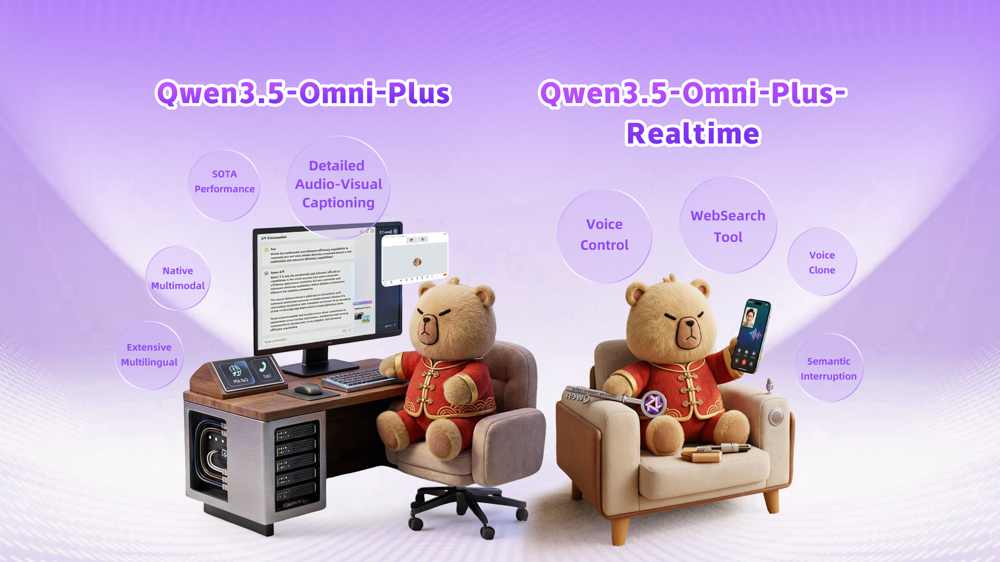
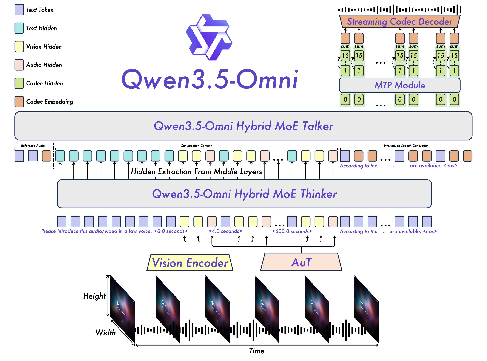
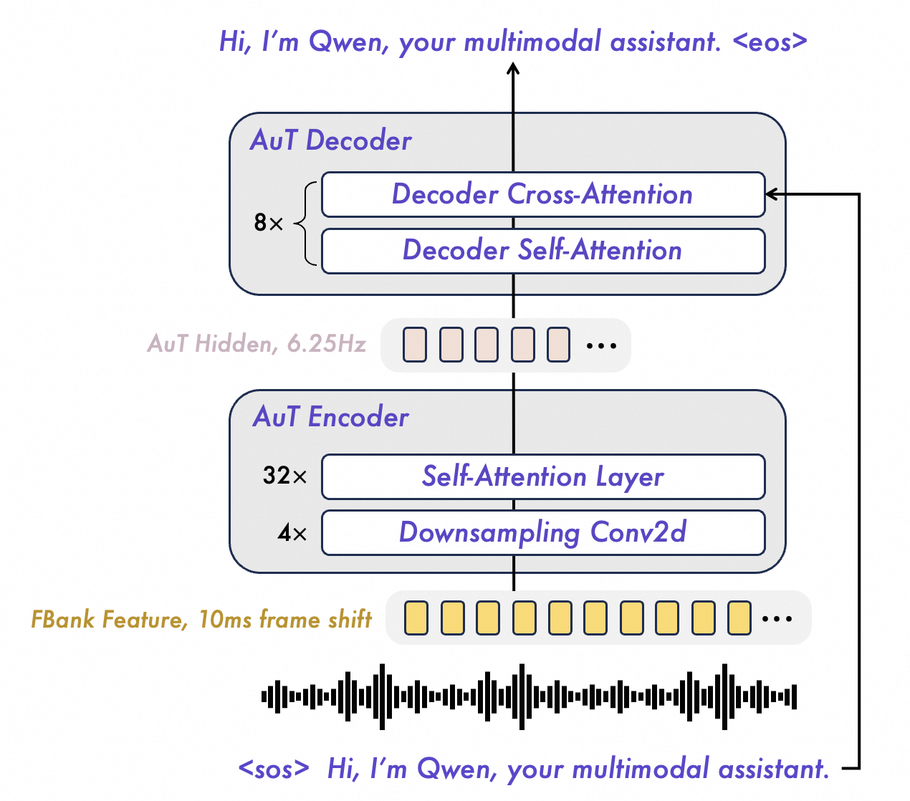

# Qwen3.5-Omni：Thinker-Talker 与全模态 Agent

Qwen3.5-Omni 这份报告的核心不是“把文本、图像、音频、视频都接进模型”这么简单，而是把全模态模型推进到一个更产品化的问题：**模型能否在 256K 上下文内听、看、读、说，并且以低延迟流式交互、调用工具、处理音视频任务，甚至从音视频指令直接生成代码。**

如果把它放在 Qwen3 / Kimi K2 / DeepSeek-V4 这些技术报告旁边看，它的主线很清楚：Qwen3 解决 thinking / non-thinking 和模型家族；Kimi K2 解决 agentic text model；DeepSeek-V4 解决百万上下文效率；Qwen3.5-Omni 则把重点放在 **native omni agent**：输入可以是文本、图像、视频、音频、音视频流，输出可以是文本或流式语音，任务还可以包含 WebSearch、FunctionCall 和 audio-visual tool use。

| 线索 | Qwen3.5-Omni 的做法 | 读者应该抓住的点 |
| --- | --- | --- |
| 统一全模态理解 | Thinker 接收 text、audio、image、video / audio-video | 多模态不是 late fusion，而是统一进长上下文序列 |
| 流式语音生成 | Talker 生成 RVQ speech tokens，MTP 补 residual codebooks，Code2Wav 增量合成 | 语音输出不是外接 TTS，而是模型体系内的 streaming generation |
| 长上下文 | 256K tokens，支持 >10 hours audio 和 >400 seconds 720P video at 1 FPS | 音视频会迅速吃掉上下文，长上下文是 omni agent 的必要条件 |
| 低延迟交互 | chunked prefilling、Hybrid MoE、Gated Delta Net、ARIA | 用户体验取决于 first-packet latency 和并发，而不只是 benchmark |
| 训练路线 | 100M+ hours audio-visual content，三阶段 pretraining，Thinker 三阶段 post-training，Talker 四阶段训练 | 全模态能力来自分阶段数据和对齐，不是单次混合训练 |

{ width="920" }

<small>图源：`Qwen3.5-Omni Technical Report`，Figure 1，来自 arXiv source 包 `figures/image.png`。原图展示 Qwen3.5-Omni 统一处理 text、audio、image、video，并生成 text 或 real-time speech response，支持 voice dialogue、video dialogue、audio-visual tool use 等任务。</small>

**总览图先看全模态输入输出是否都进入同一交互系统。**
图里最重要的是“输入和输出都是多模态”。很多 VLM 只解决 image/video 到 text；很多 speech model 只解决 ASR 或 TTS；Qwen3.5-Omni 想做的是 end-to-end interaction：用户用语音、图像、视频或音视频流提问，模型既能用文本回答，也能直接用语音流式回答，还能调用工具。

这也是为什么报告反复强调 real-time、streaming、first-packet latency 和 tool use。全模态模型如果不能及时返回第一段语音，用户体验会明显退化；如果不能稳定调用工具，它就仍然只是感知模型，而不是 omni agent。

## 论文位置

Qwen3.5-Omni 继承 Qwen2.5-Omni / Qwen3-Omni 的 Thinker-Talker 思路，同时吸收 Qwen3.5 在文本、视觉、tokenizer、Hybrid MoE 和长上下文上的能力。报告中明确写到，它相对 Qwen3-Omni 有五个关键升级：

| Upgrade | Qwen3.5-Omni |
| --- | --- |
| Hybrid-Attention MoE | both Thinker and Talker adopt Hybrid-Attention MoE designs |
| Long-context modeling | up to 256k tokens, more than 10 hours audio, over 400 seconds 720P audio-visual content at 1 FPS |
| Speech generation codec | multi-codebook codec representation enables single-frame, immediate synthesis |
| ARIA | dynamically aligns text and speech units during streaming decoding |
| Multilingual expansion | 113 languages and dialects for speech recognition, 36 for speech synthesis |

这几个升级不是孤立功能，而是互相支撑。256K 上下文让长音频和长视频进来；Hybrid MoE 和 GDN 降低长序列推理成本；Talker 的 RVQ + MTP + Code2Wav 让语音输出可以逐帧生成；ARIA 则处理文本 token 和语音 token 速率不一致导致的流式合成不稳。

## 总体架构

Qwen3.5-Omni 继续采用 Thinker-Talker 架构。Thinker 负责多模态理解和文本生成；Talker 接收 Thinker 的高层表示和文本输出，负责生成流式 speech tokens。

{ width="920" }

<small>图源：`Qwen3.5-Omni Technical Report`，Figure 2，来自 arXiv source 包 `figures/model.jpg`。原图展示 Thinker-Talker 架构：Thinker 处理文本、图像、视频和音频输入；Talker 通过 RVQ tokens、MTP 和 Code2Wav 生成流式语音。</small>

架构可以按模块拆开：

| Module | Role | Training / inference implication |
| --- | --- | --- |
| Vision Encoder | 处理 image / video frames | 继承 Qwen3.5 vision encoder，支持图像和视频理解 |
| AuT | audio encoder | 40M hours audio-text pairs 训练，输出 6.25Hz audio tokens |
| Thinker | unified multimodal reasoning and text generation | Hybrid MoE Transformer，支持 streaming input 和 256K context |
| Talker | contextual speech generation | Hybrid MoE Transformer，接收 Thinker 表示并生成 RVQ speech tokens |
| MTP | residual codebook prediction | 每个 decoding step 输出当前 frame 的 residual codebooks |
| Code2Wav | waveform renderer | causal ConvNet，增量合成 waveform，支持 frame-by-frame streaming |

**Thinker-Talker 为什么不是简单 ASR + LLM + TTS。**
如果把语音系统拆成 ASR、LLM、TTS 三段，工程上容易做，但会丢失很多信息：语气、情绪、背景音、说话人、节奏、打断意图、音视频同步线索。Thinker-Talker 的好处是保留更丰富的中间表示，让 Talker 能根据多模态上下文调节 prosody、loudness、emotion 和 speaker style。

代价是训练和推理都更复杂。Talker 不是一个独立 TTS 小模型，它要和 Thinker 的文本输出、多模态表示、历史对话和语音 token 对齐。

## AuT：音频编码器

AuT 是 Qwen3.5-Omni 的 audio encoder。报告说它使用 transformer-based audio encoder，从 scratch 训练在 attention-encoder-decoder 模型中。

{ width="760" }

<small>图源：`Qwen3.5-Omni Technical Report`，Figure 3，来自 arXiv source 包 `figures/3.5aut.png`。原图展示 AuT 概览：使用 40 million hours supervised data，获得 6.25Hz general purpose audio representation。</small>

关键训练和输入细节如下：

| Item | Qwen3.5-Omni AuT Detail |
| --- | --- |
| Training data | 40 million hours audio-text pair data generated by Qwen3-ASR |
| Audio feature | 16 kHz waveform -> 128-channel mel-spectrogram |
| Window / hop | 25 ms window, 10 ms hop |
| Downsampling | 4 Conv2D blocks, downsample 16 times |
| Output rate | 6.25Hz audio tokens, about 160 ms per output frame |
| Multilingual mix | more than 20 languages; Chinese : English : multilingual = 3.5 : 3.5 : 3 |
| Training trick | dynamic attention window size training |

这里的 6.25Hz 很关键。音频原始帧率非常高，如果直接把音频细粒度 token 全部塞进 LLM，上下文会被迅速吃光。AuT 通过降采样把音频压到约每 160ms 一个 token，让 10 小时级音频理解进入 256K context 成为可能。

## 多模态输入与时间编码

Qwen3.5-Omni 的 Thinker 把 text、audio、image、video 输入转成统一表示序列。报告里有几个容易被忽略但很重要的实现细节：

| Modality | Processing |
| --- | --- |
| Text | Qwen3.5 tokenizer, byte-level BPE, vocab size 250k, encoding / decoding efficiency improves 10-60% across most languages |
| Audio | 16 kHz resampling, 128-channel mel-spectrogram, AuT output every ~160 ms |
| Image / Video | Qwen3.5 vision encoder; dynamic frame rate to preserve video information while aligning audio stream |
| Audio-video time | explicit timestamps inserted as formatted text strings in seconds |
| Position | temporal IDs aligned to 160 ms resolution; modality positions made contiguous to avoid conflicts |

Qwen3-Omni 使用 TMRoPE 提供 temporal awareness，但 Qwen3.5-Omni 认为直接把 temporal position IDs 绑定到 absolute time 会在长视频和音视频输入中产生过大、过稀疏的位置 ID，削弱 long-range temporal modeling，也提高多帧率训练数据构造成本。因此它在每个 video 或 audio-video temporal patch 前插入显式 timestamp 文本，让模型更自然地学习 timecode。

**为什么 timestamp 文本有用。**
对长音视频来说，“第 243 秒出现了什么”比“这是第 1518 个 temporal position ID”更接近语言模型已经擅长处理的符号结构。显式时间戳会稍微增加上下文长度，但它让模型能用文本式 timecode 学习跨模态对齐，尤其适合生成 script-level caption、自动分段和带时间戳的音视频描述。

## Talker 与 ARIA

Talker 直接操作 Qwen3.5-Omni-Audio-Tokenizer 产生的 RVQ tokens。它用 MTP 模块建模 residual codebooks，再由 causal ConvNet Code2Wav 增量合成波形。

这套设计要解决两个问题。第一，语音输出必须低延迟，不能等整段文本和整段声学 token 全部生成完再播。第二，多语种场景下 text token 和 speech token 的比例差异很大，如果用固定 interleaving rate，容易出现跳词、错读、数字读法混乱或 prosody 不自然。

ARIA, Adaptive Rate Interleave Alignment，就是为了解决这个速率不匹配问题。报告把它定义为：在任意生成 prefix 上，累计 speech-to-text token ratio 不能超过对应 item-level global ratio。也就是说，ARIA 不依赖 MFA-derived alignment，也不使用固定 interleaving rate，而是让文本和语音 token 在单一 stream 中按自适应速率单调交织。

**ARIA 的直觉。**
文本 token 和语音 token 像两条速度不同的履带。英文、中文、数字、缩写、多语混合时，两条履带速度并不固定。如果强行每 N 个语音 token 配一个文本 token，就容易在某些语言或数字表达上错位。

ARIA 的做法是给全局比例设一个单调约束：语音可以跟着文本往前走，但不能在任意 prefix 上跑得过快。这样既支持流式播放，也降低 text-speech alignment 崩掉的概率。

## 流式与延迟

报告专门给了架构模块和 first-packet latency。表格保留原英文列名：

| Module | Architecture | Streaming |
| --- | --- | --- |
| Audio Encoder | AuT | ✓ |
| Vision Encoder | SigLIP2 | -- |
| Thinker | Hybrid MoE Transformer | ✓ |
| Talker | Hybrid MoE Transformer | ✓ |
| MTP | Dense Transformer | ✓ |
| Code2wav | ConvNet | ✓ |

| Setting | First-Packet Latency |
| --- | --- |
| Audio Input | Plus: 435ms; Flash: 235ms |
| Video Input | Plus: 651ms; Flash: 426ms |

<small>表源：`Qwen3.5-Omni Technical Report`，Table 1。原论文表意：Qwen3.5-Omni 多个模块都支持 streaming，并给出 audio/video input 下 Plus 与 Flash 的端到端 first-packet latency。</small>

更细的并发延迟表如下，保留原英文字段：

|  | Qwen3.5-Omni-Flash 1 Conc. | Flash 4 Conc. | Flash 8 Conc. | Qwen3.5-Omni-Plus 1 Conc. | Plus 4 Conc. | Plus 8 Conc. |
| --- | --- | --- | --- | --- | --- | --- |
| Thinker TTFT | 80/255ms | 86/446ms | 103/765ms | 162/377ms | 183/907ms | 260/1243ms |
| Talker TTFC | 56/61ms | 68/108ms | 81/116ms | 54/56ms | 72/88ms | 95/116ms |
| Thinker TPOP | 5.6/5.9ms | 8.2/9.2ms | 9.6/15.8ms | 17.4/18.5ms | 25.6/26.9ms | 33.3/40.2ms |
| Talker TPOP | 14.2/14.2ms | 16.9/17.0ms | 20.5/20.6ms | 14.9/14.9ms | 21.0/21.3ms | 25.8/27.1ms |
| Codec Decode | 3~5ms | 3~5ms | 3~5ms | 3~5ms | 3~5ms | 3~5ms |
| Overall Latency | 235/426ms | 298/891ms | 352/1625ms | 435/651ms | 619/1515ms | 955/1980ms |
| Thinker TPS | 177/171 | 556/457 | 942/598 | 57/54 | 156/149 | 266/240 |
| Talker TPS | 70/70 | 237/235 | 389/388 | 67/67 | 191/189 | 320/296 |
| Generation RTF | 0.178 | 0.211 | 0.257 | 0.187 | 0.267 | 0.334 |

<small>表源：`Qwen3.5-Omni Technical Report`，Table 2。原论文说明：A/V 表示 audio/video input；整体延迟不是简单逐行相加，而是 ARIA 统一 interleaved stream 下的端到端 critical path。</small>

**这些延迟指标怎么读。**
`TTFT` 是 Thinker 的第一 token 时间，`TTFC` 是 Talker 第一段音频 chunk 时间，`TPOP` 是稳定解码阶段每个输出 token 的时间，`RTF` 是生成音频相对真实播放时长的比例。RTF 小于 1 才有流式实时播放余量。

对语音产品来说，first-packet latency 往往比总推理吞吐更敏感。用户先听到第一段声音，后续只要生成速度快于播放速度，就能维持自然流式体验。

## 预训练数据与阶段

Qwen3.5-Omni 的预训练数据覆盖 text、image-text、video-text、audio-text、video-audio、video-audio-text 和 pure text。报告摘要还说总计使用 heterogeneous text-vision pairs 和 100M+ hours audio-visual content。

语言覆盖表如下，保留原英文列名：

| Modality | # Varieties | Supported languages and dialects |
| --- | ---: | --- |
| Text | 201 | See Qwen3.5 for the complete list of supported languages. |
| Speech Input | 113 | 74 languages + 39 Chinese dialects |
| Speech Output | 36 | 29 languages + 7 Chinese dialects |

<small>表源：`Qwen3.5-Omni Technical Report`，Table 3。原论文表意：Qwen3.5-Omni-Plus 支持 201 text varieties、113 speech input varieties、36 speech output varieties。</small>

预训练分三阶段：

| Stage | Training setup | Main purpose |
| --- | --- | --- |
| Encoder Alignment Stage (S1) | LLM initialized from Qwen3.5; vision encoder from Qwen3.5; audio encoder initialized with AuT; train encoders on fixed LLM, adapters first then encoders | 让 vision/audio encoder 与 LLM 语义空间对齐 |
| General Stage (S2) | ~4T tokens: text 0.92T, audio 1.99T, image 0.95T, video 0.14T, video-audio 0.29T; sequence length 32,768 | 用大规模多模态数据提升 auditory、visual、textual、audio-visual understanding and interaction |
| Long Context Stage (S3) | max token length from 32,768 to 262,144; higher proportion of long audio and long video | 提升复杂长序列音视频理解 |

<small>表源：`Qwen3.5-Omni Technical Report`，Pretraining section。表格为按原文阶段信息重绘。</small>

这三阶段很有工程意义。S1 不直接全参数混训，而是先锁住 LLM、对齐 encoder；S2 才全参数引入大规模多模态任务；S3 专门拉长上下文，增加长音频和长视频比例。这样做可以减少一开始多模态信号冲击语言底座，也能把长上下文能力作为后期能力增强，而不是在早期就承担高成本。

## 后训练：Thinker

Thinker 的 post-training 是三阶段，目标是保持各模态能力不退化、提升 audio query 下回答质量，并优化真实交互体验。

| Stage | Qwen3.5-Omni Thinker Training |
| --- | --- |
| Stage 1: Specialist Distillation | train domain-specialized teacher models via independent SFT and RL from Qwen3.5 base; cover text agentic, coding, reasoning, vision, audio; generate domain-specific data and distill into one unified model |
| Stage 2: On-Policy Distillation | for audio-text paired query, use text-conditioned response as target for audio-conditioned query; align audio-conditioned outputs with stronger text-conditioned behavior |
| Stage 3: Interaction-Aligned Reinforcement Learning | construct multi-turn interaction trajectories and reward signals for language stability, persona consistency, instruction following over long contexts, and user experience |

<small>表源：`Qwen3.5-Omni Technical Report`，Post-training section。表格为按原文阶段信息重绘。</small>

**为什么 OPD 用 text response 教 audio response。**
报告指出 audio query 下的 response quality 和 text query 之间仍有差距，尤其是 speech dialogue。这里的 OPD 很像跨模态行为对齐：同一个语义 query，如果文本输入能得到更流畅、更完整的回答，就把这个回答作为 audio-conditioned query 的训练目标。

这不是普通 ASR 后再回答。它训练的是模型在音频条件下直接学会接近文本条件下的高质量行为，从而减少“听懂了但回答质量变差”的模态差距。

## 后训练：Talker

Talker 的训练是四阶段：

| Stage | Qwen3.5-Omni Talker Training |
| --- | --- |
| General Stage | train on >20 million hours multilingual speech data paired with multimodal context; add instruction-following speech generation |
| Long-Context Stage | data quality stratification + continual pre-training on high-quality subsets; augmented by Qwen3-Omni-Captioner; extend max context length to 64k tokens |
| Reinforcement Learning Stage | DPO with multilingual human preference pairs; incorporate rule-based rewards and GSPO for stability |
| Speaker Fine-tuning Stage | lightweight speaker fine-tuning for target speaker characteristics, naturalness, expressiveness, controllability |

<small>表源：`Qwen3.5-Omni Technical Report`，Post-training section。表格为按原文阶段信息重绘。</small>

Talker 训练里有两个重点。第一，它不是只做“文本到语音”的单调映射，而是用 multimodal context 做 speech generation，让语音能跟随对话历史、视觉/音频上下文和情绪。第二，它把 speaker fine-tuning 放在最后，说明 speaker identity、自然度和可控性更像产品化 polish，不应在基础语音能力还不稳时过早注入。

## X to Text 评测

Qwen3.5-Omni 的评测分成 `X -> Text` 和 `X -> Speech`。`X -> Text` 覆盖 text、audio、vision、audio-visual video。

### Text to Text

| Datasets | Qwen3.5-Plus-Instruct | Qwen3.5-Omni-Flash | Qwen3.5-Omni-Plus |
| --- | ---: | ---: | ---: |
| MMLU-Pro | 86.8 | 79.9 | 85.9 |
| MMLU-Redux | 94.3 | 90.0 | 94.2 |
| SuperGPQA | 67.4 | 54.9 | 66.4 |
| C-Eval | 92.3 | 86.0 | 92.0 |
| IFEval | 89.7 | 85.2 | 89.7 |
| IFBench | 51.1 | 38.4 | 52.6 |
| LongBench v2 | 60.2 | 46.4 | 59.6 |
| LiveCodeBench v6 | 67.1 | 56.6 | 65.6 |
| BFCL-V4 | 66.1 | 55.3 | 63.3 |
| TAU2Bench | 82.7 | 78.0 | 81.0 |

<small>表源：`Qwen3.5-Omni Technical Report`，Table `Text -> Text performance` 摘录。原表比较 Qwen3.5-Omni 与 Qwen3.5-Plus-Instruct。</small>

这张表的意义是：Omni 模型加入音频、视觉、语音生成后，文本能力没有明显塌陷。Qwen3.5-Omni-Plus 在多数任务上接近 Qwen3.5-Plus-Instruct，IFBench 甚至更高。报告认为 OPD 和 interaction-aligned RL 对 omni LLM 的 instruction following 有正向作用。

### Audio to Text

| Datasets | Gemini-3.1 Pro | Qwen3.5-Omni-Flash | Qwen3.5-Omni-Plus |
| --- | ---: | ---: | ---: |
| MMAU | 81.1 | 80.4 | 82.2 |
| MMAR | 83.7 | 74.0 | 80.0 |
| MMSU | 81.3 | 72.2 | 82.8 |
| RUL-MuchoMusic | 59.6 | 60.5 | 72.4 |
| VoiceBench | 88.9 | 87.8 | 93.1 |
| Fleurs xx↔zh/en (top59) | 32.1 | 29.4 | 32.8 |
| Fleurs (top60) WER↓ | 7.32 | 10.75 | 6.55 |
| CV15 (zh/yue/zh-tw) WER↓ | 8.59 / 13.40 / 6.78 | 4.25 / 3.45 / 2.68 | 3.46 / 1.95 / 2.27 |
| LibriSpeech (clean/other) WER↓ | 3.36 / 4.41 | 1.30 / 2.43 | 1.11 / 2.23 |

<small>表源：`Qwen3.5-Omni Technical Report`，Audio benchmark table 摘录。原表说明大多数 benchmark 越高越好，ASR benchmark 使用 WER 越低越好。</small>

### Vision 和 Audio-Visual

| Audio-Visual Dataset | Gemini-3.1 Pro | Qwen3.5-Omni-Flash | Qwen3.5-Omni-Plus |
| --- | ---: | ---: | ---: |
| DailyOmni | 82.7 | 81.8 | 84.6 |
| WorldSense | 65.5 | 57.9 | 62.8 |
| AVUT | 85.6 | 81.4 | 85.0 |
| AV-SpeakerBench | 75.1 | 65.2 | 71.3 |
| VideoMME w/ audio | 89.0 | 79.3 | 83.7 |
| Qualcomm IVD | 66.2 | 66.3 | 68.5 |
| Omni-Cloze | 57.2 | 63.0 | 64.8 |
| OmniGAIA | 68.9 | 33.9 | 57.2 |

<small>表源：`Qwen3.5-Omni Technical Report`，Audio-Visual -> Text table。原表说明 VideoMME 使用 `use_audio_in_video=True`；OmniGAIA 不使用 thinking prompt 和 `<answer>` formatting，并使用 DeepSeek-V3.2-Thinking 作为 judge。</small>

这里有两个信号。第一，Qwen3.5-Omni-Plus 在 DailyOmni、Qualcomm IVD、Omni-Cloze 上很强，说明音视频融合和 caption 能力是重点优化方向。第二，OmniGAIA 仍低于 Gemini-3.1 Pro，说明 audio-visual tool use 虽然已进入评测主线，但还没有完全追平最强闭源系统。

## X to Speech 评测

语音生成部分主要看 zero-shot speech generation、multilingual speech generation、cross-lingual speech generation 和 custom-voice speech generation。

| Dataset | Model | Performance |
| --- | --- | --- |
| SEED test-zh / test-en | Seed-TTS ICL | 1.11 / 2.24 |
| SEED test-zh / test-en | Seed-TTS RL | 1.00 / 1.94 |
| SEED test-zh / test-en | CosyVoice 3 | 0.71 / 1.45 |
| SEED test-zh / test-en | Qwen3-Omni-30B-A3B | 1.07 / 1.39 |
| SEED test-zh / test-en | Qwen3.5-Omni-Plus | 0.99 / 1.26 |

<small>表源：`Qwen3.5-Omni Technical Report`，Zero-shot speech generation table 摘录。原表使用 WER，越低越好。</small>

Cross-lingual speech generation 摘录如下：

| Language | Qwen3.5-Omni-Plus | Qwen3-Omni-30B-A3B | CosyVoice3 | CosyVoice2 |
| --- | ---: | ---: | ---: | ---: |
| English-to-Chinese | 4.86 | 5.37 | 5.09 | 13.5 |
| Chinese-to-English | 2.18 | 2.76 | 2.98 | 6.47 |
| Japanese-to-English | 2.18 | 3.31 | 4.20 | 17.1 |
| Korean-to-English | 2.51 | 3.34 | 4.19 | 11.2 |
| Chinese-to-Japanese | 5.92 | 8.29 | 7.08 | 13.1 |
| Chinese-to-Korean | 4.03 | 5.13 | 14.4 | 24.8 |
| English-to-Korean | 3.72 | 4.96 | 5.87 | 21.9 |

<small>表源：`Qwen3.5-Omni Technical Report`，Cross-lingual speech generation table 摘录。原表使用 mixed error rate，英文为 WER，其他语言为 CER，越低越好。</small>

报告特别指出，`zh-to-ko` 相比 CosyVoice3 从 14.4 降到 4.03，约 72% relative reduction。这说明 Qwen3.5-Omni 的语音生成不只是“读得像”，还在跨语言保持内容一致性和发音稳定性上有明显优化。

## 关键贡献怎么理解

Qwen3.5-Omni 最值得学习的不是某一个 benchmark，而是几组工程取舍：

| Problem | Qwen3.5-Omni answer |
| --- | --- |
| 长音频和长视频会吃爆上下文 | AuT 6.25Hz、dynamic frame rate、explicit timestamps、256K context |
| 多模态输入难以对齐时间 | audio/video temporal IDs + timestamp text strings |
| 语音生成和文本生成速率不匹配 | ARIA 自适应 interleaved single stream |
| 语音输出要低延迟 | RVQ tokens + MTP residual codebooks + streaming Code2Wav |
| Omni 模型容易损失文本能力 | Qwen3.5 初始化、specialist distillation、OPD、interaction-aligned RL |
| 长交互容易语言切换/人设漂移/指令退化 | multi-turn interaction trajectories + reward signals |

**为什么 Audio-Visual Vibe Coding 值得注意。**
报告把 Audio-Visual Vibe Coding 描述为一种 emergent capability：模型能直接基于音视频指令生成可执行代码。它不是单纯听写用户说的话，而是把视觉界面、音频说明、任务意图和代码生成连接起来。

这类能力说明 omni agent 的边界正在从“看图回答”走向“看/听一个动态场景，然后执行工程任务”。但报告没有给出足够细的可复现训练/评测细节，所以更适合把它看作方向信号，而不是已经完全标准化的 benchmark 结论。

## 局限和阅读边界

第一，Qwen3.5-Omni 是技术报告，很多评测来自内部实现、内部 vLLM、内部测试集或特定 API 日期。延迟表也明确说明 Flash 与 Plus 部署资源和并行策略不同，不适合严格横向比较。

第二，报告没有公开完整模型参数规模细表，只在摘要中说 scales to hundreds of billions of parameters，并区分 Plus / Flash。我们可以讨论架构、训练阶段、数据规模和接口能力，但不应编造具体 total/activated params。

第三，音视频 benchmark 仍处于快速变化期。DailyOmni、Qualcomm IVD、OmniCloze、OmniGAIA 这类评测比传统 MMLU 更接近真实交互，但 judge、prompt、格式和工具协议都会影响结果。

第四，ARIA 是很有启发的工程设计，但报告给的是方法描述和系统结果，不是完整可复现实验消融。实际复现时还要知道 speech tokenizer、RVQ codebook、Talker schedule、decoder 和 serving pipeline 的更多细节。

## 项目启发

Qwen3.5-Omni 给工程项目的启发主要有五条：

1. **Omni 不是简单拼模块。** ASR + LLM + TTS 可以做产品原型，但要保留情绪、音视频同步、语音打断和上下文语音风格，就需要更深的 Thinker-Talker 式联合建模。
2. **音视频长上下文要先算 token 账。** AuT 的 6.25Hz、动态帧率、256K context 和 timestamp 设计，本质都是在控制音视频输入的 token budget。
3. **流式语音生成的难点是对齐。** ARIA 说明多语种下 text token 和 speech token 的速率差异会直接影响稳定性和自然度。
4. **后训练要分 Thinker 和 Talker。** Thinker 侧重跨模态回答质量和交互对齐；Talker 侧重语音自然度、偏好对齐、speaker fidelity 和长期上下文语音输出。
5. **Omni agent 的评测要覆盖行为。** 只看识别准确率不够，还要看 tool use、audio-visual QA、caption、voice cloning、first-packet latency、RTF 和多轮交互稳定性。

## 阅读结论

Qwen3.5-Omni 展示的是一条全模态 agent 模型路线：用 Thinker 统一理解文本、视觉、音频和音视频，用 Talker 生成低延迟流式语音，用 ARIA 解决文本与语音 token 速率对齐，再用分阶段预训练和分模块后训练把长上下文、语音自然度、跨模态回答质量和交互稳定性组合到一个系统里。

读这篇报告时要把三类证据分开：overview 图说明能力覆盖，architecture 和 AUT 图说明结构分工，多模态 benchmark 说明报告设置下的任务表现。全模态强不等于工作流成功；真实应用还要验 first-packet latency、打断恢复、工具链、跨模态误触发和长上下文退化。

## 站内延伸

1. [Qwen3：Thinking 模式、36T 预训练与蒸馏](qwen3.md)：理解 Qwen 系列的文本模型和后训练基础；
2. [Kimi K2：MuonClip、万亿 MoE 与 Agent 数据](kimi-k2.md)：对照 agentic data synthesis 和 RL 基础设施；
3. [VLM/VLA：VLM 架构：视觉表征、连接器与记忆](../../vlm/architecture-and-training.md)：补多模态输入组织和连接器思路；
4. [推理：RAG、Agent 与长上下文系统](../../inference/rag-agents-and-long-context-systems.md)：把 omni agent 放到工具和应用系统里看；
5. [训练：训练数据系统与吞吐优化](../../training/data-systems-and-optimization.md)：理解多模态数据、质量过滤和训练阶段设计。

## 外部精读

1. [Qwen3.5-Omni Technical Report](https://arxiv.org/abs/2604.15804)
2. [Alibaba Cloud Model Studio: Qwen Omni](https://www.alibabacloud.com/help/en/model-studio/qwen-omni)
