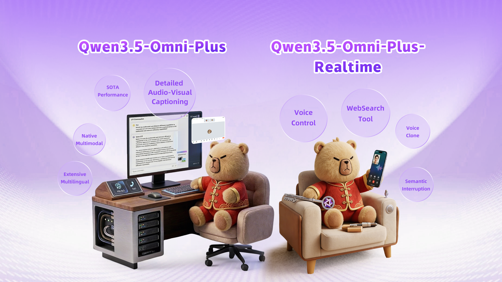
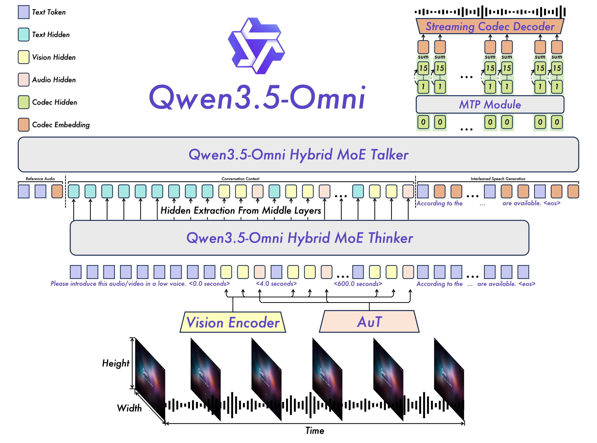
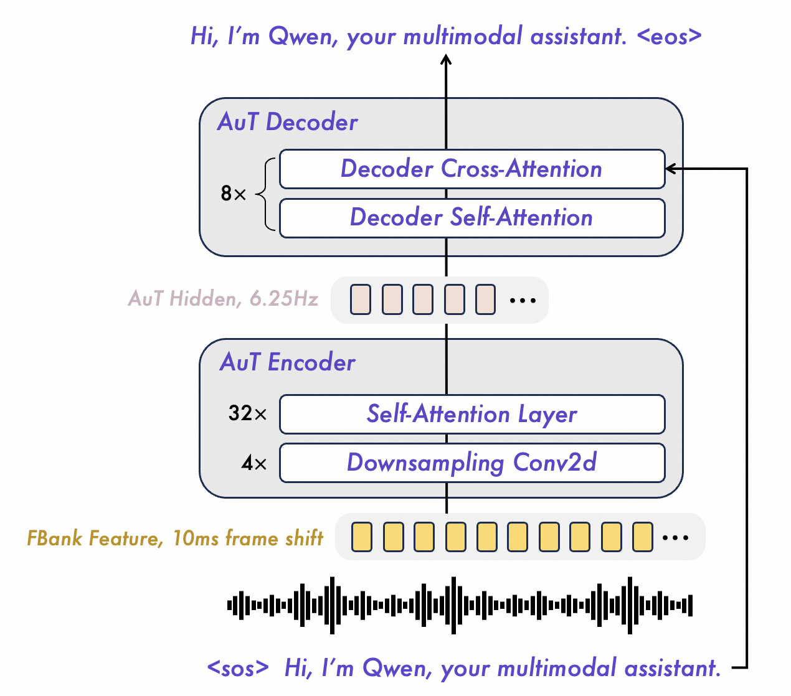
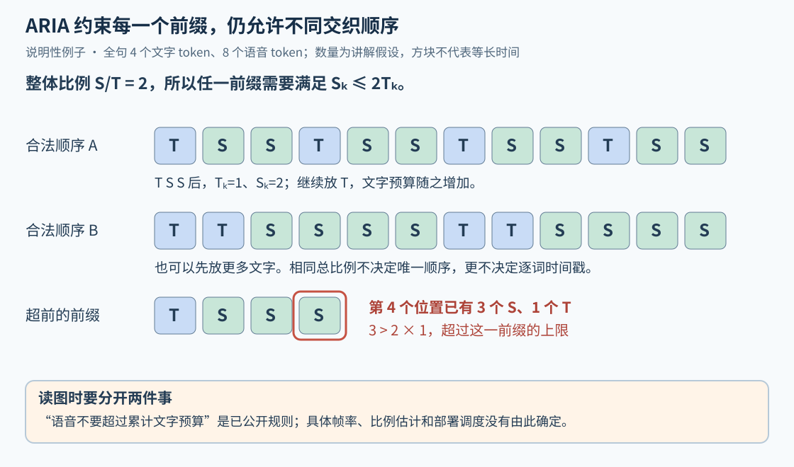
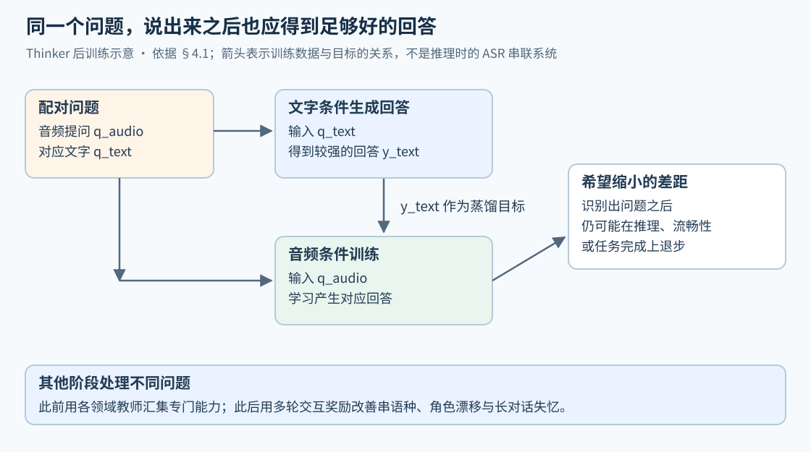
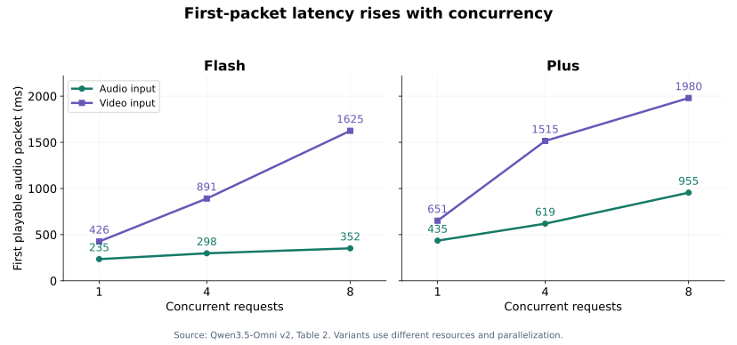

# Qwen3.5-Omni：Thinker-Talker 与全模态 Agent

!!! info "论文信息"
    **论文题名：** Qwen3.5-Omni Technical Report。 
    **作者：** Qwen Team。 
    **机构：** 未在公开元数据中稳定解析；以 arXiv/PDF 或官方页 affiliation block 为准。 
    **时间 / 主题：** 2026-04；技术报告。 
    **arXiv / 官方报告：** arXiv：[2604.15804](https://arxiv.org/abs/2604.15804)；官方材料：[www.alibabacloud.com/help/en/model-studio/qwen-omni](https://www.alibabacloud.com/help/en/model-studio/qwen-omni)。 
    **GitHub / 项目：** GitHub：未找到官方链接；项目页：[www.alibabacloud.com/help/en/model-studio/qwen-omni](https://www.alibabacloud.com/help/en/model-studio/qwen-omni)。 
    **元数据来源与核验口径：** 来源：[arXiv](https://arxiv.org/abs/2604.15804)；[官方 / 项目材料](https://www.alibabacloud.com/help/en/model-studio/qwen-omni)；Checked Date：2026-06-04；Repro Status：Paper / official materials reviewed, independent reproduction not claimed。

## 一次视频对话里，有三条不同速度的信息流

设想用户拿起手机，拍着电脑屏幕问“这里为什么报错，请小声解释”。助手要读取画面中的代码，听懂问题，结合前几轮对话判断错误，可能调用工具，最后组织解释并以合适的声音说出来。这里至少有三件事要同时做好。感知端要保留足够的画面与声音信息，理解端要给出正确回答，发声端要及时跟上，而且不能因为赶着开口而漏词、读错数字。

Qwen3.5-Omni 的主线就沿着这三条信息流展开。它沿用 Qwen2.5-Omni 与 Qwen3-Omni 的 **Thinker–Talker** 分工，让 Thinker 处理理解和文本生成，让 Talker 根据对话上下文生成语音。本代扩展了音视频数据与模型规模，采用 Hybrid Attention MoE、256K 上下文和显式时间戳，并用 **ARIA（Adaptive Rate Interleave Alignment，自适应速率交织对齐）** 组织文字与语音的流式输出。Plus、Flash 均为 instruct 模型；报告将系列规模描述为数千亿参数，未逐一给出两档模型可供还原的参数配置。[↗](https://arxiv.org/pdf/2604.15804v2#page=1)

总览图把能力分成两个使用场景。左侧是读材料、生成细粒度音视频描述，右侧是语音控制、语义打断、声音定制和工具使用。看这张图时，应把“模型可以接收哪些信号”和“它在某项任务上做得多可靠”分开。后面的实验分别衡量理解、工具任务、语音内容与说话者相似度，不能用一项分数替代全部能力。

{ width="920" }

*原文 Figure 1。左侧偏向材料理解，右侧强调实时交互；图中的能力标签需要由对应实验进一步限定。*

## Thinker 怎样把“这句话应该怎么说”交给 Talker

最容易误解的地方，是把 Thinker–Talker 想成“先输出完整文字，再调用一个独立 TTS”。报告实际传递的信息更多，输出也可以逐步推进。沿 Figure 2 从下往上看，视觉编码器与 AuT 音频编码器先把原始信号变成连续表示，和文本、时间戳一起进入 Thinker。Thinker 一边理解这些输入，一边生成文字；Talker 接收历史文字、当前流式文字，以及从 Thinker 中间层抽出的多模态表示。[↗](https://arxiv.org/pdf/2604.15804v2#page=3)

{ width="920" }

*原文 Figure 2。先看中间的 “Hidden Extraction From Middle Layers”，再看右上方 code 0、残差码本 1–15 和 Streaming Codec Decoder。两处分别说明上下文怎样传给 Talker，以及一帧声音怎样被还原。*

为什么传中间表示有用？同一句“可以继续”，在安静说明、紧张提醒或角色对话中，语气可能完全不同。纯文本能保存词句，原始音频中的说话方式、画面中的情境却未必都写进最终回答。报告给 Talker 的条件保留了这些模态表示，使它可以结合上下文调整韵律、音量和情绪。这解释了接口的用途；具体控制效果还要看语音评测，不能仅凭连接方式认定每次都能准确表达情绪。

Thinker 和 Talker 都采用 Hybrid MoE。这里有两个不同的效率来源。MoE 在模型容量与每次计算量之间做取舍；混合注意力中的 Gated Delta Net 则帮助减少长音视频序列的 KV-cache I/O。输入越来越长时，每一步生成都搬运历史状态会变得昂贵，降低这种访问负担有利于解码吞吐和并发。报告没有给出完整的层数、专家配置和混合比例，因而这里能复用的是模块分工与长序列瓶颈的判断，不能据此重建等规模网络。[↗](https://arxiv.org/pdf/2604.15804v2#page=6)

### 一帧语音为什么有多个 code

Talker 生成的是 **RVQ（Residual Vector Quantization，残差向量量化）** 语音表示。一帧声学信息由多个码本共同描述，后续码本继续补充前面表示尚未覆盖的细节。Figure 2 中，Talker 主干先给出 code 0，轻量 MTP 模块补齐当前帧的 code 1 到 code 15，码本嵌入合成后交给因果 ConvNet Code2Wav，增量还原波形。[↗](https://arxiv.org/pdf/2604.15804v2#page=5)

用符号整理图中的求和，可以写成

$$
\hat z_t=\sum_{j=0}^{15}E_j[c_{t,j}].
$$

这里 $t$ 是声学帧索引，$c_{t,j}$ 是第 $j$ 个码本的索引，$E_j[c_{t,j}]$ 是查到的向量，$\hat z_t$ 是合成后的当前帧表示。这是对架构图的说明性记号。它提醒我们，右上方的 MTP 主要补充**同一帧内的码本细节**，并不等于语言模型一次猜出多个未来文字 token。也不能把 AuT 的 160 ms 输入表示间隔，直接套到这里的输出 codec 帧上。

Talker 还有自己的 system prompt，描述目标声音，既可以包含文字条件，也可以包含参考 codec 序列。参考声音提供“像谁说”的信息，多模态上下文提供“在什么情境下说”的信息，当前文字提供“说什么”。这些条件共同参与生成，但内容准确、身份相似和自然度仍然是三项不同的评价。

## 十小时音频能不能放进去，先算表示长度

理解长音频之前，先做一个长度计算。原始波形按采样点送入大语言模型会产生极长序列，AuT 因而先在音频域提取和压缩表示。输入重采样到 16 kHz，再以 25 ms 窗、10 ms hop 计算 128 通道 mel-spectrogram。10 ms 一帧相当于每秒约 100 个特征位置，四个 Conv2D block 共同做 16 倍下采样，得到每秒约 6.25 个位置。[↗](https://arxiv.org/pdf/2604.15804v2#page=4)

{ width="760" }

*原文 Figure 3。底部 FBank 经卷积下采样与 32 层编码器自注意力，形成 6.25 Hz 的 AuT Hidden；上方 8 层 decoder 在 AuT 训练中利用音频表示生成文字监督。进入 Figure 2 中 Thinker 的是编码器表示。*

这张图还说明 AuT 的训练信号从哪里来。它作为 attention encoder–decoder 系统训练，上方 decoder 通过 cross-attention 读取压缩后的音频，学习产生配对文字；编码器必须在有限的位置数里保留足够的可识别信息。报告使用约 4000 万小时由 Qwen3-ASR 产生音频文字配对的数据，中文、英文、多语言占比为 3.5∶3.5∶3，多语言部分覆盖二十多种语言。动态 attention window 训练则照顾两种不同条件，实时输入只能逐块接收和缓存，离线理解可以利用更完整的上下文。

按论文给出的表示速率，十小时纯音频大致需要

$$
N_{\mathrm{audio}}=10\times3600\times6.25=225000
$$

个位置，小于最大上下文 262144。这是容量上的解释，文字、时间戳及其他模态还会继续占用预算。长音频“能进入窗口”与“任意细节都能准确找回”需要分别验证，报告没有提供覆盖十小时任意位置检索的完整准确率曲线。

视频还包含空间成本。报告列出的另一项规格，是 720P、1 fps 下约 400 秒音视频；不能据此推成同样时长的原始高帧率视频也具有相同成本。模型还支持动态采样帧率，实际送入哪些帧决定了它能看见哪些短暂事件。例如只保留稀疏帧时，按钮刚被按下的瞬间可能没有进入模型，之后再扩大文本回答长度也无法恢复这段证据。

文字 tokenizer 也影响预算。Qwen3.5 的 byte-level BPE 词表由 150K 扩至 250K，报告称多数语言的编码与解码效率提高 10%–60%。不同语言表达同一含义需要的 token 数可能不同，这种差异不仅影响输入长度，后面还会影响文字与语音的交织。

### 时间戳给出可读的时间，位置编码维持序列关系

长音视频还有一个问题，同一事件的声音和画面要能够对上时间。报告沿用 TM-RoPE，但指出直接把绝对时间全部映射到 temporal position ID，会让长视频的视觉位置索引变得稀疏，也增加跨不同帧率构造训练样本的负担。

本代在每个视频或音视频 temporal patch 前加入以秒为单位的文本时间戳，并在纯音频序列的随机间隔插入时间标记。Figure 2 中的 `<0.0 seconds>`、`<4.0 seconds>`、`<600.0 seconds>` 就给出了这种输入形式。时间因此也成为模型能够读取和输出的文字信息，有利于回答“何时发生了什么”、生成带时间段的细粒度描述。[↗](https://arxiv.org/pdf/2604.15804v2#page=4)

文本时间戳没有取消位置编码。音频 temporal ID 按约 160 ms 的粒度组织，视频帧按真实时间调整对应 ID，高度与宽度仍有空间位置；后续模态从前一模态最大 position ID 加一开始编号，以避免位置冲突。两种表示各有作用，一种帮助表达可读时间，一种维持网络内部的时空关系。收益要付出少量额外上下文 token，这也是设计输入预算时必须保留的一部分。

## ARIA 怎样避免“声音已经往前说，文字还没准备好”

流式发声需要边收到文字边合成语音，但两种 token 的粒度并不一致。文字 tokenizer 会因语言、词形和数字写法产生不同长度，语音表示又按声学方式编码。如果强行使用固定的“几个文字对应几个语音 token”，一个语言里适用的比例换到另一个语言里可能就不够了。报告将漏词、发音错误和数字读法不稳定列为这种错配带来的问题。[↗](https://arxiv.org/pdf/2604.15804v2#page=5)

ARIA 把此前双轨组织改为文字和语音交织的单一序列，并约束每个前缀的累计比例。设全条样本有 $T$ 个文字 token、$S$ 个语音 token；走到第 $k$ 个位置时，已出现的数量为 $T_k,S_k$。将原文的文字规则记成公式，就是

$$
\frac{S_k}{T_k}\leq\frac{S}{T},\qquad T_k>0.
$$

右边是这一条样本的整体比例，左边是当前已经生成的比例。它给语音推进设定一个随文字数量增长的上限，防止语音过早超过当前文字提供的预算。这是对报告规则的记号化表达，论文没有另外给出这一形式的训练损失。

下面用全句 4 个文字 token、8 个语音 token 举例。这个假设下，每累计一个文字 token，最多允许累计两个语音 token。先看前两行，它们的交织顺序不同，都满足约束；再看第三行，`T S S S` 在第四个位置就超限了。

{ width="1000" }

*依据原文 §2.4 绘制的讲解示意。T/S 数量为说明性假设，方块表示序列次序，不代表等长时间；该图没有指定真实声学帧率。*

这个例子也说明约束没有规定什么。`T S S` 重复可以合法，先给两个 `T` 再接四个 `S` 也可以合法，所以它不会唯一确定逐词时间戳，更不会要求每两个语音 token 恰好念完一个词。跨样本时，$S/T$ 可以变化，因而不需要把所有语言塞进同一个固定比例；它也不依赖 MFA 先提供逐词强制对齐。

部署时仍需要决定整体比例如何估计、什么时候切换到语音、什么时候把波形块交给播放器。报告没有给出全部调度实现，不能用这一个不等式还原完整 Talker。不过它解释了作者想减少的负担，文字与语音在一条有序序列中推进，减少两条轨道之间的同步工作，再与 RVQ、轻量 MTP 和因果 codec decoder 配合实现连续输出。

## 训练分阶段，是因为“听见了”和“回答得好”之间还隔着一段距离

### 三个阶段分别接通模态、扩大能力和延长输入

预训练的三个阶段分别处理接口、能力和长度。S1 固定 LLM，从 Qwen3.5 初始化主干与视觉编码器，从 AuT 初始化音频编码器；两条编码路径分别先训练 adapter，再训练 encoder。固定语言主干让新输入表示先学会进入已有语言空间，避免一开始就同时改变所有模块。[↗](https://arxiv.org/pdf/2604.15804v2#page=7)

S2 解冻全部参数，以 32768 的序列长度进行多模态共同训练。以下是原文给出的数据量，单位为 trillion tokens。

| Modality | Tokens (T) |
| --- | ---: |
| Text | 0.92 |
| Audio | 1.99 |
| Image | 0.95 |
| Video | 0.14 |
| Video-Audio | 0.29 |

报告称该阶段约 4T，所列分项合计为 4.29T，阅读时应保留近似统计的含义。不同模态经过不同编码，一个音频表示位置与一个文字 token 的原始信息量并不相同，不能直接据此判断“哪种模态学得更多”。S3 再提高长音频、长视频的比例，把最大长度由 32768 提至 262144。只改最大长度的配置不会自动训练出长距离理解能力，长样本在这一阶段真正进入训练才是关键。

### Thinker 的三步后训练针对三类失败

**Specialist Distillation** 先从 Qwen3.5 base 训练文字、代码、agent、视觉和音频等领域的 SFT/RL 教师，再把它们生成的专门数据蒸馏进统一模型。各领域教师先处理自己的任务，统一模型再吸收这些回答；教师训练和数据构造也因此成为整个流程的一部分。

报告称第二段迁移为 **On-Policy Distillation（OPD）**。同一问题用文字输入时已经能得到较好的回答，换成音频后，流畅性、推理或任务完成质量仍可能下降。针对配对的文字与音频问题，文字条件下的回答被用作音频条件的蒸馏目标。[↗](https://arxiv.org/pdf/2604.15804v2#page=8)

{ width="1000" }

*依据原文 §4.1 绘制。上方产生回答目标，下方在音频条件下学习；这张图表示训练关系，不要求上线时先转写、再调用文字模型。*

这里监督的是“给这个问题一个更好的回答”，不只是识别器的转写准确率。若音频已经能被识别，但之后的解题表现下降，单纯继续堆转写样本未必针对这个缺口。配对问题让两个条件共享语义，较强的文字回答就能为音频条件提供更直接的目标。报告没有展开 OPD 的完整采样、损失与更新细节，因此不能自行补成某一种确定的 KL 方向或策略梯度公式。

最后一段是 **Interaction-Aligned RL**。单轮题目答对之后，长对话仍可能无意切换语言、丢失角色设定、忘记早先的指令。作者构造多轮交互轨迹，围绕这些体验问题设计奖励。评价单位扩展到持续交互，单轮回答正确不再足够。后面的指令遵循结果与这个目标一致，但报告没有拆开所有阶段做受控消融，不能把分数变化全部归到某一步。

### Talker 还要单独学习声音质量与表达方式

Talker 的四阶段训练沿着另一条线推进。起点是超过 2000 万小时、带多模态上下文的多语言语音训练，任务包含按指令控制说话方式。随后筛选高质量数据继续预训练，借助 Qwen3-Omni-Captioner 改善噪声数据带来的监督问题，并把 Talker 自身上下文扩到 64K。这个 64K 与 Thinker 的 256K 属于不同模块，不能混成一个窗口规格。[↗](https://arxiv.org/pdf/2604.15804v2#page=8)

人工标注的多语言偏好对用于 DPO，随后结合规则奖励和 GSPO；轻量 speaker fine-tuning 再学习目标说话者的特征。语音最终表现因此不能只归因于 ARIA，数据清理、偏好优化与声音微调也在改变输出。

数据规模同样要区分口径。AuT 的 4000 万小时描述编码器配对训练，整体超过一亿小时音视频描述全模态数据，Talker 的 2000 多万小时描述语音生成训练。报告没有交代这些集合怎样重叠，把三项相加并称为去重训练时长没有依据。

## 首包有多快，要和连续播放、多人并发一起看

实时对话至少需要三个时间指标。**首包延迟**决定用户等多久听到第一段声音；**TPOP（Time Per Output Token）**描述稳定生成阶段每个输出 token 的耗时；**RTF（Real-Time Factor）**比较生成耗时与对应音频时长。RTF 小于 1 表示生成速度快于播放速度，有利于持续播放，但它不能保证第一段声音很快出现。

报告 Table 2 使用内部 vLLM，并对 MTP 与 codec decoder 开启 `torch.compile` 和 CUDA Graph。作者称其为 theoretical first-packet latency，结果对应这套部署条件下的首个可播放音频包关键路径。下图将原表的 Overall Latency 按输入类型与并发量画出。先在同一个面板内比较不同并发量，观察音频、视频两条曲线分别怎样上升。[↗](https://arxiv.org/pdf/2604.15804v2#page=6)

{ width="1000" }

*由原文 Table 2 数值绘制，纵轴为 ms。Flash 与 Plus 使用不同资源分配和并行策略，两个面板不能作为相同硬件预算下的严格横向对照。*

Flash 的视频首包从单并发 426 ms 增至八并发 1625 ms，音频首包则由 235 ms 增至 352 ms。输入形态会改变等待时间的增长，不能只引用最快的 235 ms 代表所有视频对话。Plus 的对应音频首包为 435、619、955 ms，视频为 651、1515、1980 ms。

更完整的分项保留在下表。A/V 表示音频/视频输入，TPS 是 tokens/s。Codec Decode 在原表中统一列为 3–5 ms。

| Metric (A / V) | Flash 1 Conc. | Flash 4 Conc. | Flash 8 Conc. | Plus 1 Conc. | Plus 4 Conc. | Plus 8 Conc. |
| --- | ---: | ---: | ---: | ---: | ---: | ---: |
| Thinker TTFT (ms) | 80 / 255 | 86 / 446 | 103 / 765 | 162 / 377 | 183 / 907 | 260 / 1243 |
| Talker TTFC (ms) | 56 / 61 | 68 / 108 | 81 / 116 | 54 / 56 | 72 / 88 | 95 / 116 |
| Thinker TPOP (ms) | 5.6 / 5.9 | 8.2 / 9.2 | 9.6 / 15.8 | 17.4 / 18.5 | 25.6 / 26.9 | 33.3 / 40.2 |
| Talker TPOP (ms) | 14.2 / 14.2 | 16.9 / 17.0 | 20.5 / 20.6 | 14.9 / 14.9 | 21.0 / 21.3 | 25.8 / 27.1 |
| Overall Latency (ms) | 235 / 426 | 298 / 891 | 352 / 1625 | 435 / 651 | 619 / 1515 | 955 / 1980 |
| Thinker TPS | 177 / 171 | 556 / 457 | 942 / 598 | 57 / 54 | 156 / 149 | 266 / 240 |
| Talker TPS | 70 / 70 | 237 / 235 | 389 / 388 | 67 / 67 | 191 / 189 | 320 / 296 |
| Generation RTF | 0.178 | 0.211 | 0.257 | 0.187 | 0.267 | 0.334 |

这里有两种常见误读。第一，Flash 音频 Thinker TPS 从 177 增至 942，说明并发服务的总吞吐提高；同一表里的 Thinker TPOP 却从 5.6 ms 增至 9.6 ms，单条生成并没有因此快五倍。第二，Thinker TTFT、Talker TTFC、TPOP 和 codec 时间含有流水重叠与不同依赖，不能把几行数字相加，当作首包延迟。ARIA 的交织序列需要沿端到端关键路径计算。

RTF 的 0.178–0.334 则显示报告配置下有持续生成余量。对一个具体产品，更实际的检查顺序是先固定输入长度、视频采样和并发，再观察首包以及播放期间是否断流。表中未给出足以重建两档硬件配置的完整预算，也没有用户网络、麦克风、播放器缓冲的完整测量，不能把这些数字直接写成每个终端上的体验承诺。

## 统一音频能力之后，原来的文字和视觉保留了多少

这组实验先回答“加入新模态是否挤掉原有能力”。Table 4 的主要对照是 Qwen3.5-Plus-Instruct，Omni-Flash 也一起列出，以便看模型档位的影响。Omni-Plus 在 MMLU-Redux 上为 94.2，对照为 94.3，知识表现接近；IFBench 从 51.1 到 52.6，指令遵循略有提高。但 AA-LCR 从 62.0 到 57.0，LiveCodeBench v6 从 67.1 到 65.6，BFCL-V4 从 66.1 到 63.3，长文本、代码和工具调用没有全部持平。[↗](https://arxiv.org/pdf/2604.15804v2#page=10)

| Datasets | Qwen3.5-Plus-Instruct | Qwen3.5-Omni-Flash | Qwen3.5-Omni-Plus |
| --- | ---: | ---: | ---: |
| MMLU-Pro | 86.8 | 79.9 | 85.9 |
| MMLU-Redux | 94.3 | 90.0 | 94.2 |
| SuperGPQA | 67.4 | 54.9 | 66.4 |
| C-Eval | 92.3 | 86.0 | 92.0 |
| IFEval | 89.7 | 85.2 | 89.7 |
| IFBench | 51.1 | 38.4 | 52.6 |
| AA-LCR | 62.0 | 46.0 | 57.0 |
| LongBench v2 | 60.2 | 46.4 | 59.6 |
| GPQA | 85.9 | 76.4 | 83.9 |
| LiveCodeBench v6 | 67.1 | 56.6 | 65.6 |
| HMMT Nov 25 | 86.2 | 59.0 | 84.4 |
| IMOAnswerBench | 68.3 | 51.5 | 65.5 |
| BFCL-V4 | 66.1 | 55.3 | 63.3 |
| TAU2Bench | 82.7 | 78.0 | 81.0 |

因此，“大体保留原有能力，同时有任务间变化”更符合这组数值。摘要的 no degradation 不能逐字理解成每一项都没有下降。Flash 在 HMMT、长文本等项目上与 Plus 的差距也较大，较快开口与复杂推理够不够用需要分别判断。

Table 6 检查视觉、文档、空间与视频。可以先看六个 Video Understanding 项目，Omni-Plus 相对同一对照全部提高，LVBench 为 71.2 对 68.6，MME-VideoOCR 为 77.0 对 74.2；这支持模型具备较强的动态视觉理解能力。但文档项目 MMLongBench-Doc 为 57.5 对 59.7，CharXiv 为 72.5 对 74.2，视频收益没有平均地出现在所有视觉任务上。

??? note "Table 6 · 全部视觉、文档、空间与视频结果"

    | Datasets | Qwen3.5-Plus-Instruct | Qwen3.5-Omni-Flash | Qwen3.5-Omni-Plus |
    | --- | ---: | ---: | ---: |
    | MMMU | 81.0 | 76.9 | 80.1 |
    | MMMU-Pro | 73.8 | 68.2 | 73.9 |
    | MathVision | 73.6 | 65.4 | 73.0 |
    | Mathvista (mini) | 86.9 | 82.9 | 86.1 |
    | DynaMath | 84.2 | 79.3 | 83.8 |
    | ZEROBench | 6 | 1 | 5 |
    | ZEROBench_sub | 31.1 | 26.0 | 34.4 |
    | RealWorldQA | 79.1 | 77.5 | 84.1 |
    | MMStar | 80.3 | 75.7 | 79.4 |
    | MMBenchEN-DEV-v1.1 | 93.8 | 88.8 | 92.8 |
    | SimpleVQA | 66.1 | 54.4 | 65.3 |
    | CharXiv (RQ) | 74.2 | 64.4 | 72.5 |
    | CC-OCR | 83.0 | 80.8 | 83.4 |
    | AI2D_TEST | 92.1 | 89.0 | 91.2 |
    | MMLongBench-Doc | 59.7 | 53.6 | 57.5 |
    | OCRBench | 91.4 | 89.1 | 91.3 |
    | ERQA | 53.8 | 50.0 | 54.8 |
    | CountBench | 95.1 | 88.2 | 95.1 |
    | RefCOCO(avg) | 95.2 | 92.6 | 95.0 |
    | ODInW13 | 50.3 | 46.8 | 49.5 |
    | EmbSpatialBench | 83.4 | 82.7 | 85.4 |
    | VideoMME(w/o sub.) | 81.0 | 77.0 | 81.9 |
    | MLVU(M-Avg) | 85.1 | 81.9 | 86.8 |
    | MVBench | 76.7 | 70.8 | 79.0 |
    | LVBench | 68.6 | 65.7 | 71.2 |
    | MMVU | 67.1 | 62.7 | 67.5 |
    | MME-VideoOCR | 74.2 | 70.5 | 77.0 |
    | SLAKE | 82.8 | 73.1 | 84.7 |
    | PMC-VQA | 62.4 | 58.7 | 62.7 |
    | MedXpertQA-MM | 55.3 | 44.8 | 54.7 |

作者认为音视频共同训练可能有益于视频理解，这是合理的研究方向；表中同时变化的还有模型训练与数据，缺少只开关音频联合训练的对照，不能将六项提高直接当作音频融合的独立因果效果。医疗 VQA 的三行也只支持相应答题任务的判断，不能从这些分数跳到真实诊疗可靠性。[↗](https://arxiv.org/pdf/2604.15804v2#page=12)

## 音频理解的优势，具体落在哪些任务上

音频输入后输出文字，可以是转写、翻译、声音推理，也可以是口头提问后的回答。这四类任务的错误发生在不同环节。Table 5 前半部分先比较声音理解与对话，三列分别为 Gemini-3.1 Pro、Omni-Flash 和 Omni-Plus，以下指标按原表均为越高越好。

| Datasets | Gemini-3.1 Pro | Qwen3.5-Omni-Flash | Qwen3.5-Omni-Plus |
| --- | ---: | ---: | ---: |
| MMAU | 81.1 | 80.4 | 82.2 |
| MMAR | 83.7 | 74.0 | 80.0 |
| MMSU | 81.3 | 72.2 | 82.8 |
| RUL-MuchoMusic | 59.6 | 60.5 | 72.4 |
| SongFormBench-HarmonixSet (acc / hr.5f / hr3f) | 75.6 / 46.8 / 77.9 | 80.6 / 67.8 / 83.4 | 81.1 / 72.9 / 85.3 |
| SongFormBench-CN (acc / hr.5f / hr3f) | 78.1 / 43.2 / 71.9 | 86.7 / 66.4 / 84.6 | 87.1 / 65.7 / 84.2 |
| VoiceBench | 88.9 | 87.8 | 93.1 |
| URO-Bench-pro (U / R / O) | 69.1 / 84.0 / 99.2 | 64.1 / 83.8 / 98.7 | 66.3 / 86.3 / 99.8 |
| SpeechRole | 124.2 | 119.8 | 123.5 |
| WildSpeech-Bench | 76.3 | 72.2 | 75.4 |

RUL-MuchoMusic 的 72.4 对 59.6 是较明显的音乐任务优势，VoiceBench 的 93.1 对 88.9 也支持口头对话能力。另一些项目需要反向读，MMAR 为 80.0 对 83.7，WildSpeech-Bench 为 75.4 对 76.3，SpeechRole 也略低于对照；不能把“音频有强项”写成每个维度领先。

协议影响这些比较的含义。SongFormBench 使用统一提示，要求类似 SRT 的时间戳输出和 `SongForm-HX-8Class` 封闭标签集合，测到的是这个结构化标注条件下的能力。URO-Bench-pro 的 U、R、O 分别为 Understanding、Reasoning、Oral Conversation，口语维度采用 GenStyle-en、GenStyle-zh、Multilingual 任务。Omni-Plus 的 R/O 提高，U 则为 66.3，低于 Gemini 的 69.1，拆开看才能知道哪里还存在差距。[↗](https://arxiv.org/pdf/2604.15804v2#page=11)

### 转写的平均优势，不保证每一种语言都更好

Table 5 的识别部分使用错误率，越低越好，括号中的数据划分顺序与数值顺序一致。

| Datasets | Gemini-3.1 Pro | Qwen3.5-Omni-Flash | Qwen3.5-Omni-Plus |
| --- | ---: | ---: | ---: |
| Fleurs (top60) | 7.32 | 10.75 | 6.55 |
| CV15 (zh / yue / zh-tw) | 8.59 / 13.40 / 6.78 | 4.25 / 3.45 / 2.68 | 3.46 / 1.95 / 2.27 |
| CV15 (en) | 8.73 | 5.90 | 4.83 |
| Librispeech (clean / other) | 3.36 / 4.41 | 1.30 / 2.43 | 1.11 / 2.23 |
| Weneetspeech (net / meeting) | 11.53 / 14.21 | 4.41 / 5.51 | 4.30 / 5.84 |
| Kespeech | 23.67 | 4.47 | 3.46 |
| MIR-1K (vocal-only) | 8.76 | 4.94 | 4.56 |
| Opencpop | 6.83 | 1.11 | 1.49 |

LibriSpeech 两个划分、中文方言相关集合和歌声转写都有较强结果。MIR-1K 的转写先转换为简体中文，比较时需要保留这个归一化条件。Flash 也不总是劣于 Plus，例如 Weneetspeech meeting 的 5.51 优于 5.84，Opencpop 的 1.11 优于 1.49。这些局部结果提醒我们，档位名称不能替代任务测试。

附录 Table 13 将 FLEURS 拆成 60 种语言。Chinese、Cantonese、Korean、Thai、Vietnamese、Japanese 使用 CER，其余使用 WER，因此 6.6 的平均值沿用的是作者混合统计口径，不能叫作同一分词规则下的所有语言 WER。下表挑出部分优势与反例，数值保留附录的一位小数精度。

| Language | Qwen3.5-Omni-Plus | Qwen3.5-Omni-Flash | Gemini-3.1 Pro | GPT-4o-Transcribe | Gemini-3-Flash |
| --- | ---: | ---: | ---: | ---: | ---: |
| Chinese | 2.9 | 2.9 | 3.6 | 2.6 | 4.6 |
| English | 3.2 | 3.7 | 2.7 | 3.2 | 2.9 |
| Cantonese | 2.2 | 3.1 | 6.3 | 5.2 | 10.8 |
| Arabic | 11.7 | 13.6 | 9.2 | 13.0 | 10.1 |
| Korean | 1.7 | 2.1 | 2.0 | 2.1 | 2.4 |
| Japanese | 1.9 | 2.5 | 2.3 | 3.0 | 3.4 |
| Hindi | 9.7 | 9.9 | 4.5 | 12.0 | 5.6 |
| Persian | 12.0 | 12.1 | 8.9 | 9.9 | 10.0 |
| Average | 6.6 | 10.8 | 7.3 | 10.4 | 10.5 |

粤语的 2.2 对 6.3 很有吸引力，但英语为 3.2 对 2.7，印地语为 9.7 对 4.5，阿拉伯语与波斯语也高于 Gemini-3.1 Pro。若产品主要服务这些语言，平均排名就不够用了。识别器对方言、词汇和说话环境的表现，应当进入实际任务的选择条件。[↗](https://arxiv.org/pdf/2604.15804v2#page=26)

### 翻译要保留方向，不能只写一个总分

Table 5 给出 FLEURS top59 的双向语音到文本翻译汇总。Omni-Plus 在 `xx↔zh`、`xx↔en` 上分别为 30.2、35.4，Gemini-3.1 Pro 为 29.5、34.6，总汇总为 32.8 对 32.1。原表说明 top59 排除了缺少该翻译测试数据的 Afrikaans，它与 ASR top60 不是同一个测试口径。

附录 Tables 14–15 的四个方向平均 BLEU 更能帮助选择使用场景。

| Direction (BLEU ↑) | Qwen3.5-Omni-Plus | Qwen3.5-Omni-Flash | Gemini-3.1 Pro | Gemini-3-Flash |
| --- | ---: | ---: | ---: | ---: |
| English → Other Languages | 33.8 | 30.4 | 31.8 | 31.8 |
| Chinese → Other Languages | 21.4 | 18.1 | 19.6 | 19.5 |
| Other Languages → English | 37.0 | 33.5 | 37.4 | 36.6 |
| Other Languages → Chinese | 38.9 | 35.7 | 39.4 | 38.9 |

Omni-Plus 从中英文向其他语言翻译时平均更高，反过来向中英文翻译的平均值则略低于 Gemini-3.1 Pro。具体语言又有差异，例如 Cantonese→Chinese 为 36.8 对 21.2，English→Cantonese 为 40.1 对 25.5。要判断一个多语言助手，应先列出用户实际需要的源语言与目标语言，再读对应单元格；“支持多语言”和“某个方向更合适”是不同层次的结论。[↗](https://arxiv.org/pdf/2604.15804v2#page=27) [↗](https://arxiv.org/pdf/2604.15804v2#page=28)

## 音视频融合与工具使用，为什么要单独评估

正确听写和识别画面，不保证模型能把说话者、动作与事件对应起来。Table 7 因而加入同时需要音频与视频的任务，并进一步区分文字提问、音频提问、描述和工具使用。先看 DailyOmni 与 Omni-Cloze，再看 AV-SpeakerBench 和 OmniGAIA，就能看到能力并非同步提高。

| Datasets | Gemini-3.1 Pro | Qwen3.5-Omni-Flash | Qwen3.5-Omni-Plus |
| --- | ---: | ---: | ---: |
| DailyOmni | 82.7 | 81.8 | 84.6 |
| WorldSense | 65.5 | 57.9 | 62.8 |
| AVUT | 85.6 | 81.4 | 85.0 |
| AV-SpeakerBench | 75.1 | 65.2 | 71.3 |
| VideoMME (with audio) | 89.0 | 79.3 | 83.7 |
| Qualcomm IVD | 66.2 | 66.3 | 68.5 |
| Omni-Cloze | 57.2 | 63.0 | 64.8 |
| OmniGAIA | 68.9 | 33.9 | 57.2 |

Omni-Plus 的 DailyOmni 为 84.6，对照为 82.7；Omni-Cloze 为 64.8 对 57.2，说明一般理解与细粒度描述有强项。音频提问的 Qualcomm IVD 为 68.5 对 66.2，也与实时交互目标一致。AV-SpeakerBench 为 71.3 对 75.1，WorldSense 为 62.8 对 65.5，说明说话者关联和另一组场景理解仍有差距。[↗](https://arxiv.org/pdf/2604.15804v2#page=13)

工具任务的差距更直接。OmniGAIA 中 Plus 得到 57.2，Flash 为 33.9，Gemini-3.1 Pro 为 68.9。这个 harness 没有加 thinking prompt，也没有要求 `<answer>` 格式，全部结果用 DeepSeek-V3.2-Thinking 评分。分数对应这些条件，不能与使用不同提示、预算和评分器的排行榜直接拼接。VideoMME 这一行还明确设置 `use_audio_in_video=True`，与前面无字幕视觉表的条件也要区分。

报告还描述 Audio-Visual Vibe Coding，让音视频指令直接进入代码生成，以及语义打断、声音控制等能力。这些描述展示了系统接口扩展到了哪里；本文的主表没有给出复杂软件项目长期运行、所有打断场景或所有情绪控制的统一量化结果。最有实际意义的判断仍然是，感知结果能否支持下一步动作，工具是否返回了需要的信息，最终任务有没有完成。

## 说得对、声音像、跨语言稳定，要分三次检查

理解实验输出的是文字，语音生成实验则给定文字与参考语音，检查合成后的声音。两者不能混读。例如 ASR 错误率衡量输入语音被识别得怎样，TTS 的内容一致性则是把**生成语音再次送给识别器**，比较识别文字与目标文字。

WER 的基本计数方式是

$$
\mathrm{WER}=\frac{N_{\mathrm{sub}}+N_{\mathrm{del}}+N_{\mathrm{ins}}}{N_{\mathrm{ref}}}\times100\%.
$$

三项分别为替换、删除和插入，分母为参考词数。它能暴露漏词、多说和读错内容，但分数还受识别器与文本归一化影响，也不会直接给出自然度。插入足够多时 WER 可以超过 100%，后面的商业声音结果里确实有这种数值，不能把它当作超出范围而裁掉。CER 使用字符级计数，跨语言比较时必须保留单位。

### Zero-shot 先看中文和英文的内容一致性

原文 Table 8 在 SEED-TTS 的 test-zh / test-en 上比较 13 个系统，使用参考语音的 zero-shot 条件，以下均为 WER，越低越好。

| Model | test-zh | test-en |
| --- | ---: | ---: |
| Seed-TTS ICL | 1.11 | 2.24 |
| Seed-TTS RL | 1.00 | 1.94 |
| MaskGCT | 2.27 | 2.62 |
| E2 TTS | 1.97 | 2.19 |
| F5-TTS | 1.56 | 1.83 |
| Spark TTS | 1.20 | 1.98 |
| CosyVoice 2 | 1.45 | 2.57 |
| CosyVoice 3 | 0.71 | 1.45 |
| MiniMax-Speech | 0.83 | 1.65 |
| MiMo-Audio-7B-Instruct | 1.96 | 5.37 |
| Qwen2.5-Omni-7B | 1.42 | 2.33 |
| Qwen3-Omni-30B-A3B | 1.07 | 1.39 |
| Qwen3.5-Omni-Plus | 0.99 | 1.26 |

Omni-Plus 相对 Qwen3-Omni 的两项都改善，英文 1.26 是表中最低；中文 0.99 仍高于 CosyVoice 3 的 0.71 和 MiniMax-Speech 的 0.83。表中没有人类自然度分数，也没有只开启 ARIA 或只开启 RLHF 的配对结果，所以它支持最终系统的内容保真度，不能独立证明某个组件改善了多少自然度。[↗](https://arxiv.org/pdf/2604.15804v2#page=13)

### 多语言声音克隆同时报告 WER 与 SIM

Table 9 使用 TTS multilingual test set，共 20 种语言，同时报告内容 WER 和说话者余弦相似度 SIM。后者衡量声音表征与目标说话者的接近程度，越高越好。按表中三套系统逐行比较，Omni-Plus 在 13/20 种语言上 WER 最低，在 15/20 种语言上 SIM 最高。

??? note "Table 9 · 20 种语言的内容与说话者相似度"

    | Language | Qwen WER ↓ | MiniMax WER ↓ | ElevenLabs WER ↓ | Qwen SIM ↑ | MiniMax SIM ↑ | ElevenLabs SIM ↑ |
    | --- | ---: | ---: | ---: | ---: | ---: | ---: |
    | Chinese | 0.695 | 2.252 | 16.026 | 0.800 | 0.780 | 0.677 |
    | English | 0.631 | 2.164 | 0.756 | 0.833 | 0.756 | 0.613 |
    | German | 0.447 | 1.906 | 0.572 | 0.757 | 0.733 | 0.614 |
    | Italian | 0.503 | 1.543 | 1.743 | 0.785 | 0.699 | 0.679 |
    | Portuguese | 1.221 | 1.877 | 1.331 | 0.792 | 0.805 | 0.711 |
    | Spanish | 0.862 | 1.029 | 1.084 | 0.797 | 0.762 | 0.615 |
    | Japanese | 3.479 | 3.519 | 10.046 | 0.788 | 0.776 | 0.738 |
    | Korean | 1.458 | 1.747 | 1.865 | 0.747 | 0.776 | 0.700 |
    | French | 2.430 | 4.099 | 5.216 | 0.730 | 0.628 | 0.535 |
    | Russian | 3.182 | 4.281 | 3.878 | 0.790 | 0.761 | 0.676 |
    | Thai | 2.170 | 2.701 | 73.936 | 0.788 | 0.800 | 0.588 |
    | Indonesian | 0.823 | 1.237 | 1.059 | 0.780 | 0.729 | 0.660 |
    | Arabic | 2.602 | 1.665 | 1.666 | 0.745 | 0.736 | 0.706 |
    | Vietnamese | 1.143 | 0.880 | 73.415 | 0.767 | 0.743 | 0.369 |
    | Turkish | 0.938 | 1.520 | 0.699 | 0.747 | 0.779 | 0.596 |
    | Finnish | 2.784 | 4.666 | 2.964 | 0.859 | 0.835 | 0.759 |
    | Polish | 1.427 | 1.415 | 0.766 | 0.839 | 0.802 | 0.729 |
    | Hindi | 6.444 | 6.962 | 5.827 | 0.797 | 0.818 | 0.730 |
    | Dutch | 1.238 | 1.143 | 0.803 | 0.762 | 0.738 | 0.680 |
    | Czech | 2.929 | 3.875 | 2.108 | 0.802 | 0.796 | 0.685 |

    Qwen 为 Qwen3.5-Omni-Plus；WER 与 SIM 分别比较，不能跨列排序。

两项指标不能互相代替。阿拉伯语中 Omni-Plus 的 SIM 为 0.745，高于 MiniMax 的 0.736，但 WER 为 2.602，高于 1.665；声音更接近参考，并不保证内容更准确。韩语则呈现另一种组合，Omni-Plus 的 WER 为 1.458，优于 MiniMax 的 1.747，SIM 却是 0.747 对 0.776。若只保留一列，就会遗漏真实选择中的取舍。[↗](https://arxiv.org/pdf/2604.15804v2#page=14)

Table 10 另外检查九种语言，使用基于 FLEURS 的内部集合，识别器为 `GPT-4o-transcribe-2025-03-20`。这一表的对照是 **Ground Truth** 录音经识别器得到的错误率，未列出其他 TTS 厂商；SIM 的 Ground Truth 列没有数值。

| Language | Qwen WER ↓ | Ground Truth WER ↓ | Qwen SIM ↑ |
| --- | ---: | ---: | ---: |
| Urdu | 14.819 | 17.822 | 0.775 |
| Tagalog | 5.193 | 6.885 | 0.870 |
| Swedish | 3.760 | 4.813 | 0.822 |
| Danish | 3.636 | 6.403 | 0.775 |
| Hebrew | 7.860 | 16.178 | 0.760 |
| Icelandic | 10.244 | 11.451 | 0.764 |
| Malay | 3.142 | 4.628 | 0.794 |
| Norwegian | 3.613 | 4.442 | 0.825 |
| Persian | 11.113 | 14.469 | 0.800 |

这九行里，生成语音得到的 ASR 错误率低于原录音。例如 Hebrew 为 7.860 对 16.178，说明识别器在这些生成样本上更容易恢复目标文字；它没有测出“生成声音整体超过真人”，也没有提供九种语言上的厂商排名。原文把两组实验合称为 29 种语言，其中 22 种最低；使用这个概括时必须保留两张表的不同对照，不能改写为“在 29 种语言的同场厂商比较中赢了 22 种”。

### 跨语言迁移必须看源语言和目标语言

参考语音与目标文字跨语言时，模型既要保留声音特征，又要说对目标语言。原文 Table 11 以混合错误率检查内容，目标英语用 WER，其他目标语言用 CER；表中并没有同步给出各方向的身份相似度。

| Language | Qwen3.5-Omni-Plus | Qwen3-Omni-30B-A3B | CosyVoice3 | CosyVoice2 |
| --- | ---: | ---: | ---: | ---: |
| English-to-Chinese | 4.86 | 5.37 | 5.09 | 13.5 |
| Japanese-to-Chinese | 3.55 | 3.32 | 3.05 | 48.1 |
| Korean-to-Chinese | 0.84 | 0.99 | 1.06 | 7.70 |
| Chinese-to-English | 2.18 | 2.76 | 2.98 | 6.47 |
| Japanese-to-English | 2.18 | 3.31 | 4.20 | 17.1 |
| Korean-to-English | 2.51 | 3.34 | 4.19 | 11.2 |
| Chinese-to-Japanese | 5.92 | 8.29 | 7.08 | 13.1 |
| English-to-Japanese | 5.12 | 7.53 | 6.80 | 14.9 |
| Korean-to-Japanese | 2.16 | 4.24 | 3.93 | 5.86 |
| Chinese-to-Korean | 4.03 | 5.13 | 14.4 | 24.8 |
| English-to-Korean | 3.72 | 4.96 | 5.87 | 21.9 |
| Japanese-to-Korean | 5.12 | 6.23 | 7.92 | 21.5 |

按显示数值逐行比较，Omni-Plus 在 11/12 个方向最低，唯一例外是 Japanese-to-Chinese，3.55 高于 Qwen3-Omni 的 3.32 和 CosyVoice 3 的 3.05。原文正文写的是 10/12，与表中数值不一致，因此这里按具体单元格解释，不沿用该计数。[↗](https://arxiv.org/pdf/2604.15804v2#page=15)

Chinese-to-Korean 的改善尤其明显，4.03 相对 CosyVoice 3 的 14.4，按 $(14.4-4.03)/14.4$ 计算约降低 72.0%。这个百分比的基线是 CosyVoice 3，不能换成上一代 Qwen 的 5.13。它证明的是这一方向的内容错误减少，跨语言迁移时声音身份有没有同样保留，还需要相应的相似度或听测证据。

### 定制声音经过微调，已经换了一种使用条件

Table 12 检查 speaker fine-tuning 后的 custom voice。Qwen 只用单语言声音数据微调，再测试 29 种语言，这是一个跨语言泛化问题；它与前面临时提供参考语音的 zero-shot 条件不同。对照商业接口取自 2026 年 3 月，指定了各自声音。

| System | API / voice setting |
| --- | --- |
| ElevenLabs | Multilingual v2 / `9YHcvj6GT2YYXdXww` |
| Gemini | 2.5 Pro-Preview-TTS / `Achernar` |
| GPT-Audio | 2025-08-28 / `Alloy` |
| MiniMax | Speech-2.8-HD / `English_expressive_narrator` |

??? note "Table 12 · 29 种语言的定制声音 WER"

    | Language | Qwen3.5-Omni-Plus | ElevenLabs | Gemini-2.5 Pro | GPT-Audio | MiniMax |
    | --- | ---: | ---: | ---: | ---: | ---: |
    | Chinese | 0.785 | 3.801 | 1.890 | 0.829 | 0.786 |
    | English | 0.839 | 1.126 | 0.953 | 1.050 | 1.429 |
    | German | 0.182 | 0.500 | 0.509 | 0.558 | 1.581 |
    | Italian | 0.458 | 0.513 | 0.991 | 0.769 | 1.063 |
    | Portuguese | 1.581 | 1.109 | 2.050 | 1.506 | 1.240 |
    | Spanish | 0.768 | 0.520 | 0.891 | 0.936 | 0.691 |
    | Japanese | 3.306 | 11.685 | 4.420 | 4.317 | 4.254 |
    | Korean | 1.309 | 3.981 | 4.110 | 3.999 | 3.635 |
    | French | 2.724 | 2.574 | 3.284 | 2.809 | 3.439 |
    | Russian | 4.723 | 4.324 | 3.858 | 4.346 | 3.529 |
    | Thai | 1.653 | 114.813 | 2.539 | 4.430 | 1.811 |
    | Indonesian | 1.596 | 6.094 | 1.498 | 2.362 | 1.585 |
    | Arabic | 3.183 | 5.400 | 5.525 | 5.326 | 3.309 |
    | Vietnamese | 1.320 | 82.849 | 1.699 | 1.854 | 1.058 |
    | Turkish | 1.309 | 0.551 | 2.237 | 1.389 | 0.652 |
    | Finnish | 4.039 | 2.522 | 5.331 | 3.270 | 2.939 |
    | Polish | 1.462 | 0.733 | 1.622 | 1.737 | 0.833 |
    | Hindi | 6.776 | 6.388 | 6.596 | 7.191 | 6.146 |
    | Dutch | 1.135 | 1.005 | 0.973 | 1.561 | 1.406 |
    | Czech | 3.769 | 1.916 | 3.380 | 2.859 | 1.766 |
    | Urdu | 14.916 | 12.970 | 14.141 | 13.362 | 24.151 |
    | Tagalog | 5.090 | 5.473 | 6.784 | 5.352 | 5.674 |
    | Swedish | 3.588 | 3.132 | 3.196 | 2.898 | 2.833 |
    | Danish | 7.183 | 2.604 | 3.876 | 3.846 | 4.951 |
    | Hebrew | 7.680 | 102.018 | 4.459 | 5.328 | 8.161 |
    | Icelandic | 10.322 | 25.110 | 6.348 | 9.648 | 33.431 |
    | Malay | 3.738 | 6.448 | 3.731 | 3.406 | 3.955 |
    | Norwegian | 5.576 | 7.351 | 4.304 | 3.400 | 9.492 |
    | Persian | 12.140 | 20.564 | 12.620 | 13.202 | 12.722 |

Omni-Plus 在 10/29 种语言上 WER 最低，日语 3.306、韩语 1.309 有较强结果。但俄语 4.723 高于表中全部四个对照，丹麦语 7.183 也明显高于 ElevenLabs 的 2.604。表中支持“单语言微调的声音可以扩展到多语言，并在部分语言有优势”，并不支持每种目标语言都稳定领先。

这里的声音与接口设置也是实验的一部分，换一个参考声线或服务版本，数值可能变化。Thai 的 ElevenLabs WER 为 114.813，Hebrew 为 102.018，应保留其原值，并结合前面的插入错误理解；不应把这种结果直接等同于发音自然度或声音身份评价。[↗](https://arxiv.org/pdf/2604.15804v2#page=16)

## 怎样把这份报告用到自己的系统设计里

这份报告最值得带走的是几个明确的接口。AuT 先把音频压到可承担的序列长度，时间戳与位置编码帮助长材料保持时间关系；Thinker 将回答与多模态上下文传给 Talker；ARIA 约束文字与语音的推进，再由多码本表示和流式 codec 逐步生成可播放声音。训练又分别针对领域能力、音频条件回答质量和持续交互，避免把所有问题都归为“模型不够大”。

语言支持也需要沿这些接口拆开。Table 3 给出文字 201 种，语音输入 113 种语言及方言，其中 74 种语言、39 种中文方言；语音输出 36 种，其中 29 种语言、7 种中文方言。这里采用任务分项的详细表，不能把摘要中较笼统的语言数字套给每个模块。支持列表说明覆盖范围，前面的逐语言、逐方向测试才说明能力分布。[↗](https://arxiv.org/pdf/2604.15804v2#page=7)

若要搭建一个视频语音助手，可以先固定真实使用任务，再沿三个接口定位问题。听错问题，检查采样、音频输入和识别；听懂却答得差，检查推理与音频条件回答；答案对但声音迟迟不来或播放断续，检查首包、并发、生成 RTF 与缓冲。需要工具时，再把“是否完成动作”作为独立评价。这样的诊断顺序能让输入表示、模型能力和服务延迟各自对应到可测的现象。

Plus 与 Flash 的选择也由这套任务来决定。某些简单对话可能更看重首包与并发，代码、长文本、音视频工具任务则需要先满足能力要求。报告提供 API 和在线演示入口，未给出足以完整还原模型和训练流程的配置；可以据此学习系统组织方式，并用自己的语言方向、视频采样、上下文长度和并发进行验证，而不是把单一最好分数当作整个应用的性能。

## 继续阅读

Thinker-Talker 的全模态接口可接[多模态评测](../../vlm/multimodal-evaluation-and-failure-modes.md)；实时输出与 KV/队列开销见[推理服务系统](../../inference/serving-systems.md)。
