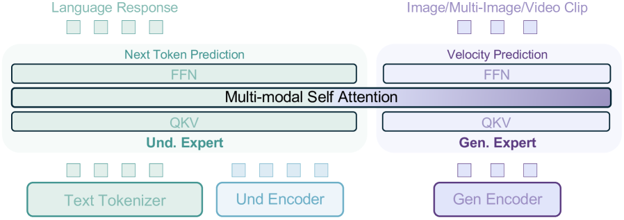
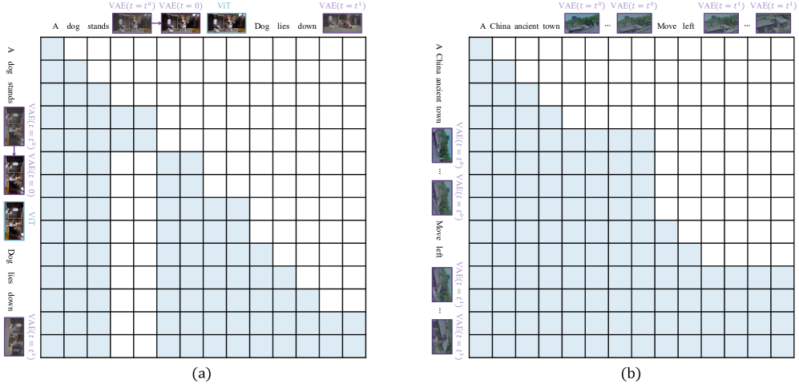
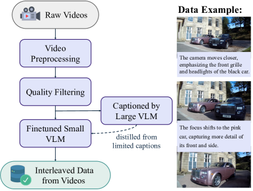
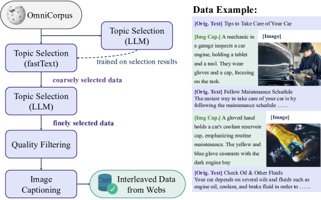
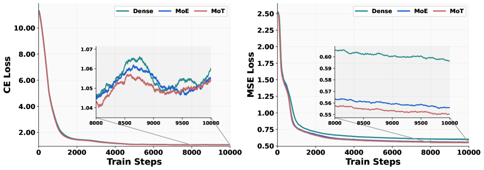
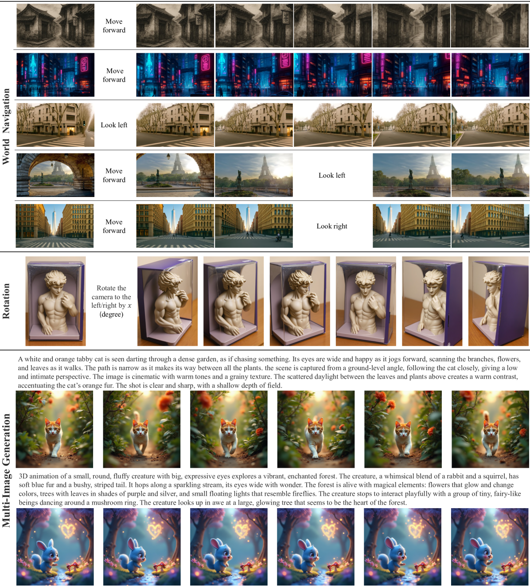

# BAGEL：交错多模态预训练中的世界建模涌现

| Checked Date | Repro Status | 本页证据口径 |
| --- | --- | --- |
| 2026-06-02 | Author code / checkpoints reported | 以 arXiv HTML、项目页与论文图表为主；future frame prediction、3D manipulation、world navigation 按论文 qualitative/demo evidence 解读。 |

BAGEL 的价值不只是“一个能看图又能画图的模型”。它更像一篇统一多模态预训练的路线论文：用一个 decoder-only backbone 承载文本、ViT 语义 token、VAE latent 和 interleaved multimodal sequence，再观察当数据规模、交错格式和训练阶段扩大后，模型是否出现更复杂的图像编辑、未来帧预测、3D 操作和世界导航能力。

## 论文信息

| 维度 | 贡献 |
| --- | --- |
| 节省的成本 | 避免把 VLM 与 diffusion generator 通过少量 adapter 硬接；用共享 self-attention 让理解和生成在每层交换信息 |
| 核心机制 | decoder-only backbone、MoT 双专家、双视觉编码、CE + Rectified Flow、generalized causal attention、interleaved data |
| 对世界模型主线的意义 | 说明“世界建模能力”可能从视频、网页、编辑和推理型交错数据中涌现，而不只来自显式 action 数据 |
| 主要风险 | 世界导航和 3D manipulation 多是 qualitative / benchmark 证据，尚不能等同于真实闭环世界模型 |
| 应接到本站哪里 | [Lance](lance.md)、[LingBot-World](lingbot-world.md)、[Towards Video World Models](towards-video-world-models.md)、[VLM/VLA 与世界模型高效训练接口](../../vlm/vlm-vla-for-efficient-world-model-training.md) |

## 核心问题

| 论文结论 | 证据来源 | 证据等级 | 可外推到世界模型高效训练 | 不能直接外推 |
| --- | --- | --- | --- | --- |
| bottleneck-free unified backbone 更利于长上下文多模态推理 | Figure 2、Figure 3、模型设计消融 | Architecture + Ablation | 世界模型里的理解和生成不要只靠小 adapter 传递状态 | 不能证明所有任务都需要完整双专家 |
| interleaved video/web data 能带来更强世界知识和时序信号 | Figure 4、数据构造、Table 1/3 | Data recipe | 视频帧间变化 caption、网页图文上下文和 reasoning data 可作为世界状态监督 | 不能替代真实 action-state-reward 轨迹 |
| generation data 需要更高采样比例 | Figure 5/6 的 loss 曲线 | Training diagnostic | 视觉生成/未来预测通常比理解更吃数据和学习率调度 | 不能直接照搬比例到机器人或视频策略 |
| BAGEL 展示 future frame、3D manipulation、world navigation | Figure 1/14、qualitative examples | Demo + qualitative | 统一多模态预训练可作为世界模型底座候选 | 不能证明闭环规划、动作因果或物理可执行性 |

## 论文位置

统一多模态模型常见有三种设计：

| Route | How it works | BAGEL 的判断 |
| --- | --- | --- |
| Quantized AR | 图像离散成 visual tokens，文本和图像都 next-token prediction | 工程简单，但视觉质量和延迟受限 |
| External Diffuser | VLM 生成少量条件 token，再调用外部 diffusion model | 收敛快，但理解到生成之间有信息瓶颈 |
| Integrated Transformer | 同一个 Transformer 同时处理语言建模和视觉 flow/diffusion | 训练成本更高，但长上下文信息交换更完整 |

BAGEL 选择第三条路，并加入 Mixture-of-Transformer-Experts。它关心的问题是：如果模型不再把“理解”和“生成”隔成两个系统，而是让它们在同一条上下文里逐层通信，会不会出现更强的跨模态组合能力？

## 方法结构

{ width="880" }

<small>图源：`Emerging Properties in Unified Multimodal Pretraining`，Figure 2。原论文图意：BAGEL 使用两个 Transformer experts 处理 understanding 与 generation 信息，但所有 token 在每层共享 multimodal self-attention；视觉侧用两个 encoder 分别捕捉 semantic content 和 low-level pixel information。</small>

!!! note "这张图怎么读"
    先看最中间的 `Multi-modal Self Attention`：理解和生成没有被一个小连接器压缩，而是在每个 Transformer block 里共享上下文。再看两侧 expert：语言 response 走 next-token prediction，image / multi-image / video clip 走 velocity prediction。

    对世界模型来说，这张图的重点是“共享状态、分开能力路径”。世界状态需要语义、空间、外观和未来预测共同存在；BAGEL 让它们在 attention 层通信，但用不同 expert 减少 CE 与 flow objective 的冲突。

### Token 和目标函数

BAGEL 的输入序列可以混合 text tokens、ViT tokens、clean VAE tokens 和 noised VAE tokens。文本输出用自回归交叉熵：

$$
\mathcal{L}_{\mathrm{CE}}
= - \sum_i \log p_{\theta}(y_i \mid y_{<i}, \mathcal{C}).
$$

| 符号 | 含义 |
| --- | --- |
| \(\mathcal{L}_{\mathrm{CE}}\) | multimodal understanding / text generation 的 next-token loss |
| \(y_i\) | 第 \(i\) 个目标文本 token |
| \(\mathcal{C}\) | 当前 interleaved multimodal context |

视觉生成用 Rectified Flow。干净 latent 记为 \(x_1\)，噪声记为 \(x_0\)，训练时采样 \(t\) 并预测从噪声到目标 latent 的方向：

$$
x_t = t x_1 + (1-t)x_0,\quad
\mathcal{L}_{\mathrm{MSE}}
= \mathbb{E}\left[\|v_{\theta}(x_t,t,\mathcal{C})-(x_1-x_0)\|_2^2\right].
$$

| 符号 | 含义 |
| --- | --- |
| \(x_t\) | flow matching 中的带噪视觉 latent |
| \(v_{\theta}\) | generation expert 预测的 velocity |
| \(\mathcal{L}_{\mathrm{MSE}}\) | visual generation 的 velocity prediction loss |

这也是 BAGEL 与纯离散视觉 AR 模型的差别：它没有把高保真视觉生成完全压进离散 token prediction，而是保留 diffusion / flow 对连续视觉 latent 的优势。

### Generalized causal attention

BAGEL 的 interleaved generation 样本可能包含多张图。每张图准备三组视觉 token：

| Token group | Role | Loss / cache behavior |
| --- | --- | --- |
| Noised VAE tokens | Rectified Flow 的训练目标 | 只在训练/当前生成时用于 MSE，不作为后续干净条件长期缓存 |
| Clean VAE tokens | 后续图像或文本生成的视觉条件 | 图像生成完成后替换 noised tokens，并进入 context |
| ViT tokens | 语义视觉条件 | 帮助统一 understanding 与 generation 的输入格式 |

{ width="920" }

<small>图源：`Emerging Properties in Unified Multimodal Pretraining`，Figure 15。原论文图意：展示 BAGEL 训练中的 causal mask；VAE 和 ViT 分别表示生成与理解视觉特征，\(t\) 是噪声时间步，\(t=0\) 表示 clean VAE latent。</small>

!!! note "这张图怎么读"
    图里的关键不是 mask 形状本身，而是“条件”和“目标”不能混。后续 token 可以看前面已经生成好的 clean VAE / ViT tokens，但不能把尚处在 denoising 状态的 noised VAE token 当成稳定世界状态。

    对世界模型项目来说，这一点可以直接迁移：past observation、future target、candidate action 和 predicted state 最好用显式 mask 区分。否则模型可能在训练时偷看未来，部署时就会漂。

## 训练细节

BAGEL 的数据不是只由 image-text pairs 组成。论文强调 text、image-text、video-text、web interleaved、video interleaved 和 reasoning-augmented data 的组合。

{ width="420" }

<small>图源：`Emerging Properties in Unified Multimodal Pretraining`，Figure 4(a)。原论文图意：视频数据先经过预处理和过滤，再由小 VLM 生成 temporally grounded captions，形成视频来源的 interleaved sequence。</small>

{ width="520" }

<small>图源：`Emerging Properties in Unified Multimodal Pretraining`，Figure 4(b)。原论文图意：网页数据基于 OmniCorpus，经 topic selection、质量过滤和 captioning 后，构造图文交错序列。</small>

!!! note "这两张数据图怎么读"
    视频 pipeline 的目标是把时间变化变成语言监督：模型不只是看到几帧，还看到帧间对象运动、动作变化和场景转移。网页 pipeline 的目标是降低图文弱对齐：把图片 caption 插入到图片之前，让模型先形成“概念草稿”，再学习生成或理解视觉内容。

    这就是 BAGEL 对世界模型路线的启发：数据格式本身就是训练目标的一部分。视频帧、变化描述、网页上下文和 reasoning trace 共同塑造模型对“世界状态如何变化”的理解。

| Data source | 论文披露的构造方式 | 对世界建模的意义 |
| --- | --- | --- |
| Video interleaved | 平均每个 clip 采样约 4 帧，生成 frame-pair change captions；得到约 45M temporally grounded sequences | 给模型帧间变化、动作转移和时序连续性信号 |
| Web interleaved | 对网页文档做 topic selection、质量过滤、caption-first 结构化；得到约 20M web documents | 让长上下文图文关系进入生成/理解上下文 |
| Reasoning-augmented | 约 500K examples，覆盖 T2I、free-form manipulation、conceptual edits 等 | 让语言推理成为图像生成和编辑前的中间规划步骤 |

### 训练阶段与调度

BAGEL 使用四阶段训练：

| Stage | Trainable parts | Data / tokens | 目标 |
| --- | --- | --- | --- |
| Alignment | 只训练 MLP connector，冻结 vision encoder 和 LLM | image-text captioning，固定 378x378 输入 | 对齐 SigLIP2 ViT 与 Qwen2.5 LLM |
| Pre-training | 除 VAE 外基本可训练，并加入 QK-Norm | 约 2.5T tokens，含 text、image-text、conversation、web/video interleaved | 建立统一理解与生成底座 |
| Continued Training | 提高视觉分辨率和 interleaved data ratio | 约 2.6T tokens | 强化 cross-modal reasoning 和长上下文生成 |
| SFT | 高质量理解与生成子集 | 约 72.7B tokens | 收口指令跟随、编辑质量和生成稳定性 |

<small>表源：`Emerging Properties in Unified Multimodal Pretraining`，Table 3 与 Section 4。表格保留原论文阶段英文名，数值按论文训练描述整理。</small>

训练时最重要的不是阶段名字，而是两个 tradeoff：

1. generation data 和 understanding data 的采样比例；
2. CE loss 与 MSE / flow loss 的优化速度。

{ width="920" }

<small>图源：`Emerging Properties in Unified Multimodal Pretraining`，Figure 3。原论文图意：在 1.5B LLM 上比较不同 Transformer 设计，CE loss 用于理解/文本任务，MSE loss 用于生成任务。</small>

!!! note "这张 loss 图怎么读"
    CE 和 MSE 不是同一种学习信号。CE 更关心 token 级语言/理解正确性；MSE 更关心视觉 latent 的 velocity prediction。统一模型如果只追求一个 loss 下降，另一侧可能被拖慢。

    BAGEL 的经验是 generation examples 要采样得更频繁，学习率和 loss weight 也要为视觉生成让路。对视频世界模型来说，这很合理：未来观测的细节、时序和一致性通常比文本理解更吃样本和训练步数。

## 实验结论

{ width="760" }

<small>图源：`Emerging Properties in Unified Multimodal Pretraining`，Figure 14。原论文图意：展示 BAGEL 在 navigation、rotation 与 multi-image generation 场景中的定性结果。</small>

!!! note "这张图支撑什么，不支撑什么"
    这张图支撑的是 BAGEL 能在多图上下文中保持一定空间关系、视角变化和连续视觉生成。它对“世界模型底座”很重要，因为世界不是单张图，而是随视角和时间变化的一组状态。

    但它不等于闭环交互世界模型。图中没有真实 agent 执行、没有 action success、没有碰撞或 reward，也没有固定历史下系统性改变动作的反事实评测。

## 消融诊断

| Diagnostic | Observation | 对训练 recipe 的解释 |
| --- | --- | --- |
| Loss design | Figure 3 比较 CE / MSE 在不同 Transformer 设计下的下降曲线 | 理解和生成目标存在优化冲突，MoT 与 shared attention 是为了同时保留交流和专门化 |
| Interleaved mask | Figure 15 区分 noised VAE、clean VAE 和 ViT tokens 的可见性 | future target、当前去噪 token 和已完成视觉状态必须分开，否则世界状态会被泄露 |
| Data scaling | video interleaved、web interleaved、reasoning-augmented data 在 PT/CT/SFT 中逐步加权 | 世界知识不是单一 caption 数据给出的，而来自时间变化、网页上下文和编辑/推理任务的组合 |
| Evidence boundary | navigation / rotation / manipulation 主要来自 qualitative examples | 可支持“世界模型底座候选”，不能支持“闭环策略已成立” |

### 和 Lance、LingBot-World 的关系

| Dimension | BAGEL | Lance | LingBot-World |
| --- | --- | --- | --- |
| Unified state | MoT + shared self-attention | shared interleaved context + dual expert pathways | video foundation model adapted to simulator |
| Visual representation | SigLIP2 ViT + FLUX VAE | Qwen2.5-VL ViT + Wan2.2 VAE | video generation latent / action-conditioned rollout |
| Training emphasis | large interleaved data and emergent abilities | staged multi-task synergy | long-horizon, action conditioning, causalization, distillation |
| World-model evidence | future frame, 3D manipulation, navigation demos | video generation / editing / understanding benchmarks | interactive simulation and action-conditioned world rollout |
| Main missing piece | closed-loop action causality | action-conditioned dynamics | independent closed-loop robotics proof |

BAGEL 是四篇统一多模态专题中最像“底座 scaling”路线的一篇。它说明大规模交错数据可以让 unified model 学到更丰富的世界知识；LingBot-World 则继续追问这些世界知识能否被动作条件实时驱动。

## 局限风险

1. **世界模型证据偏 qualitative**：navigation、rotation 和 manipulation 图很有启发，但还不是真实闭环 benchmark。
2. **动作接口不够显式**：BAGEL 的重点是交错多模态生成，不是固定动作空间下的 dynamics model。
3. **训练成本和数据治理很重**：45M video interleaved sequences、20M web documents 和多阶段训练不是轻量 recipe。
4. **评测仍偏图像/编辑/理解**：GenEval、WISE、GEdit 和 IntelligentBench 能测语义与编辑，不直接测物理状态正确性。
5. **推理仍需处理视觉生成成本**：虽然 generalized causal attention 可缓存 clean VAE / ViT context，但视觉 flow 生成仍比纯文本解码重。

## 阅读结论

BAGEL 的核心启发是：统一多模态世界模型不能只靠“VLM 外接一个图像生成器”。如果希望模型在长上下文里理解、生成、编辑和预测未来，理解与生成信号需要在共享上下文中充分通信，训练数据也要覆盖视频变化、网页上下文、编辑目标和推理过程。

!!! info "本站判断"
    BAGEL 是统一多模态世界模型底座路线的关键论文。它的强证据是 MoT + shared self-attention、interleaved data 和 staged training 能带来跨任务能力；它的弱证据是 world navigation / future frame 仍主要来自 qualitative examples，尚不能替代 action-conditioned closed-loop evaluation。
