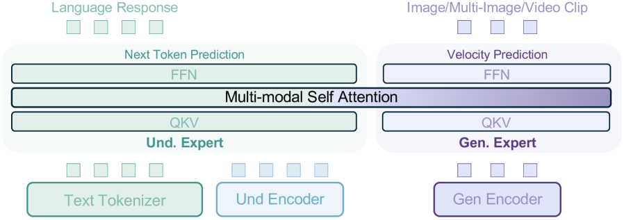
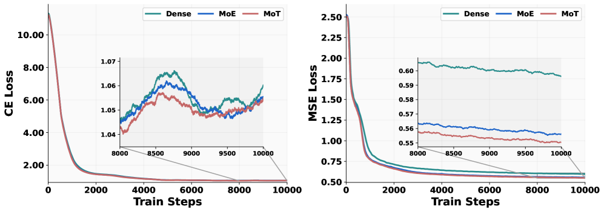
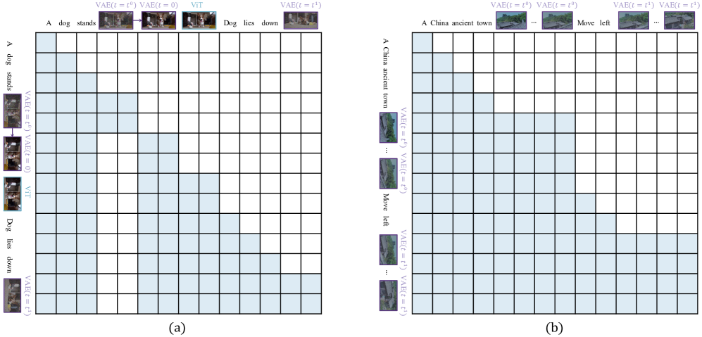
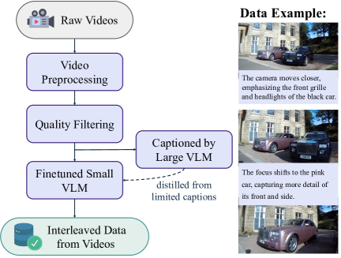
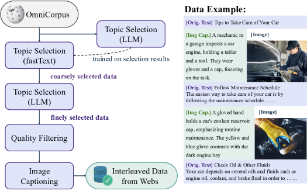
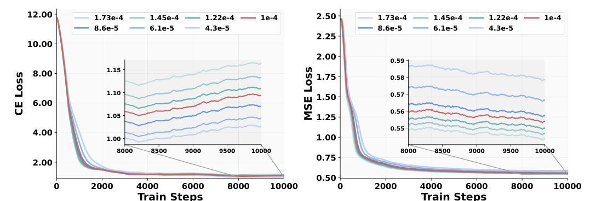
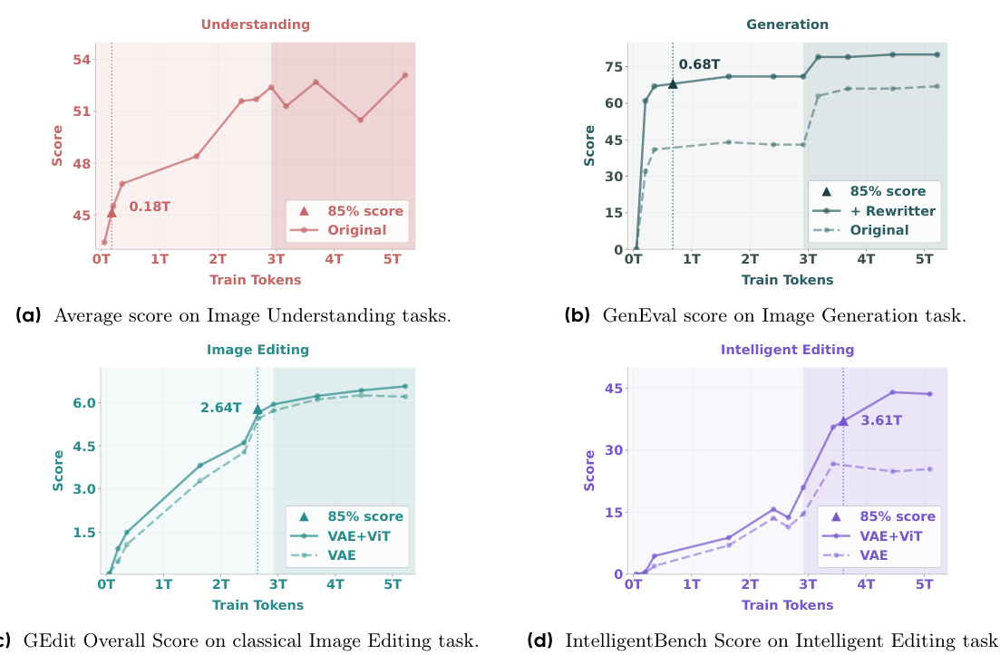
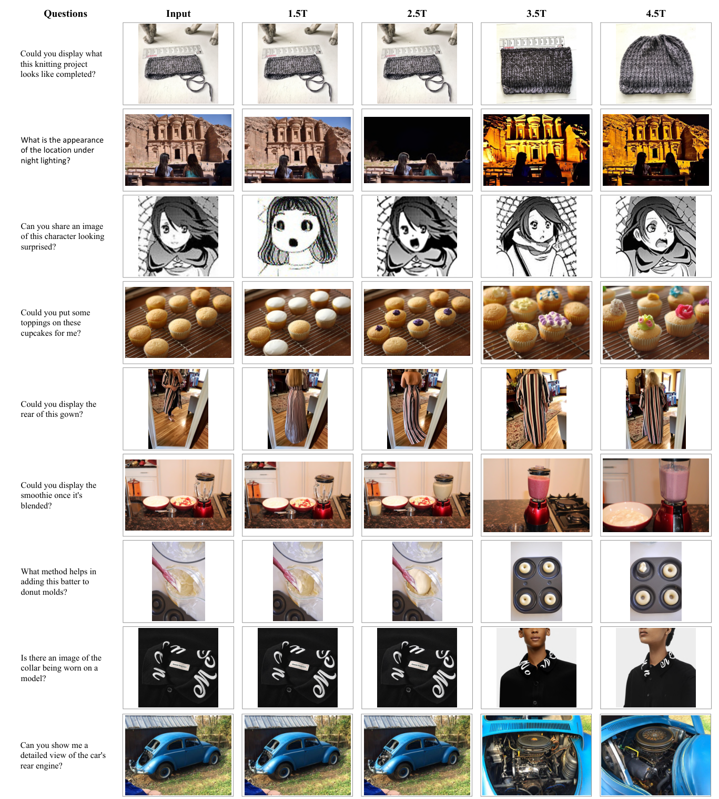
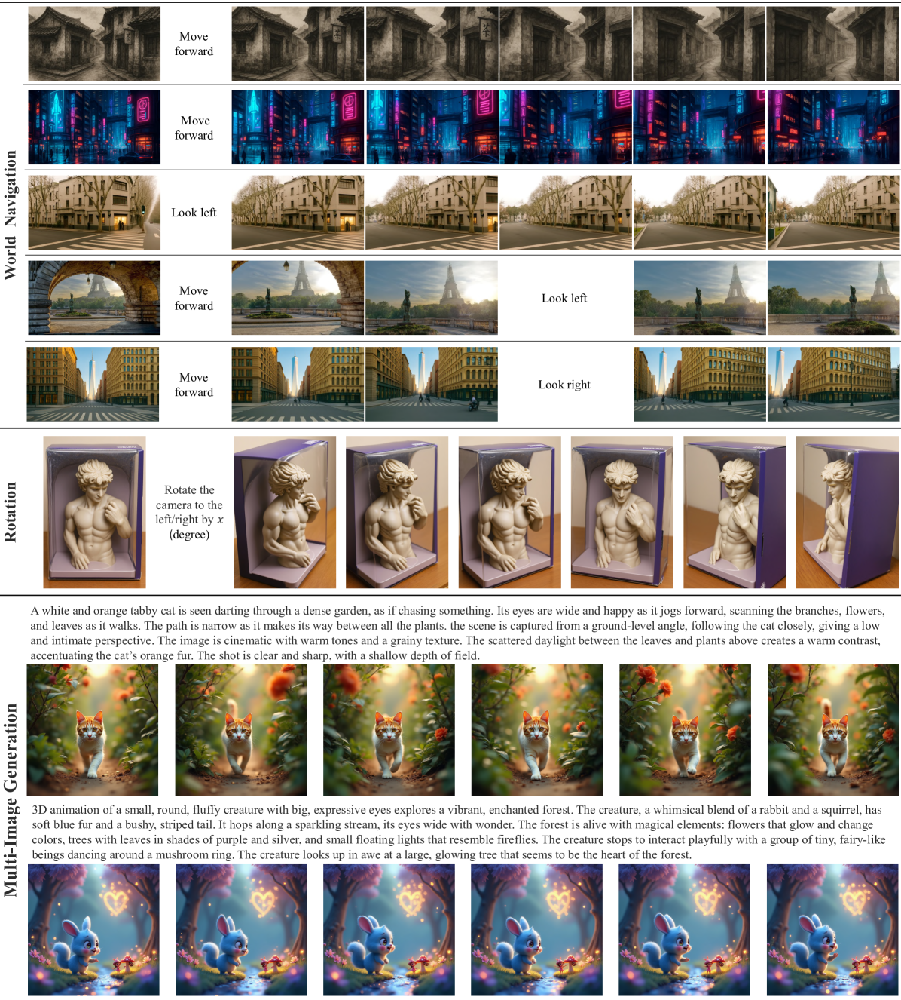
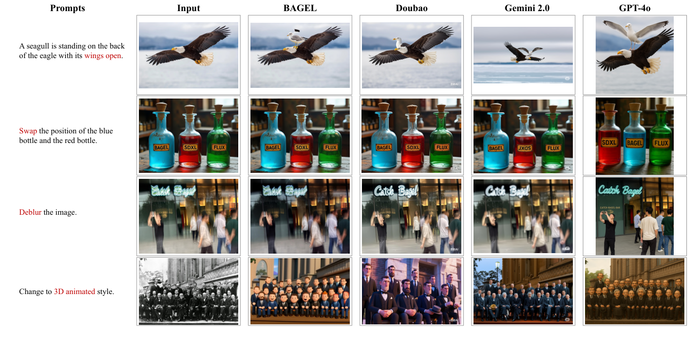

# BAGEL：交错多模态预训练中的世界建模涌现

!!! info "论文信息"
    **论文题名：** Emerging Properties in Unified Multimodal Pretraining。 
    **作者：** Chaorui Deng、Deyao Zhu、Kunchang Li、Chenhui Gou、Feng Li、Zeyu Wang、Shu Zhong、Weihao Yu、Xiaonan Nie、Ziang Song 等（共 12 人）。 
    **机构：** ByteDance Seed,、Shenzhen Institutes of Advanced Technology,、Monash University、Hong Kong University of Science and Technology,。 
    **时间 / 主题：** 2025-05；世界模型。 
    **arXiv / 官方报告：** arXiv：[2505.14683](https://arxiv.org/abs/2505.14683)；官方材料：[bagel-ai.org/](https://bagel-ai.org/)。 
    **GitHub / 项目：** GitHub：[github.com/ByteDance-Seed/Bagel](https://github.com/ByteDance-Seed/Bagel)；项目页：[bagel-ai.org/](https://bagel-ai.org/)。 
    **元数据来源与核验口径：** 来源：[arXiv](https://arxiv.org/abs/2505.14683)；[GitHub API / repo](https://github.com/ByteDance-Seed/Bagel)；[官方 / 项目材料](https://bagel-ai.org/)；Checked Date：2026-06-04；Repro Status：Paper / official materials reviewed, independent reproduction not claimed。

| Checked Date | Repro Status | 本页证据口径 |
| --- | --- | --- |
| 2026-06-02 | Author code / checkpoints reported | 以 arXiv HTML、项目页与论文图表为主；future frame prediction、3D manipulation、world navigation 按论文 qualitative/demo evidence 解读。 |

## 统一模型真正需要连接的，是理解与生成的中间过程

BAGEL 要解决的困难，比“一个模型既能回答图片问题，又能画图”更具体。用户要求把图里的外套变成玩偶穿着的服装，或从汽车外观生成相应内饰时，系统需要先理解对象、推断转换目标，再保留应当不变的身份、材质和布局。如果理解模块只把整段多模态上下文压成少量条件 token 交给另一个生成器，跨图片的细节与中间判断可能在这个接口处丢失。论文选择让理解与生成在每一层 attention 中访问同一个多模态上下文，并为两类计算保留独立参数。[↗](https://arxiv.org/pdf/2505.14683v3#page=3)

最终 BAGEL 的 Transformer 主体为 14B 总参数、约 7B activated parameters。这里的统一并非要求图像理解和图像生成采用相同 tokenizer，或所有 token 经过完全相同的权重；统一的是交错序列、逐层信息交换以及训练任务。文字仍然自回归预测，图像使用 Rectified Flow 预测连续 latent 的速度，二者通过共享上下文协作。

这篇论文的另一条主线是训练规模。作者没有只在独立图文对上联合优化，而是构造视频与网页来源的交错图文序列，让模型学习“前一张图、描述变化的文字、后一张图”之间的关系。历史 checkpoint 显示，基础理解与一般生成较早变强，编辑与依赖知识的复杂转换较晚改善。论文把这个先后过程称为 emerging properties。真正需要核实的问题是，哪些结构和数据让这种组合成为可能，曲线证明了什么，以及它与可用于控制的世界模型还有多远。

## 为什么选 Integrated Transformer

论文讨论了三类统一方式，其区别直接影响可传递的信息和训练代价。[↗](https://arxiv.org/pdf/2505.14683v3#page=4)

| Design | Understanding–generation interface | Main trade-off |
| --- | --- | --- |
| Quantized AR | 文字与离散视觉编码都做 next-token prediction | 接口直接沿用 LLM；视觉生成逐 token 进行，质量与延迟受离散表示和串行解码约束 |
| External Diffuser | LLM 输出少量语义 latent，作为独立 diffusion 模块的条件 | 容易复用已有生成器并较快收敛；压缩后的条件可能限制长上下文细节传递 |
| Integrated Transformer | 文字预测与视觉去噪在同一个 Transformer 上下文中交互 | 减少模块间的条件压缩；联合预训练需要更大计算投入，也要处理目标冲突 |

BAGEL 选择第三条路线，并进一步使用 Mixture-of-Transformer-Experts。它保留了外部 diffusion 方案擅长的连续 latent 生成方式，同时让生成过程在每层都能访问理解侧的 text/ViT tokens。作者将其称为 bottleneck-free，具体含义是没有强制经过一个小型语义条件集合的模块接口；这不意味着视觉编码本身没有压缩，也不意味着模型一定能无损记住所有上下文。

与采用单一离散视觉流的 LWM 相比，BAGEL 的选择还体现了另一种分工。LWM 用同一套 VQ 编码兼顾理解和生成；BAGEL 用 ViT 提供语义，用 VAE 保留可解码的空间细节，再让二者在主模型中交换信息。后面的复杂编辑实验专门比较 VAE-only 与 VAE+ViT，因而能够检查这条语义支路是否真正被生成任务使用。

## 两条视觉支路和两个专家怎样协作

原论文 Figure 2 可以分两层看。底部决定输入表示，左侧 text 与 understanding encoder、右侧 generation encoder 产生不同类型的 token。上部决定参数路由，两套 QKV 与 FFN 分别处理各自的 token，中间的 multimodal self-attention 让它们相互读取。

{ width="740" }

*原论文 Figure 2。Und. Expert 处理 text/ViT tokens，Gen. Expert 处理 VAE tokens；共享的是 attention 上下文与运算，并非强制共享全部 QKV 和 FFN 权重。*

理解侧采用 **SigLIP2-so400m/14** 初始化视觉编码器。作者将其位置 embedding 插值，并结合 NaViT，使图像以原始宽高比处理，最大输入尺寸为 $980\times980$；两层 MLP 将 ViT 特征映射到 LLM hidden dimension。理解 token 强调可与语言对应的对象和语义结构。生成侧则使用冻结的 **FLUX VAE**，在空间上降采样 8 倍，产生 16 通道 latent，再通过 $2\times2$ patch embedding 进入主模型。[↗](https://arxiv.org/pdf/2505.14683v3#page=5)

若输入图像高宽为 $H,W$，忽略边界处理，VAE 支路在主模型中的 token 数可由这两次空间压缩得到

$$
N_{\mathrm{VAE}}=\frac{H}{8\times2}\frac{W}{8\times2}=\frac{HW}{256}.
$$

因此 $512\times512$ 图像约对应 1024 个 VAE tokens，$1024\times1024$ 约对应 4096 个。这里是根据论文编码尺寸推导的预算估算。分辨率加倍会让该支路 token 数变为四倍，也会显著增加图像内部双向 attention 的工作量；后面的 CT 阶段提高分辨率，远不止“图片看上去更清楚”这么简单。

两个视觉支路在进入主干前都有 2D positional encoding。扩散时间步 embedding 直接加在 VAE token 初始 hidden states 上，作者没有像传统 DiT 那样主要通过 AdaLN 注入时间信息。这让主干更接近继承自 Qwen2.5 的 decoder-only Transformer。主干保留 RMSNorm、SwiGLU、RoPE 和 GQA，并加入 QK-Norm 稳定联合训练。[↗](https://arxiv.org/pdf/2505.14683v3#page=4)

MoT 的 **hard routing** 按 token 类型决定专家，不是每个 token 由学习到的 router 在许多专家中竞争选择。原始 Qwen2.5 权重作为理解专家，处理文字与 ViT token；复制出来的生成专家处理 VAE token。对单个 attention head，可用下面的简化记号解释信息如何越过专家边界。

$$
q_i=W_Q^{e(i)}h_i,\qquad k_i=W_K^{e(i)}h_i,\qquad v_i=W_V^{e(i)}h_i,
$$

$$
o_i=\sum_j\operatorname{softmax}_j\left(\frac{q_i^\top k_j}{\sqrt d}+M_{ij}\right)v_j.
$$

$e(i)$ 表示第 $i$ 个 token 的专家，$M_{ij}$ 表示允许访问的位置，$d$ 为 head dimension。实际模型还包含 GQA、QK-Norm 等细节；这两式只是说明 routing 与 attention 共享的关系。生成 token 的 query 由生成专家计算，但可以读取理解 token 的 key/value；得到的输出再交给对应专家继续处理。因此参数可以专用，跨模态信息仍能逐层交换。把“两个专家”理解成两个互不相见、只在输入输出连接的独立网络，就会遗漏 BAGEL 的关键设计。

### MoT 比仅复制 FFN 多解决了什么

作者在 Qwen2.5-1.5B 上比较 Dense、MoE 与 MoT。MoE 只复制每层 FFN 作为生成专家；MoT 则复制全部可训练 Transformer 参数。三者使用相同数据与超参数，generation:understanding 采样比例为 4:1，按作者的比较口径 active FLOPs 相同，但 MoE/MoT 的总参数和存储需求更大。[↗](https://arxiv.org/pdf/2505.14683v3#page=6)

Figure 3 左边是理解 CE，右边是生成 MSE。先看右图后半段的放大框，MoT 的红线低于只拆 FFN 的 MoE，再低于完全共享的 Dense；左图差距小得多，并且有明显的波动和局部接近。

{ width="830" }

*原论文 Figure 3。1.5B 基础规模的受控架构消融。MoT 在生成 MSE 上的收益更清楚，理解 CE 的优势较小。*

这个实验支持理解与生成有不同的优化需求，连注意力投影等参数也拆开，比仅增加独立 FFN 更适合本文设定。它没有证明所有规模、所有数据配比都应使用完全相同的专家划分，也没有以相同总参数量比较“两个小专家”和“一个更大 Dense”。最终 7B active 模型的主结果综合了架构、数据与大规模训练，不能把所有增益都归因于这一次 1.5B 消融。

## 一条序列里同时训练文字预测和图像速度预测

文本位置采用通常的 next-token cross-entropy，图像位置则承担 Rectified Flow 的 velocity prediction。它们共享上下文但监督对象不同。文本目标是下一个离散 token 的概率分布，图像目标是当前带噪 latent 应沿哪个方向变化，才能还原数据分布中的视觉结果。[↗](https://arxiv.org/pdf/2505.14683v3#page=3)

论文没有展开完整的 Rectified Flow 数学式。为解释其输入输出，下面采用与 Figure 15 中 $t=0$ 表示 clean latent 一致的标准线性路径记法。令 $x_0$ 为真实图像的 VAE latent，$\epsilon$ 为噪声，$t\in[0,1]$ 为噪声程度，则

$$
x_t=(1-t)x_0+t\epsilon,\qquad v^*=\epsilon-x_0.
$$

网络接收 $x_t$、时间 $t$ 和多模态上下文 $c$，输出速度 $v_\theta(x_t,t,c)$，相应训练目标可表示为

$$
\mathcal L_{\mathrm{RF}}=\mathbb E\left[\left\|v_\theta(x_t,t,c)-(\epsilon-x_0)\right\|_2^2\right].
$$

这是对论文 velocity-MSE 训练接口的解释性公式，不补充其未报告的采样分布、求解器或步数。按该约定，推理从高噪声 $t=1$ 走向 clean 端 $t=0$，利用预测速度逐步更新 latent，再用 VAE decoder 输出图像。图像 token 在每个去噪步骤内一起参与计算，不能把它写成与文字完全一样的逐像素 next-token 解码。

PT、CT 与 SFT 阶段使用 CE:MSE 为 0.25:1 的权重。将两项按各自的训练口径归一化后，论文的联合加权可以概括为

$$
\mathcal L=0.25\,\mathcal L_{\mathrm{CE}}+\mathcal L_{\mathrm{RF}}.
$$

损失权重与数据采样比例是两把不同的旋钮。采样比例决定遇到哪类样本的频率，损失权重决定这些样本在更新时以多大系数贡献梯度；专家划分则改变哪些参数承担这些梯度。理解这三个环节的联动，比单独记住“0.25:1”更有用。[↗](https://arxiv.org/pdf/2505.14683v3#page=10)

## Generalized causal attention 如何防止训练目标泄漏

普通 causal mask 只需阻止文字看到未来。交错图像训练更复杂，因为同一张图会同时准备 noisy VAE、clean VAE 与 ViT 三套表示。如果当前去噪目标可以直接看到自己对应的 clean latent 或语义编码，训练就可能通过答案副本完成预测；如果后续图片只能看到前一张图的随机噪声副本，又会把无关噪声传播进历史上下文。

BAGEL 先把序列切成连续的 modality splits。文字 split 内部保持 causal，视觉 split 内部允许双向 attention；跨 split 的可见性再按任务决定。Figure 15 左右两图对应两种不同训练设置，应先分清它们再阅读蓝色可见区域。[↗](https://arxiv.org/pdf/2505.14683v3#page=5)

{ width="830" }

*原论文 Figure 15。左图是交错 image-text generation，右图是采用 diffusion forcing 的 multi-image/video clip generation。$t=0$ 为无噪声，蓝色区域表示可访问关系。*

### 交错图文使用已经完成的 clean history

在左图中，第一张狗的图片存在一个 noisy VAE block，承担该图的 RF loss；它后面的 clean VAE 与 ViT blocks 提供历史条件。后续文字“Dog lies down”和下一张图可以访问前图的 clean VAE/ViT，却不访问前图 noisy VAE 那一列。当前图的 noisy block 只能看到合法前缀和自身 noisy tokens，不能偷看自己在训练样本中的 clean 副本。这既保留了未来生成所需的图像细节，也隔离了当前预测的答案。[↗](https://arxiv.org/pdf/2505.14683v3#page=31)

推理时并不存在预先可知的目标 clean image。模型先根据历史生成当前图片，去噪完成后，把生成结果作为 clean 视觉内容接入后续上下文。作者缓存 clean VAE 与 ViT 的 key/value，不把不断变化的 noisy target 留作永久历史；此后继续生成文字或下一张图片时，便可以复用已完成上下文的 KV。这解释了为何训练要同时准备“用于监督的 noisy 版本”和“用于后续条件的 clean 版本”。

### 多图或视频联合生成允许不同噪声状态的历史

右图采用 diffusion forcing。各图具有独立噪声水平，当前图可以条件于前图的 noisy 表示，这与左图“后续内容只读 clean history”的规则不同。作者还随机将相邻图像分组，同组使用相同噪声水平，并在组内开放 full attention，增强帧间一致性。组之间保留顺序关系，同组内部则可以联合协商视觉内容。[↗](https://arxiv.org/pdf/2505.14683v3#page=5)

这使模型学习的不只是“完整上一帧到下一帧”，还包括不同去噪状态之间的联合建模。若把所有设置都压成“只允许看 clean VAE”，就会误述 diffusion forcing；若反过来允许所有图文任务看到 noisy/clean 副本，又可能破坏因果监督。这里的 causal 指训练与生成序列中的信息可见性，并不保证输出遵循现实世界的物理因果规律。

实现使用 PyTorch FlexAttention，作者报告相对 naive scaled-dot-product attention 约 2 倍加速。这是指定 attention 实现的比较，不能直接换算成整套模型训练或端到端编辑快两倍。为支持 classifier-free guidance，训练分别以 0.1、0.5、0.1 概率丢弃 text、ViT、clean VAE 条件。这样模型学习缺失条件时的分支，推理才有相应引导接口。[↗](https://arxiv.org/pdf/2505.14683v3#page=5)

## 交错数据提供的是跨图像关系

独立图文对能教会模型“这段文字对应什么图”，却很少直接教它“同一个对象经历这句话描述的变化后应该是什么样”。视频提供对象身份、视角和动作之间的连续关系，网页提供概念、步骤和图示之间的关系。BAGEL 把两者整理成统一交错格式，但二者对模型的监督并不相同。

| Data Source | # Data (M) | # Tokens (T) |
| --- | ---: | ---: |
| Text Data | 400 | 0.4 |
| Image-Text-Pair Understanding Data | 500 | 0.5 |
| Image-Text-Pair Generation Data | 1600 | 2.6 |
| Interleaved Understanding Data | 100 | 0.5 |
| Interleaved Generation Data: Video | 45 | 0.7 |
| Interleaved Generation Data: Web | 20 | 0.4 |

*原论文 Table 1。数据池统计与实际 seen tokens 分开，训练随机采样，不能把每个数据池大小直接视作完整遍历次数。*

纯文本维持原 LLM 的语言能力。理解图文对经过 CLIP 相似度、分辨率、宽高比、文本长度和重复过滤，并用 concept-aware sampling 补充长尾概念，还包括 OCR、图表、grounding 等监督。生成图文对重视清晰度、结构与风格多样性，并包含少量已有 T2I 模型产生的合成数据。这些基础数据让模型先具备读图和画图能力，交错数据进一步教它如何在多张图之间运用这些能力。[↗](https://arxiv.org/pdf/2505.14683v3#page=7)

### 视频变成“帧、变化描述、帧”

视频来源包括公开网络视频、Koala36M 和 MVImgNet2.0。首先做 shot detection，将视频切成连贯片段，必要时根据视觉相似度合并相关段；再去黑边、logo 与文字覆盖，按长度、分辨率、清晰度和运动稳定性过滤，并用 CLIP 相似度去重。[↗](https://arxiv.org/pdf/2505.14683v3#page=8)

Figure 4a 的重点在中间的 captioner 蒸馏。大 VLM 为少量帧对产生高质量变化描述，再微调一个基于 Qwen2.5-VL-7B 的小模型，批量生成帧间 caption。

{ width="360" .atlas-figure-compact }

*原论文 Figure 4a。示例中的文字描述相机靠近汽车、关注点转移到另一辆汽车，承接的是帧间变化，而非为每帧独立列举物体。*

每段视频平均采样四帧，帧对 caption 限制在 30 tokens 内以减少幻觉，最终得到 45M 条 temporally grounded interleaved sequences。变化描述为生成目标提供一个可学习的语言接口。例如“镜头靠近”与后续局部放大的画面相对应，“转向另一辆车”与主体变化相对应。它能支持编辑和视角转换，但普通视频 caption 本身不等于精确动作、相机位姿或控制标签；后面的导航实验还要专门补充轨迹标注。

### 网页需要修复松散的文字图像对应关系

网页交错数据基于 OmniCorpus。作者先用 LLM 标注少量文档主题，训练 fastText 快速粗筛，再用 Qwen2.5-14B 做细筛。之后应用规则，包括过滤 URL 中像 icon/widget 的 UI 图片，尺寸保持在 150–20000 范围、宽高比在 $1/2$ 到 2 之间，检查图像清晰度与相关性，去除 OCR 超过 100 tokens 的文档式图片，修剪无关页眉页脚，并保留含 3–8 张图的文档。[↗](https://arxiv.org/pdf/2505.14683v3#page=8)

Figure 4b 右侧应比较 Original Text 与 Img Cap. 的作用。原始文章讲汽车维护，离某张图片最近的文字未必准确描述图片中应出现的对象与动作，新增 caption 则给出局部视觉目标。

{ width="430" .atlas-figure-compact }

*原论文 Figure 4b。主题筛选之后加入质量过滤与逐图 caption，形成带原文、局部图像描述和图片的结构化序列。*

作者采用 caption-first 策略，用 Qwen2.5-VL-7B 为每张图生成简洁描述，插到该图之前，相当于先给模型一个概念草稿再要求生成视觉内容。图像之间超过 300 tokens 的文字则由 LLM 摘要，提高上下文密度，最终得到 20M 个交错网页文档。此外还加入现有 image editing 数据作为结构化交错样本。因此不能把编辑能力全说成从完全无标签网页与视频中自发长出，训练中确实包含明确的编辑监督。[↗](https://arxiv.org/pdf/2505.14683v3#page=9)

### Reasoning-augmented data 怎样让语言计划进入生成

作者另构造约 500k reasoning-augmented examples。文本具体展开了三条流程。T2I 从人工编写的短且模糊的 query 与 guidance 出发，用 Qwen2.5-72B 扩展成更明确的描述，再调用 FLUX.1-dev 产生目标图。自由编辑从现有编辑或视频数据中抽取 source/target image pair，用 VLM 结合输入、目标、请求以及 R1 风格示例生成修改说明。Conceptual edits 则从网页图像序列中筛选合理的输入输出对，依次生成问题、检验问题与图像的匹配度，再补充转换说明。[↗](https://arxiv.org/pdf/2505.14683v3#page=9)

附录的 prompt 特别强调“什么应该改变、什么应该保持”。编辑与视频样本的说明约控制在 60 tokens 内，概念转换约 200 tokens 内。这些是监督数据的构造要求，教师在生成说明时能看到目标图；部署时 BAGEL 并不会获得真实答案图作为输入。它学到的是先根据当前问题与图像形成生成指导，再生成结果的过程。[↗](https://arxiv.org/pdf/2505.14683v3#page=34) [↗](https://arxiv.org/pdf/2505.14683v3#page=36)

这种数据设计让语言知识有一个可直接影响视觉输出的中间接口。它也意味着后文 Self-CoT 的改进发生在经过相应监督的模型上，不能直接等同于强化学习训练出了通用视觉规划。论文的训练方案是预训练与监督微调，RLHF 在失败讨论中作为未来改进方向出现。

## 四阶段训练如何改变模型的学习重点

BAGEL 的训练分为 Alignment、Pre-training、Continued Training 与 SFT。Alignment 只训练连接 SigLIP2 与 Qwen2.5 的 MLP，视觉编码器和 LLM 冻结，用图像描述任务完成接口对齐。SigLIP2 初始化来自 384 分辨率版本，而本阶段实际图像尺寸按论文 recipe 使用 $378\times378$，这两个数字指的是不同环节。PT 开始加入 QK-Norm，并训练除 VAE 外的参数；CT 增加分辨率和交错数据比例；SFT 再使用高质量生成子集，以及从 LLaVA-OV、Mammoth-VL 过滤的理解指令数据。[↗](https://arxiv.org/pdf/2505.14683v3#page=10)

| Hyperparameter | Alignment | PT | CT | SFT |
| --- | ---: | ---: | ---: | ---: |
| Learning rate | $10^{-3}$ | $10^{-4}$ | $10^{-4}$ | $2.5\times10^{-5}$ |
| LR scheduler | Cosine | Constant | Constant | Constant |
| Warm-up steps | 250 | 2500 | 2500 | 500 |
| Training steps | 5K | 200K | 100K | 15K |
| Training seen tokens | 4.9B | 2.5T | 2.6T | 72.7B |
| Loss weight (CE : MSE) | — | 0.25 : 1 | 0.25 : 1 | 0.25 : 1 |
| EMA ratio | — | 0.9999 | 0.9999 | 0.995 |
| Sequence length per rank (min, max) | 32K, 36K | 32K, 36K | 40K, 45K | 40K, 45K |
| Max context window | 16K | 16K | 40K | 40K |
| Gen resolution (min short side, max long side) | — | 256, 512 | 512, 1024 | 512, 1024 |
| Und resolution (min short side, max long side) | 378, 378 | 224, 980 | 378, 980 | 378, 980 |
| Diffusion timestep shift | — | 1.0 | 4.0 | 4.0 |

*原论文 Table 3。所有阶段使用 AdamW，$\beta_1=0.9$、$\beta_2=0.95$、$\epsilon=10^{-15}$，weight decay 为 0，gradient norm clip 为 1.0。*

表里有两个容易误读的“长度”。Sequence length per rank 是为了各 rank 负载均衡，把样本打包进一个窄区间后的总长度；max context window 才是单个上下文的上限。PT 每 rank 可放到 36K，并不意味着模型在一个样本里已经拥有 36K 的可见上下文。CT 的 40–45K packing 区间也不应直接叫作 45K context。[↗](https://arxiv.org/pdf/2505.14683v3#page=11)

生成分辨率从短边至少 256、长边最多 512，变为至少 512、最多 1024。作者同时把 diffusion timestep shift 从 1.0 调到 4.0，以调整噪声水平的采样分布；这个值不是去噪步数，也不是“采样次数乘四”。PT/CT/SFT 使用 constant LR，目的是让训练可以继续增加数据而无需因一个预设衰减周期结束而重启整条计划。

| Data sampling ratio | Alignment | PT | CT | SFT |
| --- | ---: | ---: | ---: | ---: |
| Text | 0.00 | 0.05 | 0.05 | 0.05 |
| Image-Text pair (T2I) | 0.00 | 0.60 | 0.40 | 0.30 |
| Image-Text pair (I2T) | 1.00 | 0.10 | 0.10 | 0.05 |
| Interleaved understanding | 0.00 | 0.10 | 0.15 | 0.20 |
| Interleaved generation: video | 0.00 | 0.10 | 0.15 | 0.20 |
| Interleaved generation: web | 0.00 | 0.05 | 0.15 | 0.20 |

*原论文 Table 3 的数据混合部分。每阶段各行之和为 1。*

按表中后三类相加，交错数据比例从 PT 的 25% 增至 CT 的 45%，再到 SFT 的 60%。训练后期更强调跨模态关系，而非持续使用同样的独立图文配比。这也意味着后面的能力曲线不是一个固定分布上单纯延长训练的实验。模型看到的样本类型、分辨率、上下文长度都随阶段变化。

### 数据比例与学习率消融显示两项损失并不同步

作者还在 1.5B 上将 generation:understanding 从 1:1 提高到 4:1。Figure 5 显示生成 MSE 持续改善，理解 CE 没有同样清晰的单调趋势。这支持生成任务需要被更频繁采样，但最后的大模型使用上面的分阶段配比，并非所有阶段都机械固定为 4:1。[↗](https://arxiv.org/pdf/2505.14683v3#page=11)

学习率消融的冲突更明显。Figure 6 固定 1:1 数据比例，只比较不同 LR。先看左侧放大框，再对照右侧同一颜色的曲线，会发现优化 CE 有利的方向与优化 MSE 有利的方向相反。

*原论文 Figure 6。1.5B 模型的学习率消融，较小 LR 更有利于 CE，较大 LR 更有利于生成 MSE。*

这解释了作者为何同时使用参数分工、生成数据倾斜与 CE/MSE loss weighting。单一学习率可能让一类任务收敛得快、另一类退化，但简单降低整个模型的 LR 又拖慢生成。加权目标可以改变梯度的相对贡献，却不严格等价于给两个任务分别设置互不干扰的学习率，因为跨模态 attention 仍把两者的优化联系起来。

## “涌现”曲线首先是一条训练轨迹中的能力先后

论文用一个较窄的定义讨论 emerging properties，即某项能力在早期训练阶段不明显，在后期阶段出现。作者保存历史 checkpoint，分别测理解、GenEval、普通编辑 GEdit 与 IntelligentBench，再用达到峰值 85% 所需 seen tokens 比较能力形成的时间尺度。这里的“85%”是相对该能力曲线自身峰值的阈值，不是不同任务统一的合格标准。[↗](https://arxiv.org/pdf/2505.14683v3#page=12)

Figure 7 应分成两个问题读。先比较四个面板的横向位置，观察不同任务何时接近各自最终水平；再比较下方两个面板的 VAE+ViT 与 VAE-only，观察语义视觉支路对两种编辑任务的影响。

*原论文 Figure 7。所有历史 checkpoint 评测均关闭模型自身 thinking mode；生成面板同时显示有无 LLM rewriter，两类编辑面板比较 VAE+ViT 与 VAE-only。浅深背景表示低分辨率 PT 与高分辨率 CT。*

| Capability | Evaluation proxy | Tokens to 85% of peak |
| --- | --- | ---: |
| Understanding | 作者汇总的图像理解 benchmark score | 0.18T |
| Generation | GenEval，图中阈值位于 + Rewriter 曲线 | 0.68T |
| Image Editing | GEdit Overall Score | 2.64T |
| Intelligent Editing | IntelligentBench Score | 3.61T |

*原论文 Figure 7。该阈值用于描述训练轨迹，不是单独测得的普适规模定律。*

基础理解较早接近自身最终得分，普通生成也相对较早；需要读懂输入并施加转换的编辑任务要更久，依赖概念与世界知识的 Intelligent Editing 最晚。右下面板在约 3T 之后的改善尤其明显，作者概括为后期从约 15 提高到约 45。这个顺序与任务所需的组合复杂度一致，但它还不能证明一个只由 token 总数触发的固定相变。[↗](https://arxiv.org/pdf/2505.14683v3#page=13)

原因有三点。首先，前述 CT 同时提高分辨率、上下文长度和交错数据比例，横轴增加不代表其他因素固定。其次，不同 benchmark 的得分函数不同，达到自身峰值的 85% 并不对应同样的能力增长量。再次，理解本来就从已训练的 Qwen 与 SigLIP2 初始化，不能把理解曲线较早饱和完全解释为理解任务在本质上更简单。图中阶段分界画在约 3T 附近，recipe 表则给 PT 2.5T 的预算，也不宜凭图上阴影进一步声称每个拐点发生在精确相同的训练 step。

VAE+ViT 对照更贴近模型内部机制。普通 GEdit 两条线相近，而 IntelligentBench 上，保留 ViT 的实线在后期明显高于只留 VAE 的虚线。这说明复杂转换确实利用了理解侧的语义信息，不能仅靠可重建像素的 VAE 条件完成。它支持双表示路线的价值，但也不等同于重新训练一个完全不含 ViT 的模型、在相同全部预算下做架构比较；图中观察应限制为论文给出的特征输入对照。

### 后期变化不只是把同一张图画得更精致

Figure 9 提供了不同 checkpoint 的实际输出，能检查曲线背后的行为变化。先看“编织完成后是什么样”和“衣领穿到模特身上”两行，早期模型经常近似复制输入，后期才做出任务要求的状态或呈现方式转换。

*原论文 Figure 9，比较 1.5T、2.5T、3.5T 与 4.5T checkpoint。输入图、问题与全部 checkpoint 列均保留。*

编织样本在早期基本仍是针上的半成品，4.5T 时出现完整帽子；汽车发动机一行在早期仍返回汽车外观，到后期开始展示发动机区域；搅拌后的饮料也由几乎不变的原场景转为具有液体状态变化的画面。这里的差别涉及“该生成什么”，而不只是纹理清晰度。相较之下，Figure 8 的一般人像生成在较早 checkpoint 已经能输出合理图像，后续更多改善画质、文字与指令细节。[↗](https://arxiv.org/pdf/2505.14683v3#page=14) [↗](https://arxiv.org/pdf/2505.14683v3#page=15)

这些样例让“复杂转换较晚形成”的说法更有内容，但它们仍是作者选择的定性实例。不能从一顶完成的帽子推断模型在所有编织项目上掌握了物理制作过程，也不能从汽车内部生成推断恢复了这辆车不可见部分的真实几何。某些任务允许基于常识生成合理候选，而非还原唯一真实状态，IntelligentBench 的评价规则也明确保留了这种自由度。

## 基础理解有没有因加入生成而明显失守

Table 4 同时比较专门的视觉理解模型与统一模型。下面保留决定判断的若干行，重点是近似 activated parameter 规模的比较，同时保留 1.5B MoT 结果，避免把所有数字混为一个模型。

| Type | Model | # LLM Params | MME-P | MME-S | MMBench | MMMU | MM-Vet | MathVista | MMVP |
| --- | --- | --- | ---: | ---: | ---: | ---: | ---: | ---: | ---: |
| Und. Only | InternVL2.5 | 7B | — | 2344 | 84.6 | 56.0 | 62.8 | 64.4 | — |
| Und. Only | Qwen2.5-VL | 7B | — | 2347 | 83.5 | 58.6 | 67.1 | 68.2 | — |
| Unified | Janus-Pro | 1.5B | 1444 | — | 75.5 | 36.3 | 39.8 | — | — |
| Unified | BAGEL | 1.5B MoT | 1610 | 2183 | 79.2 | 43.2 | 48.2 | 63.4 | 54.7 |
| Unified | Janus-Pro | 7B | 1567 | — | 79.2 | 41.0 | 50.0 | — | — |
| Unified | MetaQuery-XL | 7B | 1685 | — | 83.5 | 58.6 | 66.6 | — | — |
| Unified | BAGEL | 7B MoT | 1687 | 2388 | 85.0 | 55.3 | 67.2 | 73.1 | 69.3 |

*原论文 Table 4 关键比较行。MME-S 为 MME-P 与 MME-C 之和；MetaQuery-XL 使用并冻结预训练 Qwen2.5-VL。MoT 的 activated 参数与总参数不能混同。*

相对 Janus-Pro-7B，BAGEL 的 MMMU 从 41.0 提高到 55.3，MM-Vet 从 50.0 提高到 67.2，即分别提高 14.3 与 17.2 分。相对 Qwen2.5-VL-7B，BAGEL 在 MMBench、MM-Vet、MathVista 等列更高，但 MMMU 55.3 低于 58.6；MetaQuery-XL 的 MMMU 也为 58.6。因而主表支持它在多个标准理解任务上保持很强能力，并没有支持“统一训练后每项都胜过所有专门理解模型”。[↗](https://arxiv.org/pdf/2505.14683v3#page=16)

这个结果回答的是可行性问题。一个包含图像去噪、编辑和交错生成训练的大模型，仍能保有较好的读图与推理表现。它不单独证明 MoT 已彻底消除了负迁移，因为各模型的预训练数据和预算不同，也没有一个同等完整训练预算、只去掉生成任务的 BAGEL 对照。架构消融与主结果各自承担不同证据角色，前者观察优化差异，后者展示最终能力组合。

## 一般图像生成、知识生成和外部 rewriter 必须分开看

GenEval 检验对象、数量、颜色、位置与属性绑定。BAGEL 原始提示条件下 Overall 为 0.82，使用 LLM rewriter 后为 0.88。表中的 dagger 是外部 prompt rewriting 条件，不等于让 BAGEL 自己先输出 Self-CoT。[↗](https://arxiv.org/pdf/2505.14683v3#page=17)

| Model | Single Obj. | Two Obj. | Counting | Colors | Position | Color Attri. | Overall |
| --- | ---: | ---: | ---: | ---: | ---: | ---: | ---: |
| SD3-Medium | 0.99 | 0.94 | 0.72 | 0.89 | 0.33 | 0.60 | 0.74 |
| FLUX.1-dev† | 0.98 | 0.93 | 0.75 | 0.93 | 0.68 | 0.65 | 0.82 |
| LWM | 0.93 | 0.41 | 0.46 | 0.79 | 0.09 | 0.15 | 0.47 |
| Janus-Pro-7B | 0.99 | 0.89 | 0.59 | 0.90 | 0.79 | 0.66 | 0.80 |
| MetaQuery-XL† | — | — | — | — | — | — | 0.80 |
| BAGEL | 0.99 | 0.94 | 0.81 | 0.88 | 0.64 | 0.63 | 0.82 |
| BAGEL† | 0.98 | 0.95 | 0.84 | 0.95 | 0.78 | 0.77 | 0.88 |

*原论文 Table 5 关键行。† 表示使用 LLM rewriter，未报告子项的模型保留空项。*

rewriter 对 BAGEL 的 Position 从 0.64 提高到 0.78，Color Attri. 从 0.63 提高到 0.77，说明更明确的语言条件可以改善关系与属性绑定。也要保留反例，BAGEL 无重写时 Position 低于 Janus-Pro 的 0.79，即使加入重写也仍略低。整体平均较高并不意味着每项关系都更可靠。与 LWM 的较大差距还同时包含模型表示、生成范式、数据与训练规模的不同，不能用这一表格单独得出“RF 必定比所有离散生成更强”的因果结论。

WISE 更关注文字提示中隐含的文化、时间、空间和科学知识，适合检验在生成前展开语言指导是否有帮助。

| Model | Cultural | Time | Space | Biology | Physics | Chemistry | Overall |
| --- | ---: | ---: | ---: | ---: | ---: | ---: | ---: |
| FLUX.1-dev | 0.48 | 0.58 | 0.62 | 0.42 | 0.51 | 0.35 | 0.50 |
| Janus-Pro-7B | 0.30 | 0.37 | 0.49 | 0.36 | 0.42 | 0.26 | 0.35 |
| MetaQuery-XL | 0.56 | 0.55 | 0.62 | 0.49 | 0.63 | 0.41 | 0.55 |
| GPT-4o | 0.81 | 0.71 | 0.89 | 0.83 | 0.79 | 0.74 | 0.80 |
| BAGEL | 0.44 | 0.55 | 0.68 | 0.44 | 0.60 | 0.39 | 0.52 |
| BAGEL w/ Self-CoT | 0.76 | 0.69 | 0.75 | 0.65 | 0.75 | 0.58 | 0.70 |

*原论文 Table 6 关键行。GPT-4o 数值在论文中引自其他评测工作；BAGEL 两行分别为关闭与开启自身思考的结果。*

BAGEL 从 0.52 提高到 0.70，增益为 0.18，其中 Cultural 从 0.44 到 0.76。它说明语言生成的中间条件能调动知识并改善视觉目标的表达。基础 BAGEL 的 0.52 低于 MetaQuery 的 0.55，只有加 Self-CoT 后才超过表列开源比较模型；同时仍低于 GPT-4o 的 0.80。应把“统一模型有较强生成能力”和“额外语言推理改善知识相关生成”作为两条相互关联的结果，而非把 0.88 GenEval 与 0.70 WISE 都归到同一种推理设置。

Figure 13 中“大汽车由许多小汽车组成”的例子有助于理解这个机制。直接生成容易落成一辆普通汽车，先表达组合结构后，输出才明显呈现由多辆小车拼成的大车形状。这个观察支持中间语言计划对目标澄清有帮助，但没有证明输出文字是对内部视觉计算的忠实解释；更长的目标描述本身也改变了生成条件和推理计算量。[↗](https://arxiv.org/pdf/2505.14683v3#page=22)

## 普通编辑与 IntelligentBench 在衡量不同难点

普通编辑往往要求改背景、换物体、保留主体或改画风，重在遵守显式请求与控制非目标区域。IntelligentBench 则希望模型依据输入推断合理的输出，例如由服装图案生成相配手机壳、把未完成食品变成完成状态，或展示汽车内饰。这些任务并不总能由一个局部像素修改完成。

先看 GEdit-Bench。该 benchmark 的 EN/CN full sets 使用 GPT-4.1 自动评分，论文报告 G_SC、G_PQ、G_O 三列，不能只选择 BAGEL 获胜的子项而略去 Overall。

| Model | EN G_SC | EN G_PQ | EN G_O | CN G_SC | CN G_PQ | CN G_O |
| --- | ---: | ---: | ---: | ---: | ---: | ---: |
| Gemini 2.0 | 6.73 | 6.61 | 6.32 | 5.43 | 6.78 | 5.36 |
| GPT-4o | 7.85 | 7.62 | 7.53 | 7.67 | 7.56 | 7.30 |
| OmniGen | 5.96 | 5.89 | 5.06 | — | — | — |
| Step1X-Edit | 7.09 | 6.76 | 6.70 | 7.20 | 6.87 | 6.86 |
| BAGEL | 7.36 | 6.83 | 6.52 | 7.34 | 6.85 | 6.50 |

*原论文 Table 7 的关键比较。所有指标越高越好，保留原表列名与整体分数。*

BAGEL 与 Step1X 的普通编辑能力接近。BAGEL 的 EN G_SC、G_PQ 更高，但 EN Overall 6.52 低于 Step1X 的 6.70；CN Overall 6.50 也低于 6.86。BAGEL 高于 Gemini 的 Overall，但仍低于 GPT-4o。因此单靠此表，最稳妥的判断是统一模型已能达到专门编辑模型附近的水平，而非“普通编辑全面领先”。[↗](https://arxiv.org/pdf/2505.14683v3#page=19)

### IntelligentBench 评分允许合理生成，不要求唯一答案

IntelligentBench 初版包含 350 个样本，每个样本有 question image、question text 与 reference answer image。评估时再加上模型输出图，组成四元组交给 GPT-4o-2024-11-20。评审检查请求是否满足、元素是否完整、有无重大视觉错误，以及基于知识的变化是否合理，给出 0、1、2 分，然后归一化到百分制。[↗](https://arxiv.org/pdf/2505.14683v3#page=12)

若完整评估 $N$ 个样本、逐项分数为 $s_i\in\{0,1,2\}$，归一化可写为

$$
S=100\frac{\sum_{i=1}^{N}s_i}{2N}.
$$

这不是像素重建分数。附录明确说 reference 是一种示例答案，生成图不必与它完全相同，只要满足问题并保持合理一致即可。prompt 中的“human answered image”也只是给评审模型的标签，不意味着参考图一定由人类生成。这个协议适合衡量开放式转换，但最终成绩包含自动视觉评审器的判断，应与真实任务成功率区分。[↗](https://arxiv.org/pdf/2505.14683v3#page=37)

| Type | Model | IntelligentBench Score | Evaluation coverage |
| --- | --- | ---: | --- |
| Private | GPT-4o | 78.9 | 回答的 318 / 350 个样本 |
| Private | Gemini 2.0 | 57.6 | 回答的 349 / 350 个样本 |
| Open-source | Step1X-Edit | 14.9 | 标准测试集口径 |
| Open-source | BAGEL | 44.9 | 标准测试集口径 |
| Open-source | BAGEL w/ Self-CoT | 55.3 | 标准测试集口径 |

*原论文 Table 8。私有模型分数仅统计实际回答的子集，拒答情况改变了比较分母。*

BAGEL 无 Self-CoT 已比 Step1X 高 30.0 分，普通 GEdit 上却没有同样优势。这表明 IntelligentBench 确实在强调另一类需求，即识别用户要的是哪种概念转换并形成新的输出结构。开启 Self-CoT 后再提高 10.4 分到 55.3，接近 Gemini 表列 57.6，但两个模型的有效评估子集并非完全相同。GPT-4o 的 78.9 仍明显更高，且只统计其回答部分，不能把它视为含所有拒答的完整任务效用分数。[↗](https://arxiv.org/pdf/2505.14683v3#page=19)

### Self-CoT 的收益并不覆盖所有推理类型

附录增加了 RISEBench 与 KRIS-Bench，分别检查不同类型的图像推理编辑。下面保留 BAGEL 的全部子项，而不是只报告提高后的 Overall。

| RISEBench model | Temporal | Causal | Spatial | Logical | Overall |
| --- | ---: | ---: | ---: | ---: | ---: |
| Gemini 2.0 | 8.2 | 15.5 | 23.0 | 4.7 | 13.3 |
| GPT-4o | 34.1 | 32.2 | 37.0 | 10.6 | 28.9 |
| BAGEL | 2.4 | 5.6 | 14.0 | 1.2 | 6.1 |
| BAGEL w/ Self-CoT | 5.9 | 17.8 | 21.0 | 1.2 | 11.9 |

*原论文 Table 9，使用 GPT-4.1 评估。*

RISE 的 Overall 从 6.1 到 11.9，Causal 从 5.6 到 17.8，Spatial 从 14.0 到 21.0，但 Logical 保持 1.2。Self-CoT 大幅改善了一些任务，却没有解决表中逻辑类的弱项，整体也仍低于 Gemini 与 GPT-4o。

| KRIS-Bench model | AP | SP | TP | SS | NS | LP | ID | Overall |
| --- | ---: | ---: | ---: | ---: | ---: | ---: | ---: | ---: |
| BAGEL | 64.27 | 62.42 | 42.45 | 55.40 | 56.01 | 52.54 | 50.56 | 56.21 |
| BAGEL w/ Self-CoT | 67.42 | 68.33 | 58.67 | 63.55 | 61.40 | 48.12 | 50.22 | 60.18 |

*原论文 Table 10，使用 GPT-4o 评估。AP/SP/TP 分别为 Attribute Perception、Spatial Perception、Temporal Prediction；SS/NS 为 Social Science、Natural Science；LP/ID 为 Logical Reasoning、Instruction Decomposition。*

KRIS Overall 从 56.21 到 60.18，Temporal Prediction 提高 16.22 分，但 Logical Reasoning 反而下降 4.42 分，Instruction Decomposition 也略降。这些反例约束了“先想再画”的泛化范围。语言指导能帮助知识检索和目标澄清，却也可能引入错误解释或无效约束；增加文字推理不能替代对每一种编辑关系的实际验证。[↗](https://arxiv.org/pdf/2505.14683v3#page=31) [↗](https://arxiv.org/pdf/2505.14683v3#page=34)

## 导航、旋转与多帧生成使用了额外训练条件

世界建模部分有一个会改变结论的训练细节。论文 Section 7.5 先说明，为改善长序列视觉生成，作者额外微调模型，提高视频与导航数据比例；导航样本来自视频交错序列，并使用 ParticleSfM 标注 camera trajectories。随后 Figure 14 才展示导航、旋转与多图生成。因此不能把这些演示全部说成原始通用预训练模型在完全没有对应监督时自发获得的能力。[↗](https://arxiv.org/pdf/2505.14683v3#page=23)

Figure 14 上半部按连续指令阅读。向前移动后，近处街道与建筑相对相机放大；转向时，视野变化需要与先前场景保持关系。中部旋转序列则要求从不同角度维持雕像和包装盒的身份，下部是根据一段提示生成多帧连续内容。

{ width="760" }

*原论文 Figure 14。导航、旋转和多帧生成的定性示例，来自增加视频与导航数据比例后的微调模型。*

作者报告导航训练只使用真实街景，但示例还能处理水墨画、卡通、电子游戏风格的场景，这提示模型学到的视角变化模式可以迁移到不同外观域。它比一次独立图片编辑多要求了跨帧一致性和指令对应的视野变化，是具有价值的生成接口。

不过图中没有测量相机轨迹误差、三维重投影一致性、回到原位后的闭环误差，也没有用真实环境任务回报验证规划或控制。看起来像转动了摄像机，与形成一个稳定、可重复查询的三维世界状态仍有区别；后者要求不同路径和多次交互的结果相互一致。BAGEL 在这里提供的是视觉世界模拟的演示及可学习接口，而不是经过控制实验验证的环境动力学替代品。

额外微调的细分数据量、计算预算和完整导航评测也没有随 Figure 14 给出，因此无法据这张图估算达到相同效果的训练成本，或声称它能在任意场景长期保持几何一致。对希望复用这条路线的人，最明确的做法是把视频帧关系、相机轨迹和交错生成 mask 配套起来，而不是只给普通图像模型追加“向左走”提示。

## 失败例子说明哪些能力仍不能交给模型自行保证

附录 Figure 17 列出多类失败，包括复杂文字、多对象组合、人物姿态、反事实场景、对象位置交换与去模糊。下面保留其中编辑部分，重点看第二行的蓝色与红色瓶子交换，以及第三行的 deblur。

*原论文 Figure 17 的编辑部分。输入与各模型列完整保留；BAGEL 没有在换瓶子位置的示例中完成要求，去模糊也没有明显恢复清晰结果。*

瓶子交换尤其有辨识力。模型可以生成高质量新图，也能完成某些复杂概念转换，却可能在一个语义上简单、需要严格保持对象身份并交换空间关系的请求上失败。第三行去模糊则需要恢复受损细节，输出维持原图外观并不等于完成修复。大量人物同时转为 3D 风格时，还要保持每个实例及整体布局，这比一个人物的局部风格转换困难得多。[↗](https://arxiv.org/pdf/2505.14683v3#page=33)

这些失败与前面的 Position、Logical 等子项共同说明，统一上下文和更强语言推理并没有让所有约束满足问题自动消失。使用时应将“生成一个合理候选”与“精确执行指定关系”分别验收。尤其是对象交换、文字、数量、动作后状态和多轮一致性，视觉上漂亮的结果也需要逐项核对。

## 这项工作留下的可复用方法

BAGEL 最清楚的设计经验是，理解与生成可以共享深层上下文，同时保留不同参数和不同视觉表示。ViT 的语义特征不必被提前压成少数外部条件，VAE 的细节也不必被强行用作唯一理解表示。MoT 的 hard routing 让两种监督拥有各自容量，shared attention 则保留协作渠道。

数据侧同样不能只追求数量。视频的帧间变化描述、网页的 caption-first 对齐、显式编辑样本和 reasoning-augmented 指导，共同把独立读图与画图变成了跨图像转换任务。CT 又提高交错数据比例和分辨率，因此能力增长需要连着课程设计理解。若只复制网络结构，却继续主要训练孤立图文对，就没有复现论文最强调的关系监督。

资源判断也应保持具体。7B active 不等于只存储 7B 参数，连续视觉生成需要多次速度预测，Self-CoT 增加文字生成步骤，长交错上下文还扩大 KV 与注意力开销。论文给出了 tokens、steps、分辨率、packing 和 optimizer recipe，但没有足够的硬件、wall clock 与服务延迟数据来推断完整复现价格或交互速度。应先按实际图像分辨率和上下文计算 token 预算，再决定容量与吞吐方案。

这篇论文最有力的结果是把三件事放到了同一个系统里验证：通用理解没有明显失守，图像生成达到较强水平，交错训练之后还能够完成更复杂的视觉转换。它最需要继续检验的地方，则是这些转换能否在明确的空间、逻辑和长期状态约束下持续可靠。将两者同时保留，才能把 BAGEL 当作可扩展的多模态基础模型来使用，而不是把几组成功视觉演示直接等同于一个完备的物理世界模型。
