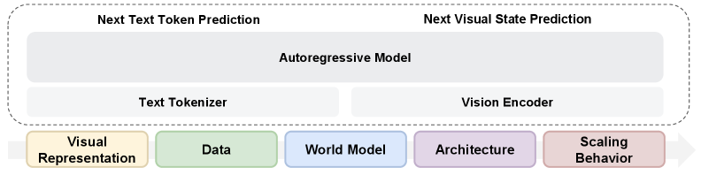
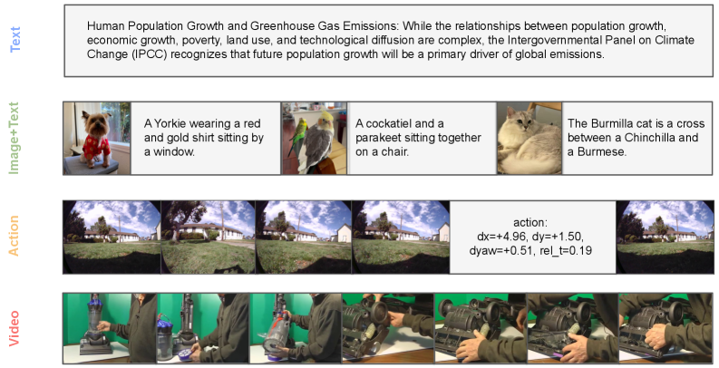
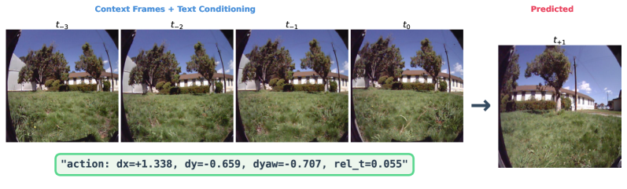
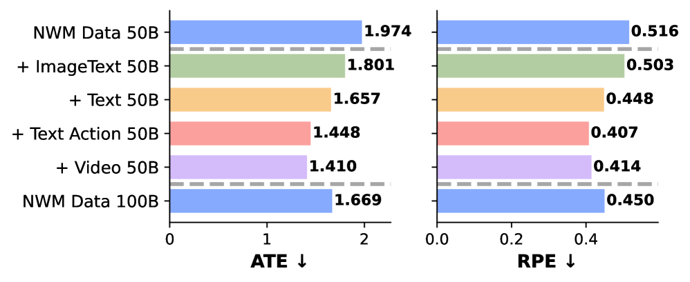
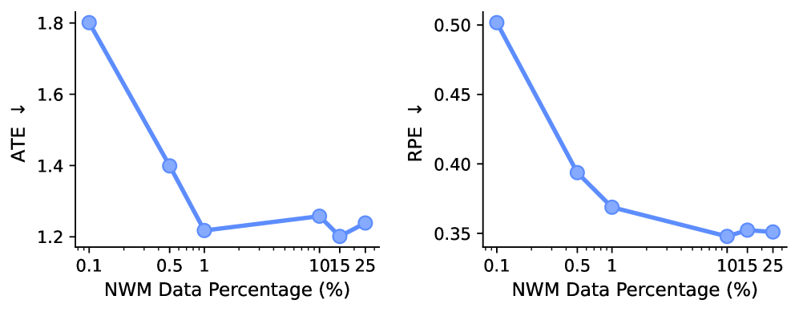
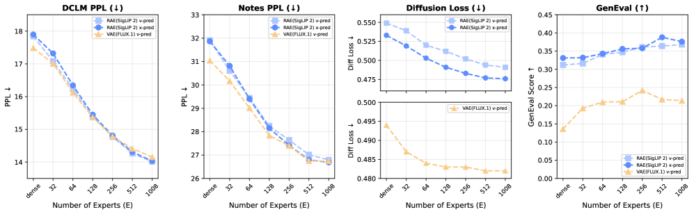
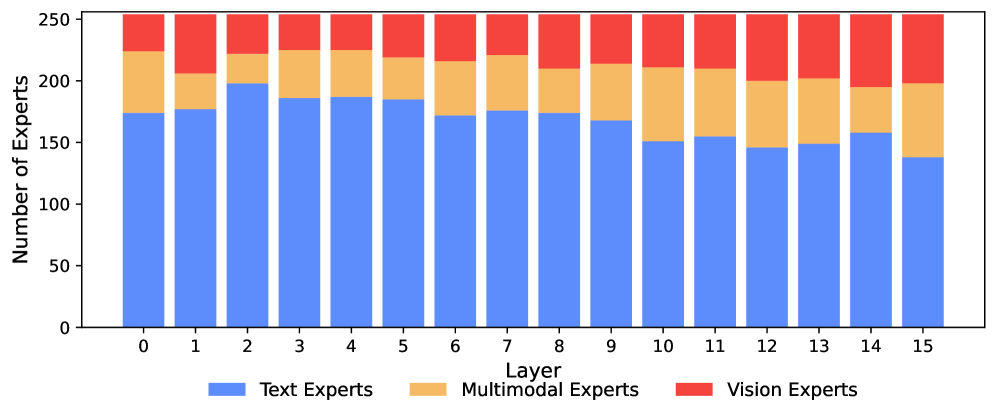

# Beyond Language Modeling：多模态预训练怎样长出世界模型能力

!!! info "本站判断"
    这页把《Beyond Language Modeling：多模态预训练怎样长出世界模型能力》当作机制和证据案例来读：先看它真正改变了哪个接口，再看实验、消融、scaling 或失败边界是否支撑这个 claim。

    Checked Date: 2026-06-04；Repro Status: Paper / official materials reviewed, independent reproduction not claimed.

这篇论文的价值不是发布一个最强模型，而是做控制实验：如果从零训练统一多模态模型，视觉表示、数据混合、动作条件、MoE 和 scaling 分别影响什么。

它最值得放进世界模型专题，是因为它把一个常被含糊带过的问题拆开了：世界建模能力到底来自大量 action-conditioned data，还是也能从一般视频和图文预训练里迁移出来。论文在 Navigation World Model (NWM) 设置里发现，通用视频预训练比单纯扩大域内 NWM 数据更关键，少量域内 action-conditioned 数据主要负责教会模型任务格式。

这不是说动作数据不重要，而是说动作数据的角色更像 alignment：它把已经从通用视觉动态里学到的能力，对齐到“给定动作，预测未来状态”的接口上。

先把 NWM 想成一个很小的导航任务：模型看见前方走廊的几帧图像，然后文本里出现 `turn left` 或 `move forward`。如果它真的学到世界动态，同一段历史在不同动作下应该走向不同未来；如果它只是会生成“像视频的下一帧”，动作 token 变了，未来也可能几乎不变。论文最有价值的地方，就是把这种差别放进数据消融里：通用视频先让模型学会物体和视角如何变化，少量动作条件数据再告诉它“动作应该怎样控制变化”。

这也是为什么本文适合按高质量技术博客的方式读：不要先背 Transfusion、RAE、MoE 这些名词，而是一直追问一个问题：统一多模态预训练里的哪种设计，真正让模型从静态理解走向动作条件未来预测？

{ width="660" }

<small>图源：`Beyond Language Modeling`, Figure 1。原图把研究空间分成 visual representations、data、world model、architecture 和 scaling behavior。本站读法：不要把它看成模型结构海报，而要看成实验路线图，论文逐一回答“用什么视觉 latent、喂什么数据、怎么形成动作条件未来预测、稀疏专家是否有必要”。</small>

## 核心问题

传统 VLM 通常先有一个语言模型，再接视觉编码器或图像生成模块。这样能快速得到能力，但很难判断：哪些性质来自语言模型预训练，哪些来自多模态训练本身，视觉和语言是否真的共享 scaling 规律。

这篇论文选择从零训练，采用 Transfusion 风格的统一序列建模：文本 token 用 next-token prediction，视觉状态用 diffusion / flow matching。它关心的不是“把图像也离散成 token 后继续做 LM”这一条路线，而是让同一个 Transformer 同时处理离散文本和连续视觉 latent。

因此它的主问题可以写成一句话：在一个原生多模态预训练系统里，理解、生成和世界建模能否由同一套表示、同一套数据混合和同一套稀疏架构共同支撑。

## 统一目标：文本预测加视觉流匹配

文本部分仍然是标准自回归语言建模：

$$
\mathcal L_{\mathrm{LM}}
=
-\sum_i \log p_\theta(x_i \mid x_{<i})
$$

这里 \(x_i\) 是第 \(i\) 个文本 token，\(x_{<i}\) 是它之前的上下文，模型优化的是下一个 token 的负对数似然。换句话说，语言仍按 LLM 最熟悉的方式训练。

视觉部分使用 flow matching。给定干净视觉 latent \(z_0\) 和噪声 \(\epsilon\)，在时间 \(t\) 上构造一条从噪声到数据的线性路径：

$$
z_t=(1-t)\epsilon + t z_0,
\qquad
\mathcal L_{\mathrm{flow}}
=
\mathbb E_{t,z_0,\epsilon}
\left[
\lVert v_\theta(z_t,t,\cdot)-(z_0-\epsilon)\rVert_2^2
\right]
$$

其中 \(z_t\) 是中间 noisy latent，\(v_\theta\) 是模型预测的 velocity，目标 \(z_0-\epsilon\) 表示从噪声点指向干净视觉 latent 的方向。直觉上，文本是在“猜下一个离散 token”，视觉是在“学会把连续噪声场推回真实视觉状态”。

联合训练目标是：

$$
\mathcal L
=
\lambda_{\mathrm{LM}}\mathcal L_{\mathrm{LM}}
+
\lambda_{\mathrm{flow}}\mathcal L_{\mathrm{flow}}
$$

这里 \(\lambda_{\mathrm{LM}}\) 和 \(\lambda_{\mathrm{flow}}\) 控制文本与视觉目标的相对权重。这个公式背后的工程问题很现实：如果视觉损失太弱，模型只是带图像接口的语言模型；如果视觉损失太强，语言能力和稳定性可能被视觉训练拖走。

论文还使用 block-wise causal attention：同一张图或同一帧内部的视觉 token 可以互相看见，但未来帧不能泄露给当前帧。这个设计承认图像内部没有自然的一维因果顺序，同时保留世界模型需要的时间因果性。

## 数据混合：每类数据承担不同功能

{ width="660" }

<small>图源：`Beyond Language Modeling`, Figure 2。原图展示 text、videos、image-text pairs 和 action-conditioned video。本站读法：四类数据不是可互换原料，文本维持语言能力，raw video 学视觉动态，image-text pair 建立语义对齐，action-conditioned video 才把动作和未来状态绑定起来。</small>

论文一个重要结论是：视觉数据并不必然伤害语言。Text + Video 可以接近甚至改善 text-only perplexity；真正容易带来语言分布偏移的，往往是 image-text caption 的文本域和普通语料不同。

这对世界模型很重要。很多项目会担心“视频 token 会稀释语言能力”，于是把视觉训练压得很小。但这篇论文的实验提示，问题不在于视觉信号天然冲突，而在于数据分布、loss 权重和任务格式是否处理好。

更关键的是，raw video 和 action-conditioned video 的作用不同。raw video 给模型大量无标注动态：物体怎样移动、视角怎样变化、空间结构怎样连续。action-conditioned video 则教模型把动作写入因果条件：向左、前进、转身以后，下一帧应该怎样变。前者提供世界常识和动态底座，后者提供控制接口。

## RAE：为什么视觉表示决定统一能力

很多生成模型默认用 VAE latent，因为它压缩强、重建友好、扩散模型成熟。但世界模型不只需要重建像素，还需要理解对象、空间和语义关系。只靠低层重建 latent，可能生成图像可以，跨任务理解和动作条件预测却弱。

论文比较 VAE、semantic encoder、raw pixels，并突出 Representation Autoencoder (RAE) 的作用。RAE 的思路是用 SigLIP 2 等语义表示作为 encoder，再训练 decoder 把语义 latent 还原成图像。这样单一视觉表示既能服务理解，也能服务生成。

这点对统一模型尤其关键。如果系统为理解用一个 encoder、为生成用另一个 VAE encoder，模型内部会长期处理两套视觉空间：一套知道图像“是什么”，另一套适合还原图像“长什么样”。RAE 把这两件事尽量放进同一个 latent space，降低多模态融合的接口成本。

论文的经验结论可以翻译成：不要默认“生成必须 VAE、理解必须 CLIP”是唯一合理架构。对于原生多模态世界模型，更值得问的是：这个视觉 latent 是否同时保留可生成细节、语义对象和时序预测所需状态。

## 世界建模：通用视频为什么能迁移

论文采用 NWM 设置：给定几帧上下文和一个导航动作，预测未来视觉状态。动作不使用专门连续控制 embedding，而是直接写成文本 token，包括 WASD 风格动作和自由语言动作。

{ width="660" }

<small>图源：`Beyond Language Modeling`, Figure 11。原图展示 NWM 序列由四个 context frames 和一个 navigation action 组成，动作直接编码为文本 token。本站读法：action-as-text 不是机器人控制的终点，而是一个低成本统一接口，用来检验文本条件能否控制未来视觉预测。</small>

这个设置有两个好处。第一，它不需要改模型结构：还是同一个文本加视觉序列，只是文本里出现了动作。第二，它把世界模型问题变成条件生成问题：模型必须理解“同一段上下文，在不同动作下会走向不同未来”。

论文最有启发的证据来自数据消融。只扩大域内 NWM 数据，不如加入通用视频预训练；固定总数据量时，域内 alignment 数据占比很小也能接近饱和。这说明模型在 general multimodal pretraining 中已经学到一部分可迁移动态，NWM 数据主要让它学会这个任务的格式和动作接口。

{ width="820" }

<small>图源：`Beyond Language Modeling`, Figure 12。原图比较不同数据组合对 world modeling performance 的影响。本站读法：通用视频数据不是背景材料，它直接提高 action-conditioned future prediction，说明视觉动态预训练可以迁移到动作条件任务。</small>

{ width="820" }

<small>图源：`Beyond Language Modeling`, Figure 13。原图显示域内数据占比很小时 world modeling transfer 已接近饱和。本站读法：这不是否定动作数据，而是把动作数据的角色改写为 alignment data：少量高质量动作条件样本可以把通用动态能力接到具体接口上。</small>

对工程路线的启发很直接：如果要做 VLA 或交互世界模型，不一定一开始就收集海量动作标注视频。更合理的顺序可能是先用通用视频和图文数据学视觉动态与语义，再用高质量动作条件数据对齐控制接口，最后再针对闭环失败做增量数据回流。

## MoE：专家分化不是装饰

多模态 token 的需求不一样。文本 token 更像离散符号序列，视觉 latent 需要处理连续空间、局部结构和生成目标；世界模型还要建模时间动态和动作条件。如果所有 token 共享同一套 FFN，模型容量会被迫在不同模态之间折中。

论文先验证 modality-specific FFN 有帮助，再进一步研究 MoE。MoE 的意义不是“参数更多所以更强”这么简单，而是在固定 active compute 下增加总容量，让不同 token 可以路由到不同专家。

{ width="820" }

<small>图源：`Beyond Language Modeling`, Figure 16。原图显示在固定 active experts 条件下，增加总 expert 数能改善 language 和 vision 指标。本站读法：稀疏总容量给多模态模型更多空间，但 serving、通信和路由成本仍要单独评估。</small>

{ width="820" }

<small>图源：`Beyond Language Modeling`, Figure 18。原图展示 expert specialization 自然出现，后层中 vision 与 multimodal experts 比例增加。本站读法：模型不是被人工规定“这个专家看图、那个专家看字”，而是在数据驱动下形成模态分工。</small>

这和 scaling asymmetry 连在一起。论文的 IsoFLOP 分析显示，视觉比语言更 data-hungry。Dense 模型里，语言和视觉可能需要不同的参数/数据配比；MoE 通过更大的总容量和较小 active capacity，缓解这种不对称。对大规模世界模型来说，这说明“统一”不等于所有模态共享完全相同的计算路径。

## 这篇论文真正给出的路线

把所有结果合在一起，论文给出的不是一个单点 recipe，而是一条更清楚的路线：

1. 用 Transfusion 式目标统一离散文本和连续视觉 latent，而不是把所有模态强行离散化成同一种 token。
2. 用 RAE 这类语义视觉 latent 尽量统一理解和生成，减少双视觉空间的接口摩擦。
3. 用 text、raw video、image-text 和少量 action-conditioned video 组成数据混合，让通用动态、语义对齐和动作接口各司其职。
4. 用 NWM 这类任务检验模型是否真的能根据动作预测不同未来，而不是只做静态视觉理解。
5. 用 MoE 或模态分化容量处理视觉和语言 scaling 不对称，而不是假设所有模态按 LLM scaling 规律同步增长。

这条路线对 VLA/WAM 很有意义。它支持一种先预训练、再对齐、再闭环修正的思路：通用视频提供动态底座，图文数据提供语义，动作条件数据提供控制接口，真实机器人失败数据提供最后的闭环校正。

## 边界与误解

action-as-text 很适合导航和离散控制演示，但不能直接替代机器人连续动作。机械臂控制需要关节、末端位姿、夹爪状态、控制频率和安全约束，这些都不是自由语言动作可以完整表达的。

NWM 的未来帧预测也不能等同于完整物理世界模型。它主要检验视角变化和导航动作后的视觉连续性，不能覆盖接触、力控、遮挡后的对象持久性、多物体交互和失败恢复。

RAE 的结论依赖 decoder、数据和评测。语义 latent 对统一理解生成很有吸引力，但在高频纹理、精确几何和低延迟控制中是否足够，还需要按任务复测。

MoE 结果说明稀疏专家有潜力，但工程成本很实在：训练负载均衡、跨卡通信、路由稳定性、推理批处理和专家缓存都会影响实际部署。论文证明的是方向，不是把系统问题自动解决。

## 外部精读

- [Beyond Language Modeling project page](https://beyond-llms.github.io/)：适合先看五个实验轴和图解，再回论文查完整消融。
- [Beyond Language Modeling arXiv](https://arxiv.org/abs/2603.03276)：主要读 visual representation、world modeling、MoE 和 scaling 部分。
- [Transfusion: Predict the Next Token and Diffuse Images with One Multi-Modal Model](https://arxiv.org/abs/2408.11039)：理解本文“文本 next-token + 视觉 diffusion”统一目标的前置论文。
- [Navigation World Models](https://arxiv.org/abs/2412.03572)：理解 NWM 任务为什么适合检验 action-conditioned future prediction。
- [Diffusion Transformers with Representation Autoencoders](https://arxiv.org/abs/2510.11690)：补充 RAE 为什么可能成为 DiT/视觉生成的新默认表示。

## 相关阅读与下一步

- 外部材料：[论文标题 arXiv 检索](https://arxiv.org/search/?query=Beyond+Language+Modeling%3A+An+Exploration+of+Multimodal+Pretraining&searchtype=title)。
- 外部材料：[Semantic Scholar 标题检索](https://www.semanticscholar.org/search?q=Beyond+Language+Modeling%3A+An+Exploration+of+Multimodal+Pretraining)。
- 外部材料：[Papers with Code 检索](https://paperswithcode.com/search?q=Beyond+Language+Modeling%3A+An+Exploration+of+Multimodal+Pretraining)。
- 站内下一步：[论文精读专题](../index.md)。
- 站内下一步：[论文专题写作规范](../writing-standard.md)。
- 站内下一步：[外部精读来源台账](../../references/external-reading-ledger.md)。
