# Beyond Language Modeling：多模态预训练怎样长出世界模型能力

!!! info "论文信息"
    **论文题名：** Beyond Language Modeling: An Exploration of Multimodal Pretraining。 
    **作者：** Shengbang Tong、David Fan、John Nguyen、Ellis Brown、Gaoyue Zhou、Shengyi Qian、Boyang Zheng、Théophane Vallaeys、Junlin Han、Rob Fergus 等（共 21 人）。 
    **机构：** 未在公开元数据中稳定解析；以 arXiv/PDF 或官方页 affiliation block 为准。 
    **时间 / 主题：** 2026-03；世界模型。 
    **arXiv / 官方报告：** arXiv：[2603.03276](https://arxiv.org/abs/2603.03276)；官方材料：[beyond-llms.github.io/](https://beyond-llms.github.io/)。 
    **GitHub / 项目：** GitHub：未找到官方链接；项目页：[beyond-llms.github.io/](https://beyond-llms.github.io/)。 
    **元数据来源与核验口径：** 来源：[arXiv](https://arxiv.org/abs/2603.03276)；[官方 / 项目材料](https://beyond-llms.github.io/)；Checked Date：2026-06-15；Repro Status：Paper / official materials reviewed, independent reproduction not claimed。

## 把统一多模态预训练拆成可以验证的五个问题

Beyond Language Modeling 最值得读的地方，是它把“同一个模型既理解又生成，还能预测世界”拆成了几组能够分别检验的问题。视觉应该以像素、VAE latent 还是语义特征进入模型？图像和视频会挤占语言学习能力，还是能补充监督？一般视频中学到的运动规律，能否借助少量动作数据接到导航接口上？不同模态是否需要不同参数？扩大计算预算时，视觉和语言需要的模型规模与数据量是否同步增长？这些问题共同决定统一模型怎样训练，但不能由一张综合排行榜代替回答。

作者采用从头训练 Transformer 主干的方式研究这些问题。这样做的作用，是减少预训练 LLM 所带来的一项混淆——模型最后表现出来的知识，究竟来自本轮多模态预训练，还是来自初始化时已经学会的语言能力。这里的“从头”有明确范围。视觉编码器与图像解码器仍使用预训练组件，文本使用 Llama 3 的 BPE tokenizer；因此实验研究的是统一主干如何学习和组织已有视觉表示，并非证明所有感知与生成能力都能从随机初始化开始获得。[↗](https://arxiv.org/pdf/2603.03276v1#page=3)

研究的主要判断可以先放在一起。语义视觉表示在这套设置中同时有利于理解与生成；多模态数据的收益取决于任务关系和数据分布；视频预训练能够减少导航所需的专门动作数据；MoE 能以近似固定的激活计算量扩大容量，并学出模态偏好；而在计算最优的拟合中，视觉比语言更偏向增加数据。这些结论都有成立条件，也都有值得保留的例外。尤其不能将不同实验族的最优配置、1T-token 模型的路由分析和 57B-token 的 MoE 消融拼成一个“最终模型”的全部成绩。

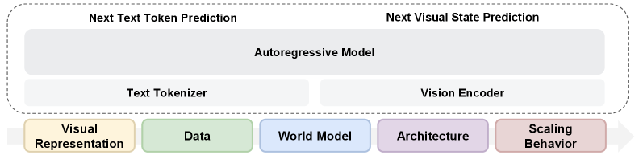{ width="660" }

*原论文 Figure 1。上方展示统一主干怎样同时预测离散文本与连续视觉状态，下方五条研究轴对应五类实验。读后文时，应始终区分模型接口与各实验族的训练预算。*

它与把视觉接到成熟 LLM 上的工作形成互补。后者通常关心保住已有语言能力，再获得图像理解、生成或编辑能力；本文更关心在统一训练开始时，表示、数据与计算分配本身怎样影响学习。因此，本文对 MoE、MoT、双编码器的比较，首先适用于这里的从头预训练设置，不能直接推翻使用预训练 LLM 初始化的其他系统。

## 一个序列，两类预测过程

### 文本与视觉怎样进入同一个 Transformer

模型沿用 Transfusion 的基本思路。文本保持离散 token，图像和视频帧保持连续 latent；二者排在同一序列里，由一个 decoder-only Transformer 处理。文本经过 embedding，视觉由冻结编码器映射成 patch 特征，再经过简单线性投影进入主干维度。与 Transfusion 的视觉输入、输出 U-Net 不同，本文在这些位置使用线性层，因为多数编码器已经提供所需数量的视觉 token，无须另一个网络再压缩和展开空间网格。[↗](https://arxiv.org/pdf/2603.03276v1#page=5)

每幅图像、每一帧视频都由 `<BOI>` 和 `<EOI>` 包围。于是视频可以写成多个相邻的图像块，带动作的视频则在相应位置加入动作文本。模型知道哪些位置应输出词表上的概率分布，哪些位置应输出连续向量，靠的是这些位置所属的模态及其输出头。

这里有两种不同尺度的自回归关系。整段序列遵守先后顺序，当前帧不能读取未来帧；一帧内部的所有 patches 则可以双向注意，因为它们共同构成一个需要联合去噪的空间对象。文本位置仍采用普通因果注意。这样的 mask 允许前文为后面的图像提供条件，也允许图像为后面的文字提供条件，同时避免提前看到未来文本或未来视觉状态。

默认网络在 self-attention 后使用两个 FFN，一个处理文本，一个处理视觉。attention 负责跨模态信息交互，FFN 则给不同类型的 token 留出独立变换。默认总参数约 2.3B，每个 token 激活约 1.5B；共享 FFN 的对照模型总参数和激活参数都约为 1.5B。因此两者可以保持每个 token 的主要计算量接近，但模型存储容量并不相同。后文的 MoE 实验会进一步把固定的模态分工改成可学习路由。

### 为什么语言预测下一个词，视觉却预测连续速度

文本训练使用标准交叉熵。对于文本序列，目标为

$$
\mathcal L_{\mathrm{LM}}
=-\sum_{i=1}^{n}\log p_\theta(x_i\mid x_{<i}).
$$

这里的 $x_i$ 是当前文本 token，$x_{<i}$ 表示可见的历史条件；在混合序列中，实际条件还可以包含之前的视觉位置。模型必须把主干输出投影到词表，给正确的下一个 token 更高概率。视觉 latent 通常具有连续的高维结构，不必先量化成词表中的编号，因此采用 flow matching 学习从噪声到视觉表示的路径。

论文将干净图像或视频帧的 latent 记作 $z_0$，采样高斯噪声 $\epsilon$，构造

$$
z_t=(1-t)\epsilon+t z_0,\qquad
\epsilon\sim\mathcal N(0,I),\quad t\sim U[0,1].
$$

尽管干净 latent 的名字带下标 0，本文插值的时间方向是 $t=0$ 对应噪声、$t=1$ 对应干净数据。沿着这条直线路径求导，目标速度就是 $z_0-\epsilon$，所以模型训练目标为

$$
\mathcal L_{\mathrm{flow}}
=\mathbb E_{t,z_0,\epsilon}
\left[\left\|v_\theta(z_t,t,\mathrm{context})-(z_0-\epsilon)\right\|_2^2\right].
$$

$v_\theta$ 的输出与视觉 latent 形状对应。它需要根据当前噪声状态、时间位置以及前面的文本或视觉上下文，预测下一步应朝哪个方向移动。采样时多次更新 latent，最终得到可以交给预训练 decoder 的视觉特征。论文还将高维视觉表示的噪声时间分布向更嘈杂的区域偏移，以改善去噪训练；这里的均匀采样公式给出基础构造，实际训练还包含这一 schedule 调整。[↗](https://arxiv.org/pdf/2603.03276v1#page=4)

每张图或每一帧独立采样一个时间步，同一帧所有 patches 共用这个时间步。于是一个视频序列中，不同帧可能处于不同噪声水平，这与 Diffusion Forcing 的训练方式相符。尤其要注意，本文训练时位于图像之后的文本，会直接条件于带噪的视觉表示；附录 B 明确说明了这一点。不能把其他统一模型中“另保留一份干净图像作为后文条件”的做法移植到这里。模型需要在历史视觉本身有噪声的情况下，同时完成后续文本预测和视觉去噪。[↗](https://arxiv.org/pdf/2603.03276v1#page=30)

两类目标在同一次前向、反向传播中联合优化

$$
\mathcal L
=\lambda_{\mathrm{LM}}\mathcal L_{\mathrm{LM}}
+\lambda_{\mathrm{flow}}\mathcal L_{\mathrm{flow}},
\qquad \lambda_{\mathrm{LM}}=1,\quad\lambda_{\mathrm{flow}}=3.
$$

这两个系数控制联合优化时的损失尺度，并不表示训练数据按 1∶3 采样。数据配比、损失权重、单个样本的 token 数量是三件不同的事。论文默认的 1∶3 也不同于它所比较的 Transfusion 1∶6 设置。后面研究的 x-pred 则进一步改变视觉预测目标，让模型直接预测干净 latent，而非预测速度；其收益需要与视觉表示一起考察。

### 推理怎样在文字与图像之间切换

推理开始时，模型像语言模型一样逐 token 生成文字。一旦采样出 `<BOI>`，解码程序暂时停止生成离散文本，在当前上下文后面追加一组纯噪声视觉向量，通常是 $16\times16=256$ 个 tokens。接下来用 25-step Euler sampler 反复预测速度、更新这些向量，再由相应的预训练 decoder 将它们还原成图像。最后追加 `<EOI>`，恢复文本生成；若继续遇到 `<BOI>`，便开始下一帧或下一张图像。[↗](https://arxiv.org/pdf/2603.03276v1#page=31)

这解释了它为何能同时表达 caption、图像生成和视频预测。区别主要在序列条件和哪些位置需要预测，无须为每个任务建立互不相通的主干。它也说明“统一模型”的计算并非每生成一个视觉 token 就只做一次自回归前向。一帧视觉块需要经历多步连续去噪，因此长序列、更多候选轨迹和更多预测帧都会增加实际推理负担。

所有图像生成评测固定使用 CFG=3.0，训练时以 10% 概率丢弃条件以支持 classifier-free guidance。固定采样步数与 guidance 可以减少不同编码器之间的推理调参差异，但结果仍然是在这套采样协议下得到的，不能据此推断每个表示经过单独调参后的上限。

## 视觉表示，先决定主干到底需要学习什么

### 为什么语义编码器也能用于生成

VAE latent 的优势通常在于保留可以重建图像的局部信息；SigLIP、DINOv2、WebSSL 一类表示则预先组织了较强的语义结构。统一模型面临的问题是，它究竟应在容易重建像素的空间里重新学习语义，还是在已有语义结构的空间里学习生成，再让 decoder 补回图像细节。

本文比较了 raw pixels、SD-VAE、FLUX.1 VAE 以及三种 semantic encoder。语义编码器通过 RAE 配套 decoder 还原图像，因此理解和生成可以使用同一套 latent。这里的 RAE 是“表示编码器加重建解码器”的组合，并非给理解分支一个 SigLIP、给生成分支另一个 VAE 的双路结构。

为了让主干处理的视觉序列长度可比，各配置都整理为每图 256 个 tokens。具体输入分辨率和空间变换如下；应以附录 Table 4 的细节为准，不能把正文中概括的 224×224 推广到所有 VAE 配置。[↗](https://arxiv.org/pdf/2603.03276v1#page=35)

| Type | Encoder | Resolution | Patch / downsampling | Native grid | Spatial adaptation | Transformer tokens |
| --- | --- | --- | --- | --- | --- | ---: |
| Raw Pixel | Raw Pixel | 224×224 | 14×14 patches | 16×16 | — | 256 |
| RAE | SigLIP 2 So400m | 224×224 | 14×14 patches | 16×16 | — | 256 |
| RAE | DINOv2-L | 224×224 | 14×14 patches | 16×16 | — | 256 |
| RAE | WebSSL-L | 224×224 | 14×14 patches | 16×16 | — | 256 |
| VAE | SD-VAE | 256×256 | 8× spatial downsampling | 32×32 | PixelUnshuffle(2) | 256 |
| VAE | FLUX.1 VAE | 256×256 | 8× spatial downsampling | 32×32 | PixelUnshuffle(2) | 256 |

VAE 原本产生 1024 个空间位置。PixelUnshuffle(2) 把相邻的 2×2 位置重排到通道维，空间位置减少为四分之一、通道数扩大为四倍，再经线性层进入主干。输出时先做对应的 PixelShuffle(2)，恢复到 VAE latent 的原始空间网格，再计算视觉损失。这种操作改变的是信息排列，没有在这里引入另一个需要训练的空间压缩网络。

先看 Figure 4 的后三组柱子。SigLIP 2 在 DPGBench、GenEval 和平均 VQA 上都位于前列，表明已经具有语义结构的 latent 并未因为服务过理解任务，就失去生成价值。raw pixels 的图像生成明显较弱，但 VQA 与部分编码器的差距较小，这也提醒我们，理解分数和生成质量不应互相代替。

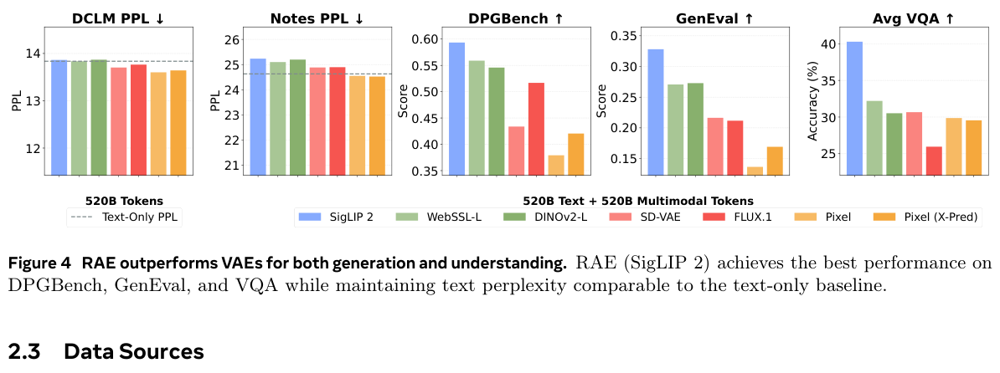

*原论文 Figure 4。各多模态模型均采用 520B text + 520B multimodal tokens；语言侧的虚线参考是 520B tokens 的纯文本模型。右侧视觉任务比较编码器，左侧同时检查语言代价。*

这一结果支持用单一语义表示简化统一模型接口。它没有证明“语义越强，所有视觉细节一定越好”，因为重建质量还受到编码器丢失的信息以及 decoder 能力限制。VAE 和 semantic encoder 的取舍，需要继续看层级表示实验。

### 更深的语义特征会留下什么重建代价

附录 D.1 对 SigLIP 2 不同层做线性分类探针，并训练重建 decoder 测量 PSNR。随着层数从 0 增加到 26，ImageNet 分类准确率由 12.8% 升到 86.3%，PSNR 却由 29.6 dB 降到 20.9 dB。深层特征更适合区分类别，同时更难恢复逐像素细节。这两个指标朝相反方向变化，正是统一理解、生成时需要面对的表示取舍。[↗](https://arxiv.org/pdf/2603.03276v1#page=31)

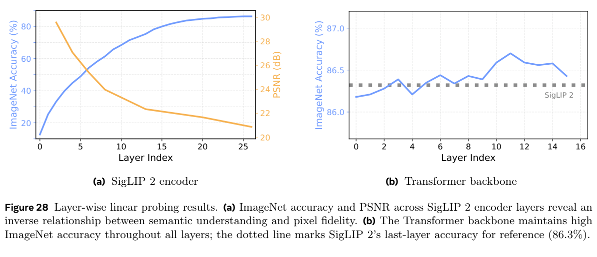

*原论文 Figure 28。左图同时读分类准确率与 PSNR；右图的灰色虚线是输入 SigLIP 2 特征的分类基准，蓝线表示统一 Transformer 各层保留下来的语义可分性。*

这个实验的重建 decoder 使用约 3M 张 MetaCLIP 图像训练，因此 PSNR 变化是特定表示、decoder 和训练数据共同作用的结果。它提示深层表示对像素恢复不友好，不能直接当成关于信息绝对不可恢复的定理。论文也指出，更大或更合适的 decoder 训练数据可能缓解这种损失。

右图回答另一件事。视觉表示进入统一主干、同时参与语言和生成目标之后，是否被破坏？线性探针仍保持在约 86%—87% 附近，一些较深层略高于冻结编码器基准，说明联合训练至少没有普遍冲掉原有语义结构。不过前几层也存在低于基准的点，结果并非每一层都严格改善。对实践更有用的判断是，单一语义表示在该训练框架下能够保留下来，而高保真细节仍值得专门处理。

## 数据混合的收益，要先分清预算与分布

### 四类数据分别教会模型什么

训练数据包括 DCLM 文本、无文字配对的视频、image-text pairs，以及动作条件视频。文本提供语言、知识与符号关系；连续视频提供外观变化和时间连续性；图文配对将视觉内容与语言关联；动作条件数据则进一步告诉模型，某种输入动作对应怎样的视觉变化。它们共享序列接口，但监督内容不同。

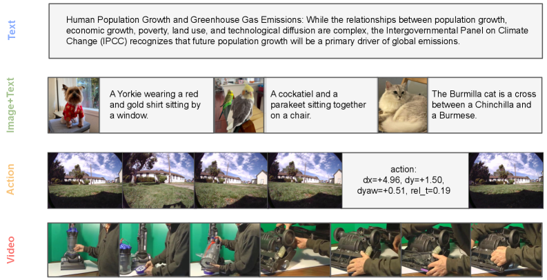{ width="660" }

*原论文 Figure 2。图文配对建立跨模态对应，动作字符串为未来帧加入可控制条件，而视频可以没有文字标注。不能把这三种视觉数据都视为同一种 caption 数据。*

视频来源包括 YouTube-Temporal 1B、Something-Something V2 和 Kinetics，按约 1 FPS 处理；导航配比实验的附录还列出 HowTo100M。图文来源包括 MetaCLIP 和内部 Shutterstock 数据，文中简称 SSTK。动作数据包括 NWM 导航轨迹与内部 Text-Annotated Videos。本文没有使用通常意义上的一般网页图文交错文档，但视频帧与动作仍然按序列组织，因此“未使用 interleaved data”不应被解释成模型无法处理任何跨模态序列。[↗](https://arxiv.org/pdf/2603.03276v1#page=38)

第一组数据实验固定文本暴露量为 520B tokens，给多模态模型额外加入 520B multimodal tokens，再与 520B text-only 模型比较。这个控制适合回答“保留同样的文本训练量后，加入视觉会怎样影响语言”，却不是相同总训练量或相同计算量的比较。总计算预算是否值得，必须等后面的 IsoFLOP 实验再判断。

Figure 5 中，Text + Video 在 DCLM 上接近或略优于纯文本模型，说明原始视觉信号与语言训练可以共存。加入 MetaCLIP 的配置更容易提高语言困惑度，混合视频、图文和动作后则有所缓解。但换到更偏分布外的 Notes 文本，所有多模态混合都比纯文本基线差。于是“视觉不会损害语言”只能理解为干扰可以很小、依数据而异，不能变成对所有语言分布都成立的保证。[↗](https://arxiv.org/pdf/2603.03276v1#page=7)

图文数据还有不可被无标注视频完全替代的作用。Figure 6 的 Text + Video 配置没有 image-text 配对，因此论文没有为它报告 text-to-image 分数。视频提供视觉变化，并不自动给出文字与视觉内容的对应关系。加入图文配对以后，才能直接检验文本条件生成；这也是为什么“更多视频”与“更强语言控制”之间还需要一个对齐环节。

### 图像 caption 会改变模型看到的语言分布

语言损失变差不一定说明视觉特征与文本天生争夺能力，也可能因为配对数据中的文字与原文本语料相差较大。作者比较原始 MetaCLIP captions、重写后的 captions 和 SSTK captions。用 Qwen3-Embedding-8B 对每类数据的 100K 个样本编码，每条最多保留 2000 个字符，再计算数据集嵌入中心与 DCLM 中心的 cosine distance，得到下表。[↗](https://arxiv.org/pdf/2603.03276v1#page=8)

| Caption source | Cosine distance to DCLM centroid ↓ |
| --- | ---: |
| MetaCLIP | 0.196 |
| MetaCLIP Recaption | 0.286 |
| SSTK | 0.215 |

这里的数字是嵌入中心之间的距离，并不是 caption 逐条“正确率”，也不是语言模型中的概率。重写 captions 更详细，不代表它更接近日常文本分布。Recaption 使用 Qwen2.5-VL-32B-Instruct，通过 vLLM 以 8 路 tensor parallel 运行，temperature=0.6、top-p=0.95、最多生成 128 tokens。这给出了可复用的构造方式，也说明 synthetic caption 会引入特定模型的语言风格。

实验显示，不同 caption 来源对任务的影响不同。重写 captions 有利于 VQA，SSTK 更有利于生成，而文本 perplexity 还受它们与 DCLM 的分布差异影响。作者因此使用 MetaCLIP 承担 image-to-text、SSTK 承担 text-to-image 的组合。这里的启发是按照监督方向分配数据来源，而不是给一份 captions 贴上“质量最高”的标签后用于全部目标。嵌入距离与语言指标的相关性为解释提供线索，但尚未单独证明距离本身就是性能变化的原因。

### 什么时候可以说异质数据优于同类数据扩量

论文还让 DCLM 文本和 SSTK 图像 tokens 各自在 0、25B、50B、75B、100B 中取值，观察相同图像暴露量下增加文本的效果。总体上，视觉 diffusion loss 随增加文本而下降，GenEval 也优于对应的视觉单模态基线。这说明文本可以为图像学习提供有用的共享结构。但增加文本同时增加了总训练量，而且 GenEval 的局部变化并非每个点都单调，所以它证明的是总体互补性，不能单靠这张图推出免费收益或任意配比都更优。[↗](https://arxiv.org/pdf/2603.03276v1#page=9)

更直接的等量对照来自 VQA 数据实验。先给模型 20B VQA tokens，再把剩余 80B 预算用于视频、图文或纯文本，并与直接训练 100B VQA tokens 比较。

| Training data | Total tokens | Average VQA accuracy (%) ↑ |
| --- | ---: | ---: |
| VQA 20B | 20B | 34.6 |
| VQA 20B + Video 80B | 100B | 36.1 |
| VQA 20B + Image/Text 80B | 100B | 36.9 |
| VQA 20B + Text 80B | 100B | 37.9 |
| VQA 100B | 100B | 35.7 |

应优先比较后四行，因为总量同为 100B。增加纯文本在这组实验中最好，增加无标注视频也优于继续扩充同类 VQA。与 100B VQA 相比，文本混合高 2.2 个百分点，这是表内数字的直接差值。它支持一般知识或视觉经验能帮助回答问题，也说明进一步增加任务格式相同的数据可能遇到较快的边际收益下降。这个结果仍绑定于当前来源和配比，不表示专门 VQA 监督可以完全取消。

## VQA 结果检验的是预训练底座经过相同微调后的能力

理解 Figure 10 之前，必须补上评测协议。所有模型的视觉编码器冻结，统一在 Cambrian-7M 上微调一个 epoch，使用 64 GPUs、约 1M tokens 的全局 batch 和 $10^{-5}$ peak learning rate。纯文本预训练模型此前没有视觉适配器，因此先在 Cambrian-Alignment 上只训练 adapter，其余参数冻结，peak learning rate 为 $2\times10^{-3}$；之后再按同一 VQA 微调流程训练。[↗](https://arxiv.org/pdf/2603.03276v1#page=35)

因此这里比较的是不同预训练底座接受相同任务适配后的理解能力。它不是未经微调的 zero-shot VQA，也不是多模态模型只靠预训练就能直接回答所有问答题。平均分覆盖 16 个 benchmark，包括 MMBench、Seed、MME、GQA、AI2D、MathVista、MMMU、ScienceQA、OCRBench、TextVQA、ChartQA、DocVQA、MMVP、CV-Bench 2D/3D 和 RealWorldQA。

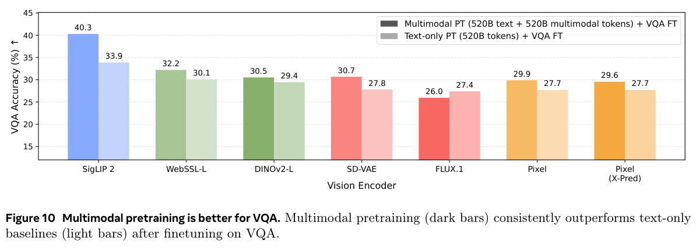

*原论文 Figure 10。每组深色柱是 520B text + 520B multimodal 预训练后再做 VQA 微调，浅色柱是 520B text-only 预训练后接 adapter 与 VQA 微调。FLUX.1 是图中明确的反例。*

| Vision Encoder | Multimodal PT + VQA FT (%) ↑ | Text-only PT + VQA FT (%) ↑ | Difference (percentage points) |
| --- | ---: | ---: | ---: |
| SigLIP 2 | 40.3 | 33.9 | +6.4 |
| WebSSL-L | 32.2 | 30.1 | +2.1 |
| DINOv2-L | 30.5 | 29.4 | +1.1 |
| SD-VAE | 30.7 | 27.8 | +2.9 |
| FLUX.1 | 26.0 | 27.4 | −1.4 |
| Pixel | 29.9 | 27.7 | +2.2 |
| Pixel (X-Pred) | 29.6 | 27.7 | +1.9 |

SigLIP 2 的绝对分数与多模态预训练增益都最突出，支持语义表示与联合预训练相互配合。FLUX.1 却从 27.4 降到 26.0，所以原图图注中“consistently outperforms”的概括强于图中实际结果。保持这个例外很有价值，它说明预训练目标、视觉空间和任务迁移之间仍可能不匹配。再加上多模态配置用了更多总 tokens，这张图应与前面的等量 VQA 对照、后面的等 FLOP 实验共同阅读，不能独自承担所有关于训练效率的结论。

## 从下一帧预测到动作条件世界模型

### 数值动作作为文本，接通已有预测接口

统一预训练已经能根据历史帧预测未来，导航任务进一步要求未来受到动作控制。作者采用 Navigation World Model 的设置，输入四个 context frames，并把位移、转角和时间写成普通文本，例如 `action: dx=+1.338, dy=-0.659, dyaw=-0.707, rel_t=0.055`，再预测下一视觉状态。这个接口没有新增连续动作 encoder 或 action adapter，而是利用现有 tokenizer 与语言路径读取数值字符串。[↗](https://arxiv.org/pdf/2603.03276v1#page=10)

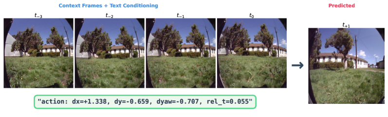{ width="660" }

*原论文 Figure 11。先沿序列读四个历史帧，再看动作文本如何插入下一帧前面。动作与图像通过同一主干交互，训练目标仍然是动作条件下的视觉预测。*

使用文本接口的好处是减少专门模块，也让数值动作与自然语言动作可以进入同一种序列格式。但仅仅能接收字符串，并不等于模型已经知道这些数值的动力学含义。这样的含义仍需要动作与视觉变化的配对数据来建立。本文真正要检验的是，一般视觉预训练能否提供大部分预测能力，再由相对少量的领域数据建立动作对齐。

### 为什么还需要规划评价

好看的下一帧并不能保证动作正确。模型可能保留了外观，却没有准确表现转弯、前进所造成的视角变化。作者因此将视觉预测器放入一个目标导航规划流程，用它为候选动作评估未来，而非只对生成图片做感官判断。

附录 F.1 给出的 CEM 规划设置是 8-step horizon，对应 2 秒。每次从高斯分布采样 120 条候选动作序列，为每条序列预测 8 个未来帧，再用最终预测帧与目标图像之间的 LPIPS 距离评分。选择分数最好的 5 条轨迹，将对应动作平均，形成最终计划；每个评测实例重复这个过程 3 次。最后用计划轨迹相对真实轨迹的 Absolute Trajectory Error（ATE）与 Relative Pose Error（RPE）评价，二者都越低越好。[↗](https://arxiv.org/pdf/2603.03276v1#page=37)

这一流程赋予视觉预测明确的用途。模型必须让“更接近目标画面”的候选动作在排序中更有利，否则规划结果就会偏离真实轨迹。同时，120 条候选、每条 8 帧意味着一次规划要进行大量视觉生成，不能把“无需动作适配器”理解成控制推理几乎没有成本。论文这里报告的是 RECON 数据上的轨迹评价，没有给出实机闭环行驶的成功率或实时控制延迟。

### 哪类通用数据真正帮助导航

先以 50B NWM tokens 训练作为基线，再用 50B 预算扩充不同来源。若一般预训练学到的是有助于动力学的知识，那么视频或文字动作描述应该优于无差别增加图文。

| Training mixture | Total tokens | ATE ↓ | RPE ↓ |
| --- | ---: | ---: | ---: |
| NWM 50B | 50B | 1.974 | 0.516 |
| NWM 100B | 100B | 1.669 | 0.450 |
| NWM 50B + Video 50B | 100B | 1.410 | 0.414 |
| NWM 50B + Text Action 50B | 100B | 1.448 | 0.407 |
| NWM 50B + Text 50B | 100B | 1.657 | 0.448 |
| NWM 50B + ImageText 50B | 100B | 1.801 | 0.503 |

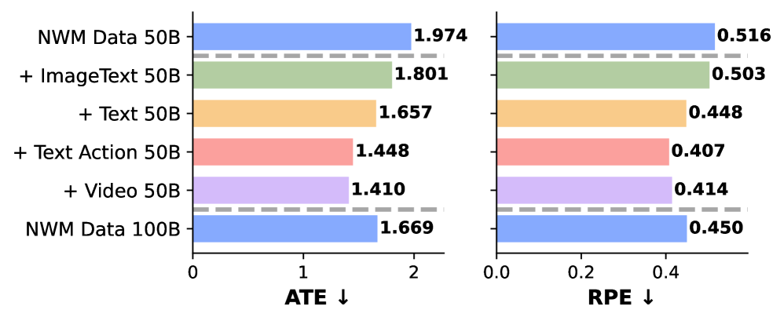{ width="820" }

*原论文 Figure 12。最有判断力的对照是同为 100B tokens 的各行。Video 在 ATE 上最好，Text Action 在 RPE 上最好；ImageText 对 50B 基线有帮助，却弱于直接训练 100B NWM。*

Video 相对 NWM 100B 的 ATE 从 1.669 降到 1.410，按二者差值计算约降低 15.5%。Text Action 的 RPE 则从 0.450 降到 0.407。这个结果支持动态视觉经验可以补充领域轨迹，而且其作用强于单纯保留静态图文关联。Text 混合的结果只略优于 100B NWM，ImageText 则更差，因此“异质数据总是优于同域扩量”超出了这组证据。

Text Action 也应与无标注视频区分。该数据由约 12M 个视频转移描述对构成，来自 YouTube-Temporal 视频，使用多模态模型描述从上下文到后续帧发生的物理动作，再通过 self-reflection 检查描述是否合理、是否与视频相符。一个样本可包括 1—4 个上下文帧和 1—4 个结果帧。这已经是额外构造的动作语言监督，不能将它计作完全未经标注的原始视频收益。[↗](https://arxiv.org/pdf/2603.03276v1#page=39)

### “只需 1% 对齐”应怎样理解

进一步的配比实验固定总预算为 200B tokens，默认使用 modality-specific FFN 与 SigLIP 2，在 128 张 H100 上训练。基础混合包括 25% 文本、25% 视频和 50% 其他多模态数据，再让 NWM 数据占总预算的比例取 0.1%、0.5%、1%、10%、15%、25%，其余部分由 MetaCLIP 和 text-action annotations 填充。

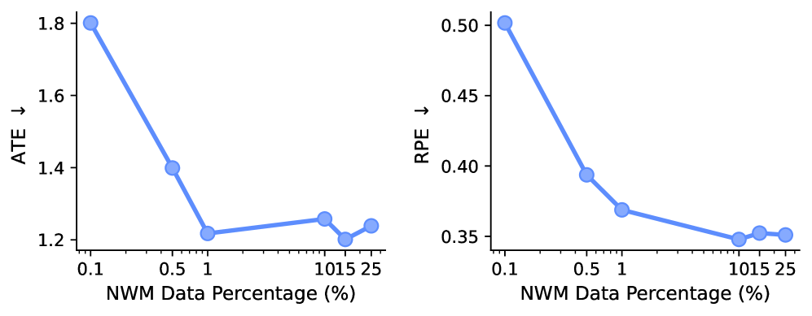{ width="820" }

*原论文 Figure 13。横轴是 NWM tokens 在整个 200B-token 训练预算中的比例。ATE 在约 1% 后趋于平缓，RPE 仍有一些继续下降，不能把平台描述成所有指标完全不变。*

ATE 到 1% 左右已经约为 1.22，之后大致在 1.2 附近变化；RPE 在 1% 附近约为 0.37，增加到更高比例还可下降到约 0.35。它说明在这个预训练分布和导航任务中，专用数据的边际收益较快变小。按 200B 总量换算，1% 仍然是约 2B tokens，而且实验没有一个完全零 NWM 的对照。因此它支持“通用预训练提供相当一部分基础能力，少量相对占比的数据可建立领域联系”，不支持任何机器人、任何传感器都只需 1% 样本即可适配。

### 自由语言控制是有价值的示例，但尚不是控制成功率

论文还展示 WASD 与自然语言命令交替控制未来帧。坐标采用机器人自身坐标系，$+x$ 向前、$+y$ 向左，yaw 逆时针为正。W 和 S 的归一化动作分别为 $(+0.5,0,0)$、$(-0.5,0,0)$；A 和 D 分别为 $(+0.2,0,+0.5)$、$(+0.2,0,-0.5)$。A/D 因而包含少量向前移动并左转、右转，不能读成左右横移。

更有意思的是“get out of the shadow”“go on the road”“take big steps forward”等命令。模型能把这些文字接到视觉状态预测中，展示训练动作格式之外的语义控制。附录 Figure 35 给定同样的四帧上下文，再用不同命令生成不同未来，因此比单条漂亮视频更直接地体现条件的作用。

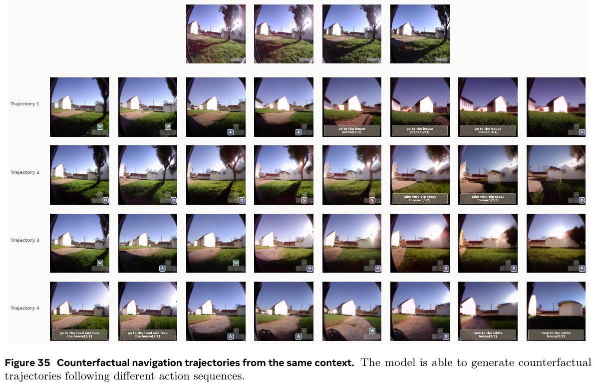

*原论文 Figure 35。上方四帧对各条轨迹相同，下方不同动作序列使视角沿不同路线变化。应比较相同起点下的分歧，不能把某一条轨迹当作已验证的真实环境转移。*

这些展示支持模型可以把语义与局部视觉变化联系起来，但并未给出自由语言控制的统一成功率、长期几何一致性误差或真实机器人试验。其“zero-shot”侧重未专门为这些具体命令做导航训练，并不表示预训练阶段从未出现 text-action 数据。理解这一层边界，才便于判断下一步应用要补的是语言命令解析、动作标定，还是长时间预测和规划验证。

## MoE 研究的两根调节轴，专家粒度与总容量

### 为什么固定模态 FFN 还不够

文本、视觉需要不同的变换，最简单的做法是各给一个 FFN。但它事先决定了两类模态的容量分配，也无法根据当前内容临时调整参数使用。MoE 将 FFN 分成许多 experts，由 router 为每个 token 选择其中的一部分，使主干既能保留共享 attention，也能让不同输入拥有不同计算路径。

“更多专家”其实有两种不同操作。第一种是在总容量和激活计算量大致不变时，把专家切得更细，再增加每个 token 激活的数量；第二种保持每个专家的宽度与激活数量不变，只扩大可供选择的专家池。前者研究组合的粒度，后者研究稀疏容量。如果混为一谈，就无法解释收益到底来自更细的路由，还是更大的参数储备。

这两组结构研究采用约 57B training tokens，数据为 50% DCLM 和 50% SSTK。附录中的稀疏实验使用 64 张 NVIDIA H200、8 个节点，训练 27,248 steps，全局 batch 为 512 条长度 4096 的序列，约 2M tokens。主干有 16 层，$d_{\mathrm{model}}=2048$，GQA 使用 32 个 query heads 和 8 个 key-value heads。这些设置不同于后面 1T tokens 的专家行为分析，应分别阅读。[↗](https://arxiv.org/pdf/2603.03276v1#page=35)

### 更细专家何时有用，何时不再有效

论文定义 expert granularity 为

$$
G=\frac{4d_{\mathrm{model}}}{d_{\mathrm{expert}}}.
$$

其中 $d_{\mathrm{expert}}$ 是单个 expert 的内部宽度，分子给出相对主干宽度的参考尺度。增大 $G$ 意味着专家变窄；为了保持每个 token 的激活计算量，router 同时选取更多专家。实验把总参数维持在约 13.5B、激活参数约 1.5B，比较下面这组组合。[↗](https://arxiv.org/pdf/2603.03276v1#page=12)

| Granularity G | Expert width | Total experts | Active experts per token |
| ---: | ---: | ---: | ---: |
| 1 | 8192 | 16 | 1 |
| 4 | 2048 | 64 | 4 |
| 16 | 512 | 256 | 16 |
| 32 | 256 | 512 | 32 |
| 64 | 128 | 1008 | 64 |

最后一行按理想构造对应 1024 experts，实际实现因 TorchTitan 约束使用 1008，因此这些“固定容量”是近似而非逐参数完全相等。这个细节不会改变研究问题，但在估算真实模型规模时需要保留。

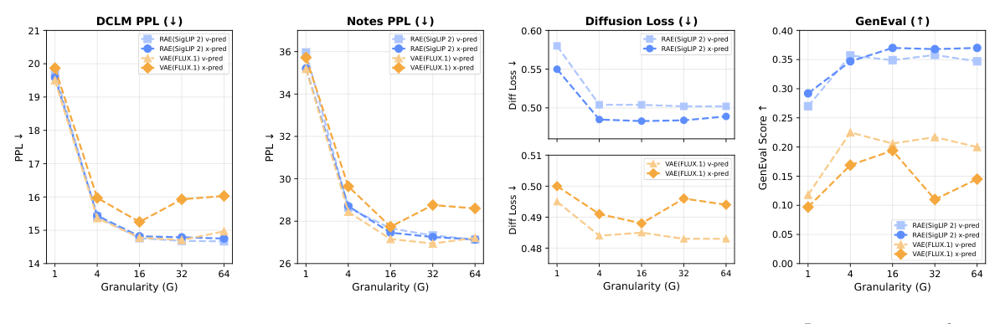

*原论文 Figure 15。先在同一表示、同一预测目标内沿横轴读粒度变化，再比较 RAE/FLUX 与 x-pred/v-pred。若直接把全部曲线看成同一变量，就会漏掉 FLUX x-pred 在高粒度下的语言退化。*

语言困惑度从 $G=1$ 到 $G=16$ 明显下降，之后多数配置趋于平缓；视觉 diffusion loss 的主要收益更早出现，通常到 $G=4$ 左右已经获得大部分改善。生成分数仍可能在个别配置中继续变化，所以“视觉在 4 完全饱和”也是过度概括。作者最终采用 $G=16$，是在两类任务收益与后续实验统一性之间作选择。

预测目标与表示的相互作用尤其明显。SigLIP 2 RAE 下，x-pred 的 GenEval 整体优于 v-pred；FLUX VAE 下，v-pred 更稳定，而 x-pred 在 $G=32$、64 时会出现明显的语言 PPL 反弹，生成分数也更差。因此 x-pred 并非所有 latent 都适用的通用改进。作者提出一种解释，窄专家与视觉表示的有效结构可能存在相互作用，但这仍是对曲线的机制猜测，并没有直接测出表示流形秩并建立完整因果证明。

### 固定激活 16 个专家，再扩大专家池

第二组实验固定 $d_{\mathrm{expert}}=512$、top-k=16，让总专家数从 32 增至 1008。一个 token 每次使用的专家规模基本相同，却有更多候选路径可选。Table 5 将“激活量接近”与“总参数增长”放在一起，正好能避免将稀疏扩容理解成没有存储成本的免费升级。

| Configuration | Total Params | Active Params |
| --- | ---: | ---: |
| Dense Baseline | 1.50B | 1.50B |
| E = 32 | 2.30B | 1.50B |
| E = 64 | 3.92B | 1.50B |
| E = 128 | 7.14B | 1.50B |
| E = 256 | 13.59B | 1.51B |
| E = 512 | 26.48B | 1.52B |
| E = 1008 | 51.46B | 1.53B |

激活参数也有小幅增长，因为 router 随专家池扩大而增加。更加实际的差异还包括参数内存、通信、专家之间 token 数不均匀造成的空闲与拥塞；论文在 limitations 中也把负载不均衡列为硬件利用率的瓶颈。因此文中固定 compute 的主张主要针对近似激活 FLOPs，并未建立严格相等的 wall-clock 训练时间或推理延迟。[↗](https://arxiv.org/pdf/2603.03276v1#page=36)

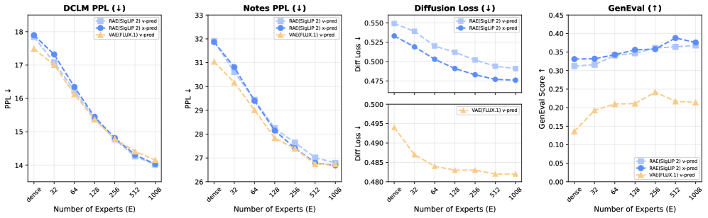{ width="820" }

*原论文 Figure 16。语言 PPL 随专家池扩大持续改善；视觉损失也整体下降，但最右侧 GenEval 曲线并非处处单调。总容量、训练损失和具体生成 benchmark 应同时查看。*

这里最稳定的收益是语言困惑度下降。视觉侧则依表示而异，RAE 的 diffusion loss 继续从更大容量获益，FLUX VAE 的下降更早变得缓慢。Figure 17 的训练曲线进一步支持这点，它让人看到差别发生在训练过程中，而非仅在最后一个 checkpoint 上。

与此同时，GenEval 并不随专家数严格递增。RAE x-pred 在 512 experts 附近约为 0.39，扩大到 1008 后略降；FLUX v-pred 在 256 附近达到约 0.24，再继续增加专家也没有保持上升。这不否定稀疏扩容的总体价值，却说明训练损失改善不能直接替代下游生成质量。若实际任务最在乎组合属性生成，选择容量时仍需验证该任务，而非只看 diffusion loss。

### 是否需要一组永远激活的共享专家

第三个消融固定 256 个总专家、每 token 激活 16 个，比较三种 routing 方式。No Shared Expert 从完整专家池选 top-16；Global Shared Expert 固定激活一个共享专家，再从其余 255 个选 top-15；Per-Modality Shared Expert 分别指定一个文本共享专家和一个视觉共享专家，每个 token 激活匹配其模态的那个，再从其余 254 个选 top-15。

| Configuration | DCLM PPL ↓ | Notes PPL ↓ | Diff. Loss ↓ | GenEval ↑ |
| --- | ---: | ---: | ---: | ---: |
| No Shared Expert | 14.802 | 27.392 | 0.484 | 0.360 |
| Global Shared Expert | 14.794 | 27.249 | 0.483 | 0.364 |
| Per-Modality Shared Expert | 14.785 | 27.161 | 0.483 | 0.367 |

按模态共享专家在这组指标上最好，说明保留一个稳定的模态基础路径，再让其余容量动态选择，是一种可行设计。但提升幅度很小，论文未在这张表中给出多次运行方差或置信区间，因此更适合把它看作支持该配置的细粒度消融，不能把 0.003 的 GenEval 差距扩大成决定性的架构胜负。[↗](https://arxiv.org/pdf/2603.03276v1#page=14)

## 路由分析，模型究竟怎样分配专家

### “文本专家”是如何定义出来的

前面的 MoE 结构实验只有 57B tokens。为了观察充分训练后的分工，作者另用一个 1T-token 模型分析路由。该模型使用 SigLIP 2、x-pred、$G=16$、256 experts 和模态共享专家，训练混合为 50% 文本、25% 视频、22.5% 图文、2.5% 动作数据。分析使用 held-out DCLM 文本和 CC12M 图像，记录各 expert 被选中的次数。[↗](https://arxiv.org/pdf/2603.03276v1#page=36)

如果模态 $m$ 一共包含 $N_m$ 个 tokens，专家 $i$ 被选中 $C_m^{(i)}$ 次，每个 token 选择 $k=16$ 个专家，则论文定义

$$
R_m^{(i)}=\frac{C_m^{(i)}}{N_m k},\qquad
S_i=\frac{R_{\mathrm{text}}^{(i)}-R_{\mathrm{image}}^{(i)}}
{R_{\mathrm{text}}^{(i)}+R_{\mathrm{image}}^{(i)}}.
$$

$R$ 按全部路由选择次数归一化，可以理解为该专家占该模态路由选择的份额。严格来说，某个 token 激活该 expert 的边际概率应是 $C/N$，而不是再除以 $k$；不过相同的 $k$ 会在 $S_i$ 中抵消，所以不影响后续模态偏好分类。

若 $S_i>0.5$，文本选择率超过图像选择率三倍，被称为 Text Expert；若 $S_i<-0.5$，称为 Vision Expert；中间区域称为 Multimodal Expert。这里“多模态”意味着两者选择率相差不超过三倍，不意味着两个模态必定使用得完全一样多。

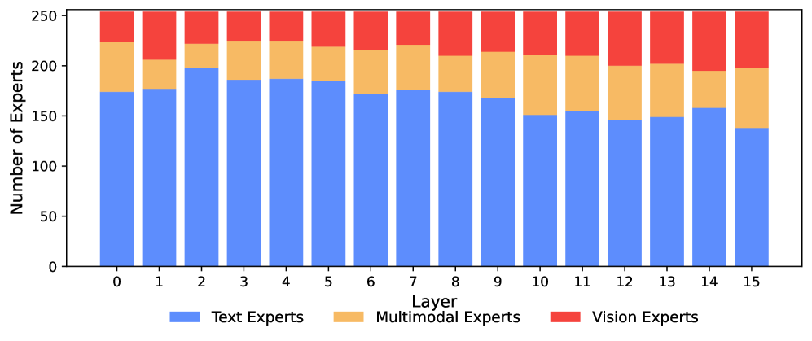{ width="820" }

*原论文 Figure 18。每层柱子的总高度对应专家池，蓝色是偏文本专家，黄色是多模态专家，红色是偏视觉专家。沿深度比较比例，比只看某一层更能体现分工变化。*

多数专家偏文本；网络后部，视觉和多模态专家的比例相对增加。作者据此提出先分别处理、再在深层整合的解释。这与文本需要更多参数容量、视觉更依赖数据的后续 scaling 观察相呼应，但路由统计本身只证明使用偏好存在。它不能直接证明某一层“负责几何”、另一层“负责推理”，也没有通过删除特定专家来验证这些功能归因。

### 视觉专家是否再分成去噪早期、晚期，或者理解与生成两类

一种自然的猜测是，高噪声阶段主要确定整体语义，低噪声阶段主要修复细节，因此它们会调用不同视觉专家。作者把 diffusion 时间分为 10 个区间，计算专家选择率随时间变化的 coefficient of variation。Figure 19 中该值主要聚集在约 0.15，意味着时间专门化不强。可以说同一批视觉专家跨噪声水平反复参与计算，但不能说每一步的路由完全相同。

另一种猜测是，模型虽然共享视觉 latent，caption 理解和图像生成仍会各用一套专家。Figure 20 分别测量 image-to-text 时视觉 token 的专家选择率与 text-to-image 去噪时的选择率。每个点代表一个专家，若两个任务都偏好它，点就接近对角线。

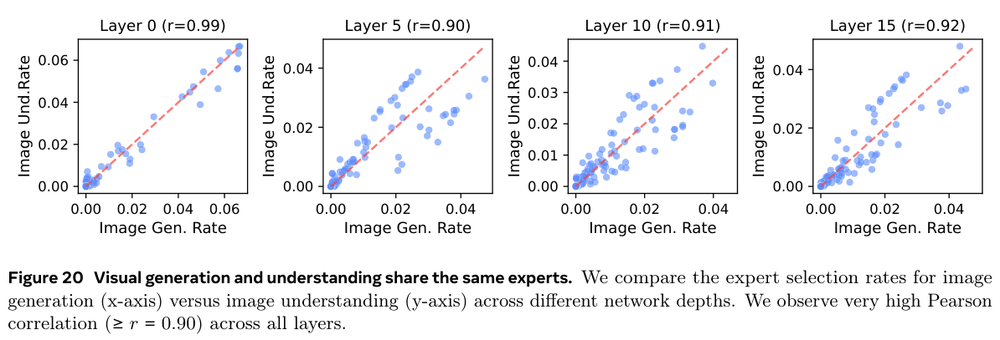

*原论文 Figure 20。图示第 0、5、10、15 层的 Pearson correlation 分别为 0.99、0.90、0.91、0.92。对角线附近的集中趋势说明专家使用频率高度相关。*

这一结果比“两个任务都经过同一主干”更具体，它表明 learned routing 也倾向让理解与生成共享视觉处理容量。共享率高支持统一表示的合理性，但相关性不等于两个任务每个 token 使用完全相同的专家，也不等于内部激活和计算内容相同。这里的贡献是找到可观察的参数使用联系，而非证明理解与生成已经成为同一个任务。[↗](https://arxiv.org/pdf/2603.03276v1#page=15)

## 把设计叠起来，收益与取舍是否还在

单项消融的好选择放到一起，可能相互抵消，因此论文另做逐步叠加设计的比较。各配置使用相同训练超参数、数据、tokens 和激活 FLOPs，先比较共享 FFN 与模态 FFN，再比较视觉编码器、参数分离方式和预测目标。它仍然不保证总参数或显存占用相同。

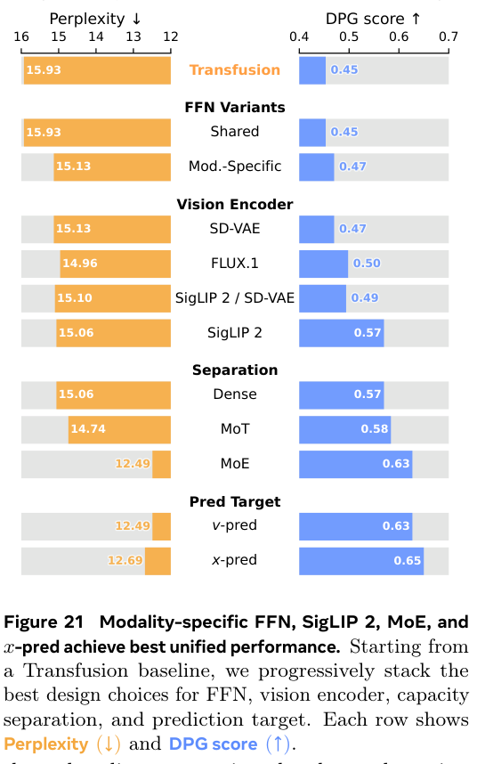

*原论文 Figure 21。左侧 perplexity 越低越好，右侧 DPG 越高越好。每个小组内部才是直接设计对照，不能把所有相邻行都当成只改变同一个变量。*

| Comparison | Configuration | Perplexity ↓ | DPG score ↑ |
| --- | --- | ---: | ---: |
| FFN Variants | Shared | 15.93 | 0.45 |
| FFN Variants | Mod.-Specific | 15.13 | 0.47 |
| Vision Encoder | SD-VAE | 15.13 | 0.47 |
| Vision Encoder | FLUX.1 | 14.96 | 0.50 |
| Vision Encoder | SigLIP 2 / SD-VAE | 15.10 | 0.49 |
| Vision Encoder | SigLIP 2 | 15.06 | 0.57 |
| Separation | Dense | 15.06 | 0.57 |
| Separation | MoT | 14.74 | 0.58 |
| Separation | MoE | 12.49 | 0.63 |
| Pred Target | v-pred | 12.49 | 0.63 |
| Pred Target | x-pred | 12.69 | 0.65 |

共享 FFN 改成模态 FFN 后，两个指标同时改善，支持最基础的模态分离。编码器比较中，单 SigLIP 2 的生成分数明显更高，双编码器 SigLIP 2 / SD-VAE 并没有在这里超过单语义表示。但 FLUX.1 的语言 PPL 14.96 低于 SigLIP 2 的 15.06，因此选择 SigLIP 2 体现的是更好的联合表现，尤其是生成收益，并非两个指标逐一严格最优。

固定 SigLIP 2 后，MoE 相比 Dense 和 MoT 同时降低语言 PPL、提高 DPG，这支持 learned routing 在该从头预训练实验中的优势。最后一步由 v-pred 改为 x-pred 时，DPG 从 0.63 升到 0.65，PPL 却从 12.49 升到 12.69。若只引用生成分数，就会把一次偏向视觉的取舍写成全面改善。对于需要较强语言建模的系统，保留 v-pred 仍然有合理依据；不能只按论文最终组合抄配置。[↗](https://arxiv.org/pdf/2603.03276v1#page=16)

Figure 22 又把评价推进到 WISE，检查生成图像是否体现生物、化学、文化、物理、空间、时间等知识。semantic encoder 的总体成绩约为 VAE 路线的 3—4 倍，MoE 总体最好，这与“语言知识能够进入视觉生成”的目标相符。不过 Space 类别中单 SigLIP 2 与 MoE 的关系并不支持“MoE 每类都最好”。同时，WISE 的知识条件生成能力也不能替代导航动力学精度，二者检验的是不同能力。

## 视觉更需要数据，这个判断怎样从 IsoFLOP 实验得到

### 同样预算下，模型变大为什么不一定更好

只看更大模型、更长训练的结果，很难区分模型容量与数据量。IsoFLOP 实验固定总计算预算 $C$，改变参数量 $N$ 和训练 tokens $D$。对于 dense 模型，作者用近似关系 $C\approx6ND$ 理解预算分配，实际 FLOPs 通过 TorchTitan 估计；MoE 则使用激活参数 $N_{\mathrm{active}}$。在固定 $C$ 下，选择更大的模型就意味着能处理的数据更少，选择较小模型则可以训练得更久。[↗](https://arxiv.org/pdf/2603.03276v1#page=17)

对于每个预算，作者分别测量语言与视觉 validation loss，在 log-parameter 空间拟合一条抛物线，取其最低点得到该预算下的 $N_{\mathrm{opt}}$。再将不同预算的最优点连接起来，拟合

$$
N_{\mathrm{opt}}\propto C^a,\qquad
D_{\mathrm{opt}}\propto C^b,\qquad a+b=1.
$$

$a$ 越大，预算增长时越倾向扩大参数；$b$ 越大，则越倾向增加数据。这里的“语言”和“视觉”首先是各自验证损失意义下的最优点，不表示它们各自拥有完全独立、互不影响的网络。统一模型的一组参数与训练预算，可能无法同时落在两类目标各自的最优位置上，这正是论文希望揭示的不对称。

### Dense 模型的两种最优增长速度

Dense 实验实际扫描的预算为 $6\times10^{18}$、$6\times10^{19}$、$3\times10^{20}$、$6\times10^{20}$、$10^{21}$ FLOPs。语言与视觉的拟合结果为

| Modality | Model scaling | Data scaling |
| --- | --- | --- |
| Language | $N_{\mathrm{opt}}\propto C^{0.47}$ | $D_{\mathrm{opt}}\propto C^{0.53}$ |
| Vision | $N_{\mathrm{opt}}\propto C^{0.37}$ | $D_{\mathrm{opt}}\propto C^{0.63}$ |

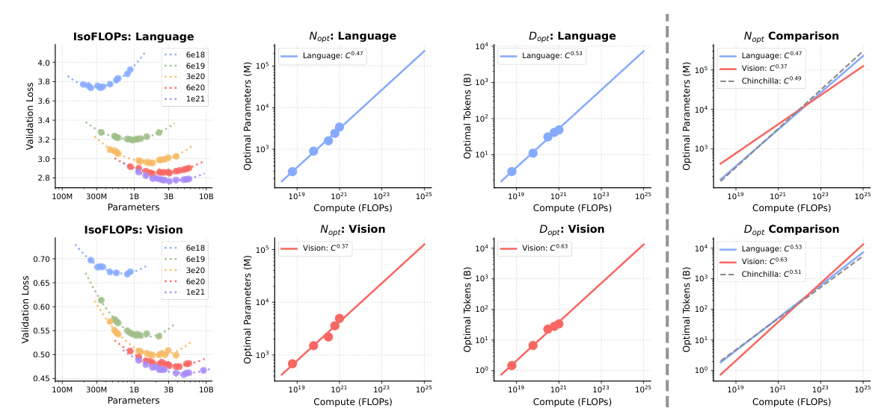

*原论文 Figure 23。左侧每种颜色表示一个固定预算，曲线最低点给出该预算的最优模型规模；中间是这些最优点的幂律拟合，右侧比较语言与视觉的斜率。圆点附近是实测范围，延长直线是外推。*

语言的参数指数与数据指数较接近，视觉则明显偏向数据。用一个直观解释性计算，预算扩大十倍时，这个拟合建议语言最优参数约扩大 $10^{0.47}\approx2.95$ 倍、数据约扩大 3.39 倍；视觉最优参数约扩大 2.34 倍、数据约扩大 4.27 倍。它表达的是两种模态的资源需求增长速度不同，并不自动给出某个项目应该采用的绝对数据配比。

论文进一步消去计算量，把最优数据量写成模型规模的函数

$$
D_{\mathrm{opt}}\propto N_{\mathrm{opt}}^{b/a},\qquad
\frac{D_{\mathrm{vision,opt}}}{D_{\mathrm{language,opt}}}
\propto N^{\,0.63/0.37-0.53/0.47}
\approx N^{0.57}.
$$

这一步的意义是，对于不断扩大的模型，视觉数据的相对需求增长更快。以 1B 参数处的相对需求为归一化基准，作者将拟合外推到 100B 和 1T 参数，得到约 14 倍和 51 倍的相对需求增长。这里有两层限定。第一，倍数描述相对于基准的增长，并不是断言训练数据的绝对比例就是视觉∶文本=14∶1 或 51∶1；第二，这些大尺度点来自幂律外推，图中并没有实际训练一个 100B 或 1T 参数模型来验证它们。[↗](https://arxiv.org/pdf/2603.03276v1#page=18)

在应用上，这个趋势提示只照搬语言模型的参数、数据扩展方式，视觉可能相对欠训练；若一直补视觉数据，又可能让语言在自身最优点之后继续消耗训练预算。它为 MoE 的容量分配提供了动机，但不能把当前拟合当成跨数据集、跨编码器和跨规模都不变的定律。

### MoE 缩小了差距，但没有使两类模态完全相同

MoE 的 scaling 实验固定总专家数与每 token 激活专家数之比为 16，采用整个模型的激活参数作为 $N$。这个专家数量比不等于整个模型的总参数与激活参数之比，因为 attention 等共享部分也计入参数。实际预算包括 $2\times10^{19}$、$4\times10^{19}$、$6\times10^{19}$、$2\times10^{20}$、$6\times10^{20}$ FLOPs，得到另一组指数。

| Modality | Active-model scaling | Data scaling |
| --- | --- | --- |
| Language | $N_{\mathrm{active,opt}}\propto C^{0.41}$ | $D_{\mathrm{opt}}\propto C^{0.59}$ |
| Vision | $N_{\mathrm{active,opt}}\propto C^{0.36}$ | $D_{\mathrm{opt}}\propto C^{0.64}$ |

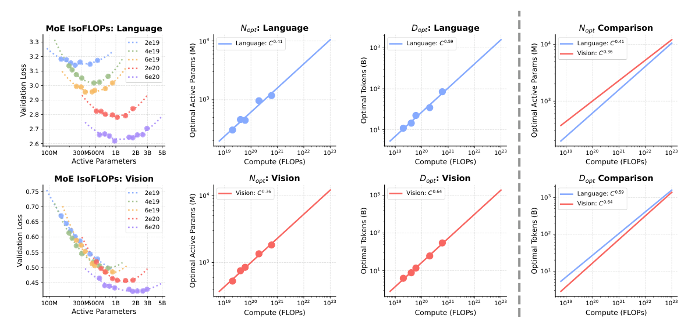

*原论文 Figure 25。横轴模型规模改为 Active Parameters。视觉与语言的数据指数相差 0.05，小于 dense 的 0.10，但两条拟合线仍有不同斜率。*

MoE 给每个 token 提供较大的可选参数池，同时维持相对较低的激活计算。这种机制与实验中的不对称相适配，语言可以拥有更多专门容量，视觉不必为这些总参数付出逐 token 全部计算的成本。观察上，数据指数差距从 0.63−0.53=0.10 缩小到 0.64−0.59=0.05；参数指数的差距也从 0.10 缩小到 0.05。

不过它没有证明不对称已经消失，也没有证明继续提高任意 sparsity 都会持续缩小差距。稀疏结构还受路由质量、专家负载和通信影响。图中 dense 拟合延伸至 $10^{25}$ FLOPs、MoE 延伸至 $10^{23}$ FLOPs，这些延长部分超出当前实测预算，应该作为趋势假设，而非现成的大规模实验结论。

## 总计算量匹配后，统一训练是否值得

前面的 520B text + 520B multimodal 对 520B text-only 只能控制文本暴露量。论文最后比较相同 FLOPs 下的多模态与单模态模型，才直接触及同一训练预算如何使用。作者用

$$
L(C)=A C^{-\alpha}+E
$$

拟合损失与计算量的关系，其中 $E$ 是不可约损失项，通过网格搜索选取，使 log-space 拟合误差最小。扣除这一项是为了避免把接近损失下限时的曲线形状误认为普通幂律斜率。拟合还用于组织不同预算结果，不能让实际对照的具体数值消失。[↗](https://arxiv.org/pdf/2603.03276v1#page=18)

在 $10^{21}$ FLOPs 的 dense 比较中，统一模型与 Text-Only、T2I-Only 的结果如下。

| Evaluation | Dense Multimodal | Unimodal baseline | Baseline type |
| --- | ---: | ---: | --- |
| Notes PPL ↓ | 23.7 | 23.8 | Text-Only |
| DCLM PPL ↓ | 13.3 | 13.6 | Text-Only |
| DPG score ↑ | 0.622 | 0.598 | T2I-Only |
| COCO FID ↓ | 39.3 | 41.5 | T2I-Only |

这组结果支持联合训练在同计算预算下能够同时维持语言表现、改善生成，尤其避免了仅仅因为多训练一倍 tokens 才获益的解释。Notes 的差距只有 0.1，应该描述为接近或略优，而不应与更明显的生成收益一起夸大为所有任务的大幅进步。

MoE 的同类比较更接近。论文在 $10^{21}$ FLOPs 报告多模态 DCLM PPL=12.3，MoE Text-Only=12.0；FID 分别为 39.2 与 MoE T2I-Only 的 39.8。也就是说，语言有轻微代价，生成有小幅收益。最终可以说稀疏统一模型在同预算下接近两个单模态模型的表现，并保留跨模态接口与知识迁移能力，不能说它在两个方向都严格胜过单模态。[↗](https://arxiv.org/pdf/2603.03276v1#page=19)

这也解释了为什么统一训练的价值不能只压缩为“损失是否全面更低”。如果任务需要读图、写图、根据动作推演未来，并让这些过程共享上下文，一个模型提供完整接口本身就有用途。但在实际选择时，仍应把接口收益与语言性能、视觉细节、模型存储和规划延迟分别衡量。

## 训练设置与一个有取舍的损失平衡方法

### 哪些配置可直接作为复现实验的起点

附录给出的默认预训练设置相对简洁。sequence length 为 4096，128 GPUs，每 GPU batch size=4，全局约 2M tokens/step；AdamW peak learning rate 为 $3\times10^{-4}$，warmup 1000 steps，然后 cosine decay 到 peak 的 5%。总步数由该实验族的 token budget 决定。它说明作者尽量固定训练配方来比较设计，而没有为每个条件单独进行大量超参数搜索。[↗](https://arxiv.org/pdf/2603.03276v1#page=34)

| Stage / experiment | Main setting | Purpose |
| --- | --- | --- |
| Default pretraining | 4096 context; 128 GPUs; 4 sequences/GPU; ≈2M tokens/step | 为主要比较提供统一训练配方 |
| Optimizer schedule | AdamW; peak LR $3\times10^{-4}$; 1000 warmup; cosine to 5% | 保持各消融的优化条件可比 |
| Visual objective | language:flow weight 1:3; frame-wise independent noise | 联合学习文字与连续视觉状态 |
| Image inference | 25 Euler steps; CFG 3.0; 10% conditioning dropout in training | 固定生成评测的采样条件 |
| VQA finetuning | Cambrian-7M, 1 epoch; 64 GPUs; peak LR $10^{-5}$ | 统一评估预训练表示的下游适配能力 |
| MoE sparsity sweep | 57B tokens; 64 H200; 27,248 steps | 分离专家池容量与激活计算量 |
| Expert analysis | 1T tokens; 50/25/22.5/2.5 text/video/image-text/action | 观察充分训练后的路由偏好 |

这些配置的用途首先是建立可解释的对照。主实验中冻结视觉编码器、使用预训练 decoder、较短的 4096 context、固定采样器，都使研究更容易控制变量，但它们也限定了所展示的能力。比如原图细节可能受 decoder 限制，长时间世界预测还受到上下文与逐帧误差累积的约束。论文并未通过这些设置证明高分辨率长视频和长期闭环控制已经解决。

### Loss centering 为什么值得看，又为什么不能只抄公式

不同视觉表示产生的 flow loss 数值尺度可能差很多。若固定使用同一权重，某个表示的视觉梯度可能压过语言，另一个表示的视觉目标又可能相对弱。因此附录 D.2 讨论了动态调整权重的 loss centering，它属于额外优化探索，并非所有主结果默认都采用的设置。

论文先用当前两类损失形成一个中心，再取其指数移动平均

$$
c_{\mathrm{current}}
=\alpha\mathcal L_{\mathrm{flow}}+(1-\alpha)\mathcal L_{\mathrm{LM}},\qquad
c_{\mathrm{target}}\leftarrow
\mu c_{\mathrm{target}}+(1-\mu)c_{\mathrm{current}}.
$$

随后给两项损失分配权重

$$
w_{\mathrm{flow}}=\frac{c_{\mathrm{target}}}{\mathcal L_{\mathrm{flow}}},\qquad
w_{\mathrm{LM}}=\frac{c_{\mathrm{target}}}{\mathcal L_{\mathrm{LM}}}.
$$

直观上，当前数值较大的损失会得到较小系数，使两个目标的量级接近一个缓慢变化的中心。但这里必须区分用于调权的统计量与参与求导的训练损失。如果完全按代数式把即时损失作为可求导分母，再乘回同一个损失，两者会约掉；因此实现时如何处理梯度、统计量更新和数值稳定性非常关键，论文这段没有提供足以确定这些操作的完整细节。

另外，按打印出的式子，两项加权损失的数值都等于 $c_{\mathrm{target}}$，$\alpha$ 影响的是共同中心；仅由这些式子不能推出它直接、独立控制视觉相对于语言的权重比例。将这种方法直接解释成一个明确的“偏视觉旋钮”，会比公式本身多走一步。更稳妥的用法是将它视为损失尺度自适应的思路，并结合真实实现检查梯度处理。[↗](https://arxiv.org/pdf/2603.03276v1#page=33)

实验结果也显示了取舍，而非无条件改善。

| Encoder | DPG without centering ↑ | DPG with centering ↑ | PPL without centering ↓ | PPL with centering ↓ |
| --- | ---: | ---: | ---: | ---: |
| SigLIP 2 | 0.570 | 0.612 | 15.06 | 15.36 |
| FLUX.1 | 0.498 | 0.510 | 14.96 | 15.14 |
| SD-VAE | 0.470 | 0.480 | 15.13 | 15.35 |

三种编码器的图像生成分数都提高，语言 PPL 也都变差。它说明动态平衡可以把训练结果推向更好的视觉表现，但没有消除两个目标之间的资源取舍。与 x-pred 的结果一起看，本文的实用结论应是联合模型存在可调的语言、视觉性能关系，而非一套配置可以同时让所有指标最优。

## 这篇研究给世界模型训练留下了什么

本文真正可复用的是一条清楚的构建路径。先用能兼顾语义与重建的视觉表示，把文本、图像、视频放入同一序列；以文本交叉熵和帧级 flow matching 建立统一预测能力；通过图文和动作数据分别补足跨模态对应与可控转移；再用稀疏专家扩大可选容量，并用计算量匹配的实验决定是否值得。这条路径把“世界模型”落到具体输入、输出、监督和规划接口上，比仅展示一段可控视频更便于后续研究检验。

它也给出几种具体的实验设计习惯。比较数据时，同时保留相同领域暴露量和相同总预算的对照；比较编码器时统一视觉 token 数，但记录分辨率与预训练组件差别；比较 MoE 时同时报告总参数和激活参数；解释 scaling 时把实测点与外推分开；报告可控生成时，再加一个真正使用预测的任务评价。这些做法能减少把训练量、初始化知识、模态接口与模型能力混为一谈的机会。

剩下的问题也能从证据直接看出来。语义 latent 在高层更难重建细节，提示表示设计尚未同时解决语义与像素保真；导航只证明当前数据与短预测范围内的转移和规划价值，长期几何一致性与真实闭环控制还需要新实验；MoE 的有效容量必须经过硬件负载与通信检验；视觉、语言的最优 scaling 虽然更接近，却仍没有完全重合。后续工作的重点因此可以具体落在更好的视觉表示、可测的长期控制、以及与真实系统成本相符的容量分配上。

最值得带走的认识是，统一多模态预训练确实能把语言、视觉生成和动作条件预测放入一个可训练接口，并在多组受控实验中产生互补收益；这些收益又并非对所有表示、所有数据、所有指标一概成立。保留这些条件，才使本文从一组设计建议变成可以继续验证、修改和扩展的研究基础。
